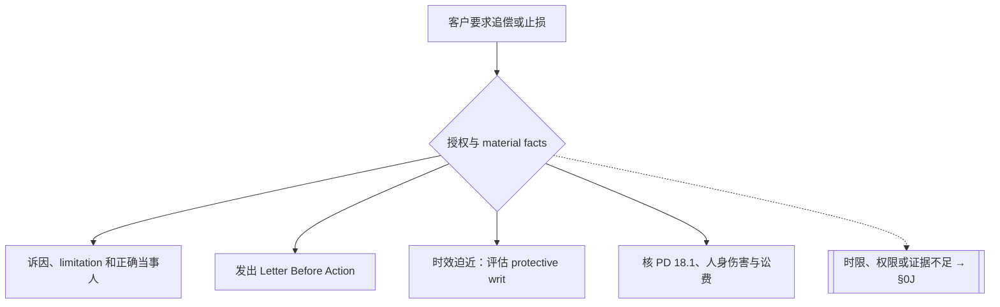
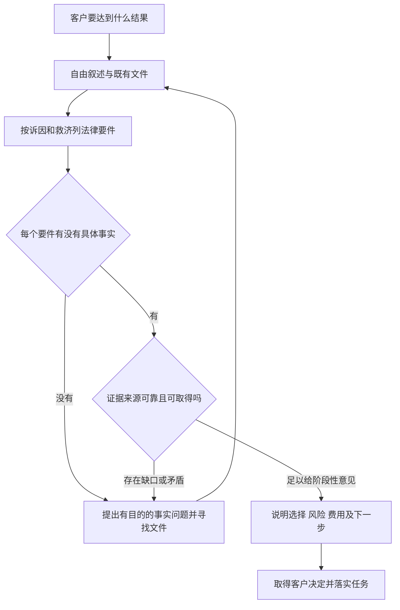
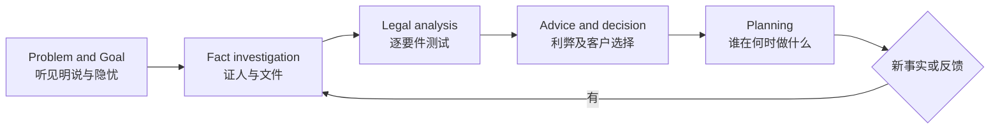
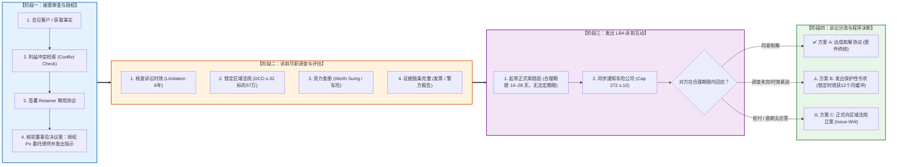
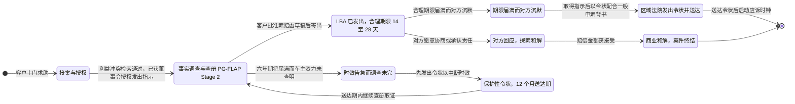
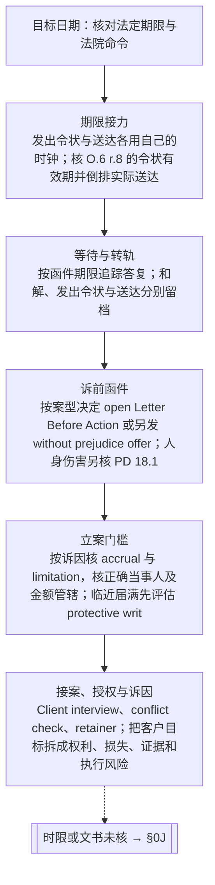
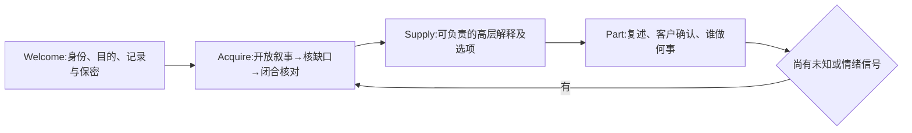

# [CO01] Taking Instructions, Pre-Action Conduct & Drafting LBA

## 速读定位层

> 本层为 2026-10-10 §18 整卡重构新增的开篇导引（同日 [LG01-02] Supplement 并主）。各环节的规则、条件、例外与逐条引注见下方 0B–0K 各深节；溯源库与修订日志在文末审计区。正文中残留的旧编号按此对照读：§一→0B、§二→0C、§三→0D、§四→0E、§五→0F、§六→0G、§七→「七、 往届真题与期末考点回溯」；原 Supplement 0A 深节已并入 0B（0A.4 记录格式→0B.3、0A.5 意见分界→0B.4、0A.6 功能性段落→0E.1）。

### 适用范围

**覆盖（按程序时序）**——从客户进门到令状发出前的完整「接案 → 诉前」链：
1. **接案会见与取指示（LG2）**：面谈议程（故事→澄清→意见→下一步）、open→semi-closed→closed 漏斗提问、建议前须事实齐备、意见与决定分界、费用与讼费风险告知（Solicitors' Guide Principal 4.01）、SCIA 考核取向。 <small style="opacity: 0.55">〔LG2V L173 "stage to establish the objectives of the interview. It is"；LG2V L195 "You must not start giving the client your"；LG2V L479 "4.01 INFORM CLIENT ABOUT COSTS"〕</small>
2. **接案审查与授权**：利益冲突检索、Retainer、公司客户的董事会书面决议——授权谁委托律师、谁代表公司给指示。 <small style="opacity: 0.55">〔📄BATCH-A p.33 "THAT solicitors be instructed to act on behalf of the Company"；📄BATCH-A p.33 "THAT George Po be authorised to represent the Company to give instructions"〕</small>
3. **诉前尽职调查**：PG-FLAP 五阶段、五层案情分析（area→cause of action→ingredients→material facts→evidence）、八项查册／取证手段（车辆登记、商业登记、公司注册处、裁判法院控罪书（MO s.35A(1)(h)）、私营查册代理、土地查册、破产清盘查册、CCTV／员工供词／损毁证据保存）。 <small style="opacity: 0.55">〔LG1V L325 "The 5-stage Process Model of Legal Problem Solving (PG-FLAP)"；LG1V L195 "the material facts for each legal ingredient"〕</small>
4. **程序三核验**：管辖（SCT ≤HK$75,000／DC ≤HK$3 million（净额）／CFI $3 million 以上＋DCO s.43(3) 移交）、时效（Cap. 347：合同与一般侵权 6 年、盖印契约 12 年、人身伤害 3 年）＋保护性令状（O.6 r.8 十二个月送达期）、当事人适格（独资／合伙 O.81／公司 O.5A r.2／直接受损主体／共同被告 O.15 r.4）。 <small style="opacity: 0.55">〔INTRO1 L147 "Money claims: up to $3 million: DC Ordinance (Cap.336)"；INTRO2 L100 "Other tort claims (e.g. nuisance, trespass to land, conversion): 6 years from when the damage was sustained"；INTRO3 L114 "Validity of a writ: 12 months from the date of issue: O.6 r.8(1)"〕</small>
5. **LBA 起草与发出**：六段结构写法、双版本完整范本、合理期限 14–28 天（无法定答复期）、PD 18.1 仅限人身伤害、O.62 r.5(1)(e)/(2)(d) 诉前行为进入讼费裁量。 <small style="opacity: 0.55">〔LG1V L431 "Reasonable time limit: 14 – 28 days"；LG1V L407 "Generally “no”; Exception: Personal Injury claims (see Practice Direction 18.1)"〕</small>
6. **等待回应与分流决断**：对方沉默无程序后果；和解终结／保护性令状锁时效／正式向区域法院立案。 <small style="opacity: 0.55">〔LG1V L433-L435 "What if the other side fails to respond to a letter before action … No specific implications"〕</small>
7. **攻防与 SG 应用**：七大红线与 0B 后果总表、SG01（起草 LBA）／SG02（SCIA 面谈）／SG03（面谈所得转 SoC）挂接、材料矩阵与 open 待补（见 0B／0C 与文末 open 块）。

**不覆盖（边界声明，相关主卡承担）**：① 送达与认收 AOS（→ [CO03 送达与 AOS 卡](%5BCO03%5D%20Service%20and%20AOS.md)）；② 诉答文书起草、修改与剔除本体（→ [CO04-05 诉答卡](./%5BCO04-05-10%5D%20Pleadings,%20Defence,%20Counterclaims%20and%20Third%20Party%20Proceedings.md)；其 0A 深化节已并入主卡（→ [CO04-05 诉答卡 0A 节](./%5BCO04-05-10%5D%20Pleadings,%20Defence,%20Counterclaims%20and%20Third%20Party%20Proceedings.md#0B.%20%E8%AF%89%E7%AD%94%E5%8A%9F%E8%83%BD%E3%80%81material%20facts%20%E4%B8%8E%E8%AF%81%E6%8D%AE%E8%BE%B9%E7%95%8C)）；本卡仅引其 O.18 r.19 作为「告错原告」的后果）；③ 临时救济与资产保全本体（Mareva／Anton Piller → [CO13 临时救济卡](%5BCO13%5D%20Interim%20Relief%20and%20Risk%20Protection%20System.md)；本卡仅引「发信惊动对方转移资产」的交叉点）；④ 讼费实体评定细则（O.62 r.28 三档正文库内仅见往届 LG17 讲义，本届未发放 LG17——见 §五 3 与 §0 学年提示）；⑤ 诉答终结后的案件管理与排期（→ [CO11 案件管理卡](%5BCO11%5D%20Case%20Management%20and%20Trial%20Organisation%20System.md)）。

### 术语

| 术语 | 定义与章节 |
| --- | --- |
| 聘用／委托（Retainer） | 客户与律所之间的委托关系及其范围；案卷中以接案会谈记录与委托条款函为书面形态。  [§0B](#0B.%20%E6%8E%A5%E6%A1%88%E3%80%81Retainer%20%E4%B8%8E%20PG-FLAP%20%E4%BA%8B%E5%AE%9E%E8%B0%83%E6%9F%A5)。 <small style="opacity: 0.55">〔📄BATCH-A p.1 "Attendance Note"〕</small> |
| 利益冲突检索（Conflict Check） | 执业利益回避审查：律师在正式接受委托之前，必须先行核查本所与现存或潜在客户之间是否存在利益冲突；若查出实质冲突且无法通过豁免排除，则律所必须拒绝接受委托。 §三 流程图节点 A2 [§0B](#0B.%20%E6%8E%A5%E6%A1%88%E3%80%81Retainer%20%E4%B8%8E%20PG-FLAP%20%E4%BA%8B%E5%AE%9E%E8%B0%83%E6%9F%A5) |
| 董事会书面决议（Board Resolution） | 公司内部授权文件：当公司作为诉讼当事人委托律师时，必须通过董事会决议明确授权特定代表委托律师并对外发出诉讼指示；本案 A17 即授权 George Po。  [§0B](#0B.%20%E6%8E%A5%E6%A1%88%E3%80%81Retainer%20%E4%B8%8E%20PG-FLAP%20%E4%BA%8B%E5%AE%9E%E8%B0%83%E6%9F%A5)。 <small style="opacity: 0.55">〔📄BATCH-A p.33 "THAT George Po be authorised to represent the Company to give instructions"〕</small> |
| 指示（Instructions） | 客户对律师的实体行动授权：客户明确向律师下达的委托内容与授权权限；在起草 LBA 时，律师严禁擅自威胁起诉，只有当获得客户明确指示时方可载明不付款即起诉。  [§0B](#0B.%20%E6%8E%A5%E6%A1%88%E3%80%81Retainer%20%E4%B8%8E%20PG-FLAP%20%E4%BA%8B%E5%AE%9E%E8%B0%83%E6%9F%A5)。 <small style="opacity: 0.55">〔LG1V L473 "not comply (if so instructed) | Other points"〕</small> |
| 标准化客户面谈考核（SCIA，Standardised Client Interviewing Exercise／Assessment） | SG2 举行的客户面谈考核，LG2 的学习目标即为该考核作准备。  [§0B](#0B.%20%E6%8E%A5%E6%A1%88%E3%80%81Retainer%20%E4%B8%8E%20PG-FLAP%20%E4%BA%8B%E5%AE%9E%E8%B0%83%E6%9F%A5)。 <small style="opacity: 0.55">〔LG2V L35 "the Standardised Client Interviewing Exercise (SCIA) conducted at SG2"；LG2V L39 "Overview of SG2 – the Standardised Client Interview Assessment (SCIA)"〕</small> |
| PG-FLAP 五阶段模型 | 本届 LG1 的法律问题解决流程：Problem/goal identification → Fact investigation → Legal issue identification → Advice and decision making → Planning and implementation。  [§0B](#0B.%20%E6%8E%A5%E6%A1%88%E3%80%81Retainer%20%E4%B8%8E%20PG-FLAP%20%E4%BA%8B%E5%AE%9E%E8%B0%83%E6%9F%A5)。 <small style="opacity: 0.55">〔LG1V L325 "The 5-stage Process Model of Legal Problem Solving (PG-FLAP)"〕</small> |
| 五层案情分析（5-level Case Analysis Model） | 法律领域→诉因／救济→法律要件→每一要件的 material facts→每一 material fact 的证据与证明方法。  [§0B](#0B.%20%E6%8E%A5%E6%A1%88%E3%80%81Retainer%20%E4%B8%8E%20PG-FLAP%20%E4%BA%8B%E5%AE%9E%E8%B0%83%E6%9F%A5)。 <small style="opacity: 0.55">〔LG1V L195 "the material facts for each legal ingredient"〕</small> |
| 漏斗提问（Funnel Question Technique） | 由开放问题到逐步收窄的半封闭问题、最后以封闭／yes-no 问题核对理解的提问技术。  [§0B](#0B.%20%E6%8E%A5%E6%A1%88%E3%80%81Retainer%20%E4%B8%8E%20PG-FLAP%20%E4%BA%8B%E5%AE%9E%E8%B0%83%E6%9F%A5)。 <small style="opacity: 0.55">〔LG2V L291 "Funnel Question Technique - you may then move the client or witness"〕</small> |
| 诉前律师函（Letter Before Action，LBA） | 起诉前向对方载明索赔背景、诉因、金额与解决建议的函件；财产案非强制、无标准格式、无法定答复期。  [§0C](#0C.%20%E7%AE%A1%E8%BE%96%E3%80%81%E6%97%B6%E6%95%88%E4%B8%8E%E5%BD%93%E4%BA%8B%E4%BA%BA%E9%80%82%E6%A0%BC)。 <small style="opacity: 0.55">〔LG1V L407 "Generally “no”; Exception: Personal Injury claims (see Practice Direction 18.1)"；LG1V L421 "Is there a standard form / are there specific requirements for the content of a letter before action"〕</small> |
| 保护性令状（Protective Writ） | 防范时效届满的保全令状：当时效即将届满但事实调查尚未完成时，原告可先行向法院申请发出令状以中断诉讼时效；发出后原告享有 12 个月送达有效期以继续开展调查。  [§0C](#0C.%20%E7%AE%A1%E8%BE%96%E3%80%81%E6%97%B6%E6%95%88%E4%B8%8E%E5%BD%93%E4%BA%8B%E4%BA%BA%E9%80%82%E6%A0%BC)。 <small style="opacity: 0.55">〔INTRO3 L114 "Validity of a writ: 12 months from the date of issue: O.6 r.8(1)"〕</small> |
| 时效（Limitation） | 法定起诉期间限制：法律规定原告提起诉讼的有效时限；若原告逾期未发出令状，则被告享有绝对抗辩权且诉权灭失：合同与一般侵权为 6 年、盖印契约 12 年、人身伤害 3 年（Cap. 347）。  [§0C](#0C.%20%E7%AE%A1%E8%BE%96%E3%80%81%E6%97%B6%E6%95%88%E4%B8%8E%E5%BD%93%E4%BA%8B%E4%BA%BA%E9%80%82%E6%A0%BC)。 <small style="opacity: 0.55">〔INTRO2 L94 "Contract: 6 years from the date of breach – s.4(1)"〕</small> |
| 管辖金额门槛（jurisdictional monetary limits） | SCT ≤$75,000；DC $75,001–$3 million（净额，不计法定利息与讼费）；CFI $3 million 以上。  [§0C](#0C.%20%E7%AE%A1%E8%BE%96%E3%80%81%E6%97%B6%E6%95%88%E4%B8%8E%E5%BD%93%E4%BA%8B%E4%BA%BA%E9%80%82%E6%A0%BC)。 <small style="opacity: 0.55">〔INTRO1 L137 "Small Claims Tribunal: up to $75,000 for contract, quasi-contract and tort claims"；INTRO1 L147 "Money claims: up to $3 million: DC Ordinance (Cap.336)"〕</small> |
| 转承责任（Vicarious Liability） | 雇主的法定替代责任：当雇员在执行职务过程中因疏忽侵权致人损害时，法律规定雇主须承担替代连带责任；原告主张转承责任时，须证明雇员存在侵权疏忽且发生于受雇工作过程。  [§0C](#0C.%20%E7%AE%A1%E8%BE%96%E3%80%81%E6%97%B6%E6%95%88%E4%B8%8E%E5%BD%93%E4%BA%8B%E4%BA%BA%E9%80%82%E6%A0%BC)。 <small style="opacity: 0.55">〔📄BATCH-A p.64 "the Company should be vicariously liable for his negligence"〕</small> |
| 共同疏忽（Contributory Negligence） | 原告自担过错的赔偿扣减抗辩：若原告自身的过失行为促成了损害的发生或扩大，则法院可依据过错比例按份扣减被告应承担的赔偿金额；本案线索为到场警员供词所记录的地面肥皂泡。  [§0C](#0C.%20%E7%AE%A1%E8%BE%96%E3%80%81%E6%97%B6%E6%95%88%E4%B8%8E%E5%BD%93%E4%BA%8B%E4%BA%BA%E9%80%82%E6%A0%BC)。 <small style="opacity: 0.55">〔📄BATCH-A p.67 "PC Ho had mentioned in his statement that he saw some bubbles on the floor when he arrived at the accident scene"〕</small> |
| 讼费评定基准（taxation bases：party and party／common fund／indemnity） | O.62 r.28 的三档讼费评定基准；库内条文文本仅见往届讼费讲义（往届仅参考）。  [§0G](#0G.%20%E8%B4%B9%E7%94%A8%E3%80%81%E6%89%A7%E8%A1%8C%E9%A3%8E%E9%99%A9%E4%B8%8E%E8%AF%89%E5%89%8D%E7%BA%A2%E7%BA%BF)。 <small style="opacity: 0.55">〔LG17 L590 "costs to which this rule applies shall be taxed on the party and party basis" ·往届仅参考〕</small> |
| 弥偿基准（indemnity basis） | 惩罚性诉讼费用评定基准：法院裁定败诉方承担胜诉方支出的所有诉讼费用，除证明金额不合理或产生无正当理由外一律予以准许；若当事人在诉前阶段存在极不合理的行为，法院可在结案时判处该方按弥偿基准支付讼费。  [§0G](#0G.%20%E8%B4%B9%E7%94%A8%E3%80%81%E6%89%A7%E8%A1%8C%E9%A3%8E%E9%99%A9%E4%B8%8E%E8%AF%89%E5%89%8D%E7%BA%A2%E7%BA%BF)。 <small style="opacity: 0.55">〔LG17 L595 "all costs shall be allowed except insofar as they are of an unreasonable amount or have been unreasonably incurred" ·往届仅参考；LG1V L409 "if the Court considers a party to have acted unreasonably before action, it may order that party to pay the other party's costs"〕</small> |


### 环节定位

| 环节 | 实际操作 |
| --- | --- |
| 接案会见与议程设定 | 让客户的目标而不是律师的假设定义案件：先听后问，议程先行，避免污染叙述。 <small style="opacity: 0.55">〔LG2V L173 "stage to establish the objectives of the interview. It is"〕</small> |
| 利益冲突检索与授权核验 | 「我们能不能接、谁有权让我们接」——公司客户以决议固定授权链，防授权瑕疵抗辩。 <small style="opacity: 0.55">〔📄BATCH-A p.33 "THAT solicitors be instructed to act on behalf of the Company"；SG1AP L182 "If there is no proper authorisation, it could be regarded as abuse of process" ·往届仅参考〕</small> |
| 事实调查与查册 | 把「客户的故事」变成「可证明的争点与可执行的被告」：识别争点、查明资力与保险。 <small style="opacity: 0.55">〔LG1V L355 "whether (and if so, what) additional information/documents and/or further searches/investigations are required"〕</small> |
| 管辖核验 | 用标的净额选对法院，避免 s.43(3) 移交与讼费层面的不利。 <small style="opacity: 0.55">〔INTRO1 L235 "the CFI must transfer to DC unless the complexity of the case warrants it to be heard at CFI"〕</small> |
| 时效核验 | 确认诉权仍在期内；临近届满则以保护性令状锁定诉权。 <small style="opacity: 0.55">〔INTRO2 L100 "Other tort claims (e.g. nuisance, trespass to land, conversion): 6 years from when the damage was sustained"；INTRO3 L114 "Validity of a writ: 12 months from the date of issue: O.6 r.8(1)"〕</small> |
| 当事人核验 | 告对人（直接受损与承担经济损失的主体）＋告全人（司机＋雇主合并），防剔除与空判。 <small style="opacity: 0.55">〔LG4V L626 "discloses no reasonable cause of action or defence"；📄INTRO3P Slide 7〕</small> |
| LBA 起草与发出 | 以低成本试和解、固定索赔内容与证据布局；为日后的讼费裁量种下有利事实。 <small style="opacity: 0.55">〔LG1V L439 "Save costs – the other side might not dispute liability"〕</small> |
| 等待回应与分流 | 期限届满后按回应分流：和解终结／保护性令状锁时效／正式立案。 <small style="opacity: 0.55">〔LG1V L433-L435 "What if the other side fails to respond to a letter before action … No specific implications"；📄BATCH-A p.75 "More than 14 days have elapsed and we have received no response from the"〕</small> |


---


## 🗺️ 本卡地图



律师先查客户能否授权、谁有权起诉，再核 limitation 及法院管辖。普通诉前沟通不能暂停时效；时效迫近时须先决定是否发出 protective writ，并另算送达期限。

| 任务 | 直达 |
| --- | --- |
| 接案、Retainer 与 PG-FLAP 事实调查 | [§0B](#0B.%20%E6%8E%A5%E6%A1%88%E3%80%81Retainer%20%E4%B8%8E%20PG-FLAP%20%E4%BA%8B%E5%AE%9E%E8%B0%83%E6%9F%A5) |
| 管辖、时效与当事人适格 | [§0C](#0C.%20%E7%AE%A1%E8%BE%96%E3%80%81%E6%97%B6%E6%95%88%E4%B8%8E%E5%BD%93%E4%BA%8B%E4%BA%BA%E9%80%82%E6%A0%BC) |
| 诉前调查与行动分流 | [§0D](#0D.%20%E8%AF%89%E5%89%8D%E8%B0%83%E6%9F%A5%E4%B8%8E%E8%A1%8C%E5%8A%A8%E5%88%86%E6%B5%81) |
| Letter Before Action 起草 | [§0E](#0E.%20Letter%20Before%20Action%20%E8%B5%B7%E8%8D%89) |
| PD 18.1 与诉前行为 | [§0F](#0F.%20PD%2018.1%20%E4%B8%8E%E8%AF%89%E5%89%8D%E8%A1%8C%E4%B8%BA) |
| 费用、执行风险与诉前红线 | [§0G](#0G.%20%E8%B4%B9%E7%94%A8%E3%80%81%E6%89%A7%E8%A1%8C%E9%A3%8E%E9%99%A9%E4%B8%8E%E8%AF%89%E5%89%8D%E7%BA%A2%E7%BA%BF) |
| 文书与期限倒排 | [§0H](#0H.%20%E5%AE%9E%E5%8A%A1%E6%93%8D%E4%BD%9C%E6%B8%85%E5%8D%95%EF%BC%9A%E6%96%87%E4%B9%A6%E3%80%81%E9%80%81%E8%BE%BE%E4%B8%8E%E6%97%B6%E9%99%90%E5%80%92%E6%8E%92) |
| 提交前核对 | [§0I](#0I.%20%E6%94%BB%E9%98%B2%E4%B8%8E%E6%89%A7%E8%A1%8C%E5%89%8D%E6%A0%B8%E5%AF%B9) |
| 失误、制裁与补救 | [§0J](#0J.%20%E7%A8%8B%E5%BA%8F%E5%A4%B1%E8%AF%AF%E5%8F%8A%E5%85%B6%E5%90%8E%E6%9E%9C) |
| SG 实务应用 | [§0K](#0K.%20SG%20%E5%AE%9E%E5%8A%A1%E5%BA%94%E7%94%A8%E4%B8%8E%E5%AF%BC%E5%B8%88%E5%8F%A3%E5%BE%84) |

#### 核心参数与计算口径
- **诉讼时效门槛（Limitation Periods - Cap. 347）**：人身伤害索赔（Personal Injuries）一般为 3 年（Cap. 347 s.27，从 accrual 与 date of knowledge 中较迟一日算起）；合同违约（Contract）与一般侵权财产损害（Tort - Property Damage）为 6 年（Cap. 347 s.4(1)）；Fatal Accidents Ordinance 下受养人索赔的三年期限见 [Limitation Ordinance（Cap. 347）s.28](https://www.elegislation.gov.hk/hk/cap347)，从死亡日与受益人的 date of knowledge 中较迟一日算起。
- **Letter Before Action 的期限**：普通催告函没有统一的法定答复期。LG1 以 14–28 天作为合理答复期的实务范围；人身伤害的 Letter of Claim 按 PD 18.1（人身伤害诉前程序）另算：被告或保险人应在一个月内作 constructive reply；如按期答复，双方随后三个月交换责任及金额材料。
- **法院民事职能管辖上限（Civil Jurisdictional Limits）**：小额钱债审裁处（Small Claims Tribunal）上限 HK$75,000；区域法院（District Court）管辖超过 HK$75,000 至 HK$3,000,000；高等法院原讼法庭（CFI）超过 HK$3,000,000（无上限）。
- **雇主替代责任核心法定测试词（English Tests）**：Course of employment / Close connection test / Unauthorised mode of authorised act / Frolic of his own (Lister v Hesley Hall / Wong Kwok Wah).

<!-- BEGIN:cite-legend -->
> [!info]- 引注图例（出处码 → 文件；点开折叠）
> 
> | 码 | 文件 | 层级 | 学年 |
> |---|---|---|---|
> | LG1V | [LG1 Lecture Outline (PT) 2026-2027（本届大纲）](../../04%20Base%20Lectures/00%20This%20Year%20Moodle%202026-27/Lecture%20Outlines,%20Powerpoints%20&%20Materials/LG1%20LECTURE%20OUTLINE%20%28PT%29%20%282026-2027%29.md) | 本届讲义 | 2026-27 |
> | LG4V | [LG4 - Pleadings（本届讲义·剔除诉状部分）](../../04%20Base%20Lectures/00%20This%20Year%20Moodle%202026-27/Lecture%20Outlines,%20Powerpoints%20&%20Materials/LG4%20-%20Pleadings.md) | 本届讲义 | 2026-27 |
> | LG5V | [LG5 - Drafting SOC（本届讲义·PD 18.1 出现在人身伤害环节）](../../04%20Base%20Lectures/00%20This%20Year%20Moodle%202026-27/Lecture%20Outlines,%20Powerpoints%20&%20Materials/LG5%20-%20Drafting%20SOC.md) | 本届讲义 | 2026-27 |
> | LG1P | [LG1B Lecture Powerpoints（本届幻灯·32 页 PDF·含文字层）](../../99%20Moodle%20Mirror/Lecture%20Outlines,%20Powerpoints%20&%20Materials/LG1B%20Lecture%20Powerpoints.pdf) | 本届讲义 | 2026-27 |
> | LG1B | [LG1B Lecture Ppt.md（往届同稿幻灯·行号级可检）](../../04%20Base%20Lectures/%5BLG01%5D%20Taking%20Instructions%20on%20a%20New%20Case%20&%20Drafting%20LBA/LG1B%20Lecture%20Ppt.md) | 往届官方 | 2025-26 |
> | BATCH-A | [Negligence Batch A（本届 Moodle 镜像案卷·145 页 PDF）](../../99%20Moodle%20Mirror/Case%20Files/Negligence%20Case%20File/Negligence_Batch_A.pdf) | 本届官方 | 2026-27 |
> | SAMPLE | [SG1 (Sample LBA)（往届官方 LBA 范本）](../../05%20Base%20Prior-year%20SG/%5BSG01%5D%20Introduction%20to%20Civil%20Litigation%20&%20Drafting%20LBA/00%20Official/SG1%20%28Sample%20LBA%29.md) | 往届官方 | 2025-26 |
> | SG1AP | [SG1 Activity Plan（往届官方活动计划）](../../05%20Base%20Prior-year%20SG/%5BSG01%5D%20Introduction%20to%20Civil%20Litigation%20&%20Drafting%20LBA/00%20Official/SG1%20Activity%20Plan.md) | 往届官方 | 2025-26 |
> | INTRO1 | [Introductory Video Lecture 1 大纲（本届 Moodle 发放）](../../04%20Base%20Lectures/00%20This%20Year%20Moodle%202026-27/Introductory%20Video%20Recordings/Introductory%20Video%20Lecture%201%20-%20Lecture%20Outline%20and%20Powerpoints/2025-2025%20Civil%20Litigation%20LG%20Outline%20-%20Introductory%20Video%20Lecture%201.md) | 本届官方 | 2026-27 |
> | INTRO2 | [Introductory Video Lecture 2 大纲（本届 Moodle 发放）](../../04%20Base%20Lectures/00%20This%20Year%20Moodle%202026-27/Introductory%20Video%20Recordings/Introductory%20Video%20Lecture%202%20-%20Lecture%20Outline%20and%20Powerpoints/2025-2026%20Civil%20Litigation%20LG%20Outline%20-%20Introductory%20Video%20Lecture%202.md) | 本届官方 | 2026-27 |
> | INTRO3 | [Introductory Video Lecture 3 大纲（本届 Moodle 发放）](../../04%20Base%20Lectures/00%20This%20Year%20Moodle%202026-27/Introductory%20Video%20Recordings/Introductory%20Video%20Lecture%203%20-%20Lecture%20Outline%20and%20Powerpoints/2025-2026%20Civil%20Litigation%20LG%20Outline%20-%20Introductory%20Video%20Lecture%203.md) | 本届官方 | 2026-27 |
> | INTRO3P | [Intro3 PPTX原件（Slide7已核）](../../04%20Base%20Lectures/00%20This%20Year%20Moodle%202026-27/Introductory%20Video%20Recordings/Introductory%20Video%20Lecture%203%20-%20Lecture%20Outline%20and%20Powerpoints/2025-2026%20Civil%20Litigation%20PPT%20-%20Introductory%20Video%20Lecture%203.pptx) | 本届官方 | 2026-27 |
> | LG17 | [LG17 Costs (Substantive)（往届讼费讲义·本届未发放 LG17）](../../04%20Base%20Lectures/%5BLG17%5D%20Costs%20%28Substantive%29/LG17%20-%20Costs%20%28Substantive%29.md) | 往届官方 | 2025-26 |
> | OLD-SET1 | [往届 Set 1 SG1 学生稿](../../05%20Base%20Prior-year%20SG/%5BSG01%5D%20Introduction%20to%20Civil%20Litigation%20&%20Drafting%20LBA/Set%201/Civil%20Litigation_SG1.md) | 往届学生稿 | 2025-26 |
> | OLD-25S | [2025 Aug Answer Scoresheet（2024-25 补考评分表）](../../02%20Past%20Papers/2025-08%20Aug/Answer%20Scoresheet.md) | 往届官方 | 2024-25 |
> | OLD-25K | [2025 Aug Knowledge Paper（2024-25 补考卷）](../../02%20Past%20Papers/2025-08%20Aug/1.%20Knowledge%20Paper%20%28Aug%202025%29.md) | 往届官方 | 2024-25 |
> | OLD-24J | [4. 2024 JAN.pdf（库内仅 pdf）](../../02%20Past%20Papers/2024-01%20Jan/4.%202024%20JAN.pdf) | 往届官方 | 2023-24 |
> | OLD-24JM | [4. 2024 JAN - Mark Sheet.pdf（库内仅 pdf）](../../02%20Past%20Papers/2024-01%20Jan/4.%202024%20JAN%20-%20Mark%20Sheet.pdf) | 往届官方 | 2023-24 |
> | OLD-24L | [5. 2024 JULY.pdf（库内仅 pdf）](../../02%20Past%20Papers/2024-07%20Jul/5.%202024%20JULY.pdf) | 往届官方 | 2023-24 |
> | OLD-23JM | [3. 2023 JULY - Mark Sheet.pdf（库内仅 pdf）](../../02%20Past%20Papers/2023-07%20Jul/3.%202023%20JULY%20-%20Mark%20Sheet.pdf) | 往届官方 | 2022-23 |
> | MASTER1 | [01 时限表（凝结层·本库自撰）](../_meta/Master%20Archive%202026-11-14/01%20Deadlines%20and%20Time%20Limits.md) | 凝结层 | 2026-27 |
> | CAP-C1A | [PCLL8010 LG1A FT](../../99%20Moodle%20Mirror/Lecture%20Outlines,%20Powerpoints%20&%20Materials/LG1%20-%20LG1A%20and%20LG1B/Panopto%20Captions%20%28local%20export%29/8010_LG01A_FT.md) | 本届讲义 | 2026-27 |
> | CAP-C1B | [PCLL8010 LG1B PT](../../99%20Moodle%20Mirror/Lecture%20Outlines,%20Powerpoints%20&%20Materials/LG1%20-%20LG1A%20and%20LG1B/Panopto%20Captions%20%28local%20export%29/8010_LG01B_PT.md) | 本届讲义 | 2026-27 |
> | LG2V | [LG2 Lecture Outline（本届大纲·内页自署 2025-2026，授课日期 2026）](../../04%20Base%20Lectures/00%20This%20Year%20Moodle%202026-27/Lecture%20Outlines,%20Powerpoints%20&%20Materials/LG2%20Lecture%20Outline.md) | 本届讲义 | 2026-27 |
> | CAP-C2 | [PCLL8010 LG2 PT](../../99%20Moodle%20Mirror/Lecture%20Outlines,%20Powerpoints%20&%20Materials/LG2%20-%20Client%20Interviewing/Panopto%20Captions%20%28local%20export%29/8010_LG02_PT.md) | 本届讲义 | 2026-27 |
> | CAP-C2S | [PCLL8010 LGS02 PT Sample Student Video](../../99%20Moodle%20Mirror/Lecture%20Outlines,%20Powerpoints%20&%20Materials/LG2%20-%20Client%20Interviewing/Panopto%20Captions%20%28local%20export%29/8010_LGS02_PT_3d6faac2.md) | 本届讲义 | 2026-27 |


<!-- END:cite-legend -->

## 0B. 接案、Retainer 与 PG-FLAP 事实调查

**此时案件处在什么状态？** 客户刚走进律所，案件还没有案号：上一刻他只是讲了一段遭遇，此刻你要决定接不接、能不能告、向谁告，以及先写信还是先发令状——这一步没做稳，后面所有文书都建立在错误的地基上。**本制度在干嘛？** 现实执业中，接案阶段回答三件事：能不能接（利益冲突检索、公司客户要董事会决议固定授权）、告不告得了（时效、管辖、当事人适格，见 0C）、怎么开局（PG-FLAP 五阶段的事实调查、查册取证与发出 LBA）。**和谁区分？** Retainer 是客户与律所之间的聘用委托关系，不等于「谁有权代表公司给指示」——后者靠董事会决议解决（本案 A17 决议授权 Po 委托律师并代表公司发指示）；本节的时效核查只是「查诉权还剩多久」，真正先发令状冻结时效的保护性令状（发出后有 12 个月送达有效期）在 0C 展开。 <small style="opacity: 0.55">〔📄BATCH-A p.33 "THAT solicitors be instructed to act on behalf of the Company"〕〔INTRO3 L114 "Validity of a writ: 12 months from the date of issue: O.6 r.8(1)"〕</small> 本制度卡将立案前（Pre-Action）的一切繁杂规则，完全还原并锚定在民事诉讼的**五大第一性原则**中：

| 维度 | 阶段一制度映射与实务逻辑 |
| --- | --- |
| **1. 第一性原理** | **告知 (Notice)** · **界定 (Define)** · **证明 (Prove)** · **效率与代价 (Cost & Efficiency)** |
| **2. 办案流程控制** | **关键考量变量**（时效倒计时、被告资力、董事授权）$\longrightarrow$ **法定准入审查**（时效审查、当事人适格审查、法院管辖审查）$\longrightarrow$ **程序后果与反馈**（诉前行为影响 O.62 r.5 讼费裁量、和解正向激励）。 <small style="opacity: 0.55">〔LG1V L409 "the Court in exercising its discretion as to costs shall take into account all the parties' conduct"〕</small> |
| **3. 竖向主干** | 会见接案 $\longrightarrow$ 事实与资力调查 $\longrightarrow$ 发送 LBA $\longrightarrow$ 保护性令状 $\longrightarrow$ 区域法院正式立案（全流程时间线） |
| **4. 横向程序联动** | LBA 发送牵动数月后法庭依 O.62 r.5(1)(e)、r.5(2)(d) 的讼费裁量；保护性令状锁定诉权但暂不启动送达时钟；雇主转承责任与司机个人过失合并审理。 <small style="opacity: 0.55">〔LG1V L409 "if the Court considers a party to have acted unreasonably before action, it may order that party to pay the other party's costs"〕</small> |
| **5. 目标倒推推导** | 终极追讨损失 $\longrightarrow$ 逆推必须查册车险与雇主资力（防空判）；调查未完 $\longrightarrow$ 逆推使用保护性令状（防时效灭失） |

### 1. 原则一：第一性原理（First Principles — 诉讼不可再拆的底层需求）

> **接案场景的三问**：接案首先解决客户真正想达到什么、凭什么达到以及谁决定采取行动。法律标签不能替代事实调查；一封 LBA 也不能同时代替证据整理、诉状和和解协议——目标、事实、规则、决定与执行必须连续起来（操作化见 0A 各节）。

- **告知（Notice）**：通过正式的索赔函（LBA）与令状背书（Indorsement of Claim），向对方充分披露侵权/违约事实与法律依据，满足程序知情权；
- **界定（Define）**：准确界定适格原告（Greenhouse 油站拥有人）与责任主体（司机个人直接过失 + 雇主转承责任 *Vicarious Liability*）；
- **证明（Prove）**：构建“最终经济损失承担证据链条”（油站权属 + 事故因果 + Supplies 发票与债务承担凭证 + 董事会授权决议案）；
- **效率与代价（Cost & Efficiency）**：严格依 HK$571,300 标的额选择区域法院（*DCO s.32*；发票金额见），防范把 300 万以下的申索投入高院而触发 **DCO s.43(3)** 的移交（原讼法庭须移交区域法院，除非案情复杂宜在高院审理）及**可能**按地院标准评定讼费（⚠️ 「按地院标准核定讼费／Taxation on DC scale」这一机制本身在本届讲义与幻灯中无明文，与本卡 §二 1 表 CFI 行、§一 2 管辖闸门、§六 红线 3 同一「可能」口径；参见 [00 Classroom §4 Q1](../../01%20SG/SG01%20Drafting%20LBA/00%20Classroom%20&%20Desk.md) 末两说并列）；「核减 35%–40%」这一具体比例**库内无本届依据**，只见于往届（2025-26）Set 1 学生稿，该生稿同段并有「the court can have the cost to be taxed on a DC level」一语（[往届 Set 1 SG1 学生稿](../../05%20Base%20Prior-year%20SG/%5BSG01%5D%20Introduction%20to%20Civil%20Litigation%20&%20Drafting%20LBA/Set%201/Civil%20Litigation_SG1.md) L24，学生答案・非官方，其语义为「高院评定标准比地院高 35–40%」，与本卡「跨级起诉即被核减 35%–40%」并非同一命题）→。 <small style="opacity: 0.55">〔INTRO1 L147 "Money claims: up to $3 million: DC Ordinance (Cap.336)"〕〔📄BATCH-A p.27 "Invoice No: SP 999666 … HK$289,500"〕〔INTRO1 L235 "the CFI must transfer to DC unless the complexity of the case warrants it to be heard at CFI"〕〔❓「错向高院起诉即按地院标准核定讼费」本届讲义与幻灯均无明文·待核〕〔OLD-SET1 L24 "The cost at HC is 35-40% more than DC" ·往届仅参考〕〔OLD-SET1 L24 "the court can have the cost to be taxed on a DC level" ·往届仅参考〕〔❓「核减 35%–40%」这一比例无任何届别明文·待核〕</small>


### 0B.1 面谈怎么问，才能得到答案而不是污染答案

先交代面谈安排：听客户说明目的和故事，再集中补问题，最后给意见和确定下一步。开始时让对方用自己的话说，避免一开始就逐个封闭问题打断叙述；记下需要回头追问的点。 <small style="opacity: 0.55">〔LG2V L173 "It is also important at this stage to establish the"〕</small>

| 阶段 | 可实际使用的问题（实务推演） | 为什么这样问 |
| --- | --- | --- |
| 目标 | “What would you like to achieve, and what matters most to you?” | 先确认结果偏好，避免把客户问题擅自定为某个法律程序 |
| 自由叙述 | “Please take me through what happened, starting with your first contact.” | 取得原始叙述、事件顺序及客户认为重要的线索 |
| 缩小范围 | “You mentioned an agreement about delivery. What exactly was agreed, and by whom?” | 把泛称的“合同”拆成可以支持要件的具体事实 |
| 核对 | “Was that before or after the goods arrived? Which document records it?” | 检验日期、因果先后和来源，不把不确定记忆写成已核实事实 |
| 不利材料 | “The other party says the goods were accepted without complaint. What is your response?” | 让客户回应实际对方版本，而不是诱导他否认 |
| 收束 | “What documents can you obtain, and when can you send them?” | 把信息缺口转成可执行的下一步 |

讲义对应的技术是open→semi-closed→closed的漏斗，最后核对；提出对方材料有助于避免诱导式问题。closed question并非一律不当，适合确认日期等事实；问题暗示希望得到的答案才可能污染证据。 <small style="opacity: 0.55">〔LG2V L289 "Open Questions - at the start of an interview or"〕</small>

客户与证人不是同一对象：证人未必主动求助、可能不愿参与；不要因其版本与客户不同就认定说谎。应适当测试矛盾并评估可靠性，而不是替客户重写证人记忆。 <small style="opacity: 0.55">〔LG2V L209 "There are numerous differences between interviewing a client and interviewing"〕</small>

### 2. 原则二：办案流程控制（Procedural Control — 案件状态 · 准入门槛 · 程序反馈）
- **关键考量变量（Key Case Variables）**：
  - 时效剩余时钟（Limitation clock）：2020-01-13 事故，6 年侵权时效倒计时；
  - 被告资力与保险状态（Solvency / Insurance）：司机是否为 "Straw Man"，雇主是否有有效商用车险；
  - 授权状态（Corporate Authority）：董事会书面决议案是否已签署——**案卷内该决议的功能是「THAT solicitors be instructed to act on behalf of the Company」与「THAT George Po be authorised to represent the Company to give instructions」**，即**授权 Po 委托律师并代表公司向律师发出指示**（案卷 A17 董事会书面决议，三名董事均于 13.04.2020 签署，同页；接案会谈记录为 A1）。它与 *RDC* O.5A r.2「董事不经律师而代表公司开始或继续进行诉讼」的三要件**不是同一件事**（见 §二 3「有限公司」行 ⚠️ 注）。 <small style="opacity: 0.55">〔📄BATCH-A p.33 "THAT solicitors be instructed to act on behalf of the Company"〕〔📄BATCH-A p.33 "THAT George Po be authorised to represent the Company to give instructions"〕〔📄BATCH-A p.1 "Attendance Note … asking for advice in relation to an accident which took place at Greenhouse’s petrol service station in Shatin"〕</small>
- **准入门槛控制（Gatekeepers — 错一步即出局）**：
  - **时效闸门**：时效届满前必须完成“发出令状（Issue Writ）”，否则诉权永久灭失；
  - **适格闸门**：若错误以开票姊妹公司起诉，触发 *RDC O.18 r.19* 被告申请直接剔除诉状（本届 LG4 讲义所列事由：）。 <small style="opacity: 0.55">〔LG4V L626 "discloses no reasonable cause of action or defence"〕〔LG4V L650 "abuse of the process of the Court"〕</small>
  - **管辖闸门**：标的额未超 300 万不可滥入高院，否则依 *DCO s.43(3)* 原讼法庭须把案件移交区域法院（除非案情复杂），并可能仅按地院标准核定讼费（Taxation on DC scale，⚠️ 本届讲义无明文，惟往届（2025-26）学生稿有此说）。 <small style="opacity: 0.55">〔INTRO1 L235 "the CFI must transfer to DC unless the complexity of the case warrants it to be heard at CFI"〕〔OLD-SET1 L24 "the court can have the cost to be taxed on a DC level" ·往届仅参考〕〔❓机制本身无本届依据·待核〕</small>
- **程序反馈机制（Feedback Loops）**：
  - **诉前行为负反馈**：发 LBA **一般并非强制**，唯一例外是人身伤害申索（依 PD 18.1；本届幻灯同义）；本案是财产损失，PD 18.1 不适用。但法庭裁量讼费「须考虑各方诉前及诉讼中的行为」（*O.62 r.5(1)(e)、r.5(2)(d)* RHC (Cap. 4A)），若认定某方诉前行为不合理，**可判令该方以弥偿基准（indemnity basis）支付对方讼费**；「未发 LBA 即剥夺利息」这一制裁在本届讲义／幻灯片中**无依据** →。 <small style="opacity: 0.55">〔LG1V L407 "Generally “no”; Exception: Personal Injury claims (see Practice Direction 18.1)"〕〔📄LG1P Slide 30 "Letter Before Action = Must? … advisable to send letter before action"〕〔LG1V L409 "the Court in exercising its discretion as to costs shall take into account all the parties' conduct"〕〔❓「突袭起诉即剥夺利息」库内无依据·待核〕</small>
  - **和解正反馈**：LBA 证据扎实并抄送保险公司，直接促成理赔员在立案前达成商业和解。

**办案流程全周期检查表（2026-10-10 实质化展开：案件状态 → 触发事实 → 审查决策 → 申请行动 → 程序反馈 → 补救手段）**。分析目的：将讲义规则转化为实务可操作检查步骤；法定条件见 0A.8 与 §二／§五，本表记录信息输入、门槛核查及失败后的救济动作：

| 状态变量 | 触发事实（输入信号） | 决策点 | 行动 | 反馈（失手代价） | 补救 |
| --- | --- | --- | --- | --- | --- |
| **客户目标**（G） | 客户叙述的目的与律师假设不一致；案情推进后目标改变 | 先澄清还是先选诉因？ | 复述确认目标（0A.3）；事实补充后重新确认 | 目标不明就起草即答非所问，函件写成律师想要的样子 | 回到 0A.3 的目标问题重取指示。 <small style="opacity: 0.55">〔LG1V L345 "- NOTE: the nature of a problem may change over time."〕</small> |
| **事实来源**（F） | 关键要件缺对应事实；客户版本与文件／证人冲突 | 区分亲历／转述／推测；缺证据与缺事实分列清单 | 漏斗追问＋查册（§一 6）；把缺口转成可执行下一步 | 事实未齐即下确定结论即意见失准（0B 行 4） | 0A.4 记录格式：问题→答复→依据→是否需核实→影响要件。 <small style="opacity: 0.55">〔LG2V L195 "You must not start giving the client your"〕</small> |
| **授权与客户决定**（A） | 函件含「将起诉」措辞但未见指示；律师建议被当成客户决定 | 该步骤是否已获授权？ | 威胁起诉前先核指示（"if so instructed"）；意见给选项不替客户决定 | 越权步骤＋abuse of process 风险（0B 行 1、行 11） | 补取书面指示；公司客户核决议链。 <small style="opacity: 0.55">〔LG1V L473 "not comply (if so instructed) | Other points"；LG2V L417 "Ultimately choice is yours, you have heard my"〕</small> |
| **时效台账**（L） | 事故日／违约日与今日之差逼近 6 年（人身伤害 3 年） | 先发令状还是继续调查谈判？ | 届满前发保护性令状中断时效 | 逾期即诉权灭失、执业疏忽（0B 行 5） | 保护性令状有 12 个月送达期；延展须届满前申请且有 good reason。 <small style="opacity: 0.55">〔INTRO3 L114 "Validity of a writ: 12 months from the date of issue: O.6 r.8(1)"；INTRO3 L132 "Bad reasons: (i) negotiations were going on; (ii) legal aid application is pending; (iii) gathering evidence"〕</small> |
| **送达时钟**（W） | 令状已发但证据未齐 | 何时送达启动应诉时钟？ | 在 12 个月内完成查册谈判后送达 | 过期不送达／不延展即令状失效（0B 行 6） | 届满前申请延展（每次 ≤12 个月）。 <small style="opacity: 0.55">〔INTRO3 L134 "the writ can only be extended for no more than 12 months starting from the date of expiry"〕</small> |
| **讼费暴露**（C） | 是否发 LBA、何时发、措辞如何 | 发函促和解还是直接起诉？ | 财产损失案照讲义建议发函并布局诉前行为记录 | 诉前行为不合理→弥偿基准讼费暴露（0B 行 10） | 和解意愿与合理期限写进函件；担心转移资产则改道保全与直接起诉（0B 行 12）。 <small style="opacity: 0.55">〔LG1V L409 "if the Court considers a party to have acted unreasonably before action, it may order that party to pay the other party's costs"〕</small> |

**总表索引**：上述状态变量失手的完整后果链，集中见 [§0J 后果总表](#0J.%20%E7%A8%8B%E5%BA%8F%E5%A4%B1%E8%AF%AF%E5%8F%8A%E5%85%B6%E5%90%8E%E6%9E%9C) 行 1–6、行 10–12。


### 0B.2 接案时真正要形成的四份工作材料

本届讲义要求养成人物表、时间轴、客户案情摘要及起草骨架的习惯，即使个别Activity Plan没有逐一要求，也用于完成课堂任务。它们承担不同功能：人物表排清身份及关系；时间轴找法律事件先后；摘要区分己方主张与对方版本；骨架检验所需法律要件是否已有事实。 <small style="opacity: 0.55">〔LG1V L191 "Throughout the course, students need to actively use these skills"〕</small>

| 材料 | 应留下的具体内容 | 它会改变什么决定 |
| --- | --- | --- |
| 人物表 | 当事人法定身份、代理人、签约人、雇主/雇员、目击者、保管文件者；未知关系不自行补 | 是否选对原被告，向谁取指示，谁能证明相应事实 |
| 时间轴 | 事件日期、文件日期、客户得知日期分别记录；每项旁边写材料来源与争议状态 | 合同何时成立、哪一步构成违约、损失是否在违约后、是否有紧急程序问题 |
| 案情摘要 | 客户想达到的结果、争议事件、对方主要回应、已有与缺少的证明 | 是需要索赔、阻止行为、履行、协商还是进一步调查 |
| 起草骨架 | 原告/被告、各诉因、支持每个要件的事实、因果链、损失及请求 | 材料能否进入LBA或诉状；哪些空白必须先补 |

以上为本卡对讲义工具的操作化，不是另加必须提交四份文件的作业要求。提交物仍按本次SG的原始Activity Plan。 <small style="opacity: 0.55">〔LG1V L193 "Students will learn how to prepare a List of Persons"〕</small>


### 0B.3 问题清单要紧贴“答案将改变什么”

一个好的补充问题同时说明缺的事实、已有信息和用途。例如“谁同意该条款”影响是否有授权及谁受约束；“何时发现瑕疵、何时通知”影响事实时间轴及条款适用；“损失如何计算、有什么记录”影响损害与举证。若材料已经明确，不重复询问；若只有客户推断，继续问其知识来源。 <small style="opacity: 0.55">〔LG1V L347 "Stage 2: Fact investigation"〕〔LG2V L191 "In this next part of the interview your need to"〕〔LG5V L280 "The material facts relating to the contract generally include:"〕</small>

**记录格式（实务推演）**：问题→客户答复→依据文件/亲历来源→是否还需核实→将影响的要件或救济。不要把“我可以申请什么”当作事实问题，也不要因为目前没有文件就写成该事件不存在。以上格式用于落实本届讲义的fact investigation，不是额外法律规则。 <small style="opacity: 0.55">〔LG1V L349 "Have to get some facts first to facilitate identification of"〕</small>

### 3. 原则三：竖向主干（Vertical Spine — 时间轴与程序主线）
- 接案会见（Retainer / 决议案）$\longrightarrow$ 尽职调查（时效/资力/发票）$\longrightarrow$ 发出 LBA（给予**合理期限** 14–28 天；**无法定答复期**）$\longrightarrow$ 紧急保全（保护性令状争取 12 个月送达期）$\longrightarrow$ 正式向区域法院立案（Issue Writ）。 <small style="opacity: 0.55">〔LG1V L431 "Reasonable time limit: 14 – 28 days"〕〔INTRO3 L114 "Validity of a writ: 12 months from the date of issue: O.6 r.8(1)"〕</small>

**逐步触发 → 行动 → 产出（2026-10-10 实质化展开；并入原 Supplement §2 顺向五步）**。以下是学习与办案准备的顺向模型；每一闸门的实际法律条件回到 0A.8／§二／§五 对应规则，不能仅凭箭头推定程序已完成：

1. 客户首次会见时，律师先说明关系、会见目的和费用，拟定提问重点。律师不预写客户的版本，记录实际指示并按案卷 A1、A11 区分会谈记录与委托条款。 <small style="opacity: 0.55">〔LG2V L167 "in advance, you should not make assumptions about the"〕</small>
2. 客户先完整叙述，律师再用开放和封闭问题核对遗漏或矛盾。律师区分亲历、转述及推测，并编人物表、时间轴和事实摘要，见 §0B。 <small style="opacity: 0.55">〔LG2V L181 "as possible. You should not ask detailed questions at this"〕</small>
3. 取得叙述和文件后，律师将事实按时间排列，逐项核对诉因及证据。现有材料只支持暂定意见时，说明尚缺的事实会怎样改变意见。 <small style="opacity: 0.55">〔LG2V L445 "Experienced lawyers can draw upon their knowledge of similar cases"〕</small>
4. 律师比较诉前函、谈判和紧急保全。如果发信可能促使对手转移资产，应先向客户解释保全条件、费用及发函后果，见 §0J 行 3、12。 <small style="opacity: 0.55">〔LG1V L415 "Fear that a potential defendant may dissipate assets ahead of action"〕</small>
5. 客户选定方案后，律师确认下一步、负责人员及所需文件，并记录授权。准备 LBA 或和解指示时另核 limitation；时效迫近时，先核能否发出 protective writ。 

### 4. 原则四：横向程序联动（Inter-Procedural Coordination — 诉前与诉中各阶段衔接）
- **LBA ↔ 最终讼费归属**：LBA 的行文专业度直接影响数月甚至数年后法庭的讼费裁量——**裁量**依据是 *O.62 r.5(1)(e)、r.5(2)(d)*（考虑诉前行为，可判弥偿基准），**评定（taxation）基准**依据是 *O.62 r.28*（party and party／common fund／indemnity 三档，⚠️ 该三档条文文本在本库只见于**往届（2025-26）**讼费讲义）；ADR／和解条款在财产损失案中属**商业选择**而非 PD 18.1 的强制要求。 <small style="opacity: 0.55">〔LG1V L409 "if the Court considers a party to have acted unreasonably before action, it may order that party to pay the other party's costs"〕〔LG17 L590 "costs to which this rule applies shall be taxed on the party and party basis" ·往届仅参考〕〔LG17 L593 "being a more generous basis than that provided for by paragraph (2)" ·往届仅参考〕〔LG17 L595 "all costs shall be allowed except insofar as they are of an unreasonable amount or have been unreasonably incurred" ·往届仅参考〕</small>
- **保护性令状 ↔ 送达时钟独立起算**：发出令状仅冻结时效，**并不立即启动被告 14 天确认送达（AOS）的倒计时**；只有当原告正式送达令状时，才启动 *Order 10 / Order 12* 的应诉时钟（案卷内区域法院 Acknowledgment of Service 随附说明即以 14 天为 AOS 期，惟令状并非由原告完全掌控送达时点）。 <small style="opacity: 0.55">〔📄BATCH-A p.84 "the period of 14 days for acknowledging service"〕〔INTRO3 L116 "It does not mean that P is in complete control as to when service of the writ should occur within the 12 months"〕</small>
- **共同被告连带责任与合并审理（*RDC O.15 r.4*）**：司机个人过失与雇主转承责任在同一诉讼中合并审理，避免分案判决事实冲突（合并要件；法庭仍可依 *O.15 r.5(1)* 裁量分案）。 <small style="opacity: 0.55">〔📄INTRO3P Slide 7〕〔📄INTRO3P Slide 7〕</small>

**程序联动关系（2026-10-10，LG2 面谈 ↔ 下游诉讼文书，原 Supplement §5 四项）**。以下为跨程序的学习分析；先沿 0A.8／§二／§五 查清各工具的边界，再处理相互影响：

- **面谈 → 诉状（LG2 × LG4-05）**：客户故事中的细节不全部成为 material facts；诉状缺要件应回到面谈补问——五层分析 Level 4 的落点是 SoC（SG03 即此转换的实战场，0C.1），不从模板倒填事实。 <small style="opacity: 0.55">〔LG5V L138 "help you plan a logical and effective draft Statement"〕</small>
- **LBA → 保全（LG13）**：发信可能提醒对方采取行动（转移资产），诉前通信与临时保障互相牵动——「担心转移资产」是讲义明文的不宜发信情形；保全本体在 [CO13 临时救济卡](%5BCO13%5D%20Interim%20Relief%20and%20Risk%20Protection%20System.md)。 <small style="opacity: 0.55">〔LG1V L415 "Fear that a potential defendant may dissipate assets ahead of action"〕</small>
- **事实调查 → 费用**：信息越零散，重复面谈和起草返工越多；用问题清单说明需要做的工作——Principal 4.01 要求解释工作量与所需时间，使费用与指示有清晰基础。 <small style="opacity: 0.55">〔LG2V L483 "competence) of how much work and how much time may be"〕</small>
- **客户决定 → 后续陈述**：没有确定的事实和授权，不能在信件或法庭替客户作承诺——「choice is yours」的决定分界。 <small style="opacity: 0.55">〔LG2V L417 "Ultimately choice is yours, you have heard my"〕</small>

### 5. 原则五：逆向推导（Reverse Engineering — 商业终极目的倒逼程序）
- **客户终极目的：真金白银追回 HK$571,300** $\longrightarrow$ 逆推必须查册车牌 GT 3194 的第三者责任险与雇主资产（车辆登记、土地与破产查册），避免拿到无法执行的**空头判决（Empty Judgment）**。 <small style="opacity: 0.55">〔📄LG1P Slide 13 "Vehicle Registration Search"〕〔📄LG1P Slide 19 "Land Search"〕〔📄LG1P Slide 20 "Bankruptcy and Winding-Up Search"〕</small>
- **客户诉前止损诉求：节约成本、快速拿钱** $\longrightarrow$ 逆推在 LBA 中把发票明细和司机过失证据固定死，迫使保险公司理赔员在诉前主动提出和解方案。 <small style="opacity: 0.55">〔LG1V L439 "Save costs – the other side might not dispute liability"〕</small>
- **客户时效安全诉求：调查未完但时效临近** $\longrightarrow$ 逆推使用**保护性令状（Protective Writ）**先行锁定诉权，争取 12 个月调查缓冲期。⚠️ 但导修大纲把「gathering evidence」列为申请延展的 **bad reason**，且延展每次不超过 12 个月、须在届满前申请——保护性令状不能当作无限期拖延的工具。 <small style="opacity: 0.55">〔INTRO3 L114 "Validity of a writ: 12 months from the date of issue: O.6 r.8(1)"〕〔INTRO3 L132 "Bad reasons: (i) negotiations were going on; (ii) legal aid application is pending; (iii) gathering evidence"〕〔INTRO3 L134 "the writ can only be extended for no more than 12 months starting from the date of expiry"〕</small>

**目标倒推检查表（2026-10-10 实质化展开；并入原 Supplement §6 三目标并补第四条）**。从客户目标倒推工具；工具名称不是结论——用 0A.8／§二 逐项检查准入、证据与后果，避免先选招式再拼事实：

| 客户目标 | 从终点向回数 | 最易断的环与对策 | 引注 |
| --- | --- | --- | --- |
| **尽快拿到赔偿** | 拿到钱 → 对方有偿付能力（资力查册）→ 责任与金额可证（完整证据链条）→ 对方愿意谈（LBA 扎实）→ 客户已授权该口径 | 断环 1：未证金额或过强威胁削弱可信度；断环 2：胜诉后对方无资力即空头判决。对策：查册先行、函件客观 | <small style="opacity: 0.55">〔📄LG1P Slide 19 "Land Search"；LG1V L439 "Save costs – the other side might not dispute liability"〕</small> |
| **维持商业关系** | 关系存续 → 函件不激怒对方 → 采用能让收件人理解的行动建议（明确、可照办） | 断环：含糊措辞使对方不知道要做什么。对策：功能性段落＋明确期限与支付方式（0A.6） | <small style="opacity: 0.55">〔LG1V L471 "Presentation (30%) Contains appropriate opening and closing formalities (visual cues"〕</small> |
| **立即起诉** | 判得回 → 打赢 → 立得上（管辖／时效／当事人三核验过闸）→ 资料与目标已核 | 断环：为赶进度猜事实、跳过三核验——时效、适格、管辖任一出错即翻车（0B 行 5、7、8）。对策：三核验不过就不发 | ；§二 三矩阵。 <small style="opacity: 0.55">〔LG2V L195 "You must not start giving the client your"〕</small> |
| **守住时效再调查** | 令状有效 → 12 个月内送达 → 调查在送达期内完成 | 断环：把保护性令状当无限拖延——「gathering evidence」是延展 bad reason。对策：令状发出日即排调查日历（0B 行 6） | <small style="opacity: 0.55">〔INTRO3 L132 "Bad reasons: (i) negotiations were going on; (ii) legal aid application is pending; (iii) gathering evidence"〕</small> |


### 0B.4 给客户意见要回答的内容

完成关键取指示后，说明当前法律评价、可用选择、风险及需要采取的步骤；区分“已知事实足以判断的事项”和“取决于补充材料的事项”。不要在只听到开头时给确定胜算，也不能承诺法院结果。 <small style="opacity: 0.55">〔LG2V L195 "You must not start giving the client your advice until"〕〔LG2V L445 "Experienced lawyers can draw upon their knowledge of similar cases"〕</small>

费用不是末尾装饰。讲义要求说明可能工作量、时间、费用估计或大概预测及付款安排；案件进展中如情况重大变化也要重新考虑。法律援助可用性要按实际条件评估，不能一概假定客户不符合。 <small style="opacity: 0.55">〔LG2V L477 "Of particular importance at the first interview with a client,"〕</small>

**收尾示例（实务推演）**：“On the information available, the next step is to obtain the delivery and inspection records. They will help us assess the alleged breach and the loss claimed. Once we have reviewed them, we will confirm the advice and the proposed terms of the letter.” 这是有条件的下一步说明，不是对任何本届客户的实际建议。 <small style="opacity: 0.55">〔LG1V L353 "Legal issues preliminarily identified from facts gathered may necessitate further"〕</small>

### 6. 本届 LG1 核心补录：PG-FLAP 五阶段 · 查册手段 · 本案法律争点

> 以下三项为本届 LG1 讲义与幻灯片的核心内容（讲义 L293-L401 段；本届幻灯至 Slide 24），Audit 2026-09-27 M5 记为「本卡原先几乎没写」，现按讲义原文补入；未见于讲义的内容一律不写。 <small style="opacity: 0.55">〔LG1V L325 "The 5-stage Process Model of Legal Problem Solving (PG-FLAP)"〕〔📄LG1P Slide 3 "5-stage Process Model of Legal Problem Solving: P G - F L A P"〕</small>

**（1）PG-FLAP 五阶段法律问题处理模型**（讲义 Stage 1–5 原文 L337-L379；）。 <small style="opacity: 0.55">〔📄LG1P Slide 3 "5-stage Process Model of Legal Problem Solving: P G - F L A P"〕</small>

| 阶段 | 讲义原文要点 | 本案落地（至 Slide 26）。 <small style="opacity: 0.55">〔📄LG1P Slide 11 "Recover losses $$$"〕</small> |
| --- | --- | --- |
| **P**roblem and goal identification | 客户的目标／问题是什么？客户想要什么？障碍何在？「the nature of a problem may change over time」。 <small style="opacity: 0.55">〔LG1V L345 "the nature of a problem may change over time"〕</small> | Recover losses $$$；是否改为「minimize loss or recover as much as practicable at minimal costs」；是否需就共同疏忽降低责任风险。 <small style="opacity: 0.55">〔📄LG1P Slide 11 "Minimize liability for contributory negligence?"〕</small> |
| **F**act investigation | 先取得事实以识别争点；透过面谈、书信、文件分析；须判断是否需要进一步文件／查册／调查。 <small style="opacity: 0.55">〔LG1V L355 "whether (and if so, what) additional information/documents and/or further searches/investigations are required"〕</small> | 车主与司机 whereabouts／地址；车主与司机是否 worth suing；事故经过；损失明细（查册清单见下）。 <small style="opacity: 0.55">〔📄LG1P Slide 12 "Is the owner of the Benz worth suing?"〕</small> |
| **L**egal issue identification and assessment | 依事实识别法律争点并评估各方实体胜负；必要时先做法律研究。 <small style="opacity: 0.55">〔LG1V L359 "Identify legal issues raised by the facts and make an assessment as to the legal merits of parties"〕</small> | Negligent? Contributory negligent? Occupier's liability? <small style="opacity: 0.55">〔📄LG1P Slide 24 "Negligent? … Contributory Negligent? … Occupier’s Liability?"〕</small> |
| **A**dvice and decision making | 发展选项（sue, settle, mediate, negotiate, admit fault, withdraw…）；评估选项（量化结果、客户风险偏好）；非法律因素（内心安宁、时间与金钱成本）；client-centred 与 lawyer-centred 两种取向。 <small style="opacity: 0.55">〔LG1V L365 "Developing options: e.g. sue, settle, mediate, negotiate, admit fault, withdraw"〕〔LG1V L371 "Choosing the best option: (1) client-centred: disclose risks and benefits and let the client decide"〕</small> | 给出法律胜负总观与实务考虑、列出后续步骤与所需费用，「Then ask the client to make a commercial decision whether to pursue the matter further」。 <small style="opacity: 0.55">〔📄LG1P Slide 25 "Then ask the client to make a commercial decision whether to pursue the matter further"〕</small> |
| **P**lanning and implementation | 部分计划在阶段 4 已作；客户选定后拟出更具体的行动计划；「Specify who does what, and when, and how」。 <small style="opacity: 0.55">〔LG1V L379 "Specify who does what, and when, and how"〕</small> | Who does what? … When? … How? <small style="opacity: 0.55">〔📄LG1P Slide 26 "Who does what? … When? … How?"〕</small> |

**（2）Stage 2 查册／取证手段清单**（至 Slide 23，官方网址照幻灯片原文）。 <small style="opacity: 0.55">〔📄LG1P Slide 13 "Vehicle Registration Search"〕</small>

| 待查事项 | 手段 | 讲义给出的连结／说明 |
| --- | --- | --- |
| 车辆登记所有人的地址 | **运输署车辆登记查册** Vehicle Registration Search | 向运输署线上申请 Certificate of Particulars of the Vehicle：<https://www.gov.hk/en/residents/transport/vehicle/certofparticulars.htm>。 <small style="opacity: 0.55">〔📄LG1P Slide 13 "online application for a Certificate of Particulars of the Vehicle"〕</small> |
| 商号性质、状态、现时东主 | **商业登记查册** Business Registration Search（税务局） | <https://www.gov.hk/en/residents/taxes/etax/services/application_for_supply_of_information_on_the_br.htm>。 <small style="opacity: 0.55">〔📄LG1P Slide 14 "Business Registration Search"〕</small> |
| 注册办公地址、董事、股东、押记 | **公司注册处公司查册** Company Search | <https://www.e-services.cr.gov.hk/ICRIS3EP/system/dashboard/e-search.do>。 <small style="opacity: 0.55">〔📄LG1P Slide 15 "Information on registered office address, directors, shareholders, Charges etc."〕</small> |
| 司机身份与地址 | 向警方**非正式查询**；并向裁判法院**取得控罪书**——依 **Magistrates Ordinance s.35A(1)(h)**（就实际或潜在民事／刑事程序合理需要，可向登记官或裁判法院书记员查验纪录） | ；s.35A(1) 原文照录于 Slide 18；案卷 A36／A37 即 Form 105 控罪书。 <small style="opacity: 0.55">〔📄LG1P Slide 17 "Obtain the relevant Charge Sheet from the Magistracy"〕〔📄LG1P Slide 18 "Magistrates Ordinance section 35A"〕〔📄BATCH-A p.59 "Notice of Prosecution for Minor Offence"〕〔📄BATCH-A p.61 "Room 1234, Speedy Mansion, 99 Hennessy Road, Wanchai"〕</small> |
| 有否被列为民事程序当事人、有无买卖物业、是否破产／接管 | 私营查册代理（如 Target、Guardforce），收费低；委托私家侦探则费用可观 | （Slide 21 同一清单）。 <small style="opacity: 0.55">〔📄LG1P Slide 16 "Data base search services provided by private agents"〕</small> |
| 被告／司机是否值得起诉、能否赔偿 | **土地查册** Land Search（最新业权与产权负担、已注册买卖协议／契据） | <https://www.landreg.gov.hk/en/services/services_b_2.htm>。 <small style="opacity: 0.55">〔📄LG1P Slide 19 "Information on updated ownership and encumbrances"〕</small> |
| 破产与清盘 | **Bankruptcy and Winding-Up Search** | <https://www.gov.hk/en/business/registration/bankruptcy/compulsory.htm>。 <small style="opacity: 0.55">〔📄LG1P Slide 20 "Bankruptcy and Winding-Up Search"〕</small> |
| 事故经过 | CCTV、其他环境证据（照片）、取得在场员工供词（须其同意）、内部报告、**记录并保存损毁证据** | （并须「Documented the damage to the fuel pump and surrounding area」）。 <small style="opacity: 0.55">〔📄LG1P Slide 22 "CCTV recording?"〕</small> |
| 损失范围 | 保险；支出证明（发票、往来书信） | <small style="opacity: 0.55">〔📄LG1P Slide 23 "Proof of expenditure, e.g. invoices, correspondence"〕</small> |

**（3）本案法律争点（Stage 3）**（；A40 会谈记录）。 <small style="opacity: 0.55">〔📄LG1P Slide 24 "Negligent? … Contributory Negligent? … Occupier’s Liability?"〕〔📄BATCH-A p.67 "BK explained the cause of action against the Company and the driver and why it would be most preferable if the driver was also joined"〕</small>

- **司机有否疏忽**：警方供词支持「进入油站时车速偏高、车辆打溜后撞入 6 号油泵与收银机」，故 BK 认为对车主与司机均有 negligence 的诉因（⚠️ 该意见是**案卷 A38**，非 A39——A39 仅一页封面；意见原文）。 <small style="opacity: 0.55">〔📄BATCH-A p.65 "Draft demand letters to be issued on the letterhead of Black, Green & White"〕〔📄BATCH-A p.64 "you have a valid cause of action in negligence against the Company and the driver of the vehicle"〕〔📄BATCH-A p.64 "the driver might have been driving negligently when entering the Service Station at high speed"〕</small>
- **共同疏忽 contributory negligence**：PC Ho 供词提到到场时**地面有气泡（bubbles on the floor）**；若该等证据显示地面状况促成打溜，「the case against driver for negligence may not be as strong」，车主及／或司机可反过来向 Greenhouse 主张共同疏忽（A40 会谈记录；供词原文见 A33）→ BK 于同页建议向当值员工查明地面气泡成因。 <small style="opacity: 0.55">〔📄BATCH-A p.67 "PC Ho had mentioned in his statement that he saw some bubbles on the floor when he arrived at the accident scene"〕〔📄BATCH-A p.55 "there were some soap bubbles on the surface of the floor area, near the entrance of the station"〕</small>
- **占用人责任 Occupier's Liability**：把它与「Contributory Negligent?」并列列出，属 Greenhouse 作为占用人一方须评估的争点（本卡不就实体法展开，仅登记为待办争点）。 <small style="opacity: 0.55">〔📄LG1P Slide 24 "Negligent? … Contributory Negligent? … Occupier’s Liability?"〕</small>
- **转承责任 vicarious liability**：司机当时在执行职务，故雇主须为其疏忽负责（A38 法律意见；惟同页提醒「you would first need to prove that the driver was negligent」且须证明其在 course of employment 行事，故建议一并把司机列为被告）。 <small style="opacity: 0.55">〔📄BATCH-A p.64 "the Company should be vicariously liable for his negligence"〕〔📄BATCH-A p.67 "the extra costs in adding the driver as a defendant should be minimal"〕</small>
- **独立的责任基础——轮胎纹深**：车尾两胎纹深不足法定标准，违反 **Road Traffic (Construction and Maintenance of Vehicles) Regulations (Cap. 374A) reg. 22(1)(f)(ii)**，车主因「permit to be driven」、司机因「drive」被控（reg. 121），两者于 2020 年 4 月 20 日在沙田裁判法院认罪，分别被判罚 HK$2,000 与 HK$800（A24 出庭记录；控罪书本体为 A36／A37 Form 105）。 <small style="opacity: 0.55">〔📄BATCH-A p.41 "pleaded guilty on behalf of Inn Convenient Co. Ltd., which was subsequently fined for HK$2,000"〕〔📄BATCH-A p.59 "Regulation 121 of the Road Traffic (Construction and Maintenance of Vehicles) Regulations"〕</small>

---


### 0B.5 两种模型分别解决什么问题

**PG-FLAP用于推进工作**：先确定问题与目标，再调查事实、识别和评估法律问题、提供意见并让客户决定，最后计划实施。它不是一次从左到右就结束：新事实会改变问题，初步法律分析又会指向新的取证。 <small style="opacity: 0.55">〔LG1V L325 "The 5-stage Process Model of Legal Problem Solving (PG-FLAP):"〕</small>

**五层案情分析用于检验论证**：法律领域→诉因/救济→要件→material facts→证据及证明方法。第四层是要在诉状中说清的事实，第五层是将来如何证明。只有法律名词，没有第四层事实，不足以起草；只有发票或聊天记录清单，也不等于已经说明诉因。 <small style="opacity: 0.55">〔LG1V L195 "the material facts for each legal ingredient"〕〔LG5V L124 "Level 5: in respect of each material fact, the evidence"〕</small>

**自拟合同例子**：客户说“对方的货很差，附件有发票”。先找双方、订立方式和有关质量条款，再找交货及不符合条款的事实；发票、检验记录、现场照片属于证明线索。若要追讨营业损失，还要问违约如何造成损失，不能从“不合规格”直接跳到某个利润数字。这个例子只示范分析方法，不是本届SG案情。 <small style="opacity: 0.55">〔LG5V L280 "The material facts relating to the contract generally include:"〕〔LG4V L362 "e.g. in a contract claim, it is necessary for the"〕</small>



图是上述PG-FLAP和五层分析的结合；“足以给阶段性意见”并不表示法庭事实已经证明。 <small style="opacity: 0.55">〔LG1V L325 "The 5-stage Process Model of Legal Problem Solving (PG-FLAP):"〕</small>


### 0B.6 从客户目标出发的五步循环（PG-FLAP 课堂应用）

PG-FLAP 在课堂上被拆成五步走：先听清客户要什么，再查事实，逐要件做法律分析，给出利弊让客户选择，最后落实计划；任何一步冒出新事实就回到查事实那一格。下图是这一循环的走法：



PG-FLAP课堂五步并非只填标题：首步把“要求赔设备”与“担心我方责任”分开。George一再说事故不是其错，课堂要求追问是否可能有油污导致车辆打滑，这是**调查问题**，不是已证明事实。只有查明事实后才可分析contributory negligence。 <small style="opacity: 0.55">〔CAP-C1B L358 "it was none of our fault"〕〔CAP-C1B L379 "Maybe there were leftover oil on the floor."〕</small>

| 目标／触发 | 调查及证据动作 | 选择／产物 |
| --- | --- | --- |
| 客户欲追设备损失 | 取得票据并拆replacement、安装、停业和利润损失；判断公司本体是否付款。 | 赔偿金额按实际净损、因果和举证，不把初始口头“几百千”当最终请求。 <small style="opacity: 0.55">〔CAP-C1B L451 "what is the exact breakdown of clients losses?"〕</small> |
| 要找到正确D及地址 | 车辆登记、公司登记及business资料；司机可问警方案情与公开控罪文件，合法取资料。 | 车主可能是公司、司机为个人；谁可承担何种侵权须依实体事实，不因登记就自动担责。 <small style="opacity: 0.55">〔CAP-C1B L400 "When deciding who should clients do, you should also ask yourself whether you have the address"〕</small> |
| 判后能否实际回收 | 公司查册看到抵押不等于资产无负担净值；按地址做土地查册，另核破产／清盘及实际债权人。 | 调查成本与可回收额相称；追查抵押余额和优先权，执行方法交CO18。 <small style="opacity: 0.55">〔CAP-C1B L880 "you can only key in the address"〕</small> |
| 事故谁知道事实 | 现场CCTV、照片、员工见闻，取相关人同意向警索其陈述及车检。 | 被告陈述在诉前可能无法得到，不能写成己方已经持有；披露阶段再核CO08。 <small style="opacity: 0.55">〔CAP-C1B L955 "only for the purpose of the intended legal proceedings"〕</small> |
| 提出方案前 | 按五层分析把法律诉因→要件→必要事实→支持证据连接；每缺一项就追问。 | 本届案卷与学生练习不同，课堂事故例只示范方法；材料事实不可移用到SG03或SG06。 <small style="opacity: 0.55">〔CAP-C1A L404 "the material facts that support each ingredient"〕</small> |
| 建议客户 | 用易懂语言逐项讲胜弱、时间、收费、调解及LBA／诉讼替代路径，客户决定目标与授权。 | 不只给法律正确性，也估实际执行和商业风险；临时费用估计是说明义务，不伪报精确最终账单。 <small style="opacity: 0.55">〔CAP-C1B L1072 "in layman's terms."〕〔CAP-C1A L707 "the client's objectives, the available evidence"〕</small> |

> **Exam / Drafting Formulation:** "The solicitor should identify the client's objective, the material facts still missing, and the evidence required before giving final advice."

## 0C. 管辖、时效与当事人适格

**此时案件处在什么状态？** 0B 完成了接案与初步事实调查，此刻在动笔写信或发令状之前，还有三道准入审查没过：向哪家法院告、诉权还剩多久、被告有没有告对——三关任一失守，轻则案件被移交或讼费不利，重则诉状被剔除、诉权永久灭失。**本制度在干嘛？** 本节的三张矩阵就是这三关的检查表：管辖矩阵按标的净额把案件分流到 SCT／DC／CFI；时效矩阵按诉因类型给出 6 年／12 年／3 年及其起算点；当事人矩阵解决原告是否适格、被告是否齐全。**和谁区分？** 时效核验是查 Cap. 347 还剩多少时间，保护性令状则是时效迫近时抢先发出令状、用 O.6 r.8 的 12 个月有效期换取调查与谈判时间——一个是「查表」，一个是「抢时间」，不能混用。 <small style="opacity: 0.55">〔INTRO1 L235 "the CFI must transfer to DC unless the complexity of the case warrants it to be heard at CFI"〕〔INTRO3 L114 "Validity of a writ: 12 months from the date of issue: O.6 r.8(1)"〕〔LG4V L626 "discloses no reasonable cause of action or defence"〕</small>

> **总表索引（2026-10-10）**：本节三矩阵对应「不做／做错」的完整后果链，集中见 [§0J 后果总表](#0J.%20%E7%A8%8B%E5%BA%8F%E5%A4%B1%E8%AF%AF%E5%8F%8A%E5%85%B6%E5%90%8E%E6%9E%9C)——时效与保护性令状↔行 5、6；告错原告↔行 7；错选法院↔行 8。

### 1. 法院职能管辖权矩阵（Jurisdiction Matrix）

| 法院层级 | 金钱申索法定门槛 | 法定依据 | 适用场景与实务要点 | 选错法院后果 |
| --- | --- | --- | --- | --- |
| **小额钱债审裁处 (SCT)** | $\le$ **HK$ 75,000** | *SCTO (Cap. 338)*。 <small style="opacity: 0.55">〔INTRO1 L137 "Small Claims Tribunal: up to $75,000 for contract, quasi-contract and tort claims"〕</small> | 标的额极小的简易金钱申索；**严禁律师出庭代理**。 | 无 |
| **区域法院 (DC)** | **HK$ 75,001 至 HK$ 3,000,000** | *DCO (Cap. 336) s. 32*。 <small style="opacity: 0.55">〔INTRO1 L147 "Money claims: up to $3 million: DC Ordinance (Cap.336)"〕</small> | 标的额在 300 万以内的合同与侵权金钱申索（**净额，不计法定利息与讼费；但约定合同利息计入门槛**）（；约定利息是否计入以**往届**（2024-25 学年）2025 Aug 补考官方答案为准，见 §七）。 <small style="opacity: 0.55">〔INTRO1 L149 "does not include any interest or costs to be awarded by the Court"〕〔OLD-25K L50 "The contract interest will be taken into account" ·往届仅参考〕〔OLD-25K L52 "interest under the DCO/HCO will not be taken into account" ·往届仅参考〕</small> | 无 |
| **高等法院原讼法庭 (CFI)** | $>$ **HK$ 3,000,000**（无上限） | *HCO (Cap. 4)*。 <small style="opacity: 0.55">〔INTRO1 L205 "Money claims: $3 million upwards"〕</small> | 超过 300 万港元的申索，或专属性质案件（如专利、海事海商、复杂信托）。错向高院起诉者另须注意 *Chow Koon Tung v Sze Kwok Yiu Larry*：即使有利地看原告的案情，最高赔额不超过 300 万即应移交。 <small style="opacity: 0.55">〔INTRO1 L239 "the Court should transfer the case to DC if, even on a favourable view of P's case"〕</small> | 标的额 $\le 300万$ 却投入高院：依 *DCO s.43(3)* 原讼法庭**须**把案件移交区域法院，除非案情复杂，且可能仅按**地院标准核定讼费（Taxation on DC scale）**——⚠️ 本届讲义与幻灯无此明文，仅有往届（2025-26）学生稿一说。至于「损失 35%–40% 律师费」的具体比例：库内无本届依据 → （另见 §一 1 末段）。 <small style="opacity: 0.55">〔INTRO1 L235 "the CFI must transfer to DC unless the complexity of the case warrants it to be heard at CFI"〕〔OLD-SET1 L24 "the court can have the cost to be taxed on a DC level" ·往届仅参考〕〔❓该机制本届无明文·待核〕〔❓「核减 35%–40%」比例无据·待核〕</small> |


#### 法院职能管辖权法定金钱门槛与分流规则
- **小额钱债审裁处（Small Claims Tribunal）**：上限 HK$75,000（Small Claims Tribunal Ordinance Cap. 338 Schedule para 1）。不容许大律师或律师代表，程序非正式。
- **区域法院（District Court）**：标的额超过 HK$75,000 至上限 HK$3,000,000（District Court Ordinance Cap. 336 s.32）。
- **高等法院原讼法庭（CFI）**：标的额超过 HK$3,000,000（High Court Ordinance Cap. 4 s.12）。无限金钱管辖权。若原告在 CFI 起诉原本可在区域法院审理的案件，除非有合理理由（例如法律问题复杂），否则即使胜诉可能受到不利的讼费扣减惩罚（Costs Sanctions under High Court / District Court scales）。


### 2. 法定时效与保全机制矩阵（Limitation & Protective Writ）

| 诉由类型 | 法定时效 | 起算点 | 法定依据 | 时效临近应对方案（保护性令状） |
| --- | --- | --- | --- | --- |
| **一般侵权（非人身伤害）** | **6 年** | 损害发生之日（Accident date） | *Cap. 347 s. 4(1)(a)*。 <small style="opacity: 0.55">〔INTRO2 L100 "Other tort claims (e.g. nuisance, trespass to land, conversion): 6 years from when the damage was sustained"〕</small> | **发出保护性传讯令状（Issue a Protective Writ）**：<br/>1. 在法院登记处发出令状即可**法定中断时效**；<br/>2. 依据 *RDC O.6 r.8*，令状自发出起享有 **12 个月的有效送达期**；<br/>3. 无需立即送达，争取 12 个月时间深入取证、资产查册与和解谈判（令状有效期；凝结层横向总表同口径）。 <small style="opacity: 0.55">〔INTRO3 L114 "Validity of a writ: 12 months from the date of issue: O.6 r.8(1)"〕〔MASTER1 L110 "自发出日起 **12 个月** 内须送达"〕</small> |
| **简单合同违约** | **6 年** | 违约发生之日（Breach date） | *Cap. 347 s.4(1)*。 <small style="opacity: 0.55">〔INTRO2 L94 "Contract: 6 years from the date of breach – s.4(1)"〕</small> | 同上。 |
| **盖印契约（Deed / Specialty）** | **12 年** | 违约或违约救济发生之日 | *Cap. 347 s. 4(3)*。 <small style="opacity: 0.55">〔INTRO2 L96 "Contract under seal: 12 years from the date of breach"〕</small> | 同上。 |
| **人身伤害侵权 (Personal Injuries)** | **3 年** | 事故发生日或原告获知损害日 | *Cap. 347 s. 27*。 <small style="opacity: 0.55">〔INTRO2 L98 "Death and personal injuries: 3 years from being aware of the injury"〕</small> | 极严格；过期仅能依据 *s. 30* 申请法庭自由裁量豁免。 <small style="opacity: 0.55">〔INTRO2 L106 "the Court has the discretion to override any time limit if it thinks appropriate"〕</small> |


#### Cap. 347《时效条例》人身伤害时效与排除机制
- **人身伤害诉因时效（Cap. 347 s.27(4)）**：人身伤害侵权诉讼须在诉因产生之日（Accrual of cause of action，即事故发生之日）或原告人最早知悉知情日（Date of knowledge）起 3 年内提起。
- **知情日要件（s.27(6)–(8)）**：原告人知悉：(a) 损害足以起诉；(b) 伤害系因被告人作为或不作为引起；(c) 被告人身份。
- **法院排除时效的裁量权（Cap. 347 s.30）**：若在 3 年时效届满后起诉，法院可行使衡平裁量权排除时效，权衡双方损害（Balance of prejudice），重点审查原告延误的理由、证据变质程度以及被告受损情况。
- **保护性令状（Protective Writ；有效期见 O.6 r.8）**：若时效即将届满（如距离 3 年期限仅余数日），律师必须即时签发“保护性令状”（Protective Writ），即使此时尚未取得完整医疗报告或详尽损失证据。令状自签发日起 12 个月内有效（O.6 r.7(1)），为原告换取 12 个月的调查、收集证据与送达时间窗口。


### 3. 当事人适格与代理权矩阵（Parties, Standing & Retainer）

| 主体类别 | 适格与命名规则 | 法律依据 / 规则 | 审查重点与避坑指南 |
| --- | --- | --- | --- |
| **独资经营者 (Sole Proprietor)** | 须以个人名义起诉，格式为：`[个人姓名] trading as [商号名称]`。 <small style="opacity: 0.55">〔INTRO3 L174 "must sue in the sole proprietor's own name – the business has no separate legal entity"〕</small> | *Common Law* | 商号（Business name）不是法人，不能单独作为原告起诉（作被告时可按商业登记名称送达）。 <small style="opacity: 0.55">〔INTRO3 L176 "allows the sole proprietor to be sued in the name of the business only"〕</small> |
| **合伙企业 (Partnerships)** | 可直接以合伙商号名义起诉或应诉 | *RDC Order 81* | 需随时准备披露全体合伙人真实姓名与住址清单（以商号名义起诉可省去逐一送达合伙人）。 <small style="opacity: 0.55">〔INTRO3 L182 "easier to effect service on the defendant, as there is no need to serve each of the partners individually"〕</small> |
| **有限公司 (Corporation)** | 必须以公司完整全称起诉（如 Greenhouse Effective Petroleum Co. Ltd.） | *RDC Order 5A Rule 2*（⚠️ 见下注） | **强制律师代理**：公司原则上必须由事务律师出庭；董事亲自代表必须取得**董事会书面决议案（Board Resolution）**并向法院存档宣誓书。<br/>⚠️ **规则号出处待核**：本届 LG1 讲义、幻灯片与 Intro 讲义均**未出现 O.5A r.2** 的规则号；该条文本（(1) 公司非由事务律师不得开始或继续进行诉讼；第(2)款允许董事在 (a) 无律师代理、(b) 获董事会正式授权、(c) 已作出并向登记处存档宣誓书 时代表公司）见于**往届（2025-26）官方 SG1 Activity Plan L184-198**，以及本届案卷内区域法院 Acknowledgment of Service（Form No. 14）随附 Notes for Guidance 第 6 项（同一要件的表格版表述），属**往届官方／案卷文本**，引用前须核对 RDC 现行文本（案卷内区域法院 Form No. 14 随附说明亦以同一思路要求公司由律师或获授权人签署）。<br/>⚠️ **本案卷的决议案并不用于 O.5A r.2**：A17 的董事会书面决议是**授权 Po 委托律师并代表公司发出指示**（另见 §一 2「授权状态」），而非「董事不经律师自行诉讼」的宣誓书要件。 <small style="opacity: 0.55">〔SG1AP L186 "a corporation may not begin or carry on any such proceedings in the Court otherwise than by a solicitor" ·往届仅参考〕〔📄BATCH-A p.84 "Not applicable if the defendant is a company served at its registered office"〕</small> |
| **侵权直接受害人 vs 集团关联公司** | 必须由**直接遭受财产损害/承担最终经济损失的主体**起诉 | *Locus Standi*; *RDC O.18 r.19*。 <small style="opacity: 0.55">〔LG4V L626 "discloses no reasonable cause of action or defence"〕〔LG4V L656 "The Court may order a strike out on its own motion or an application of parties"〕</small> | 姊妹公司开票仅为内部债权，若以姊妹公司起诉会被以“无诉因”直接剔除诉状（本案实际受损与经营油站者为 Greenhouse，见 A1；发票则由关联的 Supplies Ltd. 开具）。 <small style="opacity: 0.55">〔📄BATCH-A p.1 "The petrol service station in Shatin is owned and operated by Greenhouse"〕〔📄BATCH-A p.27 "GREENHOUSE EFFECTIVE PETROLEUM Supplies Ltd."〕</small> |
| **直接侵权人 vs 雇主** | 直接侵权人（Primary Tortfeasor）+ 雇主转承责任（Vicarious Liability） | *RDC Order 15 Rule 4*。 <small style="opacity: 0.55">〔📄INTRO3P Slide 7〕</small> | 雇员受雇履职行为，雇主承担连带责任；合并起诉防范互相推诿（连带但不分割的责任另受 *O.15 r.4(3)* 限制；本案律师意见认为加列司机的额外成本极低）。 <small style="opacity: 0.55">〔📄INTRO3P Slide 7〕〔📄BATCH-A p.67 "the extra costs in adding the driver as a defendant should be minimal"〕</small> |

---

#### 雇主替代责任（Vicarious Liability）核心判词要旨与保单跟进
- **替代责任两步检验法（Lister v Hesley Hall [2002] 1 AC 215 / Wong Kwok Wah v The Incorporated Owners of Oxford Commercial Building [2015] HKEC 1485）**：
  ① 雇佣关系（Relationship of employment）：被告人与侵权人之间是否存在雇佣关系或类似雇佣的关系。
  ② 紧密关联测试（Close Connection Test）：侵权行为是否发生在受雇工作过程中（Course of employment），或者侵权行为是否与雇员受聘执行的职责有如此紧密的联系（Sufficiently closely connected），以致认定雇主承担连带责任是公正合理的。雇员以未经授权的方式执行被授权的工作（Unauthorised mode of authorised act），雇主仍须承担替代责任；仅当雇员完全脱离工作为个人私利行为（Frolic of his own）时，雇主方免除责任。
- **第三者汽车保险法定义务（Cap. 272 s.10）**：根据《汽车保险（第三者风险）条例》，保险人须就涉及第三者人身伤亡的判决承担先行给付责任。因此诉前 LBA 必须立即抄送目标车辆的机动车登记人及保单承保人（Motor Insurers），确保未来取得判决后执行无障碍。


### 0C.1 本届规则与操作边界一览

> 原 Supplement §3「本届规则与操作边界」共 17 行：其中 LBA 五问相关 5 行（诉前信一般规则 LG1V L407、诉前行为与讼费 LG1V L409、资产耗散风险 LG1V L415、回复期限 LG1V L431、信件授权 LG1V L473）与本卡 §五 1「LBA 十问」重复，按「留来源更足者」保留本卡既有十问表，不重复收列；其余 12 行并入下表。

| 规则节点 | 凝结后的规则或边界 | 明确出处 |
| --- | --- | --- |
| 问题解决模型 | 依PG-FLAP顺序识别问题目标、调查事实、识别法律问题、建议决定、规划执行。 | <small style="opacity: 0.55">〔LG1V L325 "The 5-stage Process Model of Legal Problem Solving"〕</small> |
| 目标可能改变 | 客户的目标和问题不是一次记录后永远固定，应在事实补充后重新确认。 | <small style="opacity: 0.55">〔LG1V L345 "- NOTE: the nature of a problem may change over time."〕</small> |
| 面谈前准备 | 尽可能预读文件、研究已知法律问题；资料很少时至少准备要问的问题清单。 | <small style="opacity: 0.55">〔LG2V L165 "You should not go into an interview or conference"〕</small> |
| 不可预写事实剧本 | 不要预设事实或把面谈绑在预先写好的script上。 | <small style="opacity: 0.55">〔LG2V L167 "in advance, you should not make assumptions about the"〕</small> |
| 开场议程 | 先解释面谈结构：故事、澄清问题、意见和下一步。 | <small style="opacity: 0.55">〔LG2V L173 "stage to establish the objectives of the interview. It is"〕</small> |
| 叙述阶段 | 先让客户完整讲故事，不频繁打断或代为补完叙事。 | <small style="opacity: 0.55">〔LG2V L181 "as possible. You should not ask detailed questions at this"〕</small> |
| 记录与缺口 | 做准确记录，并记录故事中的gaps供后续问询。 | <small style="opacity: 0.55">〔LG2V L183 "should also note down any ‘gaps’ in his"〕</small> |
| 建议前事实 | 在掌握相关事实之前不开始给完整意见；必要的初步意见须说明界限。 | <small style="opacity: 0.55">〔LG2V L195 "You must not start giving the client your"〕</small> |
| 口头意见与研究 | 通常可在完成询问后当场给意见；需研究时不伪装为已定结论。 | <small style="opacity: 0.55">〔LG2V L385 "some occasions, it may be necessary to carry out some further research before you"〕</small> |
| 客户选择 | 意见应辅助客户作决定，而不是替客户决定。 | <small style="opacity: 0.55">〔LG2V L417 "Ultimately choice is yours, you have heard my"〕</small> |
| 工作和时间说明 | 解释预计工作量和所需时间，使费用与指示有清晰基础。 | <small style="opacity: 0.55">〔LG2V L483 "competence) of how much work and how much time may be"〕</small> |
| 文书计划 | 先用事实与诉因分析规划有逻辑的诉状，而不是从模板倒填事实。 | <small style="opacity: 0.55">〔LG5V L138 "help you plan a logical and effective draft Statement"〕</small> |

> **Exam / Drafting Formulation:** "The claim should be issued in the court with monetary and subject-matter jurisdiction before the applicable limitation period expires."

## 0D. 诉前调查与行动分流

**此时案件处在什么状态？** 授权与三道准入审查已过（0B／0C），案件进入「把调查做完、把行动选对」的阶段：还差哪些证据、先发信还是先发令状、对方不理会怎么办。**本制度在干嘛？** 本节用两张图把诉前阶段的时序走完整：接案授权 → 资力与证据查册 → 发出 LBA 并等合理期限（14–28 天）→ 对方回应后分流为和解、保护性令状或正式发令状三条出路。**和谁区分？** 这里的「分流」是诉前行动决策，不是立案后的案件管理；对方逾期不回信本身没有程序后果，律师要不要推进诉讼，靠的是自己的时效与证据判断。 <small style="opacity: 0.55">〔LG1V L431 "Reasonable time limit: 14 – 28 days"〕〔LG1V L433-L435 "What if the other side fails to respond to a letter before action … No specific implications"〕</small>



**阶段一诉前程序推进图（Stage 1 Pre-Action Progression）**（Audit 2026-09-27 M5 指出的 Level B 缺口；本图节点与转移条件一律取自本卡已核实的事实：授权节点为董事会决议；查册节点；合理期限；对方沉默；保护性令状 12 个月；区域法院门槛；寄发方式（往届官方范本））。 <small style="opacity: 0.55">〔📄BATCH-A p.33 "THAT solicitors be instructed to act on behalf of the Company"〕〔📄BATCH-A p.33 "THAT George Po be authorised to represent the Company to give instructions"〕〔LG1V L355 "whether (and if so, what) additional information/documents and/or further searches/investigations are required"〕〔LG1V L431 "Reasonable time limit: 14 – 28 days"〕〔LG1V L433-L435 "What if the other side fails to respond to a letter before action … No specific implications"〕〔INTRO3 L114 "Validity of a writ: 12 months from the date of issue: O.6 r.8(1)"〕〔INTRO1 L147 "Money claims: up to $3 million: DC Ordinance (Cap.336)"〕〔SAMPLE L25-L26 "[ON FIRM LETTERHEAD] … BY REGISTERED POST" ·往届仅参考〕</small>



---

> **Exam / Drafting Formulation:** "Before writing, the solicitor should identify the correct claimant, every proper defendant, and the evidence linking each party to the loss."

## 0E. Letter Before Action 起草

**此时案件处在什么状态？** 三道准入审查已过、客户同意先行索赔，现在要把「事实＋诉因＋金额」压成一封可以挂号寄出的信。**本制度在干嘛？** LBA（诉前催告函）在执业中承担三重功能：以最低成本试探和解（对方可能照付或转交保险人处理）、把责任与损失固定成书面、并在讼费裁量上留下「我方诉前行为合理」的记录；香港民事程序原则上不强制发函，人身伤害申索按 PD 18.1 另走 Letter of Claim 时序。**和谁区分？** LBA 不是普通催款函——它须写明当事人、事实、诉因、金额、答复期限与诉讼警告，发出后本身就是未来呈堂的证据；它也不是法院文书，没有标准格式、无法定答复期，与发出令状后「存档并送达」的程序完全两回事。 <small style="opacity: 0.55">〔LG1V L407 "Generally “no”; Exception: Personal Injury claims (see Practice Direction 18.1)"〕〔LG1V L427-L431 "Is there a specific time limit for responding to a letter before action … Reasonable time limit: 14 – 28 days"〕</small>

### 1. LBA 六段结构与评分要素（Appendix B & C）

| 段落模块                       | 核心起草要件（Appendix B/C 评分要素）    | 实务规范与标准表达                                                        |
| -------------------------- | ---------------------------- | ---------------------------------------------------------------- |
| **1. Header & Re:** | 律所抬头、挂号邮递标注、档案参考号、完整案由主题栏 | 律所抬头照案卷：Black, Green & White／白健韋律師行／**24th Floor, APEC House, Central, Hong Kong**／Telephone (852) 2000 2000／Facsimile (852) 3000 3000（A11／A15／A43 抬头）。列明索赔人、两名拟定被告、案发时间（**13 January 2020 约 3:00 p.m.**）、地点（**Shatin Petrol Service Station, No.188 Shatin Road**，见与）与涉案车牌（GT 3194，车辆登记细节证明）。日期一律写 **`[Date]`**，不得写死日期（见 §六 红线 2）。 <small style="opacity: 0.55">〔📄BATCH-A p.20 "Black, Green & White 白健韋律師行 24th Floor, APEC House, Central, Hong Kong"〕〔📄BATCH-A p.20 "Telephone: (852) 2000 2000 Facsimile: (852) 3000 3000"〕〔LG1V L387 "a traffic accident occurred on 13 January 2020 at Greenhouse's Shatin Petrol Service Station"〕〔📄BATCH-A p.27 "Shatin Petrol Service Station, 188 Shatin Road, N.T."〕〔📄BATCH-A p.8 "GT 3194"〕〔📄BATCH-A p.8 "Inn Convenient Company Limited"〕</small> |
| **2. Introduction** | 亮明代理身份（We act for...）与发信目的 | 确认受权代表 Greenhouse，确立原告适格地位（Locus Standi）；往届官方范本句：「We act for Greenhouse Effective Petroleum Co. Ltd. in relation to the Accident.」。 <small style="opacity: 0.55">〔SAMPLE L45 "We act for Greenhouse Effective Petroleum Co. Ltd. in relation to the Accident" ·往届仅参考〕</small> |
| **3. Factual Background** | 客观、按时间顺序陈述侵权实质事实 | 主动语态（Active voice），叙述车主身份、受雇履职、车辆**以过高车速驶入油站后打滑并碰撞 6 号油泵与 6 号收银机**，二者**严重毁损、无法修复须予更换**（案卷用字 skidded / collided，损坏程度用语照往届范本 severely damaged beyond repair；**严禁情绪化用词**，不用「violently」，依《AGENTS.md》第 4 条「客观动词」要求）；**不得写案卷没有的事实**（例如「pump island 结构受损」「completely destroyed」）。 <small style="opacity: 0.55">〔📄BATCH-A p.39 "skidded in the Service Station and collided with a petrol dispenser"〕〔📄BATCH-A p.3 "collided into a pump and a cash register, causing severe damage"〕〔SAMPLE L51 "severely damaged beyond repair, requiring new replacements" ·往届仅参考〕</small> |
| **4. Legal Basis** | 准确界定法律责任基础 | ① 司机个人过失（Primary tortious negligence）＋雇主转承责任（Vicarious liability）；② **独立责任基础**：车尾两胎纹深不符合 **Road Traffic (Construction and Maintenance of Vehicles) Regulations (Cap. 374A) reg. 22(1)(f)(ii)**，车主「permit to be driven」与司机「drive」均可据此负责并已认罪（往届范本；A24 出庭记录；控罪书 A36／A37）；③ 诉因与争点还须预留共同疏忽的应对（§一 6（3））。 <small style="opacity: 0.55">〔SAMPLE L49 "the tread patterns of the two rear tyres of the Vehicle also did not have sufficient depth as required under 22(1)(f)(ii)" ·往届仅参考〕〔📄BATCH-A p.41 "permitting to be driven and driving on the road a vehicle which did not comply with section 22(1)(f)(ii)"〕〔📄BATCH-A p.41 "pleaded guilty on behalf of Inn Convenient Co. Ltd., which was subsequently fined for HK$2,000"〕〔📄BATCH-A p.59 "Regulation 121 of the Road Traffic (Construction and Maintenance of Vehicles) Regulations"〕</small> |
| **5. Demand & Sum** | 精确列明索赔金额与付款期限 | 列明损失 **HK$571,300**，即 Invoice No. **SP 999666**（3 February 2020，Greenhouse Effective Petroleum Supplies Ltd.）四项合计（A14 发票）；往届范本用语「within the next 14 days」——14 天只是**合理期限区间 14–28 天的下限**，**并非法定答复期**；如要写「on or before × 月 × 日」必须与 `[Date]` 联动，模板阶段不写死。 <small style="opacity: 0.55">〔📄BATCH-A p.27 "Invoice No: SP 999666 … Total HK$571,300"〕〔SAMPLE L55 "compensate our client by paying HK$571,300 to us on behalf of our client within the next 14 days" ·往届仅参考〕〔LG1V L427-L431 "Is there a specific time limit for responding to a letter before action … Reasonable time limit: 14 – 28 days"〕</small> |
| **6. ADR, Warning & Encl** | 和解意愿、诉讼警告、车险提示与附件处理 | ① **不得援引 PD 18.1 作为本案依据**：PD 18.1 只适用于人身伤害申索，本案为财产损失；表达和解／分期意愿属**商业与讼费考量**（O.62 r.5(1)(e)、r.5(2)(d)）；② 警告将向区域法院起诉并追讨利息与讼费（往届范本：「our client will also seek to recover from you interest and legal costs」）；③ 敦促转交车险公司；④ **证据克制**：附件不堆叠，改为「A copy of Invoice No. SP 999666 dated 3 February 2020 can be supplied upon request.」（《AGENTS.md》第 4 条「证据克制」要求）。 <small style="opacity: 0.55">〔LG1V L407 "Generally “no”; Exception: Personal Injury claims (see Practice Direction 18.1)"〕〔SAMPLE L55 "our client will also seek to recover from you interest and legal costs" ·往届仅参考〕</small> |

> 本届官方评分标准另见 Appendix 2 Skills Guide（Presentation 30%／Contents 40%／Overall 30%）；表中「Appendix B/C」为**往届（2025-26）**SG1 Activity Plan 的学生起草指南，二者内容高度重合，引用时注意学年边界（§0 提示）。 <small style="opacity: 0.55">〔LG1V L471-L473 "Presentation (30%) … Contents (40%)"〕</small>

---


#### 核心参数与计算口径
- **LBA 必备六大结构要件（Essential 6 Components under Appendix B & C）**：
  ① 明确当事人身份与代理权（Identity & Retainer）；
  ② 清晰事实背景陈述（Concise & Chronological Factual Matrix）；
  ③ 法律基础与责任归属（Legal Basis & Breach / Vicarious Liability）；
  ④ 损害明细与求偿金额（Particulars of Loss and Damage / Clear Quantified or General Claim）；
  ⑤ 确定答复期限（Definite Deadline: 14–28 天，PI 按 PD 18.1 ¶19：一个月 constructive reply，按期回复后再有三个月交换材料）；
  ⑥ 诉讼警告与利息/讼费后果预警（Clear Warning of Legal Proceedings, Costs & Statutory Interest under HCO s.48 / DCO s.49）。


### 0E.1 LBA 从案情到可理解请求的转换

LBA须说明代表谁、有关背景、诉因、损失及金额、符合客户目标的解决建议；只有客户指示支持时才说明不依从将起诉。收信人应看得懂为何找他、要求他做什么，以及如何解决。 <small style="opacity: 0.55">〔LG1V L471 "Presentation (30%) Contains appropriate opening and closing formalities (visual cues"〕</small>

建议采用功能性段落：**The Incident / Contract → Liability → Loss and Damage → Action Required**；标题依案情选择。这是本卡写法建议。每段分别回答事件、责任基础、损失及行动，避免把案卷证据全文贴入信中，也不要把给客户的内部胜算分析写给对方。 <small style="opacity: 0.55">〔LG1V L471 "Presentation (30%) Contains appropriate opening and closing formalities (visual cues"〕</small>

| 常见问题 | 具体修复方向 |
| --- | --- |
| 只有“breach of contract”标签 | 交代有关合同义务及没有履行的事实 |
| 只有总赔偿额 | 列明损失类别、计算基础和待补材料；区分已发生与估计 |
| 威胁起诉但没有指示 | 先核对客户是否授权该步骤，或只提出协商请求 |
| 套用前人名字、日期或诉因 | 回到本届案卷和五层分析，范本仅作表达参考 |
| 语言夸大或含糊 | 用客观动作、具体要求和明确段落，保持坚定但不夸大 |

依据为LBA评分表对背景、诉因、金额、解决建议及不损害客户利益的要求；表中修复方式为本卡分析。 <small style="opacity: 0.55">〔LG1V L471 "Presentation (30%) Contains appropriate opening and closing formalities (visual cues"〕</small>


### 0E.2 LBA 如何选择、写清及设期限

起草一封 LBA 要先做四个决定：要不要先发、写什么内容、给对方多久、发这封信图什么。下表把这四个决定落成可直接执行的起草动作，课堂限定一栏写明每条的边界。

| 判断 | 可直接执行的起草动作 | 课堂限定 |
| --- | --- | --- |
| 是否先发 | 一般并非法定每案必需；personalinjury有PD18.1专项，且须区分案型与适用期。 | 预警对方可能转移资产时，先评保全与LBA的先后；不是一律发信或一律不发。 <small style="opacity: 0.55">〔CAP-C1B L1396 "he might transfer the money away to another bank account."〕</small> |
| 写什么 | Who we actfor→可核关键事实和cause→分项金额及证据→可履行方案→期限和后续步骤。 | 不要把未经查明的contributorynegligence当客户已承认；达成和解目标不等于必须夸大指控。 <small style="opacity: 0.55">〔CAP-C1B L1192 "Who do you act for?"〕</small> |
| 多久 | 老师通常14日，金额较大、融资或需调查时可21／28日；不是法定统一14日。 | 按风险／紧急程度／对方要做的事定期限；精确日历归CO03。 <small style="opacity: 0.55">〔CAP-C1B L1243 "consider giving them slightly more time"〕</small> |
| 为什么 | 让对方通知保险人、调查并回答，缩争及避免可省的程序费用；诉前行为影响O62费用裁量。 | 不回LBA本身没有直接自动defaultjudgment；先起诉可能仍合理。 <small style="opacity: 0.55">〔CAP-C1B L1282 "They can alert their insurers"〕</small> |
| 形式与WP | 没有通用固定LBA表格；若含谈判建议，依目的决定open／WP／WPsavecosts，不能把所有正式通知标WP。 | 客户授权、身份及目标决定是否向两名可能D各寄；课堂未替SG01直接给统一答案。 <small style="opacity: 0.55">〔CAP-C1B L1429 "is there a standard form for letter before action?"〕</small> |

### 2. 双版本完整范本：致雇主版与致司机版

#### **版本 A：致车主 / 雇主 Inn Convenient（主打 Vicarious Liability）**

```text
Black, Green & White
白健韋律師行
24th Floor, APEC House, Central, Hong Kong
Telephone: (852) 2000 2000   Facsimile: (852) 3000 3000
www.blackgreenwhite.com

[ON FIRM LETTERHEAD]
BY REGISTERED POST

Inn Convenient Company Limited (旅易有限公司)
Room 501, 5/F., Po Kwong Commercial Building,
10 Hankow Road,
Kowloon, Hong Kong

your ref         our ref: AG/BK/GEPCL-01
                 direct line: 2000 2002
                 direct e-mail: bkin@blackgreenwhite.com

Date: [Date]

Dear Sirs,

Re: Traffic Accident at Shatin Greenhouse Effective Petroleum Service Station at around 3:00 p.m. on 13 January 2020 (the “Accident”)

Claimant                : Greenhouse Effective Petroleum Company Limited (“our Client”)
Intended Defendants    : (1) Inn Convenient Company Limited
                        (2) Mr. Michael Shu (driver)
Date & Time of Accident : 13 January 2020 at approximately 3:00 p.m.
Location of Accident    : Shatin Petrol Service Station, No. 188 Shatin Road, Shatin, N.T.
Vehicle Involved        : Silver S Class Mercedes Benz, registration mark GT 3194 (the “Vehicle”)

1. Introduction
We act for Greenhouse Effective Petroleum Company Limited in relation to the Accident, which occurred at our Client’s Shatin Petrol Service Station. We are instructed to write to you concerning our Client’s claim for damages for the property damage suffered in the Accident.

2. Factual Background
We understand that:
(a) You are the registered owner of the Vehicle, and Mr. Michael Shu (“Mr. Shu”) was at the material time your employee and was driving the Vehicle in the course of his employment with you;
(b) Shortly prior to the Accident, Mr. Shu drove the Vehicle into our Client’s Service Station at high speed. The Vehicle skidded, the driver lost control of it, and the Vehicle collided with our Client’s petroleum dispenser pump number 6 (the “Pump”) and cash register number 6 (the “Cash Register”);
(c) At the time of the Accident, the tread patterns of the two rear tyres of the Vehicle did not have sufficient depth as required under regulation 22(1)(f)(ii) of the Road Traffic (Construction and Maintenance of Vehicles) Regulations (Cap. 374A). Charges brought against you under regulation 121 of the said Regulations (Shatin Magistracy Case No. STCC 9413/2020) and against Mr. Shu (Case No. STCC 9414/2020) on that basis were each answered with a plea of guilty on 20 April 2020;
(d) As a result of the Accident, the Pump and the Cash Register were severely damaged beyond repair, requiring new replacements.

3. Liability
The Accident was caused by the negligence of your employee Mr. Shu in the driving, management and control of the Vehicle, for which you are vicariously liable. Further or alternatively, you are liable in respect of the Vehicle’s non-compliance with regulation 22(1)(f)(ii) of Cap. 374A referred to above, which is a separate basis of liability and does not depend on the state of the road surface or on any issue of vicarious liability.

4. Quantum and Demand
By reason of the Accident our Client has incurred HK$571,300 in removing and replacing the damaged Pump and Cash Register, namely removal of the damaged pump and cash register (service fee) HK$10,000, replacement pump (model no. FX938) HK$289,500, replacement cash register (model no. RG493) HK$256,800 and installation charges HK$15,000, as billed by Greenhouse Effective Petroleum Supplies Limited under Invoice No. SP 999666 dated 3 February 2020. A copy of the said invoice can be supplied upon request.

We are instructed to demand that you compensate our Client by paying the sum of HK$571,300 to us on our Client’s behalf within 14 days of the date of this letter, failing which we are instructed to take further action against you without notice.

5. Settlement
Our Client is willing to consider reasonable proposals for settlement of this claim, including payment by instalments, if received within the period stated above. We draw to your attention that, in exercising its discretion as to costs, the court takes into account all the parties’ conduct before as well as during the proceedings (Order 62 rules 5(1)(e) and 5(2)(d) of the Rules of the High Court, Cap. 4A), and that our Client will rely on your conduct in response to this letter.

6. Warning of Legal Proceedings
Should payment or an acceptable settlement proposal not be received within 14 days, we are instructed to commence proceedings in the District Court against you and Mr. Shu without further notice. In that event our Client will claim the said HK$571,300 together with interest (including interest pursuant to section 49 of the District Court Ordinance, Cap. 336) and the costs of the action.

Please forward this letter to your motor insurer without delay and advise us of the policy number.

In the meantime, all our Client’s rights are reserved.

Please do not hesitate to contact Bill Kin at (+852) 2000 2002 if you wish to make payment of the demanded sum or if you wish to discuss the matter further.

Yours faithfully,

BLACK, GREEN & WHITE
Solicitors for the Claimant
```

> **模板溯源与已删内容（2026-09-28 复审，T6）**：抬头／电话图纹照 A11；收件人名称与地址照公司／车辆查册结果；事故描述照往届范本 Letter A与 A38 法律意见（⚠️ 原标 A39 有误，A39 只有封面一行）；胎纹责任基础照往届范本与 A24；发票号与四项明细照 A14；14 天付款期照往届范本；O.62 r.5(1)(e)、r.5(2)(d) 照 LG1 Outline。 <small style="opacity: 0.55">〔📄BATCH-A p.20 "Black, Green & White 白健韋律師行 24th Floor, APEC House, Central, Hong Kong"〕〔📄BATCH-A p.20 "Telephone: (852) 2000 2000 Facsimile: (852) 3000 3000"〕〔📄BATCH-A p.12 "Inn Convenient Company Limited 旅易有限公司"〕〔📄BATCH-A p.10 "Inn Convenient Company Ltd., whose address is Room 501, 5/F., Po Kwong"〕〔SAMPLE L51 "severely damaged beyond repair, requiring new replacements" ·往届仅参考〕〔📄BATCH-A p.64 "the driver might have been driving negligently when entering the Service Station at high speed"〕〔SAMPLE L49 "the tread patterns of the two rear tyres of the Vehicle also did not have sufficient depth as required under 22(1)(f)(ii)" ·往届仅参考〕〔📄BATCH-A p.41 "permitting to be driven and driving on the road a vehicle which did not comply with section 22(1)(f)(ii)"〕〔📄BATCH-A p.27 "Invoice No: SP 999666 … Total HK$571,300"〕〔SAMPLE L55 "compensate our client by paying HK$571,300 to us on behalf of our client within the next 14 days" ·往届仅参考〕〔LG1V L409 "the Court in exercising its discretion as to costs shall take into account all the parties' conduct"〕</small>
> **本次删除的无据事实**：①「15/F, Gloucester Tower, The Landmark」及「Solicitors & Notaries」抬头（案卷为 24th Floor, APEC House）；②「Tel +852 2000 2002 / Fax +852 2000 2003」→ 改回案卷图纹（直线 2000 2002 保留为 direct line）；③「structural damage was caused to the pump island」；④「completely destroyed」→ 往届范本用字 severely damaged beyond repair；⑤「conduct necessary site repairs」；⑥发票编号「GEP-INV-2020-01」；⑦写死的「Date: 10 September 2026」与「on or before 24 September 2026」（与本卡 §六 红线 2 冲突：事故 2020-01-13，六年时效已于 2026 年 1 月届满）；⑧「BY REGISTERED POST & BY HAND」→ 照往届范本仅挂号邮递；⑨「Address ... Tsim Sha Tsui」这一案卷未载的分区；⑩三项附件清单（Encls 1–3）→ 改为「can be supplied upon request」；⑪援引 Practice Direction 18.1 的 ADR 段落 → 改为 O.62 r.5 与商业和解表述。 <small style="opacity: 0.55">〔SAMPLE L51 "severely damaged beyond repair, requiring new replacements" ·往届仅参考〕〔LG1V L387 "a traffic accident occurred on 13 January 2020 at Greenhouse's Shatin Petrol Service Station"〕〔SAMPLE L25-L26 "[ON FIRM LETTERHEAD] … BY REGISTERED POST" ·往届仅参考〕</small>

---

#### **版本 B：致司机 Michael Shu（主打个人直接过失驾驶）**

```text
Black, Green & White
白健韋律師行
24th Floor, APEC House, Central, Hong Kong
Telephone: (852) 2000 2000   Facsimile: (852) 3000 3000
www.blackgreenwhite.com

[ON FIRM LETTERHEAD]
BY REGISTERED POST

Mr. Michael Shu
Room 1234, Speedy Mansion,
99 Hennessy Road,
Wanchai, Hong Kong

your ref         our ref: AG/BK/GEPCL-01
                 direct line: 2000 2002
                 direct e-mail: bkin@blackgreenwhite.com

Date: [Date]

Dear Mr. Shu,

Re: Traffic Accident at Shatin Greenhouse Effective Petroleum Service Station at around 3:00 p.m. on 13 January 2020 (the “Accident”)

Claimant                : Greenhouse Effective Petroleum Company Limited (“our Client”)
Intended Defendants    : (1) Mr. Michael Shu
                        (2) Inn Convenient Company Limited (your employer and the registered owner of the Vehicle)
Date & Time of Accident : 13 January 2020 at approximately 3:00 p.m.
Location of Accident    : Shatin Petrol Service Station, No. 188 Shatin Road, Shatin, N.T.
Vehicle Involved        : Silver S Class Mercedes Benz, registration mark GT 3194 (the “Vehicle”)

1. Introduction
We act for Greenhouse Effective Petroleum Company Limited in relation to the Accident, which occurred at our Client’s Shatin Petrol Service Station. We are instructed to write to you concerning our Client’s claim for damages arising out of your driving of the Vehicle at and before the material time.

2. Factual Background
We are instructed that:
(a) At approximately 3:00 p.m. on 13 January 2020 you were driving the Vehicle, owned by your employer Inn Convenient Company Limited, into our Client’s Service Station in the course of your employment with that company;
(b) You drove the Vehicle into the Service Station at high speed. The Vehicle skidded, you lost control of it, and the Vehicle collided with our Client’s petroleum dispenser pump number 6 (the “Pump”) and cash register number 6 (the “Cash Register”);
(c) At the time of the Accident the tread patterns of the two rear tyres of the Vehicle did not have sufficient depth as required under regulation 22(1)(f)(ii) of the Road Traffic (Construction and Maintenance of Vehicles) Regulations (Cap. 374A). You pleaded guilty on 20 April 2020 to a charge brought against you under regulation 121 of the said Regulations (Shatin Magistracy Case No. STCC 9414/2020) in that you drove on the road a Vehicle which did not comply with regulation 22(1)(f)(ii);
(d) As a result of the Accident the Pump and the Cash Register were severely damaged beyond repair, requiring new replacements.

3. Liability
The Accident and the damage suffered by our Client were caused by your negligent driving, including failure to keep a proper lookout, failure to control the Vehicle and failure to drive at a safe speed in the prevailing conditions. You are personally liable in tort for the damage and consequential losses suffered by our Client, without prejudice to any claim our Client may have against your employer.

4. Quantum and Demand
By reason of the Accident our Client has incurred HK$571,300 in removing and replacing the damaged Pump and Cash Register, as billed by Greenhouse Effective Petroleum Supplies Limited under Invoice No. SP 999666 dated 3 February 2020. A copy of the said invoice can be supplied upon request.

We are instructed to demand that you compensate our Client by paying the sum of HK$571,300 to us on our Client’s behalf within 14 days of the date of this letter, failing which we are instructed to take further action against you without notice.

5. Settlement
Our Client is willing to consider reasonable proposals for settlement, including payment by instalments, if received within the period stated above. Please note that, in exercising its discretion as to costs, the court takes into account all the parties’ conduct before as well as during the proceedings (Order 62 rules 5(1)(e) and 5(2)(d) of the Rules of the High Court, Cap. 4A).

6. Warning of Legal Proceedings
Should payment or an acceptable proposal not be received within 14 days, we are instructed to commence proceedings in the District Court against you and your employer without further notice, claiming the said HK$571,300 together with interest and the costs of the action.

We advise you to seek independent legal advice and to notify the insurer of the Vehicle immediately upon receipt of this letter.

In the meantime, all our Client’s rights are reserved.

Please do not hesitate to contact Bill Kin at (+852) 2000 2002 if you wish to make payment of the demanded sum or if you wish to discuss the matter further.

Yours sincerely,

BLACK, GREEN & WHITE
Solicitors for the Claimant
```

> **版本 B 的事实来源**：司机姓名与地址照 A37 Form 105，另见函稿与诉状第一被告地址栏；认罪与罚款照 A24 出庭记录；其余抬头、金额、14 天与 O.62 r.5 依据同版本 A。 <small style="opacity: 0.55">〔📄BATCH-A p.61 "Room 1234, Speedy Mansion, 99 Hennessy Road, Wanchai"〕〔📄BATCH-A p.79 "Room 1234, Speedy Mansion"〕〔📄BATCH-A p.81 "Room 1234, Speedy Mansion, 99 Hennessy Road, Wanchai, Hong Kong."〕〔📄BATCH-A p.41 "pleaded guilty on behalf of Inn Convenient Co. Ltd., which was subsequently fined for HK$2,000"〕</small>
> **本版本一并删除的无据内容**：「Flat B, 8/F, Lucky Mansion, 45 Shatin Centre Street, Shatin」这一捏造地址；「excessive and dangerous speed」中「dangerous」的定性（案卷用字为 high speed / fast speed）；「collide violently」；「completely destroyed / restore the pump island / conduct urgent repairs」；「In compliance with Practice Direction 18.1」；写死的日期与「on or before 24 September 2026」；三项 Encls 清单。

---

> **Exam / Drafting Formulation:** "Unless payment is received within [14/28] days, our client may commence proceedings without further notice, if so instructed."

## 0F. PD 18.1 与诉前行为

**此时案件处在什么状态？** LBA 在起草或已寄出，此刻要回答两个诉前程序问题：法院会不会因为诉前步骤影响讼费，以及人身伤害案还要多做哪些动作。**本制度在干嘛？** PD 18.1 是人身伤害申索的诉前程序指引——按 Appendix A 寄 Letter of Claim、对方一个月内作实质答复（constructive reply）、其后三个月交换责任与金额材料；本案是财产损失，PD 18.1 不适用，诉前行为只通过 O.62 r.5 进入讼费裁量。**和谁区分？** 别把「发 LBA」当成 PD 18.1 的义务——普通财产案发不发函是商业与讼费考量；也别把「对方不回复」当成有程序后果的事件，讲义明文 No specific implications。 <small style="opacity: 0.55">〔LG1V L407 "Generally “no”; Exception: Personal Injury claims (see Practice Direction 18.1)"〕〔LG1V L433-L435 "What if the other side fails to respond to a letter before action … No specific implications"〕〔LG1V L409 "the Court in exercising its discretion as to costs shall take into account all the parties' conduct"〕</small>

> ⚠️ **本节标题按「标题契约」保留原文（含「PD 18.1」与「制裁」二词），但内容已于 2026-09-28 依本届讲义更正**：PD 18.1 **只适用于人身伤害申索**，本案（财产损失）不适用；本届讲义对该环节的措词是**讼费裁量（discretion as to costs）**，而非独立的「诉前行为制裁」。 <small style="opacity: 0.55">〔LG1V L407 "Generally “no”; Exception: Personal Injury claims (see Practice Direction 18.1)"〕〔LG1V L409 "the Court in exercising its discretion as to costs shall take into account all the parties' conduct"〕</small>

### 1. PD 18.1 诉前核心指引要求
1. **适用范围（本届讲义明文）**：发送 LBA「Generally "no"; Exception: Personal Injury claims (see Practice Direction 18.1)」——即**原则上并无强制发函义务**，PD 18.1 的诉前规定**针对人身伤害申索**（；本届幻灯 Slide 30 并在同页给出 O.62 r.5 依据）。同一限定另见本届 LG5 讲义（人身伤害申索须简列伤害、附医疗报告并另立特别损害赔偿陈述书）——⚠️ 原卡此处并列的「LG6」在本届 Moodle 夹内并无「PD 18.1」，该 LG6 大纲在往届夹，故本轮删去其「本届」资格（§0 `LG5V` 行）。**往届**真题题干亦明示「please ignore Practice Direction 18.1 or other procedural rules in relation to personal injuries claims」（2024 Jan Q5、2024 Jul Q5，见 §七）。**PD 18.1 条文全文未见于本库**，故本卡不复述其细则；如需引用条文须外部核实。 <small style="opacity: 0.55">〔LG1V L407 "Generally “no”; Exception: Personal Injury claims (see Practice Direction 18.1)"〕〔📄LG1P Slide 30 "Letter Before Action = Must? … advisable to send letter before action"〕〔LG5V L458 "(see O.18 r.12(1A) and (1C) and PD 18.1)"〕〔📄OLD-24J p.7 "please ignore Practice Direction 18.1 or other procedural rules in relation to personal injuries claims" ·往届仅参考〕〔📄OLD-24L p.7 "please ignore Practice Direction 18.1 or other procedural rules in relation to personal injuries claim" ·往届仅参考〕</small>
2. **答复期**：**没有法定答复期**；合理期限为 **14–28 天**。案卷实务采 14 天：往届范本「within the next 14 days」；本届案卷 A45 于函件发出后「More than 14 days have elapsed」而无回音即推进程序。 <small style="opacity: 0.55">〔LG1V L427-L431 "Is there a specific time limit for responding to a letter before action … Reasonable time limit: 14 – 28 days"〕〔SAMPLE L55 "compensate our client by paying HK$571,300 to us on behalf of our client within the next 14 days" ·往届仅参考〕〔📄BATCH-A p.75 "More than 14 days have elapsed and we have received no response from the"〕</small>
3. **ADR／和解条款**：LBA **没有标准格式、也没有强制内容要求**（；本届幻灯），故写入和解／分期意愿是**商业与讼费考量**，不是履行 PD 18.1 的义务；财产损失案中**不得**在函件里援引 PD 18.1。 <small style="opacity: 0.55">〔LG1V L421 "Is there a standard form / are there specific requirements for the content of a letter before action"〕〔📄LG1P Slide 31 "A Letter Before Action NOT suitable when"〕</small>

**LBA 十问（本届 LG1 Outline L403-445／本届幻灯 LG1P Slide 28-31 原文整理，Audit M5 补录）**

| 讲义问题 | 讲义答案（原文要点） | 本案落点 |
| --- | --- | --- |
| 起诉前是否必须发 LBA？ | Generally "no"; Exception: Personal Injury claims (see PD 18.1)；但仍应**建议客户发函** | 本案为财产损失，非强制，惟讲义仍要求「建议客户发函」；BK 即建议发出 demand letters（A39 p.65）。 <small style="opacity: 0.55">〔LG1V L411 "Advise client to send letter before action before commencing proceedings"〕〔📄BATCH-A p.65 "Draft demand letters to be issued on the letterhead of Black, Green & White"〕</small> |
| 诉前行为的讼费依据？ | 法庭裁量讼费时须考虑各方诉前及诉讼中的行为：*O.62 r.5(1)(e)、r.5(2)(d)* RHC (Cap. 4A)；认为该方诉前行为不合理的，**可判令其以弥偿基准支付对方讼费** | 见本节 2。 <small style="opacity: 0.55">〔LG1V L409 "if the Court considers a party to have acted unreasonably before action, it may order that party to pay the other party's costs"〕</small> |
| 有无不宜发 LBA 的情形？ | 「Fear that a potential defendant may dissipate assets ahead of action?」。 <small style="opacity: 0.55">〔LG1V L415 "Fear that a potential defendant may dissipate assets ahead of action"〕</small> | 若担心对方转移资产，宜先采取保全／直接起诉（另见 LG13 Mareva，非本卡范围） |
| 谁可以发 LBA？ | Anyone。 <small style="opacity: 0.55">〔LG1V L417-L419 "Who can send a letter before action … Anyone"〕</small> | 律师代发并非效力要件 |
| 有无标准格式或强制内容？ | No；惟须参照 **Drafting Letters Before Action Skills Guide（Appendix 2）** | 见 0E.1。 <small style="opacity: 0.55">〔LG1V L425 "Drafting Letters Before Action Skills Guide (Appendix 2)"〕〔LG1V L471-L473 "Presentation (30%) … Contents (40%)"〕</small> |
| 有无指定答复期？ | No；Reasonable time limit: **14 – 28 days**。 <small style="opacity: 0.55">〔LG1V L431 "Reasonable time limit: 14 – 28 days"〕</small> | 函件以 14 天为合理下限 |
| 对方不回复有何后果？ | **No specific implications** | 不回复本身不产生程序效果；案卷于逾 14 天无回音后建议起诉（A45 p.75）。 <small style="opacity: 0.55">〔LG1V L433-L435 "What if the other side fails to respond to a letter before action … No specific implications"〕〔📄BATCH-A p.75 "More than 14 days have elapsed and we have received no response from the"〕</small> |
| 发 LBA 的目的？ | Save costs（对方可能不争议责任）；Save costs（对方可能愿意探索和解）；Iron out issues in dispute；Test the waters | 另见本届幻灯；「让对方及早准备」逐行可检于往届同稿幻灯，通知其保险人、自行调查同一页列出。 <small style="opacity: 0.55">〔📄LG1P Slide 29 "Purpose … To save costs … Test the waters"〕〔LG1B L226 "Inform the other side of your claim, so that they can, where appropriate start their own preparation" ·往届仅参考〕</small> |
| LBA 内容（Skills Guide）？ | 说明受谁委托；充分交代索赔背景；载明诉因；概述损失／伤害；处理赔偿额；提出符合客户目标的明确和解建议；（如获指示）表明对方不遵守即提起法律程序 | 见 0E.1 六段结构表 |


#### PD 18.1：Letter of Claim、constructive reply 与起诉时序

- **发函（¶15）**：索赔人一般在起诉前按 Appendix A 向每名拟告被告寄两份 Letter of Claim，并向已知或可查明的保险人送副本。信中附足以让对方调查责任、损害及是否需要医学证据的资料；需要时提出联合医学检查或 single joint expert 的安排。
- **一个月及其后三个月（¶19）**：索赔人一般应至少在起诉前四个月发信。被告或保险人应在一个月内作 constructive reply；单纯确认收悉不够。对方未在一个月内作实质答复，索赔人可随即起诉，不因未遵守本段的等待安排而承担讼费风险。对方按时作实质答复，双方随后三个月就 liability 和 quantum 交换合理所需的材料，并处理和解及医学证据。
- **时效例外及后果（¶¶18、20–21、147）**：律师在时效届满前才获指示、等候将跨过届满日时，应先起诉保全。除紧急情形外，各方其后仍按诉前时序推进；索赔人漏发合格函件时，法院可要求解释何以提前支出讼费，亦可暂缓后续进度。被告没有实质答复或合理调查，法院可拒绝给时间弥补。法院可依 ¶147 作适当 costs order。见 [司法机构 PD 18.1 原文](https://legalref.judiciary.hk/lrs/common/pd/pdcontent.jsp?lang=EN&pdn=PD18.1.htm)。

### 2. 违反诉前行为的法庭制裁权（Cost Sanctions）

> **总表索引（2026-10-10）**：不发 LBA 与误引 PD 18.1 的后果链见 [§0J 后果总表](#0J.%20%E7%A8%8B%E5%BA%8F%E5%A4%B1%E8%AF%AF%E5%8F%8A%E5%85%B6%E5%90%8E%E6%9E%9C) 行 9、10；「剥夺判决前利息／赔被告应诉费」两项无据制裁仍列 open 待核（见 §0J 行 10）。

- **发 LBA 并非义务**（本节 1 已述），所以「未发 LBA 即构成违规」的表述不成立；真正的机制是**讼费裁量**：法庭裁量讼费时须考虑各方诉前行为，认为该方诉前行为不合理的，**可判令该方以弥偿基准（indemnity basis）支付对方讼费**（*O.62 r.5(1)(e)、r.5(2)(d)*；本届幻灯 Slide 30 同调；**往届**官方 SG1 Activity Plan 亦复述同一规则）。 <small style="opacity: 0.55">〔LG1V L409 "the Court in exercising its discretion as to costs shall take into account all the parties' conduct"〕〔LG1V L409 "if the Court considers a party to have acted unreasonably before action, it may order that party to pay the other party's costs"〕〔📄LG1P Slide 30 "Order 62 rules 5(1)(e) and 5(2)(d) RHC says that the Court"〕〔SG1AP L236 "the Court shall take into account all the parties' conduct before as well as during, the proceedings" ·往届仅参考〕</small>
- 原告突袭立案时，除上述弥偿基准风险外，还会面对：① 自身律师费无法全额追回（见本节 3）；② 因未先行促致和解而多支出程序费用，该部分讼费可能不获判给。「自身律师费无法全额追回」见本节 3（**往届**官方 AP 同调）；② 因未先行促致和解而多支出程序费用，该部分讼费可能不获判给。**旧版本卡所列「剥夺原告判决前阶段的利息（Deprive of interest）」与「赔偿被告因突袭起诉而产生的应诉讼费」两项，本届讲义与幻灯片均无依据** → （若日后在判例或 PD 中找到依据再补）。 <small style="opacity: 0.55">〔SG1AP L240 "even if a party wins a case, it is usually impossible to recover all legal costs" ·往届仅参考〕〔❓「剥夺判决前利息」与「赔偿被告因突袭起诉之应诉讼费」两项制裁库内无出处·待核〕</small>

### 3. 客户财务预期管理（Taxation of Costs 规则）
- **评定基准的法定依据是 *RDC*／*RHC* O.62 r.28**（旧版本卡误引为 r.3；r.3 是「讼费随诉讼结果」的一般裁量规则，见**往届**官方 AP）。O.62 r.28 的**三档**基准（LG17 L582-603，⚠️ **往届（2025-26）官方**——原标「本届官方」有误，本届 Moodle 夹未发放 LG17，见 §0 提示 2）： <small style="opacity: 0.55">〔SG1AP L244 "cost follows the event O.62, r. 3" ·往届仅参考〕</small>
  - **(a) Party and party basis（对等基准）**——默认基准，法庭未另指定时即适用；只准许「为实现正义或为行使／维护该方权利所必要或适当」的讼费（**往届** LG17 逐字）。 <small style="opacity: 0.55">〔LG17 L590 "costs to which this rule applies shall be taxed on the party and party basis" ·往届仅参考〕〔LG17 L590 "necessary or proper for the attainment of justice or for enforcing or defending the rights of the party" ·往届仅参考〕</small>
  - **(b) Common fund basis（共同基金基准）**——较对等基准宽松、但低于弥偿基准，（**往届** LG17：）通常用于案情有「special or unusual feature」者。 <small style="opacity: 0.55">〔LG17 L593 "being a more generous basis than that provided for by paragraph (2)" ·往届仅参考〕〔LG17 L601 "usually because the case has some “special or unusual feature”" ·往届仅参考〕</small>
  - **(c) Indemnity basis（弥偿基准）**——除数额不合理或支出无正当理由外一律准许，疑点作有利于收受方的认定；适用原则见 *Chow Sau Hei v Ho Keung Yuen* [2013]、*Tang Kim Kwan Patrick v Lee Chi Ting Karen* [2014] 2 HKLRD 947（须有超出一般预期的特别或异常因素；两案判例引用均见于**往届** LG17 同一讲义）。**诉前行为不合理是法庭判弥偿基准的其中一类触发因素**（O.62 r.5(2)(d)）。 <small style="opacity: 0.55">〔LG17 L595 "all costs shall be allowed except insofar as they are of an unreasonable amount or have been unreasonably incurred" ·往届仅参考〕〔LG17 L603 "special or unusual feature of the case going beyond normal or expected outcomes" ·往届仅参考〕</small>
- **可追回比例的口径差异 ⚠️（不裁决，仅并列）**： <small style="opacity: 0.55">〔D-COSTSREC〕</small>
  - 本届导修影片 Intro 2：「Normal figure is **60-70%**」，并须依 *Solicitors' Guide to Professional Conduct* **§4.01(8)** 向客户说明胜败两面的讼费风险（；告知义务总纲；预估义务）。 <small style="opacity: 0.55">〔INTRO2 L170 "even if a party wins a case, it is usually impossible to recover all legal costs in commencing an action. Normal figure is 60-70%"〕〔INTRO2 L168 "It is the duty of a solicitor to explain to his client the potential liability of costs in commencing any action"〕〔INTRO2 L172 "When required, the solicitor is also under a duty to provide an estimate of costs"〕</small>
  - 案卷内 BGW 致客户函：「the court will normally require the losing party to pay **60 to 80% of the costs** actually incurred by the successful party」（A11 委托条款函 p.21，另见 A15 p.29 同一表述）。 <small style="opacity: 0.55">〔📄BATCH-A p.21 "the court will normally require the losing party to pay 60 to 80% of the costs"〕〔📄BATCH-A p.29 "the court will normally require the losing party to pay"〕</small>
  - 两者只是口径不同（一般说明 vs 该所信件），**不冲突**；旧版本卡所称「Indemnity 基准约 80%–90%、仅限欺诈」在本库检索**无任何依据** → 已删除该数字与「仅限欺诈」的要件（弥偿基准的门槛是「特别或异常因素」＋「诉前行为不合理」，见上）。
- **对客户的书面揭示义务**：须同时说明①胜诉亦不能全额追偿、②败诉须付对方讼费、③对方无支付能力时判决可能无法执行、④如有需要须提供讼费预估①②两项目的在案卷委托条款内有逐字对应：账单义务「irrespective of the outcome of the case or of any costs order(s) made against your opponent」、败诉须付对方讼费；④讼费预估另见。惟③「对方无支付能力时判决可能无法执行」一项，2026-10-10 并主时发现已有着落：本届 LG2 大纲全文引述 *Solicitors' Guide* **Principal 4.01**，其中含「胜诉亦可能拿不回全额、且对方可能无能力支付被判数额」的告知要求——该项不再是无出处（2026-09-29 登记的已查范围未含 LG2 大纲，原「库内无出处·待核」登记作废；公开撤回记录见文末 open 块与 2026-10-10 迁移记录）。 <small style="opacity: 0.55">〔📄BATCH-A p.21 "irrespective of the outcome of the case or of any costs order(s) made against your opponent"〕〔📄BATCH-A p.21 "the court will normally require the losing party to pay the legal costs"〕〔INTRO2 L172 "When required, the solicitor is also under a duty to provide an estimate of costs"〕〔LG2V L491 "and may not be capable of paying what he has been ordered to pay"〕</small>

---

> **Exam / Drafting Formulation:** "The parties are expected to exchange sufficient information and consider settlement before proceedings are commenced."

## 0G. 费用、执行风险与诉前红线

**此时案件处在什么状态？** 信件定稿、令状备发，风险从「程序走对没有」转到「钱」：客户要付多少、赢了能追回多少、哪些措辞会变成对方日后攻击的材料。**本制度在干嘛？** 本节把诉前阶段的七条操作红线列成一张表——告错原告、错过时效、选错法院、情绪化用词、误引 PD 18.1、授权瑕疵、讼费揭示不足——每条写明违背后果与正确操作；0G.1 另收教授的方法指引与考核口径。**和谁区分？** 讼费「裁量」（O.62 r.5：谁付、是否因诉前行为不合理而加重）与讼费「评定基准」（O.62 r.28 的 party and party／common fund／indemnity 三档，决定实际可追回比例；三档条文文本本库仅见往届 LG17 讲义，展开见 0F.3）是两套规则，别混为一谈。 <small style="opacity: 0.55">〔LG1V L409 "if the Court considers a party to have acted unreasonably before action, it may order that party to pay the other party's costs"〕</small>

> **总表索引（2026-10-10）**：本表 7 条红线与 [§0J 后果总表](#0J.%20%E7%A8%8B%E5%BA%8F%E5%A4%B1%E8%AF%AF%E5%8F%8A%E5%85%B6%E5%90%8E%E6%9E%9C) 一一对应（红线 1↔行 7、红线 2↔行 5、红线 3↔行 8、红线 4/5↔行 9/10、红线 6↔行 1、红线 7↔行 3）；两表口径一致，0B 表另附「执业暴露／救济门槛」分栏与依据列。


| 序号 | 致命红线陷阱 | 违背后果 | 正确实务操作 |
| --- | --- | --- | --- |
| **1** | **以开票的姊妹公司作为原告起诉** | 被告依据 *RDC O.18 r.19* 申请 Striking Out 剔除诉状（本届 LG4 讲义所列剔除事由：）。 <small style="opacity: 0.55">〔LG4V L626 "discloses no reasonable cause of action or defence"〕〔LG4V L650 "abuse of the process of the Court"〕</small> | 严格以直接受损及经营油站的 **Greenhouse** 作为原告，附发票证明实际经济损失承担链。 |
| **2** | **因调查未完毕导致时效超期** | 诉权永久丧失，构成重大律师执业疏忽（Professional Negligence） | 侵权申索时效 6 年，届满前**发出保护性令状（Protective Writ）**中断时效；令状自发出日起 12 个月内有效，此即送达缓冲期。 <small style="opacity: 0.55">〔INTRO2 L100 "Other tort claims (e.g. nuisance, trespass to land, conversion): 6 years from when the damage was sustained"〕〔INTRO3 L114 "Validity of a writ: 12 months from the date of issue: O.6 r.8(1)"〕</small> |
| **3** | **标的额 57 万故意去高等法院起诉** | 依 *DCO s.43(3)* 原讼法庭须把案件移交区域法院（除非案情复杂），并可能仅按地院标准核定（Taxation on DC scale）。 <small style="opacity: 0.55">〔INTRO1 L235 "the CFI must transfer to DC unless the complexity of the case warrants it to be heard at CFI"〕〔❓「错向高院起诉即按地院标准核定讼费」本届讲义与幻灯均无明文·待核〕</small> | 本案标的 HK$571,300 在区域法院金钱申索上限之内，严格向**区域法院（District Court）**申请令状。 <small style="opacity: 0.55">〔INTRO1 L147 "Money claims: up to $3 million: DC Ordinance (Cap.336)"〕</small> |
| **4** | **LBA 充斥主观攻击与情绪化用词**（如「violently」「dangerous」） | 违反法律文书起草规范（客观动词），损害律所专业形象，并在日后成为对方攻击函件诚意的材料 | 保持客观、专业、坚定（Firm but respectful），让事实与发票明细说话；定性词语只用于法律责任段落（negligent / in the course of employment）。 |
| **5** | **在财产损失案的 LBA 里援引 PD 18.1，或反过来完全不提和解可能** | 援引 PD 18.1 属**法律错误**（该指引只适用于人身伤害申索，本届 LG1 讲义 L407 明写）；只催款不提和解则丧失诉前促和解、节省讼费的主动。 <small style="opacity: 0.55">〔LG1V L407 "Generally “no”; Exception: Personal Injury claims (see Practice Direction 18.1)"〕</small> | 正确写法：表达愿考虑和解／分期提案，并以 **O.62 r.5(1)(e)、r.5(2)(d)**（法庭须考虑诉前行为）作为敦促回应的依据；答复期用「within the next 14 days」（**往届**官方范本（2025-26）即如此写），不要写死日历日。 <small style="opacity: 0.55">〔LG1V L409 "if the Court considers a party to have acted unreasonably before action, it may order that party to pay the other party's costs"〕〔SAMPLE L55 "compensate our client by paying HK$571,300 to us on behalf of our client within the next 14 days" ·往届仅参考〕</small> |
| **6** | **未核验公司授权即对外签署发函** | 授权瑕疵抗辩，甚至引发程序滥用争议（**往届**（2025-26）官方 SG1 Activity Plan：「If there is no proper authorisation, it could be regarded as abuse of process」）。 <small style="opacity: 0.55">〔SG1AP L182 "If there is no proper authorisation, it could be regarded as abuse of process" ·往届仅参考〕</small> | 接案时核验**董事会书面决议案（Board Resolution）**：本案 A17 决议解决的是**授权律师代表公司**（决议原文），另见 O.5A r.2「董事代表公司须经董事会授权并存档宣誓书」的适用边界（§二 3 ⚠️ 注）。 <small style="opacity: 0.55">〔📄BATCH-A p.33 "THAT solicitors be instructed to act on behalf of the Company"〕〔📄BATCH-A p.84 "the director has been authorized by the board of directors of the Company"〕</small> |
| **7** | **未向客户揭示讼费不可全额追偿的风险** | 违反 *Solicitors' Guide to Professional Conduct* **§4.01(8)**（须就胜败两面说明潜在讼费责任；**往届**（2025-26）官方 AP 同一表述），并引发后续拒付律师费纠纷。 <small style="opacity: 0.55">〔INTRO2 L168 "It is the duty of a solicitor to explain to his client the potential liability of costs in commencing any action"〕〔SG1AP L238 "The solicitor has to explain the extent of liability for both winning and losing the contemplated action" ·往届仅参考〕</small> | 诉前书面告知：对等基准下通常仅能追回 **60–70%**／案卷致客户函作 **60 to 80%**——两口径并列，⚠️ 不裁决；败诉时另须支付对方讼费。 <small style="opacity: 0.55">〔INTRO2 L170 "even if a party wins a case, it is usually impossible to recover all legal costs in commencing an action. Normal figure is 60-70%"〕〔📄BATCH-A p.21 "the court will normally require the losing party to pay 60 to 80% of the costs"〕</small> |

---


### 0G.1 教授的方法指引、事实边界与考核

LG1A反复强调sample用于尝试之后的自我比较，skills guide是可迁移准则，起草相同文书可以有多种合理版本。核对一段答案时，应问“为什么以这些事实、规则及客户目标组织”，不以是否长得像往届稿作为对错标准。 <small style="opacity: 0.55">〔CAP-C1A L200 "There is no black and white right and wrong."〕〔CAP-C1A L221 "applied flexibly rather than mechanically."〕</small>

讲师以两个贯穿案卷解释整学期程序走位；案卷里的ATF／RFL或加油站损失并不自动是每场SG的本届问题。课程设计要求将legalingredients、materialfacts和evidence分离；相同主题的SG事实以当场AP／Additional为准。 <small style="opacity: 0.55">〔CAP-C1A L323 "not simply examples attached to individual topics."〕</small>

本届课纲独立确认Civil Litigation内部SCIA 5%、Knowledge47.5%、Drafting47.5%，LG1A对此有解释；其“oral answer”和旧届评分经验仍不能替代本届具体任务要求与声明规则。字幕中事故罚款的“$802,000”明显可能是ASR拼接，**本卡不采该数字**。LG1A课堂亦强调作业声明及先自行作答再比对历史范本；本库往届只作有身份标签的复盘来源，不能对外宣称作业未使用相关资料。 <small style="opacity: 0.55">〔CAP-C1A L755 "Practical drafting is not peripheral to this course."〕</small>

### 七、 往届真题与期末考点回溯

> ⚠️ **考次实况（2026-09-28 复核 `02 Past Papers` 目录）**：库内往届试卷只有 **2022 Jan、2022 Aug、2023 Jan、2023 Jul、2024 Jan、2024 Jul、2025 Jan、2025 Aug** 八个考次，且试卷一律以「Question 1／2／3…」编号，**没有「Part A」**。旧版本卡所列「2024 MAY Part A Q1」「2023 DEC Part A Q2」两条出处**在库内不存在，已删除**（对应考点若需保留，只能挂到下面可核的考次或讲义）。

- **2025 年 8 月补考（2024-25 学年・往届真题）Question 1(a)，8 分**——管辖门槛与**约定利息计入门槛**：题目为合同申索、**约定**年利率 10%，官方评分表拆分是 **HK$2,000,000 未付合同款（逾期 2 年，按约定年利率 10%）＋ HK$1,000,000 损失与损害赔偿 ＋ HK$400,000 约定利息 ＝ HK$3,400,000**，超过区域法院 HK$3,000,000 的民事界限（*DCO (Cap. 336) s.32*），故须向**原讼法庭**起诉（评分表原文）；官方评分标准并记明「**依 DCO／HCO 的法定利息不计入门槛**」，且「建议当事人放弃超出 300 万的部分（例如放弃约定利息）」亦给分（放弃超额之机制见）。与本案（HK$571,300，只主张法定利息，留在地院）形成对照。 <small style="opacity: 0.55">〔OLD-25K L48 "there is a contracted interest at the rate of 10% per year" ·往届仅参考〕〔OLD-25S L26 "HK$2,000,000 contract sum [1] + loss and damages HK$1,000,000 [1] + contracted interest HK$400,000" ·往届仅参考〕〔OLD-25S L26 "Commence the claim at the High Court" ·往届仅参考〕〔OLD-25K L52 "interest under the DCO/HCO will not be taken into account" ·往届仅参考〕〔INTRO1 L153 "P can abandon the part of his claim in excess of $3 million: DCO s.34(1)"〕</small>
  出处：[2025 Aug Answer Scoresheet](../../02%20Past%20Papers/2025-08%20Aug/Answer%20Scoresheet.md)、[2025 Aug Knowledge Paper](../../02%20Past%20Papers/2025-08%20Aug/1.%20Knowledge%20Paper%20%28Aug%202025%29.md)；
- **2024 年 1 月 Question 5（25 分，2023-24 学年・往届真题）**——题干第一行即「**For this question, please ignore Practice Direction 18.1 or other procedural rules in relation to personal injuries claims.**」，该题正是一宗**人身伤害**（行人受伤）疏忽申索；**2024 年 7 月 Question 5** 有同一措辞（「…in relation to personal injuries claim」）。这两处**往届**题干从反面印证 §五 的结论：**PD 18.1 是人身伤害申索的诉前指引**，考试涉及其他案型时会要求考生排除它。出处：[2024 JAN 试卷](../../02%20Past%20Papers/2024-01%20Jan/4.%202024%20JAN.pdf)、[2024 JULY 试卷](../../02%20Past%20Papers/2024-07%20Jul/5.%202024%20JULY.pdf)。 <small style="opacity: 0.55">〔📄OLD-24J p.7 "please ignore Practice Direction 18.1 or other procedural rules in relation to personal injuries claims" ·往届仅参考〕〔📄OLD-24L p.7 "please ignore Practice Direction 18.1 or other procedural rules in relation to personal injuries claim" ·往届仅参考〕</small>
- **可核的时效考点（供替换旧卡捏造的「时效届满前 2 周」一题）**：**往届 2024 年 1 月 Q1(a)** 考 *Limitation Ordinance* **s.23(3)**（书面承认债务产生新的诉因，2017 年 5 月的 email 承认为准）；**往届 2023 年 7 月 Q1(a)** 考 **s.22**（精神受无行为能力者（MIP）在其无行为能力期间时效不起算）。两处均**未**涉及「保护性令状」，故本卡 §二 2 的保护性令状应对方案仍以讲义与 *O.6 r.8* 为据，不得再挂在真题名下。出处：[2024 JAN Mark Sheet](../../02%20Past%20Papers/2024-01%20Jan/4.%202024%20JAN%20-%20Mark%20Sheet.pdf)、[2023 JULY Mark Sheet](../../02%20Past%20Papers/2023-07%20Jul/3.%202023%20JULY%20-%20Mark%20Sheet.pdf)。 <small style="opacity: 0.55">〔📄OLD-24JM p.1 "Limitation Ordinance s.23(3): fresh accrual of cause of action upon acknowledgement" ·往届仅参考〕〔📄OLD-23JM p.1 "Time limit does not run until an MIP ceases to be so mentally incapacitated" ·往届仅参考〕</small>
- **期末第一问的稳定命题模式（自拟归纳，非官方）**：立案前环节反复只考四件事——① 标的额与法院层级（含约定利息计入门槛，见上 2025 Aug Q1(a)）；② 该申索是否仍在时效内、时效依据（*Cap. 347 s.4(1)(a)、s.4(3)、s.27*）；③ 谁是有诉因的原告（适格与命名）；④ 以何种原始程序文件启动（Writ ＋ General Endorsement of Claim／Statement of Claim）。LBA 本身在上述考次中未见独立命题，本卡的 LBA 内容一律以 §〇 溯源表中的 `LG1V`（讲义 L403–445「LBA 十问」）、`LG1P`（幻灯 Slide 28–31）与 `BATCH-A`（案卷）三源为据，逐条引注见 §五（）。

---

> **Exam / Drafting Formulation:** "The client must be advised on recoverability, enforcement risk and potential adverse costs before litigation begins."

## 0H. 实务操作清单：文书、送达与时限倒排

**此时案件处在什么状态？** 0B–0G 的规则已齐，现在把它们排成一张从目标日期往回倒推的操作时间表，供实际办案与考试作答直接照用。**本制度在干嘛？** 本节把接案授权、立案门槛、诉前函件、等待答复、令状有效期五个步骤的应备文书与时限一次列齐：每一步先定起算点，再核适用规则与个案命令。**和谁区分？** 时效（limitation）管「还能不能起诉」，令状有效期（O.6 r.8：自发出起 12 个月）管「起诉后多久要送达」，两条时钟独立起算——发过 LBA 不会让任何一条暂停。先以实际事件确定起算点，再核适用规则和个案命令。法院指定的期限、送达方式与普通规则不同时，按实际命令操作。下图从目标日期倒排；确定日期后，再按下表顺序办理。 <small style="opacity: 0.55">〔INTRO3 L114 "Validity of a writ: 12 months from the date of issue: O.6 r.8(1)"〕</small>



| 步骤 | 应备文书及操作 |
| --- | --- |
| 接案、授权与诉因 | Client interview、conflict check、retainer；把客户目标拆成权利、损失、证据和执行风险 |
| 立案门槛 | 按诉因核 accrual 与 limitation，核正确当事人及金额管辖；临近届满先评估 protective writ |
| 诉前函件 | 按案型决定 open Letter Before Action 或另发 without prejudice offer；人身伤害另核 PD 18.1 |
| 等待与转轨 | 按函件期限追踪答复；和解、发出令状与送达分别留档 |
| 期限接力 | 发出令状与送达各用自己的时钟；核 O.6 r.8 的令状有效期并倒排实际送达 |

- **文书包**：律师保存 attendance note、冲突检索、retainer、公司授权及 limitation 台账；发函前核对实际的索赔人、损失凭证和送达地址。普通 Letter Before Action 与 without prejudice offer 需要承担不同用途时，分开起草及发出。
- **到期排期**：律师先登记 limitation 届满日，再安排发函和答复。如果答复期限跨过时效，律师先取得授权并及时发出 protective writ；随后按 O.6 r.8 另记送达有效期。PD 18.1 的 Letter of Claim 另按 §0F 的一个月及其后三个月安排。

> **Exam / Drafting Formulation:** "Please confirm your position on liability and provide your substantive response by [date]."

## 0I. 攻防与执行前核对

**此时案件处在什么状态？** 文书与时限已排好（0H），发出信件或令状之前做最后一轮双向核对：我方有没有漏项、对方会从哪里打过来。**本制度在干嘛？** 本节从原告侧、被告侧各给一张简明核对单——原告侧核拟告对象、公司授权与请求内容；被告侧预判对方会争实体责任、损害承担人、时效与金额估算。**和谁区分？** 这是发文前的自查动作，不是 0J 那张「失误—后果—补救」总表：本节列「核对什么」，0J 列「错了会怎样」。

### 0I.1 申请人或原告的准备与核对

发信前记清拟告谁、为何告他及要求什么；代表公司时先核委托人与给指示者的授权。

### 0I.2 答辩人、被告与第三方的应对

对方可争实体责任、损害承担人、时效及估算；若有保险或资力疑问，应分别核承保与执行资产。

### 0I.3 签署、送达或执行前的最终核对

信件应列明依据、损失及合理答复期限；需要威胁起诉时先取得客户指示。


## 0J. 程序失误及其后果

**此时案件处在什么状态？** 前面各节讲的是「应该怎么做」，本节回答反面问题：哪一步不做或做错，现实里会发生什么、对方或法庭会怎样利用。**本制度在干嘛？** 这张总表把全卡十二个环节加五条诉前补充串成后果链：每行写明是自动生效的后果（如时效届满诉权灭失）、对方或法院可启动的不利结果（如剔除诉状、授权瑕疵抗辩），还是律师自身的执业风险，并给出补救门槛。**和谁区分？** 【自动后果】无需对方动作即发生；【制裁暴露】要靠对方或法院启动；【执业暴露】是律所自身的职业风险——三者机制不同，补救方式也不同。

> 对应主规范 §18.6：把本卡各环节「不做／做错／逾期会怎样」集中在一张总表，正文各环节以「总表索引」回点（§一 2→行 1–4、§二→行 5–8、§四／§五→行 9–12、§六→全表、0A.3→行 2、0A.5→行 3）。【自动后果】指无需对方动作即发生；【制裁暴露】指对方或法院可启动的不利结果；【执业暴露】指对律所／律师自身的执业风险；【救济门槛】指按什么补救。库内无明文者如实标注并进 open 块，不臆造。

| # | 失误 | 后果及下一步 |
| --- | --- | --- |
| 1 | 未核验公司授权（董事会决议）即发函或起诉：授权链断裂 | 【制裁暴露】无适当授权可被视为 abuse of process（往届官方 AP 明文），相对方可提授权瑕疵抗辩。【救济门槛】接案时核验决议并留档——本案 A17 决议即「授权委托律师＋授权 George Po 代表公司给指示」的范式；O.5A r.2「董事不经律师自行诉讼」是另一轨（三要件见 §二 3 ⚠️ 注），两者不可混。 <small style="opacity: 0.55">〔SG1AP L182 "If there is no proper authorisation, it could be regarded as abuse of process" ·往届仅参考；📄BATCH-A p.33 "THAT solicitors be instructed to act on behalf of the Company"；📄BATCH-A p.33 "THAT George Po be authorised to represent the Company to give instructions"〕</small> |
| 2 | 面谈预写剧本／诱导式提问：叙述被污染、意见建立在失真输入上 | 【执业暴露】讲义明令不要预设事实、不要被预先写好的 script 绑死；诱导式问题令客户自发版本失真，后续法律意见随之失准。【救济门槛】回到开放问题重取叙述（0A.3 漏斗；closed question 适合核对日期等事实，不一律禁止）。 <small style="opacity: 0.55">〔LG2V L167 "in advance, you should not make assumptions about the"；LG2V L289 "Open Questions - at the start of an interview or"；CAP-C2 L970 "And then finally using those closed questions as you're checking"〕</small> |
| 3 | 不作费用与讼费风险揭示：客户对账单与胜败风险无预期 | 【执业暴露】Principal 4.01（LG2 大纲全文引述）：接案时须给讼费最佳信息、解释工作量与时间、尽可能给预估并以书面确认； contentious 事项还须告知四项——自付账单不论结果、败诉须付对方、胜诉未必足额且对方或无资力、对方法援时或追不回；法援资格未告知可致 negligence 申索。 <small style="opacity: 0.55">〔LG2V L479 "4.01 INFORM CLIENT ABOUT COSTS"；LG2V L487 "that in any event he will be personally responsible for paying his own solicitor's bill of costs"；LG2V L491 "and may not be capable of paying what he has been ordered to pay"；LG2V L495 "If a solicitor thinks that his client may be eligible for legal aid, he must inform the client of its availability"；INTRO2 L168 "It is the duty of a solicitor to explain to his client the potential liability of costs in commencing any action"〕</small> |
| 4 | 事实与资力调查未完即起诉或给确定结论：意见失准或拿到空头判决 | 【执业暴露】掌握相关事实前不得开始给完整意见；【制裁暴露】对无资力被告胜诉即执行不能（空头判决）。【救济门槛】查册清单逐项做完（§一 6（2）八项手段：车辆登记／商业登记／公司／控罪书／私营代理／土地／破产清盘／CCTV 与供词）；意见区分「已知足判」与「取决于补充材料」（0A.5）。 <small style="opacity: 0.55">〔LG2V L195 "You must not start giving the client your"；📄LG1P Slide 19 "Land Search"；📄LG1P Slide 20 "Bankruptcy and Winding-Up Search"〕</small> |
| 5 | 不核时效／时效届满未发令状：诉权永久灭失 | 【自动后果】Cap. 347：合同与一般侵权 6 年、盖印契约 12 年、人身伤害 3 年，逾期诉权灭失（人身伤害仅余 s.30 法庭裁量豁免）；对律师构成执业疏忽（§六 红线 2）。【救济门槛】届满前发保护性令状中断时效。 <small style="opacity: 0.55">〔INTRO2 L94 "Contract: 6 years from the date of breach – s.4(1)"；INTRO2 L100 "Other tort claims (e.g. nuisance, trespass to land, conversion): 6 years from when the damage was sustained"；INTRO2 L106 "the Court has the discretion to override any time limit if it thinks appropriate"〕</small> |
| 6 | 保护性令状发出后 12 个月内不送达／不延展：令状失效 | 【自动后果】令状自发出日起 12 个月有效；延展每次不超过 12 个月且须在届满前申请；「gathering evidence」被列为延展的 bad reason——保护性令状不能当无限拖延工具；被告亦可依 O.12 r.8A(1) 发送达通知促执行（原告并不完全掌控送达时点）。【救济门槛】届满前申请延展并备 good reason。 <small style="opacity: 0.55">〔INTRO3 L114 "Validity of a writ: 12 months from the date of issue: O.6 r.8(1)"；INTRO3 L132 "Bad reasons: (i) negotiations were going on; (ii) legal aid application is pending; (iii) gathering evidence"；INTRO3 L134 "the writ can only be extended for no more than 12 months starting from the date of expiry"；INTRO3 L116 "It does not mean that P is in complete control as to when service of the writ should occur within the 12 months"〕</small> |
| 7 | 告错原告（开票的姊妹公司／商号）：诉状被剔除 | 【制裁暴露】O.18 r.19：无合理诉因或程序滥用可剔除，法院可依职权或依申请、于诉讼任何阶段作出。【救济门槛】以直接受损及承担经济损失的主体为原告（本案 Greenhouse 而非 Supplies），附发票证明实际损失承担链（§六 红线 1）。 <small style="opacity: 0.55">〔LG4V L626 "discloses no reasonable cause of action or defence"；LG4V L650 "abuse of the process of the Court"；LG4V L656 "The Court may order a strike out on its own motion or an application of parties"〕</small> |
| 8 | 错选法院（≤300 万却入高院）：移交＋讼费层面不利 | 【自动后果】DCO s.43(3)：原讼法庭须把案件移交区域法院，除非案情复杂宜在 CFI（Chow Koon Tung：即使有利看原告，最高赔额不超 300 万即应移交）。【制裁暴露】「按地院标准核定讼费」——⚠️ 本届讲义幻灯无明文，仅往届学生稿一说，并列不裁决（open 块既有登记）。 <small style="opacity: 0.55">〔INTRO1 L235 "the CFI must transfer to DC unless the complexity of the case warrants it to be heard at CFI"；INTRO1 L239 "the Court should transfer the case to DC if, even on a favourable view of P's case"；OLD-SET1 L24 "the court can have the cost to be taxed on a DC level" ·往届仅参考〕</small> |
| 9 | 财产损失案 LBA 援引 PD 18.1：法律错误 | 【执业暴露】PD 18.1 只适用于人身伤害申索，财产损失案援引即法律错误并损专业形象（§六 红线 4/5）；往届人身伤害真题反而明确要求 ignore PD 18.1。 <small style="opacity: 0.55">〔LG1V L407 "Generally “no”; Exception: Personal Injury claims (see Practice Direction 18.1)"；📄OLD-24J p.7 "please ignore Practice Direction 18.1 or other procedural rules in relation to personal injuries claims" ·往届仅参考〕</small> |
| 10 | 不发 LBA（财产损失案）：无程序制裁，但有讼费裁量暴露 | 【自动后果】发函非强制（唯一例外人身伤害 PD 18.1）；对方不回复「No specific implications」——不回复本身无程序效果（案卷 A45 逾 14 天无回音后即建议起诉）。【制裁暴露】讼费裁量考虑各方诉前行为，行为不合理者可被判以弥偿基准付对方讼费（O.62 r.5(1)(e)/(2)(d)）；旧卡另两项制裁（剥夺判决前利息／赔被告应诉费）库内无据，仍列 open 待核。【救济门槛】无需救济——但函件本身是争取和解与有利讼费事实的工具。 <small style="opacity: 0.55">〔LG1V L407 "Generally “no”; Exception: Personal Injury claims (see Practice Direction 18.1)"；LG1V L433-L435 "What if the other side fails to respond to a letter before action … No specific implications"；LG1V L409 "if the Court considers a party to have acted unreasonably before action, it may order that party to pay the other party's costs"；📄BATCH-A p.75 "More than 14 days have elapsed and we have received no response from the"〕</small> |
| 11 | LBA 威胁起诉但无客户指示：越权步骤 | 【执业暴露】Skills Guide 口径：表明「不遵守即提起法律程序」以获指示为前提（"if so instructed"）。【救济门槛】先取指示再发函；或只提协商请求（0A.6 表行 3）。 <small style="opacity: 0.55">〔LG1V L473 "not comply (if so instructed) | Other points"〕</small> |
| 12 | 发信惊动对方转移资产：赢了官司拿不到钱 | 【制裁暴露】「担心潜在被告转移资产」是讲义明文的不宜发 LBA 情形——此时宜先保全或直接起诉（Mareva 等保全本体在 [CO13 卡](%5BCO13%5D%20Interim%20Relief%20and%20Risk%20Protection%20System.md)）。【救济门槛】评估后改道：不经 LBA 直接立案＋临时救济。 <small style="opacity: 0.55">〔LG1V L415 "Fear that a potential defendant may dissipate assets ahead of action"〕</small> |
| 诉前补充 1 | 只听索赔、不问隐忧 | 客户潜在责任或商业目的被漏掉。目标和风险双栏面谈；新事实回到PG-FLAP事实调查 |
| 诉前补充 2 | 见车主／公司登记即断财力 | 无净资产、回款落空。查charge、所有权及回收成本，必要时调整目标 |
| 诉前补充 3 | 只有一张发票却列所有经济损失 | 数额与因果受攻。拆明细、取得收据和交易资料；未知保留取证 |
| 诉前补充 4 | 直接抄sample | 来源身份、事实及授权可能错位。当前AP先定位，sample只检方法；逐句核事实与规则 |
| 诉前补充 5 | 机械14日或一律WP | 过短妨碍真实商谈；过宽标签损证据用途。按客户目标、风险和案型选期限及信件性质 |

**使用口径**：每行均可在本卡相应小节展开——行 1–4 回 0A 与 §一 2，行 5、6 回 §二 2，行 7、8 回 §二 1／§二 3，行 9–12 回 §四／§五；§六 红线与本表各行一一对应（红线 1↔行 7、红线 2↔行 5、红线 3↔行 8、红线 4/5↔行 9/10、红线 6↔行 1、红线 7↔行 3）。


### 0J.1 诉前调查与函件的补充后果

相关后果见本节总表的「诉前补充」行。


## 0K. SG 实务应用与导师口径

**此时案件处在什么状态？** 前面的规则与操作层讲完，现在把知识落回本届三门 SG 的真实任务：任务是什么、评分看什么、导师在课堂上点过哪些红线。**本制度在干嘛？** SG01 的任务是起草 LBA（0E 的应用场）、SG02 是客户面谈取指示（SCIA，0B.1 的应用场）、SG03 是把面谈事实转成 Statement of Claim；本节把每门的争点、答题要件与导师口径对回前面章节。**和谁区分？** SG01 的案件是财产损失，PD 18.1 不适用，别把 0F 的人身伤害诉前时序搬进去；SG02 的评分口径是沟通技巧考核，不等于实体法的对错标准。 <small style="opacity: 0.55">〔LG1V L407 "Generally “no”; Exception: Personal Injury claims (see Practice Direction 18.1)"〕</small>

### 0K.1 SG01：Drafting LBA（车祸/人身伤害诉前催告函与附录 BC 评分标准）

#### 1. 法律关系与核心争点拆解
- **车祸事故三方当事人法律关系**：原告（受害行人/车主）、雇员司机（第一侵权人 Michael Shu）、车主/雇主（第二责任人 Inn Convenient Ltd）。
- **核心实体争点**：
  1. 司机直接过失侵权责任（Direct negligence in driving）；
  2. 雇主替代责任（Vicarious liability）——事故发生时司机是否处于受雇工作过程中（In the course of employment）或属于职务之合理延伸；
  3. 车辆第三者保险法定承保义务（Cap. 272 s.10）。

#### 2. 答题/起草要件映射与操作落点
- **LBA 起草双版本分流**：
  - **致车主/雇主版本（版本 A）**：核心主打替代责任，必须列明司机姓名、车牌号、受雇事实，并要求转交其第三者责任保险人（Motor Insurers）；
  - **致司机版本（版本 B）**：核心主打个人直接过失驾驶责任，叙明违章超速、未留有效刹车距离等事实。
- **附录 B & C 扣分雷区**：
  1. 遗漏事实基础（仅写法律结论未写事故发生时间、地点及具体经过）；
  2. 期限不合理或模糊（写“尽快”、“立即”而非明确的日历日期或不少于 14 clear days）；
  3. 遗漏诉讼警告与法定利息（Cap. 4 s.48 / Cap. 336 s.49）与讼费追索后果。

> **Exam / Drafting Formulation:** "Please confirm your position on liability and forward this letter to your insurers."

#### 3. 导师课堂口径与考场红线（Tutor's Takeaways）
- **客观平和，严禁辱骂与恐吓**：催告函是未来呈堂证据，用词必须专业、坚定、客观（Objective and firm tone）。
- **事实边界严守**：不得随意编造未给出的事实细节；若案情存在事实空白（如无法确定雇佣合同具体条款），应在信中要求对方确认或在内部备忘录中列为待取指示事项。

---

### 0K.2 SG02：Client Interviewing Exercise（SCIA 面谈取指示与 WASP 模型实战）

#### 1. 法律关系与核心争点拆解
- **SCIA 面谈客户角色**：初次到访客户，叙述涉及货物买卖争议、违约赔偿或商业合作纠纷。
- **核心程序任务**：建立委托人关系（Retainer），理清事实全貌与证据线索，识别客户终极商业诉求（不仅是赔偿，包括商誉、继续合作、现金流），给出负责任的初步法律意见与下一步行动方案。

#### 2. 答题/起草要件映射与操作落点
- **WASP 阶段化四步模型实战映射**：
#### WASP 四步的行动与时间



20分钟是本届SCIA面谈**上限**，30分钟是分配时段；早于20分钟完成不额外加分。课堂强调初次会面主要取事实与目标，详尽责任胜算在未取够材料时不宜编造。模拟录制是学院安排，不能从示范学生说法推导所有真实客户会面都应录音。 <small style="opacity: 0.55">〔CAP-C2 L79 "each student has 20 minutes to complete the interview"〕〔CAP-C2 L271 "this is more about the client centered experience"〕</small>

| 阶段 | 做到什么 | 失手与修复 |
| --- | --- | --- |
| Welcome | 说明自己身份／角色、会议目的、笔记与保密，短交谈安顿客户，再转主要问题。 | Sample开头只递名片未自报姓名；导师仍评友好开场约3，并建议更明确介绍与自然转场。 <small style="opacity: 0.55">〔CAP-C2 L2566 "she handed her card, but she didn't say her name."〕</small> |
| Acquire叙事 | 先请客户自述，再问谁／何时／如何／为什么，最后闭合核对金额与日期；留短暂停顿。 | 过早诱导或盘问式问法会扭曲叙事；提纲可回到主题但不机械念完整问题表。 <small style="opacity: 0.55">〔CAP-C2 L928 "Avoid asking leading questions too early"〕〔CAP-C2 L565 "don't follow your roadmap slavishly."〕</small> |
| Acquire目标 | 除了法律金额，还问关系维护、时间／预算、情绪与行动偏好。 | 客户来见律师不必然想起诉；未知偏好须询问，不由律师替选。 <small style="opacity: 0.55">〔CAP-C2 L838 "They make decisions for themselves"〕</small> |
| Supply | 只就已有事实给可负责的初步选项、风险及成本层级；解释writ、jurisdiction、security等普通客户不懂的术语。 | 未知胜算与金额要说明还需调查；不能为显专业度而说确定答案。 <small style="opacity: 0.55">〔CAP-C2 L1294 "even things like saying a writ."〕</small> |
| Part | 中途小复述或末尾总复述皆可；明确客户需给哪些材料、律师何时采取什么行动与下次沟通。 | Sample“if you have no further questions”预设对方无话；改用真正开放的“Is there anything else…?”。 <small style="opacity: 0.55">〔CAP-C2 L2662 "It should be an open question."〕〔CAP-C2 L1393 "you need to send me your employment contract"〕</small> |

> **Exam / Drafting Formulation:** "Who authorised you to give instructions on behalf of the company?"

#### 3. 导师课堂口径与考场红线（Tutor's Takeaways）
- **八项评分指标与导师实战评价口径**：
#### 八项评分指标与讲师对示范学生的评价

| rubric项目 | 可观察最低口径及提升点 | 示范视频与导师反馈 |
| --- | --- | --- |
| 1 Greeting | 友好介绍且识别客户处境；更好是自然过渡。 | 学生交名片与短聊天，但未自报；导师给约3。 <small style="opacity: 0.55">〔CAP-C2 L2581 "for me this is a three."〕</small> |
| 2 Listening | 少打断、对回应有反应，让客户讲；适时非语言鼓励和眼神。 | 导师认为适当追问／复述及同情达约4，但过频“mhm”可使客户分心。 <small style="opacity: 0.55">〔CAP-C2 L2605 "I think good listening because she did ask appropriate follow up questions."〕</small> |
| 3 Questioning | 有结构且问出基本相关事实；用漏斗，但不设强制开放问题数量。 | 示范由大背景转交付／瑕疵，再追问；结尾开放问题不足，导师认为3–4。 <small style="opacity: 0.55">〔CAP-C2 L2662 "It should be an open question."〕</small> |
| 4 Summary | 抓主要事实和担心，核准确度，连接行动；中途小结与末尾总括皆可。 | 示范结尾整合到下一步，导师认为4–5。 <small style="opacity: 0.55">〔CAP-C2 L2680 "she did tie it to future actions."〕</small> |
| 5 Understanding | 用普通语言；必要术语解释，更好再确认理解。 | 示范提writ、jurisdiction而解释不够，导师倾向3。 <small style="opacity: 0.55">〔CAP-C2 L2716 "she still didn't give the explanation."〕</small> |
| 6 Comfort | 礼貌、真切注意、让客户可讲困难信息；共情无需冗长。 | 不能凭文字证明眼神／微笑；主课堂教师看视频后的评价可引用为评价，不把ASR当视觉证据。 <small style="opacity: 0.55">〔CAP-C2 L2791 "I think a 3 or 4 is completely fair"〕</small> |
| 7 Confidence | 有方向，理解客户真正关切且不支配决定。 | 示范多数学生评4，讲师认为3–5随整体表现。 <small style="opacity: 0.55">〔CAP-C2 L2158 "no domineering attitude."〕</small> |
| 8 Return | 客户综合看沟通、态度、理解与胜任度。 | 示范整体获好pass；不是讲师宣布其每句法律解释正确。 <small style="opacity: 0.55">〔CAP-C2 L2821 "a very good pass on this on this assessment."〕</small> |

课堂明确：这八项评估主要是客户沟通，不要求在SCIA初次会面深入解答复杂管辖／合同实体问题；但时间和问题结构仍要为查清基本情况服务。视频中学生说“第一步就是发writ”不应提升为规则；字幕把“75% of 10,000”转成“77,500”亦明显不符算术。本卡不采视频数字作案件事实。 <small style="opacity: 0.55">〔CAP-C2 L2851 "not one of the requirements under the grading rubric."〕〔CAP-C2S L292 "around 77,500 were defective."〕</small>

**来源状态**：主课字幕已回流讲师评分及纠错；单独视频全读用于核学生实际说法。图文不能证明未被收录的视线／动作；导师在课堂对录影的观察可按其“教师评价”记录。原课程面谈脚本如已另有本届客户材料，以那些材料为事实权威；本表只提供评分与技巧索引。SG02现有剧本应逐段检查“客户说完了吗／有没有开放结尾／未知事实是否留取指示”，而不是把ATF示范案例带到本届借款客户。

- **考场致命红线**：
  1. 严禁霸道支配客户决定（No domineering attitude）；
  2. 严禁在初次面谈中承诺虚假胜算（如声称“100% 胜诉”或“一定能拿到全额赔偿”）；
  3. 严禁滥用客户听不懂的法律行话（Jargon-free communication）。

---

### 0K.3 SG03：Drafting Statement of Claim I (Contract)（面谈事实如何转成诉状的实质事实）

#### 1. 法律关系与核心争点拆解
- **商业合同索赔实体结构**：双方当事人签约能力 → 合同订立（Offer, Acceptance, Consideration, Written/Oral Agreement） → 核心条款（Express terms / Implied terms） → 违约行为（Breach） → 因果关系与损失（Loss & Damage）。

#### 2. 答题/起草要件映射与操作落点
- **五层分析法向诉答转换（Level 4 Material Facts → SoC）**：
  - 从面谈记录中剔除情绪性、传闻性证据描述，仅提取证明合同成立、履行与违约的实质事实（Material Facts under O.18 r.7）；
  - 区分“待证事实”（Facts）与“证明手段”（Evidence）：诉状中仅陈述对方在何日未交付何批货物，不附发票或现场照片。

> **Exam / Drafting Formulation:** "The Defendant agreed to [obligation] but failed to perform it by [date]."

#### 3. 导师课堂口径与考场红线（Tutor's Takeaways）
- **起草口径一致性**：LBA 中的主张金额与事实版本必须与后续签发的 Statement of Claim 保持前后逻辑自洽，避免产生自相矛盾的陈述导致信誉受损。

## 1. 第一性原理

从这里到下面第 6 节是全卡的快速对照区：把前面各章的要点压成自查表，答题或办案前各过一遍。本表先问四个比较问题——本阶段控制什么风险、对方怎样暴露错误、相近程序如何区分、结果如何接成下一步。

| 问题 | 比较方法 |
| --- | --- |
| 本阶段先控制什么风险？ | 发信前记清拟告谁、为何告他及要求什么；代表公司时先核委托人与给指示者的授权。 |
| 对方怎样暴露错误？ | 对方可争实体责任、损害承担人、时效及估算；若有保险或资力疑问，应分别核承保与执行资产。 |
| 两条相近程序如何区分？ | 诉讼时效约束何时起诉，令状有效期约束起诉后何时送达；分别登记并指定负责人。 |
| 如何把结果变成下一步？ | 发出令状与送达各用自己的时钟；核 O.6 r.8 的令状有效期并倒排实际送达 |

## 2. 顺向推进

下表按办理顺序列出每一步谁做什么、交接什么产物；执行时逐行留档，跳步前先确认上一步的交接物已在手。

| 步骤 | 参与者完成的工作 | 交接物 |
| --- | --- | --- |
| 确认目标 | 律师确认客户要取得的结果及当前程序状态。 | 行动范围 |
| 核法律入口 | Client interview、conflict check、retainer；把客户目标拆成权利、损失、证据和执行风险 | 事实与权源清单 |
| 选程序 | 按诉因核 accrual 与 limitation，核正确当事人及金额管辖；临近届满先评估 protective writ | 程序与期限记录 |
| 准备材料 | 按案型决定 open Letter Before Action 或另发 without prejudice offer；人身伤害另核 PD 18.1 | 文书与支持证据 |
| 检查对方立场 | 对方可争实体责任、损害承担人、时效及估算；若有保险或资力疑问，应分别核承保与执行资产。 | 异议和回应 |
| 完成下一步骤 | 按函件期限追踪答复；和解、发出令状与送达分别留档 | 送达记录、法院命令或已完成的步骤 |
| 管理余项 | 发出令状与送达各用自己的时钟；核 O.6 r.8 的令状有效期并倒排实际送达 | 更新后的时间表 |
| 确认执行与补救 | 信件应列明依据、损失及合理答复期限；需要威胁起诉时先取得客户指示。 | 交接及待办记录 |

## 3. 本届规则与操作边界

下表区分本卡主制度与相邻规则的操作边界，防止把名字相近的工具混用。

| 客户所求 / 核心规则节点 | 与本卡主制度的区别及操作边界 |
| --- | --- |
| 期限管理 | 诉讼时效约束何时起诉，令状有效期约束起诉后何时送达；分别登记并指定负责人。 |
| 保全与沟通 | 若发信会促成资产转移，先核 CO13 的保全门槛及通知风险。 |

## 4. 办案流程控制与关键节点核查（Procedural Control & Case Verification）

下表是发文与立案前的节点核查表：每个节点核对什么、发现缺口后做什么。

| 核对项 | 当事人如何核对 | 发现缺口后的行动 |
| --- | --- | --- |
| 接案、授权与诉因 | Client interview、conflict check、retainer；把客户目标拆成权利、损失、证据和执行风险 | 发信前记清拟告谁、为何告他及要求什么；代表公司时先核委托人与给指示者的授权。 |
| 诉前函件 | 按案型决定 open Letter Before Action 或另发 without prejudice offer；人身伤害另核 PD 18.1 | 对方可争实体责任、损害承担人、时效及估算；若有保险或资力疑问，应分别核承保与执行资产。 |
| 期限接力 | 发出令状与送达各用自己的时钟；核 O.6 r.8 的令状有效期并倒排实际送达 | 信件应列明依据、损失及合理答复期限；需要威胁起诉时先取得客户指示。 |

## 5. 横向程序联动与机制衔接（Inter-Procedural Coordination & Interface）

下表列出本阶段与相邻程序的衔接点：期限管理、保全与沟通各在哪里相接。

| 接口 | 两个程序如何衔接 |
| --- | --- |
| 期限管理 | 诉讼时效约束何时起诉，令状有效期约束起诉后何时送达；分别登记并指定负责人。 |
| 保全与沟通 | 若发信会促成资产转移，先核 CO13 的保全门槛及通知风险。 |

## 6. 目标倒推与实务应对策略（Goal-Driven Strategy & Strategic Remedies）

下表从客户的两个典型目标——收回损失、保住即将届满的申索——倒推所需的材料与行动，供对齐客户目的时使用。

| 客户目标 | 从目标倒推所需材料与行动 |
| --- | --- |
| 回收损失 | 确认真正承担损失的人，查明被告的财产、保险及执行成本，再决定应向谁追偿。 |
| 保护即将届满的申索 | 从最后可起诉日倒排授权、立案与送达，并记录任何延期理由及法院命令。 |

###### 0A. 从客户叙述到可采取行动的案情

见 [现行章节](#0B.%20%E6%8E%A5%E6%A1%88%E3%80%81Retainer%20%E4%B8%8E%20PG-FLAP%20%E4%BA%8B%E5%AE%9E%E8%B0%83%E6%9F%A5)。

<!-- === AUDIT_ZONE_START (DO NOT SEND BELOW THIS LINE TO GPT) === -->
> [!abstract]- 审计留痕：材料矩阵、待核事项与历史修订记录
> 
> **2026-11-15 修订（可读性重构：接通逻辑断头路＋还原制度真实功能＋清除伪黑话）。** ①14 个主节＋小节新增三问式导语（承上启下／制度真身／易混切割），原导语合并保留；②清除「解剖学／金标准/控制环/控制链/转换接口」等黑话并修复悬空指针与旧编号断头路（速读层新增旧编号对照行）；③file 类动词错译修正 3 处（提交→存档宣誓书）；④改后自锚断链 0，全库入站锚已集中同步；⑤引注守恒 411→426，旧引注逐条比对 0 缺失，新增 15 处均为同章节既有引注复用。遗留：正文历史 §一–§六/0A.x 旧编号引用未逐一改写（速读层已置对照路标，断链为零）。改名 7 条：`0H. 申请与操作工程：文书、送达和期限 → 0H. 实务操作清单：文书、送达与时限倒排`；`0B.6 从客户目标开始的五步控制环 → 0B.6 从客户目标出发的五步循环（PG-FLAP 课堂应用）`；`1. LBA 结构解剖学（Appendix B & C 评分要素） → 1. LBA 六段结构与评分要素（Appendix B & C）`；`2. 双版本金标准实战模板 → 2. 双版本完整范本：致雇主版与致司机版`；`0E.1 WASP的行动与时间 → WASP 四步的行动与时间`；`0E.2 八项评分与讲师真正的示范评价 → 八项评分指标与讲师对示范学生的评价`；`0K.3 …（面谈事实向诉答实质事实转换接口） → …（面谈事实如何转成诉状的实质事实）`。门禁：cite_check error 0／warn 61（与基线持平）；check_one non-ok 1（审计区内指向 Master 的既有坏锚，按纪律未动）。备份：`_workspace/backup-2026-11-15-co-readable-batch/`。
>
> **本轮修订**：按现行节号统一正文及跳转标签，归并高阶模型表，补全程序行动句，并将原引注移至段末、列表项末或相应单元格末。
> 
> 本轮统一操作、攻防、后果与实务应用的章节编号，并保留原有资料与历史核对记录。
> 
> ### 原导航层来源与版本留痕
> 
> > **定位：** PCLL8010 Civil Litigation · 阶段一制度凝结卡（立案前与接案）  
> > **服务环节：** [SG01 Drafting LBA](../../01%20SG/SG01%20Drafting%20LBA/00%20Classroom%20&%20Desk.md)（2026-10-10 修正：原链接文件名 `00 Classroom.md` 已按 SG-NAV 正名为 `00 Classroom & Desk.md`） · 期末知识卷第一题（Question 1）常考的立案前环节（往届试卷**无「Part A」分段**，见 §七 复核注） · 诉讼启动前置条件  
> > **上游宏观索引：** [00 Master Overview §3.1](../00%20Master/00%20Master%20Overview%20&%20Flowcharts.md#2.1%20%E8%AF%89%E5%89%8D%E3%80%81%E9%80%81%E8%BE%BE%E3%80%81%E8%AF%89%E7%AD%94%E4%B8%8E%E5%AE%A1%E5%89%8D%E6%8B%A6%E6%88%AA) · [01 时限表](../00%20Master/01%20Master%20Deadlines%20&%20Case%20Matrix.md) · [02 流程图（阶段一）](../00%20Master/00%20Master%20Overview%20&%20Flowcharts.md#2.%20%E5%85%A8%E6%B5%81%E7%A8%8B%E7%8A%B6%E6%80%81%E6%9C%BA)
> 
> 
> ---
> 
> ## 0. 底层材料溯源库与代码表（Source Provenance Index）
> 
> 本卡原先**无任何溯源码、亦未链接任何讲义或案卷**（Audit 2026-09-27 §1「溯源码抽查」记为 0 处），2026-09-28 复审时曾以 `[S-…]` 方括号标签标注出处；2026-09-29 起按《PCLL Provenance Manual 2026-09-29》§2.2 改为**行内引注**（出处码＋行号或页码＋原文摘录三段，以全角方括号包裹；pdf／pptx 只写页码或幻灯片号，不写行号），旧式 `[S-…]` 标签全部废止。码→文件→层级→学年见文首引注图例。**下列材料并非全为本届**：`LG1B`／`SAMPLE`／`SG1AP`／`LG17`／`OLD-*` 均为往届，引用其出处一律带「·往届仅参考」；`INTRO1`–`INTRO3` 与 `LG1P` 按本届发放材料引用，惟三份导修大纲正文自署「CIVIL LITIGATION 2025-2026」（见本节末 ⚠️ 第 3 条）：
> 
> | 溯源码 | 材料性质 | 底层文件位置（直接可点） | 核心贡献内容 |
> |---|---|---|---|
> | `LG1V` | **本届讲义·LG1 大纲（474 行）** | [md](../../04%20Base%20Lectures/00%20This%20Year%20Moodle%202026-27/Lecture%20Outlines,%20Powerpoints%20&%20Materials/LG1%20LECTURE%20OUTLINE%20%28PT%29%20%282026-2027%29.md) · [docx](../../04%20Base%20Lectures/00%20This%20Year%20Moodle%202026-27/Lecture%20Outlines,%20Powerpoints%20&%20Materials/LG1%20LECTURE%20OUTLINE%20%28PT%29%20%282026-2027%29.docx) | L18「CIVIL LITIGATION 2026-2027」、L26 讲座时间 4 September 2026；L293-401 两类法律问题与 PG-FLAP 五阶段＋Exercise 1；**L403-445 LBA 十问**（L407 PD 18.1 仅限人身伤害、L409 O.62 r.5(1)(e)/(2)(d)、L431 合理期限 14–28 天）；L467-474 **Appendix 2 Skills Guide**（Presentation 30%／Contents 40%／Overall 30%）；L177 不得参阅往届范本与材料 |
> | `LG4V` | **本届讲义·LG4 Pleadings 大纲（699 行）** | [md](../../04%20Base%20Lectures/00%20This%20Year%20Moodle%202026-27/Lecture%20Outlines,%20Powerpoints%20&%20Materials/LG4%20-%20Pleadings.md) | L16「CIVIL LITIGATION 2026-2027」；PART I Striking Out：L624 剔除事由提问、**L626「discloses no reasonable cause of action or defence」(O.18 r.19(1)(a))**、L632 scandalous/frivolous/vexatious、L646 prejudice/embarrass/delay、**L650「abuse of the process of the Court」(O.18 r.19(1)(d))**、L654「drastic」「sparingly」「plain and obvious」、L656 法庭可依职权或依申请剔除、L658 可于诉讼任何阶段申请 |
> | `LG5V` | **本届讲义·LG5 Drafting SOC（本届 Moodle 夹）** | [md](../../04%20Base%20Lectures/00%20This%20Year%20Moodle%202026-27/Lecture%20Outlines,%20Powerpoints%20&%20Materials/LG5%20-%20Drafting%20SOC.md) | L458：人身伤害申索须简列伤害、附医疗报告并另立特别损害赔偿陈述书，「(see O.18 r.12(1A) and (1C) and PD 18.1)」——本卡 §五 1 用作「PD 18.1 只适用于人身伤害」的第二处本届印证。全库检索后确认：**本届 Moodle 夹内仅此一处出现「PD 18.1」**；LG6 大纲只在往届夹（`04 Base Lectures/[LG06] …/LG6 Lecture Outline.md`），不能算本届印证〔LG5V L458 "(see O.18 r.12(1A) and (1C) and PD 18.1)"〕 |
> | `LG1P` | **本届讲义·LG1B 幻灯片（Ophelia Chan，32 页）** | [pdf](../../99%20Moodle%20Mirror/Lecture%20Outlines,%20Powerpoints%20&%20Materials/LG1B%20Lecture%20Powerpoints.pdf) · [pptx](../../99%20Moodle%20Mirror/Lecture%20Outlines,%20Powerpoints%20&%20Materials/LG1B%20Lecture%20Powerpoints.pptx) | Slide 3 PG-FLAP；Slide 10 初始事实；Slide 11-26 五阶段落地；**Slide 13-23 查册手段清单（含官方网址与 MO s.35A(1)(h)）**；Slide 28 Skills Guide 内容；Slide 29 目的；**Slide 30-31 LBA 是否强制**；库内 md 伴生件转换失败（converter unavailable），故一律以 `📄 Slide N` 引用 |
> | `LG1B` | **往届官方·同稿幻灯片 md（行号级可检）** | [LG1B Lecture Ppt.md](../../04%20Base%20Lectures/%5BLG01%5D%20Taking%20Instructions%20on%20a%20New%20Case%20&%20Drafting%20LBA/LG1B%20Lecture%20Ppt.md) | 与本届 `LG1P` 同为 32 页、Slide 编号一致，惟本件在往届 `[LG01]` 夹内（同夹 `LG1 Outline.md` 自署 2025-2026）；本卡只在需要逐行摘录时引它，并一律带「·往届仅参考」 |
> | `BATCH-A` | **本届官方案卷·Negligence Bundle A（145 页 PDF）** | [本届 Moodle 镜像](../../99%20Moodle%20Mirror/Case%20Files/Negligence%20Case%20File/Negligence_Batch_A.pdf) · [往届 SG01 00 Official 副本](../../05%20Base%20Prior-year%20SG/%5BSG01%5D%20Introduction%20to%20Civil%20Litigation%20&%20Drafting%20LBA/00%20Official/Negligence%20Batch%20A.pdf) | 三副本 md5 相同，库内**无 md 伴生件**，故一律以 `📄 p.页` 引用。A1 p.1-5 接案会谈记录；A11 p.20 律所抬头（24th Floor, APEC House；Tel 2000 2000／Fax 3000 3000）；A14 p.27 Invoice No. **SP 999666**（3 February 2020，四项合计 HK$571,300）；A17 p.33 董事会书面决议；A24 p.41 裁判法院出庭记录（认罪与罚款）；A33 p.55 员工供词（地面气泡）；A36／A37 p.59／p.61 Form 105 控罪书（Cap. 374A reg. 22(1)(f)(ii)、reg. 121，司机地址 Room 1234, Speedy Mansion）；A38 p.63-64 法律意见；A39 p.65 索赔函草稿；A40 p.67 会谈记录；A43 p.71；A45 p.75「More than 14 days have elapsed」 |
> | `SAMPLE` | **往届官方·LBA 范本（2025-26，非本届材料）** | [md](../../05%20Base%20Prior-year%20SG/%5BSG01%5D%20Introduction%20to%20Civil%20Litigation%20&%20Drafting%20LBA/00%20Official/SG1%20%28Sample%20LBA%29.md) · [pdf](../../05%20Base%20Prior-year%20SG/%5BSG01%5D%20Introduction%20to%20Civil%20Litigation%20&%20Drafting%20LBA/00%20Official/SG1%20%28Sample%20LBA%29.pdf) | 两封信（致 Inn Convenient／致 Michael Shu）逐字范本：`[Date]` 占位、[ON FIRM LETTERHEAD]、BY REGISTERED POST、14 天付款要求、Cap. 374A reg. 22(1)(f)(ii) 胎纹责任基础 |
> | `SG1AP` | **往届官方·SG1 活动计划（2025-26）** | [SG1 Activity Plan](../../05%20Base%20Prior-year%20SG/%5BSG01%5D%20Introduction%20to%20Civil%20Litigation%20&%20Drafting%20LBA/00%20Official/SG1%20Activity%20Plan.md) | Appendix B 学生起草指南、Appendix C LBA 起草 Skills Guide、Appendix A 诉讼生命周期；L182「no proper authorisation → abuse of process」；L184-198 O.5A r.2 文本；L236 O.62 r.5；L238 讼费告知义务；L244 O.62 r.3 |
> | `INTRO1` | **本届官方·导修影片大纲 1（正文自署 2025-2026）** | [Introductory Video Lecture 1](../../04%20Base%20Lectures/00%20This%20Year%20Moodle%202026-27/Introductory%20Video%20Recordings/Introductory%20Video%20Lecture%201%20-%20Lecture%20Outline%20and%20Powerpoints/2025-2025%20Civil%20Litigation%20LG%20Outline%20-%20Introductory%20Video%20Lecture%201.md) | L137 SCT 上限 $75,000；L147／L149 DCO s.32 $3 million（净额、不计利息与讼费）；L153／L161 s.34 放弃超额；L205 高院金钱申索 $3 million upwards；L227-243 DCO s.41／s.42／**s.43(3)**（原讼法庭须移交区域法院，除非案情复杂）／s.44 与 *Chow Koon Tung v Sze Kwok Yiu Larry* |
> | `INTRO2` | **本届官方·导修影片大纲 2（正文自署 2025-2026）** | [Introductory Video Lecture 2](../../04%20Base%20Lectures/00%20This%20Year%20Moodle%202026-27/Introductory%20Video%20Recordings/Introductory%20Video%20Lecture%202%20-%20Lecture%20Outline%20and%20Powerpoints/2025-2026%20Civil%20Litigation%20LG%20Outline%20-%20Introductory%20Video%20Lecture%202.md) | L92-100 Limitation Ordinance (Cap. 347)：合同 6 年 s.4(1)、盖印契约 12 年 s.4(3)、人身伤害 3 年 s.27、其他侵权 6 年 s.4(1)；L168 Solicitors' Guide §4.01(8) 讼费告知义务；L170 可追回「Normal figure is 60-70%」；L172 讼费预估；L174 域外原告须提供讼费担保 |
> | `INTRO3` | **本届官方·导修影片大纲 3（正文自署 2025-2026）** | [Introductory Video Lecture 3](../../04%20Base%20Lectures/00%20This%20Year%20Moodle%202026-27/Introductory%20Video%20Recordings/Introductory%20Video%20Lecture%203%20-%20Lecture%20Outline%20and%20Powerpoints/2025-2026%20Civil%20Litigation%20LG%20Outline%20-%20Introductory%20Video%20Lecture%203.md) | L114 令状自发出日起 12 个月内有效；L116-120 被告可依 O.12 r.8A(1) 送达通知促请执行；L122／L126-132 延展的两步检验与「好理由」清单（**「gathering evidence」被列为 bad reason**）；L134 每次延展不超过 12 个月且须在届满前申请 |
> | `INTRO3P` | **本届正式沿用旧年份PPT** | [Intro3 PPTX原件](../../04%20Base%20Lectures/00%20This%20Year%20Moodle%202026-27/Introductory%20Video%20Recordings/Introductory%20Video%20Lecture%203%20-%20Lecture%20Outline%20and%20Powerpoints/2025-2026%20Civil%20Litigation%20PPT%20-%20Introductory%20Video%20Lecture%203.pptx) | 2026-10-23核Slide7：joinder的O15r4条件、r4(3)jointlynotseverally及r5分案裁量。旧MD目标不存在，原行号引用撤回，现按真实Slide7定位。 |
> | `LG17` | **往届官方·讼费实体讲义（2025-26；本届 Moodle 未发放 LG17）** | [LG17 - Costs (Substantive)](../../04%20Base%20Lectures/%5BLG17%5D%20Costs%20%28Substantive%29/LG17%20-%20Costs%20%28Substantive%29.md) | L16 自署「CIVIL LITIGATION 2025-2026」；L582-595 **O.62 r.28** 三项评定基准原文（party and party／common fund／indemnity）；L599-603 三档说明＋*Chow Sau Hei*、*Tang Kim Kwan Patrick* |
> | `OLD-SET1` | **往届学生稿（2025-26，非官方）** | [Civil Litigation_SG1.md](../../05%20Base%20Prior-year%20SG/%5BSG01%5D%20Introduction%20to%20Civil%20Litigation%20&%20Drafting%20LBA/Set%201/Civil%20Litigation_SG1.md) | L24「The cost at HC is 35-40% more than DC」——与「跨级起诉被核减 35%–40%」并非同一命题，见 §一 1 末段 |
> | `OLD-25S` | **往届官方·2024-25 学年 2025 Aug 补考评分表** | [Answer Scoresheet](../../02%20Past%20Papers/2025-08%20Aug/Answer%20Scoresheet.md) | L26 2025 Aug Q1：HK$2,000,000 合同款＋HK$1,000,000 损失＋HK$400,000 约定利息＝HK$3,400,000＞地院 $3 million 界限（*DCO s.32*），并记明放弃超额部分亦给分 |
> | `OLD-25K` | **往届官方·2025 Aug 补考知识卷** | [1. Knowledge Paper (Aug 2025)](../../02%20Past%20Papers/2025-08%20Aug/1.%20Knowledge%20Paper%20%28Aug%202025%29.md) | L63-73 Q1(b) 送达推定日与默认判决时程（与 `[LG03]` 卡 D-AUGQ1 同源） |
> | `OLD-24J` | **往届官方·2024 Jan 知识卷（库内仅 pdf）** | [4. 2024 JAN.pdf](../../02%20Past%20Papers/2024-01%20Jan/4.%202024%20JAN.pdf) | p.7 Q5 题干：「please ignore Practice Direction 18.1 or other procedural rules in relation to personal injuries claims」 |
> | `OLD-24JM` | **往届官方·2024 Jan 评卷表（库内仅 pdf）** | [4. 2024 JAN - Mark Sheet.pdf](../../02%20Past%20Papers/2024-01%20Jan/4.%202024%20JAN%20-%20Mark%20Sheet.pdf) | p.1 Q1(a)：*Limitation Ordinance* s.23(3) 承认债务产生新诉因（2017 年 5 月 email） |
> | `OLD-24L` | **往届官方·2024 Jul 补考卷（库内仅 pdf）** | [5. 2024 JULY.pdf](../../02%20Past%20Papers/2024-07%20Jul/5.%202024%20JULY.pdf) | p.7 Q5 题干：同一「ignore Practice Direction 18.1 … personal injuries claim」措辞 |
> | `OLD-23JM` | **往届官方·2023 Jul 评分标准（库内仅 pdf）** | [3. 2023 JULY - Mark Sheet.pdf](../../02%20Past%20Papers/2023-07%20Jul/3.%202023%20JULY%20-%20Mark%20Sheet.pdf) | p.1 Q1(a)：*Limitation Ordinance* s.22——精神无行为能力者（MIP）期间时效不起算 |
> | `MASTER1` | **凝结层·本库自撰** | [01 时限表](../_meta/Master%20Archive%202026-11-14/01%20Deadlines%20and%20Time%20Limits.md) | 阶段一各项期限的横向总表（本卡数字与该行文互校） |
> | `LG2V` | **本届讲义·LG2 Client Interviewing 大纲（573 行；2026-10-10 随 [LG01-02] 并主新增）** | [md](../../04%20Base%20Lectures/00%20This%20Year%20Moodle%202026-27/Lecture%20Outlines,%20Powerpoints%20&%20Materials/LG2%20Lecture%20Outline.md) | 封面授课日期 2026、内页自署「CIVIL LITIGATION 2025-2026」（并列记录，见 open 块并入条）；L160-203 面谈结构与各阶段、L209-217 客户与证人面谈之别、L289-297 漏斗提问、L385-450 意见与决定、L477-495 全文引述 Solicitors' Guide Principal 4.01（讼费告知）、L507 起 SCIA 评分准则；原 Supplement 的 `CL2` 码并入本码，行号未动 |
> | `CAP-C2` | **本届字幕·LG2 PT（Panopto 本地导出；2026-10-10 随并主新增）** | [md](../../99%20Moodle%20Mirror/Lecture%20Outlines,%20Powerpoints%20&%20Materials/LG2%20-%20Client%20Interviewing/Panopto%20Captions%20%28local%20export%29/8010_LG02_PT.md) | L970-976 结尾用封闭问题核对的课堂口径；L400 SCIA 考核重 soft skills 的定位；原 Supplement 同码沿用 |
> 
> > ⚠️ **学年边界提示（2026-09-29 引注改造时复核）**：
> > 1. `LG1B`／`SAMPLE`／`SG1AP`／`LG17`／`OLD-SET1`／`OLD-25*`／`OLD-24*`／`OLD-23JM` 为**往届材料**，本卡引用其出处一律带「·往届仅参考」，行文亦须点明届别。本届 LG1 Outline L177 明确学生**在 doing assignments / preparing for SG activities 时不得参阅往届范本与材料**，故引用它们仅作**赛后复盘与格式比对**用途，不得用于本届作业。
> > 2. **原表两处届别标注有误，本轮已更正**：①讼费讲义 `LG17` 原标「本届讼费实体讲义」，实则其正文 L16 自署「CIVIL LITIGATION 2025-2026」〔LG17 L16 "CIVIL LITIGATION 2025-2026 … LECTURE OUTLINE" ·往届仅参考〕，且本届 Moodle 夹（`04 Base Lectures/00 This Year Moodle 2026-27/`）内**查无 LG17 任何文件**，故 §五 3 的 O.62 r.28 三档基准现按**往届讲义**引用并标注；②原 `[S-LG1B]` 指向的 `LG1B Lecture Ppt.md` 在往届 `[LG01]` 夹内（同夹 `LG1 Outline.md` 自署 2025-2026），而本届发放的同名幻灯在 `99 Moodle Mirror/Lecture Outlines, Powerpoints & Materials/LG1B Lecture Powerpoints.pdf`（32 页，文字层与 Slide 编号一致），本卡因此增设 `LG1P` 作为**本届**幻灯出处，旧 `LG1B` 降为往届行号级对照件；该夹内的 `LG1B Lecture Powerpoints.md` 自动转换失败（无正文），不可作行号出处。
> > 3. ⚠️ **待用户核定**：`INTRO1`–`INTRO3` 三份导修大纲与 `INTRO3P` 幻灯文字层物理上都在本届 Moodle 夹，本卡按**本届发放材料**引用；惟其正文各自署「CIVIL LITIGATION 2025-2026」。若你认为应按编制学年降为往届，本卡相关引注须整体加「·往届仅参考」，此处先登记、不代你裁定。〔❓导修大纲届别认定（发放学年 vs 编制学年）库内无裁断依据·待用户核定〕
> 
> ---
> 
> > **2026-10-23本轮更新**：新增／校准落点 §0D／0E；当前材料链见[全科当前进度](../_meta/Current%20Progress%20and%20Material%20Uptake.md)。下方带日期的旧快照保留为历史。
> > **2026-10-10 并主与 §18 整卡重构**：原 `[LG01-02] Client Instructions and Pre-Action Preparation - Topic Supplement.md`（接案取指示与诉前准备体系稿，涵盖 LG1/LG2）已按「一个母题一张卡」（主规范 §18.3）全量并入本卡——新增**速读定位层**、**🗺️ 本卡地图**、**0A 接案面谈深节**（原 Supplement 0A.1–0A.7 全量＋0A.8 规则边界）、**0B 环节×不做后果×依据总表**、**0C SG 应用锚点与材料矩阵**；五原则四节实质化展开（§一 2/3/4/5）。原卡 §0–§七 正文与全部日志零删减；迁移逐项记录与本轮明示修正清单见文末「2026-10-10 并入重构与迁移记录」。
> 
> ### 材料矩阵（纳入／参考／未读一览，自原§0C.2迁移）
> ### 0C.2 材料矩阵（纳入／参考／未读一览，2026-10-10 核对）
> 
> | 材料 | 届别／身份 | 本卡使用 |
> |---|---|---|
> | LG1V：本届 LG1 大纲（474 行） | 本届讲义 | **全读**；LBA 十问、PG-FLAP、Skills Guide 主体依据 |
> | LG1P：本届 LG1B 幻灯（32 页 PDF） | 本届讲义 | **全读（页码级）**；查册清单、LBA 是否强制 |
> | LG2V：本届 LG2 大纲（573 行） | 本届讲义（封面授课日期 2026；内页自署 2025-2026，并列记录） | **随并主全量纳入**；0A 面谈方法、Principal 4.01 费用告知、SCIA 框架（评分准则自 L507 起） |
> | LG4V／LG5V：本届 LG4／LG5 大纲 | 本届讲义 | 定向引用（O.18 r.19 剔除事由；PD 18.1 人身伤害第二处印证；五层分析与 material facts） |
> | INTRO1–INTRO3／INTRO3P：导修影片大纲三份＋幻灯 | 本届发放（正文自署 2025-2026，届别认定登记 open） | 管辖、时效、令状有效期、当事人命名主体依据 |
> | CAP-C1A／CAP-C1B／CAP-C2：LG1A／LG1B／LG2 字幕 | 本届讲义 | LG1A／1B 2026-10-23整份回流§0D；LG2主课＋Student Video本轮整份回流§0E |
> | BATCH-A：Negligence 案卷（145 页 PDF） | 本届官方 | 页码级引用；SG01 背景与模板事实源 |
> | SAMPLE／SG1AP：往届 SG01 官方范本与 AP | 往届官方（2025-26） | **往届仅参考**：LBA 范本用字、起草指南、O.5A r.2 文本、abuse of process 口径 |
> | LG1B：往届同稿幻灯 md | 往届官方 | 行号级对照件（与本届 LG1P 同稿） |
> | 往届 [LG01] 夹其余（LG1 Outline、LG1A） | 往届官方 | 登记；未逐行核读 |
> | 往届 [LG02] 夹（LG2 Lecture Outline 仅 PDF；LG2 Slides [with notes] md） | 往届官方 | 登记；大纲 PDF 未逐页核（库内无 md 伴生） → open |
> | OLD-SET1：往届 Set 1 学生稿 | 往届学生稿 | 仅参考；「35-40%」一语出处 |
> | LG17：往届讼费讲义 | 往届官方 | O.62 r.28 三档基准库内唯一出处（往届仅参考） |
> | 往届真题 8 考次（02 Past Papers） | 往届官方 | 已核读 2025 Aug／2024 Jan／2024 Jul／2023 Jul 相关题；其余考次未逐题核 |
> | MASTER1：凝结层时限表 | 凝结层（本库自撰） | 期限数字互校 |
> | SG01／02／03 工作台与成果 | 本届 SG | 应用锚点（0C.1） |
> | PD 18.1 条文全文 | 库外法源 | 库内无；不复述细则，登记 open，需用先外部核实 |
> | 每组 SCIA 原始录像、实际打分与导师反馈 | 本届 SG | **未取得**（并入自 Supplement open 块） |
> | O.5A r.2／DCO／Cap.347 等条文官方文本 | 库外法源 | 本卡沿讲义与案卷转述；正式使用须核官方版本 |
> 
> **总体判断**：书面讲义可支撑本卡规则与体系，但本届材料链不视为全齐（同上届材料一律标「往届仅参考」）；具体缺口在文末 open 块。
> 
> ### 字幕补充使用规范（自原§0A.7迁移）
> ### 0A.7 字幕补充怎样使用
> 
> 本届LG2字幕再次要求开放问题，结尾用封闭问题确认。它支持面谈方法，不证明本届SG客户任何额外事实。字幕口误、断句或无法识别处，应与书面讲义互校，不把ASR逐字当法律原文。〔CAP-C2 L970 "And then finally using those closed questions as you're checking"〕〔LG2V L289 "Open Questions - at the start of an interview or"〕
> 
> ## 复审修订记录
> 
> | 日期 | 事项 |
> |---|---|
> | 2026-09-27 | 复审（报告 `8010-COND-LG01-03.md`）：本卡被列为「质量差」，另计 0 个溯源码。 |
> | 2026-09-28 | 复审修订（依据 PCLL Audit 2026-09-27 附录 E 之 **S1／S2／S3／M5／M6／M7** 与 L 级 Mermaid；T6 收尾）：见下逐项说明。本轮同时保留前一 agent 已插入的 §0 溯源库（含八个代码）不改动。 |
> 
> **S1（严重）PD 18.1 被当成通用诉前指引 — 已修**
> - 全文（§一 表格第 2、4 行，原则二「反馈回路」，原则四首项，§四 1 表第 6 行，两版模板的 ADR 段，§五 全节，§六 红线 5）一律把依据改为 **O.62 r.5(1)(e)、r.5(2)(d)**〔LG1V L409 "the Court in exercising its discretion as to costs shall take into account all the parties' conduct"〕（出处码 `LG1V` L405–409、`LG1P` Slide 30〔📄LG1P Slide 30 "Letter Before Action = Must? … advisable to send letter before action"〕），并保留正确限定「**PD 18.1 只适用于人身伤害申索**」〔LG1V L407 "Generally “no”; Exception: Personal Injury claims (see Practice Direction 18.1)"〕；
> - 「14 天强制答复期」改为「**无法定答复期，合理期限 14–28 天**」〔LG1V L431 "Reasonable time limit: 14 – 28 days"〕；「违反即剥夺利息」这一制裁在讲义无依据，已降为待核条目（见 §五 2 与文末 open 块）；「对方不回复」补上讲义明文「**No specific implications**」〔LG1V L433-L435 "What if the other side fails to respond to a letter before action … No specific implications"〕；
> - §五 的原标题（含「PD 18.1」「制裁」字样）依标题契约**未改**，改为在节首加 ⚠️ 说明其准确定位。
> 
> **S2（严重）LBA 模板捏造事实／违反文书规范 — 已修**
> - 两版模板抬头改回案卷图纹（**24th Floor, APEC House, Central**〔📄BATCH-A p.20 "24th Floor, APEC House, Central, Hong Kong"〕；Tel (852) 2000 2000／Fax (852) 3000 3000，案卷 A11 p.20、A15 p.28、A43 p.71 均为同一抬头），删除「15/F, Gloucester Tower, The Landmark」「Solicitors & Notaries」（案卷无此二者）；
> - 司机地址改为 **Room 1234, Speedy Mansion, 99 Hennessy Road, Wanchai**（案卷 A37 Form 105〔📄BATCH-A p.61 "Room 1234, Speedy Mansion, 99 Hennessy Road, Wanchai"〕），删除「Flat B, 8/F, Lucky Mansion, 45 Shatin Centre Street, Shatin」（案卷无此地址）；
> - 发票改为 **Invoice No: SP 999666（3 February 2020，HK$571,300，四项明细照案卷 A14）**〔📄BATCH-A p.27 "Invoice No: SP 999666"〕〔📄BATCH-A p.27 "Date: 3 February 2020"〕，删除「GEP-INV-2020-01」（案卷无此编号）；
> - 删除案卷没有的「**structural damage was caused to the pump island**」「completely destroyed」「conduct necessary site repairs」「restore the pump island」，改用案卷与范本用字：案卷作「skidded … collided」〔📄BATCH-A p.39 "skidded in the Service Station and collided with a petrol dispenser pump"〕，损害程度一语采**往届**（2025-26）范本用字〔SAMPLE L51 "severely damaged beyond repair, requiring new replacements" ·往届仅参考〕；
> - 「violently」全部删除并改客观动词；版本 B 另删「dangerous speed」的定性（案卷用字为 high speed〔📄BATCH-A p.64 "the driver might have been driving negligently when entering the Service Station at high speed"〕／fast speed〔📄BATCH-A p.51 "The vehicle entered the station at a fast speed"〕）；
> - 日期改为 **`[Date]`**，删除「Date: 10 September 2026」与「on or before 24 September 2026」（与本卡红线 2 的六年时效冲突）；
> - 三项 Encls 清单删除，改为「A copy of the said invoice can be supplied upon request.」（此句为本卡自拟的证据克制表述，非案卷或范本原文）；「BY REGISTERED POST & BY HAND」照**往届**范本改回仅挂号邮递〔SAMPLE L25-L26 "[ON FIRM LETTERHEAD] … BY REGISTERED POST" ·往届仅参考〕；地址中案卷未载的「Tsim Sha Tsui」删除；
> - **补入 Cap. 374A reg. 22(1)(f)(ii) 轮胎纹深作为独立责任基础**：控罪条文见**往届**范本〔SAMPLE L49 "the tread patterns of the two rear tyres of the Vehicle also did not have sufficient depth as required under 22(1)(f)(ii)" ·往届仅参考〕与案卷 A36／A37（Form 105，违例条款为 Regulation 121 of the Road Traffic (Construction and Maintenance of Vehicles) Regulations (Cap 374A)〔📄BATCH-A p.59 "commit an offence contrary to Regulation 121 of the Road Traffic (Construction and Maintenance of Vehicles) Regulations (Cap 374A)"〕）；2020-04-20 认罪与罚款 HK$2,000（公司）／HK$800（司机）见案卷 A24 出庭记录〔📄BATCH-A p.41 "The representative pleaded guilty on behalf of Inn Convenient Co. Ltd., which was subsequently fined for HK$2,000"〕。
> 
> **S3（严重）往届真题出处捏造 — 已修**
> - 删除「**2024 MAY Part A Q1**」「**2023 DEC Part A Q2**」两条不存在的出处，并在 §七 顶部写明库内实际考次（2022 Jan/Aug、2023 Jan/Jul、2024 Jan/Jul、2025 Jan/Aug）且试卷无 Part A；卡首「服务环节」里的「期末考试 Part A 必考第一问」一并更正；
> - **往届** 2025 Aug Q1(a) 拆分更正为 **HK$2,000,000 合同款 ＋ HK$1,000,000 损失 ＋ HK$400,000 约定利息 ＝ HK$3,400,000**〔OLD-25S L26 "HK$2,000,000 contract sum [1] + loss and damages HK$1,000,000 [1] + contracted interest HK$400,000" ·往届仅参考〕（评分表与知识卷两份文件已互校），并补上「放弃超额部分亦给分」；
> - 原「时效届满前 2 周」与「未遵守 PD 18.1 → 申请 Stay」两项**没有可核出处**，改挂为可核考次：2024 Jan Q1(a)（LO s.23(3)）、2023 Jul Q1(a)（LO s.22），并另列 2024 Jan Q5／2024 Jul Q5 题干作为 PD 18.1 仅限人身伤害的反证；引注已落 §七。
> 
> **M5（中）本届核心内容缺失 — 已补**
> - 新增小节 **`### 6. 本届 LG1 核心补录：PG-FLAP 五阶段 · 查册手段 · 本案法律争点`**（§一 末）：PG-FLAP 五阶段表、查册／取证手段清单（运输署车辆登记、税务商业登记、公司注册处、私营查册代理与私家侦探、依 **Magistrates Ordinance s.35A(1)(h)** 向裁判法院取得控罪书、土地查册、破产与清盘查册、CCTV／员工供词／保存证据）、本案法律争点（司机疏忽、地面气泡引致共同疏忽、占用人责任、转承责任、Cap. 374A 胎纹）——五阶段与查册清单的逐条引注见 §一 6；
> - LBA 十问以表格补入 §五 1（非强制／有资产转移风险时不宜发／任何人都可发／无标准格式／合理期限 14–28 天／不回复无特定后果／四项目的），内容全部取自 `LG1V` L403–445 与 `LG1P` Slide 28–31，未自拟；
> - §三 补入**阶段一状态机**（stateDiagram-v2），节点与转移条件只使用本卡已核实的事实。
> 
> **M6（中）讼费表述无据或错引 — 已修**
> - 评定基准的依据由 *O.62 r.3* 订正为 **O.62 r.28**，并补 **common fund basis** 一档（三档原文见**往届**（2025-26）讲义 `LG17` L586–603〔LG17 L590 "costs to which this rule applies shall be taxed on the party and party basis" ·往届仅参考〕〔LG17 L595 "all costs shall be allowed except insofar as they are of an unreasonable amount or have been unreasonably incurred" ·往届仅参考〕）；r.3 保留为「讼费随结果」的一般规则并注明出处；
> - 「Indemnity 80–90%、仅限欺诈」删除（库内无依据），代之以「特别或异常因素」＋*Chow Sau Hei*、*Tang Kim Kwan Patrick*；
> - 「35%–40% 核减」在本卡原出现**两处**（§一 1 原则一末段、§二 1 表 CFI 行「选错法院后果」），均已降为待核条目（见 §一 1、§二 1 与文末 open 块）：另见下方「与审查结论不同之处」第 2 点；§六 红线 7 原写的「30%–40% 不可追偿差额」系由旧版「60%–70%」单项数字反推，现与 §五 3 同步改为两口径并列；
> - 补 **DCO s.43(3)**（原讼法庭须移交区域法院，除非案情复杂）于 §一 1、§一 2 管辖闸门、§二 1 表、§六 红线 3，出处 `INTRO1` L233–235〔INTRO1 L235 "the CFI must transfer to DC unless the complexity of the case warrants it to be heard at CFI"〕；
> - 客户可追回比例并列两口径并标 ⚠️ 不裁决：〔INTRO2 L170 "even if a party wins a case, it is usually impossible to recover all legal costs in commencing an action. Normal figure is 60-70%"〕与案卷致客户函〔📄BATCH-A p.21 "the court will normally require the losing party to pay 60 to 80% of the costs"〕。
> - **2026-09-28 主会话补（与 SG01 Classroom 对齐）**：§一 1 末段原把「按地院标准评定讼费」写成确定后果（同卡其余三处均作「**可能**」），现统一为「可能」并降为待核条目——「错向高院起诉即按地院标准核减讼费」这一机制在本届讲义、幻灯与 AP 中均无明文（该待核条目见 §一 1、§六 红线 3 与文末 open 块），本届可核实的只有 DCO s.32 的 300 万上限〔INTRO1 L147 "Money claims: up to $3 million: DC Ordinance (Cap.336)"〕与 s.43(3) 的移交规则〔INTRO1 L235 "the CFI must transfer to DC unless the complexity of the case warrants it to be heard at CFI"〕；同时就近链回 [00 Classroom §4 Q1](../../01%20SG/SG01%20Drafting%20LBA/00%20Classroom%20&%20Desk.md) 的「35%–40% 两说并列」。改后 `check_one.py` 实跑：**26 links / 0 non-ok**（本轮该卡唯一改动，其余 t8f 交回项经核对本卡已无残留）。
> 
> **M7（中）董事会决议挂错规则 — 已修**
> - §一 2「授权状态」、§三 流程图节点 A4、§二 3「有限公司」行、§六 红线 6 全部订正：A17 董事会书面决议的功能是**授权 Po 委托律师并代表公司向律师发出指示**（决议原文〔📄BATCH-A p.33 "THAT George Po be authorised to represent the Company to give instructions"〕），不是 O.5A r.2 的「董事不经律师自行诉讼」要件；O.5A r.2 本身保留在公司代理那一格，但标注规则号在本届讲义／幻灯片中检索为 0 命中，其文本见于**往届**（2025-26）官方 SG1 Activity Plan L184-198 与本届案卷内区域法院 Acknowledgment of Service（Form No. 14）随附 Notes for Guidance 第 6 项〔📄BATCH-A p.84 "the director has been authorized by the board of directors of the Company"〕，引用前须核对 RDC 现行文本。
> 
> **L 级 Mermaid 合规 — 已核并维持合规**
> - §三 流程图：节点文本全部为 `A["文本"]` 双引号形式（含菱形 `C3{"…"}`），`-->|"…"|` 连线标签内无半角括号；本轮改写的节点（A4、C1、C3）沿用同一格式；
> - 新增状态机改用 ASCII 状态识别码（S1–S9）＋中文描述，转移标签不含括号，避免中文识别码与括号的解析风险；
> - 辐射式多要素图：本卡未新增 `flowchart LR` 以外的图；§三 两图均为 LR 方向。
> 
> **核实后与审查结论不同之处（不照改，写明证据）**
> 1. **M7 的「O.5A r.2 只出现在 Tier 3 学生笔记」不准确**：该条规则全文（(1) 公司不得不经律师开始或继续进行诉讼；(2) 董事三要件）见于**往届（2025-26）官方** `SG1 Activity Plan` L184-198〔SG1AP L186 "a corporation may not begin or carry on any such proceedings in the Court otherwise than by a solicitor" ·往届仅参考〕，亦以「有限公司被告须由律师或获授权人填写表格，且公司除①由律师代理外，若由董事代表须有董事会授权并作出、提交宣誓书」的形式，见于本届案卷内区域法院 **Acknowledgment of Service（Form No. 14）随附的 Notes for Guidance 第 6 项**（本届案卷内区域法院 Acknowledgment of Service 随附说明 p.84〔📄BATCH-A p.84 "the director has been authorized by the board of directors of the Company"〕）。故本卡未删除 O.5A r.2，只把「案卷决议 ≠ O.5A r.2」讲清并降格其出处标签。
> 2. **M6 的「35–40% 全库检索无依据」需修正为「无本届依据、有往届学生稿出处」**：该数字见于**往届**（2025-26）Set 1 学生稿〔OLD-SET1 L24 "The cost at HC is 35-40% more than DC" ·往届仅参考〕，语义是**高院评定标准比地院高 35–40%**，与本卡原写的「跨级起诉被核减 35%–40% 律师费」并非同一命题。处理方式：保留该出处并标「往届（2025-26）学生答案・非官方」，本卡正文的比例数字降为待核条目（见 §一 1 与文末 open 块）。
> 3. **S2 的「附件清单堆叠」之外另发现两处未列入审查的细节**（已一并改正并在此登记）：收件人地址多出案卷未载的「Tsim Sha Tsui」；「BY REGISTERED POST & BY HAND」与范本「BY REGISTERED POST」不一致。
> 4. **§0 溯源表的一格表述需主审留意**：`BATCH-A` 行原写「A24 裁判官法院控罪（Cap. 374A 纹深）」，实际 A24 是 2020-04-20 的**出庭 Attendance Note**，控罪书本体是 **A36／A37（Form 105 Notice of Prosecution）**。按指示 §0 保持原样，本卡正文一律引 A24＋A36／A37。
>    **→ 2026-09-28 主会话已就地订正 §0 该行**：改为「A24＝2020-04-20 裁判法院出庭记录（Attendance Note），控罪书本体为 A36／A37 Form 105 Notice of Prosecution（Cap. 374A 胎纹，reg. 121）」。该行是 §0 表格内的文字，非标题，不触犯标题契约；本卡正文口径（一律引 A24＋A36／A37）不变。
> 5. **2025 Aug 是补考卷**（考卷标题「SUPPLEMENTARY EXAMINATION」，Scoresheet 标题「2024-2025 … KNOWLEDGE SUPPLEMENTARY EXAM」），§七 已按此标注，未沿用旧卡的「AUG 正考」隐含口径。
> 
> 
> **2026-09-29 引注改造（P3，依《PCLL Provenance Manual 2026-09-29》§2.2／§3.3）**
> - 全文 2026-09-28 引入的 `[S-…]` 方括号标签全部废止，改为行内引注（出处码＋行号或页码＋原文摘录，全角方括号）；文首新增 `cohort: "2026-27"` frontmatter 与引用图例块（21 码：本届 9／往届 11／凝结层 1），§〇 溯源表逐行补「材料性质／直接可点路径／核心贡献内容」。门禁 `cite_check.py` 实跑 **270 引注／0 error／0 warn**；pdf／pptx 引注（73 条 distinct）不在 `cite_check` 的内容校验范围内，另以 `pdfcheck.py` 逐字比对文字层，全部命中。
> - 改造过程中就地订正的实质问题（不只在记录里描述）：
>   - ①**A38 vs A39**：过失与转承责任的法律意见在案卷 **A38 p.63–64**，A39 p.65 只是「指示以律所抬头起草索赔函」的一页；正文原挂 A39 处已改。
>   - ②**`LG17` 属往届**：正文 L16 自署 2025-2026，且本届 Moodle 夹查无 LG17 任何文件；§五 3 三档评定基准原标「本届讲义」，现按往届引用。
>   - ③**PD 18.1 的本届印证只有一处**：本届 Moodle 夹内「PD 18.1」仅见于 `LG5V` L458（人身伤害陈述书环节〔LG5V L458 "(see O.18 r.12(1A) and (1C) and PD 18.1)"〕）；原卡并列的 LG6 大纲在往届夹，已删其「本届」资格并加 ⚠️（§〇 `LG5V` 行、§五 1）。
>   - ④**「跨级起诉即按地院标准核定讼费」本届无明文**：只有往届（2025-26）Set 1 学生稿一句「the court can have the cost to be taxed on a DC level」，且其「35-40% more」的语义方向与本卡原命题不同；正文统一为「可能」并登记待核。
>   - ⑤**三项无据断言降为待核**：§五 2 的「剥夺判决前利息／赔偿被告因突袭起诉之讼费」、§五 3 揭示义务第③项「对方无支付能力时判决可能无法执行」，在本库讲义、幻灯与案卷均查无原文。
> - 旧式 `[待核实]` 方括号标记（5 处）改为描述式文字；真正的冲突与待核条目集中登记于本文件末尾的 open 块（**1 条冲突 ＋ 5 条待核实**，覆盖正文 10 处 ❓ 未核实引注：L74、L94×2、L104、L106、L168×2、L462、L473、L483），此前散落在 §〇 提示 2／3 的登记已并入。
> 
> **需用户确认**
> - PD 18.1 条文全文不在本库内，故 §五 1 只写讲义所述适用范围与「合理期限」，未复述其 14 天／ADR 等细则；若需引用条文原文，须外部核实（elegislation／civiljustice.hk）后再补。
> - §一 2 反馈回路与 §六 红线 5 的「未发 LBA 不产生程序后果」是本届讲义明文；但「突袭起诉是否另触发剥夺利息」在旧卡有断言、库内无依据，现降为待核条目（见 §五 2 与文末 open 块），如你另有判例出处请告知。
> - 新增小节 `### 6.` 与本 `## 复审修订记录` 属**新增**，未改动任何既有标题；`01 SG/SG01 Drafting LBA/00 Classroom.md` 现有指向本卡的锚点仍全部有效（详见 `_workspace/audit-2026-09-27/headings-lg01.txt`）。
> 
> ---
> 
> ## 2026-10-05 字幕补充与校核 (Caption Supplement & Check)
> 
> > 校核时间：2026-10-05（Asia/Shanghai）。依据本届2026–27课堂字幕；每项标注讲次、相对录像时间及可核对的MD行号。原制作时间、历史材料快照及原稿保留。本轮为定向校核，未逐句回听所有录音；新字幕入库不等于未来SG补充指示、评分范本或整条材料链已齐。
> 
> **顺向取指示：每一步必须产生下一步的输入。** 原有PG-FLAP模型已有覆盖，本轮补课堂出处：先问客户的problem/goal，再调查事实，识别及评估法律问题，给出选择并取得决定，最后落实计划；不要跳过客户目标直接套一封LBA。（根据字幕：PCLL8010 LG1B PT，00:04:51–00:05:38；〔CAP-C1B L127 "problem and goal identification"〕） 回到本卡控制闸门检查：客户要什么、缺哪项事实、由谁决定、下一行动何时执行；这是依课堂模型设计的自检，不是新增法条。
> 
> **逆向自检：范本不是唯一答案。** 范文不同不自动等于错误。先说明自己的结构怎样实现客户目标，再用Skills Guide核对遗漏，不以复制范文代替分析。（根据字幕：PCLL8010 LG1A FT，00:06:43–00:06:59；〔CAP-C1A L212 "They give you criteria that you can apply"〕） 此段为本届Moodle提供的FT录像，借用一般方法，不据它改PT日期、分组或交件安排。
> 
> 
> **（2026-10-10 并入自 [LG01-02] Supplement 的 LG2 字幕校核，原记录 2026-10-05）**
> 
> **面谈的颗粒度：叙事→追问→封闭核对。** 先用开放问题让客户讲完整故事，再按法律要件追问，最后用封闭问题核对日期、金额、人物和客户决定。避免一开始以连串yes/no问题把客户引入律师预设版本。（根据字幕：PCLL8010 LG2 PT，00:35:48–00:36:11；〔CAP-C2 L970 "using those closed questions as you"〕） 当前卡的顺向模型及工程控制表可据此逐项检查缺失输入。
> 
> **第一性目标与横向边界。** LG2面谈训练侧重同理心和有效沟通，不是靠展示最多法律知识取得好表现；此评价定位不能推广为客户不需要法律意见，也不能替代后续LBA/诉状研究。（根据字幕：PCLL8010 LG2 PT，00:14:47–00:14:56；〔CAP-C2 L400 "The emphasis is on the development of soft skills"〕） 将“事实未知”留作进一步指示，而非把未核实的客户希望直接写成可行救济。
> 
> 
> <!-- BEGIN:open -->
> ### ⚠️ 未裁决冲突
> 
> - **D-COSTSREC**「胜诉通常能追回多少比例的讼费：60–70% 还是 60 to 80%」
>   - 一说（本届导修影片 Intro 2）：**60-70%**〔INTRO2 L170 "even if a party wins a case, it is usually impossible to recover all legal costs in commencing an action. Normal figure is 60-70%"〕
>   - 另一说（本届案卷 A11／A15 BGW 致客户函）：**60 to 80%**〔📄BATCH-A p.21 "the court will normally require the losing party to pay 60 to 80% of the costs"〕〔📄BATCH-A p.29 "the court will normally require the losing party to pay"〕
>   - 现状：**未裁决**；用户 2026-09-29「有冲突用本年讲义」的口径**对本条不适用**——两说同出本届材料（导修影片与案卷信件），不存在「本年 vs 往年」之争。两说也可能是不同层面（一般说明 vs 该所对本案的估计），强行合并会造出一个库内不存在的区间。本卡 §五 3 与 §六 红线 7 均按两口径并列书写。
> 
> ### ❓ 待核实
> 
> > 以下条目按用户 2026-09-29 的决定处理：**不做库外核实，只在本卡标注并登记**；每条写明所在小节与已查过的库内文件。
> 
> - **§〇 提示 3（L74）导修大纲的届别认定**〔❓导修大纲届别认定（发放学年 vs 编制学年）库内无裁断依据·待用户核定〕：`INTRO1`–`INTRO3` 与 `INTRO3P` 物理上都在 `04 Base Lectures/00 This Year Moodle 2026-27/`，但正文各署「CIVIL LITIGATION 2025-2026」。本卡按**本届发放材料**引用；若你改按编制学年，则这些引注须整体加「·往届仅参考」。已查：本届 Moodle 夹目录结构、旧库 `[LG00] Introductory Civil Procedure Videos/` 同名件（与 `01 Deadlines` 卡 J 节同项，那边已登记）。
> - **§一 1（L94）「错向高院起诉即按地院标准核定讼费」**〔❓「错向高院起诉即按地院标准核定讼费」本届讲义与幻灯均无明文·待核〕：已查本届 LG1 Outline（L403-445 LBA／讼费段）、LG1B 幻灯 32 页文字层、Intro 1（s.32／s.34／s.41-44）、往届 SG1 Activity Plan、LG17——均无「taxed on DC scale」机制；仅往届学生稿一语。§一 2（L104）、§二 1 表 CFI 行（L168）为同一待核点的复述。
> - **§一 1（L94）「核减 35%–40%」的比例本身**〔❓「核减 35%–40%」这一比例无任何届别明文·待核〕：库内唯一含「35-40%」的原文是往届 Set 1 学生稿 L24「The cost at HC is 35-40% more than DC」，语义为高院评定标准**高于**地院，与本卡原命题（跨级起诉被核减）方向不同。§二 1 表（L168）同项。
> - **§五 2（L106、L462）两项诉前制裁**〔❓「突袭起诉即剥夺利息」库内无依据·待核〕〔❓「剥夺判决前利息」与「赔偿被告因突袭起诉之应诉讼费」两项制裁库内无出处·待核〕：已查 LG1V L403-445（只写 O.62 r.5(1)(e)／r.5(2)(d) 的**不合理诉前行为**可判该方付对方讼费）、LG1P Slide 30-31、SG1AP L236-244、LG17 讼费实体讲义——未见「剥夺判决前利息」与「赔偿被告因突袭起诉之讼费」的独立制裁表述。旧卡断言已降为待核。
> - **§五 3（L473）揭示义务第③项「对方无支付能力时判决可能无法执行」**~~〔❓「判决无法执行」之揭示义务库内无出处·待核〕~~：Intro 2 L168-174 只规定「胜败两面说明＋必要时提供预估」，案卷 A11 委托条款函有①②④的逐字对应，独缺③；已另查 LG1V、LG1P、往届 SG1 AP 与 Set 1／Set 2 学生稿。**【2026-10-10 公开撤回】**并主时发现该轮「已查」清单漏了本届 LG2 大纲：LG2V L477–L495 全文引述 Solicitors' Guide Principal 4.01，L491 含「胜诉亦可能拿不回全额、且对方可能无能力支付被判数额」的告知要求〔LG2V L491 "and may not be capable of paying what he has been ordered to pay"〕——③已有本届讲义出处，§五 3 正文已于 2026-10-10 补引；本条由「待核」改为「已解决」，原登记按误报撤回、保留留痕不删除。
> 
> 
> ### ❓ 待核实（2026-10-10 并入自 [LG01-02] Supplement 的既有登记，四条）
> 
> - LG2 的旧学年页眉与 2026 授课日期须并列记录；本卡使用其本届发布面谈内容，不据此声称每段已作年度更新（对应 LG2V 图例行与 0C.2 材料矩阵）。
> - 未核齐每组 SCIA 原始录像、实际打分和后续导师反馈；不把本卡流程等同于标准客户的具体答案。
> - 个案的诉前限制、时效和紧急保全仍须回本届题面及对应专题核查。
> - 未来新讲义、修订稿、课堂答疑及本届 SG 题面到货时，按本卡已登记来源定位补丁；不可用“本届”目录名消解原件内的学年或版本差异。
> 
> ### ❓ 待核实（2026-10-10 本轮新增登记）
> 
> - **往届 [LG02] 夹 LG2 Lecture Outline 仅 PDF（库内无 md 伴生）**：未逐页核读；若需与本届 LG2 大纲逐段比对，须先转换或按 📄 页码引用，不伪造行号。
> - **0B 总表行 8「错向高院起诉的讼费核减机制」**：与上方既有 open 项（§一 1 L94 两条）同源，维持「本届无明文＋往届学生稿一说」并列，不裁决。
> 
> - **【O-R1】O-R1｜2026-11-15｜正文仍残留历史编号 §一–§六／0A.x 交叉引用（未逐一改写，速读定位层已加新旧对照行作路标）；如需彻底统一编号另行批量处理。**
> <!-- END:open -->
> ## 2026-10-06 实质内容入口
> 
> 本轮在以下主题稿的0A节新增具体规则、条件、证据、程序选择、后果和演练示例。此页原有正文及引注保留；同一细节从下列入口阅读，避免另复制一份。
> 
> - [0A. 从客户叙述到可采取行动的案情](#0B.%20%E6%8E%A5%E6%A1%88%E3%80%81Retainer%20%E4%B8%8E%20PG-FLAP%20%E4%BA%8B%E5%AE%9E%E8%B0%83%E6%9F%A5)
> 
> > **2026-10-10 并主更正**：该 0A 节原位于 `[LG01-02] … Topic Supplement.md`，2026-10-10 已全量并入本卡（见上方 0A 节），上列链接由跨文件改为本卡内锚点；Supplement 原址现为重定向存根。
> 
> **留痕**：2026-10-06新增本入口；未将导航页/清单改造成另一份重复主题稿。
> 
> > **2026-10-06引注边界恢复**：只在既有来源表和既有未决内容外补回机器标记，表格、旧结论及冲突正文保留。
> 
> > **2026-10-06 链接修复留痕**：按本机Obsidian内部链接解析修正编码、跨库或定位问题；本次仅调整链接与技术标注，原有正文行序保留。逐处记录见课程总库 `output/reviews/Obsidian Link Repair - 2026-10-06.md`。 [完整修复记录](obsidian://open?vault=3b1e77255f6c6e29&file=output%2Freviews%2FObsidian%20Link%20Repair%20-%202026-10-06.md)
> 
> ## 2026-10-10 并入重构与迁移记录（[LG01-02] Supplement 并主 · §18 整卡重构）
> 
> **依据**：用户 2026-10-10 任务分派——一个母题一张卡（主规范 §18.3 单点单承重），`[LG01-02] Client Instructions and Pre-Action Preparation - Topic Supplement.md` 零删减并入本卡，并按 §18 整卡重构。
> 
> **备份（编辑前）**：两卡均已备份至 `_workspace/backup-2026-10-10-8010-institutions/Civil Litigation (PCLL8010)/03 Condensation/01 Institutions/`（保留原相对路径，md5 与原文件一致；另 `_workspace/backup-2026-10-09-8010-condensation/` 有 2026-10-09 批次快照）。
> 
> **逐项迁移对照（Supplement → 本卡）**：
> 
> | 原节 | 去向 |
> |---|---|
> | frontmatter（type／涵盖LG／关联LG／覆盖SG／LG·SG 课表字段） | 并入本卡 frontmatter；`enriched`／`enrichment_snapshot` 更新为 2026-10-10 |
> | §0 辐射范围与材料状态 | 拆入 0C.1（SG 挂接；四处 SG 旧文件名链接已按 SG-NAV 正名接通）与 0C.2（材料矩阵）、速读定位层 a |
> | 0A.1–0A.7（接案面谈深节，约 4.3KB） | 本卡 0A.1–0A.7 全量原文（仅引注码重映射；含其内嵌 mermaid） |
> | §1 第一性（接案三问） | §一 1 节首补注 |
> | §2 顺向推进五步 | §一 3 「逐步触发→行动→产出」展开 |
> | §3 本届规则与操作边界（17 行） | 12 行不重复者 → 0A.8；LBA 五问相关 5 行与本卡 §五 1 十问重复，留来源更足者（本卡十问表），不重复收列（见下去重清单） |
> | §4 工程控制论（四状态变量） | §一 2 主闭环表（与本卡既有时效／资力／授权变量合并为六行） |
> | §5 横向耦合四项 | §一 4 「并入耦合」四条 |
> | §6 逆向选择三目标 | §一 5 「目标倒推链」（并补「守住时效再调查」第四条） |
> | §7 既有卡片关系与使用方法 | 0C.1 挂接表与本节；其指向 [LG04-05] Supplement 与 [LG13] 卡的接口链接随并入内容保留于 §一 4 |
> | 2026-10-05 字幕校核两段（LG2 PT） | 本卡「2026-10-05 字幕补充与校核」节追加 |
> | open 块四条 | 本卡 open 块「2026-10-10 并入自 Supplement」小节 |
> | 2026-10-06 内容扩充记录／SG 答案同步记录 | 0C.1「SG 答案同步」段（链接按 SG-NAV 正名 `03 SCIA Spoken Master Script`）与本节 |
> 
> **去重清单（重复规则留来源更足者）**:
> 
> - Supplement §3 的 5 行（诉前信一般规则 CL1 L407、诉前行为与讼费 CL1 L409、资产耗散风险 CL1 L415、回复期限 CL1 L431、信件授权 CL1 L473——码已映射为 LG1V 同文行号）＝本卡 §五 1「LBA 十问」已有同条文且更完整的对应行 → 不重复收列；
> - Supplement 图例 `CL1`＝本卡 `LG1V`、`CL4`＝`LG4V`、`CL5`＝`LG5V`（同一文件）→ 引注码并入，行号未动；`CL2`→新增 `LG2V`、`CAP-C2` 同码沿用（本卡图例与 §0 溯源表各新增两行）。
> 
> **真冲突并列（本轮无新增；既有维持不裁决）**：D-COSTSREC（追回比例 60–70% vs 60–80%）继续并列于 open 块；「跨级起诉讼费机制／35-40%」维持既有待核登记。
> 
> **本轮明示修正清单（除新增外对本卡的改动，共 6 类）**：
> 1. frontmatter：由 3 行扩为全字段（届别、涵盖LG LG1+LG2、关联LG、覆盖SG、课表五字段、状态与 preserve 登记）；
> 2. 既有失效链接 3 处：本卡内指向 `SG01/00 Classroom.md`（该文件已按 SG-NAV 正名为 `00 Classroom & Desk.md`）——§定位行、§一 1 末段、M6 修订记录段，均已改指现行文件名（基线 check_one 记 3 non-ok，属 2026-10-06 改名遗留）；
> 3. **待核条目公开撤回一项**：open 块「§五 3 揭示义务第③项（判决无法执行）库内无出处」——2026-09-29 登记的已查范围未含本届 LG2 大纲；LG2V L491 含对应告知要求（Principal 4.01 全文引述），§五 3 正文已补引，open 项改为「已解决」并留撤回痕；
> 4. §五 3 ③ 正文句随上项补引 LG2V（旧句保留于 open 块撤回记录）；
> 5. 「2026-10-06 实质内容入口」的跨文件 0A 链接改本卡内锚点（0A 已并入）；
> 6. 速读定位层／本卡地图／0A–0C／迁移记录为本轮新增节；§一 2、§二、§五 2、§六 加「总表索引」点题四处。
> 
> **未做什么**：除上列 6 类外未删改本卡任何既有正文行（§0–§七、复审修订记录、字幕节既有段、open 既有项均原样保留）；未改 README.md／Structure Map.md／其他课程文件（应改清单见本次任务报告）；未把任何往届材料升格为本届依据；未做库外核实；机器块（cite-legend／open）边界未动。
> 
> ## 2026-10-15 字幕增量校核：LG2 学生面谈录像
> 
> **来源定位。** 新入库的 `LGS02 PT Sample Student Video` 是一段学生面谈表现录像，字幕没有导师逐段点评。因此只把它当作可观察的面谈流程样本，不把学生在录像中的法律表述当作规则或标准答案。（根据字幕：PCLL8010 LGS02 PT Sample Student Video，00:00:26–00:00:43、00:09:47–00:10:49；〔CAP-C2S L43 "The purpose of our meeting is to know more about your case"；CAP-C2S L295 "So in summary"〕）
> 
> **可吸收的流程颗粒度。** 录像呈现了开场说明目的、请客户先讲背景、阶段性总结、索取合同／交付文件、询问客户目标、结尾复述及分配下一步等动作；这些动作支持本卡既有“叙事→追问→核对→行动”结构。（根据字幕：PCLL8010 LGS02 PT Sample Student Video，00:02:08–00:02:45、00:05:08–00:06:05、00:09:47–00:10:49；〔CAP-C2S L295 "Okay, so in summary, what happened is that your company and RFL has entered into a contract"；CAP-C2S L319 "grateful if you can provide us with documents that are related to the dispute"〕）
> 
> **不能照搬的边界。** 学生在尚未完成文件、管辖及诉前步骤核实前便说“the very first step ... is to issue a writ”；字幕没有显示导师认可该说法。本卡因此不据该录像改变诉前调查、LBA及管辖审查的既有顺序。（根据字幕：PCLL8010 LGS02 PT Sample Student Video，00:06:19–00:06:45；〔CAP-C2S L205 "the very first step that we have to do is to issue a writ"〕）
> 
> ## 2026-10-23来源定位修复
> 
> Intro1–3改指实存子目录；Intro3幻灯文字层原目标不存在，四处旧L引用撤回并改真实PPTSlide7。已读该页，不冒称已取得导修影片字幕。其余文字与旧日志保留。
> 
> ## 2026-10-23 LG1课堂字幕回流记录
> 
> FT替代版LG1A及PT LG1B全读、入§0D；案例中的ASR数字不作为案卷事实，Intro视频未冒称观看。旧范围记录保留作历史。
> 
> ## 2026-10-23 LG2全堂回流
> 
> LG2 PT及独立示范录像整份阅读；§0E补本届八项评分讲解与导师实际评价，并限制样本法律口径／ASR数字。历史单片段字幕状态仅作日期记录。
> 
> ### 令状有效期：MASTER1 行号校正
> 
> 正文使用现行底本 L110；旧引注的行号和切片保留如下。
> 
> ```text
> 〔MASTER1 L106 "自发出日起 12 个月 内须送达"〕
> ```
> 
> **材料矩阵更新**：CAP-C1A整份FT替代字幕与CAP-C1B整份PT字幕已读并在本节落实；Intro1–3仅本地大纲／PPT，不冒称其影片字幕已取得；LG2独立面谈字幕另作CO01范围。SG01／02既有答案若未改正式正文，Word不因本卡研究表直接重制。Moodle当前会话所见其他视频待用户选择的后续摄入环节核。
