# 送达、诉讼认收与管辖权异议

## 速读定位层

> 本层为 2026-10-10 按主规范 §18 重构新增的开篇导引；卡内既有 §0–§6、复审修订记录、字幕校核与 open 块全部内容与引注原样保留，按本层术语定位后直达。后果链一站查清新设 [§0E 总表](#0J.%20%E7%A8%8B%E5%BA%8F%E5%A4%B1%E8%AF%AF%E5%8F%8A%E5%85%B6%E5%90%8E%E6%9E%9C)。

### 适用范围

**覆盖（按程序时序）**——自令状签发到诉答开启的完整「送达 → 认收 → 管辖权分流」链：
1. **程序起点与分流**：令状签发（Registry 盖印，O.6 r.7，见 §2.1 状态机）→ 按被告身在何处、主体性质分流域内／域外与主体专用路径（见 §00 全景图）。 <small style="opacity: 0.55">〔LG3V L265 "Service is effected when D has notice of the proceedings"〕</small>
2. **域内送达（O.10 r.1 & O.65）**：亲自送达（*Cheung Ping* 三要件）、挂号邮寄／投信箱（O.10 r.1(2)，第 7 日推定＋誓章两项陈述）、律师背书代收（O.10 r.1(4)）、AOS 治愈（O.10 r.1(5)）、海外主体在港代理人（O.10 r.2）、合同约定送达（O.10 r.3）、收回土地诉讼（O.10 r.4）（§3.2、§3.3）。 <small style="opacity: 0.55">〔LG3R L172 "A writ for service on a defendant within the jurisdiction may, instead of being served personally on him, be served"〕</small>
3. **特殊主体送达**：本地有限公司（s.827 CO 路径甲 ∥ O.10 r.1(2) 配 O.65 r.3(2) 路径乙——*Stevenson Wong*）、海外注册公司（s.803 CO 四级瀑布流）、合伙商号（O.81 r.3 三选一）、无行为能力人（O.80 r.2）、普通文件（O.65 r.5／r.7）（§3.3）。 <small style="opacity: 0.55">〔LG3A L94 "S827 service and O10 r1(2) are alternative methods of service"〕</small>
4. **替代送达（O.65 r.4）**：常规方式 impracticable 时的 ex parte 申请＋誓章＋法庭指定方式（§3.3 替代送达行）。 <small style="opacity: 0.55">〔LG3R L262 "it appears to the Court that it is impracticable for any reason to serve that document in the manner prescribed"〕</small>
5. **域外送达（O.11）**：许可三关（17 口袋事由＋实体胜算＋香港为最合适法院）、O.11 r.1(2) 免许可、合同约定域外送达仍须许可（O.10 r.3(2)）、执行途径（内地 r.5A／海牙 r.6／领事 r.6(3)／私人 r.5(3)）（§3.4）。 <small style="opacity: 0.55">〔LG3V L537 "Generally, leave is required to serve writ out of jurisdiction"〕</small>
6. **送达效力确认与反证**：推定日由**所采送达方法**决定、退件推翻、提前知悉取代推定日、*Barclays Bank v Hahn* 属地铁律、O.2 r.1 追认裁量（*HSBC v Ong*／*3D Gold*／*China Medical v Paul Weiss*）（§3.2、§3.4）。 <small style="opacity: 0.55">〔LG3V L307 "the deeming provision does not apply if D is not within the jurisdiction at the time of service"〕</small>
7. **AOS 认收与 O.12 r.8 管辖权异议**：域内 14 日含送达日（r.5(a)）／域外依命令所定期限（r.5(b)）、保留异议三步（Form14表态并保留异议→抗辩期内r8传票→*Spiliada*／*Noble Power*／仲裁三进路）、O.12 r.8A 未送达反制（§3.5、§4）。 <small style="opacity: 0.55">〔LG3R L718 "(a) in the case of a writ served within the jurisdiction … to that time as so extended"〕</small>
8. **下游分流**：无条件 AOS → 28 日抗辩书（O.18 r.2）；逾期未认收 → 原告可依 O.13／O.13A 申请默认判决（入口见 §2.1／§3.5，规则主体在 LG06 卡）。

**不覆盖（边界声明，相关主卡承担）**：① **时限计算详表**——各级死线的全年历级对照与跨制度时限总账 → [01 时限表](../00%20Master/01%20Deadlines%20and%20Time%20Limits.md)；本卡 §3.1 只给送达／AOS 自身的算法规则与高频算例，教师对期间计算的操作要求见 2026-10-05 字幕校核；② 默认判决的申请要件、四类索赔与 irregular／regular 撤销规则主体（→ [CO06 默认判决卡](./%5BCO06-09%5D%20Pre-Trial%20Judgments,%20Admissions%20and%20Interim%20Payment.md)；本卡只供「送达瑕疵 → irregular 撤销」的接口）；③ AOS 之后抗辩书与诉答文书的起草主体（→ [CO04-05 诉答卡](./%5BCO04-05-10%5D%20Pleadings,%20Defence,%20Counterclaims%20and%20Third%20Party%20Proceedings.md)）；④ 替代送达誓章与命令草案的逐段起草作业（→ [SG07 Classroom & Desk](../../01%20SG/SG07%20Drafting%20Affidavit%20and%20Order%20%28Affirmation%20of%20Service%29/00%20Classroom%20&%20Desk.md)，Assignment 2 DDL 2026-11-17 12:00 noon）；⑤ 历年真题的全库坐标（→ [03 真题矩阵](../00%20Master/03%20Past%20Paper%20Matrix%20and%20Analysis.md)；本卡 §5 只收送达／AOS 题位）。 <small style="opacity: 0.55">〔CAP-C3 L286 "Please bring a standard calendar"〕</small>

### 术语

| 术语 | 定义与章节 |
| --- | --- |
| 送达（Service of process） | 向被告送交司法文书的法定行为：原告依据法定方式把启动司法程序的文书有效送交被告，使其知悉诉讼内容；送达是法院对被告正式确立对人管辖权的必经程序门槛。 O.10／O.11 [§0D](#0D.%20%E5%9F%9F%E5%86%85%E9%80%81%E8%BE%BE%E4%B8%8E%20Affirmation%20of%20Service)。 <small style="opacity: 0.55">〔LG3V L265 "Service is effected when D has notice of the proceedings"〕</small> |
| 认收书（Acknowledgement of Service, AOS） | 被告回应令状的法定文书（表格 14）：当被告接获正式送达的令状后，必须在法定限期（通常为 14 天）内向法庭登记处提交 Form 14 并送达原告；以此正式确立在案记录（going on record）并载明是否拟提出抗辩。 O.12 [§0G](#0G.%20AOS%20%E4%B8%8E%20jurisdictional%20challenge)。 <small style="opacity: 0.55">〔LG3R L192 "accompanied by a form of acknowledgment of service in Form No. 14"；LG3A L114 "the Defendant first goes on record in the proceedings by filing this acknowledgement of service"〕</small> |
| 送达誓章（Affirmation／Affidavit of Service） | 证明送达事实的法定宣誓文书：由原告或送达人员依法作出并宣誓；当原告拟申请缺席判决或推进程序时，必须向法院提交送达誓章，具体证明令状已按法定方式有效送达被告。 O.10 r.1(3)(b) [§0D](#0D.%20%E5%9F%9F%E5%86%85%E9%80%81%E8%BE%BE%E4%B8%8E%20Affirmation%20of%20Service)。 <small style="opacity: 0.55">〔LG3A L110 "An affirmation is a written statement of fact verified by the maker's affirmation"；LG3A L116 "the plaintiff proves service by filing an affirmation of service"〕</small> |
| 推定送达（Deemed service） | 法律对送达生效日的拟制机制：当原告按法条允许的邮寄或投递方式送达时，法律直接推定送达于特定日期生效（如通常推定为普通邮递发出后的第七天）；除非被告提出相反证据证明实际并未收到或延迟收到，否则推定日期即为法定期限起算点。 O.10 r.1(3) [§0C](#0C.%20%E6%97%B6%E9%97%B4%E8%AE%A1%E7%AE%97%E4%B8%8E%20deemed%20service)。 <small style="opacity: 0.55">〔LG3R L180 "the date of service shall, unless the contrary is shown, be deemed to be the seventh day"〕</small> |
| 替代送达（Substituted service） | 常规送达不能时的替代程序：当原告以誓章举证证明经合理努力仍无法实施常规送达（impracticable）时，法庭可下达命令，准许原告采取特定替代步骤（如登报、向特定关联人送交或社交媒体送达）使文件引起被告知悉。 O.65 r.4 [§0E](#0E.%20%E7%89%B9%E6%AE%8A%E4%B8%BB%E4%BD%93%E4%B8%8E%20substituted%20service)。 <small style="opacity: 0.55">〔LG3R L266 "is effected by taking such steps as the Court may direct to bring the document to the notice of the person to be served"〕</small> |
| 域外送达许可（Leave to serve out of jurisdiction） | 将令状送达境外被告的司法许可：当被告不在香港司法管辖区内时，除法律明确免除许可的情形外，原告在向境外被告送达令状前，必须先向香港法院申请并取得单方法庭许可。 O.11 r.1 [§0F](#0F.%20%E5%9F%9F%E5%A4%96%E9%80%81%E8%BE%BE%E4%B8%8E%20O.11%20gateways)。 <small style="opacity: 0.55">〔LG3R L462 "Service of a writ out of the jurisdiction is permissible without the leave of the Court"〕</small> |
| 口袋事由（Gateway） | O.11 r.1(1) 所列连接点事由（讲义口径共 17 项）之一，申请人须证明有良好可争辩理由（good arguable case）落入其一。 O.11 r.1(1) [§0F](#0F.%20%E5%9F%9F%E5%A4%96%E9%80%81%E8%BE%BE%E4%B8%8E%20O.11%20gateways)。 <small style="opacity: 0.55">〔LG3V L559–L563 "good arguable case … serious issue to be tried … most appropriate forum to try the case"〕</small> |
| 对人管辖权（Jurisdiction in personam） | 法院对被告本人的裁判权力；令状合法送达辖区内被告时系属，境外者须经 O.11 许可或特定代理规程（O.10 r.2）方可及之。 §1 [§0G](#0G.%20AOS%20%E4%B8%8E%20jurisdictional%20challenge)。 <small style="opacity: 0.55">〔LG3V L307 "the deeming provision does not apply if D is not within the jurisdiction at the time of service"；LG3V L325 "service may be effected on that agent instead of the overseas principal"〕</small> |
| 认收期限（Time limited for acknowledging service） | 提交 AOS 的法定死线：域内送达 14 日含送达日；域外送达由 O.10 r.2(2)／O.11 r.1(3)／O.11 r.4(4) 或许可命令另行指定，无默认 14 日。 O.12 r.5 [§0G](#0G.%20AOS%20%E4%B8%8E%20jurisdictional%20challenge)。 <small style="opacity: 0.55">〔LG3A L74 "fourteen days after service of the writ (including the day of service)"；LG3A L76 "the time limited under Order 10, rule 2(2), Order 11, rule 1(3), or Order 11, rule 4(4)"〕</small> |
| 保留管辖权异议的认收（AOS with reservation） | 被告异议管辖权的程序保留：被告在 Form 14 上明确注明仅为挑战法院管辖权而认收；若被告在认收后 14 天内未正式依 O.12 r.8 发出传票申请撤销或中止，则视为被告已无可撤销地服从香港法院管辖。 O.12 r.8 [§0G](#0G.%20AOS%20%E4%B8%8E%20jurisdictional%20challenge)。 <small style="opacity: 0.55">〔LG3V L657 "File an Acknowledgement of Service with an express reservation that D only submits to the jurisdiction"；LG3R L776 "shall not be treated as having submitted to the jurisdiction of the court"〕</small> |
| 不方便法院（Forum non conveniens） | 司法管辖地不适的衡平抗辩：若被告举证证明香港并非争议的自然审理地，且存在另一明显更为合适审理该案的境外管辖法院（distinctly more appropriate），则香港法院可裁定中止在港诉讼。 *The Spiliada* [§0G](#0G.%20AOS%20%E4%B8%8E%20jurisdictional%20challenge)。 <small style="opacity: 0.55">〔LG3V L667 "there is another available forum which is clearly or distinctly more appropriate than Hong Kong"〕</small> |
| 专属管辖条款（Exclusive jurisdiction clause） | 当事人约定把争议排他提交特定法院的条款；欲不受约束的一方负 heavy burden，须提出 strong cause（重大反因由，非「不可抗力」）。 *Noble Power* [§0G](#0G.%20AOS%20%E4%B8%8E%20jurisdictional%20challenge)。 <small style="opacity: 0.55">〔LG3P L594 "Heavy burden on P to show strong cause against stay"；LG3V L683 "there is a heavy burden to persuade the court not to hold the parties to their contractual bargain"〕</small> |
| 默认判决（Default judgment） | 被告逾期未答辩时的缺席终局救济：若被告在法定限期内未提交认收书（AOS）或未送达答辩书（Defence），则原告无需经过审讯即可依据 O.13 或 O.19 申请直接取得终局胜诉判决。 O.13／O.13A [§0J](#0J.%20%E7%A8%8B%E5%BA%8F%E5%A4%B1%E8%AF%AF%E5%8F%8A%E5%85%B6%E5%90%8E%E6%9E%9C) |
| 不规则默认判决（Irregular default judgment） | 程序违法之缺席判决的绝对撤销：若原告取得缺席判决时的前置程序存在根本违法或瑕疵（如根本未完成有效送达），则被告有权作为法定固有权利（as of right）要求法庭直接撤销判决，法庭不审查其实体抗辩是非。 2023 Jan Q5a [§0J](#0J.%20%E7%A8%8B%E5%BA%8F%E5%A4%B1%E8%AF%AF%E5%8F%8A%E5%85%B6%E5%90%8E%E6%9E%9C)。 <small style="opacity: 0.55">〔LG3V L305 "there is still no good service"；📄OLD-23J p.3 "The court will set aside the default judgment as a right without considering the merits of the claim. [5]" ·往届仅参考〕</small> |
| 追溯许可（Retrospective leave） | 对未经许可域外送达的事后司法追认：若原告未事先取得法庭许可即向境外送达令状，法院依 O.2 r.1 享有裁量权；当原告能证明存在充分正当理由（good cause shown）时，法院可事后批出追溯许可补正程序瑕疵。 *China Medical v Paul Weiss* [§0F](#0F.%20%E5%9F%9F%E5%A4%96%E9%80%81%E8%BE%BE%E4%B8%8E%20O.11%20gateways)。 <small style="opacity: 0.55">〔LG3V L631 "the court is empowered to grant retrospective leave under O.2 r.1 to rectify the irregularity, if good cause is shown"〕</small> |


### 环节定位

| 环节 | 实际操作 |
| --- | --- |
| 令状签发 | 把「谁告谁、告什么」固定成法院盖印的启动文书，诉讼从此有了形体与案号（O.6 r.7 盖印，见 §2.1 状态机）。 §2.1 |
| 送达 | 把诉讼启动有效告知被告、确立对人管辖的程序系属；**送达一完成，被告的应诉时钟才开始走**——AOS 死线、默认判决门槛全部以送达日为原点。 O.10／O.11。 <small style="opacity: 0.55">〔LG3V L265 "Service is effected when D has notice of the proceedings"〕</small> |
| 送达誓章 | 解决「法院凭什么相信你送达了」：原告取默认判决的前置证据，7 日知悉陈述＋未退件陈述是其两枚印章。 O.10 r.1(3)(b)。 <small style="opacity: 0.55">〔LG3R L184 "will have come to the knowledge of the defendant within 7 days thereafter"；LG3R L186 "the copy of the writ has not been returned to the plaintiff through the post undelivered to the addressee"〕</small> |
| AOS | 解决「被告诉答意愿的第一次表态」：是进实体打法（无条件）还是抢管辖打法（保留异议），一步定调全案攻防。 O.12。 <small style="opacity: 0.55">〔LG3A L114 "the Defendant first goes on record in the proceedings by filing this acknowledgement of service"〕</small> |
| O.12 r.8 管辖权异议 | 解决「跑线之争」：在哪打这场官司的 upfront 决战——成立则香港程序中止／撤销，不成立则视为服从管辖进实体。 O.12 r.8。 <small style="opacity: 0.55">〔LG3V L661 "the filing of an A/S unconditionally is taken to have submitted to the jurisdiction of Hong Kong Courts"；LG3V L667 "there is another available forum which is clearly or distinctly more appropriate than Hong Kong"〕</small> |
| O.11 许可审查 | 解决「香港法院凭什么把手伸到辖区外的人」：三关过滤，把对人管辖的域外扩张限定于连接点充分且法院合适者。 O.11 r.4。 <small style="opacity: 0.55">〔LG3V L559–L563 "good arguable case … serious issue to be tried … most appropriate forum to try the case"〕</small> |
| 替代送达／追溯许可 | 解决「程序被躲避者或不完美执行卡死」：在被告实际知悉不确定前不让案件停摆。 O.65 r.4／O.2 r.1。 <small style="opacity: 0.55">〔LG3V L481–L487 "Examples where sub-service may be considered … Evasion of service"；LG3V L631 "the court is empowered to grant retrospective leave under O.2 r.1 to rectify the irregularity, if good cause is shown"〕</small> |
| 算日规则 | 把日历风险变成确定死线：时间计算是民诉第一道绝对红线，算错一日即导致 AOS、默认判决、抗辩书连环位移（§3.1 首句）。 O.3／Cap.1 s.71／HCO s.31。 <small style="opacity: 0.55">〔LG3R L38 "being a period of 7 days or less, would include a specified day, that day shall be excluded"〕</small> |
| 默认判决 | 被告消极时原告的推进权：把「不理」从拖延策略变成败诉风险（入口；规则主体在 LG06 卡）。 O.13／O.13A |


---


## 🗺️ 本卡地图

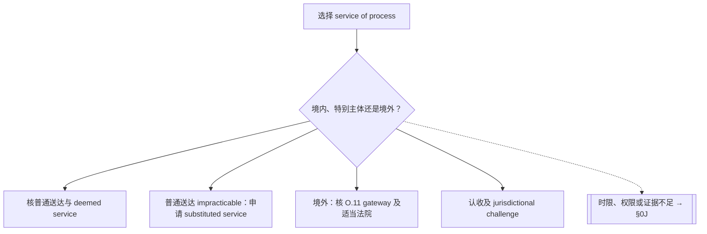

原告先证明适用的送达路径和有效日期。被告须分别计算 AOS 与 Defence；提出 jurisdictional challenge 时，传票的截止点是 Defence 期限。

| 任务 | 直达 |
| --- | --- |
| 送达、AOS 与管辖权异议总框架 | [§0B](#0B.%20%E9%80%81%E8%BE%BE%E3%80%81AOS%20%E4%B8%8E%E7%AE%A1%E8%BE%96%E6%9D%83%E5%BC%82%E8%AE%AE%E6%80%BB%E6%A1%86%E6%9E%B6) |
| 时间计算与 deemed service | [§0C](#0C.%20%E6%97%B6%E9%97%B4%E8%AE%A1%E7%AE%97%E4%B8%8E%20deemed%20service) |
| 域内送达与 Affirmation of Service | [§0D](#0D.%20%E5%9F%9F%E5%86%85%E9%80%81%E8%BE%BE%E4%B8%8E%20Affirmation%20of%20Service) |
| 特殊主体与 substituted service | [§0E](#0E.%20%E7%89%B9%E6%AE%8A%E4%B8%BB%E4%BD%93%E4%B8%8E%20substituted%20service) |
| 域外送达与 O.11 gateways | [§0F](#0F.%20%E5%9F%9F%E5%A4%96%E9%80%81%E8%BE%BE%E4%B8%8E%20O.11%20gateways) |
| AOS 与 jurisdictional challenge | [§0G](#0G.%20AOS%20%E4%B8%8E%20jurisdictional%20challenge) |
| 文书与期限倒排 | [§0H](#0H.%20%E7%94%B3%E8%AF%B7%E4%B8%8E%E6%93%8D%E4%BD%9C%E5%B7%A5%E7%A8%8B%EF%BC%9A%E6%96%87%E4%B9%A6%E3%80%81%E9%80%81%E8%BE%BE%E5%92%8C%E6%9C%9F%E9%99%90) |
| 提交前核对 | [§0I](#0I.%20%E6%94%BB%E9%98%B2%E4%B8%8E%E6%89%A7%E8%A1%8C%E5%89%8D%E6%A0%B8%E5%AF%B9) |
| 失误、制裁与补救 | [§0J](#0J.%20%E7%A8%8B%E5%BA%8F%E5%A4%B1%E8%AF%AF%E5%8F%8A%E5%85%B6%E5%90%8E%E6%9E%9C) |
| SG 实务应用 | [§0K](#0K.%20SG%20%E5%AE%9E%E5%8A%A1%E5%BA%94%E7%94%A8%E4%B8%8E%E5%AF%BC%E5%B8%88%E5%8F%A3%E5%BE%84) |

---


#### 核心参数与计算口径
- **原诉令状有效期（Writ Validity - O.6 r.8（令状有效期））**：自签发之日起 12 个月内有效（含签发日当日，至次年对应日前一日午夜 24:00 届满）。
- **邮寄送达推定生效算术（Deemed Service - O.10 r.1(2)/(3)）**：以 registered post 寄往被告通常住址或将令状投入其信箱，依法律推定在**寄出或投入信箱后第 7 天**生效送达（包括周日和公假在内的日历日，但若第 7 天逢周日或公假，不自动顺延）。
- **送达认收书死线（AOS Deadline - O.12 r.4 / r.5）**：令状在香港域内送达后 **14 天内**（含送达日当日算作第 1 天）。若向海外送达（O.11），按法官许可命令中所指定的期限（通常为 21 或 28 天）。
- **Jurisdictional challenge 的期限（O.12 r.8）**：被告先在 AOS 表明拟抗辩，并在适用的 Defence 送达期限内发出 summons。认收本身不产生独立的 14 日异议期。见 [RHC O.12 r.8](https://www.civiljustice.hk/gaz_sub_leg/documents/rhc/RHC_Order_12.pdf)。
- **替代送达法定门槛（Substituted Service - O.65 r.4）**：① 现实不可行性（Practically impossible to effect personal service after reasonable efforts）；② 替代方案高度可能性（Reasonable probability that the proposed method will bring writ to D's knowledge）。

<!-- BEGIN:cite-legend -->
> [!info]- 引注图例（出处码 → 文件；点开折叠）
> 
> | 码 | 文件 | 层级 | 学年 |
> |---|---|---|---|
> | LG3V | [LG3 送达与认收讲义（REV，本届）](../../04%20Base%20Lectures/00%20This%20Year%20Moodle%202026-27/Lecture%20Outlines,%20Powerpoints%20&%20Materials/LG3%20-%20Service%20and%20Acknowledgement%20of%20Service%20%28REV%29.md) | 本届讲义 | 2026-27 |
> | LG3R | [LG3 Reference Material（RHC O.3/O.10/O.11/O.12/O.65/O.80/O.81 与 Cap.1 s.8、s.71、HCO s.31、CO s.827 原文）](../../04%20Base%20Lectures/00%20This%20Year%20Moodle%202026-27/Lecture%20Outlines,%20Powerpoints%20&%20Materials/LG3%20-%20Reference%20Material.md) | 本届官方 | 2026-27 |
> | LG3A | [LG3 Additional Information after Lecture（本届课后补充 Matter 1—5）](../../04%20Base%20Lectures/00%20This%20Year%20Moodle%202026-27/Lecture%20Outlines,%20Powerpoints%20&%20Materials/LG3%20-%20Additional%20Information%20after%20Lecture.md) | 本届官方 | 2026-27 |
> | LG3P | [LG3 课堂幻灯 ppt（REV，本届）](../../04%20Base%20Lectures/00%20This%20Year%20Moodle%202026-27/Lecture%20Outlines,%20Powerpoints%20&%20Materials/LG3%20ppt%20%28REV%29.md) | 本届讲义 | 2026-27 |
> | OLD-SET3 | [往届 Set 3 LG3 学生笔记](../../06%20Base%20Exam%20Notes/Set%203/LG3%20Service%20and%20acknowledgement%20of%20service.md) | 往届学生稿 | 2025-26 |
> | OLD-25S | [2025 Aug Answer Scoresheet（往届补充考评分表）](../../02%20Past%20Papers/2025-08%20Aug/Answer%20Scoresheet.md) | 往届官方 | 2024-25 |
> | OLD-25K | [2025 Aug Knowledge Paper（往届补充考卷连同答案表）](../../02%20Past%20Papers/2025-08%20Aug/1.%20Knowledge%20Paper%20%28Aug%202025%29.md) | 往届官方 | 2024-25 |
> | OLD-23J | [2023 Jan Mark Sheet（往届知识考评语，库内仅 pdf）](../../02%20Past%20Papers/2023-01%20Jan/2.%202023%20JAN%20-%20Mark%20Sheet.pdf) | 往届官方 | 2022-23 |
> | OLD-24J | [2024 Jul Review PPT（往届知识考复习幻灯，库内仅 pdf）](../../02%20Past%20Papers/2024-07%20Jul/5.%202024%20JULY%20-%20Review%20PPT.pdf) | 往届官方 | 2024-25 |
> | MATRIX | [03 真题矩阵与解析（凝结层，本库自撰）](../00%20Master/03%20Past%20Paper%20Matrix%20and%20Analysis.md) | 凝结层 | 2026-27 |
> | XSET | [04 三人对比与 SG 脉络（凝结层，本库自撰）](../00%20Master/04%20Cross-Set%20Comparison%20and%20SG%20Progression.md) | 凝结层 | 2026-27 |
> | CAP-C3 | [PCLL8010 LG3 PT](../../99%20Moodle%20Mirror/Lecture%20Outlines,%20Powerpoints%20&%20Materials/LG3%20-%20Service%20and%20Acknowledgement%20of%20Service/Panopto%20Captions%20%28local%20export%29/8010_LG03_PT.md) | 本届讲义 | 2026-27 |


> | T3FULL | [8010_LG03_PT.md](../../04%20Base%20Lectures/00%20This%20Year%20Moodle%202026-27/Lecture%20Outlines,%20Powerpoints%20&%20Materials/LG3%20-%20Service%20and%20Acknowledgement%20of%20Service/Panopto%20Captions%20%28local%20export%29/8010_LG03_PT.md) | 本届讲义 | 2026-27 |
> | R12NEW | [RHC O12.md](obsidian://open?vault=3b1e77255f6c6e29&file=output%2Fresearch%2FCivil%20Litigation%20Rules%20Verification%20-%202026-10-23%2FRHC%20O12.md) | 库外法源 | 2026-27 |
> | R80NEW | [RHC O80.md](obsidian://open?vault=3b1e77255f6c6e29&file=output%2Fresearch%2FCivil%20Litigation%20Rules%20Verification%20-%202026-10-23%2FRHC%20O80.md) | 库外法源 | 2026-27 |
> | R18NEW | [RHC O18.md](obsidian://open?vault=3b1e77255f6c6e29&file=output%2Fresearch%2FCivil%20Litigation%20Rules%20Verification%20-%202026-10-23%2FRHC%20O18.md) | 库外法源 | 2026-27 |
> | NEWCN | [Mainland Hong Kong Service Arrangement Update - 2026-10-23.md](obsidian://open?vault=3b1e77255f6c6e29&file=output%2Fresearch%2FMainland%20Hong%20Kong%20Service%20Arrangement%20Update%20-%202026-10-23.md) | 库外法源 | 2026-27 |
> | S6-AP | [1. SG6 (Civil Procedure 1)](../../04%20Base%20Lectures/00%20This%20Year%20Moodle%202026-27/Small%20Group%20Activity%20Plans/1.%20SG6%20%28Civil%20Procedure%201%29.md) | 本届官方 | 2026-27 |
> | S6-A3 | [LG3 - Additional Information after Lecture](../../04%20Base%20Lectures/00%20This%20Year%20Moodle%202026-27/Lecture%20Outlines,%20Powerpoints%20&%20Materials/LG3%20-%20Additional%20Information%20after%20Lecture.md) | 本届讲义 | 2026-27 |
> | S6-L3 | [LG3 - Service and Acknowledgement of Service (REV)](../../04%20Base%20Lectures/00%20This%20Year%20Moodle%202026-27/Lecture%20Outlines,%20Powerpoints%20&%20Materials/LG3%20-%20Service%20and%20Acknowledgement%20of%20Service%20%28REV%29.md) | 本届讲义 | 2026-27 |
> | S6-R18 | [RHC O18](obsidian://open?vault=3b1e77255f6c6e29&file=output%2Fresearch%2FCivil%20Litigation%20Rules%20Verification%20-%202026-10-23%2FRHC%20O18.md) | 库外法源 | 2026-27 |
> | AP7 | [SG7 Activity Plan](../../04%20Base%20Lectures/00%20This%20Year%20Moodle%202026-27/Small%20Group%20Activity%20Plans/1.%20SG7%20Activity%20Plan.md) | 本届官方 | 2026-27 |
> | R65 | [RDC O65](obsidian://open?vault=3b1e77255f6c6e29&file=output%2Fresearch%2FCivil%20Litigation%20SG07%20Authorities%20-%202026-11-02%2FRDC%20O65.md) | 库外法源 | 2026-27 | 区院规则一手文本再刊；整合2025-03-28 |
> | R10 | [RDC O10](obsidian://open?vault=3b1e77255f6c6e29&file=output%2Fresearch%2FCivil%20Litigation%20SG07%20Authorities%20-%202026-11-02%2FRDC%20O10.md) | 库外法源 | 2026-27 | 区院规则一手文本再刊；整合2025-03-28 |
> | CHAN | [Chan Yeuk Mui - Judgment and Application](obsidian://open?vault=3b1e77255f6c6e29&file=output%2Fresearch%2FCivil%20Litigation%20SG07%20Authorities%20-%202026-11-02%2FChan%20Yeuk%20Mui%20-%20Judgment%20and%20Application.md) | 库外法源 | 2026-27 | 一手法源再刊；访问2026-11-02 |
> | DEACON | [Deacons - Judgment and Application](obsidian://open?vault=3b1e77255f6c6e29&file=output%2Fresearch%2FCivil%20Litigation%20SG07%20Authorities%20-%202026-11-02%2FDeacons%20-%20Judgment%20and%20Application.md) | 库外法源 | 2026-27 | 一手法源再刊；访问2026-11-02 |
> | MELCO | [本届 LG6 讲义：Melco Crown 案的送达与撤销缺席判决](../../04%20Base%20Lectures/00%20This%20Year%20Moodle%202026-27/Lecture%20Outlines,%20Powerpoints%20&%20Materials/LG6%20-%20Default%20Judgments%20Under%20O13%20and%20O13A.md) | 本届讲义 | 2026-27 |
<!-- END:cite-legend -->

## 0B. 送达、AOS 与管辖权异议总框架

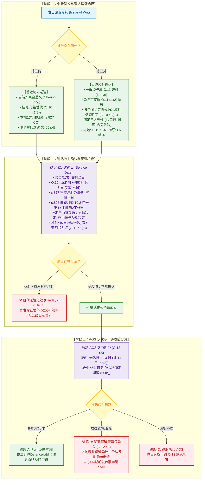

---


#### 0B.2 顺向五环：从签发令状到进入诉答

> 五原则之**顺向**落点（另四线：横向→0C、逆向→0D、第一性→§1、控制论→§2；五环见 0B，横向耦合见 0C，倒推链见 0D）。把 §00 全景图拆成五环，每环给「触发 → 行动 → 产出」；引注回 §3 对应 playbook，不重复抄写。

**环一：签发与路径分流**
- 客户已授权起诉并核过时效后，Registry 按 O.6 r.7 盖印发出 writ。原告先查被告所在地及其身份，再决定采用域内、域外或特殊主体规则；送达函可写明实际采用的方式。见 §§0D–0F。 <small style="opacity: 0.55">〔LG3V L407 "To avoid confusion, it is good practice to indicate the method of service in the covering letter"〕</small>

**环二：执行送达**
- 原告采用域内亲送时，按 Cheung Ping 确认对象、交副本并说明是法庭文件。选挂号或投递信箱时，另核 O.10 r.1(2) 与誓章须交代的知悉及退件情况。公司及合伙人分别核 s.827 和 O.81 r.3；域外先核 O.11 许可与执行方法，普通方式 impracticable 时再评估替代送达。 <small style="opacity: 0.55">〔LG3R L184 "will have come to the knowledge of the defendant within 7 days thereafter"；LG3R L186 "the copy of the writ has not been returned to the plaintiff through the post undelivered to the addressee"；LG3A L116 "the plaintiff proves service by filing an affirmation of service"〕</small>

**环三：效力确认与反证核查**
- 原告按具体送达方式确定日期。留置公司注册办事处、PD 19.2 的挂号及平邮、O.10 r.1(3)(a) 的七日推定、境外当地法及命令各有自己的规则。律师核退件、较早实际知悉和被告寄发或投递时是否在香港；反证可改变拟采用的送达日。 <small style="opacity: 0.55">〔LG3V L299 "If writ is returned through the post, then it’s not deemed served"；LG3V L301 "the actual date replaces the deemed date"；LG3V L307 "the deeming provision does not apply if D is not within the jurisdiction at the time of service"〕</small>

**环四：AOS 时钟与表态**
- 被告收到域内令状后，按 O.12 r.5(a) 计算 14 日并计入送达日；域外依许可命令。若争管辖，被告应依规定提交 Form 14 并在 Defence 期限内发传票、备誓章。被点名却未获送达者可另核 O.12 r.8A notice。 <small style="opacity: 0.55">〔LG3A L74 "fourteen days after service of the writ (including the day of service)"；LG3A L76 "the time limited under Order 10, rule 2(2), Order 11, rule 1(3), or Order 11, rule 4(4)"；LG3A L80 "the order given by the Court allowing service out of jurisdiction will indicate when the acknowledgement of service is required to be filed"〕〔LG3R L786 "either to serve the writ on the defendant or to discontinue the action as against him"〕</small>

**环五：下游分流**
- 被告若答辩，按 O.18 r.2 独立计算 Defence 期限；拟争议管辖则在该期限内依 O.12 r.8 申请。被告逾期未交 AOS 时，原告先核送达、案卷状态和 O.13 默认判决条件。O.13A 处理承认申索，见 CO06–09。 <small style="opacity: 0.55">〔LG3R L160 "nothing in this section shall be deemed to extend the time for entering appearance to any writ endorsed with a statement of claim"〕</small>

> **Exam / Drafting Formulation:** "Service must use a method authorized by the Rules and must give the defendant a fair opportunity to respond."

### 制度原理与个案核验

送达（Service）与认收（Acknowledgement of Service, AOS）并非机械性的文书流转，而是普通法民事诉讼确立**对人管辖权（Jurisdiction in Personam）**与践行**自然公正原则（Natural Justice）**的基石：

1. **听取各方陈述（Audi Alteram Partem / Right to Notice）**： <small style="opacity: 0.55">〔LG3V L265 "Service is effected when D has notice of the proceedings"〕</small>
   - 任何人不得在未获充分、有效通知其被诉事项及抗辩机会前被剥夺财产或权利。送达的本质是**将司法程序的启动有效告知被告**。
2. **管辖权的确立时点（Seisin & Territoriality）**： <small style="opacity: 0.55">〔LG3V L307 "the deeming provision does not apply if D is not within the jurisdiction at the time of service"〕</small>
   - 香港法院的原诉管辖权在令状**合法送达于辖区内被告**时正式系属（Seised）。若被告在送达时不在辖区内，除获法庭域外许可（O.11）或特定代理规程（O.10 r.2）外，法院对该人无固有管辖权。 <small style="opacity: 0.55">〔LG3V L537 "Generally, leave is required to serve writ out of jurisdiction: O.11 r.1"；LG3V L325 "service may be effected on that agent instead of the overseas principal"〕</small>
3. **程序确定性 vs 逃避送达的抗衡（Certainty vs Anti-Evasion）**： <small style="opacity: 0.55">〔LG3R L98–L100 "such service or notice shall be deemed to have been effected at the time … read in conjunction with practice direction 19.2"〕〔LG3V L481–L487 "Examples where sub-service may be considered … Evasion of service"〕</small>
   - 为防止被告恶意隐匿、拒收文件导致司法程序瘫痪，法律创设了**法定推定送达（Deeming Provisions）**与**替代送达（Substituted Service）**机制，在“确保被告知情”与“保障原告程序推进权”之间实现精细平衡。

---

## 0C. 时间计算与 deemed service

时间计算是民诉第一道绝对红线，算错一日即导致后续 AOS、默认判决、抗辩书连环位移。

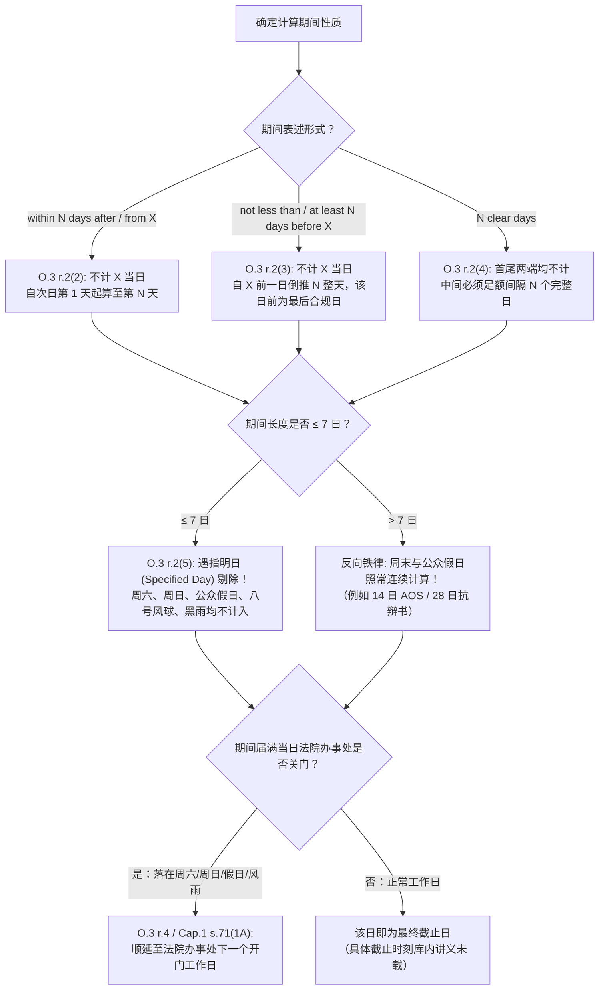

#### 核心算法与高频陷阱速查表

| 规则条款 | 法定算法与实务操作 | 官方经典算例（讲义与真题） | 溯源码 |
| --- | --- | --- | --- |
| **O.3 r.2(2)**<br>“within 14 days after/from” | **不计基准日当天**，从基准日次日开始数第 14 天届满。 | 基准日为 2026 年 9 月 2 日（周三）→ 截止日为 **2026 年 9 月 16 日（周三）**。 | <br>。 <small style="opacity: 0.55">〔LG3V L145 "14 days not counting the date of reference"；LG3V L157–L159 "period begins immediately after that date … Answer is 16 September 2026"〕〔LG3R L32 "the period begins immediately after that date"〕</small> |
| **O.3 r.2(3)**<br>“not less than 14 days prior to” | **不计基准日当天**，往前倒推 14 个完整日，第 14 天之前（即倒数第 14 天当天）为合规底线。 | 基准日为 2026 年 9 月 25 日 → 必须在 **2026 年 9 月 11 日或之前** 完成。 | <br>。 <small style="opacity: 0.55">〔LG3V L161 "14 days prior (and not counting) the date of reference"；LG3V L177 "11 Sept is the last day for compliance"〕〔LG3R L34 "the period ends immediately before that date"〕</small> |
| **O.3 r.2(4)**<br>“N clear days” | **首尾两端均不计**，行为日与基准日之间必须存在 N 个足额完整日。 | “2 clear days after 1 Sep” → 9月1日不计，空出 9月2日、9月3日 → 结果为 **9 月 4 日**。 | <br>。 <small style="opacity: 0.55">〔LG3V L183 "Which day is “2 clear days after 1 September 2026”"；LG3V L193 "at least the number of FULL days must exist between the starting date and the target date"〕〔LG3R L38 "being a period of 7 days or less, would include a specified day, that day shall be excluded"〕</small> |
| **O.3 r.2(5)–(6)**<br>期间 **≤ 7 日** 扣除规则 | 期间为 7 天或以下时，**遇“指明日”（Specified Day）必须剔除**：周六、周日、公众假日、8号+风球、黑雨、法院关门日。<br>**黑雨/烈风**：依 IGCO s.71(2) 定义（"any day throughout or for part of which ... is in force"），当天**任何时段**生效即属指明日，即使未影响登记处开放；指明日清单与定义见。 <small style="opacity: 0.55">〔LG3A L46 "if a black rainstorm is hoisted at any time during that day, it’s considered a specified day"〕〔LG3R L124 "means any day throughout or for part of which a black rainstorm warning is in force"〕</small> | 2026 年 9 月 30 日（周三）交换清单后 7 日内安排查阅 → 扣除 10/1国庆、10/3周六、10/4周日、10/10周六、10/11周日（**10/2 周五为普通工作日，须计入**：10/2、10/5–10/9、10/12 共 7 日）→ 截止日为 **10 月 12 日（周一）**！ | <br>。 <small style="opacity: 0.55">〔LG3R L38 "being a period of 7 days or less, would include a specified day, that day shall be excluded"；LG3V L197–L201 "if the period is 7 days or less … General holidays (i.e. Sunday and public holidays)"〕〔LG3V L211–L223 "arrange for inspection within 7 days from exchange of list of documents … = 12 October"〕</small> |
| **反向铁律**<br>期间 **> 7 日** | **周末及公众假日正常计入**，除非最后一日恰逢假日则顺延至下一工作日（O.3 r.4）。 | 14 天 AOS 期间若跨越中秋国庆，只要总天数未满且最后一天是工作日，中间假期照算。 | <br>。 <small style="opacity: 0.55">〔LG3R L38 "being a period of 7 days or less, would include a specified day, that day shall be excluded"；LG3R L62 "the act shall be in time if done on the next day on which that office is open"〕〔MATRIX L132 "超过 7 天的期间照常计入周末与假日"〕</small> |
| **O.3 r.3 & HCO s.31**<br>暑期休庭（Summer Vacation） | **8月1日–8月31日 不计入** 高等法院诉答文书（Pleadings）的送达、存档与修改期间；**区域法院无暑期休庭！**<br>根据 HCO s.31(1)，不超过 1 个月的文书期限亦暂停（**但令状附有 SOC 时的 AOS 期限不暂停！**）。 | 高院 7 月 25 日送达 SOC → 28天抗辩期在 8 月全部冻结，9 月 1 日恢复起算。 | <br><br><br><br>。 <small style="opacity: 0.55">〔LG3V L225 "the counting of days excludes the Court’s summer vacation (i.e. 1-31 August"〕〔LG3V L229 "there is NO SUMMER VACATION in the District Court"〕〔LG3R L56 "the period of the Summer Vacation shall be excluded in reckoning any period prescribed by these rules"〕〔LG3R L158 "any period not exceeding one month is appointed or allowed for the doing of any act"〕〔LG3R L160 "nothing in this section shall be deemed to extend the time for entering appearance to any writ endorsed with a statement of claim"〕</small> |
| **O.3 r.5**<br>期间延展与缩短 | 法院可随时命令延展（甚至逾期后追溯延展）；**诉答文书期限可由双方当事人书面同意延展，无需法庭命令**。 | 双方律师签订 consent letter 延期提交 Defence 28 天。 | <br><br>。 <small style="opacity: 0.55">〔LG3R L80 "The Court may, on such terms as it thinks just, by order extend or abridge the period"〕〔LG3R L82 "although the application for extension is not made until after the expiration of that period"〕〔LG3R L84 "may be extended by consent (given in writing) without an order of the Court being made for that purpose"〕</small> |
| **O.3 r.6**<br>沉寂一年后复动 | 诉讼沉寂（Inactivity）满 1 年以上，任何一方欲采取下一步骤，必须向对方发出 **不少于 1 个月的复动通知（Notice of Intention to Proceed）**。 | 发出传票但未获任何命令不构成“诉讼步骤”。 | <br>。 <small style="opacity: 0.55">〔LG3R L90 "not less than one month’s notice of his intention to proceed"〕〔LG3R L92 "A summons on which no order was made is not a proceeding for the purposes of this rule"〕</small> |

**总表索引**：算错 AOS／期间死线（误用 ≤7 日剔除、把普通工作日当假日、误以为暑期 AOS 暂停）的后果链归并 [§0E 后果链总表](#0J.%20%E7%A8%8B%E5%BA%8F%E5%A4%B1%E8%AF%AF%E5%8F%8A%E5%85%B6%E5%90%8E%E6%9E%9C) 行 9；暑期休庭与「附 SOC 令状 AOS 不暂停」的耦合见 [0C 耦合表](#5.1%20%E5%8E%86%E5%B9%B4%E7%9C%9F%E9%A2%98%E6%A0%87%E5%87%86%E8%80%83%E6%A0%B8%E6%A8%A1%E5%9E%8B%E7%A9%BF%E9%80%8F)「算日 × 暑期休庭」行。

---


### 两个课堂算日例与SG06

- Arthur／Bill课堂例：12June寄、按presumption19June送，AOS含送达日到2July；若人在Tokyo到21June且22June在HK知悉，起算日改变，14日含首日落5JulySunday，法院办公室下一开放日为6July。字幕自己指出slide7July有误，不能照抄slide。例子不是本届SG日期。 <small style="opacity: 0.55">〔T3FULL L3673 "your actual deadline is the 6th of July."〕</small>
- SG06Q1 Walter：email26Oct不自动满足普通writ送达；须核registeredpost有效寄送／地址及28Oct实际接收如何反驳presumption。若依法认定28Oct为service且无特别命令，AOS为10Nov；Defence依AOS法定期限后28日与5NovSoC送达后28日取较后，即8Dec。要列假设，不能从收到email就开钟。O18主述CO04-05／CO10。 <small style="opacity: 0.55">〔R18NEW L20 "whichever is the later."〕</small>
- SG06Q2 Sam：人在国外、儿子发现及电话告知、回港、判决各时点须分开；依适用Hahn原则判断是否在判前有效service，再走CO06regular／irregularsetaside，不能只按信箱发现日推定有意不理所以必败。

> **Exam / Drafting Formulation:** "The deemed date of service and the last day for acknowledgment must be calculated separately under the applicable Rules."

## 0D. 域内送达与 Affirmation of Service

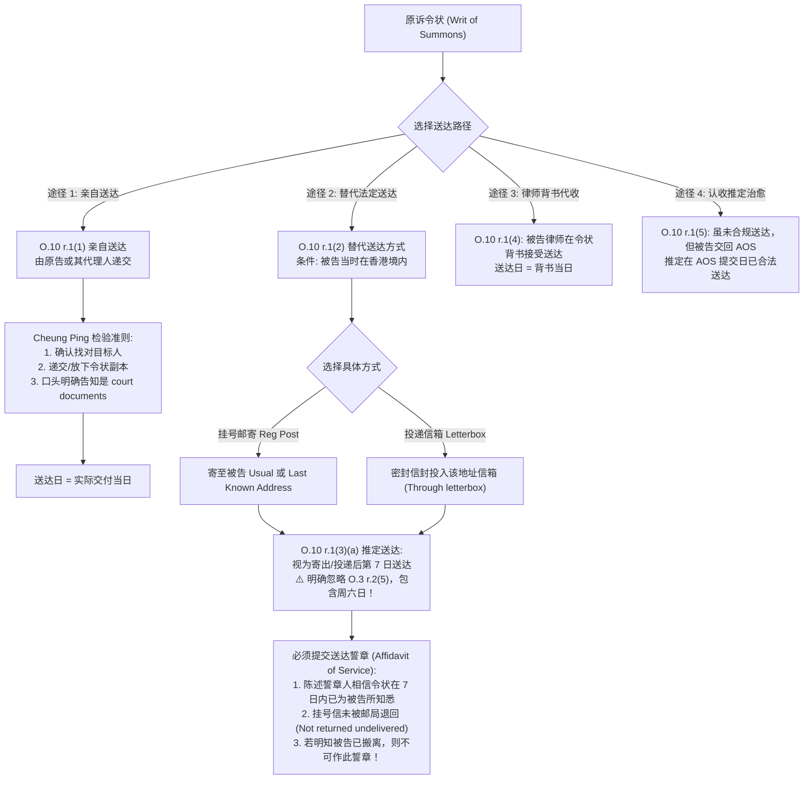


#### O.10 r.1 原诉程序域内送达四大法定方式
1. 面交送达（Personal service - O.10 r.1(1)）：将盖印令状交予被告本人；若被告拒接，在向其指明令状性质后置于其面前即告完成。
2. 邮寄送达（Service by ordinary post - O.10 r.1(2)(a)）：将令状盖印副本装入预付邮资信封寄往被告通常住址（Usual or last known address）。
3. 投入信箱（Insertion into letter box - O.10 r.1(2)(b)）：将密封信件投入被告住址之信箱。
4. 律师代为认收（Solicitor accepting service - O.10 r.1(4)）：被告委聘之事务律师签署备忘录确认代为接收并承诺认收。


### 两个需要替换活动规则的点

1. **无行为能力人**：r2规定nextfriend／guardianad litem代表诉讼及通常由solicitor代理；r16另规定须personal／O10r1(2)送达文件的收件人。Minor通常父亲／监护人，没有则同住／照顾者；MIP核获授权者或同住／照顾者。法院可另作deemedgoodservice方向，特定judgment／committal／subpoena又有r16(4)规则。不能用r2推出“所有文书一律交guardian的律师”，也不能照课堂问答推出“所有案必须先法院appointment才可送”。 <small style="opacity: 0.55">〔R80NEW L140 "on his father or guardian"〕〔R80NEW L28 "an order appointing a person next friend or guardian ad litem of a person under disability is not necessary"〕</small>

2. **AOS与异议**：r8(1)／(2)要求give noticeofintentiontodefend并在Defence期限内申请；r8(6)使及时申请者不因该notice视为submit；r8(7)规定未依(1)(2)申请时通常submit，保留O21r1获准withdrawAOS例外。保留文字是稳妥实务，不是“勾拟抗辩必定失权”法条。 <small style="opacity: 0.55">〔R12NEW L77 "shall give notice of intention to defend"〕〔R12NEW L121 "Except where the defendant makes an application"〕</small>

#### 实战核心要件与判例攻防要点

1. **“Usual / Last Known Address”与信箱投递定义**： <small style="opacity: 0.55">〔LG3V L255 "“usual address” = address at where D can usually be reached"；LG3V L259 "“address” = is not confined exclusively to a person’s residence"；LG3V L261 "take ordinary colloquial meaning, does not mean underneath a door or through an open window"〕</small>
   - **Usual address**：被告通常可联络之地址，不限于住宅（办公地址、营业地均可）。 <small style="opacity: 0.55">〔LG3V L259 "“address” = is not confined exclusively to a person’s residence"〕</small>
   - **Last known address**：原告自任何可靠来源所获知的最后地址（原告无需确保该地址绝对最新，但若已知被告搬迁则不得滥用）。 <small style="opacity: 0.55">〔LG3V L293 "If P knows that D is no longer at the address to be served, the deponent cannot make the statement of belief"〕</small>
   - **Through letterbox**：取日常词义（穿过信箱口投进），**绝不包含从门底缝塞入（underneath door）或从开着的窗户扔入（through window）**！ <small style="opacity: 0.55">〔LG3V L261 "take ordinary colloquial meaning, does not mean underneath a door or through an open window"〕</small>
2. **推定送达的反证推翻（"Unless the contrary is shown"）**： <small style="opacity: 0.55">〔LG3V L271 "“unless the contrary is shown”"；LG3V L285 "we look at DEEMED SERVICE"〕</small>
   - **反证成立情形一（退件）**：挂号信被邮局退回 → 推定送达不成立。 <small style="opacity: 0.55">〔LG3V L299 "If writ is returned through the post, then it’s not deemed served"〕</small>
   - **反证成立情形二（提前实际知悉）**：若原告能证明被告在第 7 天前已收到（例如被告于第 3 天致电原告律师询问令状案情）→ **以实际知悉日取代第 7 日推定日**，AOS 时钟提前启动！ <small style="opacity: 0.55">〔LG3V L301 "the actual date replaces the deemed date"〕</small>
   - **反证成立情形三（完全不知情）**：若被告能证明因住院、外出等客观原因根本未收到通知 → 无有效送达，原告据此取得的默认判决属于 Irregular Default Judgment，法院必予撤销。 <small style="opacity: 0.55">〔LG3V L305 "there is still no good service"〕</small>
3. **境外无常住地的属地铁律（*Barclays Bank of Swaziland v Hahn* [1989] 1 WLR 506；*India Videogram Association v Patel* [1991] 1 All ER 214）** : <small style="opacity: 0.55">〔LG3V L307 "the deeming provision does not apply if D is not within the jurisdiction at the time of service"；OLD-SET3 L105 "Service would be effective upon D’s return to the jurisdiction acquiring knowledge" ·往届仅参考〕</small>
   - **核心判例**：O.10 r.1(2) 的替代送达推定**在寄发/投递时被告不在香港境内的情况下完全不适用** (*Barclays Bank v Hahn*)。 <small style="opacity: 0.55">〔LG3V L263 "service is not valid if at the time of insertion/posting, D was outside jurisdiction"〕</small>
   - **法律后果与生效时点**：若原告在被告身在海外时往其香港地址寄信或投递信箱，该送达在被告离开香港期间不产生任何法律效力；**直至被告返回香港管辖区且实际知悉令状时（upon D's return to the jurisdiction acquiring knowledge of the writ, *India Videogram*），送达方始成立并起算 AOS 期限**（此说见于往届学生稿，仅参考，须以本届讲义 O.10 r.1(3) 与 *Hahn* 为准）。此时若原告强行申请默认判决，属绝对违法（Irregular Default Judgment），必须撤销。 <small style="opacity: 0.55">〔OLD-SET3 L105 "Service would be effective upon D’s return to the jurisdiction acquiring knowledge" ·往届仅参考〕</small>
4. **送达瑕疵与法院依 O.2 r.1 追认自由裁量权**： <small style="opacity: 0.55">〔LG3V L315 "the Court may still exercise its powers under O.2 r.1 to confirm the validity of the service"〕</small>
   - *HSBC v Ong Tong Sing* [2008] 3 HKLRD 444：原告多次交涉后将令状送交被告办公室前台接待员（未亲自递交被告本人）→ 因被告完全知晓且无实质损害，法庭确认送达有效。 <small style="opacity: 0.55">〔LG3V L317 "served by delivering a copy of the writ to D’s office and leaving it with the receptionist"〕</small>
   - *3D Gold v PwC* [2014] 4 HKC 528（HCA 1192/2011，Deputy Judge Lok，22.05.2014）：令状送达至会计师事务所的总法律顾问（General Counsel）而非合伙人本人 → 被告完全知悉诉讼性质且有往来历史，纯属技术瑕疵，法庭行使 O.2 r.1 确认有效，不予宣告无效。 <small style="opacity: 0.55">〔LG3V L319 "a writ was served on the general counsel of a firm of accountants rather than on a partner"；LG3V L321 "Court does not tend to look favorably toward declarations of irregularity where the irregularity was purely technical"〕</small>
   - ⚠️ **同案两说并列（本卡不作裁决）**：讲义另一处（O.81 合伙送达段）引同一案件 *3D-Gold v PwC* HCA 1192/2011，命题是「合伙送达**必须**采用 O.81 r.3 所列方法之一，否则送达不生效力」——本卡 §3.3 合伙表格即取此说。两说一为 O.2 r.1 追认裁量、一为 O.81 r.3 方式排他，讲义未在文内互相调和，故此处仍并列标注出处，交由用户裁决；用户 2026-09-29「有冲突用本年讲义」的口径**对本条不适用**（两说同出本届讲义 L315／L453，非「本年 vs 往年」之争）（详见文末「复审修订记录」）。 <small style="opacity: 0.55">〔LG3V L453 "One of the above methods must be used to effect service on partnerships; otherwise the service is ineffective"；D-3DGOLD〕</small>

#### 送达誓章（Affirmation of Service）与认收书（AOS）之别

| 项目 | 送达誓章／affirmation of service | 认收书 Acknowledgement of Service |
| --- | --- | --- |
| 性质 | 以陈述人 affirmation 核证（若以 oath 核证即 affidavit）的**事实陈述书**，就文件的**送达方式与送达事实**作出供证。 <small style="opacity: 0.55">〔LG3A L110 "An affirmation is a written statement of fact verified by the maker's affirmation (or if verified by oath, it’s an affidavit)"〕</small> | 被告提交的**表格**，正式回应令状并表明有否抗辩意欲 |
| 提交人 | **原告**（或其送达员 process server） | **被告** |
| 功能 | 向法庭**证明送达已完成及如何完成** | 被告**「入票 appearance」／上案（going on record）**的实际行动。 <small style="opacity: 0.55">〔LG3A L114 "the Defendant first goes on record in the proceedings by filing this acknowledgement of service"；LG3A L116 "the plaintiff proves service by filing an affirmation of service, and the defendant responds to service by filing the acknowledgement of service"〕</small> |
| 关键内容 | 邮寄／投信箱送达时，O.10 r.1(3)(b) 要求原告供证：① 其**意见**认为令状将于 7 日内送达被告知悉；②（邮寄者）信件**未被退回**。 <small style="opacity: 0.55">〔LG3R L184 "will have come to the knowledge of the defendant within 7 days thereafter"；LG3R L186 "the copy of the writ has not been returned to the plaintiff through the post undelivered to the addressee"〕</small> | Form 14；拟挑战管辖者须在表格上表明仅为管辖权异议而认收（O.12 r.8）。 <small style="opacity: 0.55">〔LG3R L192 "accompanied by a form of acknowledgment of service in Form No. 14"；LG3V L657 "File an Acknowledgement of Service with an express reservation that D only submits to the jurisdiction"〕</small> |
| 一句话串联 | **原告以送达誓章证明送达；被告以认收书回应送达。** | 同左 |

**总表索引**：亲自送达不合要件、寄发／投递时被告在境外（*Barclays Bank v Hahn*）、誓章失实的后果链归并 [§0E 后果链总表](#0J.%20%E7%A8%8B%E5%BA%8F%E5%A4%B1%E8%AF%AF%E5%8F%8A%E5%85%B6%E5%90%8E%E6%9E%9C) 行 1–2、行 14。


---

> **Exam / Drafting Formulation:** "The originating process was served by [method] on [date] at [place] upon [recipient]."

## 0E. 特殊主体与 substituted service

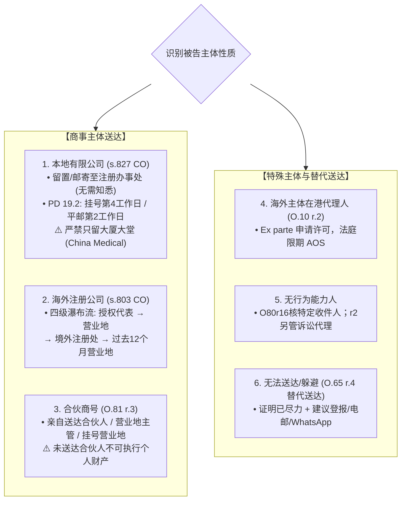


#### O.65 r.4 替代送达法定证明标准与公司送达
- **替代送达双阶要件（*Chappell v Coyle* [1985] / *Abdel Gadir* [2006]）**：
  ① 申请人必须在誓章中详尽说明至少 2–3 次在不同合理时段（包括工作日及非工作时间）前往被告住所尝试当面送达均告失败的事实，证明常规送达在实际上不可行（Practically impossible）；
  ② 申请人提议之替代送达方式（如平邮至其亲属处所、发送至其活跃私人电子邮箱、社交媒体 WhatsApp/微信私信、报章刊发告示等），必须有充分事实证明该方式有极高盖然率将令状内容实际传达给被告（Reasonable probability that it will come to defendant's knowledge）。
- **公司注册办事处送达（Companies Ordinance Cap. 622 s.827）**：凡在香港注册之有限公司，将令状平邮或交付至公司注册处的法定注册地址（Registered Office），即产生绝对的合法送达效力，无须再证明公司董事实际过目。


#### 特殊主体送达规则全景深度对比表

| 主体分类 | 适用法规 | 法定送达方式与操作要领 | 推定生效时间与证据要件 | 致命实务陷阱与出处 |
| --- | --- | --- | --- | --- |
| **本地注册有限公司**<br>(Local Limited Co.) | **s.827 CO**<br>(Cap. 622)<br>*(优先于 O.65 r.3(1)；与 O.10 r.1(2) 配 O.65 r.3(2) 为**并行二选一**——*Stevenson Wong and Co v Goldsense Technology Ltd* [2007] 1 HKLRD 217)* | **两条可选路径**：<br>**路径甲（实务最常用）**：1. 留置于注册办事处；或 2. 邮寄至注册办事处；<br>**路径乙**：依 O.10 r.1(2)（挂号邮寄／投信箱），经 O.65 r.3(2) 改读——"usual or last known address" 读作**注册或主要办事处**，"被告知悉" 读作 **r.3(1) 所列人员（主席、总裁、书记、董事等）之知悉**。 <small style="opacity: 0.55">〔LG3A L90 "there is statutory method of service i.e. P can serve a Writ by leaving or posting to the registered office"；LG3A L94 "S827 service and O10 r1(2) are alternative methods of service"〕〔LG3R L258 "for the reference to the usual or last known address of the defendant there were substituted"〕</small> | 依**所采方法**定推定日：<br>· 路径甲留置 → **留置当日**；<br>· 路径甲邮寄 → **PD 19.2**：挂号信**第 4 个工作日**／平邮**第 2 个工作日**；无须满足 O.10 r.1(3) 知悉陈述（*Ho Kwok Wah*）；<br>· 路径乙 → **O.10 r.1(3)(a) 第 7 日**推定，誓章须载 7 日知悉陈述。 <small style="opacity: 0.55">〔LG3V L399 "there is no need to establish that there was actual notice of the Writ"〕</small> | ❌ *China Medical v BOC* [2020] HKCFA 28：送达大厦 G/F 物业大堂（未上 14 楼注册办事处）不满足 s.827；电邮送达亦不满足。<br>💡 讲义：送达公函 Covering Letter 中写明所采方法（s.827 抑或 O.10 r.1(2)/O.65 r.3）为 **good practice**（非强制）。<br>⚠️ 公司**无注册办事处**时不能依 s.827 送达，须回到 O.65 r.3 一般规定（另见 O.10 r.1 是否适用于有限公司之两说：*Treasure Land* [1995] 3 HKC 30 vs *Guangdong International Trust* [1997] HKLRD 489——两说同出本届课后补充，「有冲突用本年讲义」口径对本条无法择一，见文末 `D-COMPO10`）。 <small style="opacity: 0.55">〔LG3V L417 "It does not satisfy s.827 by leaving the Writ at the G/F reception of the Bank of China Tower"〕〔LG3V L407 "To avoid confusion, it is good practice to indicate the method of service in the covering letter"〕〔LG3A L102 "cases that suggest O10 r1 does not apply to limited companies"；LG3A L100 "If there is no registered office, the limited company cannot be served according to s827"；D-COMPO10〕</small> |
| **海外注册公司**<br>(Part 16 Registered) | **s.803 CO**<br>(Cap. 622) | **四级瀑布流顺位**：<br>1. 交付/邮寄公司注册处（CR）载明的在港授权代表；<br>2. 若无代表/拒收 → 留置/邮寄在港营业地点；<br>3. 若无营业地 → 挂号寄境外注册处并抄送营业地；<br>4. 均无 → 寄往过去 12 个月内曾设立营业地。 <small style="opacity: 0.55">〔LG3V L425 "Overseas companies are served by addressing the document to an authorized representative (as shown in CR)"；LG3V L427 "If no authorized representatives/ refuse to accept service, can leave or send by post to any place of business"；LG3V L429 "If no place of business, send by registered post to RO and copy sent to principal place of business"；LG3V L431 "leave or send by post to where the company had a place of business in HK within the past 12 months"〕</small> | 依普通法或挂号凭证证明。<br>第四顺位需结合 O.10 r.2 审慎处理法庭许可。 | ❌ 不得直接越级跳至第四顺位；必须先查册 CR 确认授权代表及营业地址现状。 |
| **合伙企业（以商号被诉）**<br>(Partnership) | **O.81 r.3** | **法定三选一（排他）**：<br>(a) 亲自送达任何合伙人；<br>(b) 主要营业地交予具管理控制权人员；<br>(c) 挂号寄主要营业地（准用 O.10 r.1(2)）。 <small style="opacity: 0.55">〔LG3V L439 "Serving on any partner personally: r.3(1)(a)"；LG3V L443 "Serving at the principal place of business within jurisdiction + on any person having control/management of partnership"；LG3V L445 "Serving by registered post to principal place of business in accordance with O.10 r1(2): r.3(1)(c)"〕</small> | 走 (c) 挂号者：**第 7 日推定**，誓章须含 7 日知悉陈述与未退件证明。 <small style="opacity: 0.55">〔LG3V L447 "Service under this method would be effective 7th day after the day the Writ was sent by registered post"；LG3V L449 "was not returned to P undelivered"〕</small> | ❌ *3D-Gold v PwC*：合伙送达**必须**采 O.81 r.3 所列方法之一，否则不生效力（送达总法律顾问若不符合 (b) 即属无效）。<br>⚠️ 讲义另一处（O.2 r.1 段）引同案认定「纯技术瑕疵且无损害 → 法庭不倾向宣告无效」，两说同出本届讲义、**并列不作裁决**（用户 2026-09-29「有冲突用本年讲义」的口径对本条不适用），详见 §3.2 判例要点末段。<br>⚠️ **执行关联**：未被送达的合伙人个人财产不能直接被执行！ <small style="opacity: 0.55">〔LG3V L453 "One of the above methods must be used to effect service on partnerships; otherwise the service is ineffective"；D-3DGOLD〕〔LG3V L455 "the rules on enforcing a judgment against the personal assets of partners depend (partly) on whether the partners were served"〕</small> |
| **海外主体之在港代理人**<br>(Agent of Overseas Principal) | **O.10 r.2** | 必须通过 **单方面申请（Ex parte application）获得法庭许可**。合同须由该代理人在港代表订立。 <small style="opacity: 0.55">〔LG3R L198 "Where the Court is satisfied on an ex parte application"；LG3R L206 "the Court may authorize service of a writ … to be effected on the agent instead of the principal"〕</small> | 法庭命令将裁定 AOS 认收期限，且必须将令状与命令挂号邮寄海外被告。 <small style="opacity: 0.55">〔LG3R L208 "must limit a time within which the defendant must acknowledge service"；LG3R L210 "a copy of the order and of the writ must be sent by post to the defendant at his address out of the jurisdiction"〕</small> | ⚠️ 法庭行使自由裁量权时会优先审查能否直接依 O.11 域外送达，非轻易批准。 <small style="opacity: 0.55">〔LG3V L331 "courts use the discretion carefully and would look at whether there is any difficulty in granting service out of jurisdiction"〕</small> |
| **合同约定送达**<br>(Contractual Service) | **O.10 r.3** | 依合同条款约定方式送达（如约定发往特定电邮/传真），视为完全合法。 <small style="opacity: 0.55">〔LG3V L335 "agreed method for serving OP under the contract is deemed good under the Rules even if it does not comply with O.10 r. 1"〕</small> | 依合同约定生效时点生效。 | ⚠️ 即使合同约定域外送达，向境外送达令状**仍需向法庭申请 O.11 许可**（除非符合豁免）。 <small style="opacity: 0.55">〔LG3R L222 "A writ which is served out of the jurisdiction in accordance with a contract shall not be deemed to have been duly served"〕</small> |
| **收回土地/房屋诉讼**<br>(Possession of Land) | **O.10 r.4** | 1. **r.4(2)（强制附加步骤）**：令状 endorsing 收回土地／物业管有权申索时，**须另在涉案物业或其入口处显眼位置张贴一份副本**——此一步骤是「in addition to, and not in substitution for」其他送达方式；<br>2. **r.4(1)(a)／(b)（张贴送达许可／追认）**：无人占有、无法以其他方式送达时，**Ex parte 申请**法庭许可把令状副本张贴于物业显眼部分，或追认已完成的张贴为良好送达。 | ⚠️「张贴当日生效」**库内无依据／自拟（非官方）**：REF 所载 O.10 r.4(1) 只规定法庭可「authorize」张贴或将已张贴「treated as good service」，**未设推定送达日**；生效时点依该张贴命令所载条款为准。<br>法庭须「satisfied」：① 无人 appear to be in possession；② 服务无法以其他方式完成。 <small style="opacity: 0.55">〔❓库内无出处（O.10 r.4 未设推定送达日）〕</small> | ❌ 未经法庭许可径行张贴不生效；r.4(2) 的入口张贴是**补充**步骤，不能取代对被告本人的送达方式。出处：。 <small style="opacity: 0.55">〔LG3R L232 "in addition to, and not in substitution for any other mode of service"；LG3R L228 "if satisfied on an ex parte application that no person appears to be in possession of the premises or land"；LG3V L343 "for leave to effect service by affixing a copy of the writ to the premises in a conspicuous place"〕</small> |
| **无行为能力人**<br>(Minors & MIPs) | **O.80 r.2** | O80r2管诉讼代理，不是所有首次送达的完整规则；personal／O10r1(2)文件须先核r16的父亲／监护人／获授权人／同住或照顾者及法院特别方向，不能一律只送代表律师。 <small style="opacity: 0.55">〔LG3R L404 "a next friend or guardian ad litem of a person under disability must act by a solicitor"〕</small> | 依送达律师规程确认。 | ❌ 严禁直接向未成年人或精神无行为能力人本人送达令状。 <small style="opacity: 0.55">〔LG3R L400 "A person under disability may not bring, or make a claim in, any proceedings except by his next friend"〕</small> |
| **普通文件（非原诉程序）**<br>(Ordinary Service) | **O.65 r.5 & r.7** | 送达“Proper Address”（令状/AOS/更换律师通知书所列地址）；可由文件交换所（DX）转递。 <small style="opacity: 0.55">〔LG3R L272 "by leaving the document at the proper address of the person to be served"；LG3R L276 "where the proper address for service includes a numbered box at a document exchange"〕</small> | **时间截止线（O.65 r.7）**：工作日 16:00 后或指明日送达者，**视为下一个工作日送达**。 <small style="opacity: 0.55">〔LG3R L312 "the document is deemed to be served on the next following day, not being a specified day"〕</small> | ⚠️ 周日严禁执行任何送达（O.65 r.10），紧急情况须法庭特许。 <small style="opacity: 0.55">〔LG3R L338 "No process shall be served or executed within the jurisdiction on a Sunday"〕</small> |
| **替代送达**<br>(Substituted Service) | **O.65 r.4** | 证明无法以常规方式送达（Impracticable）后，**Ex parte 传票 + 誓章申请**。由法庭指定方式（登报、电邮、WhatsApp、亲友转交）。 <small style="opacity: 0.55">〔LG3R L262 "it appears to the Court that it is impracticable for any reason to serve that document in the manner prescribed"；LG3R L264 "An application for an order for substituted service may be made by an affidavit"；LG3R L266 "is effected by taking such steps as the Court may direct to bring the document to the notice of the person to be served"〕〔LG3V L491–L497 "Possible methods of sub-service … fax, PM, email."；❓库内无出处（WhatsApp 一项）〕</small> | 依替代送达命令所载生效规则执行（通常自完成登报或发送后 N 日推定）。 <small style="opacity: 0.55">〔❓库内无出处（替代送达的推定生效日一律取决于命令条款，库内无一般规则）〕</small> | 详见 *Chan Yeuk Mui v Ng Shu Chi* [1999]：必须证明已尽力搜寻、穷尽常规手段，且建议方式合理可能使被告获悉。 <small style="opacity: 0.55">〔LG3V L473 "it’s impracticable to effect service in the usual methods which gives rise to the Court’s discretion"〕</small> |

**总表索引**：公司未达注册办事处（大堂／电邮）、合伙未用 O.81 r.3 三法、未经批准私发电邮／即时通、收回土地张贴程序做错、covering letter 未注明方法的后果链归并 [§0E 后果链总表](#0J.%20%E7%A8%8B%E5%BA%8F%E5%A4%B1%E8%AF%AF%E5%8F%8A%E5%85%B6%E5%90%8E%E6%9E%9C) 行 3–5、行 10、行 12。

---

> **Exam / Drafting Formulation:** "The proposed method is likely to bring the proceedings to the defendant's attention and should therefore be ordered as substituted service."

## 0F. 域外送达与 O.11 gateways

向境外被告送达令状是跨境民商事诉讼的核心前置关卡。未经许可擅自送达属于严重程序瑕疵。

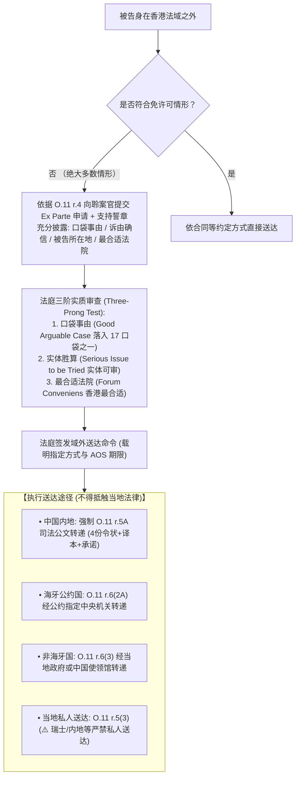

#### O.11 r.1(1) 核心口袋事由（Gateways）速查表

| 口袋条款 | 适用情形 | 实务要点与证明标准 |
| --- | --- | --- |
| **r.1(1)(a)** | 被告定居或常住香港（Domiciled or ordinarily resident in HK） | 适用于香港居民暂时身在海外，依属人管辖权送达。 <small style="opacity: 0.55">〔LG3R L414 "relief is sought against a person domiciled or ordinarily resident within the jurisdiction"〕</small> |
| **r.1(1)(d)** | 合同诉由涉港（Contract gateways）：<br>(i) 合同在香港订立；<br>(ii) 经由在港代理人订立；<br>(iii) 合同明示/默示受香港法管辖；<br>(iv) 合同约定香港法院管辖。 | 最常用的商事口袋。只需满足四项子条件之一即可触发。须附合同文本及缔约往来证据。 <small style="opacity: 0.55">〔LG3R L420 "the claim is brought to enforce, rescind, dissolve, annul or otherwise affect a contract"；LG3R L422–L428 "was made within the jurisdiction … contains a term to the effect that the Court of First Instance shall have jurisdiction"〕</small> |
| **r.1(1)(e)** | 在香港境内违约（Breach of contract committed within HK） | 即使合同在境外订立，只要违约行为（如拒绝在港交付货物/付款）发生在香港即可。 <small style="opacity: 0.55">〔LG3R L430 "the claim is brought in respect of a breach committed within the jurisdiction"〕</small> |
| **r.1(1)(f)** | 侵权损害在香港产生（Tort committed / Damage sustained in HK） | 包含两类：侵权行为发生在香港，或侵权行为虽在海外但原告在香港承受了实际经济/人身损害。 <small style="opacity: 0.55">〔LG3R L432 "the claim is founded on a tort and the damage was sustained, or resulted from an act committed, within the jurisdiction"〕</small> |
| **r.1(1)(g)–(i)** | 涉港不动产/土地/抵押动产权利 | 标的物在香港境内之诉讼（如香港物业所有权、租赁、按揭收楼）。 <small style="opacity: 0.55">〔LG3R L434–L438 "the whole subject-matter of the action is land situate within the jurisdiction … affecting land situate within the jurisdiction"；LG3R L438 "the claim is made for a debt secured on immovable property"〕</small> |
| **r.1(1)(c)** | 必要及适当当事人（Necessary and proper party） | 诉讼中已存在一名已被合法送达的本地被告，境外被告为查明全案必不可少的当事人。 <small style="opacity: 0.55">〔LG3R L418 "a person out of the jurisdiction is a necessary or proper party thereto"〕</small> |

> ⚠️ **未先取得许可的事后救济**：若原告疏忽未先取许可即向境外送达，依据 *China Medical Technologies v Paul Weiss* [2019] HKCFI 2631，法院有权依 O.2 r.1 行使自由裁量权**追溯追认（Retrospective Leave）**送达有效，但原告必须证明存在充分正当理由（Good cause shown）。 <small style="opacity: 0.55">〔LG3V L631 "the court is empowered to grant retrospective leave under O.2 r.1 to rectify the irregularity, if good cause is shown"〕</small>

#### 【本届课后新增】内地↔香港送达新安排

> 学生问及 2026 年 4 月签署的 *Arrangement on Mutual Service of Judicial Documents in Civil and Commercial Proceedings between the Mainland and the Hong Kong Special Administrative Region*。官方原件（律政司）：[doj.gov.hk — service arrangement (EN, PDF)](https://www.doj.gov.hk/en/mainland_and_macao/pdf/service_arrangement_en.pdf)。

| 项目 | 现行制度（**仍是答题与实务依据**） | 2026 年 4 月新安排（**未生效，仅须知情**） |
| --- | --- | --- |
| 渊源 | 1999 年起运作的法院对法院转递制度 | 取代 1999 年安排，属「significant modernization」。 <small style="opacity: 0.55">〔LG3A L50 "the Arrangement on Mutual Service of Judicial Documents … was signed in April 2026"；LG3A L58 "a significant modernization of the process … replacing a system that had been in place since 1999"〕</small> |
| 主要渠道 | 令状副本送呈**香港司法常务官／登记处**，由其转递内地机关执行送达，**动辄数月**、成功率偏低 | **保留**法院对法院转递，但**增设 2 个月内完成的时限**，并容许电子转递。 <small style="opacity: 0.55">〔LG3A L56 "serving documents to Mainland China requires sending copies to the HK Registry which in turns forwards them to the Mainland authorities"；LG3A L58 "requires a two-month completion time and allows electronic transmission"〕</small> |
| 直接送达途径 | 无（私人送达在内地为 O.11 r.5(3) 项下严禁之列） | **新增三种直接方式**：① 邮递送达；② 经**获授权律师或公证机构**送达；③ 经受送达人**同意**以电子方式（电邮／传真）送达。 <small style="opacity: 0.55">〔LG3A L58 "new, direct methods of service: service by post, service through authorized lawyers or notarization institutions"；LG3R L532 "the writ must be served through the judicial authorities of the Mainland or Macao"；LG3R L504 "which is contrary to the law of that country or place"〕</small> |
| 并用与优先 | 采单一渠道 | 多种途径**可并行尝试**，**以最先送达成功者为准**，并设「deemed service（推定送达）」条款。 <small style="opacity: 0.55">〔LG3A L58 "Parties may now attempt these multiple modes in parallel, with the first successful service taking precedence"〕</small> |
| 生效时点 | 现在有效 | ⚠️ **Article 19**：须待**最高人民法院发出相关司法解释**、且**香港完成内部法律程序（包括修订《高等法院规则》）**后方始生效。讲师明示：现阶段执业者**仍须沿用旧制度**。 <small style="opacity: 0.55">〔LG3A L60 "the provisions of this new Arrangement are not yet in effect"；LG3A L60 "it will commence only after the Supreme People's Court issues a relevant judicial interpretation"；LG3A L62 "legal practitioners must continue to use the existing, less flexible system"〕</small> |

- ✍️ **答题口径**：涉内地送达，仍以 **O.11 r.5A** 司法公文转递（4 份令状 + 译本 + 承诺）作答；宜**另加一句**提示「2026 年 4 月新安排签署但未生效，规则修订后适用」以展示前沿意识——切勿把新安排写成现行法。 <small style="opacity: 0.55">〔LG3R L532 "the writ must be served through the judicial authorities of the Mainland or Macao"；LG3R L534 "2 copies of the writ and 2 additional copies thereof for the person to be served"；LG3R L544 "must be in Chinese or accompanied by a Chinese translation"〕</small>
- ⚠️ 本卡 §3.4 流程图与 §4 mindmap 中「内地：O.11 r.5A 转递／私人跑腿不生效」的表述**与新安排未生效的状态一致**，故未改动。

**总表索引**：未先取许可即域外送达（含合同约定域外送达）的后果链归并 [§0E 后果链总表](#0J.%20%E7%A8%8B%E5%BA%8F%E5%A4%B1%E8%AF%AF%E5%8F%8A%E5%85%B6%E5%90%8E%E6%9E%9C) 行 6；O.10 r.2 代理送达的后续寄送义务见行 11；r.8A 反制见行 13。


---


### Mainland安排：补上真正课后新公告

2026-10-16律政司已公告：新安排及实施附属法例定于**2027-03-30**生效。截至2026-10-23仍依当时现行程序，不能提前使用新直接方式。9月Additional“尚未生效”仍适用，但生效日已不再全无资料。后续审议或变动须再核；不倒用于早年模拟案件。 <small style="opacity: 0.55">〔NEWCN L11 "定于2027-03-30实施"〕</small>

> **Exam / Drafting Formulation:** "The plaintiff seeks leave to serve the writ out of the jurisdiction under gateway [X], Hong Kong being the forum conveniens."

## 0G. AOS 与 jurisdictional challenge

AOS 是被告在诉讼中的“第一声表态”。**走错一步，全盘皆输**。

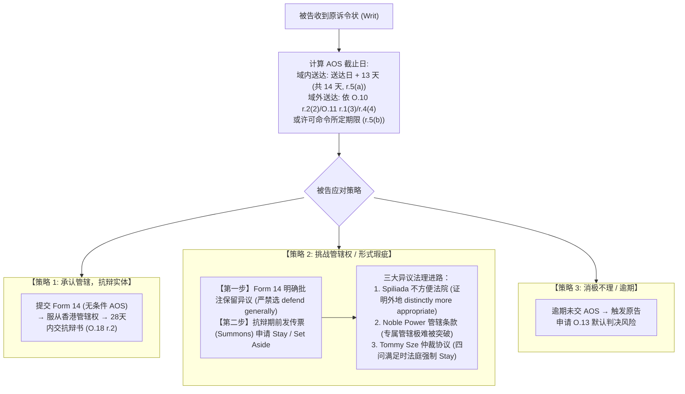


#### O.12 r.8 管辖权异议法定机制与失权红线
- **发出异议传票（O.12 r.8）**：被告须先在 Form 14 表明拟抗辩，再于 Defence 送达期限内以 summons 申请争议管辖权。未依规定提出申请时，r.8(7) 原则上将 AOS 视为 submission to jurisdiction；法院依 O.21 r.1 准许撤回 AOS 时除外。
- **禁止采取实质诉讼步骤（No Step in Action）**：在管辖权异议裁决前，被告绝对不得提交抗辩书（Defence）、不得申请正审担保、亦不得申请文件披露，否则一律构成放弃管辖权异议！
- **不方便法院原则测试（*The Spiliada* [1987] AC 460）**：
  ① 寻找最合适审理法院（Natural Forum）：考量证人所在地、合同管辖法律、履行地、语言及诉讼开支；
  ② 实体正义衡量：若另一法院更合适，但原告在海外无法获得实质正义（如人身安全威胁、政治迫害、过度迟延），香港法院仍可拒绝中止诉讼。


#### 管辖权异议三大攻防进路法理剖析

##### 1. 不方便法院原则（*The Spiliada* [1987] AC 460，香港采纳先例：*The Lanka Muditha* [1991]；*SPH v SA* [2014]）

- **第一阶段（被告举证责任）**：被告必须证明香港不仅不是本案的“自然及适当审判地”（Natural and appropriate forum），而且**存在另一具有管辖权的法域，其明显或显著地更适合审理本案（Distinctly more appropriate）**。 <small style="opacity: 0.55">〔LG3V L667 "the Hong Kong court is not only not the natural and appropriate forum for the trial"；LG3V L667 "there is another available forum which is clearly or distinctly more appropriate than Hong Kong"〕</small>
  - *有力考量因素*：侵权/违约发生地、适用之准据法、关键公共政策、海外已有平行在审诉讼（*Oracle v CITIC*）。 <small style="opacity: 0.55">〔LG3V L675 "the dispute happened abroad … there is pending litigation abroad on the same matter"〕</small>
  - *弱化因素（现代诉讼已不占主导）*：证人在海外（可通过视频取证或差旅）、涉外法律查明（香港法院可听取外国法专家证言）、公司注册地。 <small style="opacity: 0.55">〔LG3V L677 "nowadays it is of less importance to argue that witnesses are located abroad … the company was incorporated elsewhere"〕</small>
- **第二阶段（原告举证责任）**：若被告完成第一阶段证明，原告须证明若被移送外地审理，**原告将在该外国法域被剥夺实质的个人或司法利益（Personal or juridical advantage）**。 <small style="opacity: 0.55">〔LG3V L669 "P would be deprived of a personal or juridical advantage it would otherwise enjoy litigating in Hong Kong"〕</small>
  - *司法利益范例*：外国司法制度缺乏公信力/无法获得实质正义；香港享有特定法定诉因（Cause of action）；香港判赔限额更高；香港诉讼时效显著更长。 <small style="opacity: 0.55">〔LG3V L679 "quality of justice in HK … higher damages available in Hong Kong … longer limitation period in Hong Kong"〕</small>
- **第三阶段（法院综合利益平衡）**：法院衡量剥夺原告利益与公平正义，最终裁决是否中止香港诉讼。 <small style="opacity: 0.55">〔LG3V L671 "the court has to balance between P's interest and D's interest to see whether justice can still be achieved"〕</small>
- ⚠️ **强制前提**：被告在申请不方便法院中止时，**必须在誓章中披露其抗辩性质（Nature of defence）**。若被告连一个可辩驳的实体抗辩都无法提出，不方便法院申请将被直接驳回（*Bayer Polymers v ICBC* [2000]；*Xu Ziming v Ruifeng* [2014]）。 <small style="opacity: 0.55">〔LG3V L673 "D has to state the nature of its defence … will usually lead to dismissal of forum non conveniens argument"〕</small>

##### 2. 专属管辖 vs 非专属管辖条款（*Noble Power Investments v Nissei Stomach* [2008] 5 HKLRD 631）

- **专属管辖条款（Exclusive Jurisdiction Clause）**：当事人明确约定将争议**排他性地**提交特定法院。香港法院恪守合同自由——欲不受该条款约束的一方负**极重的举证负担（heavy burden）**，须提出 **「strong cause」（重大反因由）** 方能说服法庭不令当事人受其合同交易约束。 <small style="opacity: 0.55">〔LG3V L683 "there is a heavy burden to persuade the court not to hold the parties to their contractual bargain"；LG3P L594 "Heavy burden on P to show strong cause against stay"〕</small>
  - ⚠️ **用词纠正**：旧文本此处写作「不可抗力」，属误译——讲义与幻灯片的原文是 **strong cause**，与 *force majeure*／不可抗力无涉，已改。
  - 若约定**外国专属管辖** → 香港诉讼原则上被中止（"a strong case to stay the Hong Kong action"）；若约定**香港专属管辖** → 法庭原则上拒绝中止（"a strong case to refuse stay"）。 <small style="opacity: 0.55">〔LG3V L685 "there will be a strong case to refuse stay … there will be a strong case to stay the Hong Kong action"〕</small>
- **非专属管辖条款（Non-exclusive Jurisdiction Clause）**：若条款将香港列为非专属管辖法院，被告若欲将诉讼移往海外，**必须提出异常强大的充分理由（Very strong reasons）**证明为何不应在香港审理。 <small style="opacity: 0.55">〔LG3V L689 "very strong reasons are needed to show why Hong Kong is not the appropriate forum"；LG3P L597 "If HK is named: very strong reasons needed to show HK not appropriate"〕</small>

##### 3. 仲裁条款强制中止诉讼（*Tommy C P Sze & Co v Li & Fung Trading Ltd* [2003] 1 HKC 418）

当被告依据合同仲裁条款申请中止诉讼时，法院依据《仲裁条例》进行四步审查：
1. 双方是否存在仲裁协议？（被告承担证明责任）
2. 仲裁协议是否存在无效、失效（null and void / inoperative）或无法履行（incapable of being performed）之情形？（**原告承担证明责任**）。 <small style="opacity: 0.55">〔LG3P L604 "Is the agreement null and void, inoperative, or incapable of being performed? (P to prove)"〕</small>
3. 双方之间在客观上是否存在真实的争议或分歧（Dispute or difference）？
4. 该争议或分歧是否完全落入仲裁协议约定的管辖范围之内？
→ 若四项均满足，**香港法院必须无条件裁定永久中止诉讼（Mandatory Stay）**，将争议移交仲裁。 <small style="opacity: 0.55">〔LG3P L607 "If all four answered yes → stay granted"；❓库内无出处（「必须无条件」「永久」二词讲义与幻灯均未出现，《仲裁条例》中止条文亦不在本卡所引材料内，须另核 AO 原文）〕</small>

#### 「认收期限」法定全文：O.12 r.5（本届课后补充 Matter 3 全文照录）

> 讲师说明：幻灯片原摘录（Slide 71）截取过多，故于课后补充材料内附 **O.12 r.5 完整条文**。 <small style="opacity: 0.55">〔LG3A L68 "I also wish to clarify slide 71 … here is the entire O 12 r 5"〕</small>

> "5. Time limited for acknowledging service (O. 12, r. 5)。 <small style="opacity: 0.55">〔LG3R L714 "Time limited for acknowledging service"〕</small>
> References in these rules to the time limited for acknowledging service are references—。 <small style="opacity: 0.55">〔LG3R L716 "References in these rules to the time limited for acknowledging service"〕</small>
> (a) in the case of a writ served **within** the jurisdiction, to **fourteen days after service of the writ (including the day of service)** or, where that time has been extended by or by virtue of these rules, to that time as so extended; and。 <small style="opacity: 0.55">〔LG3R L718 "(a) in the case of a writ served within the jurisdiction … to that time as so extended"〕</small>
> (b) in the case of a writ served **out of** the jurisdiction, to the time limited under **Order 10, rule 2(2), Order 11, rule 1(3), or Order 11, rule 4(4)**, or, where that time has been extended as aforesaid, to that time as so extended." —。 <small style="opacity: 0.55">〔LG3R L720 "(b) in the case of a writ served out of the jurisdiction"〕</small>

- **中文拆解**：
  1. **域内送达**：认收期限 = 令状送达后 **14 日（含送达日当天）**；该期限若因规则本身（如 O.3 r.4 届满日关门顺延）而延展，则以延展后的期限为准。 <small style="opacity: 0.55">〔LG3A L74 "fourteen days after service of the writ (including the day of service)"〕</small>
  2. **域外送达**：**不存在 14 日这个默认数字**——期限由 **O.10 r.2(2)**（诉讼代理人送达）、**O.11 r.1(3)**（免许可域外送达时命令所定）、**O.11 r.4(4)**（许可域外送达命令所定）另行指定；实务上**法庭准许域外送达的命令会直接写明 AOS 应于何时提交**。 <small style="opacity: 0.55">〔LG3A L76 "the time limited under Order 10, rule 2(2), Order 11, rule 1(3), or Order 11, rule 4(4)"；LG3A L80 "the order given by the Court allowing service out of jurisdiction will indicate when the acknowledgement of service is required to be filed"〕</small>
- **考试后果**：往届 2023 Jan Q1b 官方 mark sheet 另以 **2 分**考核「按许可令状域外送达所定期限提交认收」，只答「14 天」不能取分（见本卡 §5.1）。 <small style="opacity: 0.55">〔📄OLD-23J p.1 "File the A/S according to the time given in the order giving leave to serve Writ out of jurisdiction. [2]" ·往届仅参考〕</small>
- ⚠️ 旧文在本节把域外送达情形一并写作「送达日 + 13 天」，已按 r.5(b) 双轨改写（§3.5 流程图、§2.1 状态机同步）。

**总表索引**：AOS 逾期未交、误选 defend generally／异议程序逾期的后果链归并 [§0E 后果链总表](#0J.%20%E7%A8%8B%E5%BA%8F%E5%A4%B1%E8%AF%AF%E5%8F%8A%E5%85%B6%E5%90%8E%E6%9E%9C) 行 7–8；被告方反推链见 [0D](#6.%20%E4%B8%80%E9%A1%B5%E6%9E%81%E9%80%9F%E8%AE%B0%E5%BF%86%E4%B8%8E%E9%80%9F%E6%9F%A5%E5%85%AC%E5%BC%8F%EF%BC%88One-Page%20Exam%20Cheat%20Sheet%EF%BC%89) 链 B／链 C。


---


### 4. 疑难暗礁与避坑指南（Practitioner Reefs & Common Traps）

依据历年考评报告（Examiner's Mark Sheets）与实务司法判例，总结下列极易失分的重大陷阱：

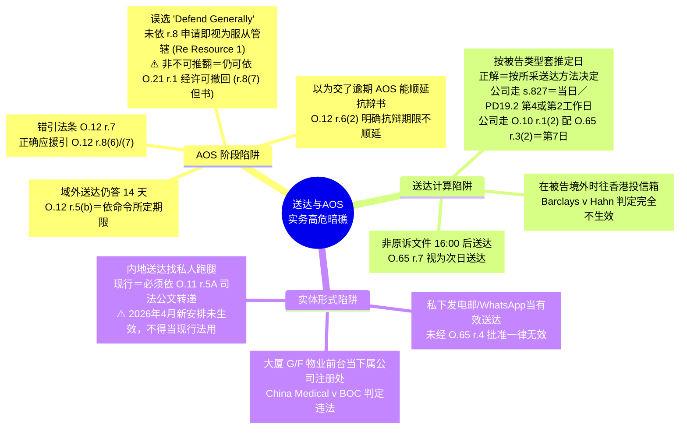

### 深度剖析清单

1. **【AOS 表格勾选陷阱】（往届 2023 Jan Q1b 官方点名扣分区）**： <small style="opacity: 0.55">〔📄OLD-23J p.1 "State that there is an intention to defend generally in the A/S, hence submitting to the jurisdiction of HK courts" ·往届仅参考〕</small>
   - 考卷中常有客户询问：“我想打管辖权异议，在表格上填拟抗辩可以吗？”
   - ❌ **实际失误**：只交AOS却未在Defence期限内作r8申请；不能把“拟抗辩”四字本身当自动服从管辖。往届评分针对其题面保留异议问题，仅作提醒。
   - ✅ **标准答案**：根据 O.12 r.8(6) 及 (7)，被告**若未依 r.8(1)/(2) 于抗辩期内提出申请**，其对令状的认收即被**视为服从法院管辖权**——但 O.12 r.8(7) 原文附有但书："unless the acknowledgment is withdrawn by leave of the Court under Order 21, rule 1"，故此效果**并非不可推翻**，仍可经法庭许可依 O.21 r.1 撤回认收。稳妥实务宜在表格明确保留异议，同时在规则期限内正式作r8申请；单靠附注不能保住异议，法条不以附注取代noticeofintentiontodefend。 <small style="opacity: 0.55">〔LG3R L776 "A defendant who makes an application under paragraph (1) or (2) shall not be treated as having submitted to the jurisdiction of the court"；LG3R L780 "unless the acknowledgment is withdrawn by leave of the Court under Order 21, rule 1"；MATRIX L99 "另外考生常错用 O.12 r.7，应为 O.12 r.8(6)、(7)"〕</small>
2. **【不方便法院论证缺陷】（往届 2023 Jan Q1c 官方点名扣分区）**： <small style="opacity: 0.55">〔📄OLD-23J p.1 "Bespoke cannot show that not only Hong Kong is the inappropriate forum, but London is a distinctively more appropriate forum. [1]" ·往届仅参考〕</small>
   - ❌ **致命错误**：整篇通篇论述“香港法院如何不便”、“在香港打官司太贵”。
   - ✅ **标准答案**：依 *Spiliada*，仅证明香港不便毫无意义，**必须积极证明外国法院是“Distinctly more appropriate”**，并必须指明具体外国法院名称及该法域的管辖连接点。 <small style="opacity: 0.55">〔LG3V L667 "there is another available forum which is clearly or distinctly more appropriate than Hong Kong"；LG3V L693 "The foreign forum which D asserts to be the appropriate forum must be named in the Summons"〕</small>
3. **【电邮与即时通讯知悉不等于合法送达】**：
   - 即使原告把令状 PDF 微信发给被告，被告也回复“我收到了”——**在未获法庭 O.65 r.4 替代送达命令前，该送达在法律上仍属完全无效（Null and void）**，不能据此启动 14 天 AOS 时钟，更不可据此申请默认判决！ <small style="opacity: 0.55">〔LG3R L266 "is effected by taking such steps as the Court may direct to bring the document to the notice of the person to be served"；XSET L73 "三人对电邮送达的定性一致：未经 O.65 r.4 事先批准的替代送达无效"〕</small>
4. **【公司送达公函注明方法＝good practice（非强制）】**：
   - 讲义原话："To avoid confusion, **it is good practice** to indicate the method of service in the covering letter for service as to which method is being adopted (s827 CO or O10r1(2)/O65r3) for service."。 <small style="opacity: 0.55">〔LG3V L407 "To avoid confusion, it is good practice to indicate the method of service in the covering letter"〕</small>
   - ✅ **正确表述**：向本地公司送达时，**宜**在 Covering Letter 中写明本件系依 s.827 CO 抑或 O.10 r.1(2)/O.65 r.3 进行，以锁定相应推定送达日（留置当日／PD 19.2 第 4 或第 2 工作日／第 7 日），避免程序争议。 <small style="opacity: 0.55">〔LG3V L405 "If posting the Writ pursuant to S827 Companies Ordinance look at Practice Direction 19.2 … look at O10r1(3)(a) for the date of deemed service"；LG3V L401 "The deemed time of service under s.827 for a writ sent by ordinary post/registered post addressed to the limited company itself"〕</small>
   - ⚠️ **纠正**：旧文本写作「**必须**在 Covering Letter 中白纸黑字明确」，把讲义的 good practice 升格为强制要件，已按原文降级；亦已删去「以锁定 PD 19.2 的 4 个工作日推定」这一与 O.10 r.1(2) 路径相冲突的单一化表述（同一公司改走 O.10 r.1(2) 时推定日是**第 7 日**，非 4 个工作日）。 <small style="opacity: 0.55">〔LG3R L180 "the date of service shall, unless the contrary is shown, be deemed to be the seventh day"〕</small>
5. **【令状根本未送达时的主动反制工具：O.12 r.8A】**（条文题号）： <small style="opacity: 0.55">〔LG3R L784 "8A. Application by defendant where writ not served"〕</small>
   - 被点名却从未被送达者，可向原告发出**通知（notice）**，要求原告于**自通知送达起不少于 14 日**的指定期限内，**要么**向该被告送达令状、**要么**撤回针对该被告的诉讼（"either to serve the writ on the defendant or to discontinue the action as against him"）。 <small style="opacity: 0.55">〔LG3R L786 "a notice requiring him within a specified period not less than 14 days after service of the notice"；LG3R L786 "either to serve the writ on the defendant or to discontinue the action as against him"〕</small>
   - 原告逾期未从 → 被告可以传票申请**中止／驳回对该被告的诉讼**（r.8A(2)），传票须以誓章支持并表明拟争辩该诉讼（r.8A(3)）。 <small style="opacity: 0.55">〔LG3R L788 "the Court may, on the application of the defendant by summons, order the action to be dismissed"；LG3R L790 "shall be supported by an affidavit verifying the facts … stating that the defendant intends to contest the proceedings"〕</small>
   - 若原告其后依通知或命令补送令状，被告**仍须在法定认收期限内**认收（r.8A(4)）——不可误以为发过 notice 即免除 AOS 义务。 <small style="opacity: 0.55">〔LG3R L792 "the defendant must acknowledge service within the time limited for so doing"〕</small>
   - 💡 与本卡 §5.1 的往届 2023 Jan Q5a／2025 Aug Q1b 同属「送达未成立 → 被告／原告各有所得」一族：不规则送达下原告取得之默认判决作为权利撤销；根本未送达时被告可主动求驳回。 <small style="opacity: 0.55">〔📄OLD-23J p.3 "The court will set aside the default judgment as a right without considering the merits of the claim. [5]" ·往届仅参考；OLD-25S L26 "Mr. Chan may apply for default judgement on the next working day, i.e. 20 Jun 2025" ·往届仅参考〕</small>

**总表索引**：本节清单 1（AOS 勾选陷阱）→ [0E 总表](#0J.%20%E7%A8%8B%E5%BA%8F%E5%A4%B1%E8%AF%AF%E5%8F%8A%E5%85%B6%E5%90%8E%E6%9E%9C) 行 8；清单 3（电邮知悉≠合法送达）→ 行 5；清单 4（covering letter good practice）→ 行 12；清单 5（O.12 r.8A）→ 行 13；清单 2（不方便法院举证断档）的倒推结构见 [0D](#6.%20%E4%B8%80%E9%A1%B5%E6%9E%81%E9%80%9F%E8%AE%B0%E5%BF%86%E4%B8%8E%E9%80%9F%E6%9F%A5%E5%85%AC%E5%BC%8F%EF%BC%88One-Page%20Exam%20Cheat%20Sheet%EF%BC%89) 链 B。

---


### 6. 一页极速记忆与速查公式（One-Page Exam Cheat Sheet）

```text
====================================================================================================
                        PCLL8010 — LG3 SERVICE & AOS 终极速查秘籍
====================================================================================================

【四大核心数字】
  ★ 14 天   : AOS 认收期限——仅适用【域内送达】：送达日起计 14 天（包含送达日当天！公式 = Service Date + 13）。
              ⚠️ 域外送达无默认 14 天：期限按 O.12 r.5(b) 依 O.10 r.2(2)/O.11 r.1(3)/r.4(4) 或许可命令所指定期限。
  ★  7 天   : ① O.10 r.1(3)(a) 替代送达（挂号／投信箱）之推定送达日——自然人可用，公司经 O.65 r.3(2) 亦可走此路（不扣周末假日！）；
              ② O.3 r.2(5) ≤7 天期间须剔除指明日的界限。
  ★  4 / 2  : 仅限【依 s.827 CO 邮寄注册办事处】这条路径的推定日（PD 19.2：挂号信第 4 工作日／平邮第 2 工作日）；
              ⚠️ 同一条形公司若留置注册办事处＝留置当日生效；若改走 O.10 r.1(2)＝第 7 日。推定日由所采方法决定，非由被告类型决定。
  ★ 28 天   : 抗辩书提交期限（自 AOS 截止日或 SOC 送达日起算，取较晚者；高院受 8 月暑期冻结）。

【三大关键时间公式】
  1. "Within 14 days after X"         ==> 不算 X 当天，X + 14。
  2. "Not less than 14 days prior"    ==> 不算 X 当天，往前倒推 14 整天（X - 14 为最后合规日）。
  3. "2 clear days"                   ==> 首尾两端均不计，中间必须空出整整 2 天。

【主体送达五句话】
  • 自然人  : 优先亲自递交（告知 court docs）；替代走挂号/投信箱（7天推定，人必须在港）。
  • 本地公司: 二条并行路径任选——甲：s.827 留置／邮寄注册办事处（留置当日；邮寄 PD 19.2 第4/第2工作日，无需证明知悉）；
              乙：O.10 r.1(2) 挂号／投信箱，经 O.65 r.3(2) 把住址读作注册或主要办事处（第 7 日推定，誓章须载知悉陈述）。
              ⚠️ s.827 仅优先于 O.65 r.3(1)（面交主席／书记等）；无注册办事处时回到 O.65 r.3（Stevenson Wong [2007] 1 HKLRD 217）。严禁只放大堂（China Medical）。
  • 合伙商号: O.81 r.3 三选一（合伙人 / 营业地主管 / 挂号营业地；未送达合伙人不可执行个人财产）。
  • 境外主体: O.11 必须先拿 Leave（过三关：17口袋 + 实体胜算 + 最合适法院；内地走 O.11 r.5A）；AOS 期限按命令所载，非 14 天。
  • 无法送达: O.65 r.4 替代送达（Ex parte 誓章证明 Impracticable + 建议登报/电邮/WhatsApp）。

【管辖权异议保命铁律】
  • 战术表态: Form14宜明确保留管辖异议；O12r8实质要求拟抗辩通知及按期申请，不能把单一checkbox当自动失权。
  • 阻击进路: 抗辩期前出 Summons —— (1) Spiliada 不方便法院；(2) Noble Power 管辖条款；(3) 仲裁协议强制 Stay。
  • 专属条款: 不受专属管辖约束的一方负 heavy burden，须提出 "strong cause"（＝重大反因由，不是"不可抗力"）。

【本届课后补充四则（Additional Information Matters）】
  • M1 黑雨: 当天任何时段生效即为 specified day（IGCO s.71(2) "throughout or for part of"），无须影响登记处开放。
  • M2 内地: 2026 年 4 月《内地—香港民商事司法协助安排（送达）》已签署但 Article 19 明定尚未生效 → 仍答 O.11 r.5A。
  • M4 公司: s.827 与 O.10 r.1(2)（配 O.65 r.3(2)）并行二选一（Stevenson Wong [2007] 1 HKLRD 217）；s.827 只优先于 O.65 r.3(1)。
  • M5 术语: 原告以 affirmation/affidavit of service 证明送达；被告以 acknowledgement of service 回应送达（＝entering appearance）。
====================================================================================================
```

---

> **Exam / Drafting Formulation:** "The defendant must acknowledge service before challenging jurisdiction and apply under O.12 r.8 within the prescribed period."

## 0H. 申请与操作工程：文书、送达和期限

先以实际事件确定起算点，再核适用规则和个案命令。法院指定的期限、送达方式与普通规则不同时，按实际命令操作。下图从目标日期倒排；确定日期后，再按下表顺序办理。

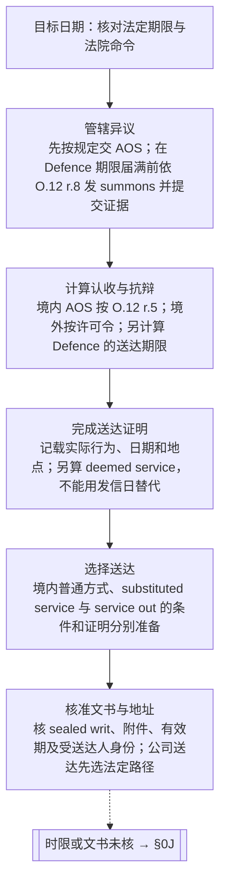

| 步骤 | 应备文书及操作 |
| --- | --- |
| 核准文书与地址 | 核 sealed writ、附件、有效期及受送达人身份；公司送达先选法定路径 |
| 选择送达 | 境内普通方式、substituted service 与 service out 的条件和证明分别准备 |
| 完成送达证明 | 记载实际行为、日期和地点；另算 deemed service，不能用发信日替代 |
| 计算认收与抗辩 | 境内 AOS 按 O.12 r.5；境外按许可令；另计算 Defence 的送达期限 |
| 管辖异议 | 先按规定交 AOS；在 Defence 期限届满前依 O.12 r.8 发 summons 并提交证据 |

- **文书包**：原告先备 sealed writ、须一并交付的文书及送达地址。普通送达完成后由实际送达人作 Affirmation of Service；若须 substituted service，先用 supporting affirmation 证明普通方式不可行及拟用方式能通知被告，再用 draft order 逐项写明执行方式和生效节点。
- **倒排与算例**：有效送达为 28 October 的课堂题，域内 AOS 期限含送达日，到 10 November；Defence 以 AOS 期限届满及 SoC 送达中较迟者为起点，题中为 10 November，其后 28 日到 8 December。被告如争管辖，按这个 Defence 窗口安排 summons，而非从实际提交 AOS 另算。

> **Exam / Drafting Formulation:** "The proposed method is likely to bring the originating process to the defendant’s attention."

### 2.1 状态机模型（State Variables）

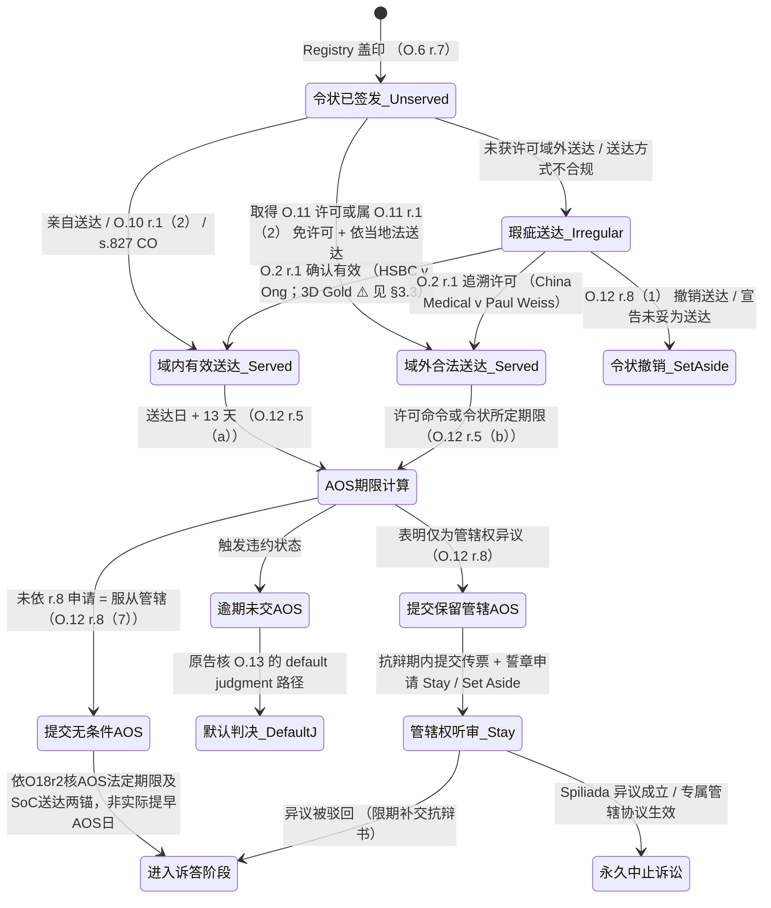

### 2.2 核心控制闸门（Gatekeepers）

| 闸门编号 | 闸门名称 | 法定依据 | 控制逻辑与触发条件 | 底层材料出处 |
| --- | --- | --- | --- | --- |
| **Gate 1** | **属地与有效性闸门** | O.10 r.1(2)<br>*Barclays Bank v Hahn* | 采用邮寄/投信箱替代送达时，被告在**寄发/投递当日必须身在香港辖区内**。若被告身在境外，推定送达绝对不生效，直至其返港并实际知悉。 | <br><br>。 <small style="opacity: 0.55">〔LG3V L263 "service is not valid if at the time of insertion/posting, D was outside jurisdiction"〕〔LG3V L307 "Service takes place when D is in jurisdiction and has knowledge of the writ"〕〔LG3R L172 "A writ for service on a defendant within the jurisdiction may, instead of being served personally on him, be served"〕</small> |
| **Gate 2** | **推定送达日计算闸门（按所采送达方法）** | O.10 r.1(2)–(3)<br>O.65 r.3(2)<br>s.827 CO & PD 19.2 | **推定日由所采用的送达方法决定，不由被告类型决定**：<br>1. 依 **O.10 r.1(2)** 挂号邮寄 / 投信箱（自然人；公司亦可，依 O.65 r.3(2) 以注册或主要办事处代替住址、以 r.3(1) 所列人员的知悉代替被告知悉）→ O.10 r.1(3)(a) **第 7 日推定**（不适用 O.3 r.2(5)），送达誓章须载 7 日知悉陈述；<br>2. 对本地有限公司依 **s.827 CO**：留置注册办事处 → 留置当日；邮寄注册办事处 → 依 PD 19.2 **挂号第 4 工作日 / 平邮第 2 工作日**；无须证明实际知悉（*Ho Kwok Wah*）；<br>3. 对公司，s.827 与 O.10 r.1(2)（配 O.65 r.3(2)）是**并行二选一**的方法（*Stevenson Wong and Co v Goldsense Technology Ltd* [2007] 1 HKLRD 217）；s.827 只优先于 O.65 r.3(1)（向主席、秘书等人员面交）。讲义称送达公函写明所采方法是 good practice。 | <br><br><br><br><br><br><br>。 <small style="opacity: 0.55">〔LG3V L287 "Deemed to be the 7th day after the day the Writ is sent to or inserted thru letterbox"〕〔LG3V L405 "If posting the Writ pursuant to S827 Companies Ordinance look at Practice Direction 19.2"〕〔LG3V L401 "deemed to have reached the registered office on the 4th working day after the writ was sent by registered post"〕〔LG3V L399 "there is no need to establish that there was actual notice of the Writ"〕〔LG3R L350 "A document may be served on a company by leaving it at, or sending it by post to, the company’s registered office"〕〔LG3R L258 "for the reference to the usual or last known address of the defendant there were substituted"〕〔LG3A L94 "S827 service and O10 r1(2) are alternative methods of service (Stevenson Wong and Co v Goldsense Technology Ltd [2007] 1 HKLRD 217 (CFI))"〕〔LG3P L306–L315 "4th working day after the writ was sent by registered post … deemed to be seven days after posting"〕</small> |
| **Gate 3** | **管辖权失权防线闸门** | O.12 r.8(7)<br>*Re Resource 1* | 被告拟挑战管辖权或送达瑕疵，须提交 AOS 并**明确表明仅为挑战管辖权而认收**，再于**抗辩期内**依 O.12 r.8(1)/(2) 以传票 + 誓章申请。未在抗辩期内依 r.8 申请的，AOS 即被视为服从香港管辖；O.12 r.8(7) 原文另有但书："unless the acknowledgment is withdrawn by leave of the Court under Order 21, rule 1"。 | <br><br><br>。 <small style="opacity: 0.55">〔LG3V L657 "File an Acknowledgement of Service with an express reservation that D only submits to the jurisdiction"〕〔LG3V L661 "the filing of an A/S unconditionally is taken to have submitted to the jurisdiction of Hong Kong Courts"〕〔LG3R L780 "unless the acknowledgment is withdrawn by leave of the Court under Order 21, rule 1"〕〔MATRIX L99 "应为 O.12 r.8(6)、(7)"〕</small> |
| **Gate 4** | **域外送达法定门槛闸门** | O.11 r.1 & r.4<br>O.10 r.3(2) | 原告向境外主体送达令状，除 **O.11 r.1(2)** 规定的免许可情形外（如依成文法原讼法庭有权审理、即使被告不在司法管辖区内的申索），**必须先取得法庭许可（Leave）**；**按合同约定方式向域外送达，同样须取得 O.11 r.1(1) 许可或属 r.1(2) 免许可**（O.10 r.3(2)）。取得许可须同时过三关：(1) 有良好可争辩理由落入 r.1(1) 事由之一（共 17 项）；(2) 实体有可审理争议；(3) 香港为最合适法院（Forum Conveniens）。 | <br><br><br><br><br>。 <small style="opacity: 0.55">〔LG3V L537 "Generally, leave is required to serve writ out of jurisdiction"〕〔LG3V L337 "P still needs to consider O. 11 r1 and apply for leave to serve out of jurisdiction unless permitted without leave"〕〔LG3V L559–L563 "good arguable case … serious issue to be tried … most appropriate forum to try the case"〕〔LG3R L222 "A writ which is served out of the jurisdiction in accordance with a contract shall not be deemed to have been duly served"〕〔LG3R L462 "Service of a writ out of the jurisdiction is permissible without the leave of the Court"〕〔LG3P L240 "Exception (r.3(2)): Service out of jurisdiction still needs O.11 leave unless permitted without leave"〕</small> |

---


> 
> ## 0G. LG3整堂课堂回流与现代规则校准（2026-10-23）
> 
> 本次读完T3FULL全部1227条正文（L31–L3709），与Notes／REV及Additional五项区分：自动字幕并非法条定本；口头问题在Additional有正式解决的，按该解答更新，不永久保留“老师稍后查”。
> 
> | 课堂解释／操作 | 落地要求与边界 | 出处／对应原卡 |
> |---|---|---|
> | 法律课内范围 | 讲师说其lectureoutline／PPT均可考，额外书中未列案例不在其设题范围；这是该讲师说明，不能变成全课程免读法源。 | T3FULL L133–139；原§0材料矩阵。 <small style="opacity: 0.55">〔T3FULL L133 "everything in the lecture outline"〕</small> |
> | 算日 | after/from不数起日；cleardays两端不数；≤7日排specifiedday但明确排除条款另核。O10邮寄／信箱的第7日不套短期间排除。 | 同一7日不是同一算法；T3FULL L970–1045。 <small style="opacity: 0.55">〔T3FULL L1039 "Rule two five is expressly ignored."〕</small> |
> | 黑雨及夏休 | 课堂追问partday黑雨未答完，AdditionalMatter1已经给整天定义；暑休区分O3r3pleadings、HCO31≤1月及法院另命，DC不照套。 | 不能把WS当pleading，也不能把所有HC期限都延整月。T3FULL L529–679。 |
> | 选择送达方式 | 个人送达利于明确当日及收件人，非必须永远优先；邮寄若退回不能作不真实belief。 | 律师接受service≠已fileAOS，承认收到不等于完成Form14。 <small style="opacity: 0.55">〔T3FULL L1066 "does not mean that I have filed an acknowledgment of service form."〕</small> |
> | 实地personalservice | 先合理确认身份，告知court-document性质，依法交／留在其面前；不把老师肩拍／pizza电影例当必须动作。 | 拒收、失踪、否认身份分别记录真实尝试，不能从无人开门推定已送。 <small style="opacity: 0.55">〔T3FULL L1660 "must tell them at least that they are court documents."〕</small> |
> | 公司 | s827与O10r1(2)配r65r3(2)两路对应不同deeming及affidavit内容；封面写路径，避免事后择有利时钟。 | registeredoffice楼层不能偷换大堂；AdditionalMatter4完善口头概括。 <small style="opacity: 0.55">〔T3FULL L2011 "our cover letter, say how the document will serve."〕</small> |
> | s803及agent | 海外公司按实际registerednonHKcompany情况核s803；本地agent路径须合同／关系／courtleave等条件，非有香港联系人就能送。 | T3FULL L1153–1216／2062–2104；原§3.3。 |
> | Substitutedservice | 申请者须提出真实能把文件带到D注意的方案和证明；email／messenger／NFT等不是无须courtorder的一般替代。 | 报纸可用但不能不看事实机械选；对经常往来家人、账号或地址的证据才有说服力。 <small style="opacity: 0.55">〔T3FULL L2221 "We need to propose the methods of service."〕</small> |
> | Serviceout | O11gatewaygoodarguablecase、meritsseriousissue及HKappropriateforum分别证明；expartefullfrank；外国方式／lawfulservice独立核。 | 外国公司不自动可境外送／也不自动不宜HK；原§3.4–3.5。 <small style="opacity: 0.55">〔T3FULL L2869 "Hong Kong is the most appropriate forum"〕</small> |
> | 听审排期 | Mainland旧委托程序可能多月且回报失败；尽早调查有效地址、翻译及留足hearingservice时间。 | 四个月是老师经历，不是法定每案完成期；2026新安排生效日另见下段。 <small style="opacity: 0.55">〔T3FULL L3052 "Try to fix your hearing a bit later"〕</small> |
> | Jurisdiction | r8(1)瑕疵／leave／writ等与r8(2)不应exercise分开；Spiliada、jurisdictionclause、arbitration不共用一套负担。 | 外国证人可remote、外国法可expert，不将任何单一因素当决定性。 <small style="opacity: 0.55">〔T3FULL L3268 "foreign law applies."〕</small> |
> | 附注与期限 | 宜明确保留异议，但真正保护来自依法作r8申请；期限是time limited forserviceDefence，不是“只要还未实际fileDefence便永远可异议”。 | 口头L3541–3568略语必须服从r8(1)(2)(6)(7)。 <small style="opacity: 0.55">〔R12NEW L77 "within the time limited for service of a defence"〕</small> |

## 0I. 攻防与执行前核对

### 0I.1 申请人或原告的准备与核对

发出程序前核送达方法、正确受送达人和回证；替代方式须能合理把程序带到被告注意。

### 0I.2 答辩人、被告与第三方的应对

被告以出境纪录、地址和送达证据挑战有效性；若争管辖，须按期限申请，不能只在 Form 14 勾选。

### 0I.3 签署、送达或执行前的最终核对

送达记录分清亲自交付、寄出、投入信箱与法定推定日；把承认送达与管辖异议分开记录。


## 0J. 程序失误及其后果

> 「不做／做错会怎样」集中在一张总表，正文各环节以其行号回点（§3.1→行 9、§3.2→行 1–2/14、§3.3→行 3–5/10/12、§3.4→行 6/13、§3.5→行 7–8、§4→行 5/8/12/13、§5.2→行 1–3）。【自动后果】＝无需对方动作即发生；【制裁暴露】＝对方或法院可启动的不利命令；【举证负担】＝想止血者要证明什么；【救济门槛】＝按哪条规则求宽。库内材料未写明文后果者如实标「库内无明文」并进 open 块 O-N1，不臆造。

| # | 失误 | 后果及下一步 |
| --- | --- | --- |
| 1 | 亲自送达未达 *Cheung Ping* 要件（找错人／未递交或放下副本／未告知是 court documents）：域内亲自送达方式不合规 | 【自动后果】送达无效。【制裁暴露】据此取得之默认判决属 irregular，法院作为权利撤销且不问实体。【救济门槛】O.2 r.1 追认：须证被告完全知悉且无实质损害（*HSBC v Ong*／*3D Gold* 两档——技术瑕疵可追认，不保证获准）。 <small style="opacity: 0.55">〔LG3V L317 "served by delivering a copy of the writ to D’s office and leaving it with the receptionist"；LG3V L319 "a writ was served on the general counsel of a firm of accountants rather than on a partner"；LG3V L321 "Court does not tend to look favorably toward declarations of irregularity where the irregularity was purely technical"；📄OLD-23J p.3 "The court will set aside the default judgment as a right without considering the merits of the claim. [5]" ·往届仅参考〕</small> |
| 2 | 挂号／信箱送达时被告身在境外：寄发或投递当日被告不在香港辖区内 | 【自动后果】O.10 r.1(3) 推定**完全不生效**（*Barclays Bank v Hahn*）；直至被告返港并实际知悉，送达方始成立并起算 AOS。【制裁暴露】强行申请默认判决属 irregular，必予撤销。【举证负担】出入境记录、实际知悉日、原告誓章内容（§5.2 Exercise 1(b) 补充核查清单）。 <small style="opacity: 0.55">〔LG3V L263 "service is not valid if at the time of insertion/posting, D was outside jurisdiction"；LG3V L307 "the deeming provision does not apply if D is not within the jurisdiction at the time of service"；OLD-SET3 L105 "Service would be effective upon D’s return to the jurisdiction acquiring knowledge" ·往届仅参考；LG3V L779 "Arthur commenced an action against Bill at the Court of First Instance … served by registered post to Bill's last known address"〕</small> |
| 3 | 公司送达只放大堂／电邮／未达注册办事处：对本地公司未依 s.827 留置于注册办事处（或邮寄注册办事处） | 【自动后果】不满足 s.827＝送达无效（*China Medical v BOC* 终院：G/F 大堂、电邮均不成立）。【制裁暴露】据此 DJ 属 irregular；公司无注册办事处时不能依 s.827，须回 O.65 r.3 一般规定。 <small style="opacity: 0.55">〔LG3V L417 "It does not satisfy s.827 by leaving the Writ at the G/F reception of the Bank of China Tower"；LG3A L100 "If there is no registered office, the limited company cannot be served according to s827"〕</small> |
| 4 | 合伙送达未用 O.81 r.3 三法之一：对合伙商号用三法以外方式送达 | 【自动后果】送达不生效力（*3D-Gold v PwC* 之排他说；与 O.2 r.1 追认说并列未裁决，见 open 块 D-3DGOLD）。【延伸制裁】未被送达的合伙人个人财产**不能**被直接执行。 <small style="opacity: 0.55">〔LG3V L453 "One of the above methods must be used to effect service on partnerships; otherwise the service is ineffective"；LG3V L455 "the rules on enforcing a judgment against the personal assets of partners depend (partly) on whether the partners were served"〕</small> |
| 5 | 未经 O.65 r.4 批准私发电邮／即时通讯当送达：以电邮／WhatsApp 等直接发送令状，未取得替代送达命令 | 【自动后果】法律上完全无效（null and void）：不能启动 AOS 时钟，更不可据此申请默认判决。【救济门槛】唯一出路：ex parte 传票＋誓章申请 O.65 r.4，须证已尽力搜寻＋建议方式合理可能达致知悉（*Chan Yeuk Mui*）。 （WhatsApp 一项库内无出处，见 open 块待核实）。 <small style="opacity: 0.55">〔LG3R L266 "is effected by taking such steps as the Court may direct to bring the document to the notice of the person to be served"；XSET L73 "三人对电邮送达的定性一致：未经 O.65 r.4 事先批准的替代送达无效"；LG3V L473 "it’s impracticable to effect service in the usual methods which gives rise to the Court’s discretion"〕</small> |
| 6 | 未先取 O.11 许可即域外送达：疏忽或侥幸直接向境外被告送达 | 【自动后果】严重程序瑕疵——管辖权基础崩塌：无许可的域外送达不构成对人管辖的程序系属。【救济门槛】唯一补救：O.2 r.1 追溯许可（retrospective leave），须证 good cause shown，属裁量不保证获准（*China Medical v Paul Weiss*）。 <small style="opacity: 0.55">〔LG3V L537 "Generally, leave is required to serve writ out of jurisdiction"；LG3V L631 "the court is empowered to grant retrospective leave under O.2 r.1 to rectify the irregularity, if good cause is shown"；LG3R L462 "Service of a writ out of the jurisdiction is permissible without the leave of the Court"〕</small> |
| 7 | AOS 逾期未交：域内送达日＋13（共 14 日含送达日）届满未认收；域外按命令所定期限届满未认收 | 【制裁暴露】原告有权依 O.13／O.13A 申请默认判决（入口见 §2.1 状态机；规则主体在 LG06 卡）。【追加后果】逾期补交 AOS **不顺延**抗辩期限（O.12 r.6(2)，§4 mindmap）。【举证负担】原告方须先证送达有效（行 1–6 全链），否则所取 DJ 属 irregular（行 1–3）。 <small style="opacity: 0.55">〔LG3A L74 "fourteen days after service of the writ (including the day of service)"；LG3A L76 "the time limited under Order 10, rule 2(2), Order 11, rule 1(3), or Order 11, rule 4(4)"；LG3R L718 "(a) in the case of a writ served within the jurisdiction … to that time as so extended"；LG3R L720 "(b) in the case of a writ served out of the jurisdiction"〕</small> |
| 8 | 拟异议但未在抗辩期内作r8申请：未按规则申请或异议程序逾期 | 【自动后果】视为服从香港管辖，管辖权异议失权（往届 2023 Jan Q1b 官方点名扣分区；误引 O.12 r.7 同被点名）。【救济门槛】仅余 O.21 r.1 经法庭许可撤回认收（r.8(7) 但书）——须经许可，非自由撤回。 <small style="opacity: 0.55">〔LG3R L776 "A defendant who makes an application under paragraph (1) or (2) shall not be treated as having submitted to the jurisdiction of the court"；LG3R L780 "unless the acknowledgment is withdrawn by leave of the Court under Order 21, rule 1"；📄OLD-23J p.1 "Wrong application of O.12 r.7 – O.12 r.8(6),(7)" ·往届仅参考；MATRIX L99 "另外考生常错用 O.12 r.7，应为 O.12 r.8(6)、(7)"〕</small> |
| 9 | 算错 AOS／期间死线：误用 ≤7 日剔除规则、把普通工作日当假日、误以为暑期 AOS 暂停 | 【自动后果】死线位移：AOS／默认判决／抗辩书连环错位（§3.1 首句「算错一日即导致后续连环位移」）。【举证负担】教师明示考期间计算及假期处理——写得出具体到期日才算完成，只答「14 日内」不算数。 <small style="opacity: 0.55">〔LG3V L197–L201 "if the period is 7 days or less … General holidays (i.e. Sunday and public holidays)"；LG3V L211–L223 "arrange for inspection within 7 days from exchange of list of documents … = 12 October"；LG3R L160 "nothing in this section shall be deemed to extend the time for entering appearance to any writ endorsed with a statement of claim"；CAP-C3 L286 "Please bring a standard calendar"〕</small> |
| 10 | 收回土地诉讼只做入口张贴而省却对被告的送达：把 r.4(2) 张贴当成替代送达；或未许可径贴 | 【自动后果】张贴系「in addition to, and not in substitution for」其他送达方式，单独张贴不生效（§5.1 2025 Aug Q1b 张贴大门应置不顾同例）。【救济门槛】r.4(1) 追认须法庭 satisfied 两前提（无人占有＋无法以其他方式送达）。 <small style="opacity: 0.55">〔LG3R L232 "in addition to, and not in substitution for any other mode of service"；LG3R L228 "if satisfied on an ex parte application that no person appears to be in possession of the premises or land"；OLD-25S L26 "Posting up the Writ is not a proper method of service and should be ignored [2]" ·往届仅参考〕</small> |
| 11 | O.10 r.2 代理送达获准后，未把令状与命令挂号寄海外被告：只送达在港代理人，漏掉条文要求的后续寄送 | 【自动后果】库内无明文 → open 块 O-N1（条文用 must，但库内未载违反的明文后果）。【规则面】法庭命令会限定 AOS 期限，令状与命令副本须邮寄域外被告。 <small style="opacity: 0.55">〔LG3R L208 "must limit a time within which the defendant must acknowledge service"；LG3R L210 "a copy of the order and of the writ must be sent by post to the defendant at his address out of the jurisdiction"〕</small> |
| 12 | 公司送达 covering letter 未注明所采方法：公函没写走 s.827 还是 O.10 r.1(2)／O.65 r.3 | 【自动后果】无明文制裁——讲义口径为 good practice（非强制）。【实务后果】推定送达日锁定争议（第 7 日 vs 留置当日 vs PD 19.2 第 4·第 2 工作日之争，§5.1 2025 Aug Q1b 即此型冲突的土壤）。 <small style="opacity: 0.55">〔LG3V L407 "To avoid confusion, it is good practice to indicate the method of service in the covering letter"〕</small> |
| 13 | 被点名而未被送达：发 r.8A 通知后原告仍不送达／不撤回：原告对 r.8A 通知期（≥14 日）坐视不理 | 【制裁暴露】被告可供誓章传票申请**中止／驳回对该被告的诉讼**（r.8A(2)(3)）。【注意】原告其后补送令状的，被告仍须在法定认收期限内认收（r.8A(4)）——发过 notice 不免 AOS 义务。 <small style="opacity: 0.55">〔LG3R L786 "a notice requiring him within a specified period not less than 14 days after service of the notice"；LG3R L788 "the Court may, on the application of the defendant by summons, order the action to be dismissed"；LG3R L792 "the defendant must acknowledge service within the time limited for so doing"〕</small> |
| 14 | 送达誓章失实：明知被告已搬离仍作 7 日知悉陈述 | 【制裁暴露】誓章不可作＝送达证明链断裂：没有可立的送达日，其后 AOS 时钟与默认判决全失基。【举证负担】原告须能真诚陈述「令状将于 7 日内为被告知悉」＋信件未被退回。 <small style="opacity: 0.55">〔LG3V L293 "If P knows that D is no longer at the address to be served, the deponent cannot make the statement of belief"；LG3V L291 "An affidavit proving service must contain a statement … the copy of the writ so sent will have come to knowledge of the defendant"；LG3R L184 "will have come to the knowledge of the defendant within 7 days thereafter"；LG3R L186 "the copy of the writ has not been returned to the plaintiff through the post undelivered to the addressee"〕</small> |

**使用口径**：本表每行均可在本卡相应小节展开——行 1–2、14 回到 §3.2，行 3–5、10、12 回到 §3.3，行 6、13 回到 §3.4，行 7–8 回到 §3.5，行 9 回到 §3.1；逆向三链（0D）以本表为断点清单。


### 本轮材料回流与后果

```
错误service或错误deeming → AOS／Defence错钟 → default或管辖争议 → 立即核原事实／送达证明 → 正确setaside／r8及期限救济
```

O-N2旧“只看期间一段”已由本节全文阅读记录替代；Moodle后续新字幕／教师修正仍受会话缺口限制。法源新再刊版身份和日期见各源，不宣称所有后续修法穷核。

## 0K. SG 实务应用与导师口径

### 0K.1 SG06：Summons Day 排期与时间算术（服务期满、送达推定与首个传票日推算）

#### 1. 法律关系与核心争点拆解
- **时限倒排与推定送达规则交织**：原告寄出令状与支持誓章，被告在香港境内，涉及平邮 7 天送达推定（O.10 r.1(3)）与周五传票日（PD 5.3 Summons Day）的提前量计算。
- **核心争议**：能否满足法定的 2 clear days 通知规则（O.32 r.3），以及若遇周五为公众假期时如何自动前移至周四。

#### 2. 答题/起草要件映射与操作落点
- **周二 10:00 黄金时点基准（Norman Hui 课堂算例）**：
  - 拟排定本周五 10:00 聆讯，扣除聆讯日、送达日及中间非工作日，最迟必须于**本周二上午 10:00 前**完成向法庭存档与向被告送达；
  - 若送达完成于周二上午 10:00 之后（如周三），首个有效复讯日必须顺排至**下周五的第二个 Summons Day**。
- **SG06 课堂校准要点**：
**Walter：有效挂号收件28Oct，AOS10Nov、Defence8Dec。** 实际收件证据取代7日推定；普通26Oct电邮未给特别送达依据。认收14日包括28Oct，28–31Oct四日＋1–10Nov十日；Defence两支为10Nov后28日8Dec、5Nov后28日3Dec，取较迟。普通SoC若因16:00后服务顺延至6Nov，分支4Dec仍不改变8Dec。 <small style="opacity: 0.55">〔S6-AP L51 "received by registered post a sealed copy"〕〔S6-A3 L74 "including the day of service"〕〔S6-L3 L303 "the deemed date is replaced by the actual date"〕〔S6-R18 L20 "whichever is the later"〕</small>

**Sam：知识与有效送达分开。** 他1Oct离港、28Oct返港；27Oct已入判，儿子电话不能把境外Sam变成域内有效送达人。须核实际送达方式、誓章及特别命令；Hahn应用与CO06撤销路线连接，不以“他知道所以必败”跳过。 <small style="opacity: 0.55">〔S6-AP L71 "returned to Hong Kong on 28 October 2026"〕〔S6-L3 L307 "the deeming provision does not apply if D is not within the jurisdiction"〕</small>

**Macau第三方**：O16发出窗口不替代O11许可，r3(4)proper-party proviso与实体claim／forum均须成立；澳门司法渠道的2020区院官方修订已在SG材料矩阵登记。

[Question 1完整答案](../../01%20SG/SG06%20Civil%20Procedure%201/01%20Question%201%20-%20Walter,%20Ann%20and%20Clement.md) · [Question 2完整答案](../../01%20SG/SG06%20Civil%20Procedure%201/02%20Question%202%20-%20Sam,%20Default%20Judgment%20and%20Discovery.md) · [课堂任务与双时间轴](../../01%20SG/SG06%20Civil%20Procedure%201/00%20Classroom%20&%20Desk.md) · [Q1材料与法源](../../01%20SG/SG06%20Civil%20Procedure%201/01%20Question%201%20-%20Walter,%20Ann%20and%20Clement.md#%E6%9D%90%E6%96%99%E7%9F%A9%E9%98%B5%E4%B8%8E%E5%AE%9E%E9%99%85%E4%BD%BF%E7%94%A8) · [Q2材料与法源](../../01%20SG/SG06%20Civil%20Procedure%201/02%20Question%202%20-%20Sam,%20Default%20Judgment%20and%20Discovery.md#%E6%9D%90%E6%96%99%E7%9F%A9%E9%98%B5%E4%B8%8E%E5%AE%9E%E9%99%85%E4%BD%BF%E7%94%A8)

本节为已入库本届AP的应用回流；规则主述仍在本卡既有深节。旧材料日期及历史快照保留，不把本节学习分析当导师反馈。

> **Exam / Drafting Formulation:** "The time for acknowledging service runs from the date of effective service, including that day for service within the jurisdiction."

#### 3. 导师课堂口径与考场红线（Tutor's Takeaways）
- **绝不踩线计算**：严禁把送达日或聆讯日算入 clear days；公假必须剔除；计算错误导致传票无效将面临即时讼费惩罚。

---

### 0K.2 SG07：Substituted Service（替代送达誓章支持与可执行命令起草）

#### 1. 法律关系与核心争点拆解
- **找不到被告本人的追索僵局**：被告刻意规避送达或搬离原址，原告无法当面交付令状（Personal service practically impossible）。
- **核心程序任务**：起草单方传票（Ex parte summons）及支持誓章（Affidavit in support），证明常规送达受阻并论证替代方式（Substituted service under O.65 r.4）的合理性与实效性。

#### 2. 答题/起草要件映射与操作落点
[本届SG7 AP](../../04%20Base%20Lectures/00%20This%20Year%20Moodle%202026-27/Small%20Group%20Activity%20Plans/1.%20SG7%20Activity%20Plan.md)现已到库：Daniel Sun只有一处已知物理地址，两次上门失败；9月电话未接、WhatsApp双勾无回复、email无退信；7月客户消息已读另属一段记录。练习要求研究并拟间接送达申请，不能把这些联络事实直接写成已经完成有效送达。4Nov客户确认没有其他联络办法，才新增三种电子渠道偏好。 <small style="opacity: 0.55">〔AP7 L150 "The only known physical address"；AP7 L193 "It was delivered (two ticks). There was no reply."；AP7 L296 "he knows of no other means of contacting Daniel Sun"〕</small>

本轮变化是本届适用事实与起草任务已明确；实体测试仍由本卡既有法源承担。誓章来源／阶段及草稿错误同步到[CO16](./%5BCO16%5D%20Affidavits,%20Affirmations%20and%20Exhibits.md)，完整任务与未决见[SG07 Classroom](../../01%20SG/SG07%20Drafting%20Affidavit%20and%20Order%20%28Affirmation%20of%20Service%29/00%20Classroom%20&%20Desk.md)。

#### 2026-11-02 SG07：间接送达的两项证明与可执行命令

**普通送达不可行与所提方法能通知被告，是两个分别需要证据的判断。** 本届SG7不是证明送达已经成功：roof无信箱、锁棚及两次失败，加搜索仅余一地址，支持r.4(1)；号码与email由Daniel在Messenger交接，30Jul双平台read与9月delivery则支持所提方法。9月双勾及无退信均不能写成已读。 <small style="opacity: 0.55">〔AP7 L116 "The message on both platforms were delivered and read"〕〔AP7 L193 "It was delivered (two ticks). There was no reply."〕〔R65 L32 "it appears to the Court that it is impracticable for any reason"〕〔R65 L36 "taking such steps as the Court may direct"〕</small>

| 判断／环节 | 条件与本案操作 | 不满足的后果与补救 |
| --- | --- | --- |
| 普通方式不可行 | 核O.10个人、registered post及letterbox三路径；无信箱不能用门缝替代。无实际挂号尝试就解释屋顶无人及邮寄难通知，不说寄过。 | 只给失败次数不足以解释整体不可行；补实际搜索、观察及合理调查，非固定两次自动准许。 |
| 方法有效性 | 认证Daniel实际recipient account；WhatsApp及email匹配合同、交接链及历史记录；当前活跃证据按真实结果补。 | 不能认证账号时，电子方案无足够基础；换有证据支持的渠道或求方向，不能任意登报充数。 |
| 法院裁量（首要原则） | Chan Yeuk Mui §§14–22：考虑有效通知及可能所在；核心标准是提议方式极有可能使被告知悉（likely to bring to notice），无须绝对保证实际阅读；依有效命令完成即构成合法有效送达。 | 错误／缺关键证据可招致撤令；补证及如实申请，不能以债务强弱治送达瑕疵；事后未实际获悉仅属申请撤销缺席判决的抗辩理由。 |
| 不利判例应对 | Deacons v Stanley Wu §§11–12：拒绝单纯以单一未经验证的 Email 替代送达（担忧真实掌控、垃圾拦截及日常查阅）；最终准 SCMP 广告附加 letterbox 及 email 复合送达。 | 正面回应账号控制、完整文件送达、delivery log 及近期活跃记录；提议多渠道组合（如 WhatsApp + 邮件），非否定电子送达司法管辖权。 |
| 社交媒体送达突破 | Zhuhai Gotech (HCZZ 10/2020)：高院原讼庭正式准许通过 Facebook Messenger 等社交渠道电子副本送达；判词有力区分 Deacons 案（Deacons 并非否定电子送达权限，而是取决于账号受控证据）。 | 须证明当事人历史业务往来、通讯认证及 delivered/read 已读回执，证明渠道与被告有实质连接且最能实现通知。 |
| 送达效力拟制与判决合规 | Melco Crown Gaming v Wong Yam Tak [2014] 3 HKLRD 267：依法院有效命令完成之替代送达，法律上强力推定已带入被告知悉（Treated as brought to D's notice），其后取得之判决为 Regular Judgment。 | 彻底阻断被告日后以“未实际查收/不知道”为由主张送达不合规（Irregular）；排除 ex debito justitiae 绝对撤销权，被告欲撤销必须启动裁量权并证明有胜诉前景抗辩（Merits of defence）。 |
| 指令须具体 | 文件、账号、累计／替代关系、delivery条件及deemed date逐项明确；本案示范三渠道累计。 | 必需渠道失败则不完整履令；依最终order求directions，保存日志并供新compliance affidavit。 |
| 阶段与地域 | 29Sep只用当时材料；4Nov客户确认用于Ex3。数码地址不等于人在香港。 | 新知海外确切地址会改变service-out判断；不能用电子r.4替代O.11要求。 |

法源：   [Earl Deng 的 Gotech 案件报告](https://dcc.law/case_commentary/the-court-of-first-instance-grants-service-by-facebook-messenger/)  送达人须在新的 Affirmation of Service 说明由谁、何时、何地及以何种方式完成送达。 <small style="opacity: 0.55">〔R10 L20 "by sending a copy of the writ by registered post"〕〔CHAN L89 "the Court must consider whether the form of service proposed would be effective"〕〔DEACON L67 "by placing an advertisement in the South China Morning Post"〕〔MELCO L388 "if the service was effected by substituted service, there is a strong argument that that would be treated as having brought the Writ to the notice of D"；MELCO L388 "Melco Crown Gaming (Macau) Ltd v Wong Yam Tak HCA 238/2013"〕〔R65 L86 "must state by whom the document was served"〕</small>

本届完整落点：[六步结构及两项门槛](../../01%20SG/SG07%20Drafting%20Affidavit%20and%20Order%20%28Affirmation%20of%20Service%29/02%20Exercise%202%20-%20Six-Step%20Structure%20and%20Oral%20Answers.md#2.%20%E5%85%AD%E6%AD%A5%E5%B7%B2%E5%A1%AB%E7%BB%93%E6%9E%84) · [具体order及新送达证明](../../01%20SG/SG07%20Drafting%20Affidavit%20and%20Order%20%28Affirmation%20of%20Service%29/03%20Exercise%203%20-%20Substituted%20Service%20Affidavit%20and%20Order.md#3.%20Draft%20Order%EF%BC%9A%E5%AE%8C%E6%95%B4%E8%8B%B1%E6%96%87%E6%AD%A3%E6%96%87) · [一手法源、Gotech参与者报告及版本限制](../../01%20SG/SG07%20Drafting%20Affidavit%20and%20Order%20%28Affirmation%20of%20Service%29/04%20Authorities,%20Evidence%20and%20Material%20Matrix.md#2.%20%E6%B3%95%E6%BA%90%E4%B8%8E%E4%B8%89%E6%A1%88%EF%BC%9A%E8%A7%84%E5%88%99%E5%A6%82%E4%BD%95%E7%94%A8%E4%BA%8E%E6%9C%AC%E6%A1%88)。本次已核区院规则，旧高院来源不再被当作本题唯一法规；主卡数仍13。

> **Exam / Drafting Formulation:** "The proposed steps are likely to bring the writ to the Defendant’s attention."

#### 3. 导师课堂口径与考场红线（Tutor's Takeaways）
- **誓章取证两项必备证明**：
  1. 必须由执行人员详细列明每次上门查访的日期、具体钟点、敲门/按铃反应及邻居询问结果；
  2. 拟提议的替代方式（如电邮、报纸、挂号信投入）必须附上近期的通讯事实（如上周仍在使用的 WhatsApp 记录或电邮往来），严禁凭空假设。

---

### 0K.3 官方附录 Exercise 1 权威全解（Arthur v Bill 送达与管辖权异议综合大题）

#### 1. 法律关系与核心争点拆解
- **当事人及背景**：Arthur（香港原告）向 Bill（英格兰被告）就一笔涉外交易提起违约损害赔偿诉讼。
- **核心争议**：涉及跨国域外送达（O.11 r.1(1) Gateways）、送达令状的有效性及被告提出管辖权异议（O.12 r.8）的胜算评估。

#### 2. 答题/起草要件映射与操作落点
#### 5.1 历年真题标准考核模型穿透

| 考卷年份与题号 | 核心案情事实与模板 | 涉及考点 | 标准踩分点与解题路径 |
| --- | --- | --- | --- |
| **2025 Aug Q1b**（往届 2024-25 学年真题）<br>原件：[2025 Aug Answer Scoresheet](../../02%20Past%20Papers/2025-08%20Aug/Answer%20Scoresheet.md) · [Knowledge Paper](../../02%20Past%20Papers/2025-08%20Aug/1.%20Knowledge%20Paper%20%28Aug%202025%29.md) | 原告 2025 年 6 月 2 日（周一）把令状**挂号寄往自然人被告 Madam Lam 的最后已知住宅地址**，6 月 4 日（周三）又把令状张贴（post up）于该单位大门。题目问：**原告最早可于何日申请默认判决**（非 AOS 截止日）。 | 推定送达 + AOS 期限 + 默认判决申请时点 | 1. 张贴于大门**非正当送达方式，应置不顾**（Scoresheet 给 2 分）；<br>2. ⚠️ **本年讲义口径＝本卡答案**（用户 2026-09-29 决定：有冲突用本年讲义，并⚠️ 标注该点和往年有冲突）：<br>① 本届 LG3 讲义口径（O.10 r.1(3)(a) 第 7 日）：6/2 + 7 日 = **6/9 推定送达** → AOS 含送达日共 14 日 = 6/22（周日）→ 依 O.3 r.4 / Cap.1 s.71(1A) 顺延至 **6/23** → 依官方同一算法（A/S 限期届满后之次一工作日方可申请），**最早可申请默认判决 = 6/24**（本卡推算，库内无原文直陈该日）；<br>⚠️ **与往年官方口径冲突**（以下三说只作冲突记录，不作本题答案）：② 往届 2025 Aug Answer Scoresheet 口径：依 PD 19.2 para 2(a) 挂号邮递第 4 个工作日视为送达 = **6/6** → A/S 限期 **6/19**（O.12 r.5）→ 最早可于下一个工作日**申请默认判决 = 6/20**（与本卡答案差 4 日）；<br>③ 往届 Knowledge Paper docx 内答案表：同走 PD 19.2 口径（6/6 → 6/19），却把「下一个工作日」写作 **6/23**。<br>②③把 PD 19.2（s.827 CO 邮寄公司之推定）套用于**挂号寄给自然人**，与本年讲义「方法决定推定日」口径不一致；②③之间亦差 3 日，且③与同一份 Knowledge Paper 前引之第 7 日口径自相矛盾。旧卡把「AOS 截止 6/23」当作本题踩分点**答非所问**，且漏算 6/22 为周日的顺延一步，均已改正。往届三说（6/20／6/9／6/23）已降为⚠️冲突记录，逐条带 `·往届仅参考`，与文末 `D-AUGQ1` 同步。 <small style="opacity: 0.55">〔OLD-25S L26 "Posting up the Writ is not a proper method of service and should be ignored [2]" ·往届仅参考〕〔D-AUGQ1〕〔LG3V L287 "Deemed to be the 7th day after the day the Writ is sent … unless contrary is shown"；LG3R L180 "the date of service shall, unless the contrary is shown, be deemed to be the seventh day"〕〔OLD-25S L26 "service by registered post deemed to be served on the 4th working day after the date of post [1], i.e. 6 June 2025" ·往届仅参考；OLD-25S L26 "Madam Lam has to file A/S by 19 June 2025" ·往届仅参考；OLD-25S L26 "Mr. Chan may apply for default judgement on the next working day, i.e. 20 Jun 2025" ·往届仅参考〕〔OLD-25K L73 "Mr. Chan may apply for default judgement on the next working day, ie. 23 Jun 2025" ·往届仅参考；OLD-25K L71 "putting at the front door on 4 June 2025 is not effective service" ·往届仅参考〕〔OLD-25K L67 "Presumed to be effective on the 7th day" ·往届仅参考；OLD-25K L69 "Deemed to be served on 9 June 2025" ·往届仅参考〕</small> |
| **2023 Jan Q1b / Q1c**（往届 2022-23 学年真题）<br>原件：[2023 Jan Mark Sheet](../../02%20Past%20Papers/2023-01%20Jan/2.%202023%20JAN%20-%20Mark%20Sheet.pdf) | Small Island Ltd.（港商铺）向英国 Luton 供应商 Bespoke Plaque Ltd. 购 500 块纪念牌，全部面板脱落。Q1b 问**被告方**如何入场抗辩并挑战管辖；Q1c 问**代理原告 Small Island 如何反驳**被告的无管辖立场。 | 域外送达下的 AOS 策略 + *Spiliada* 不方便法院 | Q1b（mark sheet 答案）：① 在 AOS 中表明**仅以「香港法院无管辖权」这一具体根据拟抗辩** [3]，切勿写 intention to defend generally（即服从管辖）；正确援引 **O.12 r.8(6)/(7)**（误引 O.12 r.7 是官方点名错处）；② **按许可令状域外送达所定期限提交 A/S** [2]（O.12 r.5(b)）。<br>Q1c（原告立场；旧卡站错当事人）：① Bespoke 不能仅证明香港不便，**须证明伦敦是 distinctly more appropriate forum，而其举不出该证明** [1]；② 货物已运抵香港、部分证人在港，**港取证更便** [2]；③ 以英国法解释合同对港院**并非难事**（可听外国法专家证据）[2]。 <small style="opacity: 0.55">〔📄OLD-23J p.1 "In the Acknowledgement of Service, state there is an intention to defend on the specific ground that the Hong Kong court has no jurisdiction to hear the matter. [3]" ·往届仅参考；📄OLD-23J p.1 "Wrong application of O.12 r.7 – O.12 r.8(6),(7)" ·往届仅参考；📄OLD-23J p.1 "File the A/S according to the time given in the order giving leave to serve Writ out of jurisdiction. [2]" ·往届仅参考〕</small> |
| **2023 Jan Q5a**（往届 2022-23 学年真题）<br>原件：[2023 Jan Mark Sheet](../../02%20Past%20Papers/2023-01%20Jan/2.%202023%20JAN%20-%20Mark%20Sheet.pdf) | Pao 诉 Fidelity Trading Co Ltd.（700 万借款）。法院署任 clerk 到公司注册办事处所在大厦 **10 楼走廊**，把令状交给刚从 Unit B 出来、自称员工者签收；Fidelity 未认收，Pao 取得默认判决后 Fidelity 发传票申请撤销。问**代理原告**应持何立场。 | s.827 CO 送达要件 × O.10 r.1 方式 × 撤销默认判决 | 1. **不应抵抗该传票**：默认判决系不规则取得，法院将**作为权利（as of right）撤销**且毋须过问实体抗辩 [5]；<br>2. 送达不规则：令状**既未「留置于」注册办事处**（不合 s.827 CO），**亦不属 O.10 r.1 授权的任何送达方式** [5]；<br>3. mark sheet 点名错处：未察觉本案与 *Po Kwong Marble* 类似；另注：纵或认 O.10 r.1 对公司可达送达，亦须送达董事会或经董事会授权之人。 <small style="opacity: 0.55">〔📄OLD-23J p.3 "The court will set aside the default judgment as a right without considering the merits of the claim. [5]" ·往届仅参考；📄OLD-23J p.3 "Service of the Writ was irregular because it was not left at the registered office of the company as per s.827 of the CO; nor was the service authorized under O.10 r.1. [5]" ·往届仅参考；📄OLD-23J p.3 "Did not realise this is similar to the facts in Po Kwong Marble." ·往届仅参考；📄OLD-23J p.3 "service by way of O.10 r.1, even if possible, must be effected on the Board of Directors, or a person authorized by the Board" ·往届仅参考〕</small> |
| **2024 Jul Q2**（往届 2024-25 学年真题）<br>原件：[2024 Jul Review PPT](../../02%20Past%20Papers/2024-07%20Jul/5.%202024%20JULY%20-%20Review%20PPT.pdf) | BamBamBuy（独资经营）向英国公司 Lovely Souvenirs Ltd.（无 CR 注册；唯一股东兼董事 Julian Watts 将来港出席 8 月玩具展）追讨湿损乐高货款。Q2a 问最有效率的起诉与送达方式；Q2b 问 AOS 期限。 | 域内对公司送达（O.10 r.1 配 O.65 r.3）vs O.11 域外送达 + O.12 r.5 双轨 | 1. 事实争议宜以令状起诉 [2]；先考虑在贸易展上**向 Julian Watts 本人送达封章令状**（O.10 r.1 [1]；「贸易展面交本人是否可行」一问 [3]；「董事即属 senior officer」[1]），不成则走 O.11 域外送达；<br>2. AOS：域内送达 = 送达日起计**含送达日共 14 日**（O.12 r.5(a)）[2]；**若依 O.11 域外送达，则按法庭命令所定期限**（O.12 r.5(b)）。 <small style="opacity: 0.55">〔📄OLD-24J p.10 "Issue a Writ of Summons as there is likely to be a dispute on facts [2]" ·往届仅参考；📄OLD-24J p.10 "O.10 r.1 [1] – discuss whether it would be possible to serve a sealed copy of the Writ personally on Julian Watts in Hong Kong when he attends the trade fair in August? [3]" ·往届仅参考；📄OLD-24J p.10 "as a director, he must be a senior officer of Lovely? [1]" ·往届仅参考〕〔📄OLD-24J p.11 "Within 14 days from the date of the service of the Writ (including the date of service) [2]" ·往届仅参考；📄OLD-24J p.11 "if the writ was served under O.11, then the court will provide for the time for acknowledging service of the writ" ·往届仅参考〕</small> |

#### 5.2 官方附录 Exercise 1 权威全解（Arthur v Bill）

> **题目情境**：Arthur 于 2026 年 6 月 12 日（周五）在 CFI 发出令状，同日通过挂号信寄往 Bill 的最后已知地址。6 月 24 日（周三）Arthur 送达了 SOC。Bill 欲应诉抗辩。 <small style="opacity: 0.55">〔LG3V L779 "Arthur commenced an action against Bill at the Court of First Instance … served by registered post to Bill's last known address"〕</small>
> **问题 (a)**：Bill 提交 AOS 的法定截止日期为何时？  
> **问题 (b)**：若 Bill 于 6 月 11 日至 21 日身在东京，6 月 22 日返港才从信箱取信，答案有何不同？需补充何种信息？ <small style="opacity: 0.55">〔LG3V L779 "Would your answer to (a) be different if Bill was in Tokyo … collected the Writ from his letterbox on 22 June?"；LG3V L779 "state, if you consider it necessary, what further information you would need"〕</small>

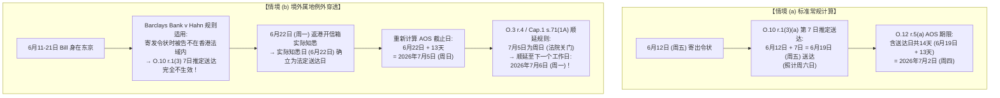

- **补充核查信息清单**：
  1. 出入境记录证明（证明 6月11–21日 确在东京离港）。 <small style="opacity: 0.55">〔LG3V L307 "the deeming provision does not apply if D is not within the jurisdiction at the time of service"〕</small>
  2. 挂号信签收/投递记录（确认信件是否妥投信箱且未被退回）。 <small style="opacity: 0.55">〔LG3V L449 "Affidavit of service to contain the deponent's opinion … and was not returned to P undelivered"〕</small>
  3. 原告送达誓章内容（是否满足 O.10 r.1(3)(b) 诚信知悉陈述）。 <small style="opacity: 0.55">〔LG3V L291 "An affidavit proving service must contain a statement … the copy of the writ so sent will have come to knowledge of the defendant"；LG3R L180 "the date of service shall, unless the contrary is shown, be deemed to be the seventh day"〕</small>

**总表索引**：Exercise 1(b) 的境外反证穿透（*Barclays Bank v Hahn*）与 2023 Jan Q5a 的 irregular 撤销，分别对应 [0E 总表](#0J.%20%E7%A8%8B%E5%BA%8F%E5%A4%B1%E8%AF%AF%E5%8F%8A%E5%85%B6%E5%90%8E%E6%9E%9C) 行 2 与行 1–3；原告防线的完整倒推链见 [0D](#6.%20%E4%B8%80%E9%A1%B5%E6%9E%81%E9%80%9F%E8%AE%B0%E5%BF%86%E4%B8%8E%E9%80%9F%E6%9F%A5%E5%85%AC%E5%BC%8F%EF%BC%88One-Page%20Exam%20Cheat%20Sheet%EF%BC%89) 链 A。

---

> **Exam / Drafting Formulation:** "The Defendant applies within the time limited for service of the Defence to set aside service of the writ."

#### 3. 导师课堂口径与考场红线（Tutor's Takeaways）
- **先提出异议，再按指示抗辩**：被告以送达、forum non conveniens 或仲裁为由争议管辖时，须核对相应法源，并在 Defence 送达期限内提出适当申请。不能只在 Form 14 勾选或先以行为接受法院审理实体争点。

## 1. 第一性原理

| 问题 | 比较方法 |
| --- | --- |
| 本阶段先控制什么风险？ | 发出程序前核送达方法、正确受送达人和回证；替代方式须能合理把程序带到被告注意。 |
| 对方怎样暴露错误？ | 被告以出境纪录、地址和送达证据挑战有效性；若争管辖，须按期限申请，不能只在 Form 14 勾选。 |
| 两条相近程序如何区分？ | Affirmation of Service 证明原告怎样送达；Form 14 是被告向法院认收，两份文书证明不同事实。 |
| 如何把结果变成下一步？ | 先按规定交 AOS；在 Defence 期限届满前依 O.12 r.8 发 summons 并提交证据 |

## 2. 顺向推进

| 步骤 | 参与者完成的工作 | 交接物 |
| --- | --- | --- |
| 确认目标 | 律师确认客户要取得的结果及当前程序状态。 | 行动范围 |
| 核法律入口 | 核 sealed writ、附件、有效期及受送达人身份；公司送达先选法定路径 | 事实与权源清单 |
| 选程序 | 境内普通方式、substituted service 与 service out 的条件和证明分别准备 | 程序与期限记录 |
| 准备材料 | 记载实际行为、日期和地点；另算 deemed service，不能用发信日替代 | 文书与支持证据 |
| 检查对方立场 | 被告以出境纪录、地址和送达证据挑战有效性；若争管辖，须按期限申请，不能只在 Form 14 勾选。 | 异议和回应 |
| 完成下一步骤 | 境内 AOS 按 O.12 r.5；境外按许可令；另计算 Defence 的送达期限 | 送达记录、法院命令或已完成的步骤 |
| 管理余项 | 先按规定交 AOS；在 Defence 期限届满前依 O.12 r.8 发 summons 并提交证据 | 更新后的时间表 |
| 确认执行与补救 | 送达记录分清亲自交付、寄出、投入信箱与法定推定日；把承认送达与管辖异议分开记录。 | 交接及待办记录 |

## 3. 本届规则与操作边界

| 客户所求 / 核心规则节点 | 与本卡主制度的区别及操作边界 |
| --- | --- |
| 送达与认收 | Affirmation of Service 证明原告怎样送达；Form 14 是被告向法院认收，两份文书证明不同事实。 |
| 缺席判决 | CO06–09 的 O.13／O.19 取判以有效送达及相应期限届满为前提。 |

## 4. 工程控制论

| 核对项 | 当事人如何核对 | 发现缺口后的行动 |
| --- | --- | --- |
| 核准文书与地址 | 核 sealed writ、附件、有效期及受送达人身份；公司送达先选法定路径 | 发出程序前核送达方法、正确受送达人和回证；替代方式须能合理把程序带到被告注意。 |
| 完成送达证明 | 记载实际行为、日期和地点；另算 deemed service，不能用发信日替代 | 被告以出境纪录、地址和送达证据挑战有效性；若争管辖，须按期限申请，不能只在 Form 14 勾选。 |
| 管辖异议 | 先按规定交 AOS；在 Defence 期限届满前依 O.12 r.8 发 summons 并提交证据 | 送达记录分清亲自交付、寄出、投入信箱与法定推定日；把承认送达与管辖异议分开记录。 |

## 5. 横向耦合

| 接口 | 两个程序如何衔接 |
| --- | --- |
| 送达与认收 | Affirmation of Service 证明原告怎样送达；Form 14 是被告向法院认收，两份文书证明不同事实。 |
| 缺席判决 | CO06–09 的 O.13／O.19 取判以有效送达及相应期限届满为前提。 |

> 五原则之**横向**落点。每条＝「本卡规则如何进另一环节／另一主卡的世界」，给落实点与出处；规则主体归各主卡，本卡不复制。

| 接口 | 两个程序如何衔接 |
| --- | --- |
| **送达 × 默认判决（O.13／O.13A）** | 送达是默认判决的前置审查点：送达无效 → irregular 默认判决，作为权利撤销且不问实体；送达有效＋AOS 逾期 → regular 轨道，其撤销规则主体在 [CO06 卡](./%5BCO06-09%5D%20Pre-Trial%20Judgments,%20Admissions%20and%20Interim%20Payment.md)；2023 Jan Q5a：10 楼走廊交予自称员工者，既非「留置于注册办事处」（不合 s.827）亦非 O.10 r.1 授权方式 → as of right 撤销。 <small style="opacity: 0.55">〔📄OLD-23J p.3 "The court will set aside the default judgment as a right without considering the merits of the claim. [5]" ·往届仅参考；LG3V L305 "there is still no good service"〕</small> |
| **送达誓章 × AOS（一文一答）** | 原告以 affirmation of service **证明**送达、被告以 AOS **回应**送达；SG07 Assignment 2（DDL 2026-11-17 12:00 noon）正考此前者；[SG07 Classroom & Desk](../../01%20SG/SG07%20Drafting%20Affidavit%20and%20Order%20%28Affirmation%20of%20Service%29/00%20Classroom%20&%20Desk.md)。 <small style="opacity: 0.55">〔LG3A L116 "the plaintiff proves service by filing an affirmation of service, and the defendant responds to service by filing the acknowledgement of service"〕</small> |
| **AOS × 抗辩死线（O.18 r.2／O.12 r.6(2)）** | O18r2以AOS法定期限／SoC送达取较后起算28日，并非以实际提早AOS日启动；**交了逾期 AOS 不能顺延抗辩期**（O.12 r.6(2)，§4 mindmap）——抗辩死线是另一台独立的钟；诉答主体在 [CO04-05 卡](./%5BCO04-05-10%5D%20Pleadings,%20Defence,%20Counterclaims%20and%20Third%20Party%20Proceedings.md)；§6 秘籍「28 天」条；§4 mindmap「以为交了逾期 AOS 能顺延抗辩书」 |
| **算日 × 暑期休庭（HCO s.31）** | 高院 8 月 1–31 日暂停 pleadings 送达／存档／修改期间，区院无暑期休庭；但**令状附有 SOC 时的 AOS 期限不暂停**——「暑期」不是万能停牌器；全年历级总账 → [01 时限表](../00%20Master/01%20Deadlines%20and%20Time%20Limits.md)。 <small style="opacity: 0.55">〔LG3V L225 "the counting of days excludes the Court’s summer vacation (i.e. 1-31 August"；LG3V L229 "there is NO SUMMER VACATION in the District Court"；LG3R L160 "nothing in this section shall be deemed to extend the time for entering appearance to any writ endorsed with a statement of claim"〕</small> |
| **O.11 × 内地↔香港新安排** | 2026 年 4 月新安排已签署但 Article 19 明定未生效（须最高法司法解释＋香港修例）；答题与执业仍走 O.11 r.5A——时间维度上两套制度并存；§3.4 新安排对照表。 <small style="opacity: 0.55">〔LG3A L60 "the provisions of this new Arrangement are not yet in effect"；LG3A L62 "legal practitioners must continue to use the existing, less flexible system"；LG3R L532 "the writ must be served through the judicial authorities of the Mainland or Macao"〕</small> |
| **O.2 r.1 追认裁量（瑕疵补救引擎）** | 域内瑕疵（*HSBC v Ong* 前台代收、*3D Gold* 总法律顾问——纯技术瑕疵无损害）与域外无许可（*China Medical v Paul Weiss* 追溯许可 good cause）共用的补救引擎；但 D-3DGOLD 并列之 O.81 r.3 方式排他说**未裁决**（open 块）。 <small style="opacity: 0.55">〔LG3V L315 "the Court may still exercise its powers under O.2 r.1 to confirm the validity of the service"；LG3V L321 "Court does not tend to look favorably toward declarations of irregularity where the irregularity was purely technical"；LG3V L631 "the court is empowered to grant retrospective leave under O.2 r.1 to rectify the irregularity, if good cause is shown"〕</small> |
| **O.65 r.4 × O.10 失灵** | 替代送达是常规方式 impracticable 时的后备闸：须证明已尽力搜寻、穷尽常规手段，且建议方式合理可能使被告获悉（*Chan Yeuk Mui*）；未经命令先电邮／即时通 = null and void。 <small style="opacity: 0.55">〔LG3R L262 "it is impracticable for any reason to serve that document in the manner prescribed"；LG3V L473 "it’s impracticable to effect service in the usual methods which gives rise to the Court’s discretion"；XSET L73 "三人对电邮送达的定性一致：未经 O.65 r.4 事先批准的替代送达无效"〕</small> |
| **O.12 r.8 × 送达瑕疵** | 撤销送达／宣告未妥为送达是被告对瑕疵送达的主动武器（O.12 r.8(1)，§2.1 状态机）；前提：拟抗辩通知＋抗辩期内r8申请及誓章；保留异议文字不代替申请；§3.5。 <small style="opacity: 0.55">〔LG3R L776 "A defendant who makes an application under paragraph (1) or (2) shall not be treated as having submitted to the jurisdiction of the court"；LG3V L657 "File an Acknowledgement of Service with an express reservation that D only submits to the jurisdiction"〕</small> |
| **O.12 r.8A × 未送达** | 被点名而从未被送达者的主动反制：发 notice 限原告不少于 14 日内要么送达、要么撤回；逾期可求驳回；补送后仍须在法定认收期限内认收；§4 清单 5。 <small style="opacity: 0.55">〔LG3R L786 "a notice requiring him within a specified period not less than 14 days after service of the notice"；LG3R L788 "order the action to be dismissed"；LG3R L792 "the defendant must acknowledge service within the time limited for so doing"〕</small> |

**耦合使用提示**：横向上每条都不是独立法条，而是「一条规则如何进另一环节的死线」——SG 场景问「送达有瑕疵，对方取的默认判决稳不稳」，答在「送达 × 默认判决」行；问「8 月放假 AOS 算不算日子」，答在「算日 × 暑期休庭」行。

## 6. 逆向选择

| 客户目标 | 从目标倒推所需材料与行动 |
| --- | --- |
| 争议送达 | 先收集原告送达记录及客观反证；分别请求纠正送达或撤销已入判的缺席判决。 |
| 保留管辖异议 | 从 Defence 截止日倒排召集证据、发传票及送达，避免先在实体上采取不一致的行动。 |

> 五原则之**逆向**落点。三条倒推链各从失败终点回数，断点落到 [0E 总表](#0J.%20%E7%A8%8B%E5%BA%8F%E5%A4%B1%E8%AF%AF%E5%8F%8A%E5%85%B6%E5%90%8E%E6%9E%9C) 行号；交叉 §3 各 playbook 不重复抄写。

**链 A（原告防）：我的默认判决不能在撤销席上死掉**
- 终点：被告发传票申请撤销默认判决——若送达无效（即无有效送达），法院**作为权利撤销且不问实体**。 <small style="opacity: 0.55">〔LG3V L305 "there is still no good service"；📄OLD-23J p.3 "The court will set aside the default judgment as a right without considering the merits of the claim. [5]" ·往届仅参考〕</small>
- 回数：①送达日确立且无反证（退件？提前知悉？寄发时被告在境外？）→ ②送达方式本身合规（亲自达 *Cheung Ping* 三要件／公司必达注册办事处而非大堂／合伙用 O.81 r.3 三法）→ ③送达誓章两项陈述真实可作（明知被告搬迁不得作知悉陈述）→ ④（域外）先许可后送达、命令载明期限。 <small style="opacity: 0.55">〔LG3V L263 "service is not valid if at the time of insertion/posting, D was outside jurisdiction"；LG3V L299 "If writ is returned through the post, then it’s not deemed served"〕</small>
- 断点：任一环答「否」＝irregular，链断。对策：送达当日建证据包（邮寄凭证／出入境核查／誓章草稿；疑难主体先查 CR 册）。→ 0E 行 1–6、14。 <small style="opacity: 0.55">〔LG3V L293 "If P knows that D is no longer at the address to be served, the deponent cannot make the statement of belief"；LG3V L301 "the actual date replaces the deemed date"；LG3V L307 "the deeming provision does not apply if D is not within the jurisdiction at the time of service"；LG3V L417 "It does not satisfy s.827 by leaving the Writ at the G/F reception of the Bank of China Tower"〕</small>

**链 B（被告攻）：我要把管辖打回起跑线**
- 终点：中止香港诉讼／撤销令状或送达的裁定。
- 回数：①抗辩期内 r.8 传票＋誓章已备（逾期失权，仅余 O.21 r.1 经许可撤回认收）→ ②Form 14 已明批仅为异议（误选 defend generally 同归失权）→ ③选定进路并举证到位：*Spiliada* 须证明另一 distinctly more appropriate forum 且**在传票中点名该外国法院**，誓章还须披露抗辩性质（否则直接驳回）；专属管辖条款须 strong cause；仲裁须过四问。 <small style="opacity: 0.55">〔LG3R L776 "A defendant who makes an application under paragraph (1) or (2) shall not be treated as having submitted to the jurisdiction of the court"；LG3V L673 "D has to state the nature of its defence"〕</small>
- 断点：进路选错或举证断档＝异议死。对策：表态前先核事实落在哪条进路的举证射程内；传票、誓章、点名法院三者同日备齐。→ 0E 行 8。 <small style="opacity: 0.55">〔LG3V L667 "there is another available forum which is clearly or distinctly more appropriate than Hong Kong"；LG3V L683 "there is a heavy burden to persuade the court not to hold the parties to their contractual bargain"；LG3V L693 "The foreign forum which D asserts to be the appropriate forum must be named in the Summons"；LG3R L780 "unless the acknowledgment is withdrawn by leave of the Court under Order 21, rule 1"〕</small>

**链 C（被告防）：我方不能掉进默认判决**
- 终点：AOS 死线错过，原告依 O.13／O.13A 取默认判决（规则主体在 LG06 卡）。
- 回数：①死线已正确算出（域内 14 日含送达日；域外按命令所定期限；≤7 日剔指明日；暑期对附 SOC 令状的 AOS 不暂停）→ ②送达日是否正确（第 7 日推定？留置当日？反证推翻？）→ ③送达是否真的到了我方手上（根本未送达 → r.8A 反制；瑕疵送达 → r.8 异议）。 <small style="opacity: 0.55">〔LG3A L74 "fourteen days after service of the writ (including the day of service)"；LG3V L197–L201 "if the period is 7 days or less … General holidays (i.e. Sunday and public holidays)"；LG3R L792 "the defendant must acknowledge service within the time limited for so doing"〕</small>
- 断点：算错一日＝死线连环位移（§3.1 首句）。对策：收到令状当日立日历卡、经办两人独立算再对数——教师明示考期间计算，写得出具体到期日才算完成。→ 0E 行 7、9、13。 <small style="opacity: 0.55">〔LG3A L76 "the time limited under Order 10, rule 2(2), Order 11, rule 1(3), or Order 11, rule 4(4)"；LG3R L160 "nothing in this section shall be deemed to extend the time for entering appearance to any writ endorsed with a statement of claim"；LG3R L786 "a notice requiring him within a specified period not less than 14 days after service of the notice"；CAP-C3 L286 "Please bring a standard calendar"〕</small>

<!-- === AUDIT_ZONE_START (DO NOT SEND BELOW THIS LINE TO GPT) === -->

---

## 审计留痕：材料矩阵、待核事项与历史修订记录

> [!abstract]- 审计留痕：材料矩阵、待核事项与历史修订记录
> 
> **本轮修订**：按现行节号统一正文及跳转标签，归并高阶模型表，补全程序行动句，并将原引注移至段末、列表项末或相应单元格末。
> 
> 本轮统一操作、攻防、后果与实务应用的章节编号，并保留原有资料与历史核对记录。
> 
> ### 原导航层来源与版本留痕
> 
> > **2026-10-23本轮更新**：新增／校准落点 §0G；当前材料链见[全科当前进度](../_meta/Current%20Progress%20and%20Material%20Uptake.md)。下方带日期的旧快照保留为历史。
> 
> > **定位**：PCLL8010 民事诉讼核心制度专题凝结卡片（Level B 七位一体深度下沉版 / 黄金范本）  
> > **整课互指**：[00 Master Overview §3.2 / §2](../00%20Master/00%20Master%20Overview.md) · [Structure Map](../00%20Master/Structure%20Map.md) · [01 时限表](../00%20Master/01%20Deadlines%20and%20Time%20Limits.md) · [02 流程图](../00%20Master/02%20Procedural%20Flowcharts.md) · [03 真题矩阵](../00%20Master/03%20Past%20Paper%20Matrix%20and%20Analysis.md) · [04 三人对比](../00%20Master/04%20Cross-Set%20Comparison%20and%20SG%20Progression.md) · [07 默认判决卡片](./%5BCO06-09%5D%20Pre-Trial%20Judgments,%20Admissions%20and%20Interim%20Payment.md) · [SG01 Classroom](../../01%20SG/SG01%20Drafting%20LBA/00%20Classroom%20&%20Desk.md)
> 
> ---
> 
> ## 0. 底层材料溯源库与代码表（Source Provenance Index）
> 
> 为确保凝结层每一项法定规则、判例要旨、实务操作与时间算法均可**无缝反向穿透到原始材料与证据链**，本文统一采用下列精确溯源码（点击代码可直接跳转至对应底层文件）：
> 
> > **行号说明（2026-09-27；2026-09-29 更新）**：正文引注（出处码、L 行号、原文摘录三段，以全角方括号包裹）的行号一律按 **REV 版** outline；原版 outline 第 11 行以后的行号 = REV 行号 + 2（REV 只改了 L405、L407 两行的措辞）。2026-09-29 起改用《PCLL Provenance Manual 2026-09-29》§2.2 的行内引注；旧式方括号溯源码及其新旧对照，已按用户 2026-09-29 的决定抹除，本表只保留材料说明（码→文件→层级→学年见文首引注图例）。
> 
> | 溯源码 | 材料性质 | 底层文件位置（直接可点） | 核心贡献内容 |
> |---|---|---|---|
> | **`LG3V`** | **本届讲义·大纲（REV 版为准）** | [LG3 outline (REV)](../../04%20Base%20Lectures/00%20This%20Year%20Moodle%202026-27/Lecture%20Outlines,%20Powerpoints%20&%20Materials/LG3%20-%20Service%20and%20Acknowledgement%20of%20Service%20%28REV%29.md) · [REV docx](../../04%20Base%20Lectures/00%20This%20Year%20Moodle%202026-27/Lecture%20Outlines,%20Powerpoints%20&%20Materials/LG3%20-%20Service%20and%20Acknowledgement%20of%20Service%20%28REV%29.docx) · [原版 md](../../04%20Base%20Lectures/00%20This%20Year%20Moodle%202026-27/Lecture%20Outlines,%20Powerpoints%20&%20Materials/LG3%20-%20Service%20and%20Acknowledgement%20of%20Service.md) | 2026-27 最新官方讲义正文：O.3 时间计算、O.10 域内原诉送达、特殊主体送达、O.11 域外送达、O.12 AOS 与 O.12 r.8 管辖异议 |
> | **`LG3R`** | **本届官方·参考法规** | [LG3 Reference Material](../../04%20Base%20Lectures/00%20This%20Year%20Moodle%202026-27/Lecture%20Outlines,%20Powerpoints%20&%20Materials/LG3%20-%20Reference%20Material.md) · [docx](../../04%20Base%20Lectures/00%20This%20Year%20Moodle%202026-27/Lecture%20Outlines,%20Powerpoints%20&%20Materials/LG3%20-%20Reference%20Material.docx) | RHC O.3 / O.10 / O.11 / O.12 / O.65 / O.80 / O.81 条文；Cap. 1 s.8（附注"read in conjunction with practice direction 19.2"）& s.71；Cap. 4 (HCO) s.31；Cap. 622 (CO) s.827。⚠️ REF **没有** s.803 与 PD 19.2 原文——这两项的出处是 outline（REV L401＝s.827 邮寄推定日、L423–431＝s.803 海外公司四级顺位）与 ppt（PD 19.2 见 Slide 37；海外公司单列 Slide 40，该页在本届 ppt 里仅存标题、内容以 outline 为准；Slide 39 讲的是无注册办事处时回落 O.65 r.3／*China Medical*）〔LG3V L401 "The deemed time of service under s.827 for a writ sent by ordinary post/registered post addressed to the limited company itself"；LG3V L423 "S803 Companies Ordinance (Cap.622)"；LG3P L297 "Slide 37 — Service on Limited Companies (1)"；LG3P L326 "Slide 40 — Service on Overseas Companies"〕 |
> | **`LG3A`** | **本届官方·课后补充** | [LG3 Additional Information after Lecture](../../04%20Base%20Lectures/00%20This%20Year%20Moodle%202026-27/Lecture%20Outlines,%20Powerpoints%20&%20Materials/LG3%20-%20Additional%20Information%20after%20Lecture.md) | Matter 1 黑雨指明日；Matter 2 内地↔香港送达新安排（未生效）；Matter 3 O.12 r.5 全文；Matter 4 公司送达 s.827 与 O.10 r.1(2) 并行（*Stevenson Wong*）；Matter 5 送达誓章 vs AOS |
> | **`LG3P`** | **本届讲义·幻灯片（REV）** | [LG3 ppt (REV)](../../04%20Base%20Lectures/00%20This%20Year%20Moodle%202026-27/Lecture%20Outlines,%20Powerpoints%20&%20Materials/LG3%20ppt%20%28REV%29.md) | 按 Slide 编号引用 |
> | **（案卷附录·本卡未设引注码）** | **本届案卷实务附录** | [LG3 - Appendices.pdf](../../04%20Base%20Lectures/00%20This%20Year%20Moodle%202026-27/Lecture%20Outlines,%20Powerpoints%20&%20Materials/LG3%20-%20Appendices.pdf) | 合约案卷（A6 令状、A9 替代送达誓章、A10 替代送达命令、A31 AOS 表格）、侵权案卷（A50 令状、A51–55 往来信件、A59 D2 送达誓章） |
> | **`MATRIX`** | **历年真题矩阵（凝结层二手整理）** | [03 真题矩阵](../00%20Master/03%20Past%20Paper%20Matrix%20and%20Analysis.md) · 原件：[2025 Aug Answer Scoresheet](../../02%20Past%20Papers/2025-08%20Aug/Answer%20Scoresheet.md) · [2023 Jan Mark Sheet](../../02%20Past%20Papers/2023-01%20Jan/2.%202023%20JAN%20-%20Mark%20Sheet.pdf) · [2024 Jul Review PPT](../../02%20Past%20Papers/2024-07%20Jul/5.%202024%20JULY%20-%20Review%20PPT.pdf) | 2022–2025 八届考题中送达、AOS 期限计算、不方便法院异议评分标准与踩分点 |
> | **`XSET`** | **往届研讨对比（凝结层）** | [04 三人对比](../00%20Master/04%20Cross-Set%20Comparison%20and%20SG%20Progression.md) | 往届三人组在电邮送达、实收推翻推定、送达誓章草拟等争议点上的最佳实务共识 |
> | **`OLD-SET3`** | **往届学生笔记（Tier 3，非官方）** | [Set 3 LG3 笔记](../../06%20Base%20Exam%20Notes/Set%203/LG3%20Service%20and%20acknowledgement%20of%20service.md) | 往届学生 LG3 专题复习笔记：O.3 算期法则、O.10 r.1 替代送达境内要件、*Barclays Bank v Hahn* 判例、*India Videogram* 返港知悉反证 |
> | **（并入 `LG3R`）** | **法定法例规程** | [LG3 Reference Material](../../04%20Base%20Lectures/00%20This%20Year%20Moodle%202026-27/Lecture%20Outlines,%20Powerpoints%20&%20Materials/LG3%20-%20Reference%20Material.md)（法条原文库） | 香港法例《高等法院规则》(Cap. 4A RHC)、《释义及通则条例》(Cap. 1)、《高等法院条例》(Cap. 4 HCO)、《公司条例》(Cap. 622 CO) |
> | **（并入 `LG3V`／`LG3R`）** | **权威司法先例（出处为讲义正文，非案卷附录）** | outline REV L117-121、L307、L317-319、L373-383、L399、L413-417、L453、L473、L631、L661-705 · [本卡 §3.2 判例要点](#实战核心要件与判例攻防要点) | *Barclays Bank v Hahn*, *Chan Yeuk Mui*, *3D Gold v PwC*, *China Medical*, *The Spiliada*, *Lanka Muditha*, *Noble Power* |
> 
> ---
> 
> ### 材料矩阵（纳入、参考与未读一览，自原§0F迁移）
> ## 0F. 材料矩阵：纳入、参考与未读一览（2026-10-10）
> 
> > 按主规范 §8.3：说明纳入、仅作参考、尚未读取与库外未核项；不声称未看材料已融合。码与文件对照见文首 cite-legend 与 §0 溯源库，本表只登记**使用状态**。
> 
> | 材料 | 届别／身份 | 本卡使用状态 |
> |---|---|---|
> | LG3V（本届 LG3 outline REV，行号基准版） | 本届讲义 | **全读**；全卡规则主体依据（原版 outline 仅存档，行号换算见 §0 行号说明） |
> | LG3R（Reference Material：O.3／O.10／O.11／O.12／O.65／O.80／O.81＋Cap.1／HCO／CO 原文） | 本届官方 | **全读**；条文引注主据。⚠️ 无 s.803 与 PD 19.2 原文（见 §0 LG3R 行） |
> | LG3A（Additional Information after Lecture，Matter 1–5） | 本届官方 | **全读**；黑雨指明日、内地新安排、O.12 r.5 全文、公司双轨、誓章与 AOS 之别 |
> | LG3P（本届课堂幻灯 REV） | 本届讲义 | **全读（按 Slide 引用）**；Slide 40 海外公司页仅存标题，内容以 outline 为准（§0 已记） |
> | LG3 Appendices.pdf（合约／侵权案卷 A6–A59） | 本届案卷实务附录 | **登记未逐页重核**（本卡未设引注码）；A9 替代送达誓章、A10 替代送达命令、A31 AOS 表格与 SG07 起草作业直接相关 |
> | CAP-C3（本届 LG3 PT 字幕） | 本届字幕 | **定向校核**（2026-10-05，期间计算一段）；非整卷逐句审核——送达主体／O.11／O.12 r.8 段口头阐释未按字幕校过（open 块 O-N2） |
> | OLD-SET3（Set 3 LG3 学生笔记） | 往届学生稿 | **往届仅参考**；*Barclays Bank v Hahn*／*India Videogram* 返港知悉反证表述，以本届讲义为准 |
> | OLD-25S／OLD-25K（2025 Aug 补充考官方卷） | 往届官方 | **冲突记录专用**（D-AUGQ1 三说）；逐条带·往届仅参考 |
> | OLD-23J／OLD-24J（2023 Jan／2024 Jul 官方考材，pdf） | 往届官方 | **踩分点来源**（📄页码引注）；逐条带·往届仅参考 |
> | MATRIX／XSET（凝结层自撰真题矩阵与三人对比） | 凝结层 | **导航与共识整理**；不作一手规则依据 |
> | 库外未核项 | 库外 | PD 19.2 原文、O.12 r.8 条文官方版面、仲裁条例（Cap. 609）中止条文、Additional Info 提到的 2026 White Book (10/1/18) 摘录、doj.gov.hk 新安排官方 PDF（仅链接登记）——旧不作库外核实限制已由固定规范§15取代；本次已核O12／O80及10月16日律政司公告，其余未核仍保留缺口，标注见 open 块待核实 1–4 |
> 
> ---
> 
> ## 复审修订记录
> 
> * 2026-10-10 §18 规范重构（依据库根《PCLL MATERIAL STANDARDS.md》§18 与用户 2026-10-10 任务分派；样板＝同目录 [LG15] 卡）：**插入式重构、零删减**——既有 §0–§6、四张 mermaid、考题矩阵、速查秘籍、各修订日志、字幕校核与 open 块全部内容与引注原样保留（编辑前已备份至 `_workspace/backup-2026-10-10-8010-institutions/`，逐行比对差异仅为本轮新增）。新增六件：① 速读定位层（a 程序辐射范围＋边界声明、b 关键术语十五项定义、c 各环节解决什么问题，位置：文首 cite-legend 之前）；② 🗺️ 本卡地图（母题结构分支 mermaid——以 Service & AOS 为中心辐射域内送达／特殊主体／域外／AOS／管辖权异议／算日规则六支、虚线挂「做错后果」，＋章节导航图＋任务直达表，位置：cite-legend 与 §0 之间）；③ 五原则实质线补全：新增 0B 顺向五环（签发→送达→效力→AOS→分流）、0C 横向耦合九条（默认判决／O.12／暑期休庭／O.2 r.1／内地新安排等）、0D 逆向倒推三链（判决被撤销／程序被击／死线失守），与既有 §1 第一性（告知 vs 效率）、§2 控制论（状态机＋时钟反馈四闸门）合为五条分析线（位置：§00 全景图与 §1 之间）；④ 0E「环节 × 不做或做错的后果 × 依据」总表 14 行（含库内无明文如实标注），并在 §3.1／§3.2／§3.3／§3.4／§3.5／§4／§5.2 七处插入「总表索引」点题行；⑤ 0F 材料矩阵（纳入／参考／未读一览）；⑥ frontmatter 数据层补齐（type、enriched 2026-10-10、涵盖LG LG3、关联LG LG6／LG4-05、覆盖SG SG7、仅联系SG SG01、LG3 课表 2026-09-08 出处工作表2!C13:C17、SG7 课表并列留痕出处工作表10!E13:E17）。open 块新增 O-N1（O.10 r.2(2) 后续寄送无明文后果）、O-N2（字幕仅定向校核）两条。引注全部沿用既有 12 码，无新码；未动 README／Structure Map／其他卡／SG／04、99 原件。另修复 1 条既有失效链接：文首「整课互指」SG01 Classroom 由 `00 Classroom.md` 正名为 `00 Classroom & Desk.md`（目标文件实况，与 LG15 卡同修例一致）——此为全卡唯一一处对既有行的改写，其余 659 原行逐字未动。
> 
> * 2026-09-27／28 复审修订（依据 PCLL Audit 2026-09-27 附录 `8010-COND-LG01-03.md` 之 S4、S5、M1、M2、M3、M4、L1—L8，及 `linkfix/F6-8010-LG01-03.txt`；并补 T6 已知缺口 ①②③ 与 Additional Info Matter 1—5）。**前序会话已改部分**（§0 溯源表重写并加行号说明、Gate 2/3/4 三条口径、状态机 r.5(a)/(b) 双轨、§5.2 与 §3.1 的 10/2 与「17:00」订正、mermaid 与标题）本次予以保留、未重复改动；本轮改动逐项回本届 LG3 原件（outline REV／Reference Material／ppt REV／Additional Information after Lecture／Appendices）与 2023 Jan、2024 Jul、2025 Aug 真题原件逐字核对后落地。
> 
> * 2026-09-29 出处落实（依据 PCLL Provenance Manual 2026-09-29）：全卡旧 `[S-…]` 溯源标签改写为行内引注共 251 条、172 组（md 摘录 220、📄 页码 16、冲突编号 7、待核实 8；另有 28 处纯「—」括注＝已审无需出处，不计引注；`cite_check.py` 0 ERROR／0 WARN），图例 11 码，文首 §0 溯源表同步；本届可直引的只有 LG3（REV）讲义／ppt、Reference Material 与 Additional Information 四件，2025 Aug／2024 Jul／2023 Jan 真题与 Set 3 学生稿共 34 条（正文 10 行＋文末 open 块 3 行）逐条加 `·往届仅参考`＋限定语气。改正 5 处：①§0 溯源表 `LG3R` 行把 s.803 的 outline 行号记作 REV L421-429、ppt 页码记作 Slide 37／39，回原件实为 L423–431 与 Slide 37／**Slide 40**（Slide 39 是无注册办事处回落 O.65 r.3），已改正并逐条挂引注；②§5.1 2024 Jul Q2 行把 Review PPT p.10 三个得分点合并挂在 [1]，已按原文分列 [1]／[3]／[1]；③§5.1 2025 Aug Q1b 行「下一个工作日用**请默认判决」错字，改为「**申请默认判决」；④§5.1 四行真题与 §3.5／§4 两处提示原以本届口吻陈述往届考卷，已逐行补届别＋限定语气；⑤§00 状态机 mermaid 节点内残留旧 `[S-…]` 码（§8 禁止图内引注），已删。另补注 2 处原全无出处的规则行：§4 第 5 项标题行（O.12 r.8A 条文题号，REF L784）、§5.2 问题 (b)（Exercise 1 原文两句，讲义 L779）。另按用户 2026-09-29 决定执行两项：①§0 溯源表的旧码新旧对照已抹除，只留材料说明；②4 条待核实不到库外核实，仅在原文与文末 open 块保留标注。新登记冲突 3 项：〔D-AUGQ1〕（已按用户 2026-09-29「有冲突用本年讲义」的决定采本届讲义为答案、往年三说降为⚠️冲突记录）、〔D-3DGOLD〕、〔D-COMPO10〕（后两条两说同出本年讲义／本年课后补充，该口径无法择一，仍并列不裁决）；待核实 4 条（见文末 open 块）。底层原件（99／04／05／06）本轮一份未改，只读取证。
> 
> * 2026-09-29 冲突口径（用户决定）：**有冲突处采本年讲义为准，并以 ⚠️ 标注该点和往年有冲突**。本卡适用结果：`D-AUGQ1`（本年讲义 vs 往届官方）已落地——§5.1 2025 Aug Q1b 行改以本届讲义为答案（O.10 r.1(3)(a) 第 7 日 → 6/9 推定送达 → AOS 含送达日 14 日 = 6/22 周日 → 顺延 6/23 → 本卡推算最早申请默认判决 6/24），往届 Scoresheet 6/20、Knowledge Paper 6/9 与 6/23 三说改挂⚠️「与往年官方口径冲突」并逐条保留 `·往届仅参考`。`D-3DGOLD`、`D-COMPO10` **不适用**该口径（两侧同出本届讲义 L315／L453、本届课后补充 L102／L94，非「本年 vs 往年」之争），保持并列并在正文与文末注明原因。同步改动：§5.1 该行、§3.2 判例段、§3.3 本地公司与合伙两行、修订记录 4 处、文末 open 块 3 条现状。
> 
> * **实质纠正**
>   1. **S4｜§5.1 2025 Aug Q1b 行**：原卡把「AOS 截止 6/23」当踩分点，**答非所问**（题目问最早可于何日申请默认判决），且自身算术漏了 6/22 为周日之顺延一步。现以本年讲义为答案，官方三份往届原件（Scoresheet 6/20、Knowledge Paper 6/9 与 6/23）并列作⚠️冲突记录（见下条「未修」1）。
>   2. **S5｜§5.1「2024 Jul Q1」行系捏造**：该题实考 Defence/Counterclaim 与清盘，与送达无关；原卡「公司已迁址未更新 CR」「原告有权申请默认判决」与真实答案相反。整行改回真实的 **2023 Jan Q5a**（Pao v Fidelity：10 楼走廊交予自称员工者签收 → 既非「留置于注册办事处」亦非 O.10 r.1 授权方式 → 送达不规则 → 默认判决作为权利撤销；mark sheet 点名 *Po Kwong Marble* 类比）。
>   3. **M4｜§5.1 2023 Jan Q1c 站错当事人**：题目要求代理**原告** Small Island 反驳中止申请，原卡写成被告拟发传票申请 Stay。现按 mark sheet 采原告立场（Bespoke 举不出伦敦 distinctly more appropriate；货物与部分证人在港；港院可听英国法证据），并补 Q1b「按许可命令所定期限提交 A/S」（2 分）得分点。
>   4. **L4｜§3.5 专属管辖段「极其异常的不可抗力」** → 误译，讲义 L683／Slide 66 原文为 **strong cause** ＋ heavy burden，已改正并附英文原话。
>   5. **L4｜§3.3 收回土地行「张贴当日生效」** → 库内无依据，改为 ⚠️ 标注；并按 REF L224-232 补入 O.10 r.4(2)「入口显眼张贴系 *in addition to, and not in substitution for* 其他送达方式」的强制附加步骤与 r.4(1) 法庭须「satisfied」的两项前提（原卡只写了后者的通俗版，此条为本次复核自行发现，附录未列）。
>   6. **L3｜*3D Gold v PwC* 两说未调和** → §3.2 判例段与 §3.3 合伙表格两处各引一说（outline L317-322 的 O.2 r.1 追认 vs L453 的 O.81 r.3 方式排他），现**并列标注出处、不作裁决**（两说同出本届讲义，用户 2026-09-29「有冲突用本年讲义」的口径对本条不适用）；补全案号引注（[2014] 4 HKC 528；HCA 1192/2011，Deputy Judge Lok，22.05.2014）。
>   7. **L2｜「不可推翻地视为服从管辖」** → 依 REF L776-780 原文改为「未依 O.12 r.8(1)/(2) 申请即视为服从；但有但书 *unless withdrawn by leave under O.21, rule 1*」，§4 清单与 mindmap 同步。
>   8. **M1｜推定送达日「按被告类型」决定** → 讲义（outline L403-407、Slide 37-38、Matter 4）口径为**按所采送达方法**决定；§3.3 本地公司行、§4 mindmap、§6 速查表三处同步为「路径甲 s.827（留置当日／PD 19.2 第 4·第 2 工作日）与路径乙 O.10 r.1(2) 配 O.65 r.3(2)（第 7 日）并行二选一（*Stevenson Wong* [2007] 1 HKLRD 217）；s.827 仅优先于 O.65 r.3(1)」。
>   9. **§4 清单第 4 项「必须在 Covering Letter 写明」** → outline L407 原文是 "**it is good practice** to indicate…"，已降级为「宜」，并删去把 PD 19.2 当唯一结果的表述。
>   10. **L1｜§3.1 速查表 10/2 曾被列为排除日**（前序会话已改，本轮复核确认：10/2 周五为普通工作日须计入，答案 10/12 才成立）。
>   11. **L6｜mermaid 与表格内 16 处 `$\rightarrow$`** 数学语法 → 纯文本「→」（表格内原本渲染成字面 `$\rightarrow$`）。
> * **新增（T6 已知缺口 ①②③ ＋ Matter 1／5 ＋ 一手补充）**
>   1. **§3.4 末新设小节「内地↔香港送达新安排（2026 年 4 月签署，尚未生效）」**：照录 Matter 2 要点（取代 1999 年安排、保留法院对法院转递但增设 2 个月完成时限并容许电子转递、新增邮递／获授权律师或公证机构／经受送达人同意之电子送达三种直接途径、可并行尝试且最先成功者优先、附 deemed service 条款），并标明 **Article 19**：须待最高法司法解释＋香港完成内部程序（含修订规则）方生效；附官方 doj.gov.hk 文件链接与「答题仍以 O.11 r.5A 为准」口径。
>   2. **§3.5 末新设小节「O.12 r.5 全文（Matter 3）」**：逐字照录 r.5(a)/(b)（REF L714-720）＋中文拆解＋2023 Jan Q1b 的 2 分后果。
>   3. **§3.2 末新设小节「送达誓章 vs 认收书（Matter 5）」**：五项对照表（性质／提交人／功能／关键内容／一句话串联），并点出 O.10 r.1(3)(b) 两项供证要求与「entering appearance＝提交 AOS」。
>   4. **§5.1 新增 2024 Jul Q2 行**（BamBamBuy v Lovely：贸易展面交董事 vs O.11；AOS 双轨），以补回被删除的捏造行所占据的题位。
>   5. **§4 清单新增第 5 项 O.12 r.8A**（令状未送达时的 notice 反制：≥14 日限期、逾期可求驳回、补送后仍须限期认收，REF L784-792）——本属讲义 REF 已附条文而全卡未提的缺口。
>   6. **§6 速查表新增「本届课后补充四则」块**（Matter 1 黑雨任何时段即指明日、Matter 2 内地新安排未生效、Matter 4 公司双轨、Matter 5 术语区分）与「专属条款＝strong cause」一行。
>   7. **§3.5 仲裁四问第 2 问补举证分配**（null and void/inoperative… 由**原告**举证，Slide 67）。
> * **溯源与标签**：§4 清单第 4 项、§3.5 专属管辖段、§3.2 *3D Gold* 段新增 `[S-LG03-OUTLINE: L407]`、`[S-LG03-PPT: Slide 66/67]`、`[S-LG03-REF: L714-720 / L776-780 / L784-792 / L224-232]`、`[S-LG03-ADD: Matter 2/3/4/5]` 精确锚定；无据或自拟处一律打 **⚠️「库内无依据／自拟（非官方）」**（张贴当日生效、*3D Gold* 两说、内地新安排生效时点）。所有 _ord_ 编号、条文行号、案号均逐条回原件核对后书写，未凭印象。
> * **链接卫生**：本轮新增链接全部为相对路径 md／pdf 外链（内地安排指向 doj.gov.hk 官方 PDF），链接文字不含方括号；未引入裸 wikilink；F6 清单中本卡的 ambiguous wikilink 与坏锚点前序会话已处理，本轮复核 `links.py` 后本卡无新增 bad-anchor／ambiguous／unencoded 条目。
> * **未修 · 待用户决定**（下列第 1 项已按用户 2026-09-29「有冲突用本年讲义」的口径落地，第 2、3 项仍未决）
>   1. **2025 Aug Q1b 口径分歧（库内实为四说）**（本卡 §5.1 原四说并列、未择一；现已按用户 2026-09-29「有冲突用本年讲义」择定①为答案，见文末 `D-AUGQ1`）：① 本届讲义口径 O.10 r.1(3)(a) 第 7 日 → 6/9 → AOS 6/22（周日）→ 顺延 6/23；② 官方 **Answer Scoresheet L26** 口径：把 **PD 19.2 para 2(a)** 第 4 个工作日套用于**挂号寄给自然人** → 6/6 → A/S 6/19 → 最早申请默认判决 **6/20**；③ 官方 **Knowledge Paper（docx 内答案表）** 同走 PD 19.2 却把「下一个工作日」写作 **6/23**。⚠️ 附录只记了「Scoresheet 6/20 对讲义 6/23」两方对立，实际库内是**三方**且②③互差 3 日；且②③与讲义「方法决定推定日」的口径相抵。**已按用户 2026-09-29「有冲突用本年讲义」的决定落地**：①（本届讲义第 7 日口径）为本卡答案，②③④降为⚠️冲突记录、只作往届参考（§5.1 该行与文末 `D-AUGQ1` 已同步）。
>   2. ***3D Gold* 用法统一与否**：附录建议「统一写成不规则但依 O.2 r.1 获确认」。经核对，讲义两段是**两个不同命题**（O.2 r.1 裁量 vs O.81 r.3 方式排他），强行统一会抹去 L453 的排他规则，故按「冲突不裁决」并列；用户 2026-09-29「有冲突用本年讲义」的口径对本条不适用（两说同出本届讲义），仍请用户定夺。
>   3. **§3.3 「O.65 r.3 优于 s.827」反向表述是否全库排查**：本卡已改，但同一命题在 `[LG06]`／`00 Master` 等文件的表述不在本包范围内。
> * **与附录的分歧（清单本身有误或不足处）**
>   1. **附录 S4 的建议修法不完整**：只要求照官方 Scoresheet 改写，未察觉 Scoresheet 与 Knowledge Paper docx 表又互差 3 日（见上「未修」1）。
>   2. **附录 §1「范围」称 LG01 无溯源码／未改动**——LG01 的 pre-fix 快照**确实存在**（diff 结果与现行版相同，即前序会话未动），与 T6 任务书「无快照则说明未动过」的提示不同。
>   3. **附录 M1 把 §3.3 表列作「按被告类型」框架问题**，实际该行原文写的是「s.827 *(优于 O.65 r.3)*」——错在**优先关系过度扩张**（应为仅优先于 r.3(1)、与 O.10 r.1(2) 并行），本轮按 Matter 4 原文改正。
>   4. **附录 L4 指「REF 无 O.10 r.4 推定日」前，未提 O.10 r.4(2) 的强制入口张贴义务**；本卡据此把原被误删的正确要求补回（见「实质纠正」5）。
>   5. **附录 L10 已自陈 handoff §6.1/6.2 与库内实况不符**（[LG06]/[LG07] B 卡其实已存在），本轮确认属实。
> * **观察到但未修（超出本包范围）**：`../00%20Master/03%20Past%20Paper%20Matrix%20and%20Analysis.md` §4/§5 仍是 2025 Aug Q1b 错误口径的**上游源头**（附录 S4 已点名 L124），归 T5；`01 SG/SG01` 指向 [LG01] 的 15 个坏锚点（附录 M8）归 T8；`04 Base Lectures/.../LG03 Service and AOS - Chapter Condensed.pdf` 等打印版按 handoff §5.4 一律不动。
> 
> ---
> 
> ## 2026-10-05 字幕补充与校核 (Caption Supplement & Check)
> 
> > 校核时间：2026-10-05（Asia/Shanghai）。依据本届2026–27课堂字幕；每项标注讲次、相对录像时间及可核对的MD行号。原制作时间、历史材料快照及原稿保留。本轮为定向校核，未逐句回听所有录音；新字幕入库不等于未来SG补充指示、评分范本或整条材料链已齐。
> 
> **期间计算：写得出具体到期日才算完成。** 原卡期间规则保留；补充实际使用步骤：列事件日期→识别适用期间及起算规则→在日历上计算→核周末/公众假期/相关特殊规则→写明具体到期日。不要只答“14日内”。教师明确说会测试期间计算及假期处理。（根据字幕：PCLL8010 LG3 PT，00:08:23–00:08:40；〔CAP-C3 L286 "Please bring a standard calendar"〕） 课堂带日历提醒不构成新的考试携带物品许可；届时仍以正式考试指示为准。
> 
> 
> <!-- BEGIN:open -->
> ### ⚠️ 未裁决冲突
> 
> - **D-AUGQ1**「2025 Aug Q1b：挂号信寄给自然人后，推定送达日与最早可申请默认判决日到底是哪一天」
>   - 一说（本届讲义口径，O.10 r.1(3)(a) 第 7 日）：6/2 寄出 → **6/9 推定送达** → AOS 6/22（周日）→ 顺延 6/23〔LG3V L287 "Deemed to be the 7th day after the day the Writ is sent … unless contrary is shown"；LG3R L180 "the date of service shall, unless the contrary is shown, be deemed to be the seventh day"〕
>   - 另一说（往届 2025 Aug Answer Scoresheet，把 PD 19.2 第 4 个工作日套用于挂号寄自然人）：6/2 → **6/6** → A/S 6/19 → 最早申请默认判决 **6/20**〔OLD-25S L26 "service by registered post deemed to be served on the 4th working day after the date of post [1], i.e. 6 June 2025" ·往届仅参考；OLD-25S L26 "Madam Lam has to file A/S by 19 June 2025" ·往届仅参考；OLD-25S L26 "Mr. Chan may apply for default judgement on the next working day, i.e. 20 Jun 2025" ·往届仅参考〕
>   - 第三说（往届 2025 Aug Knowledge Paper L67／L69，采第 7 日口径）：**6/9 送达**〔OLD-25K L67 "Presumed to be effective on the 7th day" ·往届仅参考；OLD-25K L69 "Deemed to be served on 9 June 2025" ·往届仅参考〕
>   - 第四说（同一份往届 Knowledge Paper L73，改用 PD 19.2 却把「下一个工作日」写作 6/23）：**6/23**〔OLD-25K L73 "Mr. Chan may apply for default judgement on the next working day, ie. 23 Jun 2025" ·往届仅参考；OLD-25K L71 "putting at the front door on 4 June 2025 is not effective service" ·往届仅参考〕
>   - 现状：**已按用户 2026-09-29「有冲突用本年讲义」的决定裁决**——①为本卡答案（6/9 推定送达 → AOS 顺延 6/23 → 本卡推算最早申请默认判决 6/24），②③④降为⚠️与往年官方口径之冲突记录。本条是「本年讲义 vs 往届官方」之争，故该口径可用；下两条 D- 两侧同出本年材料，口径不适用。②③④互差（②与③④相差 3 日；③与④在同一份官方文件内自相矛盾）；且官方把 PD 19.2（本属 s.827 公司送达路径）用于挂号寄自然人，与本届讲义「推定日由所采方法决定」的口径相抵。本卡 §5.1 已改以①为答案、②③④作冲突记录。
> 
> - **D-3DGOLD**「*3D Gold v PwC* 到底确立的是 O.2 r.1 追认裁量，还是 O.81 r.3 方式排他」
>   - 一说（本届讲义 O.10 送达瑕疵段）：不规则送达可依 O.2 r.1 确认有效〔LG3V L315 "the Court may still exercise its powers under O.2 r.1 to confirm the validity of the service despite the non-compliance"〕
>   - 另一说（本届讲义 O.81 合伙送达段）：合伙送达必须采 O.81 r.3 所列方法之一，否则不生效力〔LG3V L453 "One of the above methods must be used to effect service on partnerships; otherwise the service is ineffective"〕
>   - 现状：**未裁决**；用户 2026-09-29「有冲突用本年讲义」的口径**对本条不适用**——两说同出本届讲义（L315 与 L453），不存在「本年 vs 往年」之争。两段是两个不同命题（裁量追认 vs 方式排他），讲义未在文内互相调和；强行统一会抹去 O.81 r.3 的排他规则。本卡 §3.2 取前说、§3.3 合伙表格取后说，两处均已标注。
> 
> - **D-COMPO10**「O.10 r.1 究竟适不适用于有限公司」
>   - 一说（本届课后补充引述的 *Treasure Land Property Consultants v United Smart Development* [1995] 3 HKC 30）：有判例指 O.10 r.1 不适用于有限公司〔LG3A L102 "there have been cases that suggest O10 r1 does not apply to limited companies"〕
>   - 另一说（同一段所载未被遵循的 *Guangdong International Trust and Investment Corp*）：同段并陈未循此说之判例〔LG3A L102 "and those that did not follow"〕
>   - 现状：**未裁决**；用户 2026-09-29「有冲突用本年讲义」的口径**对本条同样不适用**——两说（L102 与 L94）同出本届课后补充，不存在「本年 vs 往年」之争。课后补充只并列点名、未表态；本卡 §3.3 依同件 Matter 4 的本届口径书写（s.827 与 O.10 r.1(2) 系并行二选一〔LG3A L94 "S827 service and O10 r1(2) are alternative methods of service"〕），并⚠️ 标注 L102 所引两判例未被调和；Additional Information 提到的 2026 White Book（10/1/18）摘录不在本卡图例材料内，**按用户 2026-09-29 决定不到库外核实**，此处保留标注。
> 
> ### ❓ 待核实
> 
> > 以下 4 条按用户 2026-09-29 的决定处理：**不到库外核实，只在原文标注**；每条已列出查过的库内文件。
> 
> - **§3.3「收回土地／房屋诉讼」行「张贴当日生效」**〔❓库内无出处（O.10 r.4 未设推定送达日）〕：已查本届 LG3 Reference Material（O.10 r.4(1)／(2) 全文，L224–L232）、本届讲义 O.10 段、LG3 ppt 与往届 Set 3 笔记，只见「authorize／treated as good service」，未见任何推定送达日条款。
> - **§3.3「替代送达」行的 WhatsApp 一项**〔❓库内无出处（WhatsApp 一项）〕：讲义 L491–L497 列出的可能方式是 newspaper／email／fax／PM 等，未点名 WhatsApp；O.65 r.4 原文亦无。已查 REF L262–L266、ppt、往届 Set 3。
> - **§3.3「替代送达」行的推定生效日（完成登报或发送后 N 日）**〔❓库内无出处（替代送达的推定生效日一律取决于命令条款，库内无一般规则）〕：库内无替代送达推定日的一般规则条文，生效时点取决于该个案命令条款。已查 REF O.65 r.4、讲义、ppt。
> - **§3.5 仲裁中止段「必须无条件」「永久」二词**〔❓库内无出处（「必须无条件」「永久」二词讲义与幻灯均未出现，《仲裁条例》中止条文亦不在本卡所引材料内，须另核 AO 原文）〕：已查本届讲义 O.12／仲裁段（L665–L687）、LG3 ppt Slide 59–67 与 Additional Information；《仲裁条例》（Cap. 609）第 17 条原文不在本卡图例所引材料内，须另核。
> 
> ### 🆕 2026-10-10 §18 重构新增登记
> 
> - **【O-N1｜2026-10-10】O.10 r.2(2) 代理送达命令后「未把令状与命令挂号寄海外被告」的明文后果**：LG3R 载明 "a copy of the order and of the writ must be sent by post to the defendant at his address out of the jurisdiction" 且 "must limit a time within which the defendant must acknowledge service"（两处均 must）〔LG3R L208 "must limit a time within which the defendant must acknowledge service"；LG3R L210 "a copy of the order and of the writ must be sent by post to the defendant at his address out of the jurisdiction"〕；已查本届 LG3 outline REV、Reference Material、ppt REV、Additional Information 与往届 Set 3 笔记，均未见违反该寄送义务的**明文后果**（送达是否因此无效、抑或可追认）。涉及判断：0E 总表行 11 如实标「库内无明文」；影响可用性：代理送达后漏寄时本卡给不出规则级答案；下一步：如需答案须到库外 O.10 条文／Blue Book 核字句（按用户 2026-09-29 决定本库内不核）。
> - **【O-N2｜已解决2026-10-23】** 原覆盖缺口已由§0G整份阅读补足；下句为旧状态，不再是当前待办：现有字幕校核为 2026-10-05 定向补充（仅期间计算一题，00:08:23–00:08:40），非整卷逐句审核〔CAP-C3 L286 "Please bring a standard calendar"〕；送达主体段、O.11 域外段、O.12 r.8 异议段的课堂口头阐释、追问答问与课堂例子未按字幕校过。涉及判断：本卡该等部分以 REV 讲义与课后补充为据；影响可用性：讲师口头保守口径可能未落卡；下一步：按 LG7 同款「定向补充与交叉核对」流程按需补校并在修订记录留痕。
> 
> 
> <!-- END:open -->
> ## 2026-10-06 实质内容入口
> 
> 本轮在以下主题稿的0A节新增具体规则、条件、证据、程序选择、后果和演练示例。此页原有正文及引注保留；同一细节从下列入口阅读，避免另复制一份。
> 
> - [0A. 从事实到诉状：逐项选择、起草和补救（已并入主卡）](./%5BCO04-05-10%5D%20Pleadings,%20Defence,%20Counterclaims%20and%20Third%20Party%20Proceedings.md#0B.%20%E8%AF%89%E7%AD%94%E5%8A%9F%E8%83%BD%E3%80%81material%20facts%20%E4%B8%8E%E8%AF%81%E6%8D%AE%E8%BE%B9%E7%95%8C)
> - [0A. 审前取得什么判决：准入、证明与补救](./%5BCO06-09%5D%20Pre-Trial%20Judgments,%20Admissions%20and%20Interim%20Payment.md#9.%20%E6%9D%A5%E6%BA%90%E5%A4%84%E7%90%86%E3%80%81%E7%89%88%E6%9C%AC%E4%B8%8E%E6%9C%AA%E5%86%B3%E4%BA%8B%E9%A1%B9)
> 
> **留痕**：2026-10-06新增本入口；未将导航页/清单改造成另一份重复主题稿。
> 
> > **2026-10-06引注边界恢复**：只在既有来源表和既有未决内容外补回机器标记，表格、旧结论及冲突正文保留。
> 
> > **2026-10-06 链接修复留痕**：按本机Obsidian内部链接解析修正编码、跨库或定位问题；本次仅调整链接与技术标注，原有正文行序保留。逐处记录见课程总库 `output/reviews/Obsidian Link Repair - 2026-10-06.md`。 [完整修复记录](obsidian://open?vault=3b1e77255f6c6e29&file=output%2Freviews%2FObsidian%20Link%20Repair%20-%202026-10-06.md)
> 
> ## 2026-10-23全文字幕、法规及新公告回流
> 
> 新增§0G；撤换活动版AOScheckbox及无行为能力人绝对口径，其他旧稿不丢。
> 
> <details><summary>被撤换的旧句（历史，不再适用）</summary>
> 
> ```text
> 7. **AOS 认收与 O.12 r.8 管辖权异议**：域内 14 日含送达日（r.5(a)）／域外依命令所定期限（r.5(b)）、保留异议三步（Form 14 明批→抗辩期内传票→*Spiliada*／*Noble Power*／仲裁三进路）、O.12 r.8A 未送达反制（§3.5、§4）〔LG3R L718 "(a) in the case of a writ served within the jurisdiction … to that time as so extended"〕；
> - 触发：AOS 状态确定 → 行动：无条件认收 → 28 日抗辩书时钟（O.18 r.2，§6 秘籍）；保留异议 → 抗辩期内 r.8 传票（*Spiliada*／*Noble Power*／仲裁三进路，§3.5）；逾期未认收 → 原告方依 O.13／O.13A 申请默认判决（入口见 §2.1；规则主体在 [CO06 卡](%5BCO06%5D%20Default%20Judgments%20and%20Admissions.md)）→ 产出：案件进入诉答、或被中止／撤销、或被判。**注意**：暑期休庭（HCO s.31）暂停 pleadings 期间，但令状附有 SOC 时的 AOS 期限**不暂停**〔LG3R L160 "nothing in this section shall be deemed to extend the time for entering appearance to any writ endorsed with a statement of claim"〕。详 §3.5、0C 耦合表。
> | **AOS × 抗辩死线（O.18 r.2／O.12 r.6(2)）** | 无条件 AOS 启动 28 日抗辩书时钟；**交了逾期 AOS 不能顺延抗辩期**（O.12 r.6(2)，§4 mindmap）——抗辩死线是另一台独立的钟；诉答主体在 [CO04-05 卡](%5BCO04-05%5D%20Pleadings,%20Amendments%20&%20Striking%20Out.md) | §6 秘籍「28 天」条；§4 mindmap「以为交了逾期 AOS 能顺延抗辩书」 |
> | **O.12 r.8 × 送达瑕疵** | 撤销送达／宣告未妥为送达是被告对瑕疵送达的主动武器（O.12 r.8(1)，§2.1 状态机）；前提：AOS 明批＋抗辩期内传票＋誓章，否则异议失权 | 〔LG3R L776 "A defendant who makes an application under paragraph (1) or (2) shall not be treated as having submitted to the jurisdiction of the court"；LG3V L657 "File an Acknowledgement of Service with an express reservation that D only submits to the jurisdiction"〕；§3.5 |
> | 8 | 拟异议却勾选 defend generally／未在抗辩期内发 r.8 传票 | AOS 表态错误或异议程序逾期 | 【自动后果】视为服从香港管辖，管辖权异议失权（往届 2023 Jan Q1b 官方点名扣分区；误引 O.12 r.7 同被点名）。【救济门槛】仅余 O.21 r.1 经法庭许可撤回认收（r.8(7) 但书）——须经许可，非自由撤回 | 〔LG3R L776 "A defendant who makes an application under paragraph (1) or (2) shall not be treated as having submitted to the jurisdiction of the court"；LG3R L780 "unless the acknowledgment is withdrawn by leave of the Court under Order 21, rule 1"；📄OLD-23J p.1 "Wrong application of O.12 r.7 – O.12 r.8(6),(7)" ·往届仅参考；MATRIX L91 "另外考生常错用 O.12 r.7，应为 O.12 r.8(6)、(7)"〕 |
> | 库外未核项 | 库外 | PD 19.2 原文、O.12 r.8 条文官方版面、仲裁条例（Cap. 609）中止条文、Additional Info 提到的 2026 White Book (10/1/18) 摘录、doj.gov.hk 新安排官方 PDF（仅链接登记）——均按用户 2026-09-29 决定**不到库外核实**，标注见 open 块待核实 1–4 |
> | **无行为能力人**<br>(Minors & MIPs) | **O.80 r.2** | 送达诉讼保护人（Next Friend / Guardian ad litem）；因保护人必须聘请律师（r.2(3)），实务一律送达其代表律师。〔LG3R L404 "a next friend or guardian ad litem of a person under disability must act by a solicitor"〕 | 依送达律师规程确认。 | ❌ 严禁直接向未成年人或精神无行为能力人本人送达令状。〔LG3R L400 "A person under disability may not bring, or make a claim in, any proceedings except by his next friend"〕 |
>    - ❌ **致命错误**：在 Form 14 上填写“intention to defend generally”或直接交回无保留表格。
>    - ✅ **标准答案**：根据 O.12 r.8(6) 及 (7)，被告**若未依 r.8(1)/(2) 于抗辩期内提出申请**，其对令状的认收即被**视为服从法院管辖权**——但 O.12 r.8(7) 原文附有但书："unless the acknowledgment is withdrawn by leave of the Court under Order 21, rule 1"，故此效果**并非不可推翻**，仍可经法庭许可依 O.21 r.1 撤回认收〔LG3R L776 "A defendant who makes an application under paragraph (1) or (2) shall not be treated as having submitted to the jurisdiction of the court"；LG3R L780 "unless the acknowledgment is withdrawn by leave of the Court under Order 21, rule 1"；MATRIX L91 "另外考生常错用 O.12 r.7，应为 O.12 r.8(6)、(7)"〕。必须在表格附注明确声明“仅为异议香港法院管辖权而提交”，并于抗辩期限前正式发 Summons。
> ```
> 
> </details>
> 
> 
> ### Gotech：旧引注缺定位行号，正文改用承办律师的报告直链
> 
> ```text
> 〔GOTECH Deng Report "The Court of First Instance grants service by Facebook Messenger"〕
> ```
