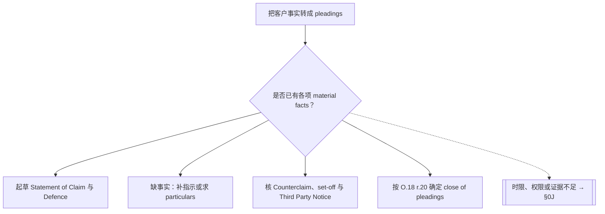
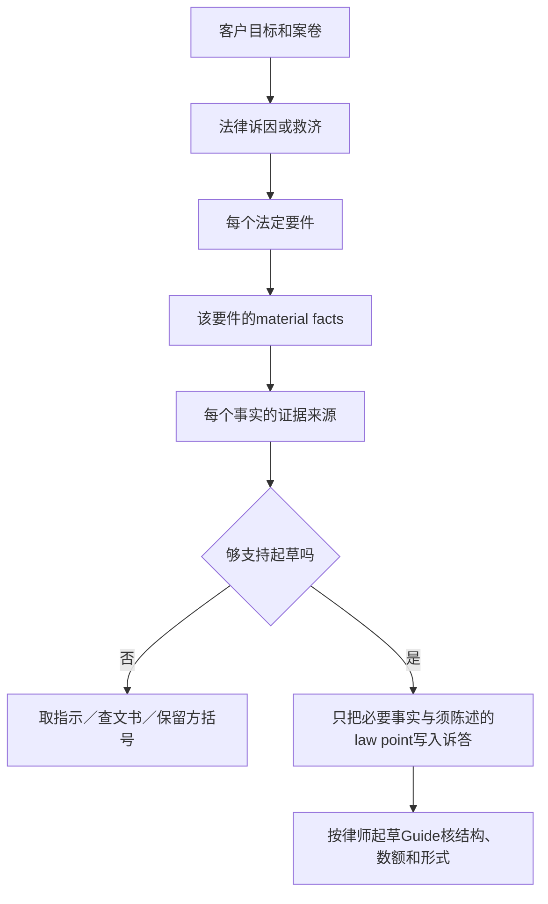
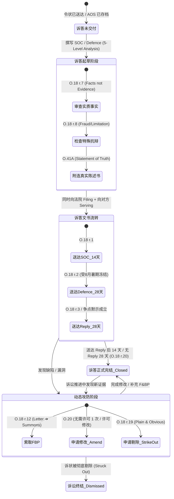
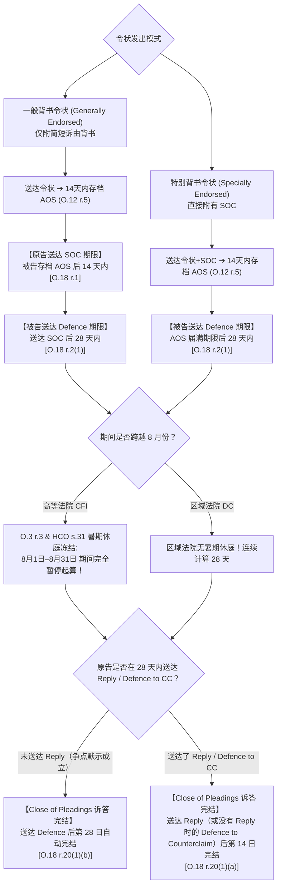
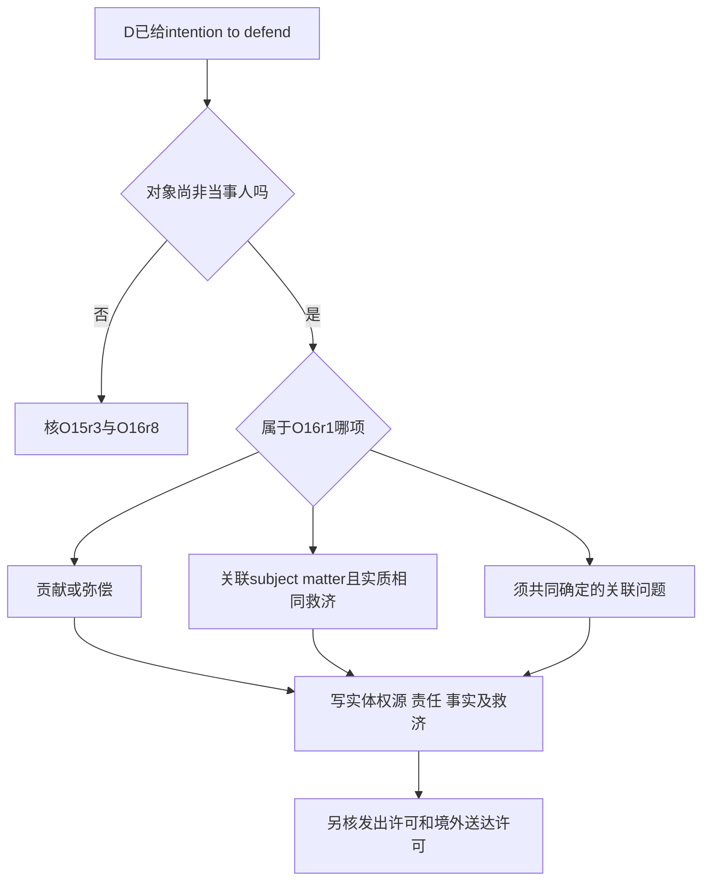
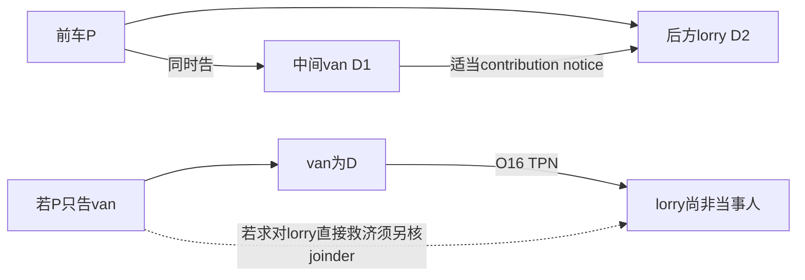
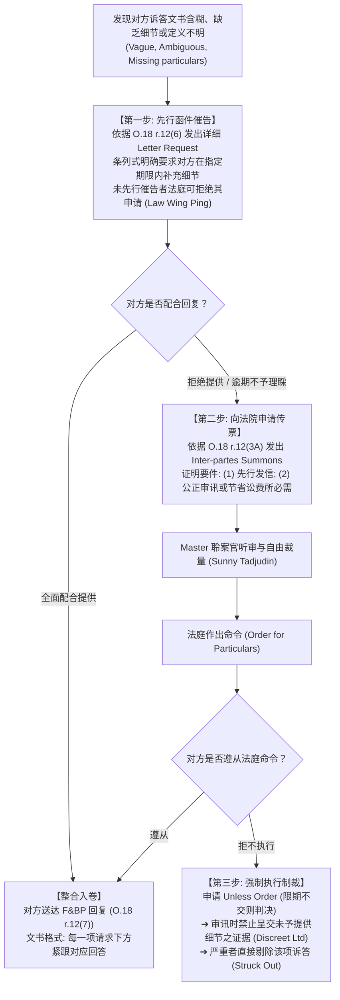
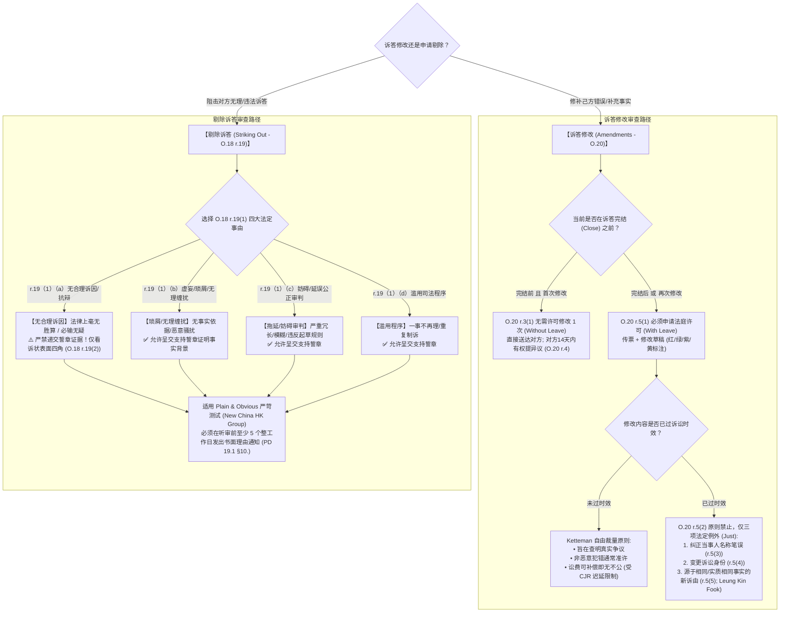
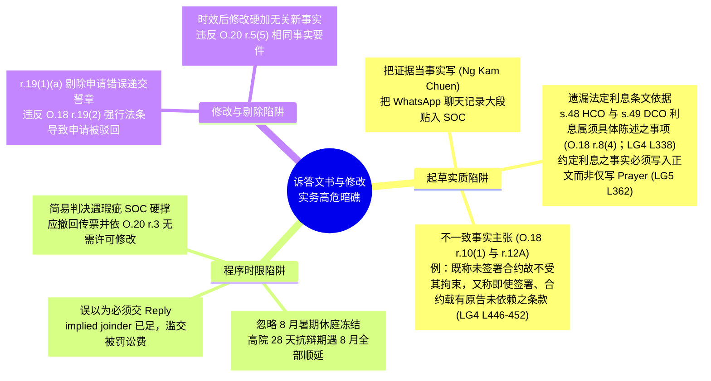
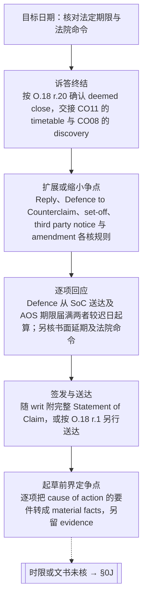

# CO04–05–10 — 诉答、抗辩、反申索与第三方程序

## 速读定位层

### 适用范围

本卡处理 pleadings 从起草、送达、回应到修订和 strike-out 的完整生命周期。§0B 解释 material facts 与 evidence 的边界；§0C 处理时限及 close of pleadings；§0D–§0E 分别处理 Statement of Claim 与 Defence／Reply；§0F 处理 set-off、counterclaim 及 third party proceedings；§0G 处理 Further and Better Particulars、amendment 与 strike-out。送达见 CO03；summary judgment 见 CO06-09；discovery 见 CO08；case management 见 CO11。

### 术语

| 术语 | 定义与章节 |
| --- | --- |
| material facts | 诉答中的实体要件事实：当事人构成诉因或确立抗辩所绝对必需的事实细节；当事人在起草诉答文书时必须清晰陈述每一项实体要件事实，但严禁将证明事实的证据性材料（evidence）写入诉答中。 [§0B](#0B.%20%E8%AF%89%E7%AD%94%E5%8A%9F%E8%83%BD%E3%80%81material%20facts%20%E4%B8%8E%E8%AF%81%E6%8D%AE%E8%BE%B9%E7%95%8C) |
| Statement of Claim | 原告起诉主张的法定诉答文书：原告详细载明案件事实要件、具体违约或侵权行为、请求法院批出的具体救济（relief）及必要事实详述（particulars）的首发文书。 [§0D](#0D.%20Statement%20of%20Claim%20%E8%B5%B7%E8%8D%89) |
| Defence | 被告答辩文书：当被告收到申索陈述书后，必须在法定限内存档并送达答辩书；对原告指控的事实逐段予以承认（admit）、否认（deny）或不予承认（not admit），若依据不可抗力、时效届满等独立事由抗辩，则须在答辩书中明确提出积极抗辩（affirmative defence）。 [§0E](#0E.%20Defence%E3%80%81%E9%80%90%E9%A1%B9%E5%9B%9E%E5%BA%94%E4%B8%8E%20Reply) |
| counterclaim | 被告提起的反请求：被告在同一民事诉讼程序中对原告（或合并其他共同责任人）提出的独立诉讼请求；其性质为完全独立的诉讼，原告即使撤回本诉亦不影响反申索的继续审理。 [§0F](#0F.%20Set-off%E3%80%81Counterclaim%20%E4%B8%8E%20Third%20Party%20Proceedings) |
| strike-out | 剔除诉答文书的司法制裁：当一方的诉答文书显示全无合理诉因或抗辩、纯属无理缠扰（frivolous or vexatious）、可能妨碍案件公平审讯或构成滥用司法程序时，法庭可依 RHC O.18 r.19 下令将其全部或部分诉答直接剔除并驳回诉讼。 [§0G](#0G.%20F&BP%E3%80%81amendment%20%E4%B8%8E%20strike-out) |

### 环节定位

| 环节 | 实际操作 |
| --- | --- |
| 分析诉因 | 把 cause of action 拆成 elements、material facts、particulars 与 evidence。 |
| 起草 SoC | 逐项写明当事人、关系、义务、违约／侵权、损失、利息与 relief。 |
| 回应 | 被告逐段 admit、deny 或 not admit，并提出 limitation、set-off 等正面抗辩。 |
| 扩展争议 | 判断是否 counterclaim、加入额外当事人或发出 third party notice。 |
| 修正与澄清 | 先以 F&BP 澄清，再按 O.20 判断 amendment；仅在门槛成立时 strike out。 |

## 🗺️ 本卡地图



起草人先把每项诉因或抗辩的 material facts 写清，再核是否须主张独立救济或加入第三方。各方用实际送达日期确定 close of pleadings，再衔接披露及案件管理。

| 任务 | 直达 |
| --- | --- |
| 诉答功能、material facts 与证据边界 | [§0B](#0B.%20%E8%AF%89%E7%AD%94%E5%8A%9F%E8%83%BD%E3%80%81material%20facts%20%E4%B8%8E%E8%AF%81%E6%8D%AE%E8%BE%B9%E7%95%8C) |
| 诉答时序、期限与 close of pleadings | [§0C](#0C.%20%E8%AF%89%E7%AD%94%E6%97%B6%E5%BA%8F%E3%80%81%E6%9C%9F%E9%99%90%E4%B8%8E%20close%20of%20pleadings) |
| Statement of Claim 起草 | [§0D](#0D.%20Statement%20of%20Claim%20%E8%B5%B7%E8%8D%89) |
| Defence、逐项回应与 Reply | [§0E](#0E.%20Defence%E3%80%81%E9%80%90%E9%A1%B9%E5%9B%9E%E5%BA%94%E4%B8%8E%20Reply) |
| Set-off、Counterclaim 与 Third Party Proceedings | [§0F](#0F.%20Set-off%E3%80%81Counterclaim%20%E4%B8%8E%20Third%20Party%20Proceedings) |
| F&BP、amendment 与 strike-out | [§0G](#0G.%20F&BP%E3%80%81amendment%20%E4%B8%8E%20strike-out) |
| 文书与期限倒排 | [§0H](#0H.%20%E5%AE%9E%E5%8A%A1%E6%93%8D%E4%BD%9C%E6%B8%85%E5%8D%95%EF%BC%9A%E6%96%87%E4%B9%A6%E3%80%81%E9%80%81%E8%BE%BE%E4%B8%8E%E6%97%B6%E9%99%90%E5%80%92%E6%8E%92) |
| 提交前核对 | [§0I](#0I.%20%E6%94%BB%E9%98%B2%E4%B8%8E%E6%89%A7%E8%A1%8C%E5%89%8D%E6%A0%B8%E5%AF%B9) |
| 失误、制裁与补救 | [§0J](#0J.%20%E7%A8%8B%E5%BA%8F%E5%A4%B1%E8%AF%AF%E5%8F%8A%E5%85%B6%E5%90%8E%E6%9E%9C) |
| SG 实务应用 | [§0K](#0K.%20SG%20%E5%AE%9E%E5%8A%A1%E5%BA%94%E7%94%A8%E4%B8%8E%E5%AF%BC%E5%B8%88%E5%8F%A3%E5%BE%84) |

<!-- BEGIN:cite-legend -->
> [!info]- 引注图例
> 
> | 码 | 文件 | 层级 | 学年 |
> |---|---|---|---|
> | LG4V | [LG4 - Pleadings（本届讲义·699 行·L16 自署 2026-2027）](../../04%20Base%20Lectures/00%20This%20Year%20Moodle%202026-27/Lecture%20Outlines,%20Powerpoints%20&%20Materials/LG4%20-%20Pleadings.md) | 本届讲义 | 2026-27 |
> | LG4P | [Pleadings PowerPoint Slides（本届幻灯 md 转本·按 Slide 编号）](../../04%20Base%20Lectures/00%20This%20Year%20Moodle%202026-27/Lecture%20Outlines,%20Powerpoints%20&%20Materials/Pleadings%20PowerPoint%20Slides.md) | 本届讲义 | 2026-27 |
> | LG5V | [LG5 - Drafting SOC（本届讲义·874 行·L16 自署 2026-2027）](../../04%20Base%20Lectures/00%20This%20Year%20Moodle%202026-27/Lecture%20Outlines,%20Powerpoints%20&%20Materials/LG5%20-%20Drafting%20SOC.md) | 本届讲义 | 2026-27 |
> | LG5S | [2. LG5 Sample drafts（本届官方起草范本·559 行）](../../04%20Base%20Lectures/00%20This%20Year%20Moodle%202026-27/Lecture%20Outlines,%20Powerpoints%20&%20Materials/2.%20LG5%20Sample%20drafts.md) | 本届官方 | 2026-27 |
> | LG8V | [LG8 Discovery Lecture Outline（本届讲义·L15 自署 2026-2027）](../../04%20Base%20Lectures/00%20This%20Year%20Moodle%202026-27/Lecture%20Outlines,%20Powerpoints%20&%20Materials/LG8%EF%BC%9A%20Discovery/LG8%20Discovery%20Lecture%20Outline.md) | 本届讲义 | 2026-27 |
> | LG3V | [LG3 送达与认收讲义 REV（本届·暑期休庭与 AOS 期限出处）](../../04%20Base%20Lectures/00%20This%20Year%20Moodle%202026-27/Lecture%20Outlines,%20Powerpoints%20&%20Materials/LG3%20-%20Service%20and%20Acknowledgement%20of%20Service%20%28REV%29.md) | 本届讲义 | 2026-27 |
> | SG3AP | [SG3 Activity Plan（本届 Moodle 镜像 md 转本·310 行）](../../99%20Moodle%20Mirror/Small%20Group%20Activity%20Plans/SG3%20Activity%20Plan%20.md) | 本届官方 | 2026-27 |
> | BATCH-A | [Negligence Batch A（本届案卷 PDF·库内无 md 伴生）](../../99%20Moodle%20Mirror/Case%20Files/Negligence%20Case%20File/Negligence_Batch_A.pdf) | 本届官方 | 2026-27 |
> | BATCH-B | [Negligence Batch B（本届案卷 PDF·库内无 md 伴生）](../../99%20Moodle%20Mirror/Case%20Files/Negligence%20Case%20File/Negligence_Batch_B.pdf) | 本届官方 | 2026-27 |
> | BATCH-C | [Negligence Batch C（本届案卷 PDF·库内无 md 伴生）](../../99%20Moodle%20Mirror/Case%20Files/Negligence%20Case%20File/Negligence_Batch_C.pdf) | 本届官方 | 2026-27 |
> | SG3DK | [SG03 Classroom & Desk（本届 SG 主控；原「00 Classroom」与「01 Desk」已正名合并，2026-10-10 改指，§7 第 13 项留痕）](../../01%20SG/SG03%20Drafting%20SoC%20I%20-%20Contract/00%20Classroom%20&%20Desk.md) | 凝结层 | 2026-27 |
> | SG4CL | [SG04 Classroom & Desk（本届 SG 主控·任务总览与作业 DDL；原「00 Classroom」已正名，2026-10-10 改指）](../../01%20SG/SG04%20Drafting%20SoC%20II%20-%20Negligence/00%20Classroom%20&%20Desk.md) | 凝结层 | 2026-27 |
> | SG4RS | [SG04当前TQ主答案（SG4RS旧Research已退役；只承接案卷身份核对）](../../01%20SG/SG04%20Drafting%20SoC%20II%20-%20Negligence/01%20Exercise%201%20-%20Timetabling%20Questionnaire.md) | 凝结层 | 2026-27 |
> | MATRIX | [03 真题矩阵与解析（凝结层·本库自撰）](../_meta/Master%20Archive%202026-11-14/03%20Past%20Paper%20Matrix%20and%20Analysis.md) | 凝结层 | 2026-27 |
> | OLD-LG10 | [LG10 - Drafting DCC and TP（往届讲义·L14 自署 2025-2026）](../../04%20Base%20Lectures/%5BLG10%5D%20Drafting%20Defence%20and%20Counterclaim%20and%20Third%20Party%20Procedure/LG10%20-%20Drafting%20DCC%20and%20Third%20Party%20Procedure%20%28VC%29.md) | 往届官方 | 2025-26 |
> | OLD-SET3P | [Set 3「LG5 Pleadings」学生笔记（往届）](../../06%20Base%20Exam%20Notes/Set%203/LG5%20Pleadings.md) | 往届学生稿 | 2025-26 |
> | OLD-SET3S | [Set 3「LG6 SOC」学生笔记（往届）](../../06%20Base%20Exam%20Notes/Set%203/LG6%20SOC.md) | 往届学生稿 | 2025-26 |
> | OLD-24J | [4. 2024 JAN.pdf（库内仅 pdf）](../../02%20Past%20Papers/2024-01%20Jan/4.%202024%20JAN.pdf) | 往届官方 | 2023-24 |
> | OLD-24JM | [4. 2024 JAN - Mark Sheet.pdf（库内仅 pdf）](../../02%20Past%20Papers/2024-01%20Jan/4.%202024%20JAN%20-%20Mark%20Sheet.pdf) | 往届官方 | 2023-24 |
> | OLD-23L | [3. 2023 JULY.pdf（库内仅 pdf）](../../02%20Past%20Papers/2023-07%20Jul/3.%202023%20JULY.pdf) | 往届官方 | 2022-23 |
> | OLD-23LM | [3. 2023 JULY - Mark Sheet.pdf（库内仅 pdf）](../../02%20Past%20Papers/2023-07%20Jul/3.%202023%20JULY%20-%20Mark%20Sheet.pdf) | 往届官方 | 2022-23 |
> | OLD-25JM | [6. 2025 JAN - Mark Sheet.pdf（库内仅 pdf）](../../02%20Past%20Papers/2025-01%20Jan/6.%202025%20JAN%20-%20Mark%20Sheet.pdf) | 往届官方 | 2024-25 |
> | OLD-25K | [1. Knowledge Paper (Aug 2025)（往届 2024-25 补考卷·库内有 md 转本·478 行）](../../02%20Past%20Papers/2025-08%20Aug/1.%20Knowledge%20Paper%20%28Aug%202025%29.md) | 往届官方 | 2024-25 |
> | CAP-C4 | [PCLL8010 LG4 PT](../../99%20Moodle%20Mirror/Lecture%20Outlines,%20Powerpoints%20&%20Materials/LG4%20-%20Pleadings/Panopto%20Captions%20%28local%20export%29/8010_LG04_PT.md) | 本届讲义 | 2026-27 |
> | CAP-C5 | [PCLL8010 LG5 PT](../../99%20Moodle%20Mirror/Lecture%20Outlines,%20Powerpoints%20&%20Materials/LG5%20-%20Drafting%20Statement%20of%20Claim/Panopto%20Captions%20%28local%20export%29/8010_LG05_PT.md) | 本届讲义 | 2026-27 |
> | WC5 | [PCLL8010 LG5本届书面讲义](../../04%20Base%20Lectures/00%20This%20Year%20Moodle%202026-27/Lecture%20Outlines,%20Powerpoints%20&%20Materials/LG5%20-%20Drafting%20SOC.md) | 本届讲义 | 2026-27 |
> | CL10 | [LG10 抗辩反申索及第三方（99 镜像；本届 2026 授课日期、内页仍写 2025-2026；2026-10-10 自 Supplement 图例并入）](../../99%20Moodle%20Mirror/Lecture%20Outlines,%20Powerpoints%20&%20Materials/LG10%20-%20Drafting%20Defence%20&%20Counterclaims%20and%20Third%20Party%20Procedure/LG10%20-%20Drafting%20DCC%20and%20Third%20Party%20Procedure.md) | 本届讲义 | 2026-27 |
> | CL1 | [LG1 LECTURE OUTLINE (PT) (2026-2027)（2026-10-10 自 Supplement 图例并入）](../../04%20Base%20Lectures/00%20This%20Year%20Moodle%202026-27/Lecture%20Outlines,%20Powerpoints%20&%20Materials/LG1%20LECTURE%20OUTLINE%20%28PT%29%20%282026-2027%29.md) | 本届讲义 | 2026-27 |
> | SG4AP | [本届SG4 Activity Plan原题](../../04%20Base%20Lectures/00%20This%20Year%20Moodle%202026-27/Small%20Group%20Activity%20Plans/SG4%20Activity%20Plan%20.md) | 本届官方 | 2026-27 |
> | SG5AP | [1. SG5 (Problem Solving and Drafting Defence and Counterclaim) ✅.md](../../04%20Base%20Lectures/00%20This%20Year%20Moodle%202026-27/Small%20Group%20Activity%20Plans/1.%20SG5%20%28Problem%20Solving%20and%20Drafting%20Defence%20and%20Counterclaim%29%20%E2%9C%85.md) | 本届官方 | 2026-27 |
> | SG5LG10 | [LG10 - Drafting DCC and Third Party Procedure.md](../../04%20Base%20Lectures/00%20This%20Year%20Moodle%202026-27/Lecture%20Outlines,%20Powerpoints%20&%20Materials/LG10%20-%20Drafting%20Defence%20&%20Counterclaims%20and%20Third%20Party%20Procedure/LG10%20-%20Drafting%20DCC%20and%20Third%20Party%20Procedure.md) | 本届讲义 | 2026-27 |
> | SG5T10 | [8010_LG10_PT_87b6e21d.md](../../04%20Base%20Lectures/00%20This%20Year%20Moodle%202026-27/Lecture%20Outlines,%20Powerpoints%20&%20Materials/LG10%20-%20Drafting%20Defence%20&%20Counterclaims%20and%20Third%20Party%20Procedure/Panopto%20Captions%20%28local%20export%29/8010_LG10_PT_87b6e21d.md) | 本届讲义 | 2026-27 |
> | SG5OLD | [Civil Litigation_SG5.md](../../05%20Base%20Prior-year%20SG/%5BSG05%5D%20Drafting%20Defence%20and%20Counterclaim%20-%20Contract/Set%201/Civil%20Litigation_SG5.md) | 往届学生稿 | 2025-26 |
> | CL10R | [本届LG10 Reference：O.15／16／18规则原文](../../04%20Base%20Lectures/00%20This%20Year%20Moodle%202026-27/Lecture%20Outlines,%20Powerpoints%20&%20Materials/LG10%20-%20Drafting%20Defence%20&%20Counterclaims%20and%20Third%20Party%20Procedure/LG10%20Reference%20Material.md) | 本届讲义 | 2026-27 |
> | R20 | [RHC O20再刊本（整合日期2025-10-01）](obsidian://open?vault=3b1e77255f6c6e29&file=output%2Fresearch%2FCivil%20Litigation%20Rules%20Verification%20-%202026-10-23%2FRHC%20O20.md) | 库外法源 | 2026-27 |
> | R18N | [RHC O18再刊本（r20分项已核）](obsidian://open?vault=3b1e77255f6c6e29&file=output%2Fresearch%2FCivil%20Litigation%20Rules%20Verification%20-%202026-10-23%2FRHC%20O18.md) | 库外法源 | 2026-27 |
> | N10 | [LG10 - Drafting DCC and Third Party Procedure.md](../../04%20Base%20Lectures/00%20This%20Year%20Moodle%202026-27/Lecture%20Outlines,%20Powerpoints%20&%20Materials/LG10%20-%20Drafting%20Defence%20&%20Counterclaims%20and%20Third%20Party%20Procedure/LG10%20-%20Drafting%20DCC%20and%20Third%20Party%20Procedure.md) | 本届讲义 | 2026-27 |
> | R10 | [LG10 Reference Material.md](../../04%20Base%20Lectures/00%20This%20Year%20Moodle%202026-27/Lecture%20Outlines,%20Powerpoints%20&%20Materials/LG10%20-%20Drafting%20Defence%20&%20Counterclaims%20and%20Third%20Party%20Procedure/LG10%20Reference%20Material.md) | 本届讲义 | 2026-27 |
> | T10 | [8010_LG10_PT_87b6e21d.md](../../04%20Base%20Lectures/00%20This%20Year%20Moodle%202026-27/Lecture%20Outlines,%20Powerpoints%20&%20Materials/LG10%20-%20Drafting%20Defence%20&%20Counterclaims%20and%20Third%20Party%20Procedure/Panopto%20Captions%20%28local%20export%29/8010_LG10_PT_87b6e21d.md) | 本届讲义 | 2026-27 |
> | P10 | [LG10 - Drafting DCC and Third Party Procedure.pptx](../../04%20Base%20Lectures/00%20This%20Year%20Moodle%202026-27/Lecture%20Outlines,%20Powerpoints%20&%20Materials/LG10%20-%20Drafting%20Defence%20&%20Counterclaims%20and%20Third%20Party%20Procedure/LG10%20-%20Drafting%20DCC%20and%20Third%20Party%20Procedure.pptx) | 本届讲义 | 2026-27 |
> | AP5 | [1. SG5 (Problem Solving and Drafting Defence and Counterclaim) ✅.md](../../04%20Base%20Lectures/00%20This%20Year%20Moodle%202026-27/Small%20Group%20Activity%20Plans/1.%20SG5%20%28Problem%20Solving%20and%20Drafting%20Defence%20and%20Counterclaim%29%20%E2%9C%85.md) | 本届官方 | 2026-27 |
> | AP6 | [1. SG6 (Civil Procedure 1).md](../../04%20Base%20Lectures/00%20This%20Year%20Moodle%202026-27/Small%20Group%20Activity%20Plans/1.%20SG6%20%28Civil%20Procedure%201%29.md) | 本届官方 | 2026-27 |
> | C045 | [[CO04-05] Pleadings, Amendments & Striking Out.md](./%5BCO04-05-10%5D%20Pleadings,%20Defence,%20Counterclaims%20and%20Third%20Party%20Proceedings.md) | 凝结层 | 2026-27 |
> | C03 | [[CO03] Service and AOS.md](./%5BCO03%5D%20Service%20and%20AOS.md) | 凝结层 | 2026-27 |
> | C09 | [[CO09] Pre-Trial Judgments and Case Disposal.md](./%5BCO06-09%5D%20Pre-Trial%20Judgments,%20Admissions%20and%20Interim%20Payment.md) | 凝结层 | 2026-27 |
> | TT | [2026-27 1st Sem PT YR1 PCLL Timetable (24.08.2026).xlsx](obsidian://open?vault=3b1e77255f6c6e29&file=PCLL%20PT%20Yr1%20%28General%29%2F2026-27%201st%20Sem%20PT%20YR1%20PCLL%20Timetable%20%2824.08.2026%29.xlsx) | 本届官方 | 2026-27 |
> | S6-AP | [1. SG6 (Civil Procedure 1)](../../04%20Base%20Lectures/00%20This%20Year%20Moodle%202026-27/Small%20Group%20Activity%20Plans/1.%20SG6%20%28Civil%20Procedure%201%29.md) | 本届官方 | 2026-27 |
> | S6-R16 | [RHC O16](obsidian://open?vault=3b1e77255f6c6e29&file=output%2Fresearch%2FCivil%20Litigation%20Rules%20Verification%20-%202026-10-23%2FRHC%20O16.md) | 库外法源 | 2026-27 |
<!-- END:cite-legend -->

本卡将相关程序按功能合为一个主述；独有规则、课堂例子、来源及未决保留，重复总览不另设竞争版本。SG答案本身不随本次结构迁移改写。旧CO编号在原案例／修订记录中仍表示教学来源坐标，不代表另有独立活动主卡。

#### 核心参数与计算口径
- **诉状送达时限（Statement of Claim - O.18 r.1）**：若令状仅附一般认可背书，原告须在被告送达 AOS 后 **14 天内**存档并送达 SoC；若已附完整 SoC 则随令状一并送达。
- **抗辩书送达时限（Defence - O.18 r.2）**：被告必须在收到 SoC 或存档 AOS 期限届满后（以较迟者为准）**28 天内**存档并送达 Defence。适用 O.3 r.5(3) 时，当事人可书面同意延长文件期限；先核特别规则及个案命令。
- **Reply 与 Defence to Counterclaim（O.18 r.3(4)）**：原告如拟送达 Reply，须在 Defence 送达后 28 天内送达；如要抗辩 Counterclaim，须在 Counterclaim 送达后 28 天内送达 Defence to Counterclaim。未抗辩反申索时，反申索人可依 O.19 适用规则取得判决。
- **Close of pleadings（O.18 r.20）**：原告送达 Reply 的，从送达后算 14 天；没有 Reply 但送达 Defence to Counterclaim 的，从该抗辩送达后算 14 天；两者均未送达的，从 Defence 送达后算 28 天。诉答终结后，各方另算 28 日排期问卷期。见 [RHC O.18 与 O.25](https://www.elegislation.gov.hk/hk/cap4A)。
- **诉答剔除四大法定事由（Striking Out Pleadings - O.18 r.19(1)）**：
  ① (a) 无合理诉因或抗辩（No reasonable cause of action or defence - 严禁引入任何宣誓证据，仅作纯法律审查）；
  ② (b) 属轻佻、烦扰（Scandalous, frivolous or vexatious）；
  ③ (c) 可能会损害、妨碍或延迟公平审讯（Prejudice, embarrass or delay the fair trial）；
  ④ (d) 构成对法庭程序的滥用（Abuse of the process of the court）。

## 0B. 诉答功能、material facts 与证据边界

**此时案件处在什么状态？** 令状已按 CO03 签发并送达，客户手里是一堆事实、文件和目标；还没有任何一份诉答文书，法院和对方都不知道你究竟主张什么、依据什么。**本制度在干嘛？** 诉答（pleadings）是把客户故事压成「构成诉因或抗辩的实质事实」的文书工序：O.18 r.7(1) 划出第一道分水岭——诉状只简要陈述 material facts，不写用来证明它们的证据（evidence），也不以法律论辩代替事实；写什么由本节定，什么时候交由 §0C 管，SOC 与 Defence 分别在 §0D、§0E 落稿。**和谁区分？** material facts 与 evidence 的分界不是文风偏好：把证据抄进诉状，对方只见一堆文件却不知道你要争什么；漏写要件事实，审讯时该事实原则上不得举证。 <small style="opacity: 0.55">〔LG4V L168 "define real issues between the parties in advance of trial"；LG4V L260 "Every pleading must contain only a statement in a summary form of the material facts"〕</small>

### 术语速查

| 术语 | 定义、程序作用与来源 |
| --- | --- |
| 诉答文书（pleading） | 以简要形式只陈述实质事实、不陈述证明该等事实之证据的诉讼文书；SOC、Defence、Reply、counterclaim 均属之；O.18 r.7(1)。 <small style="opacity: 0.55">〔LG4V L260 "Every pleading must contain only a statement in a summary form of the material facts"〕</small> |
| 实质事实（material facts） | 构成完整诉因（或抗辩）每一项要件所必需的事实，缺一则诉因（或抗辩）不完整；O.18 r.7(1)；*Bruce v Odhams*。 <small style="opacity: 0.55">〔LG4V L264 "material facts = facts necessary … complete cause of action (Bruce v Odhams Press"〕</small> |
| 细节（particulars） | 使指控具体化、令对方能够应答的补充明细；欺诈、违反信托、不当影响、恶意等法定事项必须载明；O.18 r.12(1)。 <small style="opacity: 0.55">〔LG4V L340 "[E]very pleading must contain the necessary particulars of any claim, defence or other matter pleaded"〕</small> |
| 真实陈述书（Statement of Truth） | 签署人声明相信文书所述事实为真的核实文件；诉答、修改稿与 F&BP 均须附具，未核实可命补正以至剔除；O.41A r.2(1)(a)；O.18 r.20A。 <small style="opacity: 0.55">〔LG4V L222 "Every pleading must be verified by a Statement of Truth"；LG4V L252 "if not = struck out (O.41A r.6)"〕</small> |
| 回应（traverse） | 被告对指控的否认（denial）或不承认（non-admission），可明示或必要含意；定义文本本届 LG4 未展开，以往届 LG10 讲义互校（往届仅参考）；O.18 r.13(3)（往届讲义口径）。 <small style="opacity: 0.55">〔OLD-LG10 L155 "a traverse may be made either by a denial or by a statement of non-admission" ·往届仅参考〕</small> |
| 推定自认（deemed admission） | SOC 中的事实指控未在 Defence 中明确否认或不承认者，依法推定为自认；O.18 r.13(1)。 <small style="opacity: 0.55">〔LG4V L476 "Every allegation of fact … is deemed to be admitted in the defence unless it is expressly denied"〕</small> |
| 争点默示成立（implied joinder of issue） | 原告不送达 Reply 时，依法视为对 Defence 各项实质事实主张不承认，无需另行文书；O.18 r.14。 <small style="opacity: 0.55">〔LG4V L510 "joinder of issue = a non-admission of every material allegation of fact made in the pleading"〕</small> |
| 诉答完结（close of pleadings） | 送达 Reply 后 14 日（无 Reply 时 Defence 后 28 日）诉答阶段自动关闭并触发后续案件管理时钟的节点；O.18 r.20(1)。 <small style="opacity: 0.55">〔LG4V L697 "14 days after the service of the reply … close of pleadings (O.18 r.20(1))"〕</small> |
| 抵销（set-off） | 被告以其对原告的金钱债权全部或部分抵销原告请求的抗辩；O.18 r.17。 <small style="opacity: 0.55">〔CL10 L321 "A set-off is where D has a claim"〕</small> |
| 反申索（counterclaim） | 被告对原告提出的独立诉因，与 Defence 合并于同一文书；O.15 r.2。 <small style="opacity: 0.55">〔CL10 L335 "Where a defendant alleges that he has a Counterclaim, the"〕</small> |
| 第三方程序（third party procedure） | 被告把诉讼外人拉入程序以求弥偿、分担或相关救济的独立程序，须先具备 O.16 所列实体基础；O.16。 <small style="opacity: 0.55">〔CL10 L515 "Where D believes that another person should be liable for"〕</small> |
| 进一步及更详细详情（Further and Better Particulars，F&BP） | 对方诉答含糊时，先以函件请求、必要时传票申请法庭命令补充细节的补强程序；O.18 r.12。 <small style="opacity: 0.55">〔LG4V L402 "you should first by way of letter request the other side to provide you further and better particulars"〕</small> |
| 修改（amendment） | 诉答完结前每方可自行修改一次，其后须法庭许可并受 Ketteman 裁量与时效后例外约束；O.20 r.3／r.5。 <small style="opacity: 0.55">〔LG4V L528 "A party may, without the leave of the Court, amend any pleading of his once at any time before the close of pleadings"〕</small> |
| 剔除（striking out） | 法庭对无合理诉因、虚妄缠扰、妨碍或延误公平审讯、滥用程序的诉答（或诉讼）予以删除的严厉救济，只用于 plain and obvious 案件；O.18 r.19。 <small style="opacity: 0.55">〔LG4V L654 "the Court’s power to strike out is “drastic”, to be used “sparingly”, and only in “plain and obvious” cases"〕</small> |
| 一般／特别背书令状（generally / specially endorsed writ） | 一般背书仅载简要诉由、SOC 须另行送达；特别背书令状附连 SOC，无需二次送达；O.18 r.1。 <small style="opacity: 0.55">〔LG4V L689 "P need not serve a separate statement of claim"〕</small> |
| 再答辩（rejoinder） | 被告对 Reply 的回应文书，须先取得法庭许可，28 日内送达，实务极罕见；O.18 r.4。 <small style="opacity: 0.55">〔LG4V L693 "D to serve rejoinder with leave of Court within 28 days"〕</small> |
| Defence | 回应P的实质指称，并写D拟依赖的积极案件；Admit／deny／not admit如何逐项分开。 <small style="opacity: 0.55">〔N10 L128 "respond to P’s claim and to state D’s case"〕</small> |
| Indemnity | 请求全部弥偿，须有合同、法例或其他权源；不是把100%字样写进通知就产生权利。 <small style="opacity: 0.55">〔N10 L538 "A right to indemnity exists where"〕</small> |
| Contribution | 就同一损害寻求分担，具体比例依适用法律和裁判；核各方对同一损害的责任。 <small style="opacity: 0.55">〔N10 L550 "any person liable in respect of any damage"〕</small> |
| Third party notice | D针对尚非当事人者发出的O.16通知；O.16r.1三入口、许可、送达和directions。 <small style="opacity: 0.55">〔R10 L146 "a person not already a party to the action"〕</small> |
| Contribution notice | 依O.16r.8向已在案一方提出适用的请求或争点；先核是否应循counterclaim；名称不把救济限于分担。 <small style="opacity: 0.55">〔N10 L570 "If D intends to make a claim against another party"〕</small> |


#### O.18 r.7 诉答基本法理：实质事实与证据之分水岭
- **事实而非证据（Facts, not evidence）**：诉答书状只陈述构成诉因或抗辩所必需的实质事实（Material facts），绝对不陈述用来证明这些事实的证据（Evidence）。例如：只陈述「被告向原告陈述该货物为全新」，不写「如双方于 5 月 1 日在咖啡馆谈话录音所示」。
- **事实而非法律（Facts, not law）**：原告陈述事实后可指出法律结论，但不能以法律名词代替事实。例如：仅写「被告违反注意义务构成过失」而未写明被告具体超速、闯红灯等驾驶事实，属瑕疵诉状。


### 1.1 诉状不是证据清单，也不是法律论文

诉状确定审讯争点，让对方知道要回应的案件。O.18 r.7(1)要求简要陈述material facts，而非证明它们的证据；r.11容许法律论点，但不能以法律标签取代事实。 <small style="opacity: 0.55">〔LG4V L168 "define real issues between the parties in advance of trial"〕〔LG4V L260 "Every pleading must contain only a statement in a summary"〕〔LG4V L280 "raising a point of law (permissible), e.g.:"〕</small>

**自拟对照**：合同成立的主张应说明何人于何时以什么方式达成何种约定；“有一张发票”只是证据线索。“被告疏忽”是结论，需要写明支持义务、违反、因果及损害的事实。LG5字幕特别用invoice与material facts区分第四、第五层，帮助避免把案卷抄成诉状。 <small style="opacity: 0.55">〔LG5V L280 "The material facts relating to the contract generally include:"〕〔CAP-C5 L739 "Okay. Now the fourth column is material facts okay."〕</small>

| 放在哪里 | 内容的功能 | 容易混淆的情况 |
| --- | --- | --- |
| 主体段落 | 支持每个要件的必要事实 | 不能只写“breach”“negligent”而不交代行为 |
| Particulars | 使指控具体、让对方能回应 | 不是把全部证据附进来，也不是补救根本没有诉因 |
| 证人陈述/誓章 | 依具体程序提供证明 | 不能靠其中的事实悄悄扩大未plead的案件 |
| Prayer | 所求判令及救济 | 必须和正文所支持的诉因、损失一致 |

对应规则见O.18及讲义的material facts、particulars和relief部分；本表是起草分工。 <small style="opacity: 0.55">〔LG4V L260 "Every pleading must contain only a statement in a summary"〕〔LG4V L354 "Tip: give it anyway to avoid subsequent application from other"〕〔LG4V L460 "A statement of claim must state “the relief or remedy"〕</small>

> **不做后果点题**：本节失误（要件缺失、证据混入正文、须具体主张事项未具体主张）的代价归并 [§3.6 总表](#9.1%20%E7%8E%AF%E8%8A%82%C3%97%E4%B8%8D%E5%81%9A%E5%90%8E%E6%9E%9C%E9%93%BE%C3%97%E4%BE%9D%E6%8D%AE%E6%80%BB%E8%A1%A8) 行 1–3。

### 1.2 三层案情，别把证据写作事实



课堂quiz以“买卖约定”与“purchase order dated…”、事故与“CCTV显示事故”区别第四层事实与第五层证据；有文件必须先理解其证明什么，不能把文件名写进SoC代替contract、breach或causation。 <small style="opacity: 0.55">〔CAP-C4 L376 "You would only have to put in it the facts that satisfy these legal ingredients."〕〔CAP-C4 L1600 "So the CCTV is the supporting document"〕</small>

| 争点／任务 | 应写的material facts | 要追的证据／不应写进诉答 |
| --- | --- | --- |
| 合同 | 主体、约定日期／方式、标的与对价；依赖的express／implied terms及真正变更。 | order form、invoice、口头谈话人用于核对事实；不只凭文件名说“pursuant to invoice”。 <small style="opacity: 0.55">〔CAP-C5 L1222 "plead the original contract right and then the subsequent variation."〕</small> |
| 违约与特殊损失 | 被告哪项作为／不作为违反哪项term；客户须有理由可指示对方曾知特别用途／交易。 | 示例知识用宴会、营销安排，但须本案资料确有告知；不能将旧合同案卷事实搬本届SG。 <small style="opacity: 0.55">〔CAP-C5 L1291 "must plead those facts and knowledge and special circumstances."〕</small> |
| 侵权双D | 逐被告身份、duty基础、各自breach、雇佣／职务行为、causation、分项损失。 | 员工在岗与雇主拥有车须有来源；不能把vicarious与公司自身疏忽混作同一段。 <small style="opacity: 0.55">〔CAP-C5 L1687 "allegations of separate acts of each defendant"〕</small> |
| 损失及求偿 | unliquidated damages按heads列金额、估算与必要扣减；fixed debt明确本金。 | 发票或报价要分actualoutlay／未来估算，不能把已付款与可索赔混写。 <small style="opacity: 0.55">〔LG5V L356 "Should distinguish between liquidated claims and unliquidated damages."〕</small> |
| 刑事裁断 | 若拟依犯罪定罪，写罪名、日期、法院及与民事争点的关系。 | 不能从定罪直接推出全部民事义务或损失；SG04刑案角色以现案原件为准。 <small style="opacity: 0.55">〔CAP-C4 L2272 "the court which made the conviction and the issue"〕</small> |

### 1.3 第一性原理：争点界定、突袭防范与审判边界

诉答文书（Pleadings）并非形式主义文书，而是普通法对抗制审判中**确立诉讼边界与维护程序正义**的核心承重结构：

1. **界定真实争议争点（Defining Real Issues in Dispute）**： <small style="opacity: 0.55">〔LG4V L168 "define real issues between the parties in advance of trial"〕</small>
   - 诉答的首要功能是在正式开庭审讯前，将双方庞杂的事实与法律主张提炼为精准的争议争点（Issues）。法庭与当事人均受制于诉答界定的范围，法庭**无权裁决任何当事人未在诉答中主张的救济（Relief）或事实**（*Belmont Finance Corp v Williams Furniture*）。 <small style="opacity: 0.55">〔LG4V L464 "the Court cannot grant relief which has not been claimed at all"〕</small>
2. **防范庭审突袭与武器平等（Preventing Surprise & Notice）**： <small style="opacity: 0.55">〔LG4V L174 "prevent the other side from being taken by surprise at trial"；LG4V L182 "Aktieselskabet Dansk Skibsfinansiering v. Wheelock Marden Co. Ltd."〕</small>
   - 确保被告准确获知原告主张的具体事实，以便提前准备证人陈述书与专家证据。**未在诉答中具体陈述的事实，在审讯时原则上不得举证（Tying the hands of parties）**。 <small style="opacity: 0.55">〔LG4V L176 "enable the other side to know what and how to prepare their evidence"；LG4V L180 "tie the hands of the parties as to the cases they are going to run at trial"〕</small>
3. **文件开示与案件管理的法定标尺（Limiting Discovery & Driving CMS）**： <small style="opacity: 0.55">〔LG4V L178 "limit the generality of discovery required"〕</small>
   - 决定后续文件开示（Discovery - LG8）范围的唯一法定基准就是诉答文书（*Peruvian Guano* 测试要求文件必须与“诉答所界定的争点”相关）。诉答完结（Close of Pleadings）更是触发后续案件管理里程碑时钟的总开关。 <small style="opacity: 0.55">〔LG8V L20 "discover documents relevant to the disputes as revealed from the pleadings"；LG8V L20 "the Peruvian Guano test … Compagnie Financiere du Pacifique v Peruvian Guano Co"〕〔LG4V L697 "14 days after the service of the reply … close of pleadings (O.18 r.20(1))"；LG8V L25 "within 14 days of the close of the pleadings"〕</small>

> **并入补充（2026-10-10，原 Supplement §1.3）**：Pleadings 把故事压成有法律意义的争议范围，并给对方公平应答机会；它应说明构成请求或抗辩的必要事实，证据如何证明另作准备。第三方程序和反申索还决定争议由哪些人、在什么关系下共同解决（操作层见 5.1，规则出处见 §2.5 表与 §4.4）。

> **Exam / Drafting Formulation:** "The pleading states the material facts necessary to establish the cause of action, without pleading the evidence by which those facts will be proved."

## 0C. 诉答时序、期限与 close of pleadings

**此时案件处在什么状态？** 写什么已经清楚（§0B），现在的压力是「什么时候必须交出哪份文书」：SOC、Defence、Reply 各有法定死线，算错一天可能被对方申请缺席判决或被催告。**本制度在干嘛？** 本节把诉答当成一条时间线管理：从 AOS 起算 SOC 的 14 天，到 Defence 的 28 天（高院要扣掉 8 月暑期休庭、区院不停钟），再到 O.18 r.20 的 close of pleadings——诉答一关闭，披露与案件管理的时钟立刻开动。**和谁区分？** 送达与 AOS 的算日规则在 CO03；缺席判决的要件与撤销在 CO06-09，本卡只负责诉答侧的起算点与完结时点。 <small style="opacity: 0.55">〔LG4V L697 "14 days after the service of the reply … close of pleadings (O.18 r.20(1))"；LG8V L25 "within 14 days of the close of the pleadings"〕</small>

### 2.1 时间与草稿：一般令状不产生永久保密

LG4讲授一般endorsement（随后另送SoC）及特别endorsement（SoC随writ），AOS含送达日；Defence期限按AOS的**法定期限**和SoC送达两锚取较后+28日，提早实际fileAOS不提前其法定锚。没有Reply时常依规则28日close；有Reply／Defence to Counterclaim时依相应14日close，但法院命令／特殊程序须先核。此为课堂日历演练，不能不看规则和节假日直接加日期。 <small style="opacity: 0.55">〔CAP-C4 L979 "even if the defendant file the AOS earlier"〕〔CAP-C4 L1282 "whichever is the later."〕</small>

一般endorsement可在临近时效时以摘要先签发，但随后SoC仍须按程序送；“避免公众见到商业秘密”的课堂动机不等于免于最终plead materialfacts或获得永久保密。需另核真正有权申请的保密方向，不能靠writ类型许诺。 <small style="opacity: 0.55">〔CAP-C4 L679 "there's less information."〕</small>

### 2.2 诉答阶段流转与法定死线（Pleadings Timeline & Milestones）



### 2.3 核心控制闸门（Gatekeepers）

| 闸门编号 | 闸门名称 | 法定依据 | 控制逻辑与触发条件 | 底层材料出处 |
| --- | --- | --- | --- | --- |
| **Gate 1** | **实质事实排他闸门** | O.18 r.7(1)<br>*Ng Kam Chuen* | **只陈述构成诉由所必需的实质事实（Material Facts），严禁陈述证据（Evidence）与法律论辩（Legal Arguments）**。违者构成冗赘与程序尴尬，面临被剔除风险。 | <br><br>。 <small style="opacity: 0.55">〔LG4V L260 "Every pleading must contain only a statement in a summary form of the material facts"〕〔LG4V L264 "material facts = facts necessary … complete cause of action (Bruce v Odhams Press"〕〔LG4V L268 "do NOT plead evidence that use to prove material facts"〕</small> |
| **Gate 2** | **答辩回应与争点防线** | O.18 r.13／r.14 | 依r.13(1)、(3)、(5)、(6)具体回应；否认给理由及拟依赖的版本。r.13(4)已废除，不以旧“赔偿金额自动否认”代替回应；无新积极事实时，Reply与joinder另按本卡第4章。 | <small style="opacity: 0.55">〔CL10R L108 "(4) (Repealed)"〕〔CL10R L120 "the nature of his case in relation to the issue"〕</small> |
| **Gate 3** | **矛盾主张与诚信闸门** | O.18 r.10(1) / r.12A<br>O.41A RHC | **严禁在后续诉答或修改中提出与先前诉答「不一致」之主张**；按 *Goldon Investment*，「不一致」指**新的事实或不同的事实（new or different），无须达到互相排斥（no need to be mutually exclusive）**；例外：有合理依据且以替代表述提出（O.18 r.12A、r.10(2)），或依 O.20 申请许可修改先前诉答（r.10(2)）。文书必须经由具名授权人士签署真实陈述书（Statement of Truth），虚假陈述构成藐视法庭罪。 | <br><br>。 <small style="opacity: 0.55">〔LG4V L432 "matters pleaded cannot be inconsistent with what had been pleaded in previous pleadings"；LG4V L434 "“inconsistent” = new or different, no need to be mutually exclusive"〕〔LG4V L438 "reasonable grounds for so doing and the allegations are made in the alternative"；LG4V L454 "apply for “leave to amend previous pleading” under O.20"〕〔LG4V L222 "Every pleading must be verified by a Statement of Truth"；LG4V L232 "The person signing must state his/her office or position in the Statement of Truth"；LG4V L254 "if made a false statement = contempt of court"〕</small> |
| **Gate 4** | **诉答完结与后续程序准入审查（Close of Pleadings & Milestone Stage）** | O.18 r.20<br>O.18 r.2 / r.3 | 诉答在送达 Reply 后 **14 天**（或无 Reply 时送达 Defence 后 **28 天**）自动完结。该时点触发相应案件管理与披露程序；它不使事实争议永远不可修改，之后拟改诉答须按O.20取得适当许可并满足相关条件。 | <br>。 <small style="opacity: 0.55">〔LG4V L697 "14 days after the service of the reply … close of pleadings (O.18 r.20(1))"；LG4V L691 "28 days after service of the defence (and counterclaim)"〕〔LG4V L690 "D to serve defence (and counterclaim) within 28 days"；LG4V L692 "P to serve reply and/or defence to counterclaim within 28 days"〕</small> |

### 2.4 顺向推进：从收案到诉答攻防的触发→行动→产出

> 本节由原 Supplement §2. 顺向模型扩展为"触发→行动→产出"三问式；每一闸门的实际法律条件回到 §1.1 对应 playbook 与 §2.5 速查表，不能仅凭箭头推定程序已完成。

1. 接案后，律师以客户目标确定各方身份、诉因、抗辩和救济。用人物表和时间轴为每项要件列事实及证据来源，形成起草底稿。 <small style="opacity: 0.55">〔LG5V L156 "When using the above tools, you should bear in mind"；CL1 L193 "Students will learn how to prepare a List of Persons"〕</small>
2. 完成要件与事实核对后，律师把 material facts 与必要 particulars 写入 SoC，并补齐 prayer 和 statement of truth。证明这些事实的证据另存证据档案。 <small style="opacity: 0.55">〔LG4V L260 "Every pleading must contain only a statement in a summary form of the material facts"；LG4V L340 "[E]very pleading must contain the necessary particulars of any claim, defence or other matter pleaded"〕</small>
3. 被告收到 SoC 后，逐段写明 admit、deny 或 not admit；如有自己的事实版本或须专门诉答的抗辩，应明确陈述。需求独立救济时另拟 counterclaim。 <small style="opacity: 0.55">〔LG4V L476 "Every allegation of fact made in the statement of claim"；CL10 L131 "The main functions of a Defence are to respond to"〕</small>
4. 被告主张扣减原告可得款项时先核 set-off；要求法院另判救济则核 counterclaim；向未入案者请求 contribution 或 indemnity 时，另核实体基础与第三方通知。 <small style="opacity: 0.55">〔CL10 L335 "Where a defendant alleges that he has a Counterclaim, the"；CL10 L515 "Where D believes that another person should be liable for"〕</small>
5. 收到修订稿或 particulars 请求后，律师重新检查争点及应答期限。需要回应 amended pleading 或申请 disallow 时，分别核 O.20 的适用 14 日窗口。 <small style="opacity: 0.55">〔LG4V L534 "Within 14 days of being served with an amended pleading, the other party can apply to disallow the amendment"；LG4V L536 "amend, the original pleading is taken to be in answer"〕</small>
6. 发现文书遗漏必要事实时，先核能否补 particulars 或按 O.20 修改。若缺陷符合 O.18 r.19 的独立门槛，才提出 striking out。 <small style="opacity: 0.55">〔LG4V L656 "order a strike out on its own motion or an"；LG4V L548 "The Court may at any stage of the proceedings allow any party to amend his pleadings … as may be just"〕</small>

### 2.5 本届规则速查表

> 本表自原 Supplement §1.1「本届规则与操作边界」并入，为规则节点级速查；展开的程序细节、例外与后果在 §1.1 各 playbook，时限集中在 §2.6，后果链集中在 §9.1。

| 规则节点 | 凝结后的规则或边界 | 明确出处 |
| --- | --- | --- |
| 必要事实 | Pleadings应以简要形式写material facts。 | <small style="opacity: 0.55">〔LG4V L262 "plead all the material facts (in summary form"〕</small> |
| 事实与证据 | 诉状中重点是所倚赖事实，不是展开全部证明材料。 | <small style="opacity: 0.55">〔LG4V L260 "defence, but not the evidence by which those"〕</small> |
| 诉因要件 | 起草前把事实与合同或侵权请求的必要要素连接。 | <small style="opacity: 0.55">〔LG5V L138 "Claim embodying all the essential elements of a"〕</small> |
| 合同日期 | 不能确知精确日期时用有依据的近似表述，不能创造日期。 | <small style="opacity: 0.55">〔LG5V L284 "(if the date cannot be precisely ascertained, give an"〕</small> |
| 关键条款 | material term是P拟倚赖的条款，例如被违反或赋予救济的条款。 | <small style="opacity: 0.55">〔LG5V L304 "A term is material if it is one"〕</small> |
| 违约事实 | 先指明违反合同，再清楚列D的行为或遗漏构成什么违反。 | <small style="opacity: 0.55">〔LG5V L332 "Generally start by alleging that D was in breach of contract and then set"〕</small> |
| 其他利息请求 | 合同利息等的依据应写在文书正文，不只放祈求救济段。 | <small style="opacity: 0.55">〔LG5V L362 "pleading and not only in the prayer."〕</small> |
| 明确traverse | 事实指控若未被明确否认或不承认，可能按规则视为承认。 | <small style="opacity: 0.55">〔LG4V L476 "Every allegation of fact made in the statement"〕</small> |
| 抗辩方式 | traverse可用denial或non-admission，且可明示或必要含意。 | <small style="opacity: 0.55">〔CL10 L161 "paragraph (5), a traverse may be made either by"〕</small> |
| set-off | set-off是以金钱请求作对P全部或部分请求的抗辩。 | <small style="opacity: 0.55">〔CL10 L321 "A set-off is where D has a claim"〕</small> |
| counterclaim当事人 | D向P反申索并认为他人与P一起负责任时，须检查加入该人的反申索程序。 | <small style="opacity: 0.55">〔CL10 L341 "the plaintiff may join that other person as a"〕</small> |
| 贡献与弥偿 | 贡献在效果上是部分弥偿；先确定追偿基础而不是只给文书名称。 | <small style="opacity: 0.55">〔CL10 L541 "In effect a claim to contribution is a"〕</small> |
| 第三方独立性 | 第三方程序在程序上独立，主诉已和解仍可能继续。 | <small style="opacity: 0.55">〔CL10 L583 "settled, the third party proceedings can continue: Stott v."〕</small> |
| 第三方默认 | 第三方不提交抗辩意向可能被视为承认notice中的请求并受相关判决约束。 | <small style="opacity: 0.55">〔CL10 L631 "third party does not give notice of intention to defend,"〕</small> |
| particulars路径 | 要求further and better particulars应指出缺陷，先书面请求再申请。 | <small style="opacity: 0.55">〔LG4V L136 "rules i.e. letter requests before court applications."〕</small> |
| 修订后未应答 | 对方未行使修订应答权时，原应答可按规则成为对修订文件的应答。 | <small style="opacity: 0.55">〔LG4V L536 "amend, the original pleading is taken to be in answer"〕</small> |
| 迟改损害 | 迟改而使对方准备新案、审期需取消等，属于法庭考虑的损害。 | <small style="opacity: 0.55">〔LG4V L562 "since the trials dates would have to be vacated in order"〕</small> |
| 时效后的修订 | 逾相关时效后修订一般受限制；须逐项检查本届讲义的例外，不概括成绝无可能。 | <small style="opacity: 0.55">〔LG4V L588 "Generally speaking, an amendment after the expiry of the"〕</small> |
| strike-out | 法庭可按规则主动或经当事人申请剔除。 | <small style="opacity: 0.55">〔LG4V L656 "order a strike out on its own motion or an"〕</small> |

### 2.6 诉答生命周期、时限表与诉答完结（O.18 r.1–r.5A, r.20 & HCO s.31）

这张图回答「谁在什么时候必须交什么」：从令状送达起，AOS、SOC、Defence、Reply 的时钟依次开动，高院的 8 月暑期休庭会把诉答算日整个暂停（区院没有暑期休庭），最后在 O.18 r.20 的节点自动关闭诉答、开启披露与案件管理的时钟。**易错点：**提早实际交 AOS 不提前法定锚点——Defence 期限按「SOC 送达」与「AOS 期限届满」两者中较后者起算；逐列依据见下面的速查表。 <small style="opacity: 0.55">〔CAP-C4 L979 "even if the defendant file the AOS earlier"；LG4V L690 "D to serve defence (and counterclaim) within 28 days of being served statement of claim"〕</small>



> **出处订正（附录 G 轻项）**：上图 Freeze 节点与本节标题中的 **HCO s.31**（及 O.3 r.3 暑期休庭规则）**出处在本届 LG3 讲义，不在 LG4**——见 LG3 讲义 L225（诉答之送达、递呈、修改不计休庭期，1–31 八月：RHC O.3 r.3 及 O.64 r.1 & O.1 r.4）、L227（s.31(1) HCO：其他不超过一个月之期限同样不计算休庭期）、L229（区域法院无暑期休庭）、L231（法庭可指示休庭期间继续计算）。LG4 讲义就 HCO 只论及 s.48（利息）。本节标题依「标题契约」未改，仅在此订正出处。 <small style="opacity: 0.55">〔LG3V L225 "for serving, filing or amending pleadings, the counting of days excludes the Court’s summer vacation"；LG3V L225 "(i.e. 1-31 August: RHC O.64 r.1 & O. 1 r. 4)"〕〔LG3V L227 "any period not exceeding 1 month is allowed … the Summer Vacation is not counted"〕〔LG3V L229 "there is NO SUMMER VACATION in the District Court"〕〔LG3V L231 "Court may direct time to run during Summer Vacation"〕〔LG4V L338 "interest under section 48 of the High Court Ordinance"〕</small>

#### 诉答全周期时限与法定规程速查表

| 文书类型 | 适用条款 | 触发事件与起算点 | 法定截止期间（Time Limited） | 暑期休庭适用与实务要点 |
| --- | --- | --- | --- | --- |
| **Statement of Claim (SOC)** | **O.18 r.1** | 一般背书令状下，收到被告存档之 AOS。 <small style="opacity: 0.55">〔LG4V L688 "D to file an acknowledgment of service within 14 days (including the day of service)"〕</small> | 收到 AOS 后 **14 天内**。 <small style="opacity: 0.55">〔LG4V L689 "P serves statement of claim within 14 days of D giving notice of intention to defend"〕</small> | 若为特别背书令状，令状发出时即已附连 SOC，无需二次送达。 <small style="opacity: 0.55">〔LG4V L689 "P need not serve a separate statement of claim"〕</small> |
| **Defence (& Counterclaim)** | **O.18 r.2(1)** | (1) 收到原告之 SOC；或<br>(2) 特别背书令状下 AOS 截止日届满。 | 收到 SOC 或 AOS 截止日后 **28 天内**。 <small style="opacity: 0.55">〔LG4V L690 "D to serve defence (and counterclaim) within 28 days of being served statement of claim"；LG4V L690 "within 28 days of the time limited for giving notice of intention to defend"〕</small> | **高院受 8月1–31日 暑期休庭冻结**（O.3 r.3；出处在 LG3 讲义 L225、L229，非 LG4）；双方可签 Consent Letter 书面同意顺延（O.3 r.5(3)）。 <small style="opacity: 0.55">〔LG3V L225 "for serving, filing or amending pleadings, the counting of days excludes the Court’s summer vacation"；LG3V L229 "there is NO SUMMER VACATION in the District Court"〕〔❓「Consent Letter 书面同意顺延（O.3 r.5(3)」库内查无出处·待核〕</small> |
| **Reply (& Defence to CC)** | **O.18 r.3(4)** | 收到被告送达之 Defence (& Counterclaim)。 | 收到 Defence 后 **28 天内**。 <small style="opacity: 0.55">〔LG4V L692 "P to serve reply and/or defence to counterclaim within 28 days of being served the defence"〕</small> | 若仅针对 Defence，且无新积极免责事实，**通常无需送达 Reply**。 <small style="opacity: 0.55">〔LG4V L512 "there is no need to serve a reply"〕</small> |
| **Rejoinder（再答辩）** | **O.18 r.4** | 收到原告之 Reply。 | 收到 Reply 后 **28 天内**。 | **必须先取得法庭许可（Leave）**，极罕见。 <small style="opacity: 0.55">〔LG4V L693 "D to serve rejoinder with leave of Court within 28 days"〕</small> |
| **Close of Pleadings（诉答完结）** | **O.18 r.20** | (a) 无 Reply：送达 Defence 后；<br>(b) 有 Reply：送达 Reply 后。 | (a) 送达 Defence 后 **第 28 日**；<br>(b) 送达 Reply 后 **第 14 日**。 <small style="opacity: 0.55">〔LG4V L691 "28 days after service of the defence (and counterclaim)"；LG4V L697 "14 days after the service of the reply … close of pleadings (O.18 r.20(1))"〕</small> | **诉答完结触发后续管理与披露时钟，但不排除依法申请修改**；其后核相应期限和 14 天交换文件清单（List of Docs）。 <small style="opacity: 0.55">〔LG8V L25 "within 14 days of the close of the pleadings"〕</small> |

> ⚠️ **r.20(1) 的 (a)/(b) 标号未裁决**：本卡上表与 §2.／§2.6 Mermaid 图把 (a) 标为「无 Reply、28 日」、(b) 标为「有 Reply、14 日」；本届 LG4 讲义表格只把 28 日一行标为 r.20(1(a))，14 日一行只标 r.20(1)；SG03 Classroom 旧稿另称外部核实 RDC 原文为 (a) = Reply 后 14 日、(b) = 无 Reply 28 日，未留库内出处。**天数各方一致**；答题只写 r.20(1) 最稳。 <small style="opacity: 0.55">〔D-R20〕〔LG4V L691 "close of pleadings (O.18 r.20(1(a))"；LG4V L697 "close of pleadings (O.18 r.20(1))"〕〔❓ r.20(1) 分项标号库内无规则原文〕</small>

> **不做后果点题**：误算 8 月暑期休庭、逾期不服 Defence 的代价归并 [§3.6 总表](#9.1%20%E7%8E%AF%E8%8A%82%C3%97%E4%B8%8D%E5%81%9A%E5%90%8E%E6%9E%9C%E9%93%BE%C3%97%E4%BE%9D%E6%8D%AE%E6%80%BB%E8%A1%A8) 行 7–8。

> **Exam / Drafting Formulation:** "The Defence must be served within 28 days after the later of service of the Statement of Claim and expiry of the acknowledgment period."

## 0D. Statement of Claim 起草

**此时案件处在什么状态？** 事实已按 §0B 分层核对、时限已按 §0C 算清（一般背书令状下收到 AOS 后 14 天内），轮到原告动笔写第一份正式诉答文书。**本制度在干嘛？** Statement of Claim 把原告的每个诉因从头写到尾：当事人与身份→合同或义务如何形成→对方如何违约→损失与因果→请求什么救济，目标是让对方「看得懂、答得了」。**和谁区分？** SOC 是进攻文书，被告如何逐段拆解回应（Defence）在 §0E——两份文书是同一场攻防的两面，结构相似但写作立场相反；§3.1 讲从分析到成稿的顺序，§3.2 逐项列起草要求与范例。 <small style="opacity: 0.55">〔LG4V L689 "P serves statement of claim within 14 days of D giving notice of intention to defend"〕</small>

### 3.1 SoC从五层分析转成完整稿件

先完成人物表、时间轴和五层分析，再作骨架；不要先挑“看起来类似”的范本，再硬塞客户姓名。LG5明确工具应灵活运用，不存在唯一固定措辞。 <small style="opacity: 0.55">〔LG5V L156 "When using the above tools, you should bear in mind"〕〔CL1 L193 "Students will learn how to prepare a List of Persons"〕</small>

**合同请求的顺序**：当事人及相关身份→合同形成及条款→履行/违约→损失与因果→请求。全部或部分口头合同时，说明口头部分何时、何地、由谁、如何成立；依文件或谈话时，通常概述法律效果，不逐字搬全文。 <small style="opacity: 0.55">〔LG5V L268 "Basic Structure for a Contractual Claim"〕〔LG4V L298 "briefly state (i.e. summarize) the effect of a document or"〕</small>

**损失段落**：把直接损失与进一步利润损失分开。后者尤其要说明为何该违约造成其他业务损失，不能只写一个总额就认为因果链完成。金额未能确认要回取资料，不能把估计写成确定支出。 <small style="opacity: 0.55">〔LG4V L362 "e.g. in a contract claim, it is necessary for the"〕〔CL1 L473 "Contents (40%) Explains on whose behalf the firm is instructed."〕</small>

**Prayer核对**：请求应由正文支持；SoC所诉诉因须与generally endorsed writ或相同/包含/部分相同的事实关系相符，并记writ签发日。不能在Prayer第一次突然请求没有事实基础的救济。 <small style="opacity: 0.55">〔LG4V L460 "A statement of claim must state “the relief or remedy"〕</small>

> **不做后果点题**：漏要件／利息只写 Prayer／人身伤害漏附医疗报告与 SSD／particulars 超 3 folios 未分离附件的代价归并 [§3.6 总表](#9.1%20%E7%8E%AF%E8%8A%82%C3%97%E4%B8%8D%E5%81%9A%E5%90%8E%E6%9E%9C%E9%93%BE%C3%97%E4%BE%9D%E6%8D%AE%E6%80%BB%E8%A1%A8) 行 1–3、18–20。

### 3.2 申索陈述书（SOC）逐项起草要求与范例（O.18 r.6, r.7, r.15 & O.41A）

**和 §3.1 怎么分工？** §3.1 讲从分析到成稿的顺序（先人物表、时间轴、五层分析，再搭骨架）；本节把每一项起草要求落到条目：五层分析怎么填、SOC 的七个段落各写什么、利息怎么主张、真实陈述书谁签。**为什么不能提笔就写？** 直接抄案卷会把证据当事实写进 SOC（§0B 的分水岭）；漏写一个要件，对方就能申请剔除（O.18 r.19(1)(a)），或让你在自己的简易判决申请里被卡住（§8.5 清单 3）。**一个最容易丢分的区分：**约定利息计入管辖额且必须写进正文；法定裁量利息不计入管辖额，写正文或只写 Prayer 皆可——见本节第 2 项的逐条拆解。 <small style="opacity: 0.55">〔LG5V L128 "drafting pleadings (Level 4 material facts, which must cover all Level 3 legal ingredients)"〕</small>

#### 1. 5-Level Case Analysis（五层案件分析法）

起草 SOC 严禁提笔直接写，必须先建立五层逻辑骨架： <small style="opacity: 0.55">〔LG5V L112 "a structured and useful approach to analyse issues in a case"；LG5V L114 "in civil cases, the 5 levels can be summarised as follows"〕</small>
- **Level 1（法律领域）**：例如 Contract（合同法）/ Tort（侵权法）；
- **Level 2（诉由与救济）**：例如 Breach of Contract / Negligence / Damages；
- **Level 3（法定成立要件 - Legal Ingredients）**：
  - *合同*：(1) 合同存在；(2) 实质条款；(3) 违约行为；(4) 损失；
  - *侵权*：(1) 注意义务；(2) 违反义务；(3) 损害与因果关系；
- **Level 4（实质事实 - Material Facts）**：支撑 Level 3 每一项要件的具体事实（**即必须写入 SOC 的内容**）。 <small style="opacity: 0.55">〔LG5V L128 "drafting pleadings (Level 4 material facts, which must cover all Level 3 legal ingredients)"〕</small>
- **Level 5（证据与证明方式 - Evidence）**：发票、邮件、证人证言（**严禁写入 SOC，留待证据阶段**）。

#### 2. SOC 起草的七个步骤与规范

```text
┌────────────────────────────────────────────────────────────────────────────────────────┐
│  IN THE HIGH COURT OF THE HONG KONG SPECIAL ADMINISTRATIVE REGION                      │
│  COURT OF FIRST INSTANCE / ACTION NO. [HCA 1234 / 2026]                                │
│  BETWEEN: [Plaintiff Name] (Plaintiff) AND [Defendant Name] (Defendant)                │
│                                                                                        │
│                                  STATEMENT OF CLAIM                                    │
│                                                                                        │
│  1. 【主体身份与背景 (Parties & Background)】                                           │
│     • 原告与被告的法律身份、营业性质、注册地或职业。                                  │
│  2. 【基础法律关系建立 (Formation of Contract / Duty of Care)】                         │
│     • 合同订立时间、形式（书面/口头）、标的、对价；或被告对原告负有注意义务之事实前提。│
│  3. 【合同实质条款 (Material Terms of Agreement)】                                    │
│     • 准确摘录或概括与违约直接相关的关键条款（交货期、规格、付款条件、明示/默示保证）。│
│  4. 【原告履行与被告违约事实 (Performance & Breach)】                                 │
│     • 原告已履行自身义务（或已准备并愿意履行）；被告在何日何地发生违约（拒付/瑕疵/迟延）。│
│  5. 【违约/过失细节 (Particulars of Breach / Negligence)】                              │
│     • 必须另起一段以条列式给出细目（(a), (b), (c)...），明确指明违反了第 3 段哪项条款。 │
│  6. 【损失与因果关系 (Loss, Damage & Particulars)】                                    │
│     • 违约导致原告蒙受损失，必须分项列明损失细目（Particulars of Damage）；             │
│     • 特殊损害赔偿（Special Damages）必须精确计算并列出明细。                          │
│  7. 【利息主张 (Claim for Interest)】                                                  │
│     • 依据合同条款主张约定利息；或依据 HCO s.48 / DCO s.49 主张法定利息（必须具体注明）。│
│                                                                                        │
│  AND THE PLAINTIFF CLAIMS AGAINST THE DEFENDANT: 【祈求救济项 (Prayer for Relief)】     │
│  (1) Damages (赔偿金) / Specific Performance (实际履行) / 撤销合同；                   │
│  (2) Interest pursuant to [Contract Clause X] or [s.48 High Court Ordinance];          │
│  (3) Costs (讼费);                                                                     │
│  (4) Further and/or other relief (进一步及其他救济).                                   │
│                                                                                        │
│  Dated this [Date] day of [Month] [Year].                                              │
│  [Signed by Counsel / Solicitors / Plaintiff in Person]                                │
│                                                                                        │
│  STATEMENT OF TRUTH (真实陈述书 - O.41A)                                               │
│  "The Plaintiff believes that the facts stated in this Statement of Claim are true."   │
│  [Signature, Name & Position of Signatory]                                             │
└────────────────────────────────────────────────────────────────────────────────────────┘
```

#### 3. 核心起草陷阱与法理边界

1. **事实 vs 证据 vs 法律（O.18 r.7 vs r.11）**： <small style="opacity: 0.55">〔LG4V L268 "do NOT plead evidence that use to prove material facts"；LG4V L288 "≠ pleading legal arguments (inappropriate)"〕</small>
   - ✅ **正确写法（实质事实）**：“2026年5月1日，原告与被告达成买卖合同，约定以15万港元购买100箱罐头。”。 <small style="opacity: 0.55">〔LG4V L272 "The Plaintiff agreed to buy, and the Defendant agreed to sell, 100 cartons"〕</small>
   - ❌ **错误写法（证据）**：“原告于2026年5月1日通过 WhatsApp 向被告发送了采购订单副本，被告回复了一个 OK 表情包。”（*Ng Kam Chuen*）。 <small style="opacity: 0.55">〔LG4V L274 "The Plaintiff sent a purchase order to the Defendant to place an order"〕</small>
   - ❌ **错误写法（法律论辩）**：“根据合同法原理，上述行为构成要约与承诺，当事人具有建立法律关系的意图。”。 <small style="opacity: 0.55">〔LG4V L290 "P submits that D’s conduct as pleaded above constitutes an acceptance of P’s offer"〕</small>
2. **利息主张铁律（O.18 r.8(4) & HCO s.48）**： <small style="opacity: 0.55">〔LG4V L338 "claim for interest under section 48 of the High Court Ordinance / section 49 of the District Court Ordinance"〕</small>
   - **合同约定利息（Contractual Interest）**：属于实质合同权利，**计入法院管辖权限额（DC vs CFI）**；往届 2023 JUL 真题 Q3(a)（*Mandy v Trisha* 借贷案）评分参考资料即按「本金 + 截至起诉日已产生之约定利息」合计约 HK$3.25m 判定超出区域法院管辖限额，须向高等法院起诉；这一项铁律在往届 Set 3 学生笔记与本届 LG5 讲义字句一致。 <small style="opacity: 0.55">〔OLD-25K L50 "The contract interest will be taken into account" ·往届仅参考；LG5V L362 "all other claims for interest (eg a claim for contractual interest) require the facts and matters"〕〔📄OLD-23LM p.2 "the total interest payable is around 750k, so the total claim is for around 3.25m" ·往届仅参考；📄OLD-23LM p.2 "which exceeds District Court's jurisdiction" ·往届仅参考；📄OLD-23L p.3 "At which court should Mandy sue Trisha" ·往届仅参考〕〔OLD-SET3S L457 "all other claims for interest … must be pleaded in the body of the pleading and not only in the prayer" ·往届仅参考〕</small>
   - **法定自由裁量利息（Statutory Interest under s.48 HCO / s.49 DCO）**：属于法庭自由裁量权，**不计入管辖权限额**；必须在正文与祈求项中明确援引条文。 <small style="opacity: 0.55">〔LG5V L360 "If P claims only for discretionary interest under s 48 HCO"；OLD-25K L52 "interest under the DCO/HCO will not be taken into account" ·往届仅参考〕〔❓「法定（裁定）利息不计入管辖权限额」本届 LG4/LG5 讲义无正面明文，库内仅往届补考卷答案载之·待核〕</small>
3. **真实陈述书规范（Statement of Truth - O.41A）**： <small style="opacity: 0.55">〔LG4V L222 "Every pleading must be verified by a Statement of Truth"〕</small>
   - 自然人由本人或代理律师签署；法人由董事、秘书或高级经理签署（必须注明职位）——本届官方起草范本的法人签署文字即如此示范。 <small style="opacity: 0.55">〔LG4V L228 "signed by the party or his legal representative"；LG4V L230 "signed by a person holding a senior position, such as a director, manager or secretary"；LG4V L232 "The person signing must state his/her office or position in the Statement of Truth"〕〔LG5S L249 "a director of the Plaintiff, am authorised to sign this Statement of Truth"〕</small>
   - **律师代签的法律责任（O.41A r.4(3)）**：法庭推定律师已获授权并已向客户解释后果；若明知虚假而签字，**律师本人构成藐视法庭罪（Contempt of Court）**。 <small style="opacity: 0.55">〔LG4V L242 "explained to the party that in signing the statement of truth he would be confirming his belief"；LG4V L244 "he had informed the party the consequences if it subsequently appears"；LG4V L256 "if signed by legal representative = legal representative contempt of court!"〕</small>
4. **法定必须详尽载明的特定事项与人身伤害附连物（O.18 r.12(1) & (1A)–(1C)）**： <small style="opacity: 0.55">〔LG4V L340 "[E]very pleading must contain the necessary particulars of any claim, defence or other matter pleaded"〕</small>
   - **必须提供详情的严重指控**：凡涉及**欺诈（Fraud）、违反信托（Breach of Trust）、故意拖欠（Wilful Default）、不当影响（Undue Influence）**，必须条列式详尽载明具体细节（Particulars），严禁概括指控。 <small style="opacity: 0.55">〔LG4V L346 "when relying on an allegation of misrepresentation, fraud, breach of trust, wilful default or undue influence"〕</small>
   - **恶意与心智状态（O.18 r.12(1)(b)）**：主张恶意（Malice）或欺诈意图虽可作为事实陈述，但必须明确列出据以推断该心智状态的基础事实。 <small style="opacity: 0.55">〔LG4V L348 "when relying on an allegation of any condition of the mind of any person"〕</small>
   - **人身伤害诉讼法定强制附连物（O.18 r.12(1A)–(1C)）**：送达人身伤害 SOC 时，**必须强制随附医疗报告（Medical Report）及特别损害赔偿陈述书（Statement of Special Damages）**，列出确切医疗开支、误工损失及未来照护花费，否则面临被要求补正或剔除的程序风险。 <small style="opacity: 0.55">〔LG5V L458 "attach the medical report(s) relied upon and file a statement of special damages"〕</small>

> **不做后果点题**：SoC 漏要件、证据混入正文、须具体主张事项漏主张、particulars 超 3 folios 未分离附件、利息只写 Prayer、漏附医疗报告与 SSD 的代价归并 [§3.6 总表](#9.1%20%E7%8E%AF%E8%8A%82%C3%97%E4%B8%8D%E5%81%9A%E5%90%8E%E6%9E%9C%E9%93%BE%C3%97%E4%BE%9D%E6%8D%AE%E6%80%BB%E8%A1%A8) 行 1–3、18–20。

> **Exam / Drafting Formulation:** "By reason of the matters pleaded above, the Defendant is liable to the Plaintiff for [relief]."

## 0E. Defence、逐项回应与 Reply

**此时案件处在什么状态？** 原告的 SOC 已经送达（§0D 的产物），Defence 的 28 天时钟已经开动（§0C 的算法），被告现在必须逐段决定：哪些承认、哪些否认、哪些说不掌握。**本制度在干嘛？** Defence 同时做两件事：对 SOC 的每项事实指控给出回应（admit／deny／not admit，即 traverse），并写明被告自己依赖的积极案情——只否认不写版本，审讯时就不能就相反事实举证。**和谁区分？** 回应与反击是两回事：要抵钱或反告，走 §0F 的 set-off／counterclaim；原告对 Defence 的回应叫 Reply，只在有新积极事实要反驳抗辩时才需要（§4.4）。**沉默的代价：**该否认而不否认的指称，按 O.18 r.13(1) 直接推定为承认，争点当场消失。 <small style="opacity: 0.55">〔CL10 L131 "The main functions of a Defence are to respond to"；LG4V L476 "Every allegation of fact … is deemed to be admitted in the defence unless it is expressly denied"〕</small>

**原选择图的免责承认示例。** 承认违约事实，但提出时效、不可抗力、欺诈或挫败；这些属于原卡的分类提示，所依赖的积极事实仍须具体写出，不代表任何一项免责在本案已经成立。 <small style="opacity: 0.55">〔LG4V L320 "Matters to be pleaded specifically"〕</small>

### 4.1 从收到SoC到逐项回应

Defence有两件事同时要做：回应P的每个重要指称，及写D自己的material facts。先核送达、AOS意图及O.18r.2时钟；通常为AOS期限后或SoC送达后28天取较后，但O.14／O.12r.8程序和法院命令可能改变，不能机械由实际提早认收日计算。 <small style="opacity: 0.55">〔R10 L94 "whichever is the later."〕〔R10 L96 "If a summons under Order 14"〕</small>

| 对一项指称的真实认识 | 正确动作 | 随后要写什么／后果 |
| --- | --- | --- |
| 知道是真的 | Admit，清楚限定范围 | 不因对总体索赔愤怒便否认已付deposit或真实交货。无谓否认可能有费用后果。 <small style="opacity: 0.55">〔T10 L322 "there may be cost consequences in bringing the plaintiff"〕</small> |
| 有相反事实／立场 | Deny并给理由；拟提出不同版本则写该版本 | 不是把对方整句加not后保留所有歧义。 <small style="opacity: 0.55">〔R10 L112 "state his reasons for doing so"〕〔R10 L114 "state his own version."〕</small> |
| 无法知道／核实 | Not admit并要求证明 | 不捏造反面事实，例如对方实际仓储支出或损失。 <small style="opacity: 0.55">〔T10 L244 "We don't know. We can't agree, but we cannot disagree."〕</small> |
| 承认某些事实但有积极抗辩 | 把支持该抗辩的material facts及必要particulars另写清楚 | 未写的积极事实不能仅靠清扫条款取代。 <small style="opacity: 0.55">〔N10 L188 "If D intends to put up a positive defence or averment"〕</small> |
| 一段同时有多个事实 | 逐项拆开，必要时部分承认、部分否认 | 合同存在、日期、主体、标的、价格和交付期可能分别有不同回应。 <small style="opacity: 0.55">〔T10 L358 "there may be more than one allegation of fact"〕</small> |

### 4.2 Summary、Basic Response与正式稿的转换


| 产物 | 功能与应有内容 | 不要做什么 |
| --- | --- | --- |
| Succinct Summary | 约1–2句突出D的主要抗辩及是否有反诉；不是每段SoC各写一篇。 <small style="opacity: 0.55">〔N10 L367 "in 1-2 sentences"〕〔T10 L1303 "it is in relation to the whole statement of claim"〕</small> | 不放全部时间轴、证据和情绪性指控。 |
| Basic Response | 每个SoC段／子项：admit／deny／not admit、D版本、支持来源、需取指示。 <small style="opacity: 0.55">〔N10 L371 "Basic response to the Statement of Claim"〕</small> | 不是只填一个“Deny”而不说否认什么。 |
| Defence | 按SoC顺序回应，补全部需依赖的合同条款与积极事实；编号、标题、签署及StatementofTruth。 <small style="opacity: 0.55">〔T10 L1135 "address the whole statement of claim in the order"〕〔T10 L1045 "you need a statement of truth."〕</small> | 不把客户口述原样写成affidavit；不堆证据或法律辩论。 |
| Counterclaim | 像mini-SoC：支持请求的事实／义务／违约或其他诉因／损失与救济，可精确重复Defence已写的相关段。 <small style="opacity: 0.55">〔T10 L1156 "counterclaim, plead it as if it's like a mini statement of claim."〕</small> | 不能只有一句“counterclaims3m”而无请求基础。 |

### 4.3 课堂例子怎样应用而不混入SG案情

| 课堂例子 | 真正训练点 | 可复用表达 |
| --- | --- | --- |
| MitsubishiSpacewagon一句合同 | 同一句可拆成合同、日期、主体、货物、价款等不同事实；客户可能只争其中一项。 <small style="opacity: 0.55">〔T10 L400 "This can be broken into two for a purchase"〕</small> | “Save that [admitted facts], paragraphN is denied. The Defendant avers that…”；必须跟真实指示，不是固定套句。 |
| MoGu情景A：案发时在Thailand | 在Thailand是实质事实，护照显示是证明材料；猜测P因妹妹约会而陷害不进入pleading。 <small style="opacity: 0.55">〔T10 L1231 "my passport shows that that is a piece of evidence"〕</small> | “It is denied that D entered… At the material time D was in Thailand.” |
| 情景B：获准入内并取合伙账簿 | 承认进门，否认无授权；写P开门同意；否认拿全部财物，写只拿合伙2023年度账簿。PPT48–49修正Notes年份。 <small style="opacity: 0.55">〔📄P10 Slide 48–49〕</small> | 把entry／authority／ownership／amount分别回应；不是整个指称全部否认。 |
| Shameless／MoGu／RoseDawson钻石 | 披露主事人的代理身份、真实日期、deposit100,000而非168,000、交货一周内而非指定日分别回应。 <small style="opacity: 0.55">〔N10 L417 "an agent for a disclosed principal"〕〔T10 L1507 "we say the payment is $100,000."〕</small> | 有不同日期或付款方式，就精确写不同之处；不要无差别重述P原句。 |
| PanAsiaPackaging课堂练习 | 合同条件、交付状态、通知条款、仓库因素、损失及未付价款各有位置。 <small style="opacity: 0.55">〔N10 L508 "Plaintiff failed to notify PAPL of any defects"〕</small> | 只借方法；其14日缺陷通知条款、54,500invoice不是Friendly／Buymore事实。 |

### 4.4 Reply的必要性与争点默示成立

**Defence及抵销的共同规则已在本章及第5章集中；本节保留Reply的独有条件。**

3. **答辩书（Reply）的必要性测试（2024 Jan Q5a 核心踩分点）**： <small style="opacity: 0.55">〔LG4V L508–L512 "if no reply is served by the plaintiff … there is no need to serve a reply"；MATRIX L107 "常见错误是认为不同意 Defence 就必须提交 Reply"〕</small>
   - ❌ **常见错误观念**：以为收到 Defence 后必须送达 Reply，否则等于自认 Defence 的内容。 <small style="opacity: 0.55">〔MATRIX L107 "常见错误是认为不同意 Defence 就必须提交 Reply"；📄OLD-24JM p.4 "Wrong – need to file a Reply … if Wang disagreed with Defence" ·往届仅参考〕</small>
   - ✅ **权威规则（O.18 r.14）**：若原告仅是不接受 Defence 的抗辩理由，**完全无需送达 Reply**，法律自动适用**争点默示成立（Implied Joinder of Issue）**，视同原告对 Defence 全部事实不予承认（Non-admission）。 <small style="opacity: 0.55">〔LG4V L512 "if all that the plaintiff wants to do is not admit everything in the defence, there is no need to serve a reply"；LG4V L510 "joinder of issue = a non-admission of every material allegation of fact made in the pleading"；📄OLD-24JM p.4 "Implied joinder of issues sufficient to disagree with the allegations … in the Defence" ·往届仅参考〕</small>
   - ⚠️ **唯一必须送达 Reply 的情形**：被告在 Defence 中提出了免责承认（Confession & Avoidance，如时效届满或欺诈），原告欲提出**新的积极事实反驳该抗辩**（例如依据 Limitation Ordinance s.23(3) 证明被告曾书面确认债务、重新起算时效）。注：讲义原文只作「matters to be pleaded specifically」，「Confession & Avoidance」是本卡自拟的分类标签。 <small style="opacity: 0.55">〔MATRIX L107 "implied joinder of issues 已足够，除非有新的积极主张"；LG4V L320 "Matters to be pleaded specifically"；LG4V L322 "allegation of fraud (O.18 r.8(1))"；LG4V L328 "defence of limitation period (O.18 r.12(1)(a))"〕〔❓「Limitation Ordinance s.23(3) 书面确认债务重新起算时效」库内仅 06 Base Exam Notes／00 Official Templates／Civ Lit MARKING.md L16 提及，该文件夹届别未标·待核〕</small>

> **不做后果点题**：traverse 失败即推定自认、只笼统否认即禁传反证、无新事实滥交 Reply 拖延完结、前后不一致主张不得修改的代价归并 [§3.6 总表](#9.1%20%E7%8E%AF%E8%8A%82%C3%97%E4%B8%8D%E5%81%9A%E5%90%8E%E6%9E%9C%E9%93%BE%C3%97%E4%BE%9D%E6%8D%AE%E6%80%BB%E8%A1%A8) 行 4–6、16。


#### O.18 r.13 逐项抗辩与承认/否认规则

这段规则回答一个实务问题：收到 SOC 后，每一段到底要写什么、漏写会怎样。**为什么不回应代价这么大？** O.18 r.13(1) 把「没有明确否认或不承认」直接推定为承认——漏答一段重要指称，争点当场消失，审讯时连争辩的机会都没有。**deny 与 not admit 怎么选？** 知道对方说错了就 deny 并给出自己的事实版本；只是无法核实才 not admit、要求对方举证；笼统一句「否认」而不说明理由，等于没答。**与后文的关系：**r.13(6) 保存条款、particulars 的回应方式与限时技巧在 §12.5–§12.7 展开。 <small style="opacity: 0.55">〔LG4V L476 "Every allegation of fact made in the statement of claim"；R10 L112 "state his reasons for doing so"〕</small>
- **严禁笼统否认（No general denial）**：被告必须对原告 SoC 中的每一项重要指控作出具体回应：承认（Admit）、否认（Deny）或不予置评（Do not admit / Require plaintiff to prove）。
- **未否认即推定承认（Deemed admission under O.18 r.13(1)）**：除损害赔偿金额依 O.18 r.13(4) 自动视为存疑（Put in issue without denial）外，任何在抗辩书中未被具体否认的实质事实，依法律推定一律视为被告已经承认！
- **说明具体理由（Specific traverse）**：若否认某项事实，被告须给出自己的事实版本，不能仅简单写「否认原告第 5 段」。

> **Exam / Drafting Formulation:** "The Defendant denies paragraph [X] and requires the Plaintiff to prove the allegation strictly."

### 12.5 r.13(6)保存条款及particulars

未直接处理某项指称，但Defence已说明与该争点有关的本方案件性质，r.13(6)可使该项仍需证明。教授将其称为saving provision，同时要求审慎律师仍具体回应重要事项。清扫句不能挽救重要指称的全部遗漏。 <small style="opacity: 0.55">〔R10 L120 "the nature of his case in relation to the issue"〕〔T10 L163 "as prudent lawyers"〕〔N10 L246 "cannot rely on a general traverse"〕</small>

对particulars通常无须把每项支持细节逐字复制否认，回应主指称即可；如D要就某项提出积极不同事实，则应写出。不要由这个规则跳到“损失可以一律不回应”。r.13(4)在本届Reference载为废除；赔偿额自动否认的旧卡说法已经撤回。 <small style="opacity: 0.55">〔N10 L174 "The specific traverse requirement does not apply to Particulars"〕〔R10 L108 "(4) (Repealed)"〕</small>

### 12.6 不是每次否认都要发明另一套故事

教授说，单纯“D breached the contract”一类在给定指示中只能答yes／no的结论性指称，可能没有额外事实可加。要确保真正有的支持事实已进入稿件，而非为满足格式捏造事实；对自己能确定是否违约的事项通常不使用不知情式non-admission。 <small style="opacity: 0.55">〔T10 L478 "there could be no other possibilities."〕〔T10 L475 "In that case, then you would just address it"〕</small>

### 12.7 教授的实务限时技巧

正常课前准备仍制作完整BasicResponse。面谈或考试时间紧时，可在SoC上圈出每个指称，旁边标admit／deny／not admit；否认旁写积极版本，再转正式稿。这个技巧用来保留判断结构，不允许省掉必要核实。 <small style="opacity: 0.55">〔T10 L1417 "circle and then write, admit circle and then write, deny, not admit."〕〔T10 L1423 "when I'm actually seeing the client"〕</small>

## 0F. Set-off、Counterclaim 与 Third Party Proceedings

**此时案件处在什么状态？** Defence 的骨架已经成型（§0E），被告现在要决定三件事：能不能把对方的申索抵掉、要不要反过来告原告、要不要把案外人拉进来一起算账。**本制度在干嘛？** 本节把被告的三条「反击通道」一次讲清：set-off 是盾——用自己对原告的金钱债权把原告获判金额抵减；counterclaim 是矛——另立一个独立诉讼向原告索赔，与 Defence 合并在同一份文书；third party notice（TPN）是 sideways——按 O.16 把尚非当事人的第三人拉进程序，向其追偿或共同确定争点。**和谁区分？** set-off 与 counterclaim 最易混：抵销资格受 O.18 r.17 及液体债务／关联性／合同排除条款限制，反诉只要求独立诉因（O.15 r.2）；DCC 针对原告，TPN 针对尚非当事人的人（§6.1）。 <small style="opacity: 0.55">〔CL10 L321 "A set-off is where D has a claim"；CL10 L515 "Where D believes that another person should be liable for"〕</small>

### 5.1 Set-off与counterclaim：先核实体资格再谈合并

先想清楚你要什么：只是把对方获判的金额减下来（盾），还是要在减完之外积极收回一笔钱（矛）？前者核 set-off 资格，后者必须 counterclaim；资格不满足时仍可另行反诉，只是不能扣住应付金额。下面一张表把各条抵销路径的门槛、边界与实战结果逐项拆开。

O.18r.17允许把合资格的金钱交叉请求作为P全部或部分索赔的抗辩，无论是否另加counterclaim；它不把每项counterclaim自动变成可抵销项目。课堂新PPT29–32明确补了Notes没有的区分。 <small style="opacity: 0.55">〔R10 L128 "whether or not it is also added as a counterclaim"〕〔T10 L883 "this is not in your lecture note."〕〔📄P10 Slide 29–32〕</small>

| 路径 | 关键门槛／边界 | 结果与本案实战 |
| --- | --- | --- |
| Legalset-off | 适用的liquidated debts，双方同一主体且同一法律身份；交易不必有关。不能把个人债务与executor身份的债权混同。 <small style="opacity: 0.55">〔📄P10 Slide 30〕</small> | 可抵至P获判金额；超过部分要counterclaim才可积极取得。 |
| Equitableset-off | 交叉请求与P请求须足够紧密关联；若不考虑该请求而执行P请求会明显不公。独立交易且不减损主请求不能只因“对方也欠我”就抵销。 <small style="opacity: 0.55">〔📄P10 Slide 31〕</small> | 不合条件仍可另行counterclaim；不得把紧密关联仅简化为相同当事人。 |
| 合同排除set-off | 核是否有清楚、无歧义排除抵销的付款条款及其适用范围。PPT例为freeandclear、withoutdeductionorwithholding条款。 <small style="opacity: 0.55">〔📄P10 Slide 32〕</small> | 可能只能counterclaim而不能扣住应付金额；先读合同全文。 |
| 非金钱救济／unliquidated请求 | 如只求injunction／specificperformance，不能据此当已确定金钱债权作legalset-off；unliquidated damages须另核equitable条件。 <small style="opacity: 0.55">〔📄P10 Slide 30〕</small> | 反申索的范围比抵销广，程序允许不等于实体抵销权成立。 |

课堂PPT列WongWaiKuen／Polygon、Alco／Akai、Ridge／GoldenCastle及Karpax／Yasmine作例。这里用其教学要旨；尚未把未另取得的判词冒充已全文核读，拟作真实提交的authority时另核判词及适用范围。 <small style="opacity: 0.55">〔📄P10 Slide 30–31〕</small>

### 5.2 Counterclaim与额外当事人

O.15r.2把counterclaim当独立诉讼：D角色成为反诉原告；主诉获得判决、stay、discontinuance或dismissal不当然使它结束。和解时要核是否一并处理counterclaim，不能仅因“主案settled”便推定权利放弃。 <small style="opacity: 0.55">〔R10 L26 "A counterclaim may be proceeded with notwithstanding"〕〔T10 L739 "unless the parties have agreed or by settlement"〕</small>

O.15r.3先要求D有对P的counterclaim，再看额外人的责任／救济与反诉subjectmatter或原诉subjectmatter的法定联系；不是为了向任何第三人追任何另一交易，都能加进来。向新加入者送达的文件、盖印反诉及Form14按r.3(2)处理。 <small style="opacity: 0.55">〔R10 L34 "Where a defendant joins a person as a party against whom he makes a counterclaim"〕〔T10 L796 "I need to first make a counterclaim against the plaintiff."〕</small>

| D要向谁主张 | 先问什么 | 适用程序 |
| --- | --- | --- |
| P | 有没有独立请求及完整诉因／救济 | O15r2 Counterclaim。 |
| 另一现有当事人 | 已对P反诉且满足O15r3吗 | 能按counterclaim提出时，O16r8(2)排除以contributionnotice取代。 <small style="opacity: 0.55">〔R10 L246 "that claim could be made by him by counterclaim"〕</small> |
| 尚非当事人 | 满足O15r3额外counterclaim条件，或O16r1哪个入口 | 不能只看“在不在案”便略过O15r3；按所选路径各核许可／送达。 <small style="opacity: 0.55">〔R10 L32 "whether or not a party to the action"〕</small> |


### 6. 第三方通知、送达、directions与追偿

**此时案件处在什么状态？** 被告已在 Defence 中摆出己方案件（§4.1），并认为真正的责任人是案外的某个人——例如上游供应商或另一肇事司机。**第三方通知（TPN）在干嘛？** 它让被告按 O.16 把这个人拉进同一诉讼：发出并送达通知、第三人认收（AOS）、法庭 directions，最后法院可在主案中一并处理被告与第三人之间的追偿。**和 counterclaim（DCC）怎么区分？** 反诉告的是原告本人；TPN 只能发给尚非当事人的人，且必须先满足 O.16 r.1 的三类实体入口之一——对已在案的其他当事人要用 contribution notice（O.16 r.8），不是因为「他也有错」就能发通知。 <small style="opacity: 0.55">〔R10 L146 "a person not already a party to the action"；R10 L246 "that claim could be made by him by counterclaim"〕</small>

**原告直接请求与加入当事人的边界。** 已在诉讼中的一方与尚非当事人的第三人，所需通知不同；若对现有一方的请求能以counterclaim提出，要检查O.16 r.8(2)。原告希望直接向第三人求救济，亦不能仅因被告已发TPN就视为原告也已起诉，须考虑加入为被告。 <small style="opacity: 0.55">〔CL10 L557 "It is also possible that TP might in turn wish"〕〔CL10 L599 "Therefore if P wishes to obtain relief from a third"〕</small>

### 12.9 结果算式与起草位置

假设法院确认P获判1m、D可抵销／反诉3m，则净额可能为D2m；仅pleadset-off不能由此直接拿到2m付款判决。真正数额、是否同一债务及费用仍由各请求成立与法院命令决定；这个算式是本卡演示，不是SG给定判决。O.15r.2(4)允许净额判决，保留费用裁量。 <small style="opacity: 0.55">〔R10 L28 "the Court may give judgment for the balance"〕</small>

如counterclaim也符合set-off，在Defence末、Counterclaim标题前，可写：

> Further or alternatively, the Defendant seeks to set off such amount as may be awarded upon its Counterclaim in reduction or extinction of the Plaintiff’s claim.

这是措辞示范，必须先核抵销资格。然后Counterclaim仍写完整基础，不能仅在Defence抵销句复制请求总额。 <small style="opacity: 0.55">〔N10 L337 "it is generally advisable for the defendant to plead both"〕〔T10 L862 "at the conclusion of the defense and before the counterclaim"〕</small>

### 6.1 O.16入口、实体基础及许可



| O16r1入口 | 必须说明的联系 | 不要偷换 |
| --- | --- | --- |
| (1)(a) contribution／indemnity | 另有可追偿权源；contribution须核同一损害责任。 <small style="opacity: 0.55">〔R10 L146 "any contribution or indemnity"〕</small> | 供应商可能有错，不自动等于对D弥偿全部P请求。 |
| (1)(b) relief／remedy | 与原subjectmatter有关／连接，且与P某项救济实质相同。 <small style="opacity: 0.55">〔R10 L148 "and substantially the same as some relief or remedy claimed by the plaintiff"〕</small> | 不能只说“都与公司有关”。 |
| (1)(c) question／issue | 有关／连接原subjectmatter的问题须在P／D之外与第三人共同确定。 <small style="opacity: 0.55">〔R10 L150 "should be determined not only as between the plaintiff and the defendant"〕</small> | 通知需清楚陈述究竟要判什么问题。 |

### 6.2 通知、送达、AOS与directions

| 环节 | 必须做什么 | 产物／不做后果 |
| --- | --- | --- |
| Notice内容 | P对D请求＋D对TP请求／问题＋事实／权源，足使TP知道为何被诉。 <small style="opacity: 0.55">〔T10 L1747 "Obviously why I am being sued."〕</small> | 只有“P告我所以你负责”不足；依Form20／21。 |
| Form20／21 | 救济请求用Form20；共同问题用Form21。标准措辞尽量沿用，再填真实必要事实。 <small style="opacity: 0.55">〔N10 L654 "Form 20 in Appendix A"〕〔N10 L656 "Form 21 in Appendix A"〕</small> | 不要把课堂Runway／Mood与Friendly案混为同一第三方事实。 |
| Service包 | notice附原writ／originatingsummons、已送达pleadings及适当Form14AOS；准许令可另定issue期限。 <small style="opacity: 0.55">〔R10 L34 "a form of acknowledgment of service in Form No. 14"〕</small> | 不只把notice单独发出便称完成有效送达。 |
| 境外对象 | r3(4)使相关O6／10／11／12／75规则适用，并有必要／适当第三人的O11安排。 <small style="opacity: 0.55">〔R10 L186 "Provided that in the application of Order 11"〕</small> | O16无需issueleave不等于O11无需serveoutleave。 |
| TP表示抗辩 | D须以summons向所有其他当事人送达并申请directions。 <small style="opacity: 0.55">〔R10 L190 "by summons to be served on all the other parties to the action"〕</small> | 不能假定普通Defence／CMS时间表自动完整套用。 |
| D没送directions summons | TP可在给intentiontodefend后不少于7天申请directions或撤销notice。 <small style="opacity: 0.55">〔R10 L192 "not earlier than 7 days after giving notice of intention to defend"〕</small> | 现有当事人r8情形另见14日替代窗口。 |
| Court directions | 可依已建立责任判决、命争点以适当方式审理，或终止TP程序；可定参与主案和受约束范围，亦可变更。 <small style="opacity: 0.55">〔R10 L206 "may be varied or rescinded by the Court at any time."〕</small> | directions不是仅订日期，而是把双方责任／审理和程序接上。 |

### 6.3 Default、判决、独立性与执行

| 状态 | 法律／程序后果 | 关键限制与补救 |
| --- | --- | --- |
| TP不给抗辩意向／不交法院命的Defence | r5(1)(a)视为承认notice请求，并受主案相关判决（含consentjudgment）或决定约束。 <small style="opacity: 0.55">〔R10 L212 "including judgment by consent"〕</small> | 以notice范围及有关程度为限，不是所有无关事实一并承认。 |
| 主案D被defaultjudgment，D对TP取得判决 | r5(1)(b)有特定条件：一般须D已履行主案判决；法院许可可在履行前，其他救济亦需leave。 <small style="opacity: 0.55">〔R10 L214 "at any time after satisfaction of that judgment"〕</small> | 本届Notes把该路径简化为只contribution过于绝对；依Reference完整原文，不说indemnity永远只能r7。 |
| D或TP未交命令所需pleading | r5(2)可由相对一方summons申请适当判决／命令。 <small style="opacity: 0.55">〔R10 L216 "makes default in serving any pleading which he is ordered to serve"〕</small> | r5(3)法院可按公正条件撤销或变更。 <small style="opacity: 0.55">〔R10 L218 "set aside or vary a judgment entered"〕</small> |
| 审讯后或主案其他方式处理 | r7(1)法院可按案件性质为D对TP或TP对D判决。 <small style="opacity: 0.55">〔R10 L226 "for the defendant against the third party or for the third party against the defendant"〕</small> | 判决存在与可立即execution要分开。 |
| 贡献／弥偿判决的执行 | r7(2)同一债务／损害责任未履行前，除leave外不得执行该追偿判决。 <small style="opacity: 0.55">〔R10 L228 "execution shall not issue on the judgment without the leave of the Court"〕</small> | 不能等TP先付再向P履行，除非获适当许可。 |
| 主诉和解／失去基础 | 程序上独立，但追偿请求自身仍须实体基础；P根本无权获赔可能使该项contribution／indemnity无物可追。 <small style="opacity: 0.55">〔T10 L1828 "in reality there should be no claim for indemnity"〕</small> | Stott展示主诉和解后仍可能审理追偿，不能反推所有主诉失利都不影响TP。 |
| P想直接对TP获判 | 不能仅因D发TPN便获P对TP判决；须有适当实体请求和O15r6等joinder路径。 <small style="opacity: 0.55">〔N10 L600 "Judgment cannot be given for plaintiff against a third party"〕</small> | 法院可安排P与TP披露／interrogatories，不等于自动产生P请求。 |


#### O.16 第三方程序（Third Party Proceedings）法定进路
- **O.16 r.1 适用三大事由**：
  ① 补偿或分担（Contribution or Indemnity，如保证人追偿或侵权连带责任人分担）；
  ② 相同或实质关联救济（Relief substantially the same as that claimed by plaintiff）；
  ③ 共同问题需一并裁决（Question or issue should be determined between all parties）。
- **发出令状前置（O.16 r.1(2)）**：被告必须在送达 Defence 之前或同时向法庭发出第三方通知（Third Party Notice），逾期须向法庭申请许可。第三方在被送达后享有与被告完全相同的认收和答辩权利。

> **Exam / Drafting Formulation:** "The Defendant counterclaims against the Plaintiff for [relief] arising from [material facts]."

### 12.10 发出许可的精确时间点

O16r1(2)的免许可条件是**writ action＋issue notice早于serve Defence**；AOS中已表明intentiontodefend是r1(1)前提。不要把“issue”与“serve”互换，也不要把法院未来可能准许解释成当然准许。 <small style="opacity: 0.55">〔R10 L154 "he issues the notice before serving his defence on the plaintiff."〕〔📄P10 Slide 63〕</small>

需要许可时，r2(1)允许exparte申请，法院可指示发summons；r2(2)要求誓章写明P请求、主案阶段、D请求／争点及事实、TP姓名地址。课堂Notes简写“expartebysummons”应按Reference完整规则读，不把每次申请形式写死。 <small style="opacity: 0.55">〔R10 L160 "Application for leave to issue a third party notice may be made ex parte"〕〔R10 L162 "An application for leave to issue a third party notice must be supported by an affidavit"〕</small>

### 12.11 两种notice起草密度

教授允许：（1）先按generalendorsement密度概述，再申请directions订独立SoC；或（2）notice已按SoC充分plead，再请其在TP程序中standasSoC。取舍看已有资料和欲省的重复文件；第二种不能省掉实质事实和救济基础。 <small style="opacity: 0.55">〔T10 L2332 "ask for directions to file an actual statement of claim"〕〔T10 L2338 "the third party notice stand as the statement of claim"〕</small>

Form20示例AOS为14天并含送达日；境外或特定命令不可机械复制本地14天。 <small style="opacity: 0.55">〔R10 L616 "within [14 days] after service of this notice on you, counting the day of service"〕</small>

### 12.12 O16r8与r9

| 对象／下一层 | 条件与程序 | 窗口及边界 |
| --- | --- | --- |
| 已在案者r8 | 满足r8(1)请求／问题可发notice，一般无需leave；如能循counterclaim则先从r8(2)处理。 <small style="opacity: 0.55">〔R10 L246 "that claim could be made by him by counterclaim"〕</small> | 已acknowledgeservice或本就是P者无须重复AOS；r4(2)替代为服务notice后14天。 <small style="opacity: 0.55">〔R10 L250 "14 days after service of the notice on him"〕</small> |
| TP再向第四方r9 | 按修改后的O16再次适用；不能直接套D在serveDefence前的时点。 <small style="opacity: 0.55">〔R10 L254 "Where a defendant has served a third party notice and the third party makes such a claim"〕</small> | writ案，TP在其AOS期限后14日届满前issue可免r9leave；否则核许可。 <small style="opacity: 0.55">〔R10 L258 "before the expiration of 14 days after the time limited for acknowledging service"〕</small> |
| contribution offer r10 | 无损抗辩的书面分担提议，原则上在责任／金额决定前不向审讯法官展示。 <small style="opacity: 0.55">〔R10 L262 "until after all questions of liability and amount of debt or damages have been decided"〕</small> | 分开审理责任后决定该项费用时，r10(2)有可提是否作出及日期而非金额的特定例外。 <small style="opacity: 0.55">〔R10 L264 "the date (but not the amount)"〕</small> |
| counterclaim对应的TP r11 | O16按反诉subjectmatter及调换后的P／D角色适用。 <small style="opacity: 0.55">〔R10 L24 "as if the person making the counterclaim were the plaintiff"〕</small> | 不是反诉一出现便免去TP请求的实体与程序条件。 |

### 12.13 教授课堂三车例



这是教授口头illustration，不是SG06的事实。车在程序内外不同，选的notice不同；P的直接请求仍要join。 <small style="opacity: 0.55">〔T10 L2173 "the first defendant, being the van driver, would issue a contribution notice"〕〔T10 L2197 "because the lorry driver is not a party to the proceedings"〕</small>

### 12.14 费用风险

O16可减少多重诉讼和相反裁断，但不让D无根据牵连他人。费用有裁量：主诉P败不必然令P承担所有TP费用；若D的TP请求误导／不合理，D可能自己付。第三方费用与主案胜败要分别判断。 <small style="opacity: 0.55">〔N10 L596 "misguided or not really arguable"〕〔N10 L594 "The court has power to make any order as to costs"〕</small>

## 0G. F&BP、amendment 与 strike-out

**此时案件处在什么状态？** 双方诉答都已交付，开始互相挑毛病：对方的指控含糊、自己的文书要改、对方的诉答可能根本立不住。**本制度在干嘛？** 本节是诉答阶段的三件修复与对抗工具：F&BP——让对方把含糊处说清（O.18 r.12）；amendment——修改自己的诉答（O.20）；strike-out——申请法院剔除对方的诉答（O.18 r.19）。**和谁区分？** 三条路解决三种问题，不能互相替代：指控「看不懂」先走 F&BP；「法律上毫无胜算」才评估剔除（§7.1）；修自己文书是 amendment，剔对方文书是 strike-out（§7.5）。F&BP 问的是「你的诉答主张什么事实」；要证明文件走 discovery（CO08）。 <small style="opacity: 0.55">〔LG4V L402 "you should first by way of letter request the other side to provide you further and better particulars"；LG4V L654 "the Court’s power to strike out is “drastic”, to be used “sparingly”, and only in “plain and obvious” cases"〕</small>

### 7.1 请求Further and Better Particulars还是申请剔除

若问题是指控不清楚，先辨明需要对方说明的具体事实，以便知道应答案件；F&BPs不应成为提前索取全部证据的替代程序。若问题是没有可成立的诉因/抗辩、明显无理或滥用程序，才另按strike-out的相应ground分析。 <small style="opacity: 0.55">〔LG4V L394 "example: if D is convicted of the criminal offence of"〕〔LG4V L628 "in other words, “the legal basis of the claim is"〕</small>

**四个strike-out理由不共用一套证据规则**：O.18 r.19(1)(a)无合理诉因/抗辩，依pleadings判断，r.19(2)排除用于支持该ground的证据；(b)scandalous/frivolous/vexatious、(c)妨碍或延误公平审讯、(d)abuse则可凭誓章支持。须把grounds分开写，不能一边主张(a)一边借大量案外证据做小型审讯。 <small style="opacity: 0.55">〔LG4V L628 "in other words, “the legal basis of the claim is"〕</small>

剔除属严厉、谨慎、plain and obvious的手段；法律问题高度依赖尚待查明的事实，不宜凭看似薄弱就立即剔除。讲义另要求申请人至少在聆讯前五个clear working days向对方说明大体理由。 <small style="opacity: 0.55">〔LG4V L630 "no striking out where the legal viability of the cause"〕〔LG4V L654 "the general principle: the Court’s power to strike out is"〕</small>

> **不做后果点题**：F&BP 未先函件催告可被拒、命令不遵从的递进制裁、（a）ground 附誓章即程序违法、未早 5 个整工作日通知理由的代价归并 [§3.6 总表](#9.1%20%E7%8E%AF%E8%8A%82%C3%97%E4%B8%8D%E5%81%9A%E5%90%8E%E6%9E%9C%E9%93%BE%C3%97%E4%BE%9D%E6%8D%AE%E6%80%BB%E8%A1%A8) 行 9–10、14–15。

### 7.2 修订：不是发现错误就直接改Word

先确定是否可以无许可修订、已过哪个程序节点、是否已用过相应机会、是否各方同意；不能只看案件还未审讯就假定自由修改。无许可修订后的对方亦有申请disallow的路径，讲义记收到修订诉状后14日；费用通常由修订者承担，但法庭可另作命令。 <small style="opacity: 0.55">〔LG4V L514 "PART H: Amendment of Pleadings"〕</small>

需许可时，用summons、draft amended pleading及需要的affidavit说明：修改什么、为何现在提出、是否改变案件、对方如何回应、对既定审期的影响。法院希望真正争议得到处理，但现代case management下拖延导致的系统及对方损害不一定可以用讼费弥补。 <small style="opacity: 0.55">〔LG4V L550 "“as may be just” i.e. the Court has discretion and"〕</small>

时效后修订更要分清：更正真正误称且身份无合理疑问、改变诉讼身份、加入或替代源于相同/实质相同事实的新诉因，各有条件。它们不是“同一案件就一律可以追溯”的规则。 <small style="opacity: 0.55">〔LG4V L586 "Applicant to Amend After Expiry of Limitation Period"〕</small>

**自拟例子**：公司名拼错但始终明确针对同一法人，与发现应起诉另一家公司不同；第二种不能只给申请标题写“clerical correction”。先核对主体、已诉事实及时效影响，再选正确申请。 <small style="opacity: 0.55">〔LG4V L592 "“correct the name of a party”"〕</small>

> **不做后果点题**：无许可机会用毕／完结后擅自改、收到修改稿 14 日不回应、时效后硬加新诉因、前后不一致主张的代价归并 [§3.6 总表](#9.1%20%E7%8E%AF%E8%8A%82%C3%97%E4%B8%8D%E5%81%9A%E5%90%8E%E6%9E%9C%E9%93%BE%C3%97%E4%BE%9D%E6%8D%AE%E6%80%BB%E8%A1%A8) 行 11–13、16。

### 7.3 可改、不该机械拒改及如何处理对方不清楚

| 问题 | 规则与课堂技术 | 必要限制 |
| --- | --- | --- |
| 自行改 | 一次、close前，送amended pleading；相关费用通常自己负担。 | 不是“只有首次可改”，close后仍有agreement／leave通道。 <small style="opacity: 0.55">〔R20 L43 "amend any pleading of his once at any time before"〕</small> |
| 双方同意 | O20r12书面同意任何阶段可改，但加／删／换当事人不适用该免申请路。 | 法院文书与送达仍按实际程序；同意不救所有过期法定缺陷。 <small style="opacity: 0.55">〔R20 L113 "shall not have effect in relation to an amendment which consists"〕</small> |
| 法院许可 | O20r5在程序各阶段有裁量；越近trial，新案及不能以费用弥补的损害越重。 | 讲师口语“很晚通常不准”不是绝对法条；要看fair disposal、成本及其他方实际机会。 <small style="opacity: 0.55">〔R20 L71 "at any stage of the proceedings allow the plaintiff"〕</small> |
| 超过时效 | O20r5(2)门先核与诉讼同一基本事实、身份真误或capacity等列明条件及“just”。 | 不能只凭“诚实／just”四字跨时效加任意新诉因。 <small style="opacity: 0.55">〔R20 L79 "arises out of the same facts or substantially the same facts"〕</small> |
| F&BP | 先具体letter问哪项material particular缺，遭拒且确为公正处理或省费所必要时再求命令。 | 不是一有证据争议就向对方索出所有证据；违令的strikingout等须法院酌命。 <small style="opacity: 0.55">〔CAP-C4 L2335 "you should first, by way of letter, request"〕</small> |
| O18r19剔除 | 无合理诉因／抗辩、vexatious、embarrassment、abuse分开；plainandobvious及lastresort。 | r19(1)(a)只看pleading，不能用外部誓章偷补；其他理由按适用证据程序。 <small style="opacity: 0.55">〔CAP-C5 L235 "only in plain and obvious cases."〕</small> |

### 7.4 进一步及更详细详情（F&BP - O.18 r.12）

F&BP 的制度目的只有一个：让对方把诉答里已经主张、但没说清的内容说清楚，让你知道该怎么应答。**和 discovery 怎么分？** F&BP 问「你的诉答到底在主张什么事实」，discovery（CO08）要「证明这些事实的文件」——用 F&BP 向对方索取证据是程序误用，法庭不会支持。**为什么必须先发函再申请？** 跳过函件催告径行传票申请，法庭可以拒绝（*Law Wing Ping*）；下图从函件、传票到制裁的递进路径，每一步的规则与判例都在下面的速查表里。 <small style="opacity: 0.55">〔LG4V L402 "you should first by way of letter request the other side to provide you further and better particulars"；LG4V L412 "the court may refuse such an application if there was no prior request by letter"〕</small>



#### F&BP 实务要领速查表

| 环节 | 法定规则 / 判例 | 操作规范与避坑指南 | 溯源码 |
| --- | --- | --- | --- |
| **必须附细节事项** | O.18 r.12(1) | 欺诈、蓄意、违反信托、不当影响、特殊损害赔偿、违约/过失细节**必须在诉状中载明**。 | <br><br>。 <small style="opacity: 0.55">〔LG4V L340 "[E]very pleading must contain the necessary particulars of any claim, defence or other matter pleaded"；LG4V L346 "when relying on an allegation of misrepresentation, fraud, breach of trust, wilful default or undue influence"〕〔LG4V L356 "when claiming for damages including mitigation and the amount of damages"；LG4V L358 "when claiming for special, but not of general, damages"〕〔LG4V L364–L370 "common situations where details should be given … breach of contract … negligence … loss and damage … agreements"〕</small> |
| **超长清单外挂规则** | O.18 r.12(2) | 债务、费用或损失细节超过 **3 folios（216 字）** 时，**必须以独立附件（Separate Document）形式送达**并在正文中注明。 | <small style="opacity: 0.55">〔LG4V L374 "particulars of debts, expenses or damages … must be set out in a separate document referred to in the pleading"；LG4V L376 "“3 folios” = 216 words, counting any figure such as a price or a date as a single word"〕</small> |
| **信函前置程序（酌情后果）** | O.18 r.12(6)<br>*Law Wing Ping v Prudential Insurance Co Ltd* [2018] HKCU 242, [2018] HKCFI 113（para 42–44） | 讲义原文：「the court **may refuse** such an application if there was no prior request by letter」——即**未经先行函件催告即径发传票者，法庭可（酌情）拒绝该申请**，非一律驳回。⚠️ 原卡写作「法院将直接驳回申请或判处申请人承担讼费」已订正；讼费后果一节库内无出处（L402 仅言应先以函件请求、L412 仅言法庭可拒绝申请），未予保留。 | <br>。 <small style="opacity: 0.55">〔LG4V L402 "you should first by way of letter request the other side to provide you further and better particulars"〕〔LG4V L412 "the court may refuse such an application if there was no prior request by letter"；LG4V L412 "Law Wing Ping v Prudential Insurance Co Ltd [2018] HKCU 242"〕</small> |
| **法庭裁决标准** | O.18 r.12(3B)<br>*Well Joint Trading* | 申请人不仅要证明请求项具有**相关性（Relevant）**，更必须证明对**公正解决案件或节省讼费具有“必要性”（Necessary）**。 | <br>。 <small style="opacity: 0.55">〔LG4V L406 "the order is necessary either for disposing fairly of the cause or matter or for saving costs"；LG4V L408 "party seeking has to show the particulars are not only relevant but that the order is necessary"〕〔LG4V L408 "Well Joint Trading Ltd v Chiu Chung Chiu [2012] HKCU 1422"；LG4V L410 "a decision of this nature ‘is an exercise of judicial discretion’"〕</small> |
| **时机限制** | O.18 r.12(5) | 被告在送达 Defence 之前原则上不得申请 F&BP，**除非 SOC 瑕疵严重至被告根本无法撰写抗辩书**。 | <small style="opacity: 0.55">〔LG4V L698 "further and better particulars will not normally be made prior to service of the defence … necessary or desirable to enable the defendant to plead"〕</small> |

> **不做后果点题**：未先函件催告即发传票可被酌情拒绝、命令不遵从的递进制裁（unless→禁证→剔除）归并 [§3.6 总表](#9.1%20%E7%8E%AF%E8%8A%82%C3%97%E4%B8%8D%E5%81%9A%E5%90%8E%E6%9E%9C%E9%93%BE%C3%97%E4%BE%9D%E6%8D%AE%E6%80%BB%E8%A1%A8) 行 9–10。

### 7.5 诉答修改（O.20）与剔除诉答（O.18 r.19）终极博弈

这一节把两条线放进同一张图对照：**修改（O.20）**解决「我方文书有错或有新事实要补」，**剔除（O.18 r.19）**解决「对方文书立不住」。**分界线在哪？** 动自己的文书走左边——先看是否还在无许可窗口（close 前一次）、时效过没过；动对方文书走右边——选对四类 ground，且 (a) 类严禁附誓章证据。**两边共同的时间敌人：**修改越晚，对方越难准备、既定审期可能被取消（*Subba Alvin*）；剔除则受 plain and obvious 严苛测试约束，不是「觉得对方理亏」就能动。 <small style="opacity: 0.55">〔LG4V L528 "A party may, without the leave of the Court, amend any pleading of his once at any time before the close of pleadings"；LG4V L562 "Subba Alvin v Houng Kee (Asia) Ltd [2012] 4 HKLRD 640"〕</small>



#### 诉答修改与剔除规则深度对比表

| 制度类别                                     | 法定依据与标准                          | 核心条件与操作规程                                                                                                                                         | 证据规则与实务暗礁                                                                                      | 关键判例与出处                                                                                                                                                                                                                                                                                                                                                                                                                                                                                                                                                                                                                                                                                                                                                                                                                                                                                                                                                                                  |
| ---------------------------------------- | -------------------------------- | ------------------------------------------------------------------------------------------------------------------------------------------------- | ---------------------------------------------------------------------------------------------- | ---------------------------------------------------------------------------------------------------------------------------------------------------------------------------------------------------------------------------------------------------------------------------------------------------------------------------------------------------------------------------------------------------------------------------------------------------------------------------------------------------------------------------------------------------------------------------------------------------------------------------------------------------------------------------------------------------------------------------------------------------------------------------------------------------------------------------------------------------------------------------------------------------------------------------------------------------------------------------------------- |
| **无需许可修改**<br>(Without Leave) | **O.20 r.3(1)** | 诉答完结（Close of Pleadings）前**可自行修改 1 次**；送达修改稿后对方享有 14 天应对期。 | 费用通常由修改方自行承担（O.62 r.3(3)）。对方可在 14 天内依 O.20 r.4 申请撤销修改。 | <br><br><br>本讲课堂幻灯与讲义同文。 <small style="opacity: 0.55">〔LG4V L528 "A party may, without the leave of the Court, amend any pleading of his once at any time before the close of pleadings"〕〔LG4V L534 "Within 14 days of being served with an amended pleading, the other party can apply to disallow the amendment"〕〔LG4V L538 "The costs of and occasioned by any amendment made without leave should be borne by the party making the amendment"〕〔LG4P L508 "amend any pleading of his once at any time before the close of pleadings"〕</small> |
| **许可修改一般原则**<br>(With Leave - In-time) | **O.20 r.5(1)**<br>*Ketteman* 准则 | 旨在解决当事人之间真实的争议；非恶意疏忽通常准予修改，以讼费补偿对方即可。 | ⚠️ **现代 CJR 限制**：若修改导致既定审讯日期被迫延期（Vacate trial dates），法庭将因系统性迟延与偏见直接拒绝（*Subba Alvin*）。 | <br><br><br>。 <small style="opacity: 0.55">〔LG4V L548 "The Court may at any stage of the proceedings allow any party to amend his pleadings … as may be just"；LG4V L550 "the Court has discretion and is guided by the following principles under Ketteman v Hansel Properties Ltd [1987] AC 189, 212F"〕〔LG4V L552 "amendments should be made as are necessary to enable the real questions in controversy between the parties to be decided"〕〔LG4V L554 "amendments should not be refused solely because they result from an honest fault or mistake"；LG4V L558 "there is no injustice to the other party if he can be compensated by appropriate orders as to costs"；LG4V L556 "the Court should generally allow the amendment unless it will prejudice the other party"〕〔LG4V L562 "application refused because it causes prejudice … the trials dates would have to be vacated"；LG4V L562 "Subba Alvin v Houng Kee (Asia) Ltd [2012] 4 HKLRD 640"〕</small> |
| **时效届满后修改**<br>(After Limitation Expiry) | **O.20 r.5(2)–(5)** | 原则禁止绕过时效。**仅限三项法定豁免**：<br>1. **纠正名称**（r.5(3)）：纯属笔误，主体身份无合理疑问；<br>2. **变更身份**（r.5(4)）：取得遗嘱执行人资格；<br>3. **相同事实新诉由**（r.5(5)）：新诉由必须源于先前已主张的相同或实质相同事实。 | r.5(5) 取宽泛解释，不要求事实 100% 重合，实质重大重合即可。 | <br><br><br><br>。 <small style="opacity: 0.55">〔LG4V L588 "an amendment after the expiry of the relevant limitation period … will not be allowed"；LG4V L590 "the Court may allow amendments “if it thinks it just to do so” in the following situations"〕〔LG4V L594 "the mistake sought to be corrected was a genuine mistake … cause any reasonable doubt as to the identity of the person"〕〔LG4V L600 "if the new capacity is one which the party had at the date of the commencement of the proceedings or has since acquired"；LG4V L602 "obtaining the grant of probate after the issue of the writ, amend the capacity to sue as executor or executrix"〕〔LG4V L606 "if the new cause of action arises out of the same facts or substantially the same facts"〕〔LG4V L608 "the words should be given a broad and liberal interpretation"；LG4V L610 "requirement ≠ complete overlap of facts but = significant overlap of facts"；LG4V L608 "Leung Kin Fook & Ors v Eastern Worldwide Co Ltd (No 2) [1997] 1 HKC 524"〕</small> |
| **修改形式与颜色** | **PD 19.1 §2.**<br>O.20 r.13 | 首次修改用**红色**，二次修改用**绿色**，三次用**紫色**，四次用**黄色**。修改文书必须重新签署真实陈述书。 | 严禁单色涂改；必须清晰保留原文字删除线与新文字下划线。 | <br>。 <small style="opacity: 0.55">〔LG4V L614 "First amendments should be in red, second or re-amendments in green, third amendments in violet and fourth amendments in yellow"〕〔LG4V L616 "Amendments to pleadings and to further and better particulars of pleadings must be verified by a statement of truth"〕</small> |
| **剔除：无合理诉因**<br>(No reasonable cause) | **O.18 r.19(1)(a)** | 法律基础绝对站不住脚（Incontestably bad）、毫无胜诉可能。 | ❌ **绝对铁律（O.18 r.19(2)）**：**严禁递交任何誓章证据！** 仅凭诉答文书本身四角判断。 | <br><br><br>「严苛测试」幻灯同文。 <small style="opacity: 0.55">〔LG4V L626 "it “discloses no reasonable cause of action or defence” (O.18 r.19(1)(a))"；LG4V L628 "the legal basis of the claim is unarguable or almost incontestably bad"；LG4V L628 "“bound to fail”; but not where “there is a slim chance of success”"〕〔LG4V L654 "the Court’s power to strike out is “drastic”, to be used “sparingly”, and only in “plain and obvious” cases"；LG4V L654 "New China Hong Kong Group Ltd (in liq) & Anor v Ng Kwai Kai Kenneth & Ors [2011] HKCU 276"〕〔LG4V L664 "issue an Inter-partes Summons without an affidavit"；LG4V L664 "no evidence admissible to show why the action discloses no reasonable cause of action or defence"；LG4V L664 "judged by reference to the pleadings alone"〕〔LG4P L623 "only in “plain and obvious” cases i.e. as a last resort"〕</small> |
| **剔除：滥用程序/拖延**<br>(Abuse / Frivolous) | **O.18 r.19(1)(b)–(d)** | 恶意缠扰、重复制诉、严重冗长含糊妨碍公平审讯。 | ✅ **允许呈交支持誓章（Affidavit）**。<br>⚠️ 必须在听审前 **5 个整工作日（5 clear working days）** 依 PD 19.1 §10. 书面通知对方。 | <br><br>。 <small style="opacity: 0.55">〔LG4V L666 "relying on grounds O.18 rr.19(1)(b) to (d)), issue Inter-partes Summons together with an affidavit"〕〔LG4V L668 "the applicant must write to the respondent the broad grounds … at least five clear working days before the day of the hearing"〕〔LG4V L646 "it may “prejudice, embarrass or delay the fair trial of the action”"；LG4V L652 "re-litigation of matters previously decided, multiplicity of proceedings"〕</small> |

---

> **§7.5 不做后果点题**：无许可机会用毕／完结后擅自改、收到修改稿 14 日不回应、时效后硬改、（a）ground 附誓章、未早 5 个整工作日通知理由的代价归并 [§3.6 总表](#9.1%20%E7%8E%AF%E8%8A%82%C3%97%E4%B8%8D%E5%81%9A%E5%90%8E%E6%9E%9C%E9%93%BE%C3%97%E4%BE%9D%E6%8D%AE%E6%80%BB%E8%A1%A8) 行 11–15。


#### O.18 r.19 诉答剔除标准：Plain and Obvious 规则
- **显而易见不可救药（Plain and obvious test - *Hubbuck v Wilkinson* [1899] / *Attorney General of Hong Kong v Fong Chin Yue* [1995]）**：剔除诉状是剥夺当事人受审权利的严苛救济，仅在原告诉因在法律上显而易见绝无胜诉可能（Hopeless and unsustainable）时方可动用。
- **证据禁止铁律**：依 O.18 r.19(1)(a)（无合理诉因）申请剔除时，依 O.18 r.19(2) 严禁提交任何宣誓证据（No evidence shall be admissible on an application under paragraph (1)(a)），法庭必须假设原告 SoC 中的所有事实全部属实进行纯法律检验！


### 8. 质量核查、实务暗礁与快速检查

### 8.1 完稿质量与失败补救

把稿件从头到尾做三次不同阅读：第一次只查诉因要件和事实；第二次只查回应、请求及前后矛盾；第三次查名称、日期、金额、编号和Statement of Truth。公司签署还要核对适当高级人员与授权，不能让格式正确掩盖事实未经确认。 <small style="opacity: 0.55">〔LG4V L230 "if the party is a corporation, signed by a person"〕〔LG4V L260 "Every pleading must contain only a statement in a summary"〕〔CL10 L131 "The main functions of a Defence are to respond to"〕</small>

如客户后来补充改变核心事实，应更新分析并考虑正式修订，不在另一份证人陈述里暗改诉讼立场。合法alternative pleading与对已知亲历事实任意给出互不相容版本不同；讲义特以签没签合同的矛盾说明此点。 <small style="opacity: 0.55">〔LG4V L432 "No: matters pleaded cannot be inconsistent with what had been"〕</small>

**材料边界**：LG10在本届Moodle发布，正文保留较早教学年份及示例日期；据本届发布使用其程序内容，但示例不是当前SG客户事实。LG4、LG5书面材料和字幕相互配合，课堂可直接使用的本届答案仍在各SG入口。

> **不做后果点题**：SoT 未签／签错人／漏核修改稿的代价（命令补正→剔除→藐视）归并 [§3.6 总表](#9.1%20%E7%8E%AF%E8%8A%82%C3%97%E4%B8%8D%E5%81%9A%E5%90%8E%E6%9E%9C%E9%93%BE%C3%97%E4%BE%9D%E6%8D%AE%E6%80%BB%E8%A1%A8) 行 17。

### 8.2 Drafting Guide与字幕误识别

LG5明确作业和draftingpaper以Pleadings Drafting Guide核：Presentation30%、Contents40%、Overall30%。检查顺序为①所有要件可持续；②每项重要事实与必要particulars；③结构与格式／SoT；④数字与定义不自相矛盾；⑤再读语言是否简明中性。最终题面及评分条件仍以本届官方要求为准，别把旧示范当唯一可接受模板。 <small style="opacity: 0.55">〔CAP-C5 L1768 "mark your homework according to this drafting guide"〕〔CAP-C5 L1810 "Make sure it's consistent."〕</small>

**明确的字幕错误**：LG5多次把需法院评定的金额转成“liquidated damages”，本届书面大纲L264、L356、L368明确写**unliquidated damages**。固定债额是liquidated demand；需评定的损失是unliquidated damages。跟书面讲义及示范净稿，不复制ASR漏掉的“un”。 <small style="opacity: 0.55">〔LG5V L356 "Should distinguish between liquidated claims and unliquidated damages."〕</small>

课堂示范两案里出现的公司／金额／日期与SG03、SG04、SG05题面不同，只取起草方法。若题面不给具体修理完毕日或利润数额，用方括号明确向客户索取哪一信息与会影响哪个段落，不填一个看似真实的模拟数。 <small style="opacity: 0.55">〔CAP-C5 L3130 "ask for further instructions from client"〕</small>

**逆向后果**：缺materialfact→诉因可能被剔；只写证据→对方不知case须答何事；时限错→default或另申请；lateamend无条件→对方无法充分答复、失去trial期；把ASR“liquidated”照抄→求偿种类及relief错误。分别回§12.1、CO06、CO11的救济卡，不能用一条笼统“技术缺陷无大碍”解决。

### 8.3 建模闸门表

> 本表自原规范结构并入，与 §2.2 诉答阶段流转、§2.3 四大准入门槛互补：流程图看程序推进、准入门槛看实体要件、本表看实务办案核查动作。**核查目的**：将讲义规则转化为实务可操作检查步骤；法定条件见 §1.1 各 playbook，本表记录信息输入、准入要件及未通过时的补救动作。

| 状态变量 | 检查闸门 | 未通过时的反馈 |
| --- | --- | --- |
| 要件表 | 每项请求有没有必要事实 | 缺要件先查文件与取指示 |
| 争议表 | 每一事实指控有没有正确 traverse | 沉默和含糊否认须回规则检查 |
| 当事人网络 | 请求针对 P 还是其他人 | 不要把 set-off 与第三方追偿互换 |
| 修订状态 | 新旧文件和回复是否对应 | 更新证据清单和对方应答，而非仅改标题 |

### 8.4 疑难暗礁与避坑指南（Practitioner Reefs & Common Traps）

依据历年考评报告（Examiner's Mark Sheets）与实务司法判例，总结下列诉答文书极易失分的重大陷阱：



### 8.5 深度剖析清单

1. **【修改主张与既有诉答「不一致」被拒（2024 Jan Q5b 官方点名扣分区）】**  ⚠️ `MATRIX` 此处写作「互相矛盾」，与本届讲义 L434「不一致＝新事实或不同事实，无须互斥」不符；本卡以本届讲义为答案，矩阵卡本身的同步改写不在本卡改造范围内： <small style="opacity: 0.55">〔MATRIX L109 "新论点与现有抗辩在事实上互相矛盾（如车速前后不一致）时不得修改"；📄OLD-24JM p.4 "Cannot amend Defence [1]" ·往届仅参考〕〔D-MATRIXINC〕</small>
   - **考题实际事实**（2024 JAN 试卷 Q5·往届仅参考）：被告 Chang 在 Defence 中主张其驾车时**正遵守 50 km/h 车速上限**，且行人 Wang 冲出路旁过于突然、任何合理驾驶者均无法回避；其后 Chang 在网上发现一段讨论该区意外的视频，主张**该路段因路面设计车辆不可能超过 30 km/h**、且任何车辆都无法避开冲出之行人，遂问可否把该论点加入 Defence 并披露该视频。 <small style="opacity: 0.55">〔📄OLD-24J p.7 "even though Chang was driving at the speed limit of 50 km/h … no reasonable driver could have avoided the accident" ·往届仅参考；📄OLD-24J p.7 "cars could not have driven more than 30 km/h on the road because of the road layout" ·往届仅参考；📄OLD-24J p.7 "Chang now asks you whether she can also include this argument in the Defence … and disclose the video as part of the evidence" ·往届仅参考〕</small>
   - ❌ **致命错误**：以为只要付讼费就能随意修改。讼费补偿只是「无不公」检验的一环，修改仍须过「不损害对方」这一关。 <small style="opacity: 0.55">〔LG4V L558 "there is no injustice to the other party if he can be compensated by appropriate orders as to costs"；LG4V L556 "the Court should generally allow the amendment unless it will prejudice the other party"〕</small>
   - ✅ **结论与检验标准**：往届 mark sheet Q5(b) 给分点为「Cannot amend Defence；O.18 r.12A；The new argument is factually inconsistent with existing plea in the Defence, as the speed was different」——**不得修改**这一结论不变，但**检验标准须按本届讲义订正**：O.18 r.10(1) 禁止提出与先前诉答不一致之主张，而按 *Goldon Investment Ltd v NPH International Holdings Ltd* HCA 5457/1999（Ma J; 07.06.2002）**「inconsistent」＝ new or different（新的事实或不同的事实），无须达到互相排斥（no need to be mutually exclusive）**。故「50 km/h」与「不可能超过 30 km/h」虽非逻辑互斥，只须属**不同事实**即已构成不一致。 <small style="opacity: 0.55">〔📄OLD-24JM p.4 "Cannot amend Defence [1] … The new argument is factually inconsistent with existing plea in the … Defence, as the speed was different" ·往届仅参考；📄OLD-24JM p.4 "O.18 r.12A [1]" ·往届仅参考〕〔LG4V L432 "matters pleaded cannot be inconsistent with what had been pleaded in previous pleadings"〕〔LG4V L434 "“inconsistent” = new or different, no need to be mutually exclusive"；LG4V L434 "Goldon Investment Ltd v NPH International Holdings Ltd HCA 5457/1999 (Ma J; 07.06.2002)"〕</small>
   - 出路：① 有合理依据且以**替代方式（in the alternative）**陈述时，O.18 r.12A／r.10(2) 容许不一致主张；② 否则须依 **O.20 申请许可修改先前诉答**（r.10(2)）。往届 mark sheet 备注：亦就有「申请许可呈交关于车速之专家证据」给分。 <small style="opacity: 0.55">〔LG4V L438 "reasonable grounds for so doing and the allegations are made in the alternative"；LG4V L454 "apply for “leave to amend previous pleading” under O.20"〕〔📄OLD-24JM p.4 "Marks are also given suggesting that leave should be applied to adduce expert evidence on speed" ·往届仅参考〕</small>
   - 视频部分（往届 mark sheet Q5(b)）：**无须披露**——不满足 *Peruvian Guano* 测试，因与**诉答所显示之争点**不具相关性。 <small style="opacity: 0.55">〔LG8V L20 "discover documents relevant to the disputes as revealed from the pleadings"；📄OLD-24JM p.4 "Not necessary to disclose video [1]" ·往届仅参考；📄OLD-24JM p.4 "Does not satisfy the Peruvian Guano test as not relevant to the … dispute as revealed by the pleadings" ·往届仅参考〕</small>
2. **【Reply 滥用与诉答完结时点误判（2024 Jan Q5a 官方点名扣分区）】**： <small style="opacity: 0.55">〔MATRIX L107 "常见错误是认为不同意 Defence 就必须提交 Reply"；📄OLD-24J p.7 "Did Wang need to file a Reply?" ·往届仅参考〕</small>
   - ❌ **致命错误**：考生误以为只要不同意 Defence 就必须写 Reply，否则构成自认。 <small style="opacity: 0.55">〔MATRIX L107 "常见错误是认为不同意 Defence 就必须提交 Reply"；📄OLD-24JM p.4 "Wrong – need to file a Reply … if Wang disagreed with Defence" ·往届仅参考〕</small>
   - ✅ **标准答案**：依据 O.18 r.14，争点默示成立已足以保护原告。无新免责事实而递交无实质内容的 Reply 属于滥用程序，且会**无谓拖延诉答完结时点**。 <small style="opacity: 0.55">〔LG4V L508 "if no reply is served by the plaintiff, there is an implied joinder of issue on the defence"；LG4V L512 "if all that the plaintiff wants to do is not admit everything in the defence, there is no need to serve a reply"〕〔❓「递交无实质内容之 Reply 构成滥用程序」库内讲义无正面明文·待核〕〔LG4V L697 "14 days after the service of the reply … close of pleadings (O.18 r.20(1))"〕</small>
3. **【简易判决与 SOC 瑕疵应对（2025 Jan Q4a 官方点名扣分区）】**： <small style="opacity: 0.55">〔MATRIX L117 "不能硬撑，应撤回 summary judgment summons"；📄OLD-25JM p.4 "Royal should withdraw the summary judgment summons [2]" ·往届仅参考〕</small>
   - 当原告依据 O.14 申请简易判决，被告指出原告 SOC 存在诉由要件缺失时（往届卷宗）： <small style="opacity: 0.55">〔📄OLD-25JM p.4 "summary judgment cannot be obtained on an incomplete statement of claim" ·往届仅参考〕</small>
   - ❌ **致命错误**：在简易判决听审时硬撑辩解。 <small style="opacity: 0.55">〔MATRIX L117 "不能硬撑，应撤回 summary judgment summons"；📄OLD-25JM p.4 "Thereafter, Royal should re-issue summary judgment application on amended statement of claim" ·往届仅参考〕</small>
   - ✅ **标准答案**：依据 *Wong Chow Hoi Sze Elsie v Crown Wine Cellars*，原告应主动撤回简易判决传票，**利用诉答尚未完结的窗口，依据 O.20 r.3(1) 无需许可自行修改 SOC 补齐要件**，待送达修正案后再重新申请简易判决。 <small style="opacity: 0.55">〔LG4V L528 "A party may, without the leave of the Court, amend any pleading of his once at any time before the close of pleadings"；📄OLD-25JM p.4 "Royal should withdraw the summary judgment summons [2] because summary judgment cannot be obtained on an incomplete statement of claim" ·往届仅参考；📄OLD-25JM p.4 "Wong Chow Hoi Sze Elsie v Crown Wine Cellars Ltd (unrep.) CACV 262/2015, 15 April 2016" ·往届仅参考；📄OLD-25JM p.4 "After withdrawal, Royal can amend the statement of claim without leave before pleadings are deemed to be closed (O.20 r.3)" ·往届仅参考〕</small>
4. **【O.18 r.19(1)(a) 剔除申请的誓章证据致命红线】**： <small style="opacity: 0.55">〔LG4V L664 "issue an Inter-partes Summons without an affidavit"〕</small>
   - 依据 O.18 r.19(2)，以“无合理诉讼因由”（No reasonable cause of action）为由申请剔除时，**绝对禁止向法庭递交任何誓章证据**！法官只能阅读诉答文书本身。若律师随传票附上厚厚的证人誓章，将直接导致申请因程序违法被法庭斥责。 <small style="opacity: 0.55">〔LG4V L664 "no evidence admissible to show why the action discloses no reasonable cause of action or defence"；LG4V L664 "judged by reference to the pleadings alone"；LG4V L626 "it “discloses no reasonable cause of action or defence” (O.18 r.19(1)(a))"〕</small>

### 8.6 一页极速记忆与速查公式（One-Page Exam Cheat Sheet）

```text
====================================================================================================
                   PCLL8010 — LG4/5 PLEADINGS & AMENDMENTS 终极速查秘籍
====================================================================================================

【核心数字清单】
  ★ 14 天   : 一般令状下收到 AOS 后送达 SOC 期限（O.18 r.1）；修改文书后对方应对期限（O.20 r.3）。
  ★ 28 天   : 收到 SOC 后存档并送达 Defence 期限（O.18 r.2(1)；受高院 8 月暑期休庭冻结！）。
  ★ 14 / 28 : Close of Pleadings 完结时钟（有 Reply = 14 天；无 Reply = 28 天）。
  ★ 3 Folios: 细节超过 216 字必须以独立附件送达（O.18 r.12(2)）。
  ★ 5 Days  : O.18 r.19 剔除听审前必须提前 5 个整工作日书面通知理由（PD 19.1 §10.）。
  ★ 红绿紫黄: 修改标记颜色标准（1改红、2改绿、3改紫、4改黄，PD 19.1 §2.）。

【起草四项铁律】
  1. 事实非证据 : 只写 Material Facts，绝不写 Evidence 与 Legal Arguments（O.18 r.7(1)）。
  2. 强制特辩项 : 欺诈、时效、非法性、抵销、未尽减损义务必须白纸黑字写明（O.18 r.8）。
  3. 重要事实未traverse有推定自认风险（O.18r.13(1)、(3)），须核r.13(6)；**损害赔偿额不是依据已废除r.13(4)自动否认**。〔CL10R L102 "Subject to paragraph (6)"〕〔CL10R L108 "(4) (Repealed)"〕
  4. 真实陈述书 : 诉状、修改稿、F&BP 必须签署 Statement of Truth（O.41A，违者藐视法庭）。

【动态攻防三绝招】
  • 索取 F&BP  : 先以函件请求补充（O.18 r.12(6)；未先行催告法庭「可」拒绝申请，Law Wing Ping）➔ 再发 Summons（必须证明必要性）。
  • 诉答修改   : 完结前自行改 1 次（O.20 r.3）；时效后仅限三例外（改名/改身份/相同事实新诉由）。
  • 剔除诉答   : Plain & Obvious 测试；【致命考点】r.19(1)(a) 无诉因严禁呈交誓章证据！

【2026-09-28 订正补记（见 §12.4 修订日志）】
  • 不一致检验 : O.18 r.10(1) 禁止提出与先前诉答不一致之主张；「不一致」指新事实或不同事实，无须互斥（Goldon, LG4 L434）。
  • F&BP 前置  : 未先行函件催告者，法庭 may refuse（酌情拒绝），非一律驳回（LG4 L412）。
  • 休庭出处   : O.3 r.3 与 HCO s.31(1) 之依据在 LG3 L225–231，不在 LG4；区院无暑期休庭（L229）。
  • SG04 定罪  : 案卷无不小心驾驶定罪；可依赖者是 Cap. 374A 第 121 条轮胎定罪（STCC 9413/9414/2020）＋ s.62 EO／O.18 r.7A。
====================================================================================================
```

> **Exam / Drafting Formulation:** "The impugned pleading discloses no reasonable cause of action and should be struck out under O.18 r.19(1)(a)."

### 12.8 起草质量检查：presentation／content／overall

| 维度 | 具体检查 | 常见扣分风险 |
| --- | --- | --- |
| Presentation | 正确案头、段号、回应顺序、清楚结构、语言及完整formalities。 <small style="opacity: 0.55">〔T10 L1132 "whether it's well organized."〕</small> | 段落无对应，先跳到别处争点，定义不清。 |
| Content | 每项重要指称有回应，积极事实齐；恰当counterclaim；请求由事实支持。 <small style="opacity: 0.55">〔T10 L1153 "setting out all the material facts to support the defense"〕</small> | 把non-admission当无事实基础的通用盾；漏自己的条款。 |
| Overall | 显示理解pleading用途，论点自洽，结论从事实逻辑得出。 <small style="opacity: 0.55">〔T10 L1147 "avoiding internal contradictions"〕〔T10 L1189 "you wrote a lot of evidence inside"〕</small> | 把Defence当客户陈述或证人供词，正文只复述证据。 |

## 0H. 实务操作清单：文书、送达与时限倒排

**此时案件处在什么状态？** 规则都清楚了（§0B–§0G），现在要把全部动作排成一张按日期倒推的操作单：哪天必须交什么、交之前备齐哪些文件。**本节在干嘛？** 把每份文书（writ／SOC／Defence／Reply／TPN）的期限从目标日倒排成日历动作，并列出每一步的文书包；每一步的法律条件回到 §0B–§0G 对应小节，做错的后果在 §0J 总表。**和谁区分？** 这里只是操作排程，不新增规则；期限的法定依据见 §2.6 速查表，法院命令优先于普通规则。

先以实际事件确定起算点，再核适用规则和个案命令。法院指定的期限、送达方式与普通规则不同时，按实际命令操作。下图从目标日期倒排；确定日期后，再按下表顺序办理。



| 步骤 | 应备文书及操作 |
| --- | --- |
| 起草前界定争点 | 逐项把 cause of action 的要件转成 material facts，另留 evidence |
| 签发与送达 | 随 writ 附完整 Statement of Claim，或按 O.18 r.1 另行送达 |
| 逐项回应 | Defence 从 SoC 送达及 AOS 期限届满两者较迟日起算；另核书面延期及法院命令 |
| 扩展或缩小争点 | Reply、Defence to Counterclaim、set-off、third party notice 与 amendment 各核规则 |
| 诉答终结 | 按 O.18 r.20 确认 deemed close，交接 CO11 的 timetable 与 CO08 的 discovery |

- **文书包**：起草人分别备 writ 及 Statement of Claim、Defence／Counterclaim、需要时的 Reply／Defence to Counterclaim。每份 pleading 核对案号、各项 material facts、请求及 Statement of Truth；需加入第三方时另备 Third Party Notice、适用的许可申请及原诉文件副本。
- **倒排**：以 AOS 法定截止日及 SoC 送达中较迟一日计算 Defence。原告如要回应新事项或抗辩反申索，分别按适用送达日计算 28 日。律师一旦确定 deemed close，即另列 LoD 与 Timetabling Questionnaire 的起点，不能把未答 particulars 自动当作延长。

> **Exam / Drafting Formulation:** "The Defendant denies paragraph [X] because [material facts supporting the denial]."

## 0I. 攻防与执行前核对

**此时案件处在什么状态？** 文书接近定稿，签发、送达或执行前需要最后一轮核对——这一步不产生新规则，只是把前面各节的要求过一遍清单。**本节在干嘛？** 按角色分三张核对单：原告方按每项救济倒推必要事实；被告方逐项回应并陈述己方版本；双方在签署与送达前核 Statement of Truth、送达方式与实际截止日期。**和谁区分？** 这是「交出去之前」的检查；交出去之后出了错的后果与补救在 §0J。 <small style="opacity: 0.55">〔LG4V L222 "Every pleading must be verified by a Statement of Truth"〕</small>

### 0I.1 申请人或原告的准备与核对

原告以每项救济倒推必要事实；起草前核谁订约、谁履行、何时违约及损失计算依据。

### 0I.2 答辩人、被告与第三方的应对

被告逐项 admit、deny 或 not admit，并陈述自己的事实版本；应特别诉答的抗辩及时列明。

### 0I.3 签署、送达或执行前的最终核对

区分 particulars、amendment 与 striking out；核 Statement of Truth、送达及实际截止日期。


## 0J. 程序失误及其后果

**此时案件处在什么状态？** 前面各节都在讲「该怎么做」，本节把另一面集中起来：不做、做错、做晚了会发生什么，对方和法院会怎么利用这个失误。**本节在干嘛？** §9.1 总表逐行列出 20 多个失误点的自动后果、制裁暴露、举证负担与救济门槛，并指回对应章节；库内没有明文后果的项目如实标注「库内无明文」并登记文末 open 块，不臆造。**怎么用？** 起草或核对前按表逐行自查；表内行号就是正文的回点。

### 9.1 环节×不做后果链×依据总表

> 对应 §18.6：把"不做／逾期／做错会怎样"集中在一张总表，正文各环节以其行号回点（1.1→行 1–3；3.1→行 1–3、18–20；4.1→行 4–5；7.1→行 9–10、14–15；7.2→行 11–13、16；8.1→行 17；§2.6→行 7–8；§3.2→行 1–3、18–20；§4.4→行 4–6、16；§7.4→行 9–10；§7.5→行 11–15；本卡地图流程图的断点节点同此）。【自动后果】＝无需对方动作即发生；【制裁暴露】＝对方或法院可启动的不利程序；【举证负担】＝想止血者要证明什么；【救济门槛】＝按哪条规则求宽或补救。库内材料未写后果者如实标"库内无明文"并登记文末 open 块（O-P1–O-P3），不臆造。

| # | 失误 | 后果及下一步 |
| --- | --- | --- |
| 1 | 起草 SoC：漏写诉因要件或 material facts：要件不齐的 SOC 已送达 | 【制裁暴露】O.14 简易判决拿不到——不完整 SOC 上不能取得简易判决，应撤回传票、改完再申请（*Wong Chow Hoi Sze Elsie* 路径，见 §8.4 清单 3）；同一缺口同时构成 O.18 r.19(1)(a) 剔除暴露面。【救济门槛】诉答完结前可依 O.20 r.3(1) 无许可自改一次。 <small style="opacity: 0.55">〔📄OLD-25JM p.4 "summary judgment cannot be obtained on an incomplete statement of claim" ·往届仅参考；LG4V L528 "A party may, without the leave of the Court, amend any pleading of his once at any time before the close of pleadings"；LG4V L628 "the legal basis of the claim is unarguable or almost incontestably bad"〕</small> |
| 2 | 起草 SoC：把证据／法律论证写进正文：正文混入证据或论辩 | 【制裁暴露·评分面】本届 Pleadings Drafting Guide：Contents 40% 要求列齐支持要件的全部 material facts 并排除证据与无关事实；【规则面】违反 O.18 r.7(1)，可落入 r.19(1)(c)「妨碍、尴尬或延误公平审讯」的剔除评价面。 <small style="opacity: 0.55">〔WC5 L519–L522 "Contents (40%) Sets out all material facts supporting"；WC5 L530 "Excludes evidence and immaterial facts"；LG4V L268 "do NOT plead evidence that use to prove material facts"；LG4V L646 "it may “prejudice, embarrass or delay the fair trial of the action”"〕</small> |
| 3 | 须具体主张事项未具体主张（欺诈／时效／非法性／抵销／定罪）：该事项在诉答中缺席 | 【自动后果】未 plead 的事实审讯时原则上不得举证（tie the hands）；拟依赖刑事定罪而不按 O.18 r.7A(1) plead 意图与相关争点，s.62 EO 的推定助力用不上。【举证负担】事后再补只能走修改，回到行 11–13 的许可与时效门槛。 <small style="opacity: 0.55">〔LG4V L180 "tie the hands of the parties as to the cases they are going to run at trial"；LG4V L320 "Matters to be pleaded specifically"；LG4V L380–L386 "notice of the party’s intention must be pleaded with particulars of … the issue in the proceedings to which the conviction is relevant"〕</small> |
| 4 | Defence：对 SOC 事实指控未明确否认或不承认（traverse 失败）：沉默或遗漏的指称 | 【自动后果】O.18 r.13 推定自认，争点当场消失——毋须对方再证；须另核r.13(6)保存条款是否适用；原r.13(4)赔偿额自动否认说法已撤回，具体见§4.4。 <small style="opacity: 0.55">〔LG4V L476 "Every allegation of fact … is deemed to be admitted in the defence unless it is expressly denied"〕</small> |
| 5 | Defence：只笼统否认、不写己方积极案情：有相反版本却未 plead | 【举证负担反噬】审讯时不得传召与原告版本相反事实的证据——否认写了、故事没了。 <small style="opacity: 0.55">〔LG4V L482 "otherwise, not entitled to call evidence of fact contrary to the plaintiff’s contention"〕</small> |
| 6 | 仅不同意 Defence 就交 Reply：无新积极事实的 Reply 已送达 | 【自动后果】争点默示成立（O.18 r.14）本就足够，Reply 把完结点从 Defence 后 28 日推到 Reply 后 14 日——无谓拖延诉答完结与后续时钟；「构成滥用程序」的定性库内无明文（既有待核项，见 open 块）。 <small style="opacity: 0.55">〔LG4V L512 "if all that the plaintiff wants to do is not admit everything in the defence, there is no need to serve a reply"；LG4V L697 "14 days after the service of the reply … close of pleadings (O.18 r.20(1))"〕</small> |
| 7 | 误算 8 月暑期休庭（高院案件）：按连续日数算 14／28 日死线 | 【自动后果】高院 8 月 1–31 日不计入诉答送达／递呈／修改天数，时限全盘顺延；误套即逾期或误催。区院无暑期休庭，两套日历不可互抄。 <small style="opacity: 0.55">〔LG3V L225 "for serving, filing or amending pleadings, the counting of days excludes the Court’s summer vacation"；LG3V L229 "there is NO SUMMER VACATION in the District Court"〕</small> |
| 8 | 逾期不服 Defence（28 日）／不交 AOS（14 日）：期限届满未行动 | 【制裁暴露（边界项）】原告可循默认判决路径求判——默认判决的要件、类型与撤销规则主体在 [CO06 默认判决卡](./%5BCO06-09%5D%20Pre-Trial%20Judgments,%20Admissions%20and%20Interim%20Payment.md)；本卡材料只供起算点（AOS 14 日含送达日、Defence 28 日），DJ 后果链不在本卡展开（登记 open 块 O-P3）。 <small style="opacity: 0.55">〔LG4V L688 "including the day of service"；LG4V L690 "D to serve defence (and counterclaim) within 28 days of being served statement of claim"〕</small> |
| 9 | F&BP：未先函件催告即发传票：跳过 letter request | 【制裁暴露】法庭**可**（酌情）拒绝该申请（*Law Wing Ping*）——非一律驳回；函件前置同时是必要性证明的一部分。 <small style="opacity: 0.55">〔LG4V L412 "the court may refuse such an application if there was no prior request by letter"；LG4V L402 "you should first by way of letter request the other side to provide you further and better particulars"〕</small> |
| 10 | F&BP：命令到手仍不遵从：逾期不答法庭命令 | 【制裁暴露·递进链】再获命令（可成 unless order basis，*Tenzer v Goh*）→ 审讯时禁止呈交未细节化部分之证据（*Discreet Ltd*）→ 剔除该项诉答。 <small style="opacity: 0.55">〔LG4V L416 "such an order may be made on an ‘unless’ order basis"；LG4V L418 "refusing the party permission to adduce evidence at trial on the as yet unparticularised pleading"〕</small> |
| 11 | 修改：无许可机会已用毕或诉答已完结，仍擅自直接改：未取许可的"修改稿"送达 | 【制裁暴露】对方 14 日内可依 O.20 r.4 申请 disallow 该修改；正路是 O.20 r.5 许可程序：传票＋修改草稿＋必要时誓章。 <small style="opacity: 0.55">〔LG4V L534 "Within 14 days of being served with an amended pleading, the other party can apply to disallow the amendment"；LG4V L564 "Summons + Draft Amended Pleading + Affidavit"〕</small> |
| 12 | 收到对方修改稿后 14 日不回应：沉默应对 amended pleading | 【自动后果】原应答按规则视为对修订文件的应答——旧 Defence 自动接到新 SOC 上，未必合己方立场。 <small style="opacity: 0.55">〔LG4V L536 "amend, the original pleading is taken to be in answer"〕</small> |
| 13 | 时效届满后硬加新诉因／改当事人：绕过时效的修改申请 | 【救济门槛】原则不准；仅三例外：(r.5(3)) 真正笔误改名且身份无合理疑问、(r.5(4)) 变更诉讼身份、(r.5(5)) 新诉因源于相同或实质相同事实（宽松解释但须重大重合，*Leung Kin Fook*）。 <small style="opacity: 0.55">〔LG4V L588 "an amendment after the expiry of the relevant limitation period … will not be allowed"；LG4V L606 "if the new cause of action arises out of the same facts or substantially the same facts"；LG4V L610 "requirement ≠ complete overlap of facts but = significant overlap of facts"〕</small> |
| 14 | 剔除：以 (a)「无合理诉因」申请却附誓章证据：(a) ground 传票附 affidavit | 【自动后果】程序违法：r.19(2) 排除支持该 ground 的证据，法官只看诉答文书四角——附誓章直接破坏申请基础；(b)–(d) 才可用誓章。 <small style="opacity: 0.55">〔LG4V L664 "no evidence admissible to show why the action discloses no reasonable cause of action or defence"；LG4V L664 "judged by reference to the pleadings alone"〕</small> |
| 15 | 剔除：未在聆讯前 5 个整工作日书面通知大体理由：临讯才亮底牌 | 【制裁暴露】违反 PD 19.1 §10. 的通知义务；未给足通知的直接制裁库内无明文（登记 open 块 O-P2），实务上等于把程序把柄交给对方。 <small style="opacity: 0.55">〔LG4V L668 "the applicant must write to the respondent the broad grounds … at least five clear working days before the day of the hearing"〕</small> |
| 16 | 修改或答辩中提出与先前诉答不一致的主张：新事实或不同事实即构成（无须互斥，*Goldon*） | 【制裁暴露】不得修改加入（2024 Jan Q5b 官方给分点）；出路只有两条：有合理依据且以 in the alternative 提出（O.18 r.12A／r.10(2)），或依 O.20 申请许可修改先前诉答。 <small style="opacity: 0.55">〔LG4V L432 "matters pleaded cannot be inconsistent with what had been pleaded in previous pleadings"；LG4V L434 "“inconsistent” = new or different, no need to be mutually exclusive"；📄OLD-24JM p.4 "Cannot amend Defence [1]" ·往届仅参考〕</small> |
| 17 | SoT 未签／签错人／修改稿与 F&BP 漏核：文书未经真实陈述书核实 | 【制裁暴露·递进】法院命令补正（O.41A r.8）→ 仍不补正可剔除（O.41A r.6）；虚假陈述＝藐视法庭（O.41A r.9(1)），律师代签明知虚假同罪；修改稿与 F&BP 同样须核（O.20 r.13）；法人须高级人员签署并注明职位。 <small style="opacity: 0.55">〔LG4V L250 "if not = Court order to verify document by Statement of Truth (O.41A r.8)"；LG4V L252 "if not = struck out (O.41A r.6)"；LG4V L254 "if made a false statement = contempt of court"；LG4V L616 "Amendments to pleadings and to further and better particulars of pleadings must be verified by a statement of truth"〕</small> |
| 18 | particulars 超 3 folios 未以独立附件送达：超长清单直接堆在正文 | 【规则要求】超过 3 folios（216 字，数字／日期各算一词）必须以独立附件形式送达并在正文注明；不遵的直接制裁库内无明文（登记 open 块 O-P1）。 <small style="opacity: 0.55">〔LG4V L374 "particulars of debts, expenses or damages … must be set out in a separate document referred to in the pleading"；LG4V L376 "“3 folios” = 216 words, counting any figure such as a price or a date as a single word"〕</small> |
| 19 | 约定利息等请求只写 Prayer 未写正文：利息依据缺席于正文 | 【规则要求】合同利息等请求的事实与依据必须写进正文，不能只放祈求救济段；漏写的直接后果库内无明文（登记 open 块 O-P3），但管辖额计算联动是实后果（约定利息计入，见 §3.2 与 §10.1 2023 Jul 行）。 <small style="opacity: 0.55">〔LG5V L362 "all other claims for interest … must be pleaded in the body of the pleading and not only in the prayer"；LG4V L338 "claim for interest under section 48 of the High Court Ordinance / section 49 of the District Court Ordinance"〕</small> |
| 20 | 人身伤害 SoC 未随附医疗报告＋特别损害赔偿陈述书：法定附连物缺失 | 【制裁暴露】O.18 r.12(1A)–(1C) 强制随附；缺失面临被要求补正或剔除的程序风险（§3.2 第 4 项）。 <small style="opacity: 0.55">〔LG5V L458 "attach the medical report(s) relied upon and file a statement of special damages"〕</small> |
| 诉答与第三方程序 1 | 时限／AOS | 可能defaultjudgment；提早实际AOS不改变一般Defence锚点。先核送达和命令，不能为了TPN任由主案Defence逾期。 <small style="opacity: 0.55">〔R10 L94 "whichever is the later."〕</small> |
| 诉答与第三方程序 2 | Specifictraverse | 重要事实可能被视为承认；generaldenial不救核心遗漏。逐项响应，并核r13(6)真实适用；必要时依法修改，不说已close便永远不可改。 <small style="opacity: 0.55">〔R10 L106 "a general denial of such allegations"〕</small> |
| 诉答与第三方程序 3 | set-off资格 | crossclaim存在仍可能不能扣P应收款。核liquidated／mutuality或equitableconnection以及合同排除。 <small style="opacity: 0.55">〔📄P10 Slide 30–32〕</small> |
| 诉答与第三方程序 4 | TPN许可／送达 | 被撤销或不能有效把TP带入案内。先issueleave，再独立核serveout和整包服务。 <small style="opacity: 0.55">〔R10 L222 "Proceedings on a third party notice may, at any stage"〕</small> |
| 诉答与第三方程序 5 | directions | 迟延、对方申请directions／撤销notice。TP表示抗辩后及时申请；记录r4／r8各窗口。 <small style="opacity: 0.55">〔R10 L192 "not earlier than 7 days after giving notice of intention to defend"〕</small> |
| 诉答与第三方程序 6 | TPdefault／反向default | 可能承认并被约束，也可能被适当判决。看r5触发、范围和撤销／变更；不是忽视文件。 <small style="opacity: 0.55">〔R10 L218 "set aside or vary a judgment entered"〕</small> |
| 诉答与第三方程序 7 | 追偿执行 | 有判决却未必能先收TP的钱。同一债务责任先履行，或取得r7(2)leave；不能给客户先收TP的保证。 <small style="opacity: 0.55">〔R10 L228 "until that liability has been discharged."〕</small> |

**使用口径**：每行均可在本卡相应小节展开——行 1–3 回到 §3.2／1.1–3.1，行 4–6 回到 §4.4／4.1，行 7–8 回到 §2.6，行 9–10 回到 §7.4／7.1，行 11–13、16 回到 §7.5／7.2，行 14–15 回到 §7.5／7.1，行 17 回到 §3.2／8.1，行 18–20 回到 §3.2。三处"库内无明文"已登记文末 open 块 O-P1–O-P3，不臆造。

### 9.2 环节、不做后果与补救

相关后果见本节总表的「诉答与第三方程序」行。

## 0K. SG 实务应用与导师口径

**此时案件处在什么状态？** 规则卡到此收口，下面把本届 SG03–SG06 四场小课的具体题目与本卡章节对接——从「懂规则」到「会做题」。**本节在干嘛？** 每场 SG 给三样东西：法律关系与争点拆解、答题／起草要件落点、导师课堂口径与考场红线；§10.1 的真题解析表再往届回看同一考点的出法。**和谁区分？** 完整可交的答案、Word 与课堂稿在各 SG 文件夹（链接在各小节内），本节只做「知识→题目」的映射，不替代 SG 答案本身。

### 0K.1 SG03：Drafting Statement of Claim I (Contract)（商业买卖/服务合同索赔起草实战）

#### 1. 法律关系与核心争点拆解
- **合同索赔五层架构**：原告与被告签约主体资格 → 合同成立（订立方式、明确条款与默示条款） → 原告已履行条件（Conditions precedent） → 被告违约行为（违约事实、迟延、拒付或瑕疵） → 因果关系与损失明细（Loss and Damage）。
- **核心法律争点**：违约条款的性质（Condition vs Warranty）、期待利益损失计算与利息申索依据（Contractual interest vs Statutory interest under HCO s.48 / DCO s.49）。

#### 2. 答题/起草要件映射与操作落点
- **SoC 骨架标准结构**：
  1. Title & Action Number (Cap. 4 / Cap. 336);
  2. Parties: 叙明原告与被告之身份（如香港注册有限公司或自然人商人）；
  3. The Contract: 明确订立时间、形式（Oral / In writing）及关键条款；
  4. Performance by Plaintiff: 叙明原告已按约交付货物或提供服务；
  5. Breach by Defendant: 逐项列明违约事实与违约时间；
  6. Loss and Damage: 列明损失明细（Particulars of Loss）；
  7. Prayer (And the Plaintiff claims): (1) 损害赔偿金额；(2) 利息；(3) 讼费。

> **Exam / Drafting Formulation:** "The Defendant breached clause [X] by failing to [obligation] by [date]."

#### 3. 导师课堂口径与考场红线（Tutor's Takeaways）
- **祈求事项（Prayer）完整性**：必须在诉状结尾列明具体求偿项（Damages, Interest, Costs），严禁遗漏法定利息起算点（通常自违约日或令状签发日起算至判决日）。

---

### 0K.2 SG04：Aurora Artworks 漏水案与诉状起草

#### 1. 法律关系与核心争点拆解

本届 SG04 的 Exercise 2 是 Aurora Artworks 的楼上漏水财物损害索赔。原告须说明被告在何种身份下对涉案楼上处所或漏水源负有 duty of care，并交代何种行为或遗漏造成漏水及楼下财物损失。

#### 2. 答题/起草要件映射与操作落点

按涉案处所、被告的占用或控制、可预见风险、particulars of negligence、漏水与损失之间的因果关系起草。把受损物品及各项损失分别列入 particulars of loss，并按题面选择利息及 costs。Exercise 1 的 Contract Case 排期问卷见 CO11；详见 [本届 SG04 任务与案情](../../01%20SG/SG04%20Drafting%20SoC%20II%20-%20Negligence/00%20Classroom%20&%20Desk.md)。

> **Exam / Drafting Formulation:** "The Defendant owed the Plaintiff a duty to take reasonable care to prevent water escaping into the premises below."

#### 3. 导师课堂口径与考场红线（Tutor’s Takeaways）

SG04 的两个 Exercise 使用不同案卷。旧有交通事故、人身伤害报告和定罪例子保留在审计区；Aurora 的 pleading 只列本案已给事实和财物损害。

### 0K.3 SG05：Drafting Defence & Counterclaim（抗辩、反申索、抵销及逐项否认答辩实操）

#### 1. 法律关系与核心争点拆解
- **防御与反击双轨结构**：
  - 对原告主张之逐项回应（Admissions, Denials, Non-admissions）；
  - 肯定性抗辩事由（Affirmative defences: 如不可抗力、受挫失效、欺诈、免责条款）；
  - 抵销（Set-off）与独立反申索（Counterclaim）。

#### 2. 答题/起草要件映射与操作落点
- **Defence & Counterclaim 复合文书排版**：
  - 上半部标题为「DEFENCE」：逐段对应原告 SoC 进行回应；
  - 中间过渡标题为「COUNTERCLAIM」：以独立段落陈述被告反诉事实，结尾设立专属的「And the Defendant counterclaims」求偿祈求项。

> **Exam / Drafting Formulation:** "The Defendant denies paragraph [X] and says that [material facts]."

#### 3. 导师课堂口径与考场红线（Tutor's Takeaways）
- **逐项回应铁律**：严禁出现未回应的悬空段落；凡涉及对方指控金额，均应明确要求原告证明其数额与合理性。

---

### 12.15 对现SG05答案的回查结果

LG10课堂指出interest可由全案否认的性质及r13(6)覆盖，但单独回应也不错误；故现DCC明确否认P的interestentitlement可保留。课堂还纠正counterclaim不一定set-off，现案同合同／同身份的资格理由应补进核对表；不能把一般“都可抵”当标准。 <small style="opacity: 0.55">〔T10 L619 "But if you do address it it's not incorrect."〕〔📄P10 Slide 29–32〕</small>

### 0K.4 SG06：Third Party Notice & Joinder of Parties（第三方通知、贡献补偿与管辖权协调）

#### 1. 法律关系与核心争点拆解
- **追索与分担三角关系**：原告 → 被告 → 第三方。被告向第三方主张完全赔偿（Indemnity）或共同侵权责任分担（Contribution under *Civil Liability (Contribution) Ordinance* Cap. 377）。

#### 2. 答题/起草要件映射与操作落点
- **第三方通知起草标准**：
  - 引用 O.16 r.1，叙述原告在主诉讼中的申索，并陈述为何被告有权要求第三方承担补偿或分担责任；
  - 随通知一并送达原告令状与 SoC 副本。

> **Exam / Drafting Formulation:** "The Defendant claims a contribution from the Third Party in respect of any liability established in this action."

#### 3. 导师课堂口径与考场红线（Tutor's Takeaways）
- **时效与申请前置**：严禁在送达 Defence 后不经法庭许可擅自发出第三方通知；第三方加入后须由法庭下达 Third Party Directions 统一步调。

---

#### 课堂实务演练要点精炼（自原第 10 节归拢）：
#### 10.1 历年真题标准考核点深度拆解（Past Paper In-Depth Analysis）

| 考卷年份与题号 | 核心案情事实与模板 | 涉及考点 | 标准踩分点与解题路径 |
| --- | --- | --- | --- |
| **2024 Jan Q5a / Q5b**<br>（往届卷宗，仅参考）。 <small style="opacity: 0.55">〔MATRIX L107 "常见错误是认为不同意 Defence 就必须提交 Reply"；MATRIX L109 "新论点与现有抗辩在事实上互相矛盾（如车速前后不一致）时不得修改"〕〔D-MATRIXINC〕</small> | Chang v Wang 交通事故人身伤害案（半山区）：Defence 主张被告正以 **50 km/h 车速上限** driving、行人冲出过突然无法回避；事后被告发现网上片段称**该路段因路面设计不可能超过 30 km/h**、任何车辆均无法避开冲出之行人，欲把该论点加入 Defence 并披露该片段。 <small style="opacity: 0.55">〔📄OLD-24J p.7 "even though Chang was driving at the speed limit of 50 km/h … no reasonable driver could have avoided the accident" ·往届仅参考〕</small> | (1) Reply 的必要性；<br>(2) O.18 r.10(1)／r.12A 不一致修改禁止（*Goldon* 检验标准） | 1. 无需送达 Reply——O.18 r.14(1) 争点默示成立（往届 mark sheet Q5(a) 给分点即「No」，原告无新积极案情）；<br>2. **不能修改 Defence**：新论点与既有诉答「事实上不一致（车速不同）」——⚠️ 检验标准按本届讲义订正：不一致只须 new or different，无须互相排斥；<br>3. 出路：有合理依据且以 in the alternative 提出（O.18 r.12A、r.10(2)），或依 O.20 **申请许可**修改先前诉答（mark sheet 备注亦就「申请许可呈交车速专家证据」给分）；<br>4. 该网上片段**无须披露**——与诉答所示争点不相关，不符 *Peruvian Guano* 测试。 <small style="opacity: 0.55">〔LG4V L508 "if no reply is served by the plaintiff, there is an implied joinder of issue on the defence"〕〔📄OLD-24JM p.4 "No [1] … As there is no further positive case to be adduced by Wang" ·往届仅参考；📄OLD-24JM p.4 "Implied joinder of issues sufficient to disagree with the allegations … in the Defence" ·往届仅参考〕〔LG4V L432 "matters pleaded cannot be inconsistent with what had been pleaded in previous pleadings"；LG4V L434 "“inconsistent” = new or different, no need to be mutually exclusive"；📄OLD-24JM p.4 "The new argument is factually inconsistent with existing plea in the … Defence, as the speed was different" ·往届仅参考〕〔📄OLD-24JM p.4 "Marks are also given suggesting that leave should be applied to adduce expert evidence on speed" ·往届仅参考；LG4V L548 "The Court may at any stage of the proceedings allow any party to amend his pleadings … as may be just"〕〔LG8V L20 "discover documents relevant to the disputes as revealed from the pleadings"；📄OLD-24JM p.4 "Does not satisfy the Peruvian Guano test as not relevant to the … dispute as revealed by the pleadings" ·往届仅参考〕</small> |
| **2025 Jan Q4a**<br>（往届卷宗，仅参考） | 原告提起简易判决（O.14），被告在誓章中指出原告 SOC 漏写了合同交付条款。 | 简易判决遇瑕疵 SOC 的程序救济策略 | 1. 援引 *Wong Chow Hoi Sze Elsie*，不可在 O.14 听审中硬撑；<br>2. 撤回 O.14 传票；<br>3. 依据 O.20 r.3(1) 无需法庭许可修改 SOC；<br>4. 送达 Amended SOC 后重新申请 O.14。 <small style="opacity: 0.55">〔LG4V L528 "A party may, without the leave of the Court, amend any pleading of his once at any time before the close of pleadings"〕〔📄OLD-25JM p.4 "Royal should withdraw the summary judgment summons [2] because summary judgment cannot be obtained on an incomplete statement of claim" ·往届仅参考；📄OLD-25JM p.4 "After withdrawal, Royal can amend the statement of claim without leave before pleadings are deemed to be closed (O.20 r.3)" ·往届仅参考〕</small> |
| **2023 Jul Q3(a)**<br>（往届卷宗，仅参考） | Mandy Wong 诉 Trisha Tsang 借款案：借出 HK$2,500,000，**约定年利率 10%**、3 年后一次性还本付息，期满分文未还；问应在哪个法院起诉（5 分）。 <small style="opacity: 0.55">〔📄OLD-23L p.3 "she lent Trisha $2.5 million on the latter’s request, at an agreed interest rate of 10% per year" ·往届仅参考；📄OLD-23L p.3 "At which court should Mandy sue Trisha? Please explain your answer." ·往届仅参考〕</small> | 利息是否计入法院管辖额（DCO s.32 与 CFI 之分界）；约定利息之起草位置（「法定利息不计入」一面上文已标 ⚠️：本届讲义无正面明文，库内仅往届补考卷答案载之）。 <small style="opacity: 0.55">〔MATRIX L67 "合约利息计入、法定利息不计入"；OLD-25K L50 "The contract interest will be taken into account" ·往届仅参考；OLD-25K L52 "interest under the DCO/HCO will not be taken into account" ·往届仅参考〕</small> | 1. mark sheet 给分点：**约定利息属合约性质，计算管辖额时一并计入**——利息约 HK$750,000，合共约 HK$3.25m，**超出区域法院管辖限额 → 须于高等法院原讼法庭起诉**；<br>2. 起草面：**约定利息**所依赖之事实与计算基准必须写入**正文**（不能只写在 Prayer）；<br>3. 法定裁量利息（s.48 HCO／s.49 DCO）与约定利息须分别写明（仅主张法定裁量利息时，写正文或只写 Prayer 皆可）。 <small style="opacity: 0.55">〔📄OLD-23LM p.1 "Parties agreed interests at the rate of 10% per year. This is contractual which will be taken into" ·往届仅参考；📄OLD-23LM p.2 "account when considering jurisdiction." ·往届仅参考；📄OLD-23LM p.2 "the total interest payable is around 750k, so the total claim is for around 3.25m (2.5m + 0.75m)" ·往届仅参考；📄OLD-23LM p.2 "which exceeds District Court's jurisdiction [3]" ·往届仅参考〕〔LG5V L362 "all other claims for interest … must be pleaded in the body of the pleading and not only in the prayer"；LG4V L338 "claim for interest under section 48 of the High Court Ordinance / section 49 of the District Court Ordinance"〕〔LG5V L360 "some practitioners prefer to set it out only in the prayer. Both are acceptable"；LG5V L360 "Prague Enterprises Ltd v Chan Miu Cheung [1994] 3 HKC 175, CA"〕</small> |
| **2023 Jul Q4(a)–(c)**<br>（往届卷宗，仅参考） | Small Island Ltd 诉 Bespoke Plaque Ltd：500 块 Magna Carta 纪念牌面片脱落；2022-06-10（周五）于**区域法院**发出并送达一般背书令状，被告 2022-06-16 存档 AOS 并拟抗辩，另反索加急运费 HK$100,000。 <small style="opacity: 0.55">〔📄OLD-23L p.4 "Small Island commenced a claim at the District Court against Bespoke on 10 June 2022 (Friday)" ·往届仅参考；📄OLD-23L p.4 "Bespoke filed and served its Acknowledgement of Service on 16 June 2022 (Thursday)" ·往届仅参考；📄OLD-23L p.4 "the face plate of all of the 500 plaques came off from the wooden shields" ·往届仅参考；📄OLD-23L p.5 "an extra HK$100,000.00 in delivery charges, payable on delivery of the plaques" ·往届仅参考；📄OLD-23L p.4 "Question 4 (30 marks)" ·往届仅参考〕</small> | 区院诉答时限表（O.18 r.1／r.2(1)／r.3(4)）；O.29 r.2 保存待检验；O.22 逾期接受 sanctioned payment 之讼费 | 1. Q4(a)：S/C 须于 A/S 存档后 14 天内（**2022-06-30**）；D&CC 取「送达 S/C 后 28 天」与「AOS 期限届满后 28 天」之**较后者**（07-28 与 07-21 → **2022-07-28**）；Plaintiff 之 Defence to Counterclaim 于送达 D&CC 后 28 天（**2022-08-25**），均须非假日；<br>2. **区院无暑期休庭**，8 月不停钟；<br>3. Q4(b)：依 **O.29 r.2** 申请保存涉案纪念牌以待 Inspection／examination，并就交付时之品质申请呈交专家证据；<br>4. Q4(c)：**O.22 r.15(3)** 之考量与 rr.23(2)-(6) 相若（*Or Siu Lung v Fu Hong Home*）→ 分段时间之讼费判令与利息。 <small style="opacity: 0.55">〔📄OLD-23L p.5 "When will Small Island and Bespoke have to file their respective pleadings" ·往届仅参考；📄OLD-23LM p.2 "Small Island would have to file the Statement of Claim before the expiration of 14 days after … the filing of A/S: O.18 r.1" ·往届仅参考；📄OLD-23LM p.2 "So the deadline to file S/C is 30 June 2022 (Thursday), provided that it is not a public holiday" ·往届仅参考〕〔📄OLD-23LM p.2 "within 28 days of being served the S/C or (ii) within 28 days after the last day for filing of the A/S: O.18 r.2(1)" ·往届仅参考；📄OLD-23LM p.2 "So the deadline to file D&CC is the later of (i) 28 July 2022, or (ii) 21 July 2022" ·往届仅参考；LG4V L690 "D to serve defence (and counterclaim) within 28 days"；LG4V L691 "28 days after service of the defence (and counterclaim)"〕〔📄OLD-23LM p.2 "Small Island would have to file a Defence to Counterclaim within 28 days of being served … with the D&CC: O.18 r.3(4)" ·往届仅参考；📄OLD-23LM p.2 "So the deadline to file the Defence to Counterclaim is 25 August 2022 (Thursday)" ·往届仅参考；LG4V L692 "P to serve reply and/or defence to counterclaim within 28 days"〕〔LG3V L229 "there is NO SUMMER VACATION in the District Court"；LG3V L225 "for serving, filing or amending pleadings, the counting of days excludes the Court’s summer vacation … 1-31 August"〕〔📄OLD-23LM p.2 "Apply for preservation of the plaques under O.29 r.2 pending inspection and examination" ·往届仅参考〕〔📄OLD-23LM p.2 "The court’s consideration under O.22 r.15(3) should be similar to O.22 rr.23(2)-(6): Or Siu Lung" ·往届仅参考；📄OLD-23LM p.2 "Costs to Small Island up to 18 May 2023 [3] … Costs to Bespoke on indemnity basis from 19 May 2023 to 5 June" ·往届仅参考〕</small> |

> **脚注（2023 Jul 题号订正，附录 G 第 12 项）**：原表把「Small Island 货物买卖＋利息起草／合同利息计入 CFI 门槛」挂在 **Q2 与 Q4** 名下。据往届（2023 JUL）入库之试卷与 mark sheet 原文：**利息计入管辖额是 Q3(a)（Mandy v Trisha）**；**Q4（Small Island）考的是区院诉答时限、O.29 r.2 保全与 O.22 讼费**，与利息起草无关；**Q2**（Wong 诉 In-Vogue 漏水案）考 CMC 后租金证据之取得方式（单一联合专家或双方协议租金）与证人陈述书延期（非里程碑日期），亦与本卡诉答主题无关，故自本表移出，仅在此留痕。 <small style="opacity: 0.55">〔📄OLD-23L p.3 "Question 3 (15 marks)" ·往届仅参考；📄OLD-23L p.3 "At which court should Mandy sue Trisha? Please explain your answer." ·往届仅参考〕〔📄OLD-23L p.4 "Question 4 (30 marks)" ·往届仅参考；📄OLD-23LM p.2 "Apply for preservation of the plaques under O.29 r.2 pending inspection and examination" ·往届仅参考〕〔📄OLD-23L p.3 "What is/are the possible way(s) the parties may adduce evidence on the … monthly rental of the house during the 3-month delay" ·往届仅参考〕</small>

#### 10.2 小组研讨（SG）实战映射指南

- **SG03（Drafting SoC I – Contract）**（活动计划 2026-09-22 到库，材料说明见 §1.1 溯源表 `SG3AP` 行）。 <small style="opacity: 0.55">〔SG3AP L16 "Group Format : Small Group (SG3)"〕〔SG3AP L23 "applying the procedural timelines relevant to pleadings"〕〔SG3AP L25 "applying the procedure in relation to the amendment of pleadings"〕</small>
  - 官方计划：[SG3 Activity Plan（docx 原件，99 Mirror）](../../99%20Moodle%20Mirror/Small%20Group%20Activity%20Plans/SG3%20Activity%20Plan%20.docx) · [同件 md 转本（99 Mirror）](../../99%20Moodle%20Mirror/Small%20Group%20Activity%20Plans/SG3%20Activity%20Plan%20.md) · [SG03 Classroom & Desk](../../01%20SG/SG03%20Drafting%20SoC%20I%20-%20Contract/00%20Classroom%20&%20Desk.md)
  - **Exercise 1（程序应用题：Collectors Corner Ltd 诉 Milliontech Vending Ltd）**——区院合同货价 HK$1,000,000 之买卖（40 部售卡机， clause 4 交货期、clause 7 指定「Model CD-9」派卡组件），适用《区域法院规则》(RDC)： <small style="opacity: 0.55">〔SG3AP L101 "Milliontech agreed to manufacture and deliver to Collectors 40 automated trading card game vending kiosks … for a total price of HK$1,000,000"〕〔SG3AP L109 "clause 4 of the Agreement required delivery of the Kiosks “on or before 19 January 2026” rather than “19 December 2025”"〕〔SG3AP L111 "the dispensing units fitted to all 40 Kiosks were “Model CD-7” units … and not the “Model CD-9” units specified in clause 7"〕〔SG3AP L121 "Step | Rule (RDC) | Time limit | Last day | Actual date |"〕〔SG3AP L105 "Collectors issued a generally endorsed writ against Milliontech claiming damages for breach of the Agreement"〕〔SG3AP L41 "Draft a simple Statement of Claim on a contractual claim in an organized manner for the client"〕</small>
    - 考**自令状送达至诉答完结之时限表**（O.12 r.5、O.18 r.1／r.2(1)／r.3(4)／r.20），逐步骤列出规则、最后期限日与实际日期。 <small style="opacity: 0.55">〔SG3AP L117 "for each procedural step from service of the writ to the close of pleadings, (i) the rule which fixes the time limit"〕〔LG4V L690 "D to serve defence (and counterclaim) within 28 days"；LG4V L691 "28 days after service of the defence (and counterclaim)"；LG4V L692 "P to serve reply and/or defence to counterclaim within 28 days"；LG4V L697 "14 days after the service of the reply … close of pleadings (O.18 r.20(1))"〕</small>
    - 考**完结前之无须许可修改**（2026-06-01 发现把交货期「19 December 2025」误写为「19 January 2026」→ O.20 r.3(1)），修改稿须经**真实陈述书**核实（O.20 r.13），对方得于 14 天内依 O.20 r.4 申请撤销该修改。 <small style="opacity: 0.55">〔SG3AP L127 "Advise your supervising partner how the Statement of Claim can be corrected on Monday 1 June 2026"〕〔LG4V L528 "A party may, without the leave of the Court, amend any pleading of his once at any time before the close of pleadings"〕〔SG3AP L129 "Must the corrected Statement of Claim in 2(a) above be verified by a Statement of Truth?"〕〔LG4V L616 "Amendments to pleadings and to further and better particulars of pleadings must be verified by a statement of truth"〕〔SG3AP L131 "State (i) the form which Milliontech may take in response to the corrected Statement of Claim and the last day for taking it"〕〔LG4V L534 "Within 14 days of being served with an amended pleading, the other party can apply to disallow the amendment"〕</small>
    - 考**完结后之重大实质修改**（2026-07-08 方知全部 40 部装的是「Model CD-7」→ 须传票**申请法庭许可**，O.20 r.5，裁量原则 *Ketteman*，并须说明文件、支持证据、聆讯处与讼费归属）。 <small style="opacity: 0.55">〔LG4V L548 "The Court may at any stage of the proceedings allow any party to amend his pleadings … as may be just"；LG4V L550 "the Court has discretion and is guided by the following principles under Ketteman v Hansel Properties Ltd [1987] AC 189, 212F"〕〔SG3AP L135 "If any application to the Court is required, describe the form of the application, the documents which must accompany it"〕〔SG3AP L25 "applying the procedure in relation to the amendment of pleadings"〕</small>
  - **Exercise 2（起草题：Ng Ho Choi 房屋装修延误索赔）**——为客户端 Ng Ho Choi 就装修判头 Mo See Chun 之延误与失质起草合同 SoC（✅ **当事人身份订正**：原卡写作「为客户端 Mo See Chun」，据本届 AP，Mo See Chun 是被诉之装修判头，客户是 Ng Ho Choi）；官方工具：Dramatis Personae、Chronology、5-Level Case Analysis、Succinct Summary、Skeletal Plan（附录 A），并依附录 B「Pleadings Drafting Guide」自查；AP 并预告 sample draft 于 2026-10-12（周一）5:30pm 上 Moodle——该 LG5 范本即本届官方「2. LG5 Sample drafts」：合同案 *To Tung Restaurant Limited*与疏忽案 *Lost Treasures*。 <small style="opacity: 0.55">〔SG3AP L137 "Exercise 2: Drafting a Statement of Claim"〕〔SG3AP L139 "He enlisted the services of Mo See Chun, a building contractor trading in the name of Mo See Chun Construction, to do the renovation works"〕〔SG3AP L29 "To encourage students to adopt the following tools in preparation of drafting a Statement of Claim"〕〔SG3AP L79–L85 "Dramatis Personae … Succinct summary"〕〔SG3AP L39 "Skeletal Plan (following the basic structure)"〕〔SG3AP L87 "Students form sub-groups of 2–3 to discuss and prepare a Skeletal Plan"〕〔SG3AP L87 "Appendix A is a template of a Skeletal Plan for the Statement of Claim"〕〔SG3AP L93 "Tutor discusses with students the criteria set out in the Pleadings Drafting Guide at Appendix B"〕〔SG3AP L95 "A sample draft Statement of Claim will be posted on Moodle at 5:30 p.m. on Monday 12 October 2026"〕〔SG3AP L49 "Review the sample drafts for Exercises 1 and 2 under LG5"〕〔LG5S L19 "Plaintiff (“P”) – To Tung Restaurant Limited"〕〔LG5S L285 "owner of Lost Treasures Antique Shop"〕</small>
  - 重点核查（依 AP 事实）：合同订立形式（本案以电话与现场会谈达成、两份 2026-03-02 报价书为书面证据）与「30 March 前完成」这项承诺的**条款地位**；各项损失（退還按金与和解金、代理费差额、租金损失等）须按 O.18 r.12 附细目、逾 3 folios 以独立附件（O.18 r.12(2)）；利息依 s.49 DCO（区院）具体陈述（O.18 r.8(4)）。 <small style="opacity: 0.55">〔SG3AP L153 "I immediately telephoned its proprietor, Mo See Chun, who agreed to meet me to discuss"〕〔SG3AP L143 "2 Quotations both dated 2 March 2026"〕〔SG3AP L155 "all the works had to be completed not later than 30 March"〕〔LG4V L374 "particulars of debts, expenses or damages … must be set out in a separate document referred to in the pleading"；LG4V L376 "“3 folios” = 216 words, counting any figure such as a price or a date as a single word"〕〔LG4V L338 "claim for interest under section 48 of the High Court Ordinance / section 49 of the District Court Ordinance (O.18 r.8(4))"〕</small>
  - ⚠️ **旧映射已过期（2026-09-29 已核实并同步；2026-10-10 引文撤回改引）**：原卡本节写作「将**合同买卖案卷（Batch A）**事实转化为…」。Contract Batch A–C 是 2021-22 的 ATF v Runway Fashion 合同案卷（现为本届 **SG04 Exercise 1** 排期问卷的案卷）；SG03 现行主控所列本届题为 Exercise 1 自动售货机违约案与 Exercise 2 房屋装修延误案，不得以案卷事实替代本届题面。旧稿两处引文（SG3DK L56「不是 SG3 题面」、SG3DK L40「案卷可先读，不把往届题面当本题」）所指的 SG03「01 Desk.md」已于 2026-10 正名合并入「00 Classroom & Desk.md」，该两句原文未随新件保留——**两引文失效、已撤回并改引现行文件**（留痕见 §12.4 第 13 项）。 <small style="opacity: 0.55">〔SG4RS L23 "Contract Case File (HCA 3388/2021, ATF v Runway)"〕〔SG3DK L37 "Collectors Corner v Milliontech"；SG3DK L38 "Ng Ho Choi v Mo See Chun"〕</small>
  - 答案入口：[SG03 Classroom & Desk](../../01%20SG/SG03%20Drafting%20SoC%20I%20-%20Contract/00%20Classroom%20&%20Desk.md)（现行主控：任务总览与入口、题目↔答案精准映射矩阵、双案节点速览；Exercise 1 时限表与程序申请详解见 [01 Exercise 1 - Pleadings Timetable & Procedural Applications](../../01%20SG/SG03%20Drafting%20SoC%20I%20-%20Contract/01%20Exercise%201%20-%20Pleadings%20Timetable%20&%20Procedural%20Applications.md)，Exercise 2 SoC 与案件分析见 [02 Exercise 2 - Statement of Claim & Case Analysis](../../01%20SG/SG03%20Drafting%20SoC%20I%20-%20Contract/02%20Exercise%202%20-%20Statement%20of%20Claim%20&%20Case%20Analysis.md)；原「Part A／Part B／Part C」结构描述为 2026-09-29 快照，随文件正名作废留痕）
> **2026-10-06 SG-NAV 映射更新**：以下“SG4 AP尚未入库／Negligence Batch”段保留为历史记录，不再代表本届SG4任务。本届为Contract Timetabling Questionnaire与Aurora SoC两项，已按AP核定并归集成果，见[SG4当前任务总览（Classroom & Desk）](../../01%20SG/SG04%20Drafting%20SoC%20II%20-%20Negligence/00%20Classroom%20&%20Desk.md)。
> 
> **2026-10-10 链接正名留痕**：上链原指 `00 Classroom.md#本次 SG 任务总览`，文件已正名为 `00 Classroom & Desk.md` 且该锚点标题不存在于现件，已改为指文件本身；现行主控亦载 Assignment 1（Aurora SoC）DDL 2026-10-27 17:30。 <small style="opacity: 0.55">〔SG4CL L40 "本届题目为 Aurora Artworks Limited"〕</small>

- **SG04（Drafting SoC II – Negligence）**。 <small style="opacity: 0.55">〔SG4AP L90 "Exercise 1: Filling in Timetabling Questionnaire"〕</small>
  - **历史映射已退役（2026-10-06）**：旧稿曾写“本届SG4 AP尚未入库／题面待取得”，并把Negligence Batch A–D接到SG04。当前本届AP明确：Exercise 1为Contract Case File的Timetabling Questionnaire（模拟11 October 2021）；Exercise 2为采用July 2026试题的SoC（模拟20 July 2026），不可用下述Greenhouse案替代。 <small style="opacity: 0.55">〔SG4AP L92 "Assume today is 11 October 2021."；SG4AP L101 "The following is adopted from the July 2026 Drafting Exam Paper."〕</small>
  - **原教学案卷例子保留，非本届SG04题面**：Greenhouse Effective Petroleum Co. Ltd 诉 Michael Shu 及 Inn Convenient Co. Ltd，DCCJ 12345/2020，油站车辆撞毁泵与收银机之财产损害案。 <small style="opacity: 0.55">〔📄BATCH-B p.147 "DCCJ 12345/2020"；📄BATCH-B p.147 "GREENHOUSE EFFECTIVE PETROLEUM COMPANY LIMITED … MICHAEL SHU … INN CONVENIENT COMPANY LIMITED"〕〔📄BATCH-A p.3 "A vehicle with licence plate no. GT3194 … lost control when entering the service station and collided into a pump and a cash register, causing severe damage"〕</small>
  - 核心训练——过失细目：见 [Batch B](../../99%20Moodle%20Mirror/Case%20Files/Negligence%20Case%20File/Negligence_Batch_B.pdf) 第 147–150 页之起诉状（Negligence Document B73）第 4 段 A／B 部：1st D「雨天驶入油站时车速过快、以 defective tyres 驾驶、无视 Warning Signs、未及时刹车、未留意泵与收银机之位置」；2nd D「未保持车辆处于安全及适合行驶状态、容许 1st D 驾驶装用缺陷轮胎之车辆」。 <small style="opacity: 0.55">〔📄BATCH-B p.147 "Negligence Document B73"〕〔📄BATCH-B p.148 "driving too fast when the Vehicle was turning into the Service Station and when it was raining"；📄BATCH-B p.148 "driving the Vehicle with defective tyres"；📄BATCH-B p.148 "failing to pay any or any sufficient regard to the Warning Signs"；📄BATCH-B p.148 "failing to apply the brake in time or at all so as to avoid the Collision"；📄BATCH-B p.148 "failing to keep any or any proper look out or to heed the presence of the Pump and the Cash Register"〕〔📄BATCH-B p.148 "failing to maintain the Vehicle in safe and roadworthy conditions"；📄BATCH-B p.148 "causing or permitting the 1st Defendant to drive the Vehicle with defective tyres"〕</small>
  - ✅ **刑事定罪部分订正（附录 G 第 10 项）**：本案**没有不小心驾驶之定罪**——[Batch A](../../99%20Moodle%20Mirror/Case%20Files/Negligence%20Case%20File/Negligence_Batch_A.pdf) 第 3 页（Document A3 会谈记录）与 [Batch C](../../99%20Moodle%20Mirror/Case%20Files/Negligence%20Case%20File/Negligence_Batch_C.pdf) 第 137 页（2nd D 董事誓章）均记载**警方表明不拟以不小心驾驶起诉**；两项实际定罪是《道路交通（车辆构造及保养）规例》(Cap. 374A) **第 121 条**（分别「驾驶」及「准许作驶」不符合该规例第 22(1)(f)(ii) 条之后胎花纹深度不足车辆），2020-04-20 认罪，罚款 HK$800（1st D，STCC 9414/2020）与 HK$2,000（2nd D，STCC 9413/2020）。 <small style="opacity: 0.55">〔📄BATCH-A p.3 "Negligence Document A3"〕〔📄BATCH-A p.3 "the police told Po orally that no prosecution was intended to be lodged against the driver, a Michael Shu, for careless driving"〕〔📄BATCH-C p.137 "The police told me that they did not intend to press charges against the 1st Defendant for careless driving"〕〔📄BATCH-C p.27 "the 1st and 2nd Defendants were prosecuted under Regulation 121 of Road Traffic (Construction and Maintenance of Vehicles) Regulations (Cap 374A)"；📄BATCH-C p.27 "for, respectively, driving and permitting to be driven on the road a vehicle which did not comply with section 22(1)(f)(ii) thereof"〕〔📄BATCH-B p.148 "On 20 April 2020 both the 1st and 2nd Defendants pleaded guilty to and were convicted of offences under section 121 of the Regulations"〕〔📄BATCH-C p.27 "The 1st Defendant was convicted upon his guilty plea and was fined HK$800 (Shatin Magistracy Case No. STCC 9414/2020)"；📄BATCH-C p.27 "The 2nd Defendant was also convicted upon its guilty plea and was fined HK$2,000 (Shatin Magistracy Case No. STCC 9413/2020)"〕</small>
  - 操作要点：**《证据条例》(Cap. 8) s.62(1)–(2)** — 定罪事实如与本民事程序相关即可接纳为证明罪成之证据，且一经证明即推定被告已作出构成该罪之全部行为，除非证明相反；**O.18 r.7A(1)** — 拟依赖某刑事定罪者须在诉答中表明其意图，并列明 (a) 定罪及日期、(b) 作出定罪之法院、(c) 该定罪所关涉之诉讼争点。案卷起诉状第 6 段即把定罪指向第 4(2)、(8)、(9) 段之过失争点；被告抗辩（Batch B 第 155 页第 10 段）则否认定罪与任何争点有关 ⚠️ 两造立场并列，本卡不裁决。 <small style="opacity: 0.55">〔LG4V L390 "the fact of a criminal conviction, if relevant to the civil proceedings, is admissible evidence for proving commission of the offence"；LG4V L392 "conviction proved = defendant committed the offence and all the acts constituting the offence unless the contrary is proved"〕〔LG4V L380–L386 "notice of the party’s intention must be pleaded with particulars of … the issue in the proceedings to which the conviction is relevant"〕〔📄BATCH-B p.148 "The Plaintiff will adduce evidence of the abovementioned convictions as being relevant to the issues of whether the 1st Defendant and/or the 2nd Defendant was/were guilty of negligence as pleaded in paragraph 4(2), paragraph 4(8) and (9)"〕〔📄BATCH-B p.155 "As to paragraph 6, it is denied that the conviction is relevant to any issue raised therein or in the action"；📄BATCH-B p.155 "Paragraph 5 is admitted. The 2nd Defendant pleaded guilty to the offence to avoid trouble and inconvenience"〕〔D-CONVREL〕</small>

- **SG05（Drafting DCC – Contract，本届AP全题已核齐）**：[SG05 Classroom & Desk](../../01%20SG/SG05%20Drafting%20DCC%20-%20Contract/00%20Classroom%20&%20Desk.md)——抗辩、反申索及第三方文书的起草应用，与本卡 4.1–5.1／§4.4 直接对口；材料状态：本届 AP／追加资料未作为完整题面核齐，只作辐射定位（2026-10-01 快照语，沿原 Supplement §1.1）
- **SG06（Civil Procedure 1 (Knowledge)，辐射定位）**：[SG06 Classroom & Desk](../../01%20SG/SG06%20Civil%20Procedure%201/00%20Classroom%20&%20Desk.md)——程序知识应用（诉答时限、修改与剔除为其候选考点）；材料状态同上，只作辐射定位

#### 10.3 A. 覆盖与材料边界

本卡主述LG10抗辩、反申索及第三方程序；本节代入Friendly／Buymore本届案情，不另建竞争主卡。SG05涵盖Exercise1四题客户问答，Exercise2 Summary、Basic Response及DCC。模拟16July2026，实际课堂22October；不混入LG10其他练习或SG03T-shirts案情。 <small style="opacity: 0.55">〔SG5AP L80 "Today is 16 July 2026."〕〔SG5AP L99 "Ada asks you to prepare for the case"〕</small>

[SG05完整课堂入口、角色、答案及Word](../../01%20SG/SG05%20Drafting%20DCC%20-%20Contract/00%20Classroom%20&%20Desk.md) · [讲师方法、案例应用及材料矩阵](../../01%20SG/SG05%20Drafting%20DCC%20-%20Contract/04%20Shared%20Drafting%20Principles%20and%20Authorities.md)

#### 10.4 B. 逐项回应与时限控制

| 决策点 | 当前事实 | 步骤、后果及依据 |
| --- | --- | --- |
| 已知共同事实 | 合同、deposit3m、29April交付 | Admit；不要不实否认增添证明及费用。 <small style="opacity: 0.55">〔SG5T10 L322 "that the defendant should admit there may be cost consequences"〕</small> |
| 真实相反指示 | P称99%，D称FM95最低95%，March改FM99被拒后继续原单 | Deny并写理由／己方版本；不能把整段加not。 <small style="opacity: 0.55">〔SG5AP L130 "Cheryl went for the FM95 mask"〕〔SG5LG10 L166 "state his reasons for doing so"〕</small> |
| 不掌握对方损失 | 未有仓储发票、金额及期间 | 不承认支出及损失；另否认breach及causation，不把不知写成确定不存在。 <small style="opacity: 0.55">〔SG5LG10 L172 "matters which D has no information or knowledge"〕</small> |
| 时限到来 | 15July送达Writ＋SoC | AOS包括送达日：15＋13＝28July；Defence28天从其后算，29–31July三天、August排除、1–25Sept二十五天，故25September；实际提早AOS不提前该期限。 <small style="opacity: 0.55">〔LG3V L727 "including the day of service"〕〔LG3V L729 "Service Date + 13"〕〔LG3V L225 "the counting of days excludes the Court’s summer vacation"〕〔SG5LG10 L134 "whichever is the later"〕</small> |

时限前提为无新命令、延期或改变算法的O14申请；失期会有缺席判决风险。认收、拟延期、已请求、获同意是不同状态。

#### 10.5 C. 从目标倒推程序工具

| 目标 | 工具／条件 | 不做的后果与本案应用 |
| --- | --- | --- |
| 抵减P获判金额 | O18r17 set-off，有有效金钱请求 | 只防守不能获D付款判决；可与counterclaim并用，不能双收。 <small style="opacity: 0.55">〔SG5LG10 L323 "Under a set-off, the defendant can recover nothing"〕</small> |
| 收回未付price | O15r2 counterclaim，和Defence同文 | 须有独立合同／履行／到期未付基础；6m－deposit3m＝3m；P撤诉不自动终结反诉。 <small style="opacity: 0.55">〔SG5LG10 L329 "A Counterclaim is to be treated as an independent action"〕〔SG5LG10 L335 "must be made in the same document"〕</small> |
| 向supplier追偿 | O16r1且已有intention to defend；须有合同indemnity／same-damage contribution或其他适当基础 | 本writ案在serveDefence前issueTPN无需leave，此后须leave及ex parte summons／affidavit。问题只有假设，不能编supplier或停等主案。 <small style="opacity: 0.55">〔SG5LG10 L614 "issues the third party notice before serving his Defence"〕〔SG5LG10 L616 "ex parte by summons and affidavit"〕</small> |
| 已在案他方责任 | O16r8，适用时contribution notice；可用counterclaim者从其规定 | 不等同对原告的counterclaim；本案未出现co-defendant。 <small style="opacity: 0.55">〔SG5LG10 L570 "then D should make a counterclaim instead of a contribution notice"〕</small> |

#### 10.6 D. 合同争点、拒货及替代后果

主位是证明95%真实约定且已经履行：FM95名称／invoice支持，但不能单靠型号证明口头协议；HKlab证明取样质量，不证明当时协议内容或每一盒质量。满足95%即回应己方主张，不主动把98%变成履约标准。（往届仅参考方法及研究线索）。 <small style="opacity: 0.55">〔SG5AP L130 "Cheryl went for the FM95 mask"〕〔SG5OLD L83 "why make it 98 when 95 will do?"·往届仅参考〕</small>

承认1July2026拒货退款信存在，否认其接受毁约的法律效果，理由为没有真实约定下的违约；不能仅因没有律师术语说信必然无效。本届2July已有反驳电话，不套往届“从未回应”推论。 <small style="opacity: 0.55">〔SG5AP L142 "On 2 July 2026, Patricia called Cheryl"〕〔SG5AP L144 "the Company would need to address the claim of repudiation accordingly"〕</small>

备位s37(4)须有经过合理时间保留而未通知拒绝，按s37(5)考虑检查机会；不等于没有搬回货物自动接受。2022→2026实际超过四年，不把案卷概数three years当算式。接受影响拒货，不自动消灭所有违约damages或价款抵减，仍分别查真实条款、违约、损失、因果。完整法源访问与版本限制在SG05Shared分析登记，不称已读2026在线整编全文。（往届仅参考方法及研究线索）。 <small style="opacity: 0.55">〔SG5OLD L30 "s.37(4) SOGO"·往届仅参考〕</small>

#### 10.7 E. 取证、违规后果与救济反馈机制（Evidence, Sanctions & Relief）

| 想达到的结果 | 倒推需核什么 | 影响的答案／文件 |
| --- | --- | --- |
| 证明95%约定 | 现场规格、价格、订单及March通话 | Summary→Basic Response3(4)→DCC§1.1及违约 |
| 保留迟延接受备选 | 检查机会、最早异议、修理退货约定、库存 | DCC§12.4、拒货及deposit，不能一并抹去damages |
| 成立到期3m债权 | 2May与31Mayoverdue notice所写15May的差异、有无延期 | counterclaim及利息；不能发明variation |
| 第三方请求有基础 | supplier身份合同、缺陷、因果及issue时点 | O16许可、Form20／21、directions及独立费用风险 |
| 可核实并交付的书状 | 公司事实、Patricia权限、日期地址及签名 | Statement of Truth、MD／Word及送达；未确认不称已批准 |

课后取得本届Sample及导师纠正，按“来源确认→本卡规则／适用→答案→Word→核对表”同步。未知只在Basic Response§8.4维护主清单，当前是全题已有学习稿，不表示导师认可或提交。

#### 10.8 SG05与SG06的具体接口

| 本届任务 | 从本卡带走的分析 | 本届事实和未知 |
| --- | --- | --- |
| SG05Q2／Exercise2 | 按每项指称回应；合同95%与99%争点；赔偿支出／金额不掌握则不承认；明确可选的积极事实。 <small style="opacity: 0.55">〔AP5 L130 "Cheryl went for the FM95 mask"〕</small> | 合同、deposit、交付已知就承认；报告证明样本质量，不单独证明口头约定内容。 |
| SG05Q3 | 余额3m是独立反诉；抵销还要有资格，并用不等于双重回收。 <small style="opacity: 0.55">〔AP5 L90 "Can the Company simply treat this as a set-off"〕</small> | 同合同、同公司身份的余额与退款争议须解释为何可用；不能只背shield／sword。 |
| SG05Q4 | O16writ免issueleave条件；进一步核supplier实体责任。 <small style="opacity: 0.55">〔AP5 L92 "a supplier of the raw materials or by a sub-contractor"〕</small> | 没有具体supplier／合同，不拟造真实TPN；只是程序假设。 |
| SG06Q1 Walter／Clement | O16r1／r3(4)与O11共同处理；D已giveintention、issue时点、serveoutgateway、权源和最适当法院逐层核。 <small style="opacity: 0.55">〔AP6 L61 "Clement, who is based in Macau"〕</small> | 须问Macau采购合同、representation、约定法律、地址、价款／救济及证据；“O16无需leave”不能包掉境外许可。 |

#### 10.9 SG06本届应用与校准

**本届Walter有两许可及一个实体基础问题。** 先give intention to defend；O16r1(2)以**issue before serving defence**免发出许可，而非“在Defence deadline前”一律免。O16r3(4)把O11适用于TPN，其proviso容许针对本诉necessary／proper party的域外许可，必须论证同一瓶真伪、Clement陈述及联审关系；不因澳门成交就臆造HK contract gateway。 <small style="opacity: 0.55">〔S6-AP L61 "Clement, who is based in Macau"〕〔S6-R16 L25 "he issues the notice before serving his defence"〕〔S6-R16 L54 "leave may be granted to serve a third party notice outside"〕</small>

O16不创造indemnity。Walter向Clement付300,000、向Ann收800,000、假瓶值20,000需分别分析合同／misrepresentation的rescission、damages与追偿范围；不能自动索Clement800,000。核身份／地址、合同、适用法、原话、交付、鉴定和资产；另依澳门司法渠道办理实际送达，域外AOS按许可令，之后按r4作directions。 <small style="opacity: 0.55">〔S6-AP L59 "bought the flask in question for HK$300,000"〕〔S6-R16 L58 "apply to the Court for directions"〕</small>

主案Defence仍按8Dec期限准备；“无warranty”不回答是否采纳supplier representation。TPN及送达繁复不自动延展主案期限，必要时有依据申请延长。

[Question 1完整答案](../../01%20SG/SG06%20Civil%20Procedure%201/01%20Question%201%20-%20Walter,%20Ann%20and%20Clement.md) · [课堂任务与双时间轴](../../01%20SG/SG06%20Civil%20Procedure%201/00%20Classroom%20&%20Desk.md) · [Q1材料与法源](../../01%20SG/SG06%20Civil%20Procedure%201/01%20Question%201%20-%20Walter,%20Ann%20and%20Clement.md#%E6%9D%90%E6%96%99%E7%9F%A9%E9%98%B5%E4%B8%8E%E5%AE%9E%E9%99%85%E4%BD%BF%E7%94%A8)

本节为已入库本届AP的应用回流；规则主述仍在本卡既有深节。旧材料日期及历史快照保留，不把本节学习分析当导师反馈。

## 1. 第一性原理

| 问题 | 比较方法 |
| --- | --- |
| 本阶段先控制什么风险？ | 原告以每项救济倒推必要事实；起草前核谁订约、谁履行、何时违约及损失计算依据。 |
| 对方怎样暴露错误？ | 被告逐项 admit、deny 或 not admit，并陈述自己的事实版本；应特别诉答的抗辩及时列明。 |
| 两条相近程序如何区分？ | Set-off 用于抵减申索；独立要求法院判给救济应考虑 counterclaim。 |
| 如何把结果变成下一步？ | 按 O.18 r.20 确认 deemed close，交接 CO11 的 timetable 与 CO08 的 discovery |

## 2. 顺向推进

| 步骤 | 参与者完成的工作 | 交接物 |
| --- | --- | --- |
| 确认目标 | 律师确认客户要取得的结果及当前程序状态。 | 行动范围 |
| 核法律入口 | 逐项把 cause of action 的要件转成 material facts，另留 evidence | 事实与权源清单 |
| 选程序 | 随 writ 附完整 Statement of Claim，或按 O.18 r.1 另行送达 | 程序与期限记录 |
| 准备材料 | Defence 从 SoC 送达及 AOS 期限届满两者较迟日起算；另核书面延期及法院命令 | 文书与支持证据 |
| 检查对方立场 | 被告逐项 admit、deny 或 not admit，并陈述自己的事实版本；应特别诉答的抗辩及时列明。 | 异议和回应 |
| 完成下一步骤 | Reply、Defence to Counterclaim、set-off、third party notice 与 amendment 各核规则 | 送达记录、法院命令或已完成的步骤 |
| 管理余项 | 按 O.18 r.20 确认 deemed close，交接 CO11 的 timetable 与 CO08 的 discovery | 更新后的时间表 |
| 确认执行与补救 | 区分 particulars、amendment 与 striking out；核 Statement of Truth、送达及实际截止日期。 | 交接及待办记录 |

## 3. 本届规则与操作边界

| 客户所求 / 核心规则节点 | 与本卡主制度的区别及操作边界 |
| --- | --- |
| 回应与主动申索 | Set-off 用于抵减申索；独立要求法院判给救济应考虑 counterclaim。 |
| 诉答与披露 | 先用 pleadings 界定争点，再用 CO08 的规则判断哪些文件与争点相关。 |

## 4. 办案流程控制与关键节点核查（Procedural Control & Case Verification）

| 核对项 | 当事人如何核对 | 发现缺口后的行动 |
| --- | --- | --- |
| 起草前界定争点 | 逐项把 cause of action 的要件转成 material facts，另留 evidence | 原告以每项救济倒推必要事实；起草前核谁订约、谁履行、何时违约及损失计算依据。 |
| 逐项回应 | Defence 从 SoC 送达及 AOS 期限届满两者较迟日起算；另核书面延期及法院命令 | 被告逐项 admit、deny 或 not admit，并陈述自己的事实版本；应特别诉答的抗辩及时列明。 |
| 诉答终结 | 按 O.18 r.20 确认 deemed close，交接 CO11 的 timetable 与 CO08 的 discovery | 区分 particulars、amendment 与 striking out；核 Statement of Truth、送达及实际截止日期。 |

## 5. 横向程序联动与机制衔接（Inter-Procedural Coordination & Interface）

| 接口 | 两个程序如何衔接 |
| --- | --- |
| 回应与主动申索 | Set-off 用于抵减申索；独立要求法院判给救济应考虑 counterclaim。 |
| 诉答与披露 | 先用 pleadings 界定争点，再用 CO08 的规则判断哪些文件与争点相关。 |
| **诉答 → 披露（Discovery）** | 争议范围决定披露相关性；不能靠空泛新增指控制造文件钓鱼；*Peruvian Guano* 测试要求文件与"诉答所界定之争点"相关；2024 Jan Q5b（往届卷宗，仅参考）：网上片段与诉答所示争点不相关即无须披露。 <small style="opacity: 0.55">〔LG8V L20 "discover documents relevant to the disputes as revealed from the pleadings"〕〔📄OLD-24JM p.4 "Does not satisfy the Peruvian Guano test as not relevant to the … dispute as revealed by the pleadings" ·往届仅参考〕</small> |
| **反申索 → 提前判决** | P 取得判决不自动终结 D 的独立反申索；执行面须查 stay；往届 LG10 讲义口径：main claim 被驳回或中止，counterclaim 仍有独立生命（O.15 r.2(3)）（往届仅参考）。 <small style="opacity: 0.55">〔OLD-LG10 L329 "the Counterclaim has its own life (O.15 r.2(3))" ·往届仅参考〕</small> |
| **第三方程序 → 主诉和解** | 第三方程序在程序上独立，主诉终止不等于追偿消失。 <small style="opacity: 0.55">〔CL10 L583 "settled, the third party proceedings can continue: Stott v."〕</small> |
| **第三方不抗辩 → 默认** | 第三方不提交抗辩意向，可被视为承认 notice 中的请求并受相关判决约束。 <small style="opacity: 0.55">〔CL10 L631 "third party does not give notice of intention to defend,"〕</small> |
| **修改 → 审期与费用** | 迟来的新案使对方重新准备、既定审期可被取消；CJR 下损害未必能以讼费弥补。 <small style="opacity: 0.55">〔LG4V L562 "application refused because it causes prejudice … the trials dates would have to be vacated"；LG4V L562 "Subba Alvin v Houng Kee (Asia) Ltd [2012] 4 HKLRD 640"〕</small> |
| **F&BP → 审讯证据** | 未细节化的指控到审讯不得举证。 <small style="opacity: 0.55">〔LG4V L418 "refusing the party permission to adduce evidence at trial on the as yet unparticularised pleading"〕</small> |
| **利息起草 → 管辖额** | 约定利息计入管辖额（DC vs CFI 分界）；法定裁量利息口径见 §3.2 既有待核项；往届 2023 Jul Q3(a)（往届卷宗，仅参考）：本金＋约定利息合计约 HK$3.25m 超区院限额。 <small style="opacity: 0.55">〔📄OLD-23LM p.2 "the total interest payable is around 750k, so the total claim is for around 3.25m" ·往届仅参考〕</small> |
| **SOC 瑕疵 → O.14 简易判决** | 不完整 SOC 上不能取得简易判决，应撤回传票、改完再申请。 <small style="opacity: 0.55">〔📄OLD-25JM p.4 "summary judgment cannot be obtained on an incomplete statement of claim" ·往届仅参考；LG4V L528 "A party may, without the leave of the Court, amend any pleading of his once at any time before the close of pleadings"〕</small> |
| **诉答完结 → 案件管理与披露** | close of pleadings 开动排期问卷（→ [CO11 案件管理卡](%5BCO11%5D%20Case%20Management%20and%20Trial%20Organisation%20System.md)）与 14 日交换文件清单（→ [CO08 证据准备卡](%5BCO08%5D%20Evidence%20Preparation%20System%20-%20Discovery%20Witnesses%20and%20Experts.md)）。 <small style="opacity: 0.55">〔LG8V L25 "within 14 days of the close of the pleadings"〕</small> |

## 6. 目标倒推与实务应对策略（Goal-Driven Strategy & Strategic Remedies）

| 客户目标 | 从目标倒推所需材料与行动 |
| --- | --- |
| 消除模糊或缺陷 | 可澄清的事项先求 particulars；须改变诉答时核 amendment；根本缺陷才评估 strike-out。 |
| 向第三方追偿 | 明确 contribution、indemnity 或相关救济基础，核 joinder 或 third party notice 的入口。 |
| 把责任说清 | 诉因要件与 material facts，再补所需 particulars；证据堆叠可能掩盖关键事实缺漏（→§9.1 行 1–3）。 |
| 抵销对方金额 | 区分 set-off 抗辩与独立 counterclaim；仅抵销不能自动得到超过主申索的积极救济（"shield, not sword"，往届 LG10 讲义口径，仅参考）。 <small style="opacity: 0.55">〔CL10 L321 "A set-off is where D has a claim"〕</small> |
| 把另一责任人带进来 | 检查贡献／弥偿或关联争议的实体基础，再选第三方程序；不能只因案件有关就当作程序当然许可（→5.1 选择图）。 <small style="opacity: 0.55">〔CL10 L515 "Where D believes that another person should be liable for"〕</small> |
| 修正文书错误 | 看修订时点、是否已用过无许可机会、时效与对方损害（§7.5 对比表）；补救并非永远无条件获准（→§9.1 行 11–13、16）。 |
| A 让 SoC 立得住 | 终点＝要件齐＋particulars 合规＋SoT 签署。断点：要件漏一项（行 1）、证据混入正文（行 2）、利息只写 Prayer（行 19）、人身伤害漏附医疗报告与 SSD（行 20）。回 §3.2 七步结构与 3.1 转换工序。 <small style="opacity: 0.55">〔LG5V L128 "drafting pleadings (Level 4 material facts, which must cover all Level 3 legal ingredients)"〕</small> |
| B 让 Defence 不失分 | 终点＝逐段 traverse＋积极案情＋特别事项具体主张。断点：沉默即推定自认（行 4）、只否认不写己方版本（行 5）、与先前诉答不一致（行 16）。回 §4.4 与 4.1。 <small style="opacity: 0.55">〔LG4V L482 "must set out his positive case in defence"〕</small> |
| C 改得动（amendment 获准） | 终点＝完结前用 O.20 r.3 无许可一次；完结后走 r.5 许可（传票＋草稿＋誓章）过 Ketteman 无不公检验；时效后只对三例外。断点：无许可机会已失（行 11）、对方 14 日撤销窗（行 11–12）、时效后硬改（行 13）、不一致主张（行 16）。 <small style="opacity: 0.55">〔LG4V L556 "the Court should generally allow the amendment unless it will prejudice the other party"〕</small> |
| D 剔得掉对方／防被剔 | 终点＝选对 ground＋守证据分工（(a) 不附誓章、(b)–(d) 可附）＋过 plain and obvious 测试＋5 个整工作日通知。断点：(a) ground 附誓章（行 14）、通知不足（行 15）、把高度依赖事实的法律争点当 plain and obvious（7.1）。 <small style="opacity: 0.55">〔LG4V L654 "the Court’s power to strike out is “drastic”, to be used “sparingly”, and only in “plain and obvious” cases"〕</small> |

> 从客户目标倒推工具；工具名称不是结论。先用 §2.5／§1.1 逐项检查准入、证据与后果，避免先选招式再拼事实。断点行号回点 [§3.6 总表](#9.1%20%E7%8E%AF%E8%8A%82%C3%97%E4%B8%8D%E5%81%9A%E5%90%8E%E6%9E%9C%E9%93%BE%C3%97%E4%BE%9D%E6%8D%AE%E6%80%BB%E8%A1%A8)。


###### 12.1 从事实到诉状：逐项选择、起草和补救

见 [现行章节](#0B.%20%E8%AF%89%E7%AD%94%E5%8A%9F%E8%83%BD%E3%80%81material%20facts%20%E4%B8%8E%E8%AF%81%E6%8D%AE%E8%BE%B9%E7%95%8C)。

###### 材料定位与指定范本

材料矩阵、来源及修订记录见紧接的折叠审计区。

###### 12.2 LG4／5整堂字幕：从诉答边界到可交SoC

见 [现行章节](#0B.%20%E8%AF%89%E7%AD%94%E5%8A%9F%E8%83%BD%E3%80%81material%20facts%20%E4%B8%8E%E8%AF%81%E6%8D%AE%E8%BE%B9%E7%95%8C)。

###### 2. 诉答时序、期限与规则控制

见 [现行章节](#0C.%20%E8%AF%89%E7%AD%94%E6%97%B6%E5%BA%8F%E3%80%81%E6%9C%9F%E9%99%90%E4%B8%8E%20close%20of%20pleadings)。

###### 8.3 建模闸门表（状态变量 × 检查闸门 × 未通过反馈，2026-10-10 并入）

见 [现行章节](#8.3%20%E5%BB%BA%E6%A8%A1%E9%97%B8%E9%97%A8%E8%A1%A8)。

###### 2.5 本届规则速查表（规则节点 × 凝结规则 × 出处，2026-10-10 并入）

见 [现行章节](#0C.%20%E8%AF%89%E7%AD%94%E6%97%B6%E5%BA%8F%E3%80%81%E6%9C%9F%E9%99%90%E4%B8%8E%20close%20of%20pleadings)。

###### 10. 课堂例子及SG03–06应用

见 [现行章节](#0K.%20SG%20%E5%AE%9E%E5%8A%A1%E5%BA%94%E7%94%A8%E4%B8%8E%E5%AF%BC%E5%B8%88%E5%8F%A3%E5%BE%84)。

###### 12.3 材料矩阵（纳入／参考／未读一览，2026-10-10）

材料矩阵、来源及修订记录见紧接的折叠审计区。

###### 12.4 修订日志（Revision Log）

材料矩阵、来源及修订记录见紧接的折叠审计区。

###### 既有修订记录（历史）

材料矩阵、来源及修订记录见紧接的折叠审计区。

###### 12.16 材料矩阵与ASR／版本处理

材料矩阵、来源及修订记录见紧接的折叠审计区。

###### 12.17 更新、剩余材料及主述边界

材料矩阵、来源及修订记录见紧接的折叠审计区。

###### 11.1 横向程序联动：诉答与相邻程序的相互牵动

见 [现行章节](#5.%20%E6%A8%AA%E5%90%91%E7%A8%8B%E5%BA%8F%E8%81%94%E5%8A%A8%E4%B8%8E%E6%9C%BA%E5%88%B6%E8%A1%94%E6%8E%A5%EF%BC%88Inter-Procedural%20Coordination%20&%20Interface%EF%BC%89)。

###### 11.2 目标倒推：从客户目标倒推诉答工具选择

见 [现行章节](#6.%20%E7%9B%AE%E6%A0%87%E5%80%92%E6%8E%A8%E4%B8%8E%E5%AE%9E%E5%8A%A1%E5%BA%94%E5%AF%B9%E7%AD%96%E7%95%A5%EF%BC%88Goal-Driven%20Strategy%20&%20Strategic%20Remedies%EF%BC%89)。

<!-- === AUDIT_ZONE_START (DO NOT SEND BELOW THIS LINE TO GPT) === -->
> [!abstract]- 审计留痕：材料矩阵、待核事项与历史修订记录
> 
> **2026-11-15 修订（可读性重构：接通逻辑断头路＋还原制度真实功能＋清除伪黑话）。** ①17 个主节＋小节新增三问式导语（0D SOC 进攻文书、0E Defence 沉默即推定自认、0F set-off=盾／counterclaim=矛／TPN=sideways、7.4 F&BP 与 discovery 切割、7.5 修改 vs 剔除共同时间敌人等），原导语合并保留；②清除「起草工程学/七步工程化/母题结构图」表述；③file 类动词统一 25 处（提交 AOS→存档 AOS、提交 Reply→送达 Reply 等）、「取判→取得判决」；④改后自锚断链 0，SG04／SG05 及 output 旧→新对照表共 5 条入站锚已集中同步；⑤引注守恒 518→531，旧引注逐条比对 0 缺失。改名 3 条：`3.2 申索陈述书（SOC）起草工程学（…） → 3.2 申索陈述书（SOC）逐项起草要求与范例（…）`；`2. SOC 七步工程化结构与起草规范 → 2. SOC 起草的七个步骤与规范`；`0H. 申请与操作工程：文书、送达和期限 → 0H. 实务操作清单：文书、送达与时限倒排`。门禁：cite_check error 0／warn 63（与基线持平）；check_one non-ok 0（与基线持平）。备份：`_workspace/backup-2026-11-15-co-readable-batch/`。
>
> **本轮修订**：按现行节号统一正文及跳转标签，归并高阶模型表，补全程序行动句，并将原引注移至段末、列表项末或相应单元格末。
> 
> 本轮统一操作、攻防、后果与实务应用的章节编号，并保留原有资料与历史核对记录。
> 
> ### 历史案型归位
> 旧 SG04 槽曾误用交通事故及人身伤害材料；以下保留旧文字供核对，法律命题按现行主文与法源查用。
> ### 0K.2 SG04：Drafting Statement of Claim II (Tort / Personal Injuries)（车祸过失侵权与人身伤害诉状起草）
> 
> #### 1. 法律关系与核心争点拆解
> - **侵权人身伤害三要素**：注意义务（Duty of care under *Donoghue v Stevenson*） → 违反注意义务（Breach of duty / Negligent driving） → 身体伤害与特别损害（Personal injuries, pain and suffering, loss of amenities & special damages）。
> - **附带责任**：雇主替代责任（Vicarious liability）与车牌登记人法定推定。
> 
> #### 2. 答题/起草要件映射与操作落点
> - **人身伤害诉状专属附件（O.18 r.12(1A)–(1C)）**：
>   - 必须附上合格医疗报告（Medical report）；
>   - 必须附上特别损害赔偿陈述书（Statement of Special Damages），列明医疗费、误工费、看护费等每笔支出凭证。
> - **过失明细（Particulars of Negligence）起草标准**：
>   - 必须使用标准侵权起草动词：超速驾驶（Driving at excessive speed）、未保持适当了望（Failing to keep proper lookout）、未能及时刹车（Failing to brake in time）。
> 
> #### 3. 导师课堂口径与考场红线（Tutor's Takeaways）
> - **严禁遗漏法定推定援引**：若司机已被裁判法院定罪（如不小心驾驶），必须在 SoC 中依《证据条例》（Cap. 8）s.62 援引刑事定罪纪录作为民事过失的确定证明！
> 
> ---
> 
> 
> ## 12. 来源处理、课堂修正与未决事项
> 
> ### 材料定位与指定范本
> 
> 以下保留原主卡对教材、指定范本和页段的定位；材料到货及未决状态以本卡现有矩阵／open登记为准。
> 
> 
> 本卡旧版以 `[S-…: L…]` 方括号标签标注出处；2026-09-29 起按《PCLL Provenance Manual 2026-09-29》§2.2 改为**行内引注**（出处码＋行号或页码＋原文摘录三段，以全角方括号包裹；pdf／pptx 只写页码或幻灯片号，不写行号），旧式 `[S-…]` 标签与其新旧对照表已按用户同日决定抹除，本表只保留材料说明（码→文件→层级→学年见文首引注图例）。**下列材料并非全为本届**：`OLD-*` 均为往届，引用其出处一律带「·往届仅参考」，行文亦须点明届别：
> 
> | 溯源码 | 材料性质 | 底层文件位置（直接可点） | 核心贡献内容 |
> |---|---|---|---|
> | `LG4V` | **本届讲义·LG4 诉答大纲（699 行）** | [md](../../04%20Base%20Lectures/00%20This%20Year%20Moodle%202026-27/Lecture%20Outlines,%20Powerpoints%20&%20Materials/LG4%20-%20Pleadings.md) · [docx](../../04%20Base%20Lectures/00%20This%20Year%20Moodle%202026-27/Lecture%20Outlines,%20Powerpoints%20&%20Materials/LG4%20-%20Pleadings.docx) | L16「CIVIL LITIGATION 2026-2027」。诉答功能 L168／L174／L178；真实陈述书 O.41A L222–257；实质事实 vs 证据 L260–295；利息与须特辩事项 L338；刑事定罪 s.62 EO／O.18 r.7A L378–392；F&BP L346／L374／L402／L406／L412／L698；不一致主张（*Goldon*）L432–454；推定自认与 Reply 必要性 L476／L482／L508；修改 O.20 L528／L614；剔除 O.18 r.19 L664／L666；诉答完结 O.18 r.20 L691–697 
> | `LG4P` | **本届讲义·Pleadings 幻灯（md 转本，按 Slide 编号）** | [md](../../04%20Base%20Lectures/00%20This%20Year%20Moodle%202026-27/Lecture%20Outlines,%20Powerpoints%20&%20Materials/Pleadings%20PowerPoint%20Slides.md) · [pptx](../../04%20Base%20Lectures/00%20This%20Year%20Moodle%202026-27/Lecture%20Outlines,%20Powerpoints%20&%20Materials/Pleadings%20PowerPoint%20Slides.pptx) | 与 LG4 大纲配套的课堂幻灯；本卡需要逐行摘录时以 `📄 LG4P Slide N` 形式引用其 md 转本行号（该件有文字层，行号可检） 
> | `LG5V` | **本届讲义·LG5 起草 SOC 大纲（874 行）** | [md](../../04%20Base%20Lectures/00%20This%20Year%20Moodle%202026-27/Lecture%20Outlines,%20Powerpoints%20&%20Materials/LG5%20-%20Drafting%20SOC.md) · [docx](../../04%20Base%20Lectures/00%20This%20Year%20Moodle%202026-27/Lecture%20Outlines,%20Powerpoints%20&%20Materials/LG5%20-%20Drafting%20SOC.docx) | L16 自署 2026-2027；5-Level Case Analysis L110–134；合同起草步骤 Step 9 利息 L358–362；疏忽／人身伤害：细节 L456、**随附医疗报告与特别损害赔偿陈述书 L458**、Step 7 利息 L460–462 （*Prague Enterprises*：仅主张法定裁量利息时正文或祈求项皆可） 
> | `LG5S` | **本届官方·LG5 起草范本（559 行）** | [md](../../04%20Base%20Lectures/00%20This%20Year%20Moodle%202026-27/Lecture%20Outlines,%20Powerpoints%20&%20Materials/2.%20LG5%20Sample%20drafts.md) · [docx](../../04%20Base%20Lectures/00%20This%20Year%20Moodle%202026-27/Lecture%20Outlines,%20Powerpoints%20&%20Materials/2.%20LG5%20Sample%20drafts.docx) | Exercise 1 *To Tung v Lap Sap*（口头买卖、洗碗机不具可商售质量）五层分析＋Step 1–11 骨架；Exercise 2 *Lost Treasures* 巴士冲入店铺之疏忽范本；Prayer 与 s.48 HCO／s.49 DCO 利息标准条款 
> | `LG3V` | **本届讲义·LG3 送达与认收（REV，804 行）** | [md](../../04%20Base%20Lectures/00%20This%20Year%20Moodle%202026-27/Lecture%20Outlines,%20Powerpoints%20&%20Materials/LG3%20-%20Service%20and%20Acknowledgement%20of%20Service%20%28REV%29.md) | 本卡只取两处：① 暑期休庭 L225（诉答之送达／递呈／修改之天数不计 1–31 八月，RHC O.64 r.1 与 O.1 r.4）、L227（s.31(1) HCO）、L229（**区域法院无暑期休庭**）、L231（法庭可指示休庭期间继续计算，O.3 r.3）；② AOS 期限 L727「14 days after service of the writ … O. 12 r. 5(a)」 
> | `SG3AP` | **本届官方·SG3 活动计划（2026-09-22 到库，310 行）** | [md 转本](../../99%20Moodle%20Mirror/Small%20Group%20Activity%20Plans/SG3%20Activity%20Plan%20.md) · [docx 原件](../../99%20Moodle%20Mirror/Small%20Group%20Activity%20Plans/SG3%20Activity%20Plan%20.docx) | Exercise 1 程序题 *Collectors Corner v Milliontech*（区院诉答时限表、O.20 r.3 无须许可修改、O.20 r.5 许可修改）；Exercise 2 起草题 *Ng Ho Choi*；附录 A 起草工具、附录 B Pleadings Drafting Guide；sample draft 预告 2026-10-12 上 Moodle；~~SG4 Activity Plan 尚未到库~~（2026-10-04 已到库，见图例 `SG4AP` 行；原快照语留痕） 
> | `BATCH-A` | **本届官方案卷·Negligence Bundle A** | [pdf](../../99%20Moodle%20Mirror/Case%20Files/Negligence%20Case%20File/Negligence_Batch_A.pdf) | 库内无 md 伴生件，一律以 `📄 p.页` 引用。p.3 Document A3 会谈记录：警方**不拟以不小心驾驶起诉** 
> | `BATCH-B` | **本届官方案卷·Negligence Bundle B** | [pdf](../../99%20Moodle%20Mirror/Case%20Files/Negligence%20Case%20File/Negligence_Batch_B.pdf) | p.147–150 起诉状 B73 第 4 段 A／B 部过失细目；p.155 第 10 段被告抗辩（否认定罪与争点相关） 
> | `BATCH-C` | **本届官方案卷·Negligence Bundle C** | [pdf](../../99%20Moodle%20Mirror/Case%20Files/Negligence%20Case%20File/Negligence_Batch_C.pdf) | p.27 律师函（Cap. 374A reg. 121 定罪与罚款）；p.137 2nd D 董事誓章（同记不拟起诉不小心驾驶） 
> | `SG3DK` | **凝结层·SG03 Classroom & Desk（本届 SG 主控）** | [00 Classroom & Desk.md](../../01%20SG/SG03%20Drafting%20SoC%20I%20-%20Contract/00%20Classroom%20&%20Desk.md) | 现行文件列两道本届题：Exercise 1 自动售货机违约案（Collectors Corner v Milliontech）、Exercise 2 房屋装修延误案（Ng Ho Choi v Mo See Chun）；原「00 Classroom」与「01 Desk」2026-10 正名合并为本件，旧版所注「Contract Batch A–D＝2021-22 ATF v Runway、非 SG3 题面」未随新件保留（2026-10-10 撤回改引，见 §5.2 SG03 注与 §7 第 13 项）
> | `SG4CL` | **凝结层·SG04 Classroom & Desk（本届 SG 主控）** | [00 Classroom & Desk.md](../../01%20SG/SG04%20Drafting%20SoC%20II%20-%20Negligence/00%20Classroom%20&%20Desk.md) | 现行主控：Exercise 1＝Contract 案排期问卷（模拟 2021-10-11）、Exercise 2＝Aurora 疏忽 SoC（Assignment 1 必交，DDL 2026-10-27 17:30）；原「00 Classroom」2026-10 正名为本件，旧版「Activity Plan 尚未入库」快照作废留痕
> | `SG4RS` | **凝结层·SG04 底层研究（2026-10-10 新登，接替已失效的 `SG4DK`）** | [03 Research - Questions, Facts & Evidence.md](../../01%20SG/SG04%20Drafting%20SoC%20II%20-%20Negligence/01%20Exercise%201%20-%20Timetabling%20Questionnaire.md) | Contract Case File 案卷对应：HCA 3388/2021，ATF Limited v Runway Fashion Limited（原告 v 被告）；SG04 两 Exercise 的原题、证据链与法理分析主述
> | `MATRIX` | **凝结层·本库自撰** | [03 真题矩阵与解析](../_meta/Master%20Archive%202026-11-14/03%20Past%20Paper%20Matrix%20and%20Analysis.md) | 2022–2025 各题踩分点的横向整理（本卡与之互校；原始出处一律回指试卷／mark sheet 原件） 
> | `OLD-LG10` | **往届官方·LG10 抗辩与反诉讲义（670 行，L14 自署 2025-2026）** | [md](../../04%20Base%20Lectures/%5BLG10%5D%20Drafting%20Defence%20and%20Counterclaim%20and%20Third%20Party%20Procedure/LG10%20-%20Drafting%20DCC%20and%20Third%20Party%20Procedure%20%28VC%29.md) | 本届 Moodle 未发放对应讲次，故抗辩／反诉之补强出处只能用它，引用一律带「·往届仅参考」。L319 O.18 r.17 set-off、L323「shield, not sword」、L327–333 O.15 r.2／r.3 反诉（L329 反诉有独立生命）、L147／L161 traverse 与积极案情要求 
> | `OLD-SET3P` | **往届学生稿·Set 3「LG5 Pleadings」笔记（710 行）** | [md](../../06%20Base%20Exam%20Notes/Set%203/LG5%20Pleadings.md) | ⚠️ 编号陷阱：往届把诉答讲次叫作「LG5」，而**本届的叫 LG4**；本卡引用它只作互校，不作规则出处 
> | `OLD-SET3S` | **往届学生稿·Set 3「LG6 SOC」笔记（1537 行）** | [md](../../06%20Base%20Exam%20Notes/Set%203/LG6%20SOC.md) | 起诉状七步工程、违约／疏忽标准 particulars、约定利息 vs s.48 HCO 对比、欺诈／信托／心智之细节指明（与 LG4／LG5 讲义有出入处以本届讲义为准） 
> | `OLD-24J` | **往届官方·2024 Jan 知识卷（库内仅 pdf）** | [4. 2024 JAN.pdf](../../02%20Past%20Papers/2024-01%20Jan/4.%202024%20JAN.pdf) | p.7–8 Q5 题面：Chang v Wang 交通事故，Defence 主张遵守 50 km/h 上限、拟新增「该路段不可能超过 30 km/h」之论点并披露网上片段 
> | `OLD-24JM` | **往届官方·2024 Jan 评分表（库内仅 pdf）** | [4. 2024 JAN - Mark Sheet.pdf](../../02%20Past%20Papers/2024-01%20Jan/4.%202024%20JAN%20-%20Mark%20Sheet.pdf) | p.4 Q5(a)(b) 给分点：无需 Reply；「Cannot amend … factually inconsistent … as the speed was different」；*Peruvian Guano* 相关性；车速专家证据之许可 
> | `OLD-23L` | **往届官方·2023 Jul 知识卷（库内仅 pdf）** | [3. 2023 JULY.pdf](../../02%20Past%20Papers/2023-07%20Jul/3.%202023%20JULY.pdf) | Q3(a) *Mandy v Trisha* 借贷与约定利息计入管辖额；Q4(a)–(c) 区院诉答时限、O.29 r.2 保全、O.22 讼费 
> | `OLD-23LM` | **往届官方·2023 Jul 评分表（库内仅 pdf）** | [3. 2023 JULY - Mark Sheet.pdf](../../02%20Past%20Papers/2023-07%20Jul/3.%202023%20JULY%20-%20Mark%20Sheet.pdf) | 本金 HK$2,500,000 ＋ 约定利息约 HK$750,000 ≒ HK$3.25m ＞ 区域法院限额 → 须向高等法院起诉 
> | `OLD-25JM` | **往届官方·2025 Jan 评分表（库内仅 pdf）** | [6. 2025 JAN - Mark Sheet.pdf](../../02%20Past%20Papers/2025-01%20Jan/6.%202025%20JAN%20-%20Mark%20Sheet.pdf) | p.4 Q4(a)：*Wong Chow Hoi Sze Elsie v Crown Wine Cellars* 与 O.20 r.3 无须许可修改之给分口径 
> 
> > ⚠️ **学年与编号边界提示（2026-09-29 引注改造时复核）**：
> > 1. `OLD-LG10`／`OLD-SET3P`／`OLD-SET3S`／`OLD-24*`／`OLD-23*`／`OLD-25JM` 为**往届材料**，本卡引用其出处一律带「·往届仅参考」，行文亦须点明届别（检查器 C7／C8）。
> > 2. **讲次编号错位**：本届 LG4 = 旧 `[LG05] Pleadings`，本届 LG5 = 旧 `[LG06] Drafting SOC`，本届 LG6 = 旧 `[LG04] Default Judgments`（对照见 [Structure Map](../00%20Master/00%20Master%20Overview%20&%20Flowcharts.md#1.%20%E5%8D%81%E4%B8%89%E5%BC%A0%E4%B8%BB%E5%8D%A1%E7%9A%84%E4%B8%89%E4%B8%AA%E7%BB%B4%E5%BA%A6)）。本卡文件名 `[LG04-05]` 用的是**旧**编号，其内容对应**本届 LG4＋LG5**；往届 Set 3 笔记把诉答叫「LG5」、把起草 SoC 叫「LG6」，引用时不得与本届同号讲义混同。
> > 3. ⚠️ **两处 HCO s.31 之出处**：原 `[S-STATUTE]` 行把 HCO s.31 挂在 LG4 讲义名下，实则 LG4 全文只论 s.48（利息）；暑期休庭规则出处在本届 LG3 讲义 L225–231，本卡已改挂 `LG3V`。§3.1 小标题文字（含「& HCO s.31」）依「标题契约」未改 
> > 4. **2026-10-23订正**：原损害赔偿额“自动否认”说法撤回；本届LG10 Reference载该款已废除，见§3.3及本轮修订记录。旧“不作库外核验”口径已由固定规范§15／§3.4取代。〔CL10R L108 "(4) (Repealed)"〕
> ---
> 
> 
> ### 12.1 从事实到诉状：逐项选择、起草和补救
> 
> > 本节为 2026-10-10 自《[LG04-05] Pleadings and Litigation Documents System - Topic Supplement.md》（原址已留重定向存根）**零删减并入**的操作层全文（其 1.1–8.1）；引注码 `CL4`→`LG4V`、`CL5`→`LG5V` 已按本卡图例归并（同一底层文件），`CL10`／`CL1` 已补登本卡图例。各小节末附"不做后果点题"，回点 [§3.6 总表](#9.1%20%E7%8E%AF%E8%8A%82%C3%97%E4%B8%8D%E5%81%9A%E5%90%8E%E6%9E%9C%E9%93%BE%C3%97%E4%BE%9D%E6%8D%AE%E6%80%BB%E8%A1%A8) 行号。下述"学习建模／策略分析"是对已引规则的组织，不是新增法条或本届案情；课堂字幕只作教师解释及核对，ASR 内容与书面规则有别。
> 
> ### 12.2 LG4／5整堂字幕：从诉答边界到可交SoC
> 
> 已全读LG4 PT（984条）与LG5 PT（1041条）本地字幕，及本届LG5书面大纲重点。此处只落实原卡未清晰整合的课堂判断、作业评分和口头转写错误；基本规则仍由§12.1、§2.4–2B承担。
> 
> ### 12.3 材料矩阵（纳入／参考／未读一览，2026-10-10）
> 
> > **快照分层**：下表区分"纳入主体""参照互校""仅登记未读"。2026-10-01 快照登记沿原 Supplement §1.1；2026-10-06 起新到材料以日期标注，不以文件存在宣称全部法源／课堂补充已核完。
> 
> | 材料 | 届别／身份 | 本卡使用状态 |
> |---|---|---|
> | LG4V：本届 LG4 诉答大纲（699 行） | 本届讲义 | **全读**；§1.1／12.1／§9.1 主体依据 |
> | LG4P：本届 Pleadings 幻灯 md 转本 | 本届讲义 | 按行号互校（O.20 r.3 无许可修改、剔除严苛测试等同文段） |
> | LG5V：本届 LG5 起草 SOC 大纲（874 行） | 本届讲义 | **全读**；§3.2／3.1／总表主体依据 |
> | LG5S：本届官方 LG5 Sample drafts（559 行） | 本届官方 | 引用 Exercise 1（To Tung 口头买卖）与 Exercise 2（Lost Treasures 巴士冲入店铺）范本及法人 SoT 签署示范 |
> | LG3V：本届 LG3 送达与 AOS（REV） | 本届讲义 | 只取暑期休庭（L225–231）与 AOS 期限（L727）两处 |
> | CL10：99 镜像 LG10 抗辩反申索及第三方（本届 2026 授课、内页仍写 2025-2026） | 本届讲义 | **选读** Defence／set-off／counterclaim／third-party 段；4.1–5.1／§2.5 依据；示例非当前 SG 客户事实 |
> | OLD-LG10：往届（2025-26）LG10 VC 版 | 往届官方 | 全读（往届仅参考）；traverse 定义、shield/sword、反诉独立生命互校 |
> | CAP-C4／CAP-C5：本届 LG4／LG5 课堂字幕 | 本届讲义 | 定向校核（逐项 traverse、material facts 第四层、评分 Guide、方括号取指示）；非整卷逐句回听 |
> | WC5：本届 LG5 书面 Guide 段（与 LG5V 同件） | 本届讲义 | 评分三段（Presentation 30%／Contents 40%／Overall 30%）引注 |
> | CL1：本届 LG1 大纲（PT，2026-2027） | 本届讲义 | 工具段（List of Persons、Contents 40%）两处互校 |
> | SG3AP：本届 SG3 Activity Plan | 本届官方 | **全读**；§10.2 SG03 锚点 |
> | SG4AP：本届 SG4 Activity Plan | 本届官方 | 任务时点行号沿 §10.2 SG04 援引（未逐行重读，不声称已融合全部） |
> | BATCH-A／B／C：Negligence 案卷 PDF | 本届官方 | 教学案卷例子（Greenhouse 油站案）与两造定罪立场并列；**非本届 SG04 题面** |
> | SG3DK／SG4CL／SG4RS：SG03／SG04 现行主控与底层研究 | 凝结层（本届） | 2026-10 正名后改指；SG 答案与作业入口 |
> | MATRIX：03 真题矩阵与解析 | 凝结层（本库自撰） | 互校；D-MATRIXINC 口径冲突并列中（以本届讲义为准） |
> | OLD-SET3P／OLD-SET3S：Set 3「LG5 Pleadings」「LG6 SOC」学生笔记 | 往届学生稿 | 全读（往届仅参考）；编号错位警示与起草细目互校 |
> | OLD-24J／24JM／23L／23LM／25JM／25K：往届真题与评分表 | 往届官方 | §10.1 深度解析（往届仅参考） |
> | LG8V：本届 LG8 Discovery 大纲 | 本届讲义 | Peruvian Guano 相关性接口与 close-of-pleadings 时钟两处 |
> | SG05／SG06 现行主控 | 本届 SG | SG05：2026-10-22已核完整AP及课堂稿，见文末应用；SG06仍仅辐射定位 |
> | LG4 Reference Material 其他附件；O.18／O.20／O.41A／O.15／O.16／PD 19.1 条文官方原文 | 库外／未到 | **未读**；本卡条文内容均沿本届讲义转述，旧“不作库外核实”口径已撤回（固定规范§15）；2026-10-23取得RHC O15／16／18／41A再刊，O20／PD19.1仍须核，不能以已取得部分声称全覆盖；后果链三处"库内无明文"登记 open 块 O-P1–O-P3 |
> 
> **总体判断（沿原 Supplement §1.1，2026-10-01 快照语）**：书面讲义可支撑本卡规则与体系，但本届材料链不视为全齐；未发本届 SG 题面只登记辐射用途，不套用往届案情。具体缺口列在文末 open 块。
> 
> ### 12.4 修订日志（Revision Log）
> 
> 2026-09-28 复审修订（依据 PCLL Audit 2026-09-27 附录 G 第 9/10/11/12 项及轻项；T7 卡A）：
> 
> 1. **第 9 项（原卡 §2.3 / §8.4 / §8.6「不一致」检验）** — 原卡把「前后不一致」讲成「事实上完全互斥」并引 *Goldon*，与 LG4 L434 讲义原文相反。**结论（不得修改）保留**（与 2024 Jan Q5b 评分参考资料一致），仅**改检验标准**：O.18 r.10(1)／r.12A 之「不一致」指拟新增之事实为**新事实或不同事实**，无须达到互斥程度（*Goldon Investment Ltd v NPH International Holdings Ltd* HCA 5457/1999（Ma J; 07.06.2002），LG4 L434；另见 L432、L438、L446–454）。§1.1 流程图 Rules 节点、§2.3 Gate 2／Gate 3、§8.4 思维导图、§8.6「订正补记」同步。出处：〔LG4V L432 "matters pleaded cannot be inconsistent with what had been pleaded in previous pleadings"；LG4V L434 "“inconsistent” = new or different, no need to be mutually exclusive"〕
> 2. **第 10 项（§10.2 SG04）** — 原卡称被告有「不小心驾驶刑事定罪」。**据案卷改正**：Negligence Batch A 第 3 页（Document A3 会谈记录）与 Batch C 第 137 页（2nd D 董事誓章）均记载警方**不拟以不小心驾驶起诉**；实际定罪为《道路交通（车辆构造及保养）规例》(Cap. 374A) **第 121 条**（defective tyres／后胎花纹深度不足，另涉 reg. 22(1)(f)(ii)），2020-04-20 认罪，罚款 HK$800（STCC 9414/2020）与 HK$2,000（STCC 9413/2020）（Batch C 第 27 页律师函、起诉状第 5 段）。**s.62《证据条例》与 O.18 r.7A 之教学要点保留**，仅更换所依赖之「罪」。被告抗辩否认定罪与争点相关（Batch B 第 155 页第 10 段）〔📄BATCH-B p.155 "As to paragraph 6, it is denied that the conviction is relevant to any issue raised therein or in the action"〕— 两造立场并列，本卡不裁决〔D-CONVREL〕。出处：〔📄BATCH-A p.3 "the police told Po orally that no prosecution was intended to be lodged against the driver, a Michael Shu, for careless driving"〕〔📄BATCH-C p.137 "The police told me that they did not intend to press charges against the 1st Defendant for careless driving"〕〔📄BATCH-C p.27 "the 1st and 2nd Defendants were prosecuted under Regulation 121 of Road Traffic (Construction and Maintenance of Vehicles) Regulations (Cap 374A)"〕
> 3. **第 11 项（§10.2 SG03）** — 原卡把 SG03 映射到「合同买卖案卷 Batch A」（已过期）。**已改为本届官方 SG3 Activity Plan**（2026-09-22 到库，`99 Moodle Mirror/Small Group Activity Plans/SG3 Activity Plan .docx`）内容：Exercise 1 = *Collectors Corner Ltd v Milliontech Vending Ltd* 区院诉答时限表与 O.20 r.3／r.5 修改题；Exercise 2 = *Ng Ho Choi* 装修延误起草题；标注「本届官方」。Contract Batch A–D 仍在 SG03 Desk 列为本届依据，故**未删除**，仅以 ⚠️ 注明「不得以案卷事实替代本届题面」。出处：〔SG3AP L16 "Group Format : Small Group (SG3)"；SG3AP L137 "Exercise 2: Drafting a Statement of Claim"；SG3AP L139 "He enlisted the services of Mo See Chun, a building contractor trading in the name of Mo See Chun Construction, to do the renovation works"〕
> 4. **第 12 项（§10.1 2023 Jul 行）** — 原行把「利息／管辖权限额」误挂 Q4。经核 2023 JUL 试卷与评分参考资料：**Q3(a)**（*Mandy v Trisha* 借贷）才是约定利息计入管辖额（合计约 HK$3.25m → 高等法院）；**Q4(a)–(c)**（Small Island）考区院诉答时限表（2022-06-30／07-28／08-25，区院无暑期休庭）、O.29 r.2 保全命令、O.22 r.15(3) 与 *Or Siu Lung* 讼费。已拆为两行并加脚注说明旧题号错配。出处（以下皆为往届卷宗，仅参考）：〔📄OLD-23L p.3 "Question 3 (15 marks)" ·往届仅参考；📄OLD-23LM p.2 "which exceeds District Court's jurisdiction [3]" ·往届仅参考；📄OLD-23L p.4 "Question 4 (30 marks)" ·往届仅参考；📄OLD-23LM p.2 "Apply for preservation of the plaques under O.29 r.2 pending inspection and examination" ·往届仅参考〕
> 5. **越出附录 G 清单之订正（同属 §8.4／§10.1 之 2024 Jan 行）** — 原卡「深度剖析清单」第 1 项与 §10.1 之 2024 Jan 行写有「车速由 30 km/h 增至 70 km/h」「刹车系统故障」等**卷面不存在的事实**（属虚构），已按 2024 JAN 试卷第 7–8 页与 Mark Sheet 第 4 页之真实题面（同一交通事故、拟修改 Defence 主张**不同车速**，评分参考资料结论「Cannot amend … factually inconsistent … as the speed was different」）就地订正；§7.4 原附「未先行催告即被判讼费」之制裁无库内出处，已删除并改为讲义原文之「may refuse」。
> 6. **轻项（图形与措辞）** — §1.1／§2.6／§4.4／§7.5 Mermaid：删除未定义节点 `CloseB` 之悬空边、把被截短的 `ReplyA` 分支接回 `Rules`；节点文本一律双引号；边标签内半角括号一律改全角（含 §7.5 四条 `r.19（1）（a）–（d）` 标签）；`$\rightarrow$` 改为文字或箭头符号（`➔`）。§7.4：*Law Wing Ping* 由「直接驳回」改为**酌情拒绝**（may refuse）。§8.4/§8.6：与上述检验标准一致化。
> 7. **轻项（出处订正）** — `[S-STATUTE]` 行移除 HCO s.31，新增 `[S-LG03-VAC]` 行指向 LG3 (REV) L225–231（O.3 r.3、s.31(1) HCO、区院无暑期休庭）。§2.6 小标题文字（含「& HCO s.31」）**依标题契约未改**，改于其后加「出处订正」引注说明 ⚠️ 待用户确认是否改标题。O.18 r.13(4)（赔偿金额推定否认）经全库检索（`r.13(4)`／`r\.13\(4\)`／「damages deemed denied」等多式）仅见 LG4:476 泛言 O.18 r.13，**未见该款出处** → 就地标注 ⚠️「库内无出处」，未编造条号；「待外部核实」按用户 2026-09-29 决定改为**不到库外核实、就地标注并登记文末 open 块**。出处：〔LG3V L225 "for serving, filing or amending pleadings, the counting of days excludes the Court’s summer vacation"；LG3V L229 "there is NO SUMMER VACATION in the District Court"〕
> 8. **链接卫生（强制）** — 24 链接／4 non-ok → **42 链接／0 non-ok**：`Pleadings PowerPoint Slides.pptx`、`2. LG5 Sample drafts.docx` 由裸同名 wikilink（04 与 99 各一份 → ambiguous）改为指向**本届 04** 目录之相对路径链接（不链 99）；`03 Past Paper Matrix and Analysis.md` 改为 `../00%20Master/…`（8050 课程有完全同名文件，禁用裸 wikilink）；§1.1 `[S-CASE]` 之行内自锚 `#35-诉答规则与剔除裁判要旨` 为 GitHub slug，Obsidian 不认，且实际标题含 `:` → 改为仅链本文件；另新增 `[S-SG-AP]`、`[S-PAST-PAPER]` 溯源行及 §10.2 之案卷／AP／SG 链接（全部 percent-encode）。
> 9. **未改动** — 本卡 H1「# 06 专题卡片 …」与全部既有 `##`／`###`／`####` 标题文字（仅新增 §12.4）；用户 `==高亮==` 与手写批注无（本卡未检出）；未删除、未移动任何文件；未触碰 `[LG06]`／`[LG07]`／`[LG03]`／`00 Master`／`_meta`／`01 SG`／`04 Base Lectures`／`99 Moodle Mirror` 及同名 `.pdf` 打印版。
> 10. **待办提示** — 同名打印版 `[CO04-05] Pleadings, Amendments & Striking Out.pdf` 未随本卡更新，属过期副本；SG4 Activity Plan 到库后须重写 §10.2 SG04 题面（现为 `[待取得指示]`）。
> 11. **2026-09-29 引注改造（《PCLL Provenance Manual 2026-09-29》§2.3／§2.5，队列 P4）** — 全卡旧式 `[S-…: L…]` 锚点分 b1–b9 九批改写为**行内引注**（本届讲义／官方件按行号，pdf 按页码，一律带原文摘录）；新增 `SG3DK`／`SG4CL`／`SG4DK` 三个图例码与对应 §1.1 溯源行（层级「凝结层」），并把本讲幻灯 `LG4P`、本届官方范本 `LG5S` 与往届 Set 3 学生笔记 `OLD-SET3P`／`OLD-SET3S` 用于正文互校（原先这四码在图例里空挂）；§12.4 各行与文末 open 块同步补齐出处；§8.6 极速记忆块内一处把「O.18 r.13(4) 库内无出处」的说明写成方括号注记，已改为圆括号，避免与引注语法混淆；**门禁：`cite_check.py` 0 ERROR／0 WARN**（待核实见文末 open 块）。链接面：本卡现 67 链接／0 non-ok（第 8 项记的 42 是 2026-09-28 当时数字，§10.2 新增 AP／案卷／SG 链接后增至 67）。**就地订正 1 处当事人身份**：§10.2 SG03 Exercise 2 原卡写作「为客户端 Mo See Chun（装修判头）」，据本届 Activity Plan，客户是 Ng Ho Choi，Mo See Chun 系被诉之装修判头〔SG3AP L139 "He enlisted the services of Mo See Chun, a building contractor trading in the name of Mo See Chun Construction, to do the renovation works"；SG3AP L137 "Exercise 2: Drafting a Statement of Claim"〕。标题契约：本卡 H1 与全部既有 `##`／`###`／`####` 标题文字未改；未删除、未移动任何文件；未触碰 `[LG06]`／`[LG07]` 与 8051 课程任何文件。
> 12. **2026-09-29 SG03 同步** — §10.2 SG03「旧映射已过期」一条按 SG03 Desk 新注改写（Contract Batch A–D＝2021-22 ATF v Runway，非 SG3 题面），并加 Classroom 新结构指针；§2.6 时限表后登记〔D-R20〕r.20(1) 分项标号冲突（Mermaid 与表格原标号未改），open 块同步。
> 13. **2026-10-10 并入 Topic Supplement 与 §18 重构** —
>     - **并主（单点单承重，§18.3）**：《[LG04-05] Pleadings and Litigation Documents System - Topic Supplement.md》全部实质内容零删减并入本卡：其「0A. 从事实到诉状：逐项选择、起草和补救」（1.1–8.1，含 set-off／CC／TP 选择图）→ 本卡 `## 12.1`（**锚点名保持不变**，外部入链改指本卡同名锚点继续有效）；其 §1.3 第一性 → §1.3 并入补充段；§2. 顺向推进 → `## 2A`（扩写为触发→行动→产出）；§1.1 规则与边界 19 行 → `## 2B`；§8.4 控制论闸门表 → `### 2.3`；§10. 横向耦合 → `## 5A`（并入并展开至 9 行）；§8.6 逆向选择 → `## 5B`（并入并扩四条倒推链）；§1.1 辐射范围与材料快照 → 速读定位层 a. 与 `## 5C` 材料矩阵；2026-10-05 字幕三项（评分控制／未知事实方括号／材料快照补记）→ 并入本卡同名日期节；「2026-10-05 复审后续补充」F5/C1-02 时间表 → 同名日期节并入；其 open 块四条 → 并入本卡 open 块（附 2026-10-10 现状注）。其 2026-10-04 N1–N3 与本卡既有同名节文字全同（仅引注码不同），按"去重留来源更足者"保留本卡版并列入去重清单；其文件级导语句与更新记录散句由存根与备份留痕。原址已替换为重定向存根（保留原 frontmatter＋status: merged-into-master；改前备份两份在 `_workspace/backup-2026-10-10-8010-institutions/`）。
>     - **§18 化新增**：frontmatter enriched（涵盖LG／关联LG／LG课表安排／覆盖SG·辐射SG／SG课表安排／课表来源／enriched: 2026-10-10）；速读定位层（范围与边界／16 条术语定义／11 行环节任务）；🗺️ 本卡地图（母题分支 roadmap＋章节导航图＋任务直达表）；五原则实质节（§1.3 补充、§8.3、§2.4、§2.5、§11.1、§11.2）；**§9.1「环节×不做后果链×依据」总表 20 行**（含 verification 遗漏→补正→剔除→藐视链、traverse 失败即自认、F&BP 递进制裁、(a) ground 禁誓章、逾期不服 Defence 边界等），1.1–8.1 与 §2.6–§7.5 各节末附"不做后果点题"回点总表行号；open 块新增 O-P1–O-P3 三处库内无明文登记与 Supplement 并入条目四条。
>     - **引注码归并**：并入内容的 `CL4`→`LG4V`、`CL5`→`LG5V`（同一底层文件，行号不变）；`CL10`（99 镜像 LG10，本届 2026 授课、内页 2025-26）与 `CL1`（本届 LG1 大纲）新登图例；`SG4RS`（SG04 底层研究）新登图例。
>     - **SG 文件正名修正**：SG03「00 Classroom／01 Desk」已合并为「00 Classroom & Desk」，SG04 同；SG04 Exercise 2 三件（Oral Presentation／SoC Aurora／Case Analysis Tools）已合并为「02 Exercise 2 - Statement of Claim & Case Analysis.md」（§1.3 工具／§2. 口答／§1.1 范文）；「06 Shared Research and Instructions - Current SG4.md」→「03 Research - Questions, Facts & Evidence.md」；SG03 目录内「SG3 Activity Plan.md」转本 → 改指 99 镜像同件。图例 `SG3DK`／`SG4CL` 改指现行文件；**撤回两处失效引文**：旧稿 §10.2 所引 SG3DK L56「不是 SG3 题面」／L40「案卷可先读，不把往届题面当本题」随 SG03 文件正名失效（原文未随新件保留），已公开撤回并改引 SG4RS L31（案卷身份）与 SG3DK L24–L25（SG03 现行两题），不作静默删除；失效 `SG4DK` 图例行退役、以 `SG4RS` 接替。
>     - **未改**：H1 与全部既有标题文字；§1.1–§12.4 正文与既有 mermaid 图；D-R20／D-MATRIXINC／D-CONVREL 三项冲突并列原状；README.md／Structure Map.md 的登记更新不在本卡范围（应改清单见本轮任务报告）。
>     - **门禁**：cite_check.py 与 check_one.py 结果见本轮任务报告；报告同时列字数前后、去重清单与 README／Structure Map 应改条目。
> 
> ### 12.16 材料矩阵与ASR／版本处理
> 
> | 材料 | 本次实际处理 | 用途／边界 |
> |---|---|---|
> | 本届N10 Notes／R10 Reference | Notes全读；规则、guide、forms与例题交叉核对 | Reference r5完整原文优先于“仅contribution”摘要；issueleave与serveout分开。 |
> | T10整份本地字幕 | 784条文本cue全部读取；未重听音频 | 保留口头新增set-off规则、圈事实限时技巧、年度修订、三车例和TPN两种密度。 |
> | P10 79Slides | 提取全套文字，重点核29–32、48–49、62–63、70–71、75–78 | PPT明确unliquidated，修ASR反录liquidated；年度2023和ruleissue用词对照。 |
> | 课堂未解学生追问 | T10L1924–1933导师说需要查阅再回复，但问题未完整转录 | 不代编问题和最终答复；适用规则仍以Reference原文和已明示内容核。 |
> | AP5／AP6 | 本届任务全文及现有SG05成果回查 | 严格区分Friendly、Walter／Clement、LectureMoGu／Runway案例。 |
> | Moodle新字幕 | 公开端点当前只有部分会话可读；登录会话过期，已请求恢复 | 本卡已消化现有完整T10；不声称已排除平台后续追加内容。 |
> 
> ASR误识别不修改原字幕：L958的“liquidated”按PPT30的unliquidated处理；L1171“excludes…materialfacts”按Notes和pleadingguide反向核实，实质事实应写、证据证明与论证不堆入；L1648口语serve不能改掉r1(2)issue时间点。〔📄P10 Slide 30〕〔R10 L154 "he issues the notice before serving his defence on the plaintiff."〕
> 
> ### 12.17 更新、剩余材料及主述边界
> 
> 本次补齐原先CO04-05仅有概览的LG10专题；后者保留一般O18主述及SG05入口。后续新课堂材料按“材料原件→本卡具体条目→SG核对表／实际答案→Master／导航”回流，不以增加引用数量代替消化。
> 
> ## 既有修订记录（历史）
> 
> <details><summary>展开原主卡的制作与纠错记录</summary>
> 
> ### CO04-05 · 2026-10-04 N1–N3 补作与来源挂接
> 
> **本届SG04新题已落地**：[Aurora研究与问题清单](../../01%20SG/SG04%20Drafting%20SoC%20II%20-%20Negligence/01%20Exercise%201%20-%20Timetabling%20Questionnaire.md)、[SoC及Word（现并入 Exercise 2 综合稿 §3）](../../01%20SG/SG04%20Drafting%20SoC%20II%20-%20Negligence/02%20Exercise%202%20-%20Statement%20of%20Claim%20&%20Case%20Analysis.md)。原先把旧Negligence Batch当作SG4现题的入口已由SG工作台R2纠正；旧范文继续保留为参考。
> 
> 起草控制点：分被告列material facts和breach；依赖定罪须说明其相关争点；损失未知可补particulars，不能用报价冒充已付公司损失、用零售价冒充已证净损失〔LG5V L456 "particulars of damages are to be supplied later"〕。人物表／时间线／五层分析和出处主述集中于研究页，避免多份答案各改一套数字。
> 
> **制作时状态更新**：SG4 AP已到；AP的本届题面可用于作答，但课后sample／feedback尚不冒称取得。旧“SG04/05 AP未全部核齐”记录是10月1日快照，SG05与课后反馈的缺口不因此一起消失。来源：[本届SG4 AP](../../04%20Base%20Lectures/00%20This%20Year%20Moodle%202026-27/Small%20Group%20Activity%20Plans/SG4%20Activity%20Plan%20.md) L87–107。
> 
> 留痕：新增本節与回链，未删除旧题或改动本届原件。
> 
> ### CO04-05 · 2026-10-05 字幕补充与校核 (Caption Supplement & Check)
> 
> > 校核时间：2026-10-05（Asia/Shanghai）。依据本届2026–27课堂字幕；每项标注讲次、相对录像时间及可核对的MD行号。原制作时间、历史材料快照及原稿保留。本轮为定向校核，未逐句回听所有录音；新字幕入库不等于未来SG补充指示、评分范本或整条材料链已齐。
> 
> **横向核对：每一指控与每一traverse相连。** 不应只写一篇被告自己的故事；应对照SOC逐项检查承认、否认或不承认，并将必要积极抗辩另行写明。教师特别强调逐项处理每一事实指控。（根据字幕：PCLL8010 LG4 PT，00:24:50–00:24:59；〔CAP-C4 L571 "deal with each and every allegation"〕） 这补强本卡Playbook C的操作法，不替代其O.18规则和例外。
> 
> **顺向交付：研究答案与诉状正文分层。** 5-Level中的法律研究和证据准备可以保留在工作纸；SOC只承载必要material facts、particulars及救济。不要为了显示研究充分而把invoice编号、每个证明过程或法律论证塞进正文。（根据字幕：PCLL8010 LG5 PT，01:18:09–01:18:40；〔CAP-C5 L1867 "do not include immaterial facts"〕） LG5书面Guide同样要求排除证据与无关事实：〔WC5 L530 "Excludes evidence and immaterial facts"〕；特定须plead事项仍按O.18 r.7A等处理，不能理解成“所有证据背景都不能提”。
> 
> **评分控制：Guide是起草前和交付前的闸门（2026-10-10 自 Supplement 并入）。** 教师说明作业及考试都按Pleadings Drafting Guide评分。（根据字幕：PCLL8010 LG5 PT，01:14:21–01:14:42；〔CAP-C5 L1768 "mark your homework according to this drafting guide"〕） 已对照本届LG5 Appendix 8，Presentation 30%、Contents 40%、Overall 30%来自书面Guide，而非仅凭ASR百分比：〔WC5 L497–L500 "Presentation (30%) Uses correct grammar and spelling"〕、〔WC5 L519–L522 "Contents (40%) Sets out all material facts supporting"〕、〔WC5 L533–L536 "Overall (30%) Shows a clear understanding of the"〕。实际检查为形式完整／要件与必要事实齐备／全文构成可持续且连贯的claim，而不是机械背比例。
> 
> **未知事实：明确问什么、影响哪一句（2026-10-10 自 Supplement 并入）。** 课堂解释方括号用于标示需要向客户再取的具体指示。（根据字幕：PCLL8010 LG5 PT，02:08:43–02:08:57；〔CAP-C5 L3130 "ask for further instructions from client"〕） 给每项缺口写“缺什么→影响哪个要件/金额/段落→向谁取证”，不填自编日期。SG3日期及SG4金额/责任分配的具体旁批见对应准备文件；课堂例子不成为SG案情。
> 
> **材料快照补记（2026-10-10 自 Supplement 并入）。** 2026-10-01快照原文保留；截至本轮校核，SG4已有本届研究清单、Aurora SOC学习草稿和contract问卷准备，不能继续把“原快照未核齐”当作当前没有这些文件。它们仍不是导师评分范本，未量化金额及待取指示不因新增字幕而自动齐全。参见[SG4本届准备入口](../../01%20SG/SG04%20Drafting%20SoC%20II%20-%20Negligence/00%20Classroom%20&%20Desk.md)。本点为本地材料状态更新，不是字幕新增事实。
> 
> ### CO04-05 · 2026-10-05 复审后续补充（自 Supplement 并入）
> 
> **F5／C1-02补全SG3直接要用的时间及修改链**：
> 
> | 阶段 | 普通本地案件规则 |
> |---|---|
> | AOS | 送达后14日，包含送达日；不要错用一般排除起算日规则〔LG4V L688 "including the day of service"〕 |
> | 未背书SoC | NID后14日；O.18 r.1〔LG4V L689 "within 14 days of D giving notice of intention to defend"〕 |
> | Defence | 未背书SoC：送SoC后28日；已背书：NID期限后28日；O.18 r.2(1)〔LG4V L690 "within 28 days of being served statement of claim"〕 |
> | Reply／DTC | Defence／counterclaim送达后28日，O.18 r.3(4)〔LG4V L692 "within 28 days of being served the defence"〕 |
> | Close | 无reply／DTC：Defence后28日；已有reply／DTC：送达后14日；O.18 r.20〔LG4V L697 "14 days after the service of the reply"〕 |
> | 无leave修改 | close前一次，O.20 r.3(1)；送对方。对方须核14日responding amendment及r.4申请disallow〔LG4V L528 "once at any time before the close of pleadings"〕 |
> | 需leave | O.20 r.5(1)；Ketteman通常容许真正争点被裁断，但考量可否讼费补偿的不公及O.1A审期／资源。不是一切迟改必拒〔LG4V L556 "the Court should generally allow the amendment unless it will prejudice the other party"〕 |
> | 程序／讼费 | Summons＋draft amended pleading＋必要时affidavit；修改成本一般归对方，争议聆讯讼费看争论胜方，法院保留裁量〔LG4V L564 "Summons + Draft Amended Pleading + Affidavit"；LG4V L582 "costs of the hearing shall be to the party who is successful in the argument"〕 |
> 
> 旧open块“精确期限须另核”不再表示上述库内规则缺失；具体个案命令及其他第三者程序仍需逐案核定。SG3计算以其AP程序日期带入，不能照搬别案日期。
> 
> > 留痕：本节为 2026-10-10 自 Supplement 原样并入（引注码 CL4→LG4V 归并）；与 §2.6 时限表、§7.5 修改对比表同源互补，未删减任何一处。
> 
> ### CO04-05 · 2026-10-06 SG-USE 课堂成果接口
> 
> [SG04 Exercise2直接答话（现并入 Exercise 2 综合稿 §2）](../../01%20SG/SG04%20Drafting%20SoC%20II%20-%20Negligence/02%20Exercise%202%20-%20Statement%20of%20Claim%20&%20Case%20Analysis.md) · [完整SoC及Word（综合稿 §3）](../../01%20SG/SG04%20Drafting%20SoC%20II%20-%20Negligence/02%20Exercise%202%20-%20Statement%20of%20Claim%20&%20Case%20Analysis.md) · [完整分析工具（综合稿 §1）](../../01%20SG/SG04%20Drafting%20SoC%20II%20-%20Negligence/02%20Exercise%202%20-%20Statement%20of%20Claim%20&%20Case%20Analysis.md)。本轮只增补可使用成果与接口，不把待取得的客户指示记成已知事实。
> 
> ### CO04-05 · 2026-10-06 实质内容入口
> 
> 本轮在以下主题稿的12.1节新增具体规则、条件、证据、程序选择、后果和演练示例。此页原有正文及引注保留；同一细节从下列入口阅读，避免另复制一份。
> 
> - [0A. 从事实到诉状：逐项选择、起草和补救（已并入本卡）](#0B.%20%E8%AF%89%E7%AD%94%E5%8A%9F%E8%83%BD%E3%80%81material%20facts%20%E4%B8%8E%E8%AF%81%E6%8D%AE%E8%BE%B9%E7%95%8C)。**2026-10-10 更新**：原所指 Topic Supplement 文件已零删减并入本卡即为上锚点一节，原址转为重定向存根。
> 
> **留痕**：2026-10-06新增本入口；未将导航页/清单改造成另一份重复主题稿。2026-10-10 并入后本入口改指本卡内部锚点。
> 
> > **2026-10-06引注边界恢复**：只在既有来源表和既有未决内容外补回机器标记，表格、旧结论及冲突正文保留。
> 
> > **2026-10-06出处维护**：两份往届学生笔记及SG03 Desk已移行，引注改为当前实际位置；SG04旧缺料引文退役，改引已到本届AP，原Greenhouse案分析作为教学例子保留。
> 
> > **2026-10-06 链接修复留痕**：按本机Obsidian内部链接解析修正编码、跨库或定位问题；本次仅调整链接与技术标注，原有正文行序保留。逐处记录见课程总库 `output/reviews/Obsidian Link Repair - 2026-10-06.md`。 [完整修复记录](obsidian://open?vault=3b1e77255f6c6e29&file=output%2Freviews%2FObsidian%20Link%20Repair%20-%202026-10-06.md)
> 
> ### CO04-05 · 2026-10-23 本届规则核对：损害赔偿回应及诉答完结
> 
> 原r.13(4)“金额自动否认”说法撤回；改按r.13(1)、(3)、(5)、(6)分别判断。close of pleadings是程序节点，不是永远禁止修改。当前SG05已明确不承认仓储损失，无须为该纠错改其正式Word。新专题CO10承担Defence／counterclaim／O.16完整应用，O.18共通规则继续以本卡为主。
> 
> <details><summary>已撤回旧句（保留版本记录，不可依赖）</summary>
> 
> ````text
> > 4. ⚠️ **O.18 r.13(4)（损害赔偿金额推定已否认）库内无出处**：全库检索仅 `LG4V` L476 泛言 O.18 r.13 之推定自认，未见该款条文或「damages deemed denied」表述。按用户口径**不到库外核实**，正文就地标注「库内无出处」并登记于文末 open 块 
>    - ⚠️ **法定特例（O.18 r.13(4)）**：**关于损害赔偿金额（Damages）的主张永远被视为已被否认**，无需特别提出否认即可要求原告举证。**库内检索情况**：本届 LG4 讲义就 O.18 r.13 只到推定自认层面〔LG4V L476 "Every allegation of fact … is deemed to be admitted in the defence unless it is expressly denied"〕，全库（本届 LG4／LG5／LG8 讲义、Reference Material、06 备考笔记）未见 r.13(4) 或「损害赔偿视为已否认」之条文；连往届 Set 3「LG5 Pleadings」学生笔记复述同一规则时亦只泛言 O.18 r.13〔OLD-SET3P L505 "Every allegation of fact made in the statement of claim or counterclaim is *deemed to be admitted* in the defence" ·往届仅参考〕，同样未提该款〔❓「O.18 r.13(4) 关于损害赔偿金额的主张视为已被否认」库内查无出处·待核〕；本条编号与内容按原卡保留，核实后方可依赖。
> | 4 | Defence：对 SOC 事实指控未明确否认或不承认（traverse 失败） | 沉默或遗漏的指称 | 【自动后果】O.18 r.13 推定自认，争点当场消失——毋须对方再证；唯一例外口径「损害赔偿金额推定已否认（r.13(4)）」库内无出处，见文末 open 块待核项 | 〔LG4V L476 "Every allegation of fact … is deemed to be admitted in the defence unless it is expressly denied"〕 |
>   3. 未否即自认 : 事实未 Traverse 即视同自认（O.18 r.13）；赔偿金额推定否认 ⚠️（O.18 r.13(4) 库内无出处，已登记文末 open 块；按用户 2026-09-29 决定不做库外核实）。
> - **§2.3 Gate 2（L197）＋§4.4 1（L344）之损害赔偿特例**〔❓「O.18 r.13(4) 关于损害赔偿金额的主张视为已被否认」库内查无出处·待核〕：已查本届 LG4 讲义（L476／L480／L484 只到推定自认与 deny／not admitted 之区分）、LG5 讲义、LG8 讲义、LG4 Reference Material 与 06 备考笔记；往届 Set 3「LG5 Pleadings」L515 复述同一规则时也只泛言 O.18 r.13，同样未见该款〔OLD-SET3P L505 "Every allegation of fact made in the statement of claim or counterclaim is *deemed to be admitted* in the defence" ·往届仅参考〕。条号与内容按原卡保留，核实后方可依赖。
> ````
> 
> </details>
> 
> ### CO04-05 · 2026-10-23来源退役与制作边界校准
> 
> 旧SG04Research文件已并主／退役，活动引用改到实存TQ的案卷身份；其旧名称保留于日期日志，不再假称有独立文件。SG05的DCC及完整O15／16路线统一由CO10承担。本卡继续承担一般O18、SoC、amendment及strikingout。旧“不到库外核实”不再为执行指令。
> 
> ### CO04-05 · 2026-10-23 LG4／5字幕回流
> 
> 已全读两堂本地字幕，补§12.2、教学例子及书面大纲对ASR“liquidated”误词的纠正；SG04本届任务仍以官方AP及成稿为准，历史观点保留备份。
> 
> ### CO04-05 · 2026-10-23 r20分项实质核定
> 
> 以新取得规则文本解决D-R20，更新活动Mermaid字母标号；旧状态：
> 
> ```text
>   - 现状：**未裁决**；天数各方一致，库内无 O.18 r.20 规则原文可核。本卡 Mermaid 标号未改，SG03 Classroom 答案只写 r.20(1)。
> ```
> 
> ### CO10 · 制作记录
> 
> 2026-10-23：首次建立完整CO10主卡。主要新增为PPT29–32的set-off资格与合同排除、完整O16程序与defaults／执行限制、r9第四方窗口、r10分担提议、r11反诉对应角色、课堂修订和SG05／06跨卡应用。原Notes、PPT、字幕未校改，卡内明确ASR还原及版本依据。
> 
> </details>
> 
> <!-- BEGIN:open -->
> 
> ### CO04-05材料的未决与来源边界
> 
> ### ⚠️ 未裁决冲突
> 
> - **D-R20**「O.18 r.20(1) 的 (a)/(b) 标号」
>   - 一说（本届 LG4 讲义表格）：28 日（无 Reply）一行标 r.20(1(a))，14 日（有 Reply）一行只标 r.20(1)〔LG4V L691 "No reply and/or defence to counterclaim; 28 days after service of the defence"；LG4V L697 "close of pleadings (O.18 r.20(1))"〕
>   - 另一说（本卡 §2／§3.1）：(a) = 无 Reply 28 日、(b) = 有 Reply 14 日；第三说（SG03 Classroom 旧稿，称外部核实）：(a) = Reply 后 14 日、(b) = 无 Reply 28 日〔❓ 外部核实无库内出处〕
>   - **已解决2026-10-23**：取得O18r20文本，(1)(a)为Reply／仅DefenceToCounterclaim后14日，(1)(b)为两者皆无则Defence后28日。当前Mermaid已对调正确标号，旧各说保留作版本史。〔R18N L258 "if neither a reply nor a defence to counterclaim is served"〕
> 
> - **D-MATRIXINC**「『前后不一致』的检验标准是『事实上互相矛盾』，还是『新事实或不同事实、无须互斥』」
>   - 一说（本届讲义 LG4 L432／L434，**本卡答案**）：O.18 r.10(1) 禁止提出与先前诉答不一致之主张，而「不一致」＝新事实或不同事实，无须达到互斥〔LG4V L432 "matters pleaded cannot be inconsistent with what had been pleaded in previous pleadings"；LG4V L434 "“inconsistent” = new or different, no need to be mutually exclusive"〕
>   - 另一说（本库凝结层 03 真题矩阵 L101，沿用改造前之旧表述）：新论点与现有抗辩在事实上互相矛盾时不得修改〔MATRIX L109 "新论点与现有抗辩在事实上互相矛盾（如车速前后不一致）时不得修改"〕
>   - 现状：**已按用户 2026-09-29「有冲突用本年讲义」的口径裁决**——本卡 §2.2／§4／§6 一律以本届讲义 L434 为答案。对侧是本库自撰的凝结层（`MATRIX`，非官方材料），不是「本年 vs 往年」之争，故此处仅作口径不一致之记录；03 矩阵卡自身的同步改写不在本卡（P4）改造范围内，故本条保留不删。正文指针见 L452（§4 深挖清单 1）与 L476（§5.1 2024 Jan 行）。
> 
> - **D-CONVREL**「Negligence 案卷之 Cap. 374A reg. 121 定罪与民事过失争点是否相关」
>   - 一说（本届官方案卷起诉状 B73 第 6 段）：定罪与第 4(2)、4(8)、4(9) 段之过失争点相关，原告将据此举证〔📄BATCH-B p.148 "The Plaintiff will adduce evidence of the abovementioned convictions as being relevant to the issues of whether the 1st Defendant and/or the 2nd Defendant was/were guilty of negligence as pleaded in paragraph 4(2), paragraph 4(8) and (9)"〕
>   - 另一说（本届官方案卷抗辩书第 10 段）：否认定罪与争点有关，且 2nd D 称认罪系为免麻烦〔📄BATCH-B p.155 "As to paragraph 6, it is denied that the conviction is relevant to any issue raised therein or in the action"；📄BATCH-B p.155 "Paragraph 5 is admitted. The 2nd Defendant pleaded guilty to the offence to avoid trouble and inconvenience"〕
>   - 现状：**未裁决**；用户 2026-09-29「有冲突用本年讲义」的口径**对本条不适用**——两侧同出本届官方案卷（起诉状 vs 抗辩书），是两造诉讼立场而非材料矛盾，择一即等于替当事人写出其未采之立场。s.62《证据条例》只解决定罪之**可接纳性**、O.18 r.7A(1) 只解决**须在诉答中指明争点**，二者都不替当事人认定相关性。本卡 §5.2 SG04 两边并列（见 L498）。
> 
> ### ❓ 待核实
> 
> > 以下 5 项覆盖正文 6 处 ❓ 标注（L197／L238／L307／L344／L350／L460；其中 L197 与 L344 同属 O.18 r.13(4) 一点），按用户 2026-09-29 的决定处理：**不到库外核实，只在本卡就地标注并在此登记**；每条写明所在小节与已查过的库内文件。
> 
> - **已解决2026-10-23：原r.13(4)损害赔偿特例**。本届LG10 Reference的规则原文载该款废除；活动正文、后果链和速记已撤换，旧句只保留本轮撤回记录，不再作为可用规则。〔CL10R L108 "(4) (Repealed)"〕
> - **§3.1 抗辩书期限行（L238）之双方同意顺延**〔❓「Consent Letter 书面同意顺延（O.3 r.5(3)」库内查无出处·待核〕：已查本届 LG3 讲义暑期休庭段（L225／L227／L229／L231——只述法庭可指示休庭期间继续计算，O.3 r.3）、本届 LG4 讲义、06 备考笔记；库内未见 O.3 r.5(3)，亦未见双方签同意书即可顺延期限之条文。
> - **§3.2 利息铁律（L307）之法定利息与管辖额**〔❓「法定（裁定）利息不计入管辖权限额」本届 LG4/LG5 讲义无正面明文，库内仅往届补考卷答案载之·待核〕：正面表述只见于往届 2024-25 补考卷答案〔OLD-25K L52 "interest under the DCO/HCO will not be taken into account" ·往届仅参考〕；本届 LG5V L360／L362 只规定该主张写在正文抑或祈求项，未涉管辖额。合同利息一侧另有 2023 JUL 评分参考（📄卷面）为往届口径，已在正文标「·往届仅参考」。
> - **§3.3 6（L350）之时效重行起算**〔❓「Limitation Ordinance s.23(3) 书面确认债务重新起算时效」库内仅 06 Base Exam Notes／00 Official Templates／Civ Lit MARKING.md L16 提及，该文件夹届别未标·待核〕：本届 LG4 讲义只把时效抗辩列为「须具体主张」之事〔LG4V L328 "defence of limitation period (O.18 r.12(1)(a))"〕，未涉及 s.23(3)；《时效条例》原文不在本卡图例所引材料内，按决定不到库外核实。
> - **§4 深挖清单（L460）之 Reply 与滥用程序**〔❓「递交无实质内容之 Reply 构成滥用程序」库内讲义无正面明文·待核〕：已查 LG4V L508／L512（只说无须提交 Reply、争点默示成立）、O.18 r.19 段与 2024 JAN／2023 JUL 评分参考——均无把「无实质内容之 Reply」定性为滥用程序的表述；本卡保留「会无谓拖延诉答完结时点」这有出处的一半，滥用程序之定性降为待核。
> - ⚠️ **登记面**：本卡 6 条待核实按用户口径保留，不做库外检索；若日后 LG4 Reference Material 更新版或 `SG4 Activity Plan` 到库提供了正面条文，应就地改写并把本条从 open 块移入 §7 修订日志（open 块条目不删）。
> 
> ### ❓ 2026-10-10 自 Supplement 并入的未决条目
> 
> - 本届SG04/05 AP、具体起草范本和评分反馈未全部核齐；本卡不提供未经核查的个案诉状答案。（2026-10-10 注：SG3／SG4 之 AP 其后已到并用于作答，SG04 sample draft 预告 2026-10-12 上 Moodle〔SG3AP L95 "A sample draft Statement of Claim will be posted on Moodle at 5:30 p.m. on Monday 12 October 2026"〕；SG05／SG06 题面与课后反馈缺口仍在。）
> - LG10页眉年度残留与2026授课日期均需保留；不把日期问题自动归为往届。（2026-10-10 注：CL10 图例行已按此口径登记。）
> - 抗辩修订、第三方文书等精确期限和当前个案命令须另逐条定位；无据不补。（2026-10-10 注：诉答侧期限已由"2026-10-05 复审后续补充"表补全；第三方程序各步期限仍待逐条定位。）
> - 未来新讲义、修订稿、课堂答疑及本届SG题面到货时，按本卡已登记来源定位补丁；不可用“本届”目录名消解原件内的学年或版本差异。
> 
> ### ❓ 【O-P1–O-P3｜2026-10-10】§3.6 总表三处"库内无明文"登记
> 
> - **O-P1（§3.6 行 18）**：particulars 超 3 folios 未以独立附件送达的**直接制裁**，库内无明文——LG4 讲义只载"必须以独立附件形式送达并在正文注明"之义务（L374／L376），未载不遵后果。
> - **O-P2（§3.6 行 15）**：剔除申请未在聆讯前 5 个整工作日书面通知大体理由的**直接制裁**，库内无明文——PD 19.1 §5 义务经讲义转述（L668），违反后果未见。
> - **O-P3（§3.6 行 8／行 19）**：①逾期不服 Defence（或不交 AOS）的默认判决后果链——规则主体在 [CO06 卡](./%5BCO06-09%5D%20Pre-Trial%20Judgments,%20Admissions%20and%20Interim%20Payment.md)，本卡材料（LG4/LG5/LG10）未及，只登记边界；②约定利息只写 Prayer 未写正文的直接后果，库内无明文——LG5 讲义只载"必须写进正文"之要求（L362）。
> - 如需规则级依据，须按库外核验授权到官方条文（e-legislation）核定；本卡按既有口径不到库外核实，不臆造。
> 
> ### CO10材料的未决与来源边界
> 
> - Moodle当前新增录像／字幕仍待有效登录会话恢复后核查；本地已读材料不作“平台已无更新”的证明。
> - T10中未完整转录的学生追问及导师承诺回查事项，不补造答案。
> - SG06Macau第三方的实体合同、适用法、送达地址和O11gateways需按题目已知／未知进一步核实；本卡提供条件路线，不给未有事实的保证。
> - PPT所列set-off判例在本卡按教学原文使用，未声称本轮逐份全文核验；真实外部提交或争议适用时另查判词及当前法规。
> <!-- END:open -->
> 
> ## 本次合并记录
> 
> 2026-10-29：CO04-05、CO10合为本卡；共同规则集中，独有条件、例外、案例及来源保留。旧新章节及行号定位另有迁移表；SG只更新引用，正文冻结。
> 
> ### SG05 活动计划引注：现行伴生文本的行号已更正，旧引注如下
> 
> ```text
> 〔SG5AP L74 "Today is 16 July 2026."〕
> 〔SG5AP L91 "Ada asks you to prepare for the case"〕
> 〔SG5AP L120 "Cheryl went for the FM95 mask"〕
> 〔SG5AP L120 "Cheryl went for the FM95 mask"〕
> 〔SG5AP L132 "On 2 July 2026, Patricia called Cheryl"〕
> 〔SG5AP L134 "the Company would need to address the claim of repudiation accordingly"〕
> 〔AP5 L120 "Cheryl went for the FM95 mask"〕
> 〔AP5 L84 "Can the Company simply treat this as a set-off"〕
> 〔AP5 L86 "a supplier of the raw materials or by a sub-contractor"〕
> ```
