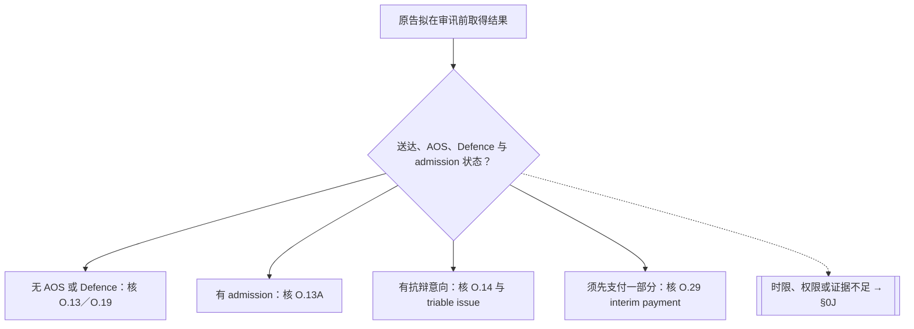
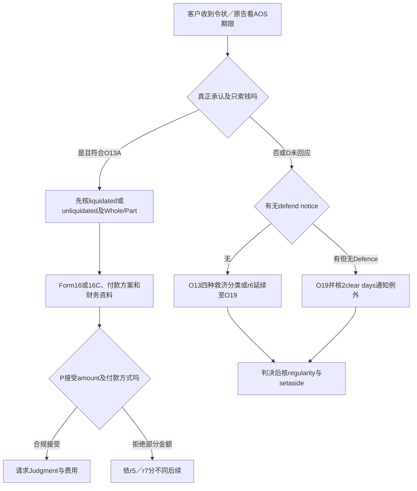
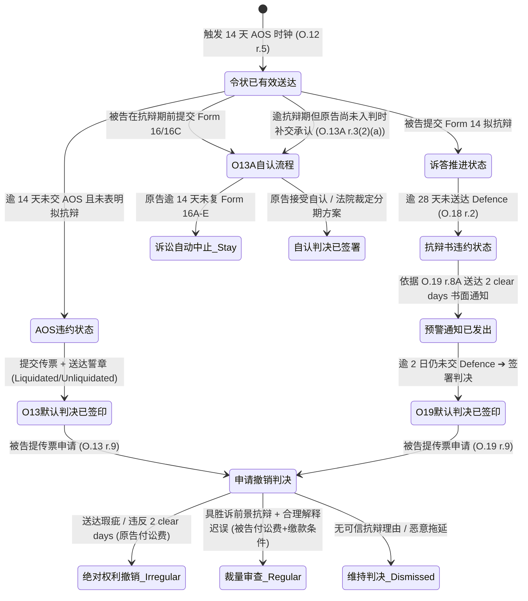
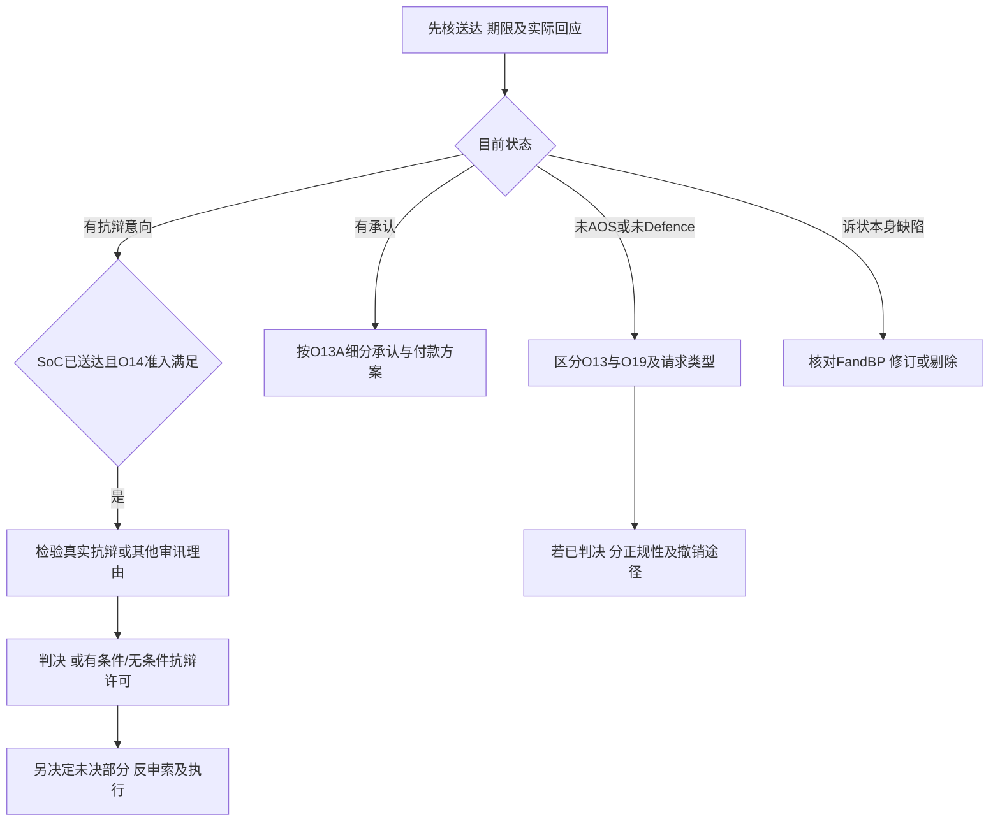
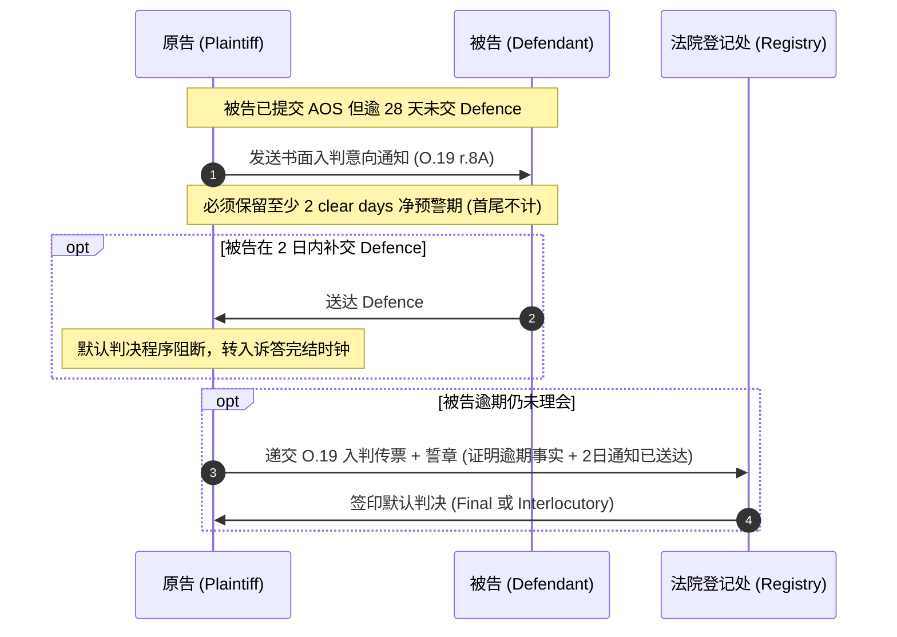
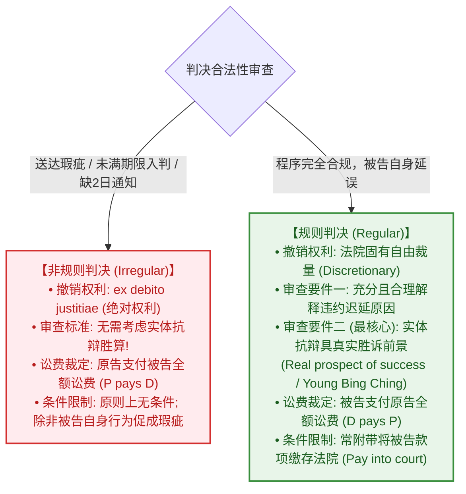
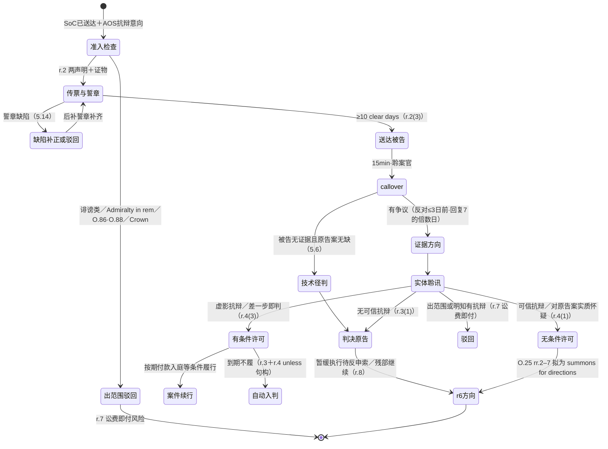
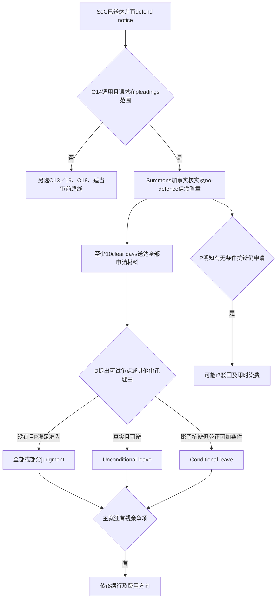
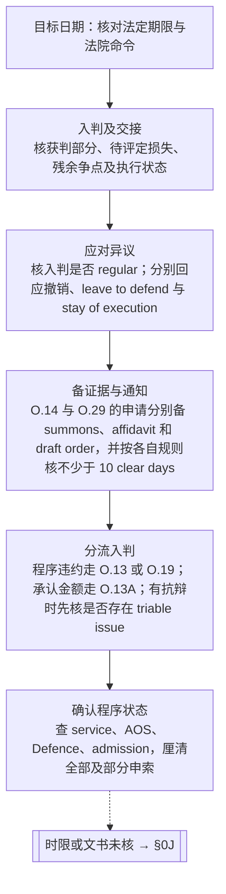

# CO06–09 — 审前判决、承认、撤销与中期付款

## 速读定位层

### 适用范围

本卡处理无需完整正审即可取得或改变金钱判决的主要路径。§0B 负责程序分流；§0C 处理 O.13／O.19 default judgment；§0D 处理 O.13A admission；§0E 处理 setting aside；§0F 处理 O.14 summary judgment；§0G 处理 O.29 interim payment。送达与 AOS 见 CO03；pleadings 见 CO04-05-10；申请和命令起草见 CO07。

### 术语

| 术语 | 定义与章节 |
| --- | --- |
| default judgment | 被告逾期未回应时的缺席判决：若被告未在法定期限内提交认收书（AOS），或在提交认收书后未在法定限期内送达答辩书（Defence），则原告有权依其申索类型向法院申请直接批出缺席判决。 [§0C](#0C.%20O.13%20%E4%B8%8E%20O.19%20default%20judgment) |
| admission | 对金钱申索的法定承认程序：当被告面对金钱申索时，可依 RHC O.13A 填写承认书承认全部或部分债务；若被告财力困难，亦可在承认债务的同时向法庭申请分期偿还令。 [§0D](#0D.%20O.13A%20admission%E3%80%81%E9%87%91%E9%A2%9D%E4%B8%8E%E5%88%86%E6%9C%9F) |
| setting aside | 撤销缺席判决的司法救济：当被告被判处缺席判决后，可向法院申请撤销该判决：(1) 若判决程序存在违法或重大瑕疵（irregular），则被告有权作为法定权利直接要求撤销（ex debito justitiae）；(2) 若原判决程序合规（regular），则被告须证明自身具有可信的实体抗辩基础并说明未能按时回应的合理理由。 [§0E](#0E.%20Setting%20Aside%20Default%20Judgment) |
| summary judgment | 排除无理抗辩的简易判决：当原告发出令状且被告提交认收书后，若原告能以誓章举证证明被告对其实体申索全无需要审讯的有效抗辩（no arguable defence），则法院可依 RHC O.14 无需经过全面审讯而直接批出终局胜诉判决。 [§0F](#0F.%20O.14%20summary%20judgment) |
| interim payment | 诉讼期间的先行临时付款令：当原告已确立被告的实体赔偿责任（或证明在正审中必然能取得巨额赔偿判决）时，为缓解原告等待审讯期间的财务困境，法院可命令被告在正审前先行支付合理比例的预付赔偿金。 [§0G](#0G.%20O.29%20interim%20payment) |

### 环节定位

| 环节 | 实际操作 |
| --- | --- |
| 核状态 | 核对 service、AOS、Defence、admission 与 counterclaim 的现状。 |
| 选路径 | 区分 default judgment、O.13A、O.14 与 interim payment。 |
| 备证据 | 按所选路径准备 affirmation、exhibits、计算表与 draft order。 |
| 回应 | 被告提出 irregularity、merits、解释、triable issue 或 impecuniosity。 |
| 落令 | 法院可作全部、部分、附条件判决，准予抗辩或撤销判决。 |

## 🗺️ 本卡地图



法院先核送达、期限和案卷状态。原告随后依 default、admission 或无可审争点的路径请求判决；如只求预付，则须另证 interim payment 的法定门槛和合理金额。

| 任务 | 直达 |
| --- | --- |
| 审前取判路径与程序状态 | [§0B](#0B.%20%E5%AE%A1%E5%89%8D%E5%8F%96%E5%88%A4%E8%B7%AF%E5%BE%84%E4%B8%8E%E7%A8%8B%E5%BA%8F%E7%8A%B6%E6%80%81) |
| O.13 与 O.19 default judgment | [§0C](#0C.%20O.13%20%E4%B8%8E%20O.19%20default%20judgment) |
| O.13A admission、金额与分期 | [§0D](#0D.%20O.13A%20admission%E3%80%81%E9%87%91%E9%A2%9D%E4%B8%8E%E5%88%86%E6%9C%9F) |
| Setting Aside Default Judgment | [§0E](#0E.%20Setting%20Aside%20Default%20Judgment) |
| O.14 summary judgment | [§0F](#0F.%20O.14%20summary%20judgment) |
| O.29 interim payment | [§0G](#0G.%20O.29%20interim%20payment) |
| 文书与期限倒排 | [§0H](#0H.%20%E7%94%B3%E8%AF%B7%E4%B8%8E%E6%93%8D%E4%BD%9C%E5%B7%A5%E7%A8%8B%EF%BC%9A%E6%96%87%E4%B9%A6%E3%80%81%E9%80%81%E8%BE%BE%E5%92%8C%E6%9C%9F%E9%99%90) |
| 提交前核对 | [§0I](#0I.%20%E6%94%BB%E9%98%B2%E4%B8%8E%E6%89%A7%E8%A1%8C%E5%89%8D%E6%A0%B8%E5%AF%B9) |
| 失误、制裁与补救 | [§0J](#0J.%20%E7%A8%8B%E5%BA%8F%E5%A4%B1%E8%AF%AF%E5%8F%8A%E5%85%B6%E5%90%8E%E6%9E%9C) |
| SG 实务应用 | [§0K](#0K.%20SG%20%E5%AE%9E%E5%8A%A1%E5%BA%94%E7%94%A8%E4%B8%8E%E5%AF%BC%E5%B8%88%E5%8F%A3%E5%BE%84) |

<!-- BEGIN:cite-legend -->
> [!info]- 引注图例
> 
> | 码 | 文件 | 层级 | 学年 |
> |---|---|---|---|
> | LG6V | [LG6 - Default Judgments Under O13 and O13A（本届讲义·447 行·L16 自署 2026-2027）](../../04%20Base%20Lectures/00%20This%20Year%20Moodle%202026-27/Lecture%20Outlines,%20Powerpoints%20&%20Materials/LG6%20-%20Default%20Judgments%20Under%20O13%20and%20O13A.md) | 本届讲义 | 2026-27 |
> | LG6S | [LG6- Admissions DJ（本届课堂幻灯 md 转本·413 行·55 张）](../../04%20Base%20Lectures/00%20This%20Year%20Moodle%202026-27/Lecture%20Outlines,%20Powerpoints%20&%20Materials/LG6-%20Admissions%20DJ.md) | 本届讲义 | 2026-27 |
> | LG6R | [LG6 - Reference Material（本届官方·RHC O.13／O.13A／O.19 原文＋Appendix A 表格·916 行）](../../04%20Base%20Lectures/00%20This%20Year%20Moodle%202026-27/Lecture%20Outlines,%20Powerpoints%20&%20Materials/LG6%20-%20Reference%20Material.md) | 本届官方 | 2026-27 |
> | LG6QA | [(NEW!) LG6 - Additional Notes（本届官方补充答疑·2026-09-28 到库·83 行）](../../99%20Moodle%20Mirror/Lecture%20Outlines,%20Powerpoints%20&%20Materials/LG6%20-%20Default%20Judgment%20and%20Admissions%20O13%20O13A/%28NEW!%29%20LG6%20-%20Additional%20Notes.md) | 本届官方 | 2026-27 |
> | LG6APP | [LG6 - Appendices.pdf（本届官方案卷附录·88 页·库内无 md 伴生）](../../04%20Base%20Lectures/00%20This%20Year%20Moodle%202026-27/Lecture%20Outlines,%20Powerpoints%20&%20Materials/LG6%20-%20Appendices.pdf) | 本届官方 | 2026-27 |
> | LG3V | [LG3 - Service and Acknowledgement of Service (REV)（本届讲义·AOS 14 日出处）](../../04%20Base%20Lectures/00%20This%20Year%20Moodle%202026-27/Lecture%20Outlines,%20Powerpoints%20&%20Materials/LG3%20-%20Service%20and%20Acknowledgement%20of%20Service%20%28REV%29.md) | 本届讲义 | 2026-27 |
> | LG3R | [LG3 - Reference Material（本届官方·RHC O.3 r.6／O.10／O.12 r.5・r.6 原文·866 行）](../../04%20Base%20Lectures/00%20This%20Year%20Moodle%202026-27/Lecture%20Outlines,%20Powerpoints%20&%20Materials/LG3%20-%20Reference%20Material.md) | 本届官方 | 2026-27 |
> | LG4V | [LG4 - Pleadings（本届讲义·O.18 r.2(1) 抗辩书 28 日出处）](../../04%20Base%20Lectures/00%20This%20Year%20Moodle%202026-27/Lecture%20Outlines,%20Powerpoints%20&%20Materials/LG4%20-%20Pleadings.md) | 本届讲义 | 2026-27 |
> | MATRIX | [03 真题矩阵与解析（凝结层·本库自撰）](../00%20Master/03%20Past%20Paper%20Matrix%20and%20Analysis.md) | 凝结层 | 2026-27 |
> | OLD-SET3DJ | [Set 3「LG4 O13A + Default Judgment」学生笔记（往届·460 行）](../../06%20Base%20Exam%20Notes/Set%203/LG4%20O13A%20+%20Default%20Judgment.md) | 往届学生稿 | 2025-26 |
> | OLD-SET3L3 | [Set 3「LG3 Service and acknowledgement of service」学生笔记（往届·702 行）](../../06%20Base%20Exam%20Notes/Set%203/LG3%20Service%20and%20acknowledgement%20of%20service.md) | 往届学生稿 | 2025-26 |
> | CAP-C6 | [PCLL8010 LG6 PT](../../99%20Moodle%20Mirror/Lecture%20Outlines,%20Powerpoints%20&%20Materials/LG6%20-%20Default%20Judgment%20and%20Admissions%20O13%20O13A/Panopto%20Captions%20%28local%20export%29/8010_LG06_PT.md) | 本届讲义 | 2026-27 |
> | WC6 | [PCLL8010 LG6本届书面讲义](../../04%20Base%20Lectures/00%20This%20Year%20Moodle%202026-27/Lecture%20Outlines,%20Powerpoints%20&%20Materials/LG6%20-%20Default%20Judgments%20Under%20O13%20and%20O13A.md) | 本届讲义 | 2026-27 |
> | S6-AP | [1. SG6 (Civil Procedure 1)](../../04%20Base%20Lectures/00%20This%20Year%20Moodle%202026-27/Small%20Group%20Activity%20Plans/1.%20SG6%20%28Civil%20Procedure%201%29.md) | 本届官方 | 2026-27 |
> | S6-L6 | [LG6 - Default Judgments Under O13 and O13A](../../04%20Base%20Lectures/00%20This%20Year%20Moodle%202026-27/Lecture%20Outlines,%20Powerpoints%20&%20Materials/LG6%20-%20Default%20Judgments%20Under%20O13%20and%20O13A.md) | 本届讲义 | 2026-27 |
> | CL4 | [LG4 Pleadings](../../04%20Base%20Lectures/00%20This%20Year%20Moodle%202026-27/Lecture%20Outlines,%20Powerpoints%20&%20Materials/LG4%20-%20Pleadings.md) | 本届讲义 | 2026-27 |
> | CL6 | [LG6 缺席判决](../../04%20Base%20Lectures/00%20This%20Year%20Moodle%202026-27/Lecture%20Outlines,%20Powerpoints%20&%20Materials/LG6%20-%20Default%20Judgments%20Under%20O13%20and%20O13A.md) | 本届讲义 | 2026-27 |
> | CL6A | [LG6 承认与判决](../../04%20Base%20Lectures/00%20This%20Year%20Moodle%202026-27/Lecture%20Outlines,%20Powerpoints%20&%20Materials/LG6-%20Admissions%20DJ.md) | 本届讲义 | 2026-27 |
> | CL9 | [LG9 简易判决与临时付款（本届大纲，711 行）](../../04%20Base%20Lectures/00%20This%20Year%20Moodle%202026-27/Lecture%20Outlines,%20Powerpoints%20&%20Materials/LG9%20-%20Summary%20Judgment%20Interim%20Payment.md) | 本届讲义 | 2026-27 |
> | CL9S1 | [本届课堂幻灯·CL LG9 1-2（O.14 上半：范围、步骤、迟延）](../../04%20Base%20Lectures/00%20This%20Year%20Moodle%202026-27/Lecture%20Outlines,%20Powerpoints%20&%20Materials/CL%20LG9%202026-2027%201-2.md) | 本届讲义 | 2026-27 |
> | CL9S2 | [本届课堂幻灯·CL LG9 2-2（O.14 下半：誓章、结果、讼费）](../../04%20Base%20Lectures/00%20This%20Year%20Moodle%202026-27/Lecture%20Outlines,%20Powerpoints%20&%20Materials/CL%20LG9%202026-2027%202-2.md) | 本届讲义 | 2026-27 |
> | CAP-C9 | [PCLL8010 LG9 PT 课堂字幕（2026-09-30）](../../99%20Moodle%20Mirror/Lecture%20Outlines,%20Powerpoints%20&%20Materials/LG9%20-%20Summary%20Judgment%20&%20Interim%20Payment/Panopto%20Captions%20%28local%20export%29/8010_LG09_PT.md) | 本届讲义 | 2026-27 |
> | OLD-LG9O | [往届（2025-26）LG9 大纲全夹伴生 md（789 行，含往届学生层面批注）](../../04%20Base%20Lectures/%5BLG09%5D%20Summary%20Judgment%20and%20Interim%20Payment/LG9%20-%20Summary%20Judgment%20%20Interim%20Payment.md) | 往届官方 | 2025-26 |
> | OLD-LG9S1 | [往届（2025-26）CL LG9 1-2 幻灯伴生 md（与本届 CL9S1 正文逐字节全同，实机 diff 核验）](../../04%20Base%20Lectures/%5BLG09%5D%20Summary%20Judgment%20and%20Interim%20Payment/CL%20LG9%202025-2026%201-2.md) | 往届官方 | 2025-26 |
> | OLD-LG9S2 | [往届（2025-26）CL LG9 2-2 幻灯伴生 md（与本届 CL9S2 正文逐字节全同，实机 diff 核验）](../../04%20Base%20Lectures/%5BLG09%5D%20Summary%20Judgment%20and%20Interim%20Payment/CL%20LG9%202025-2026%202-2.md) | 往届官方 | 2025-26 |
> | OLD-SET3L9 | [往届学生稿·Set 3「LG9 Summary Judgement」（1110 行·非官方）](../../06%20Base%20Exam%20Notes/Set%203/LG9%20Summary%20Judgement.md) | 往届学生稿 | 2025-26 |
> | R14 | [RHC O14再刊本](obsidian://open?vault=3b1e77255f6c6e29&file=output%2Fresearch%2FCivil%20Litigation%20Rules%20Verification%20-%202026-10-23%2FRHC%20O14.md) | 库外法源 | 2026-27 |
> | R21 | [RHC O21再刊本](obsidian://open?vault=3b1e77255f6c6e29&file=output%2Fresearch%2FCivil%20Litigation%20Rules%20Verification%20-%202026-10-23%2FRHC%20O21.md) | 库外法源 | 2026-27 |
> | S6-L9 | [LG9 - Summary Judgment Interim Payment](../../04%20Base%20Lectures/00%20This%20Year%20Moodle%202026-27/Lecture%20Outlines,%20Powerpoints%20&%20Materials/LG9%20-%20Summary%20Judgment%20Interim%20Payment.md) | 本届讲义 | 2026-27 |
<!-- END:cite-legend -->

本卡将相关程序按功能合为一个主述；独有规则、课堂例子、来源及未决保留，重复总览不另设竞争版本。SG答案本身不随本次结构迁移改写。旧CO编号在原案例／修订记录中仍表示教学来源坐标，不代表另有独立活动主卡。

#### 核心参数与计算口径
- **缺席判决申请时限（Default Judgment - O.13 / O.19）**：
  ① 未认收违约判决（O.13）：先按适用送达方式计算 AOS 期限；期限届满且案卷无 AOS，原告才可依 O.13 就适用类别取判；
  ② 未抗辩违约判决（O.19）：自收到 SoC 或提交 AOS 期限届满后满 **28 天**且被告未交 Defence 后起即可申请。
- **撤销缺席判决双轨门槛（Setting Aside Default Judgment - O.13 r.9 / O.19 r.9）**：
  ① 程序违法判决（Irregular Judgment）：原告未送达或未满期违规取判，被告享有当然撤销权利（As of right / Ex debito justitiae），无须证明实体抗辩；
  ② **Regular judgment**：被告申请法院酌情撤销时，应以证据说明抗辩的实际胜算、未及时应诉的原因和申请速度。法院按 *Evans v Bartlam* 及香港判例权衡相关因素；迟延和解释不足并非两个独立且一律致命的门槛。
- **O.14 简易判决法定通知与送达（Summary Judgment - O.14 r.2(3)）**：传票及支持誓章必须在聆讯日前不少于 **10 clear days** 送达被告；法官裁决走向：(1) 无条件判决（Unconditional judgment）；(2) 无条件准予抗辩（Unconditional leave to defend）；(3) 有条件准予抗辩（Conditional leave to defend，命被告将争议款项缴存法院）；(4) 驳回传票并裁定讼费（Dismiss summons with costs）。
- **O.29 中期付款法定准入要件（Interim Payment - O.29 r.10–r.12）**：被告已承认责任，或原告必将获得判决（Would obtain judgment）；数额不得超过最终预计判决金额的合理比例；判前严禁向审判法官披露。

## 0B. 审前取判路径与程序状态

### 术语速查

| 术语 | 定义、程序作用与来源 |
| --- | --- |
| 自认（Admission under O.13A） | 被告以法定表格承认金钱索赔（全部或部分），换取不经审讯结案与分期偿付的法定和解机制；O.13A r.2–r.7。 <small style="opacity: 0.55">〔LG6V L139 "O.13A provides the mechanism for early settlement of disputes"〕</small> |
| 已算定金钱索赔（Liquidated Demand） | 数额确定或可依确定公式算出的金钱请求（如借款本息、发票金额、算定违约金），不论是否附带利息主张；O.13 r.1／O.19 r.2。 <small style="opacity: 0.55">〔LG6V L255 "Liquidated claim only (irrespective whether interest is claimed): O.13 r.1"〕</small> |
| 未算定损害赔偿（Unliquidated Damages） | 数额须经法庭评估的赔偿请求（侵权损失、人身伤害等），入判只得责任中间判决、金额留待评定；O.13 r.2／O.19 r.3。 <small style="opacity: 0.55">〔LG6V L265 "the default judgment will be an interlocutory judgment on liability with damages to be assessed + costs"〕</small> |
| 意向抗辩通知（Notice of Intention to Defend） | 被告在 AOS 中表明拟抗辩的正式意思表示；「未给该通知」正是 O.13 入判的另一必备要件；O.13 r.7(1) 合并解读。 <small style="opacity: 0.55">〔LG6QA L34 "D has filed an A/S indicating that D does not intend to defend the proceedings"〕</small> |
| 认收（Acknowledgement of Service，AOS） | 被告回应令状的正式表格，表明是否打算抗辩；境内送达者期限为送达后 14 日（含送达当日）；O.12 r.5。 <small style="opacity: 0.55">〔LG3R L718 "in the case of a writ served within the jurisdiction, to fourteen days after service of the writ (including the day of service)"；LG6QA L54 "It is a form formally responding to the Writ, indicating whether the defendant intends to defend or not"〕</small> |
| 送达誓章／送达声明（Affidavit／Affirmation of Service） | 由原告（或送达执行人）以誓章核实「送达方式与事实」的陈述书；邮寄／信箱投递时须载明令状会于 7 日内为被告知悉、且未被退回；O.10 r.1(3)；O.13 r.7。 <small style="opacity: 0.55">〔LG6QA L52 "It is a written statement of fact, verified by oath or affirmation, deposing to the manner and fact of service"；LG6QA L52 "O.10 r.1(3)(b) requires the plaintiff to depose to their opinion that the Writ will have come to the defendant's knowledge within 7 days"〕</small> |
| 法定时限（Prescribed Time） | O.13 下＝被告认收令状的时限（送达后 14 日）；逾此期未认收方可入判；O.13 r.6A。 <small style="opacity: 0.55">〔LG6R L774 "the prescribed time … means the time limited for the defendant to acknowledge service of the writ"〕</small> |
| 两净日入判意向通知（Notice of Intention to Enter Judgment，2 clear days） | 原告依 O.19 入判前，须提前至少两个净日（首尾两天均不计）向被告送达的书面入判意向通知；O.19 r.8A。 <small style="opacity: 0.55">〔LG6R L902 "not less than 2 clear days before entering judgment, the party intending to enter judgment has served notice in writing"〕</small> |
| 默认判决（Default Judgment） | 被告未在期限内认收（O.13）或未在期限内送达抗辩书（O.19）时，原告依权利（as of right）取得的判决；O.13／O.19。 <small style="opacity: 0.55">〔LG6V L251 "If D fails to file any A/S within 14 days of being served … P may obtain judgment as of right against D"〕</small> |
| 最终判决（Final Judgment） | 直接判令支付全额索赔款／交还土地并加讼费的判决，案件实体就此终结；O.13 r.1／O.19 r.2。 <small style="opacity: 0.55">〔LG6R L730 "enter final judgment against that defendant"〕</small> |
| 中间判决（Interlocutory Judgment） | 只判定责任成立、损害赔偿金额留待法庭另行评估（damages to be assessed）的判决；O.13 r.2／O.19 r.3。 <small style="opacity: 0.55">〔LG6R L736 "enter interlocutory judgment against that defendant for damages to be assessed and costs"〕</small> |
| 非规则判决（Irregular Judgment） | 取得过程违反程序（送达瑕疵／未满期入判／缺 2 日通知）的默认判决，被告享有 ex debito justitiae 绝对撤销权；§3.4；判例链。 <small style="opacity: 0.55">〔LG6V L390 "D can set aside an irregular judgment ex debito justitiae, i.e. as of right without considering the merits"〕</small> |
| 依绝对正义权利（Ex Debito Justitiae） | 程序违法所生判决的撤销权利——一经证明 irregular，法院无须审查实体抗辩优劣即须撤销；*Po Kwong Marble*（讲义转述）。 <small style="opacity: 0.55">〔LG6V L430 "So long as irregularly is shown, D can set aside ex debito justitiae"〕</small> |
| 规则判决（Regular Judgment） | 程序完全合规、因被告自身迟误而取得的默认判决，撤销属法院裁量；O.13 r.9／O.19 r.9。 <small style="opacity: 0.55">〔LG6V L410 "The Court has discretion to decide whether to set aside a regular judgment"〕</small> |
| 真实胜诉前景（Real Prospect of Success） | Regular 判决撤销的核心门槛：法院须形成初步心证认为抗辩具真实胜诉机会且具相当说服力，高于「表面可辩」；*Young Bing Ching*（讲义转述）。 <small style="opacity: 0.55">〔LG6V L416 "The Court has to form a provisional view that the defence has a real prospect of success, or carrying with it some degree of conviction"〕</small> |
| 缴款入法院（Payment into Court） | 抗辩虽有胜诉前景但仍模糊（shadowy）时，法院撤销判决常附的条件——被告限期内将争议款（≤索赔额）缴存法院，逾期判决恢复；*L&M Specialist Construction*。 <small style="opacity: 0.55">〔LG6V L402 "D to pay a certain sum of money (equal to or less than P's claim) into Court in order to get judgment set aside"；LG6V L406 "On the defendant paying $300,000 into court within 14 days of this Order"〕</small> |
| 暂缓执行（Stay of Execution） | 分期判决下的执行冻结：被告按期履行期间原告不得执行；断供一期即自动失效，全部余额可径行执行；O.13A r.9(7)(8)。 <small style="opacity: 0.55">〔LG6R L258 "execution of the judgment is stayed pending payment"；LG6R L260 "the stay of execution pursuant to paragraph (7) immediately ceases"〕</small> |
| 全案法定中止（Stay of Action） | 原告收自认表后 14 日内不复对应表格（Form 16A／16B／16D／16E）即自动发生的中止，直至其补交；O.13A r.4(4)–r.7(4)。 <small style="opacity: 0.55">〔LG6R L92 "does not file a request for judgment within 14 days … the claim is stayed until he files the request"〕</small> |
| 固定讼费（Fixed Costs） | 免开庭依 O.13A 自认入判时原告讼费的法定封顶：高院 $10,000（每多一被告 +$500）、区院 $6,500（+$350）；O.62 附表二 Part II。 <small style="opacity: 0.55">〔LG6V L241 "O.62 2nd Schedule Part II fixed the costs P can get (if O.13A admission obtained without a hearing) at $10,000 for High Court cases"〕</small> |
| 简易判决（summary judgment） | 原告在被告已表示抗辩意向后，以被告对请求（或其部分）无抗辩、或除金额外无抗辩为由，不经完整审讯即请求判决的程序；O.14 r.1(1)。 <small style="opacity: 0.55">〔CL9 L72 "the plaintiff may, on the ground that that defendant has no defence to a claim"〕</small> |
| 临时付款／中期付款（interim payment） | 被告就可能被裁定负上的损害赔偿、债务或其他款项（**不含讼费**）先行部分支付的命令；O.29 r.9。 <small style="opacity: 0.55">〔CL9 L469 "means a payment on account of any damages, debt or other sum (excluding costs) which he may be held liable to pay"〕</small> |
| 申索陈述书（statement of claim, SoC） | O.14 的两个程序前提之一：原告请求所据的诉答文件，须已**送达**被告（不是只出了 writ）；O.14 r.1(1)。 <small style="opacity: 0.55">〔CL9 L127 "The statement of claim must be served on the defendant"〕</small> |
| 抗辩意向确认（acknowledgement of service giving notice of intention to defend, AOS） | 被告收受送达后交存的程序确认；O.14 入口要件——没有此件先走默认判决路径；O.14 r.1(1)。 <small style="opacity: 0.55">〔CL9 L125 "rule (1) specifically requires acknowledgement of service of the writ"〕</small> |
| 核实誓章／确认誓章（verifying affidavit / affirmation） | 支持 O.14 传票的誓章：核实请求所据事实、并声明宣誓人相信被告无抗辩（或除金额外无抗辩）；O.14 r.2(1)。 <small style="opacity: 0.55">〔CL9 L142 "an affidavit verifying the facts on which the claim, or the part of a claim, to which the application relates is based"〕</small> |
| 传票（summons） | 提出非正审申请的程序文书；O.14/O.29 申请均以传票提出，O.29 可申请并入 O.14 或 O.86 传票；O.29 r.10(2)。 <small style="opacity: 0.55">〔CL9 L477 "shall be made by summons but may be included in a summons for summary judgment under Order 14 or Order 86"〕</small> |
| 回院日／点名聆讯（return day / "callover" hearing） | 传票首次出庭日；O.14 第一庭通常是聆案官席前 15 分钟的 callover，处理证据方向与后续排期；大纲实务描述。 <small style="opacity: 0.55">〔CL9 L158 "The summons should be returnable before the Master, the first hearing will be for a 15-minute “callover” hearing"〕</small> |
| 净日（clear days） | 不计首尾两端的整日期间；O.14 传票与誓章须至少 10 clear days 前送达；O.3 r.2(4)（往届转述）。 <small style="opacity: 0.55">〔OLD-SET3L9 L513 "O 3 r.2(4): clear days = 1 whole day"·往届仅参考〕</small> |
| 提出因由（show cause） | 被告对抗 O.14 申请的动作：以誓章或其他方式证明有应审争点或其他审讯理由；O.14 r.4(1)。 <small style="opacity: 0.55">〔CL9 L194 "A defendant may show cause against an application under rule 1 by affidavit or otherwise to the satisfaction of the Court"〕</small> |
| 应审争点（triable issue） | 须由审讯检验的争点；检验是看被告主张**可信（believable）**，不是看法官此刻是否**相信（believed）**；O.14 r.3(1)；Ng Shou Chun。 <small style="opacity: 0.55">〔CL9 L380 "The issue is not whether the defendant’s assertions are to be believed; it is whether those assertions are believable"〕</small> |
| 真实／善意抗辩（real or bona fide defence） | 被告在 O.14 下须显示的抗辩质量：所陈可信、且有公平或合理概率构成法律上的真实抗辩；Bhagwandas（大纲引）。 <small style="opacity: 0.55">〔CL9 L262 "there is a fair or reasonable probability of the defendant having a real or bona fide defence as a matter of law"〕</small> |
| 抗辩许可（leave to defend） | 法院准许被告抗辩本案（或其部分）的命令；可无条件，或按提供担保、时间或审讯方式等条件给予；O.14 r.4(3)。 <small style="opacity: 0.55">〔CL9 L197 "either unconditionally or on such terms as to giving security or time or mode of trial or otherwise as it thinks fit"〕</small> |
| 有条件抗辩许可（conditional leave to defend） | 附条件（典型为付款入庭）的抗辩许可；用于差一步即判或抗辩虚影（shadowy）的情境；O.14 r.4(3)。 <small style="opacity: 0.55">〔CL9 L262 "if it is prepared very nearly to give judgment for the plaintiff or where the defence is shadowy"〕</small> |
| 无条件抗辩许可（unconditional leave to defend） | 不附条件的抗辩许可；抗辩可信、对原告案有实质怀疑或材料不足时的去处；O.14 r.4(1)／Billion Silver。 <small style="opacity: 0.55">〔CL9 L320 "would or would tend to impeach the validity of the plaintiff’s claim"〕</small> |
| 虚影抗辩（shadowy defence） | 弱而未至"不可信"的抗辩：仅空言主张、无文件或其他证据支持；Kwong Key（大纲引）。 <small style="opacity: 0.55">〔CL9 L362 "what the Defendant said amounted to bare assertions, unsubstantiated by any other evidence, documentary or otherwise"〕</small> |
| 无资力抗辩（impecuniosity） | 被告以免除财务条件的主张；须就其资财作全面坦诚披露，且证明**不能（impossible）**而非仅**困难（difficult）**履行；Yorke Motors／Hwang（大纲引）。 <small style="opacity: 0.55">〔CL9 L370 "not that it is difficult for him to fulfill the condition sought to be imposed, but that it is impossible"〕</small> |
| 随案讼费（costs in the cause） | 本申请讼费随全案结果而定——谁最终胜诉谁取得此申请讼费（往届大纲批注口径）；O.14 讼费配置。 <small style="opacity: 0.55">〔OLD-LG9O L524 "Conditional leave to defend (O 14 r 4(3)) with costs in the cause."·往届仅参考〕</small> |
| 抵销（set-off）与反申索（counterclaim） | 抵销是与本诉相连的"盾"、反申索是独立的"剑"；两者影响 O.14 下判决与执行暂缓的组合；往届学生稿整理。 <small style="opacity: 0.55">〔OLD-SET3L9 L669 "Must arise out of the same set of facts [a shield of D as against P]"·往届仅参考；OLD-SET3L9 L677 "a sword of D as against P"·往届仅参考〕</small> |
| 非正审判决（interlocutory judgment）vs 终局判决（final judgment） | 只判责任、赔偿待评定（damages to be assessed）的判决；配合 O.29 可先取部分款项；往届学生稿整理。 <small style="opacity: 0.55">〔OLD-SET3L9 L1024 "P will obtain an interlocutory judgment on liability with damages to be assessed at trial"·往届仅参考〕</small> |
| 后续方向（directions，O.14 r.6） | 给抗辩许可或判后暂缓执行时，法院须就后续程序作方向，O.25 rr.2–7 拟同为 summons for directions 适用；O.14 r.6。 <small style="opacity: 0.55">〔CL9 L425 "the Court shall give directions as to the further conduct of the action, and Order 25, rules 2 to 7"〕</small> |
| 合理比例（reasonable proportion） | O.29 临付数额上限：法院认为公正、但不超过原告可能获赔额的合理比例，且计及分担过失与抵销／反申索；O.29 r.11(1)。 <small style="opacity: 0.55">〔CL9 L501 "not exceeding a reasonable proportion of the damages which in the opinion of the Court are likely to be recovered"〕</small> |
| 全面坦诚披露（full and frank disclosure） | 就资财（impecuniosity）或单方程序（LG13 ex parte 禁令）陈述时的完整披露标准；反面为 material non-disclosure；Kwong Key（大纲引）。 <small style="opacity: 0.55">〔CAP-C9 L2899 "He must make full and frank disclosure."〕</small> |
| 速审命令（speedy trial） | 当事人已取速审令后再申 O.14 属不自洽——双方已与法院按指定时表推进；Pierre Fabre。 <small style="opacity: 0.55">〔CL9 L166 "thereafter seeks summary judgment, it has been considered to be an inconsistency"〕</small> |

### 1.1 LG6整堂字幕的分流、答问及SG06落点

已读本届LG6 PT全部1058条字幕正文，并对照本卡已经完整收录的本届Additional Notes七问。课堂口语的“an liquidated／liquidated”、第几张Form及“AOS勾无意抗辩＝承认整个申索”不能取代本届书面规则和正式补充答疑。



### 1.2 从事实而非表格封面选路

| 触发 | 操作顺序 | 课堂着重的限制 |
| --- | --- | --- |
| D真正接受仅金钱claim | 先辨fixed sum与须法院评估损害；Whole／Part和付款proposal分开，Form16／16C需真实财务情况支持分期。 | “不想抗辩”AOS勾选不自动完成O13A正式admission；先核Additional Notes及r2条件。 <small style="opacity: 0.55">〔CAP-C6 L151 "only applies to claims for payments of money"〕</small> |
| 固定金额部分认收 | r5的part amount是提出以该金额**了结wholeclaim**；P接受或拒绝而整体继续，不能一边拿走已提金额一边在同一r5路径追剩余。 | 要独立判断接受金额及接受分期方式；14日回复不应被省去。 <small style="opacity: 0.55">〔CAP-C6 L646 "We cannot have we will not have a situation where the plaintiff gets the $800,000 and the $200,000 gets litigated."〕</small> |
| 未定损害承认责任 | r6只承认全案责任、金额待评；r7另报价满足claim，P不满意也可求责任判决与评估，规则形式不同。 | 将“同意负责”与“接受报价／分期”分开；不能一听offer就称已达成settlement。 <small style="opacity: 0.55">〔CAP-C6 L1009 "We still get judgment on liability, and then the court will decide"〕</small> |
| 原告取O13默认判决 | AOS未通知拟抗辩，先看四种索赔种类：liquidated final；unliquidated及detention各需后续评定；possession按r4；mixed限前四。 | injunction等其他救济不能塞进r5 mixed；须r6向O19继续。 <small style="opacity: 0.55">〔CAP-C6 L1348 "if a claim does not fall within the four claims"〕</small> |
| 原告取O19默认判决 | 逾Defence期，按r2–r5／r6mixed／r7otherrelief；若须r8A通知，至少2clear days，不是“48小时”。 | 通知可在期限尚未届满时先送，但申请judgment仍要等Defence期限届满；例外另核。 <small style="opacity: 0.55">〔CAP-C6 L1531 "48 hours does not mean two days notice"〕</small> |
| 取判证明 | 逐项核writ和SoC送达、O13Aforms随writ、O19r8A通知，按法庭规则affidavit及申请附件。 | “有writ副本”不等于有serviceproof；法院可能因不明地址／退邮发requisition。 <small style="opacity: 0.55">〔CAP-C6 L1636 "affidavit of service should also depose"〕</small> |

### 1.3 第一性原理：自然公正、程序效益与违约失权

默认判决（Default Judgment）与自认和解（Admission under O.13A）是民事诉讼控制论中最重要的**程序加速与惩戒减负机制**，本届讲义的两条学习目标恰各指其一： <small style="opacity: 0.55">〔LG6V L33 "Distinguish between the procedures for obtaining default judgment under O.13 (failure to acknowledge service) and O.19 (failure to file a defence)"；LG6V L35 "Apply the rules governing admissions and proposals for payment by instalments under O.13A"〕</small>

1. **违约推定失权与司法效率（Default as Forfeiture & Proportionality）**： <small style="opacity: 0.55">〔LG6V L251 "If D fails to file any A/S within 14 days of being served … P may obtain judgment as of right against D"〕</small>
   - 民事诉讼奉行对抗制与当事人处分原则。若被告在获得合法通知后消极不作为（既不认收亦不抗辩），法律推定其放弃抗辩权，赋予原告**直接依权利取得判决（Judgment as of right）**的救济，防止司法资源被无端拖延；至于「践行 O.1A 相称性目标」，本届 LG6 三件材料均未援引 O.1A。 <small style="opacity: 0.55">〔LG6R L730 "if that defendant fails to give notice of intention to defend … the plaintiff may, after the prescribed time, enter final judgment"〕〔❓「O.1A 相称性目标」库内无出处·待核，已登记文末 open 块〕</small>
2. **自然公正底线：程序正当决定判决效力（Audi Alteram Partem & Due Notice）**： <small style="opacity: 0.55">〔LG6V L390 "D can set aside an irregular judgment ex debito justitiae, i.e. as of right without considering the merits of D's defence"〕</small>
   - 默认判决的合法性基石是**被告知情权的充分保障**。若送达存在瑕疵（如寄送时被告在境外、退件未达），被告并未获有效通知，则剥夺其抗辩权的判决自始违法（Irregular），属于侵犯自然公正，被告有权 **ex debito justitiae（依绝对正义权利）** 撤销判决，无需证明其实体抗辩是非曲直。 <small style="opacity: 0.55">〔LG6V L376 "Service was defective because it did not comply with the rules regarding service"；LG6V L380 "D can actually lead evidence to show that he was unaware of the service of the Writ"〕</small>
3. **纠纷早期自愿和解与分期减负（Early Dispute Resolution & Mitigation）**： <small style="opacity: 0.55">〔LG6V L139 "O.13A provides the mechanism for early settlement of disputes"；LG6V L141 "Only available for monetary claim; both liquidated and unliquidated"〕</small>
   - 对于无实体抗辩但暂时缺乏即时偿付能力的被告，O.13A 创设了“承认债务换取分期还款（Instalments）”的法定快速和解通道，促使当事人无需经历全套诉答与审讯，直接以极低固定讼费结案并由法庭确立还款计划。 <small style="opacity: 0.55">〔LG6V L173 "D may propose the time for repayment (i.e. by instalment), if he is not proposing to pay the claim immediately: O.13A r.9"；LG6V L177 "P can accept D's proposal for repaying by instalments, or asks the Court to decide whether the proposal should be accepted"〕</small>

### 1.4 状态机模型（State Variables）



### 1.5 四大控制闸门（Control Gates）

| 闸门 | 触发条件与依据 | 物理拦截机制 | 避坑/硬性规则 |
| --- | --- | --- | --- |
| **闸门 1：AOS 届满与送达合法性核验** | O.13 r.6A & r.7。 <small style="opacity: 0.55">〔LG6R L774 "the prescribed time … means the time limited for the defendant to acknowledge service of the writ"；LG6R L778 "Judgment shall not be entered against a defendant under this Order unless"〕</small> | Registry 审查送达誓章（Affidavit of Service）。若送达方式为邮寄/信箱投递，誓章必须载明**“原告合理确信令状会在 7 日内为被告所知悉”**<br>PD 24.1 第 8 段另要求证明 O.13A 自认表格已随令状及 A/S 一并送达。 <small style="opacity: 0.55">〔LG6V L335 "the affidavit must state that in P's opinion, the Writ would come to D's knowledge within 7 days"〕〔LG6V L339 "the affidavit of service should also depose to the fact that the relevant statutory forms under O.13A"〕</small> | ⚠️ 若信件已被邮局退回（Returned undelivered），即使已到期，送达仍属瑕疵（*C&S Dental Care*），强行入判必成 Irregular Judgment！ <small style="opacity: 0.55">〔LG6V L343 "the method of service on a company under O.10 r.1 & CO s.827 are alternative modes … the service must be irregular"〕</small> |
| **闸门 2：2 Clear Days 预警通知阀** | O.19 r.8A。 <small style="opacity: 0.55">〔LG6V L319 "at least 2 clear days before P applies for any default judgment, P must send D a notice in writing"；LG6R L902 "not less than 2 clear days before entering judgment, the party intending to enter judgment has served notice in writing"〕</small> | 仅适用于 **O.19 诉答违约案件**。原告在入默认判决前**必须提前至少 2 clear days 向被告发出书面入判意向通知** | ⚠️ 首尾两天均不计！若未发通知直接入判，判决构成 Irregular，被告可直接撤销并判原告付全额讼费。⚠️ **例外情形两侧口径不一致（本卡并列不裁决）**：讲义与幻灯同文称「未交 AOS／无律师且无香港地址」，而条文原文称「法庭已裁定或延展抗辩期限／无诉讼记录律师且未指明境内地址」；往届 Set 3 学生笔记与条文原文同口径，详见文末 open 块。 <small style="opacity: 0.55">〔D-R8AEXC〕〔LG6V L321 "This requirement is not necessary if D failed to file A/S, or D is unrepresented + no available Hong Kong address given"〕〔LG6S L226 "Not necessary if D failed to file A/S, or D is unrepresented + no available Hong Kong address"〕〔LG6R L906-L910 "This rule shall not apply where … the Court has made an order prescribing or extending the time for service of defence"〕〔OLD-SET3DJ L232 "Where the court has made an order prescribing / extending the time for service of defence" ·往届仅参考〕</small> |
| **闸门 3：O.13A 14 天自动中止阀** | O.13A r.4(4), r.5(4), r.6(4), r.7(4)。 <small style="opacity: 0.55">〔LG6V L185 "If there is no such acceptance within 14 days, action stayed until he does: O.13A r.4(4)"；LG6R L92 "If the plaintiff does not file a request for judgment within 14 days … the claim is stayed until he files the request"〕</small> | 被告提交自认书后，原告必须在 **14 日内** 回复相应法定表格（Form 16A/B/D/E）。**若原告逾期未回复，全案自动法定中止（Stay of action）** | 案件被冰冻，直至原告补交回复；原告在中止期间不得采取任何其他诉讼推进步骤。 |
| **闸门 4：判决盖印与撤销性质定性阀** | O.13 r.9 / O.19 r.9。 <small style="opacity: 0.55">〔LG6R L832 "the Court may, on such terms as it thinks just, set aside or vary any judgment entered in pursuance of this Order"；LG6R L916 "The Court may, on such terms as it thinks just, set a side or vary any judgment"〕</small> | 撤销听审时的二元分流阀：**Irregular（非规则）** vs **Regular（规则）** | 规则判决必须满足“真实胜诉前景（Real prospect of success）”的高标准证明（*Young Bing Ching*），非规则判决享有 ex debito justitiae 绝对撤销权。 <small style="opacity: 0.55">〔LG6V L416 "The Court has to form a provisional view that the defence has a real prospect of success, or carrying with it some degree of conviction"；LG6V L430 "So long as irregularly is shown, D can set aside ex debito justitiae"〕</small> |

**总表索引**：闸门 1（送达合法性核验）↔ [§8 行 1、2](#8.7%20%E4%B8%8D%E5%81%9A%E6%88%96%E9%80%BE%E6%9C%9F%E7%9A%84%E5%90%8E%E6%9E%9C%E9%93%BE%E6%80%BB%E8%A1%A8%EF%BC%88%E7%8E%AF%E8%8A%82%20%C3%97%20%E4%B8%8D%E5%81%9A%E5%90%8E%E6%9E%9C%20%C3%97%20%E4%BE%9D%E6%8D%AE%EF%BC%89)；闸门 2（两净日预警）↔ 行 3；闸门 3（14 日自动中止）↔ 行 6；闸门 4（撤销定性）↔ 行 1、10、11。

### 1.6 四条路径先分开

| 程序 | 为什么无需立即完整审讯 | 仍须解决的问题 |
| --- | --- | --- |
| Default judgment | 对方在有关程序阶段没有应答 | 有效送达、时限、实际缺席项目、请求类型与判决形式 |
| Admission | 对方承认全部或部分责任/金额 | 承认范围、定额/非定额、付款方案及原告回应 |
| Summary judgment | 符合准入且没有应审争点或其他审讯理由 | 原告先符合程序、被告具体提出抗辩，法院不作不适当的小型审讯 |
| Strike out | 诉状/程序落入所依赖的剔除理由 | 具体ground、能否用证据及是否plain and obvious |

不应因客户想“快赢”而混用：例如已经提出实质抗辩的案件，不是自动改走O.13；程序缺席也不证明主张的全部损害金额已确定。 <small style="opacity: 0.55">〔CL6 L33 "Distinguish between the procedures for obtaining default judgment under O.13"〕〔CL6A L40 "O.13A, r.2(1) (Making an admis"〕〔CL9 L72 "(1) Where in an action to which this rule applies"〕〔CL4 L654 "the general principle: the Court’s power to strike out is"〕</small>



图下各条路径分别受上述条文条件约束，尚未送达SoC而只有writ，不当然进入O.14。 <small style="opacity: 0.55">〔CL9 L72 "(1) Where in an action to which this rule applies"〕</small>

### 1.7 第一性原理

提前取得判决的共同目标是节约完整审讯的成本，路径却取决于对方未应答、实际承认、没有真实可审争议或文件法律缺陷。程序缺席与实体无抗辩是不同输入；工具不能凭“想快赢”互换。

**2026-10-10 深化（解释框架，不是独立法源——所有法律结论以 5.4–6.2 的条文转述与判例为准）**：

- **第一问：为什么有 O.14 却不让它随时可用？** 原告若确无对手，"走过场"的 11 步程序（ pleadings→discovery→WS→CMC→PTR→trial）是纯浪费——"justice delayed is justice denied"；但反过来，不经审讯即终局判决是"最严重的后果"。制度折中＝把入口钉在两件程序事实上（SoC 送达＋抗辩意向），把实体门槛交给"可信性"标准；排除类别（诽谤等有陪审团事实问题的案种）则直接关闸。 <small style="opacity: 0.55">〔CL9 L85 "It has been said before that “justice delayed is justice denied”."〕〔CL9 L400 "with the most severe of possible outcomes – final judgment without a trial"〕〔CAP-C9 L2257 "There is naturally a triable issue. Correct."〕</small>
- **第二问：为什么标准是 believable 而不是 believed？** 若要求法官此时认定被告"将被相信"，等于用誓章作小型审讯——这正是 Ng Shou Chun 对 Murjani 被滥用所作的限制；但 believable 也不是"任说即过"——法院不搁置批判力，用同时期文件与内在可信性卡掉"老赖宪章"。 <small style="opacity: 0.55">〔CL9 L380 "That is not a proper course for the court to take."〕〔CL9 L354 "whether the defendant’s assertions are believable is a question"；CL9 L336 "the Court is not obliged to suspend its critical faculties"〕</small>
- **第三问：为什么 conditional leave 的条件是"付款入庭"？** 被告若只是"虚影"而非"不可信"，制度不想关死他，但要对原告被拖的风险定价——款项入庭把"拖"的现金流好处拿走（Man Earn 对拖延动机的描述），也给被告一个用钱自证抗辩诚意的机会。 <small style="opacity: 0.55">〔OLD-SET3L9 L115 "because it will help D's cash-flow if he keeps P waiting for his money"·往届仅参考；CAP-C9 L2167 "if someone locks up a big chunk of your money, you're automatically at disadvantage"〕</small>
- **第四问：为什么 O.29 不需要先定责任？** 因为临付是"账户上的"预付、可回吐（审讯翻盘须连息偿还——往届学生稿口径），风险结构天然保守（reasonable proportion 上限＋分担过失／抵销扣减＋PI 被告类别限制）。它不是低配版简易判决，而是风险定价完全不同的另一种工具。 <small style="opacity: 0.55">〔CL9 L501 "not exceeding a reasonable proportion of the damages"；OLD-SET3L9 L1110 "P will be liable to repay whatever P receive as interim payment to D, plus interest"·往届仅参考〕</small>

### 1.8 顺向推进

以下是学习与办案准备的顺向模型；每一闸门的实际法律条件回到第3节对应规则，不能仅凭箭头推定程序已完成。

1. 先查送达、应答时限、实际回应和claim类别。
2. 对未回应分别查A/S与Defence默认；对承认查承认范围和付款方案。
3. 有应答但没有可审争议时，检查summary judgment准入及证据。
4. 区分judgment、assessment、leave to defend和stay execution等不同输出。
5. 判后保留set-aside或后续反申索接口，确认正规或不正规程序及补救。

**顺向十一步（2026-10-10 深化：每步触发→行动→产出，O.14 主线）**：

1. 原告送达 writ 后，应及早送达完整 SoC，因为已送达的合格诉状是 O.14 的入口。 <small style="opacity: 0.55">〔CL9 L127 "the service of the statement of claim should be as soon as reasonably possible"〕</small>
2. 被告在 AOS 表示拟抗辩后，原告核 O.14 r.1 的适用范围、排除案件及其他专门程序。被告未表示拟抗辩时，再核默认判决的独立条件。 <small style="opacity: 0.55">〔CL9 L125 "rule (1) specifically requires acknowledgement of service of the writ"〕</small>
3. 原告决定申请时，起草 summons 和 verifying affidavit，核实诉状事实并声明相信被告无抗辩或只争金额。由掌握材料的合适证人签署，标明来源及相信理由，并按 PD 10.1 组卷。 <small style="opacity: 0.55">〔CL9 L142 "An application under rule 1 must be made by summons"；CL9 L176 "failure to do so might result in a defective application for summary judgment and hence set aside"〕</small>
4. 原告须在 return day 前至少 10 clear days 送达 summons、誓章及证物，并备送达证明。 <small style="opacity: 0.55">〔CL9 L144 "must be served on the defendant not less than 10 clear days before the return day"；CL9 L162 "the plaintiff should be prove due service of the summons"〕</small>
5. 在通常约 15 分钟的 Master callover，双方可按实际情况提出证据方向或送交 consent summons。课堂例以会前约 3 日提交反对誓章、回复期按七日为单位；实际日期按法院方向。 <small style="opacity: 0.55">〔CL9 L158 "the first hearing will be for a 15-minute “callover” hearing"；CAP-C9 L583 "they can agree to the directions that would normally happen at the call over hearing"〕</small>
6. 收到反对誓章后，原告评估是否须以 reply 回应新事实，尤其是被告版本是否能合理采信。不要把证据交换变成提前审讯。 <small style="opacity: 0.55">〔CL9 L324 "the plaintiff has the right to file or not to file an affidavit / affirmation in reply"〕</small>
7. 实体聆讯时，原告先建立其 prima facie case；被告可用可信证据指出 triable issue 或其他应审讯理由。法院依争点决定判决、准予抗辩或驳回等结果。 <small style="opacity: 0.55">〔CL9 L216 "the plaintiff has a prima facie case for summary judgment"；CL9 L282 "a framework might involve the Court asking itself"〕</small>
8. 如法院考虑 conditional leave，双方可就条件的数额和付款期陈词；被告说无力履行时，须充分披露其本人及可用资金渠道。 <small style="opacity: 0.55">〔CAP-C9 L2080 "we seek that master makes an order that the full sum being claimed be paid into court within 14 days"；CL9 L368 "the onus is on him to put sufficient and proper evidence before the court as to his means"〕</small>
9. 判决或 leave 批出后，双方核尚未处理的申索、反申索是否支持 stay，以及法院在 O.14 r.6 下给出的后续 directions。 <small style="opacity: 0.55">〔CL9 L190 "stay execution of any judgment given against a defendant under this rule"；CL9 L425 "the Court shall give directions as to the further conduct of the action"；CL9 L456 "he may proceed with the action as respects any other claim"〕</small>
10. 原告有现金需要时，另按 O.29 核准入及合理比例，可以在同一传票提出替代请求。就同一争议已准 unconditional leave 时，须核这与 interim payment 的证据门槛是否相容。 <small style="opacity: 0.55">〔CL9 L477 "may be included in a summons for summary judgment under Order 14 or Order 86"；CL9 L499 "the plaintiff would obtain judgment for substantial damages against the respondent"；CL9 L501 "not exceeding a reasonable proportion of the damages"；CL9 L148 "the Court will not grant an order for interim payment where it gives unconditional leave to defend"〕</small>
11. 一方拟上诉时，先分清命令属 interlocutory 或 final，再核许可、期限及 fresh evidence 的标准，见 Asia TV 和 Grade One 的相应规则。 <small style="opacity: 0.55">〔CL9 L448 "can seek leave to adduce new evidence"；CL9 L450 "set aside the summary judgment"〕</small>

### 1.9 工程控制论

**建模目的**：把“读过讲义”变成可检查的状态。法定条件见第3节；这里记录信息输入、闸门及失败后的反馈动作。

| 状态变量 | 检查闸门 | 未通过时的反馈 |
| --- | --- | --- |
| 应答状态 | A/S、Defence、承认分别是哪种 | 不能把未作一项动作视为全部默认证据 |
| 请求类型 | liquidated或unliquidated及其他类别 | 选错路径就回claim分类 |
| 争议强度 | 是否真实可审争议 | 不能用不可信的简写取代证据审查 |
| 判决正规性 | 服务和程序是否正确 | 撤销判断先分regular/irregular |

**主闭环（2026-10-10 深化）：状态 → 触发 → 决策 → 行动 → 反馈 → 补救**（O.14 申请人与被告双面）：

| 状态变量 | 触发（输入信号） | 决策点 | 行动 | 反馈（不做／做错的后果） | 补救 |
| --- | --- | --- | --- | --- | --- |
| **S＝送达与诉状**（writ/SoC 是否已送达且无缺陷） | SoC 未送达／有缺陷 | 现在发 O.14 还是先补 SoC？ | 先补正诉答基础再发传票 | 传票被驳（8.12 行 1）。 <small style="opacity: 0.55">〔CL9 L129 "the statement of claim must be complete and without any substantial defect"〕</small> | 撤回→修 SoC→重发（往届批注，往届仅参考）。 <small style="opacity: 0.55">〔OLD-LG9O L155 "If happened: withdraw the summons; amend the SOC"·往届仅参考〕</small> |
| **A＝申请包**（传票＋核实誓章两声明＋证物） | 誓章未核实事实／未声明相信无抗辩／缺来源 | 申请是否正当构成？ | 按 5.11–5.12 清单自查 | 缺陷申请被驳或撤销（8.12 行 3）。 <small style="opacity: 0.55">〔CL9 L176 "failure to do so might result in a defective application for summary judgment and hence set aside"〕</small> | 后补誓章补正，法院再看整体。 <small style="opacity: 0.55">〔CL9 L210 "the summons for summary judgment will be dismissed, although defects or omissions might be cured"〕</small> |
| **B＝被告回应**（反对誓章有无、内容颗粒度） | callover 前 3 日无反对誓章 | 是否技术上径判？ | 原告备 affirmation of service 求判 | 被告缺席＝可能直接判（8.12 行 5）。 <small style="opacity: 0.55">〔CL9 L160 "no evidence is filed by the defendant, the Master technically has a right"〕</small> | 被告：补交誓章并解释；迟交 CJR 下有争议（Dutfield）。 <small style="opacity: 0.55">〔CL9 L184 "The late filing of an affirmation in summary judgment situations will normally be contentious"〕</small> |
| **C＝可信性**（被告版本能否被相信） | 与同时期文件矛盾／物理不可能／迟至此时才提 | 可信 vs 被相信的检验 | 双方围绕 Reyes 五问组织证据 | 不可信 → 判；可信 → 许可。 <small style="opacity: 0.55">〔CL9 L338 "the defence is not credible, the Court must say so"；CL9 L380 "it is whether those assertions are believable"〕</small> | 可疑但 material 的原告案 → 无条件许可（Billion Silver）。 <small style="opacity: 0.55">〔CL9 L320 "it must be a material one"〕</small> |
| **M＝金钱条件**（conditional leave 金额与期限） | 法院示意附条件 | 接受还是主张 impecuniosity？ | 谈判金额×时间；无资力则全披露证"不可能" | 到期不履＝自动入判（8.12 行 6）。 <small style="opacity: 0.55">〔CAP-C9 L2071 "Failure which judgment be entered for the plaintiff?"〕</small> | 证成无资力 → 改无条件（Unic）。 <small style="opacity: 0.55">〔CL9 L372 "the correct order would then be unconditional leave to defend even if the defence is shadowy"〕</small> |
| **P＝判后组合**（反申索、残部、临付、上诉） | 判了但反申索未了／原告等钱用 | stay execution？O.29？上诉？ | r.3(2)／r.8／r.6 方向；O.29 三准入核查 | unconditional leave＋临付＝不相容（8.12 行 7）。 <small style="opacity: 0.55">〔CL9 L148 "the Court will not grant an order for interim payment where it gives unconditional leave to defend"〕</small> | 上诉可添新证据（Asia TV；Grade One）。 <small style="opacity: 0.55">〔CL9 L448 "can seek leave to adduce new evidence"〕</small> |

**四类反模式（该闭环专门捕）**：(1) 把 writ 当 SoC（断在 S）；(2) 誓章只喊结论（断在 A）；(3) 被告以为"否认即应审"（断在 C）；(4) 拿了无条件许可还想要临付（断在 P）。

> **Exam / Drafting Formulation:** "The procedural route depends on the defendant's default, any admission, and whether a triable defence remains."

## 0C. O.13 与 O.19 default judgment


#### O.13 / O.19 缺席判决法定类型：清偿债务与未算定损害赔偿
- **算定债权（Liquidated demand - O.13 r.1 / O.19 r.2）**：若原告申索属于确定金额（如借款本息、未付货款），申请后法庭直接签发终局确定判决（Final Judgment），立即进入执行程序。
- **未算定损害赔偿（Unliquidated damages - O.13 r.2 / O.19 r.3）**：若原告申索侵权人身伤害或商业损失赔偿，申请后法庭先签发非正审判决（Interlocutory Judgment on liability only），由法庭聆案官（Master）择日进行损害赔偿评定聆讯（Assessment of Damages under O.37）。


### 2.1 原告依 O.13 申请默认判决（未认收违约）

#### 第一步：定性索赔诉求（核对 O.13 rr.1–6 分类）
根据令状背书（Indorsement of Writ），严格判定救济性质：
1. **已算定金钱索赔（Liquidated Demand Only - r.1）**： <small style="opacity: 0.55">〔LG6R L730 "a claim against a defendant for a liquidated demand only … enter final judgment against that defendant"〕〔LG6V L255 "Liquidated claim only (irrespective whether interest is claimed): O.13 r.1"〕</small>
   - 包括借款本金、固定约定利息、发票固定金额、反弹支票、算定违约金。
   - **入判性质**：**最终判决（Final Judgment）**，判定支付全额索赔金 + 利息 + 讼费。
2. **未算定损害赔偿（Unliquidated Damages Only - r.2）**： <small style="opacity: 0.55">〔LG6R L736 "for unliquidated damages only … enter interlocutory judgment against that defendant for damages to be assessed and costs"〕〔LG6V L265 "the default judgment will be an interlocutory judgment on liability with damages to be assessed + costs"〕</small>
   - 包括侵权损害赔偿、普通违约损害、商誉损失、人身伤害。
   - **入判性质**：**中间判决（Interlocutory Judgment）**，判定被告负有赔偿责任（Liability），**损害赔偿金额留待法庭另行评估（Damages to be assessed）** + 讼费。
3. **扣押货物索赔（Detention of Goods Only - r.3）**： <small style="opacity: 0.55">〔LG6R L744 "interlocutory judgment against that defendant for delivery of the goods or their value to be assessed and costs"〕〔LG6R L748 "for delivery of the goods without giving him the alternative of paying their assessed value"〕〔LG6V L259 "For a claim relating to detention of goods only: O.13 r.3"〕</small>
   - 可在传票中选择：①交还货物或支付评估价值；②直接索要评估价值；③申请由法院命令必须交还货物（Specific restitution，不给金钱替代选项）。
4. **收回土地占有（Possession of Land Only - r.4）**： <small style="opacity: 0.55">〔LG6R L756 "indorsed with a claim against a defendant for possession of land only … enter judgment for possession of the land"〕〔LG6V L261 "For a claim recovering possession of land only: O.13 r.4"〕</small>
   - **入判性质**：最终判决（收回土地占有 + 讼费）。
   - **硬性前置文件**：律师证明书（Solicitor's Certificate）或誓章，声明**本诉讼不含 O.88 抵押收楼救济（Mortgage Action）**。 <small style="opacity: 0.55">〔LG6R L756 "producing a certificate by his solicitor … stating that he is not claiming any relief in the action of the nature specified in Order 88"〕</small>
   - **多被告限制（r.4(5)）**：在对**所有被告**均取得收地判决前，**严禁对任何单一被告单独执行判决**！ <small style="opacity: 0.55">〔LG6R L758 "shall not be enforced against any defendant unless and until judgment for possession of the land has been entered against all the defendants"〕</small>
5. **混合索赔（Mixed Claims - r.5）**： <small style="opacity: 0.55">〔LG6R L762 "two or more of the claims mentioned in the foregoing rules … in respect of any such claim as he would be entitled to enter"〕</small>
   - 若索赔组合属于 r.1–4 之间（如追讨欠租 Liquidated + 收回物业 Land + 房屋损毁赔偿 Unliquidated），原告可合并申请：就欠租及收地取得**最终判决**，就损毁赔偿取得**待评估中间判决**。 <small style="opacity: 0.55">〔LG6V L267 "a mixture of the previously mentioned 4 types of claims P is entitled to judgment against each one … O.13 r.5 (mixed claims)"〕</small>
6. **其他索赔（Other Claims - r.6）**： <small style="opacity: 0.55">〔LG6R L766 "not mentioned in rules 1 to 4 … proceed with the action as if that defendant had given notice of intention to defend"〕</small>
   - 如申请禁制令、交出账目（Account）、衡平法宣告。原告**不得直接签署默认判决**，必须将案件视同被告已应诉推进：送达索赔陈述书（SOC），待被告未交抗辩书后，依 O.19 r.7 提出传票由法官审理。 <small style="opacity: 0.55">〔LG6V L269 "For other claims, then P must proceed as if D has filed A/S to defend the claim: O.13 r.6"〕〔LG6R L888 "An application under paragraph (1) must be by summons"〕</small>

#### 第二步：时限核查与文书准备
1. **核验时限届满（Prescribed Time）**：送达日后 **14 整天**（计送达当日，O.12 r.5）。 <small style="opacity: 0.55">〔LG3R L718 "in the case of a writ served within the jurisdiction, to fourteen days after service of the writ (including the day of service)"〕〔LG6V L251 "If D fails to file any A/S within 14 days … P may obtain judgment as of right against D = a default judgment"〕〔LG3V L727 "14 days after service of the writ (including the day of service) O. 12 r. 5(a)"〕</small>
2. **起草入判传票（Summons for Default Judgment）** （讲义原文：Application Procedure = "By summons + affidavit"；与本卡 §2.2 时序图、§8.5 暗礁 1 同一口径）： <small style="opacity: 0.55">〔LG6V L323–L325 "Application Procedure … By summons + affidavit"〕〔LG6S L228–L230 "Slide 34 … By Summons + Affidavit"〕</small>
   - 载明所求救济（Final / Interlocutory）；
   - 载明利息计算（依据合同约定利息或 HCO s.48 法定判决利率）。 <small style="opacity: 0.55">〔LG6R L732 "for interest under section 48 of the Ordinance at a rate which is not higher than that payable on judgment debts"〕</small>
   - 载明固定讼费或评定讼费。
3. **制作送达誓章（Affidavit of Service - O.13 r.7 & PD 24.1 para 8）**： <small style="opacity: 0.55">〔LG6R L782 "an affidavit is filed by or on behalf of the plaintiff proving due service of the writ on the defendant"〕〔LG6V L333 "Affidavit will prove that the writ was duly served O.13 r.7"〕〔LG6V L339 "affidavit of service should also depose … the relevant statutory forms under O.13A … were served together with the Writ and A/S"〕</small>
   - **亲自送达**：证明送达时间、地点、当面递交、确认被告身份；
   - **邮寄/信箱投递**：必须宣誓陈述——**“依宣誓人合理意见，该令状会在寄出/投递后 7 日内为被告所知悉，且该信件未被退回”**（*Law Kwok Hung*; *Cheng Yip Chi*）。 <small style="opacity: 0.55">〔LG6V L335 "the service of the Writ is by post or by insertion into letter box … the Writ would come to D's knowledge within 7 days"〕〔LG6V L337 "P's opinion must be reasonable … Law Kwok Hung v Tse Ping Man [1999] 4 HKC 397"〕〔LG6V L337 "Cheng Yip Chi v Kan Ming Construction Investments Ltd HCA 3291/2000"〕</small>
   - **PD 24.1 强制要件**：誓章中必须明确证明——**“O.13A 法定自认表格（Form 16 / 16C）已连同令状及 AOS 一并送达予被告”**！ <small style="opacity: 0.55">〔LG6S L243 "PD 24.1 para.8: Affidavit of service should also depose that relevant O.13A forms were served with Writ and A/S"〕</small>

**总表索引**：本节「定性六分」错配 ↔ [§8 行 8；收地缺律师证明书 ↔ 行 13](#8.7%20%E4%B8%8D%E5%81%9A%E6%88%96%E9%80%BE%E6%9C%9F%E7%9A%84%E5%90%8E%E6%9E%9C%E9%93%BE%E6%80%BB%E8%A1%A8%EF%BC%88%E7%8E%AF%E8%8A%82%20%C3%97%20%E4%B8%8D%E5%81%9A%E5%90%8E%E6%9E%9C%20%C3%97%20%E4%BE%9D%E6%8D%AE%EF%BC%89)；「送达誓章」合规与送达有效性 ↔ 行 1、2；多被告收地执行红线 ↔ 行 9。

### 2.2 原告依 O.19 申请默认判决（未抗辩违约）



1. **触发时点**：被告提交 AOS 确认应诉，但未在法定时限（收到 SOC 后 28 日或 AOS 届满后 28 日之较晚者，O.18 r.2(1)）内送达抗辩书。 <small style="opacity: 0.55">〔LG4V L690 "D to serve defence (and counterclaim) within 28 days of being served statement of claim (O.18 r.2(1))"〕〔LG6V L291 "If D files an AS, but it fails to file any Defence within the time limit, P may also obtain default judgment"〕</small>
2. **致命合规步骤：发送 2 Clear Days 书面通知（O.19 r.8A）**： <small style="opacity: 0.55">〔LG6R L902 "not less than 2 clear days before entering judgment, the party intending to enter judgment has served notice in writing of his intention"〕〔LG6S L225 "At least 2 clear days before P applies for default judgment, P must send D written notice: O.19 r.8A"〕</small>
   - **算法**：通知发出当日不计，入判申请当日不计，中间必须有 **2 个完整的整天（Clear Days）**！
   - **免除例外（r.8A(2)）**：仅在被告完全未交 AOS，或被告无律师代理且未提供香港送达地址时免除。　⚠️ 条文原文所列两例外为「法庭已裁定／延展抗辩期限」与「无诉讼记录律师且未指明境内地址」，与本侧不同，两侧皆本届材料，本卡并列不裁决。 <small style="opacity: 0.55">〔LG6V L321 "This requirement is not necessary if D failed to file A/S, or D is unrepresented + no available Hong Kong address given: O.19 r.8A(2)"〕〔LG6R L906–L910 "This rule shall not apply where … does not have a solicitor of record in the proceedings"〕〔D-R8AEXC〕</small>
3. **入判分类（O.19 rr.2–7）**： <small style="opacity: 0.55">〔LG6V L303 "For other claims, P may ask the Court for judgment if a Statement of Claim is served: O.19 r.7."〕</small>
   - r.2（已算定金钱）$\rightarrow$ 最终判决。 <small style="opacity: 0.55">〔LG6R L844 "the plaintiff's claim against a defendant is for a liquidated demand only … enter final judgment against that defendant"〕</small>
   - r.3（未算定损害）$\rightarrow$ 责任中间判决 + 待评估损害。 <small style="opacity: 0.55">〔LG6R L850 "enter interlocutory judgment against that defendant for damages to be assessed and costs"〕</small>
   - r.7（其他诉求，如禁制令）$\rightarrow$ 必须以传票附誓章方式向法庭申请。 <small style="opacity: 0.55">〔LG6R L888 "An application under paragraph (1) must be by summons"〕</small>
4. **入判申请程序（与本卡 §2.1、§8.5 暗礁 1 同一口径）**：以**传票附誓章**提出 （讲义原文 "By summons + affidavit"），传票载明所求命令（最终判决／责任中间判决＋损害待评定）与讼费；誓章证明令状已妥为送达（O.13 r.7；邮寄或投入信箱者须载明宣誓人合理认为令状会在 7 日内为被告所知悉；就 O.13 申请，PD 24.1 第 8 段另要求证明 O.13A 自认表格已随令状及 AOS 一并送达）。O.19 r.7(3) 并明文 "An application under paragraph (1) must be by summons."；O.19 r.4(2) 另须把传票及誓章副本送达该被告。 <small style="opacity: 0.55">〔LG6V L323–L325 "Application Procedure … By summons + affidavit"〕〔LG6R L888 "An application under paragraph (1) must be by summons"〕〔LG6R L866 "the summons and a copy of the affidavit must be served on the defendant against whom judgment is sought"〕〔LG6V L335 "the service of the Writ is by post or by insertion into letter box … the Writ would come to D's knowledge within 7 days"〕〔LG6V L339 "affidavit of service should also depose … the relevant statutory forms under O.13A … were served together with the Writ and A/S"〕</small>

**总表索引**：两净日预警通知 ↔ [§8 行 3](#8.7%20%E4%B8%8D%E5%81%9A%E6%88%96%E9%80%BE%E6%9C%9F%E7%9A%84%E5%90%8E%E6%9E%9C%E9%93%BE%E6%80%BB%E8%A1%A8%EF%BC%88%E7%8E%AF%E8%8A%82%20%C3%97%20%E4%B8%8D%E5%81%9A%E5%90%8E%E6%9E%9C%20%C3%97%20%E4%BE%9D%E6%8D%AE%EF%BC%89)；认收与盖印竞速 ↔ 行 10；誓章组合实务 ↔ 行 2。

> **Exam / Drafting Formulation:** "The Plaintiff is entitled to enter judgment in default because the Defendant has not acknowledged service or served a Defence within time."

## 0D. O.13A admission、金额与分期

不要把承认收到货物当成承认原告整个损害额。 <small style="opacity: 0.55">〔CL6A L40 "O.13A, r.2(1) (Making an admis"〕</small>

### 3.1 被告依 O.13A 自认与分期偿付申请（和解减负）

#### 适用前提与类型矩阵（O.13A r.2）

| 索赔类型 | 自认范围 | 被告提交表格 | 被告申报要件 | 原告对应选择与表格 | 逾期未复后果 |
| --- | --- | --- | --- | --- | --- |
| **已算定金钱** (Liquidated) | **全额承认** (Whole claim - r.4) | **Form 16** | 必须详述财务状况（收入/开支/负债），说明分期偿付的期数、金额与理由（r.9） | **Form 16A**（14日内）：<br>• 接受分期提议；或<br>• 要求法院裁定还款计划 | **诉讼自动中止** (Stayed under r.4(4)) 直至提交。 <small style="opacity: 0.55">〔LG6V L173 "D may propose the time for repayment (i.e. by instalment)"〕〔LG6R L86 "The plaintiff may obtain judgment by filing in the Registry a request in Form No. 16A in Appendix A"〕〔LG6R L92 "does not file a request for judgment within 14 days … the claim is stayed until he files the request"〕</small> |
| **已算定金钱** (Liquidated) | **部分承认** (Part of claim - r.5) | **Form 16** | 承认具体金额（如索赔20万，承认10万），并可就该10万提分期 | **Form 16B**（14日内）三选一：<br>1. 接受该金额结案；<br>2. 拒绝该金额继续打官司；<br>3. 接受金额但不接受分期（交法院定） | **诉讼自动中止** (Stayed under r.5(4)) 直至提交。 <small style="opacity: 0.55">〔LG6V L191 "Using RHC Appendix, Form 16B, P can"〕〔LG6V L197 "accept the amount but not the time of repayment then the Court is to decide the time of repayment: O.13A r.5(3)"〕〔LG6V L199 "If no notice filed within 14 days, action stayed: O.13A r.5(4)"〕</small> |
| **未算定损害** (Unliquidated) | **全额责任承认** (Liability only - r.6) | **Form 16C** | **仅承认责任（Liability），不提出具体赔偿金额** | **Form 16D**（14日内）：<br>请求法庭直接录入胜诉判决，损害赔偿留待法庭评估 | **诉讼自动中止** (Stayed under r.6(4)) 直至提交。 <small style="opacity: 0.55">〔LG6R L164 "the defendant admits liability but does not offer to pay a liquidated amount of money in satisfaction of the claim"〕〔LG6R L172 "The plaintiff may obtain judgment by filing in the Registry a request in Form No. 16D in Appendix A"〕〔LG6V L213 "If there is no such acceptance within 14 days, action stayed until he does: O.13A r.6(4)"〕</small> |
| **未算定损害** (Unliquidated) | **提议金额和解** (Sum in satisfaction - r.7) | **Form 16C** | 承认责任，**并主动开出一个一口价金额（Stated figure）** 以求全案终结 | **Form 16E**（14日内）二选一：<br>1. 接受该金额结案入判；<br>2. 拒绝该金额，就责任入判，损害赔偿另行评定 | **诉讼自动中止** (Stayed under r.7(4)) 直至提交。 <small style="opacity: 0.55">〔LG6V L219 "admission puts forward a figure (which may be equal or less than P's claim): O.13A r.7(1)(c)"〕〔LG6V L223 "I admit liability for the claim and offer to pay XXX in satisfaction of the claim"〕〔LG6V L225 "Using RHC Appendix, Form 16E, P can"〕〔LG6V L233 "If no notice filed within 14 days, action stayed: O.13A r.7(4)"〕</small> |

> [!NOTE]
> **承认的时限（O.13A r.3；本卡旧版只写「抗辩期前」，此处依条文与讲义补全）**：令状案件主时限＝送达抗辩书的期限（r.3(1)(a)）；源状（O/S）案件＝提交回应誓词证据的期限（r.3(1)(b)）；其他情形＝原始文书送达后 14 日（r.3(1)(c)）。**逾期并非绝对关门**：只要原告尚未依 O.13 或 O.19 取得默认判决，被告仍可补交承认书（**r.3(2)(a)**）；源状案件则须在编定聆讯日期之前（r.3(2)(b)）。依 r.3(2) 补交者，本条例如同其于 r.3(1) 所指期限内作出承认般适用（r.3(3)）。 <small style="opacity: 0.55">〔LG6R L54 "Period for making admission (O. 13A, r. 3)"〕〔LG6V L149 "Primary deadline: by the deadline for filing Defence (O.13A r.3(1)(a))"〕〔LG6R L58 "the defendant is served with a writ, the period fixed by or under these rules for service of his defence"〕〔LG6R L60 "served with an originating summons, the period fixed by or under these rules for filing of his affidavit evidence"〕〔LG6R L62 "in any other case, 14 days after service of the originating process"〕〔LG6R L66 "the plaintiff has not obtained a default judgment under Order 13 or 19"〕〔LG6R L68 "the admission is filed and served before the date or the period fixed under Order 28, rule 2 for the hearing"〕〔LG6R L70 "this Order applies as if he had made the admission specified in paragraph"〕</small>

> [!IMPORTANT]
> **利息与违约机制（O.13A r.12 & r.9(8)）**： <small style="opacity: 0.55">〔LG6R L292 "Judgment under rule 4, 5 or 7 must include the amount of interest claimed to the date of judgment"〕</small>
> 1. **利息自动计入**：若令状中已明确主张约定利息或 HCO s.48 法定利息，依 O.13A 作出的判决**强制包含利息**（r.12）。 <small style="opacity: 0.55">〔LG6V L237 "Any judgment given on D's admission will include interest as claimed by P: O.13A r.12."〕</small>
> 2. **分期违约全额到期**：若被告获准分期偿付但**违约一期**，依据 r.9(8)，对执行的暂缓（Stay of execution）**立即自动失效**，原告有权就全部未偿余额直接申请强制执行！ <small style="opacity: 0.55">〔LG6R L260 "the stay of execution pursuant to paragraph (7) immediately ceases … the plaintiff may enforce the payment of the whole amount"〕</small>

**总表索引**：逾主时限补交自认 ↔ [§8 行 5](#8.7%20%E4%B8%8D%E5%81%9A%E6%88%96%E9%80%BE%E6%9C%9F%E7%9A%84%E5%90%8E%E6%9E%9C%E9%93%BE%E6%80%BB%E8%A1%A8%EF%BC%88%E7%8E%AF%E8%8A%82%20%C3%97%20%E4%B8%8D%E5%81%9A%E5%90%8E%E6%9E%9C%20%C3%97%20%E4%BE%9D%E6%8D%AE%EF%BC%89)；原告 14 日静默 ↔ 行 6；断供即失效 ↔ 行 7；「无意抗辩 ≠ 自认」错配 ↔ 行 14。

> **Exam / Drafting Formulation:** "The Defendant admits [amount] and proposes payment by instalments of [amount] commencing on [date]."

## 0E. Setting Aside Default Judgment

### 4.1 判决有效性、对方反证和备用请求

| 核查 | 判断及申请材料 | 不能过度断言 |
| --- | --- | --- |
| Irregular | 判前无有效service、邮寄退回、令状不适法等需以实际记录证明。通常exdebitotojustitiae撤销，主要论证程序；不必先说实体Defence一定赢。 | 法院已准substitutedservice且按令履行者需另判断；本人主观“不知”不是唯一答案。 <small style="opacity: 0.55">〔CAP-C6 L2188 "You don't need to go into the merits of the defense."〕</small> |
| Regular | 若送达及取判程序合规，要尽快解释default及其迟延、展示realprospect的draftDefence，并考虑P／第三人损害。 | 不等于“程序合规就绝不能重开”；法院仍有裁量。 <small style="opacity: 0.55">〔CAP-C6 L2365 "The most important consideration that the court will look at"〕</small> |
| 实际通知与瑕疵 | P或能以邮件证明D早知程序，实际知悉会影响证言可信、费用、条件；须依法先定service及substitutedorder有效性。 | “听闻曾被通知”不等于普通邮件自动取代法定service；不能把实际知悉消灭所有irregular的救济权。 <small style="opacity: 0.55">〔CAP-C6 L2788 "I will still consider this irregular service."〕</small> |
| 条件与费用 | irregular一般P承担撤判费用，但行为和原因可能使法院调；regular一般D求宽承担费用，可能有pay-in条件。 | 金额例如300k为讲师假设，非固定安全阈；具体令必须公正相称。 <small style="opacity: 0.55">〔CAP-C6 L2236 "I don't know the cost order for this"〕</small> |
| 实践路线 | 先联系P核可同意撤判；summons及affidavit提regularity，必要时备位提交实体Defence；首场可只是callover及证据方向。 | 不能向客户保证首次召唤日就有最终审理，也不把调解对话当客户已同意认责。 <small style="opacity: 0.55">〔CAP-C6 L2917 "The first hearing that you attend isn't the actual substantive hearing"〕</small> |

### 4.2 被告申请撤销默认判决（Setting Aside Default Judgment）

当被告资产面临被强制执行（如银行账户被接管、收到押记令传票）而惊悉存在默认判决时，必须立即依 **O.13 r.9 或 O.19 r.9** 申请撤销判决并申请**暂缓执行（Stay of Execution）**。 <small style="opacity: 0.55">〔LG6R L832 "the Court may, on such terms as it thinks just, set aside or vary any judgment entered in pursuance of this Order"〕〔LG6R L916 "on such terms as it thinks just … any judgment entered in pursuance of this Order"〕〔LG6V L350 "solution for D = setting aside the default judgment + perhaps applying for stay of execution"〕</small>

#### 核心审查二元表（Irregular vs Regular）



#### 实战审查与文书策略：
1. **非规则判决（Irregular Judgment）主张要领**：
   - **送达时在境外**：以出入境记录（Immigration records / Passport stamps）证明送达当日及 7 日推定期间身在境外，摧毁知悉推定（*Barclays Bank v Hahn*; *Chu Kam Lun*; *Cosec Nominees*）；往届 Set 3「LG3 Service」学生笔记对同一判例的记述与此同口径。 <small style="opacity: 0.55">〔LG6V L376 "did not comply with the rules regarding service … service occurred when D was out of jurisdiction"〕〔LG6V L380 "those 2 methods only gave rise to a presumption of good service, D can actually lead evidence to show that he was unaware"〕〔LG6V L382 "whether the Writ was brought to D's notice by the service"〕〔OLD-SET3L3 L103 "the deeming provision does not apply if D is not within the jurisdiction at the time of service of the writ by the alternative methods" ·往届仅参考〕</small>
   - **退件已发生**：证明在入判前信件已被退回（*Fok Chun Hung*; *C&S Dental Care*）；
   - **先认收后盖印（Timing Trap）**：证明在原告默认判决获法院签印（Sealed）前，被告已依照 O.12 r.6 补交了 AOS（*Kwan Tat Chung v Ho Cheuk Kwan*）！ <small style="opacity: 0.55">〔LG6S L304 "was only sealed by the court … after the two defendants had actually acknowledged service"〕〔LG3R L724 "Except with the leave of the Court … a defendant may not give notice of intention to defend"〕</small>
2. **规则判决（Regular Judgment）证明标准（*Young Bing Ching* 测试）**：
   - 绝非仅仅提出一个“表面可辩解的抗辩（arguable defence）”，而是必须使法院形成初步心证，确信该抗辩具有**“真实的胜诉前景（Real prospect of success）”**，具有相当的说服力（*Premier Fashion Wears*; *Maryo Development*）。
   - **若抗辩胜算模糊（Shadowy defence）**：法院虽可行使宽恕裁量权予以撤销，但必将施加苛刻条件——**命令被告在 14 日内将争议款项缴存法院（Pay into Court）**，逾期未缴则判决恢复（*L&M Specialist Construction*）。 <small style="opacity: 0.55">〔LG6V L422 "When the defence, although having a real prospect of success, still appears to be shadowy: L&M Specialist Construction"〕〔LG6V L406 "On the defendant paying $300,000 into court within 14 days of this Order … be set aside"〕</small>

**总表索引**：Irregular 进路（送达瑕疵、盖印竞速）↔ [§8 行 1、10](#8.7%20%E4%B8%8D%E5%81%9A%E6%88%96%E9%80%BE%E6%9C%9F%E7%9A%84%E5%90%8E%E6%9E%9C%E9%93%BE%E6%80%BB%E8%A1%A8%EF%BC%88%E7%8E%AF%E8%8A%82%20%C3%97%20%E4%B8%8D%E5%81%9A%E5%90%8E%E6%9E%9C%20%C3%97%20%E4%BE%9D%E6%8D%AE%EF%BC%89)；Regular 举证（草稿与证据、迟延解释）↔ 行 11、12。


#### 撤销合规判决之法理标准：*Evans v Bartlam* 与 *Premier Fashion* 规则
- **实质抗辩的门槛（Merits of the Defence）**：被告人提交的誓章必须披露具有胜诉前景的真实抗辩（Real prospect of success / Arguable defence），不能仅提供毫无事实支持的空洞否认（Mere shadowy defence）。
- **迅速行动与合理迟延解释（Promptness & Explanation）**：被告人在知晓缺席判决存在后必须立即行动（Promptly apply）；若迟延数月才申请，必须在誓章中逐日交代迟延理由，否则法院有权仅凭无故迟延拒绝撤令。

> **Exam / Drafting Formulation:** "The judgment was irregularly entered and must be set aside ex debito justitiae."

## 0F. O.14 summary judgment

### 5.1 O.14：原告首先须建立什么

入口是writ诉讼、已送达SoC、被告已有抗辩意向，以及案件不落现行排除范围。SoC本身须完整，不能用支持誓章填补缺漏诉因。 <small style="opacity: 0.55">〔CL9 L72 "(1) Where in an action to which this rule applies"〕〔CL9 L129 "Since it is judgment which is being sought, the statement"〕</small>

**重要更新**：讲义前段保留fraud旧排除文字，但后段明确2021-12-01起已删除该例外；字幕亦重申。应按后段的明确更新理解，不能把旧条文摘录继续写成现行门槛。fraud仍可能有真实争点；“可申请”并非“必获简易判决”。 <small style="opacity: 0.55">〔CL9 L91 "(a) Previously, O.14 r.1(2)(b) provided that an action which includes"〕〔CAP-C9 L724 "So mainly defamation. Right. Fraud is now, um, raised as."〕</small>

Summons须附支持affidavit/affirmation，核实请求事实并说明相信没有抗辩（或只有金额争议）；连同exhibits，须至少在return day前10 clear days送达。誓章不是复制诉状，须说明证明及信息来源；不能明知有可辩案件仍作no-defence声明。 <small style="opacity: 0.55">〔CL9 L142 "(1) An application under rule 1 must be made by"〕〔CL9 L212 "If before the issue of the summons the plaintiff knows"〕</small>

### 5.2 被告如何显示“应当审讯”

被告须给具体、可信的事实基础，显示真实或bona fide defence或其他审讯理由；单句“我不同意”不够。但无需在这次申请中已经证明最终必胜。关键是believable，而不是法官此时已经决定believed。 <small style="opacity: 0.55">〔CL9 L258 "“Where the Plaintiff has raised a plausible and prima facie"〕</small>

| 被告回应 | 应给的实际内容 | 法庭需要判断的事 |
| --- | --- | --- |
| 有法律抗辩 | 所适用规则与已有事实 | 即使事实属实，法律上能否抗辩请求 |
| 有事实争议 | 哪个material fact、各版本、相关文件 | 是否真实而重要，须听证人与盘问 |
| 金额争议 | 承认范围、计算争点与资料 | 可否就无争议部分判决，余下另处理 |
| 原告案件可疑 | 具体缺陷及其对请求有效性的影响 | 不只比较哪方誓章更强，原告可能本就不宜走简易程序 |

当代文件与不可争议背景可以检验说法的可信性；然而重大事实或法律争议不宜压缩成小型审讯。原告方面的实质疑点也可支持无条件抗辩许可。 <small style="opacity: 0.55">〔CL9 L262 "“The burden is on the defendant to satisfy the court"〕</small>

### 5.3 结果不只是“判赢/判输”

法院可能给全额或部分判决、有条件抗辩许可、无条件抗辩许可，或驳回不适当申请；其后还可能需directions继续诉讼。conditional leave用于特定较弱或shadowy抗辩情境，不应拿条件惩罚已经提出真实应审争点的被告。 <small style="opacity: 0.55">〔CL9 L262 "“The burden is on the defendant to satisfy the court"〕〔CL9 L421 "(a) orders that a defendant or a plaintiff have leave"〕</small>

**反申索与执行**：主请求取得判决不等于立即执行。法庭可在合适情况下stay execution待counterclaim审理；但并非提出任意不相关反申索便当然阻止判决。未判的其他请求、部分或被告仍可继续。 <small style="opacity: 0.55">〔CL9 L415 "Given that the defendant might have a similar right as"〕〔CL9 L452 "“8. Right to proceed with residue of action"〕</small>

**讼费风险**：在案件不属O.14或原告明知被告有获得无条件抗辩许可的依据仍申请时，法院可驳回并作即时讼费命令。不能用O.14只是迫使对方提前交代全部抗辩。 <small style="opacity: 0.55">〔CL9 L429 "Costs (O. 14, r. 7)"〕</small>

### 5.4 O.14 准入、时点与程序全景

> 本节为 2026-10-10 深化重构新增主体之一。主线：**writ → SoC 送达 → AOS（抗辩意向）→ O.14 传票＋核实誓章 → ≥10 clear days 送达 → 聆案官 15 分钟 callover →（有争议）证据方向 → 实体聆讯 → 四种结果 → r.6 后续方向**。主体依据：本届 LG9 大纲（CL9，711 行全读）、本届两组幻灯（CL9S1／CL9S2；与往届同编号幻灯正文逐字节全同，本轮实机 diff 核验）、LG9 字幕（CAP-C9，2026-09-30 课堂）、往届大纲全夹与 Set 3 应试笔记（均往届仅参考）。 <small style="opacity: 0.55">〔CL9 L24 "Lecture Title : Summary judgment and interim payment"〕</small>

### 5.5 准入：两个前提、三种诉求形态与排除边界

1. **两个前提（r.1(1)）**：(i) 诉讼以 writ 开始且 **SoC 已送达**被告；(ii) 被告已交 **AOS 表示抗辩意向**——缺 (ii) 时更简单的路是默认判决，不在本卡（2.1；[CO06 卡](./%5BCO06-09%5D%20Pre-Trial%20Judgments,%20Admissions%20and%20Interim%20Payment.md)）。 <small style="opacity: 0.55">〔CL9 L72 "a statement of claim has been served on a defendant and that defendant has given notice of intention to defend the action"；CL9 L125 "otherwise judgment in default will be sought as an even simpler means of obtaining relief"〕</small>
2. **三种诉求形态（r.1(1) 尾部）**：对请求整体无抗辩／对请求的某一部分无抗辩／除赔偿金额外无抗辩——第三种产出"责任判、金额待评"的 interlocutory judgment，可与 O.29 临付配套（6.7）。 <small style="opacity: 0.55">〔CL9 L72 "or has no defence to such a claim or part except as to the amount of any damages claimed"；OLD-SET3L9 L168 "For unliquidated claims 🡪 only interlocutory judgment (damages to be assessed)"·往届仅参考〕</small>
3. **排除类别（r.1(2)）**：libel／slander／malicious prosecution／false imprisonment／seduction；Admiralty action in rem。诽谤类排除的课堂解释：诽谤是唯一可能由陪审团审讯的民事案种，客观旁观者评价属事实问题，"天然有应审争点"；例外条文作狭义解释（Tan Eng Guan；Wavefront）。**r.1(3)**：O.86／O.88 案件不适用——两者有自有简易程序，库内无展开材料，登记 open 块 O-J3。 <small style="opacity: 0.55">〔CL9 L76 "an action which includes a claim by the plaintiff for libel, slander, malicious prosecution, false imprisonment or seduction"；CL9 L79 "an Admiralty action in rem"〕〔CAP-C9 L2245 "is the only kind of civil action where potentially at trial there might be an impaneled jury"；CAP-C9 L2257 "There is naturally a triable issue. Correct."〕〔CL9 L89 "the reason for the exceptions are to be construed narrowly"〕〔CL9 L81 "This Order shall not apply to an action to which Order 86 or Order 88 applies"；OLD-SET3L9 L184 "application can be made even before D has acknowledged service of the writ"·往届仅参考〕</small>
4. **Crown 不适用**：任何由 Crown 提起或针对 Crown 的程序不得申 O.14（O.77 r.7(1)；Jades' Realm）。 <small style="opacity: 0.55">〔CL9 L137 "No application for summary judgment shall be made against the Crown in any proceedings brought by or against the Crown"〕</small>
5. **fraud 例外已删除（2021-12-01 起）**：经 RHC／RDC 2021 年修订规则，含 fraud 指称的请求可在早期不经审讯申请判决；大纲前段保留的旧例外文字不得当作现行门槛（5.1 既有更新口径）。新规下的可能形态：被告以 fraud 取得、现以 constructive trust 为原告持有的款项（Barco）。**反向门槛仍在**：被告以 fraud 作抗辩，须给出足够确切的事实指向 fraud（Wallingford v Mutual Society，Lord Blackburn）。 <small style="opacity: 0.55">〔CL9 L97 "As of 1 December 2021, the Rules of the High Court (Amendment) Rules 2021"；CL9 L99 "The “fraud exception” has now been removed"〕〔CL9 L99 "sums of money now being held on constructive trust as property for the plaintiff"〕〔CL9 L101 "such an extent definite facts pointing to fraud as to satisfy the Judge"〕</small>
6. **请求类型边界**：过失损害赔偿仅在责任无争议时可用且罕见（Dummer v Brown；对照 Wong Tai、Yam Kwok Kit 两案不判）。 <small style="opacity: 0.55">〔CL9 L103 "Summary judgment can be invoked in actions for damages for negligence but only if liability is not in issue and even then quite rarely"〕</small>

### 5.6 程序链：传票 → 10 clear days → callover → 证据方向 → 实体聆讯

| 步骤 | 规则／时限 | 细节与依据 |
| --- | --- | --- |
| 传票取出并送达 | **≥10 clear days** 前把传票＋誓章副本＋证物送达被告；通常同日送达。 <small style="opacity: 0.55">〔CL9 L156 "served on the defendant not less than 10 clear days before the return date hence usually both are served on or about the same date"〕</small> | O.14 r.2(3)；与一般传票 2 clear days 的节拍差异，课堂以"直通判决的严重性"解释；O.29 临付同样 ≥10 clear days。 <small style="opacity: 0.55">〔CAP-C9 L520 "So what's normally two clear days is now ten."〕〔CL9 L486 "shall be served on the defendant against whom the order is sought not less than 10 clear days before the return day"〕</small> |
| 谁听 | 通常**聆案官（Master）**；所求为禁令等只有法官可批的救济 → 法官内庭（O.32 r.11(1)）；callover 判断反正会上诉 → 由法官听更省（O.32 r.12）。 <small style="opacity: 0.55">〔CL9 L154 "usually heard before a Master unless the relief is for relief which only a Judge can grant such as an injunction"〕</small> | 实务上有专责的 O.14 master，约每一至两周开一次单。 <small style="opacity: 0.55">〔CAP-C9 L1588 "in the real world of litigation, there is an order 14 master"；CAP-C9 L1594 "takes place once or every other week"〕</small> |
| callover 聆讯 | 回院日首庭＝15 分钟，只处理方向；有争议 → 给证据递交方向与续审估时。 <small style="opacity: 0.55">〔CL9 L158 "the first hearing will be for a 15-minute “callover” hearing. If the matter is contested, the Master will give directions for the filing of evidence"〕</small> | 可以 **Consent Summons** 替代：双方预先同意方向即不必打 callover（LG7 机制）。 <small style="opacity: 0.55">〔CAP-C9 L583 "they can agree to the directions that would normally happen at the call over hearing"〕</small> |
| 被告无证据 | 聆案官**技术上可径判原告**，除非原告案本身有缺陷。 <small style="opacity: 0.55">〔CL9 L160 "no evidence is filed by the defendant, the Master technically has a right to give judgment for the plaintiff"〕</small> | 后果链见 8.12 行 4 |
| 送达证明 | callover 上原告应证明传票与誓章已妥为送达，防被告缺席。 <small style="opacity: 0.55">〔CL9 L162 "the plaintiff should be prove due service of the summons and supporting affidavit / affirmation in case the defendant does not appear"〕</small> | 课堂实务：聆讯前晚确保 affirmation of service 在手。 <small style="opacity: 0.55">〔CAP-C9 L1618 "You make sure there's an affirmation of service."〕</small> |
| 被告反对誓章 | 实务上须于 callover 前**不少于 3 日**送达（标准实务、非条文强制）。 <small style="opacity: 0.55">〔CL9 L322 "requires such affidavit / affirmation to be received not less than 3 days before the “callover” hearing"〕</small> | 往届学生稿同样记为标准实务而非 procedural law（往届仅参考）。 <small style="opacity: 0.55">〔OLD-SET3L9 L376 "3 days before “return day”/ “call over” hearing (standard practice, not procedural law)"·往届仅参考〕</small> |
| 原告回复誓章 | 可交可不交；目的是证明被告证据"not reasonably capable of belief"以阻止抗辩许可。 <small style="opacity: 0.55">〔CL9 L324 "a plaintiff will normally be minded to demonstrate that the evidence of the defendant is not reasonably capable of belief"〕</small> | reply 不加新内容；课堂口径：回复期以 7 为单位，典型 14／21、至多 28 日。 <small style="opacity: 0.55">〔CAP-C9 L649 "Remember what you say in reply. Can't be anything new."〕〔CAP-C9 L598 "Remember, it's going to be in units of seven days seven, 14, 21, 28"〕</small> |
| 续审与实体聆讯 | 各轮证据交齐后给续审估时并定 fixture date。 <small style="opacity: 0.55">〔CL9S1 L133 "After filing of all rounds of evidence, estimates for the amount of time for the substantive hearing and a fixture date will be given"〕</small> | 实体聆讯的开庭格式与一般传票同（申请→反对→回复三段）。 <small style="opacity: 0.55">〔CAP-C9 L571 "It is also the same format when you give your verbal submissions."〕</small> |

### 5.7 时点选择：迟延不致命，但与 speedy trial 不自洽

- **常态**：传票通常在 SoC 存档后不久发出；迟延通常解释即可、不必然致命（Morrison, Son & Jones；Kaufman；Resona Bank）。 <small style="opacity: 0.55">〔CL9 L164 "delay is usually explained but not necessarily fatal to the application for summary judgment"〕</small>
- **Resona Bank 教学**：传票迟了两年，因银行按序追讨一系列客户案而获解释；法院一方面确认"在合适案件中，迟延本身即可拒听申请"，另一方面拒绝仅因迟延驳回——"无 bona fide 抗辩还排审讯只会浪费法院时间"。 <small style="opacity: 0.55">〔CL9S1 L152 "In a suitable case, delay of itself would entitle the court to refuse to entertain an application"；CL9S1 L158 "I do not believe I should dismiss the application simply because of the delay"；CL9S1 L158 "Ordering a trial when there is no bona fide defence will only waste valuable court time"〕</small>
- **课堂逻辑**：与禁令不同，O.14 的迟延远不致命——若确无抗辩，迟延不改变原告获判权。 <small style="opacity: 0.55">〔CAP-C9 L1642 "Unlike an injunction, delay can be seriously fatal."；CAP-C9 L1648 "if there is no defense to the claim, even if there was a delay in time, I'm still entitled to my summary judgment"〕</small>
- **逾期 defence 不碍 O.14**：defence 逾期交存但经原告同意，不妨碍原告申请简易判决；关键仍看 defence 交付后是否披露实质抗辩（Wing On Bank v Tech-Craft）。 <small style="opacity: 0.55">〔CL9 L166 "a defence being filed out of time but consented to by a plaintiff does not preclude the plaintiff from seeking summary judgment"；CL9 L168 "An application for summary judgment after the delivery of the defence is not fatal"〕</small>
- **speedy trial 不自洽**：原告已申请并取得速审令后再申 O.14，被视为不一致——双方与法院已被要求按指定时表推进 defence 与披露（Pierre Fabre；C.K. Hair）。 <small style="opacity: 0.55">〔CL9 L166 "thereafter seeks summary judgment, it has been considered to be an inconsistency"〕</small>
- **往届学生稿补充（往届仅参考）**：defence 交付后申请无法定时限（Morrison），但 CJR 积极管理下不当迟延会招严批与制裁，牵动 milestone 者尤甚；申请若在 defence 交付前提出，被告无需先交 defence，直至获准抗辩（O.18 r.2(2)，往届学生稿转述，往届仅参考），其后须在命令后 28 日或指定期内交 defence（往届仅参考）。 <small style="opacity: 0.55">〔OLD-SET3L9 L470 "any undue delay would likely attract severe criticism and sanctions from the Court"·往届仅参考〕〔OLD-SET3L9 L460 "D does not have to file a defence unless D is given leave to defend the action"·往届仅参考〕〔OLD-SET3L9 L462 "D will have to serve his defence within 28 days after the making of the order"·往届仅参考〕</small>
- **SoC 有缺陷时的实务退路**（往届大纲批注，往届仅参考）：撤回传票 → 修订 SoC → 以 amended SoC 重走 O.14。 <small style="opacity: 0.55">〔OLD-LG9O L155 "If happened: withdraw the summons; amend the SOC; file as amended SOC under O.14"·往届仅参考〕</small>

### 5.8 可以判什么：全部／部分／不同诉因／多被告／其他救济

| 维度 | 规则 | 依据 |
| --- | --- | --- |
| 部分请求 | 可就请求的选定部分申判，但须在传票中**清楚写明**（Macmillan：159 件作品只就 22 件申请）。 <small style="opacity: 0.55">〔CL9 L107 "summary judgment can be applied for selected parts of a claim"〕</small> | O.14 rr.1、3；Macmillan |
| 不同诉因 | 可就不同诉因分别判（Dacheng：passing off 获判、商标侵权未判）。 <small style="opacity: 0.55">〔CL9 L109 "the Court can grant summary judgment on different causes of action"〕</small> | Dacheng |
| 碎片化风险 | 担心与审讯法官的判决不一致（Skillsoft）；把案件切碎推进可能因程序经济被劝止（Day Mark）。 <small style="opacity: 0.55">〔CL9 L111 "courts may be reluctant to grant summary judgment on parts of a claim where there are concerns of inconsistent judgments"〕</small> | Skillsoft／Day Mark |
| 多被告 | 连带责任下对一被告取默认判决，不阻碍对其余被告申 O.14；协议未签但有同时期文件支持连带责任亦可成立（Asia Television v Mak Chi Kin）。 <small style="opacity: 0.55">〔CL9 L115 "default judgment against one of those defendants does not bar a plaintiff from seeking summary judgment against the remaining defendant"；CL9 L117 "liability can be established against the defendants where there are supporting contemporaneous documents"〕</small> | 大纲 |
| 其他救济 | 清晰的 declaration（Leco）／specific performance（Verrall）可判；禁令救济须法官内庭；declaratory／injunctive relief 涉"被告自身行为与所求救济"争点时可被拒（Baillieu）。 <small style="opacity: 0.55">〔CL9 L119 "Summary judgment can be invoked for other relief such as a declaration or specific performance of a contract where the case is clear"；CL9 L121 "denied where there remains a triable issue as to whether the defendant’s own conduct relates to the plaintiff’s sought relief(s)"〕</small> | 大纲 |
| 只按诉状判 | 只就 SoC 载明的请求与事实判（Wong Chow Hoi Sze）；prayer 写 "further or other relief" 兜不住未诉救济（Chang Man）。 <small style="opacity: 0.55">〔CL9 L131 "Summary judgment will only be granted on the claims set out and facts pleaded in the statement of claim"；CL9 L133 "if a plaintiff’s application is for relief which is not pleaded in its statement of claim, the plaintiff’s claim will be dismissed"〕</small> | 判例（大纲引） |

### 5.9 O.14 r.5 反申索上的简易判决 ＋ 全景状态机

- **r.5 反申索简易判决**：被告就反申索享有与原告镜像的权利——以原告对反申索无抗辩为由申请判决；rr.2–4 经角色置换后适用；但被告须先 **serve 反申索**才能申请，且原告 SoC 请求若非站不住或与反申索全不相连，被告未必能借此取得救济；含 r.1(2) 类请求的反申索不适用（r.5(3)）。 <small style="opacity: 0.55">〔CL9 L405 "the defendant may, on the ground that the plaintiff has no defence to a claim made in the counterclaim"；CL9 L415 "The defendant must serve the “counterclaim” before it can seek summary judgment."〕〔CL9 L413 "This rule shall not apply to a counterclaim which includes any such claim as is referred to in rule 1(2)"〕</small>

**O.14 全景状态机（含"不做→后果"回路，2026-10-10）**：



**图后依据（逐项）**：①准入两前提；②排除与 Crown；③传票＋誓章与 10 clear days；④callover 与技术径判；⑤反对 3 日实务；⑥四分结果；⑦unless 句构自动入判（课堂口径）；⑧r.6 方向。 <small style="opacity: 0.55">〔CL9 L72 "a statement of claim has been served on a defendant and that defendant has given notice of intention to defend"〕〔CL9 L76 "libel, slander, malicious prosecution, false imprisonment or seduction"；CL9 L137 "No application for summary judgment shall be made against the Crown"〕〔CL9 L142 "An application under rule 1 must be made by summons supported by an affidavit verifying the facts"；CL9 L144 "must be served on the defendant not less than 10 clear days before the return day"〕〔CL9 L158 "the first hearing will be for a 15-minute “callover” hearing"；CL9 L160 "the Master technically has a right to give judgment for the plaintiff"〕〔CL9 L322 "not less than 3 days before the “callover” hearing"〕〔CL9 L188 "the Court may give such judgment for the plaintiff against that defendant"；CL9 L197 "leave to defend the action … either unconditionally or on such terms"；CL9 L431 "the Court may dismiss the application with costs and may require the costs to be paid by him forthwith"〕〔CAP-C9 L2071 "Failure which judgment be entered for the plaintiff?"〕〔CL9 L425 "the Court shall give directions as to the further conduct of the action"〕</small>

### 5.10 Verifying Affidavit 与支持证据形态

> 对应深度合同：誓章不是复制诉状——它同时是"事实核实件"与"无抗辩相信声明件"，形态错误直接击穿申请。

### 5.11 r.2(1) 两个必备声明与惯用措辞

- **声明一：核实事实（verify the facts）**——核实申请所涉请求（或其部分）所据的事实；惯用措辞如 "…thus the defendant is justly and truly indebted to the plaintiff in the sum of $1,000,000 for goods supplied … as particularized and appearing in the statement of claim…"。 <small style="opacity: 0.55">〔CL9 L142 "an affidavit verifying the facts on which the claim, or the part of a claim, to which the application relates is based"；CL9 L180 "The affidavit / affirmation must verify the facts which the claim or parts of the claim which summary judgment is sought"〕</small>
- **声明二：相信无抗辩（belief of no defence）**——声明宣誓人相信对该请求（或部分）无抗辩，或除赔偿金额外无抗辩；惯用措辞如 "…I verily believe that there is no defence to this action…"。 <small style="opacity: 0.55">〔CL9 L142 "stating that in the deponent's belief there is no defence to that claim or part"；CL9 L182 "The affidavit / affirmation must state to deponent’s belief that there is no defence to the claim or parts of the claim"〕</small>
- **诚实边界**：发传票前已知被告有可辩抗辩且应获无条件许可的，**不得**作"无抗辩"声明；明知无胜算、仅为迫使被告宣誓交底而申请，不具正当性——两者均可构成滥用而被驳回（M. Pocock v A.D.A.C.）；后果链见 8.12 行 2。 <small style="opacity: 0.55">〔CL9 L212 "the plaintiff knows that the defendant has an arguable defence and is entitled to unconditional leave to defend, the plaintiff cannot state the belief"；CL9 L214 "to compel the defendant to disclose on oath the nature of the defence, this is not legitimate"〕</small>
- **PD 10.1 合规**：支持简易判决（及其他须交誓章的传票，如非正审禁令）的誓章须符合 PD 10.1。 <small style="opacity: 0.55">〔CL9 L150 "compliance with PD 10.1 is required"〕</small>

### 5.12 谁来宣誓：当事人本人为原则

- **本人或获正式授权者**；由获授权人宣誓时，誓章本身须写明该人已获正式授权。公司原告：实务上备妥董事会决议（board resolution）授权。 <small style="opacity: 0.55">〔CL9 L176 "Made by the plaintiff or by any person duly authorized to make it and itself state that that person is duly authorized to do so"〕〔CAP-C9 L1834 "So a plaint the plaintiff or a duly authorized person such as after being granted the permission by a board resolution."；OLD-LG9O L225 "In practice: make sure you have a board resolution when you acting for company"·往届仅参考〕</small>
- **通常不应由经办律师宣誓**（Mutual Luck；Enertec）；课堂逻辑：律师当时不在场、无法亲知事实。 <small style="opacity: 0.55">〔CL9 L178 "Should not normally be made by the solicitors instructed but rather by the parties themselves"〕〔CAP-C9 L1864 "Because the solicitor wasn't there. They have no idea."〕</small>
- **Julian Betts（前高等法院司法常务官）1987 年论断**：香港要求当事人亲自就事实宣誓，除非有充分理由（如不在港）；让律师代誓＝当事人逃避伪证刑责、律师在法院落得" fool or a villain or both"的名声。 <small style="opacity: 0.55">〔CL9S2 L35 "When they swear or affirm to those stories they can and will be prosecuted for perjury"；CL9S2 L35 "the solicitor acquires (with the court) the reputation of being a fool or a villain or both"〕</small>
- **信息与相信的陈述可含 hearsay**，但须写明来源与根据（r.2(2)）；课堂提示：与刑事 hearsay 规则相反，r.2(2) 明示允许，只需交代出处。 <small style="opacity: 0.55">〔CL9 L143 "an affidavit for the purposes of this rule may contain statements of information or belief with the sources and grounds thereof"〕〔CAP-C9 L1543 "Order 14 two. Rule two is the exact opposite. It expressly allows you to use hearsay."〕</small>

### 5.13 缺陷后果与补正

- **缺来源与根据**：未写明信息来源与根据可致申请缺陷并被撤销。 <small style="opacity: 0.55">〔CL9 L176 "failure to do so might result in a defective application for summary judgment and hence set aside"〕</small>
- **传票可被驳回，但缺陷可补**：原告未过范围／程序两关，传票被驳回（Hongkong Chinese Bank v Delon Photo）；缺陷或遗漏**可经其后誓章补正**，法院再看请求的整体实质。 <small style="opacity: 0.55">〔CL9 L210 "the summons for summary judgment will be dismissed, although defects or omissions might be cured"〕</small>
- **往届学生稿补充（往届仅参考）**：誓章不合要求可被驳回连讼费（Lagos v Grunwaldt）；法院也可酌情允许以补充誓章补正（Hongkong Chinese Bank）；誓章偏离 SoC 所诉案件 → 简易判决被拒（Lin Jan v Long Xiaobo）。 <small style="opacity: 0.55">〔OLD-SET3L9 L541 "Summons may be dismissed with costs"·往届仅参考；OLD-SET3L9 L542 "to allow defects to be cured by a subsequent supplementary affidavit"·往届仅参考〕〔OLD-SET3L9 L590 "If the affidavit departs from the case pleaded in the Statement of Claim, then summary judgment will be refused"·往届仅参考〕</small>
- **CJR 后迟交证据敏感**：简易判决的证据时表短，迟交 affirmation 在 CJR 后避免押后实体聆讯的环境下通常有争议（Dutfield）。 <small style="opacity: 0.55">〔CL9 L184 "The late filing of an affirmation in summary judgment situations will normally be contentious given the short timetable"〕</small>

### 5.14 被告的反对誓章与原告的回复

- **show cause 的形式**：r.4(1) 允许"by affidavit or otherwise"，但确立的惯例是被告**几乎必须**交誓章，除非属不寻常情形、能单凭原告的诉状与誓章即显示应审争点（Cheung Tai Hong，引 Chinakong Manufactory）；课堂口径：不档反对誓章"基本上就输了"。 <small style="opacity: 0.55">〔CL9 L194 "A defendant may show cause against an application under rule 1 by affidavit or otherwise"；CL9 L298 "it is established practice that the defendant is required to file an affidavit before the court can be satisfied he has raised a triable issue"〕〔CAP-C9 L2029 "So they're telling you to file an affirmation in opposition or else you're going to lose, essentially."〕</small>
- **内容要求**：condescend upon particulars——具体回应原告每项请求，笼统一句否认通常不足；仅主张事实不当然获准抗辩（Murjani）；hearsay 可采但须披露来源与根据。 <small style="opacity: 0.55">〔CL9 L306 "The defendant’s affidavit / affirmation must “condescend upon particulars” in relation to the entire claim or part thereof. General denials will not normally suffice."〕〔CL9 L308 "The mere assertion of fact in an affidavit / affirmation does not necessarily give leave to defence"〕〔CL9 L310 "Matters of hearsay are admissible in the defendant’s affidavit / affirmation provided the sources or grounds of information or belief are disclosed"〕</small>
- **一致性红线**：反对誓章不得与同时期文件相矛盾或陈述物理上不可能之事（例：誓章称人在香港、文件显示不在香港）（Pacific Harbor）；能 particulars 而**选择不给**——法院会注意到此遗漏，后果归被告。 <small style="opacity: 0.55">〔CL9 L314 "must avoid affirming to that which is inherently inconsistent and/or impossible"〕〔CL9 L316 "this is an omission the Court will be aware of for which the consequences and blame falls back upon the defendant"〕</small>
- **送达死线**：反对誓章（或暂缓执行申请）须于 callover 前不少于 3 日送达（5.6 表）。 <small style="opacity: 0.55">〔CL9 L322 "requires such affidavit / affirmation to be received not less than 3 days before the “callover” hearing"〕</small>
- **原告回复**：交与不交是权利；实务目的在于证明被告证据不可信、阻止（有条件或无条件）抗辩许可。 <small style="opacity: 0.55">〔CL9 L324 "The plaintiff has the right to file or not to file an affidavit / affirmation in reply to the defendant’s affidavit / affirmation in opposition"〕</small>

### 5.15 Triable Issue 与负担架构

> 对应深度合同：O.14 的实体争点不在"谁更强"，而在"被告所说是否可信＋是否够格构成法律抗辩"。本节把负担架构、现代七点法、Reyes 五问与抗辩类型谱分层展开。

### 5.16 负担架构四步

1. **原告先过两关**：案件在 O.14 范围内（r.1(2)(3) 检查）＋程序要求已合（传票＋誓章＋10 clear days）。 <small style="opacity: 0.55">〔CL9 L206 "the plaintiff considers whether its case is allowed within the scope of summary judgment"；CL9 L208 "whether it has complied with the procedural requirements for proceeding with summary judgment"〕</small>
2. **正当构成＝prima facie 有权获判**：原告无上述失足，即有 prima facie case，举证责任**翻转**给被告；课堂口径：连反对誓章都没有时，除非原告案本身有毛病，几乎必然获判。 <small style="opacity: 0.55">〔CL9 L216 "the plaintiff has a prima facie case for summary judgment with the burden of proof shifting to the defendant"〕〔CAP-C9 L2221 "it's almost guaranteed there's going to be order 14 unless there's something inherently wrong"〕</small>
3. **被告负 threshold onus**：以 balance of probabilities 满足法院存在应审争点（Murjani："threshold onus to show that there is a triable issue in the case"）——但这个负担不重：法院此刻不评估抗辩在审讯会否成功；有可辩抗辩或严重法律争议即不判（Schindler Lifts）。 <small style="opacity: 0.55">〔CL9 L348 "a threshold onus to show that there is a triable issue in the case"〕〔CL9 L300 "It is not the function of the court at this stage to assess if a defence will succeed at trial."〕</small>
4. **可信性标准**：Ng Shou Chun（CA）校正 Murjani 的使用——法院只需自问"被告所说可信吗"，可信即给许可、不可信即判；问题不是主张**将被相信**（believed），而是主张**可信**（believable）；可信性须在"无争议或超越合理争议的背景"下判断（Re Safe Rich）——否则成"老赖宪章"。 <small style="opacity: 0.55">〔CL9 L380 "It will in future be sufficient for the court to ask itself the simple question: ‘Is what the defendant says credible?’"；CL9 L380 "The issue is not whether the defendant’s assertions are to be believed; it is whether those assertions are believable."〕〔CL9 L354 "whether the defendant’s assertions are believable is a question to be answered not by taking those assertions in isolation"〕</small>

### 5.17 现代七点法（Lau Chun Kam → Yung Wai Man → Barco／Guanghua）

大纲所载最新表述（Ng J in Yung Wai Man v Leung Kwok Pong [2021] HKCFI 896，沿 Lau Chun Kam v Lai Tak Shing；幻灯以 Barco 案引 Guanghua SS Holdings 同文）： <small style="opacity: 0.55">〔CL9 L326 "A more recent formulation for constituting the approach taken by the Court"；CL9S1 L54 "A summary of those principle can be found in a recent decision by Ng J in Guanghua SS Holdings Ltd v Lim Yew Cheng"〕</small>

1. 申请正当构成 → prima facie 有权获判，除非被告 show cause。 <small style="opacity: 0.55">〔CL9 L328 "if the plaintiff’s application is properly constituted, it is prima facie entitled to judgment unless the defendant shows cause to the contrary"〕</small>
2. 被告誓章中仅主张某情形，**本身不当然**获准抗辩。 <small style="opacity: 0.55">〔CL9 L330 "does not, ipso facto, ground leave to defend"〕</small>
3. 被告须显示 real or bona fide defence 或其他审讯理由：证据须**能够被相信**、且据此有公平或合理概率存在真实抗辩。 <small style="opacity: 0.55">〔CL9 L332 "his evidence is capable of being believed and that on the basis of such evidence, there is a fair or reasonable probability"〕</small>
4. 法院**不孤立逐点**看可信性，而看整体局面。 <small style="opacity: 0.55">〔CL9 L334 "the Court must look at the whole situation"〕</small>
5. 法院不作 mini-trial，但**无需悬置批判力**、无需假定被告证据准确。 <small style="opacity: 0.55">〔CL9 L336 "the Court is not obliged to suspend its critical faculties and assume that the defendant’s evidence is accurate"〕</small>
6. 按内在可信性、与同时期文件的矛盾及其他有力证据，抗辩不可信的，法院必须直说。 <small style="opacity: 0.55">〔CL9 L338 "If having regard to inherent plausibility, inconsistency with contemporaneous documents and other compelling evidence, the defence is not credible, the Court must say so"〕</small>
7. 被告证据在任何**重要方面**不可信，即不能说有公平或合理概率存在真实抗辩。 <small style="opacity: 0.55">〔CL9 L340 "If the defendant’s evidence is incredible in any material respect"〕</small>

### 5.18 Reyes 法官五问框架（Law Lectures for Practitioners 2004）

因举证责任在被告，法院可自问五问： <small style="opacity: 0.55">〔CL9 L282 "it has been suggested that a framework might involve the Court asking itself"〕</small>

1. 被告抗辩所依赖的 material facts 是什么？ <small style="opacity: 0.55">〔CL9 L284 "What are the material facts on which the defendant relies for his defence?"〕</small>
2. 这些事实若在审讯中证立，法律与逻辑上能否支持对请求全部或部分的抗辩？ <small style="opacity: 0.55">〔CL9 L286 "could they support a defence to the whole or part of the plaintiff’s claim as a matter of law and logic?"〕</small>
3. 若能构成抗辩，其中有无因**物理上不可能**而不可信的事实？——课堂例：被告称事发时在法国，出入境记录却显示全程在港。 <small style="opacity: 0.55">〔CL9 L288 "are any facts incapable of belief because of physical impossibility?"〕〔CAP-C9 L2596 "Could be the defendant says, oh, I was in France when this was happening."〕</small>
4. 若事实不完整，遗漏是被告未 condescend upon particulars，还是其控制范围外的情况所致？——课堂称此问为申请的"灵魂"。 <small style="opacity: 0.55">〔CL9 L290 "are any omissions due in whole or in part to the defendant’s failure to condescend to particulars"〕〔CAP-C9 L2617 "This is really going to be the soul of the application."〕</small>
5. 原告的请求本身在法律与事实上说得通吗？ <small style="opacity: 0.55">〔CL9 L292 "Does the plaintiff’s claim make sense as a matter of law and fact?"〕</small>

### 5.19 可信性检验材料与 mini-trial 边界

- **可用检验材料**：同时期文件、抗辩与先前所提抗辩是否一致、是否迟至有机会回应才首提（Paul Y Management，Cheung JA）。 <small style="opacity: 0.55">〔CL9 L356 "test it against the evidence disclosed in the affidavit including matters such as contemporaneous documents"〕</small>
- **不作 mini-trial ≠ 不批判**：法院不在誓章证据上作小型审讯，但也不搁置批判力（5.17 第 5 点）。 <small style="opacity: 0.55">〔CL9 L336 "the Court will not embark upon a mini-trial on affidavit evidence"〕</small>
- **争点可审性与体量无关**：是否应审与原告诉请金额、证人数量、文件卷数无必然关联（China Life v Li Xiaoming，Lisa Wong J §50）。 <small style="opacity: 0.55">〔CL9 L264 "does not have any necessary correlation with, and should not be judged with reference to, the size of the plaintiff’s claim"〕</small>
- **对原告案的实质怀疑**：法院发现原告案有未解释特征或可疑点，正确做法是**无条件许可**让事项在审讯中摊开；怀疑须为 material——一旦成立将动摇原告请求有效性（Nolan v Wright；Billion Silver）；原告案情"欠 particulars 与证据"致版本存疑时，不应入判（Lee Man Fai）。 <small style="opacity: 0.55">〔CL9 L264 "the correct course is for the court to grant unconditional leave to defend so that the matters could be ventilated at trial"；CL9 L320 "would or would tend to impeach the validity of the plaintiff’s claim"〕〔CL9 L302 "judgment against the defendant should be withheld"〕</small>
- **先审原告案**：原告自负证明其案之责（Ju Yan Di）；法院看被告抗辩之前，先看原告案（Li Mingren）。 <small style="opacity: 0.55">〔CL9 L398 "The plaintiff carries the duty to prove his case"；CL9 L398 "Before the court looks at the defence, one must look at the plaintiff’s case first"〕</small>
- **主观成分**：大纲提示，尽管有规则与判例指引，O.14 申请总有相当主观成分——因事实与法律争点的无穷变化与"不经审讯即终局判决"的严重后果。 <small style="opacity: 0.55">〔CL9 L400 "there is with all summary judgment applications, a fairly conspicuous subjective element"〕</small>
- **"应审"的课堂直观**：triable issue 以 material fact 上的盘问来理解——这是理解提示，不是把每项 triable issue 限定为必须有证人盘问（此段为 2026-10-05 字幕校核既有口径，见日志）。 <small style="opacity: 0.55">〔CAP-C9 L1999 "cross examination on a material fact"〕</small>

### 5.20 抗辩类型谱与"some other reason"

被告对抗时的四类实体内容（除应被径驳的申请外）： <small style="opacity: 0.55">〔CL9 L272 "the burden is on the defendant to show a defence on the merits on one or more of the following matters"〕</small>

| 被告回应类型 | 要点与判例 | 引注 |
| --- | --- | --- |
| 有实质抗辩（good defence） | 即使所陈事实成立，法律上能否抗辩请求——包括文件解释问题（ICS 的客观解释框架）。 <small style="opacity: 0.55">〔CL9 L266 "Construction of a document or contract is the ascertainment of the meaning which the document would convey to a reasonable person"〕</small> | 大纲 |
| 事实争议应审讯 | 指出哪个 material fact、各版本与相关文件；如 Yue Tung Ching Kee：被告抗辩与同时期文件及商业常理相悖而不可信。 <small style="opacity: 0.55">〔CL9 L270 "the defence was unbelievable in light of the contemporaneous documents as well as in a commercial sense"〕</small> | 大纲 |
| 金额真实争议 | 承认范围、计算争点与资料——可考虑无争议部分判、余下待评（5.26 部分判决）。 <small style="opacity: 0.55">〔CL9 L278 "That there is a real dispute as to the amount due."〕</small> | 大纲 |
| 其他审讯理由（some other reason） | Miles v Bull（Talent Wise 引）：r.3(1) 末段文字"很宽"，尤其当相关事实多在原告控制下、被告须借披露／质询书／盘问取证时——指不出具体争点但有"应当调查的情况"亦可获许可；但与争点无关的"其他理由"有裁量边界（Nice Plan）。 <small style="opacity: 0.55">〔CL9 L396 "there are circumstances that ought to be investigated"；CL9 L396 "most or all of the relevant facts are under the control of the plaintiff"〕〔CL9 L396 "there are limits as to how the court will exercise its discretion"〕</small> | Talent Wise／Nice Plan |

**具体抗辩的教学展开**（大纲列举）：
- **胁迫（duress）**：威胁做完全在权利范围内之事通常不构成胁迫（China Overseas Building Construction）。 <small style="opacity: 0.55">〔CL9 L172 "Threatening to carry out something perfectly within one’s rights will not normally amount to duress"〕</small>
- **口头附带协议（collateral agreement）**：对书面文件的变更／补充型附带协议，法院向来警惕；被告负严格证明之责（Bank of India v Surtani；Huang Mucai §20–21）；法院可参照文件证据与双方行为认定附带合约不存在（Wing Siu），或以条款含糊不可执行（Noble Field 的 entire agreement clause 例）；相反方向：事实可被视为单一复合协议（Bank of China v Fung Chin Kan）。 <small style="opacity: 0.55">〔CL9 L222 "the threshold onus on the defendant is compounded by the onus to strictly prove such an agreement"；CL9 L224 "the court is entitled to find that the terms of the alleged collateral contract are too vague and uncertain"〕</small>
- **不当影响（undue influence）**：有此主张时 O.14 未必适合判定（Yu Tai Hing）。 <small style="opacity: 0.55">〔CL9 L312 "Where if there are circumstances where it may be contended that the defendant was under undue influence, summary judgment may not be suitable for determination"〕</small>
- **被告身份争议**：可作为应审争点；且抗辩虽未在诉答或誓章提出、但已在同时期文件与材料中出现的，仍可维持（Oldham, Li & Nie）。 <small style="opacity: 0.55">〔CL9 L318 "the issue is already present on contemporaneous documents and materials"〕</small>
- **不易简易判定的一般警告**：O.14 只为清楚案件而设——无严重实质事实争议、法律问题也须是可以简易裁定的"清爽问题"（Man Earn；Choy Po Chun）。 <small style="opacity: 0.55">〔CL9 L384 "Order 14 is for clear cases; that is, cases in which there is no serious material factual dispute"；CL9 L386 "Order 14 is only for clear cases"〕</small>

### 5.21 结果形态、条件与讼费逻辑

> 对应深度合同：四分结果不是"判赢／判输"的二元，各自配一套讼费与后续方向；conditional leave 的条件是"金额×时间"的可谈判条款，背后是 impecuniosity 披露博弈。

### 5.22 四种结果与"4.5"变种

课堂口径：四种结果——(1) 判决原告（全案或部分）；(2) 有条件抗辩许可；(3) 无条件抗辩许可；(4) 驳回申请；另有"四个半"——**部分判**的混合形态。 <small style="opacity: 0.55">〔CAP-C9 L670 "And there are four. There are only four."；CAP-C9 L673 "There's actually four and a half."〕〔CL9 L436 "Judgment for the plaintiff (O 14 r 3) with costs."；CL9 L438 "- Conditional leave to defend (O 14 r 4(3)) with costs in the cause."；CL9 L440 "- Unconditional leave to defend (O 14 r 4(1)) with costs in the cause."；CL9 L442 "- Application dismissed (O 14 r 7) with costs to the defendant."〕</small>

| 结果 | 触发情形 | 典型讼费 | 后续 |
| --- | --- | --- | --- |
| 判决原告（r.3(1)） | 被告无可信抗辩、申请正当构成 | costs of the action to be taxed if not agreed（**全案讼费**，非仅申请讼费——课堂强调学生常错）；另 O.62 r.32(4) 定额讼费规则（Cobalt）。 <small style="opacity: 0.55">〔CAP-C9 L3334 "if you win everything you don't get cause of the application, you get cause of the action itself"〕〔CL9 L444 "the successful plaintiff is entitled to fixed costs in accordance with Part II of the Second Schedule to O 62"〕</small> | 可另命暂缓执行待反申索（r.3(2)）；残部继续（r.8） |
| 有条件抗辩许可（r.4(3)） | 差一步即判／抗辩虚影（shadowy） | costs in the cause。 <small style="opacity: 0.55">〔CL9 L438 "Conditional leave to defend (O 14 r 4(3)) with costs in the cause."〕</small> | 条件（付款入庭等）履行 → 回 pleadings 轨道续审；不履行 → 自动入判（5.23） |
| 无条件抗辩许可（r.4(1)） | 可信抗辩／对原告案有实质怀疑／some other reason | costs in the cause。 <small style="opacity: 0.55">〔CL9 L440 "Unconditional leave to defend (O 14 r 4(1)) with costs in the cause."〕</small> | 回 pleadings 轨道；r.6 方向 |
| 驳回（r.7） | 案件不在 O.14 范围／原告明知被告应获无条件许可 | **被告讼费且可令即付（forthwith）**。 <small style="opacity: 0.55">〔CL9 L431 "the Court may dismiss the application with costs and may require the costs to be paid by him forthwith"〕</small> | 程序回到常轨；原告 reputation 风险 |

**"4.5"部分判**：例如四张退票只对两张取判、两张给无条件许可；讼费如何配置"实际上有争议"，讲师保留个人答案待 costs 讲次回收——如实登记 open 块 O-J2，不编造定论；讲义只明确一点：部分判后案件未了部分须以 r.6 方向继续。 <small style="opacity: 0.55">〔CAP-C9 L3445 "Let's say there's four dishonor checks."；CAP-C9 L3484 "And there's actually a dispute about how that should be resolved."〕〔CL9 L425 "the Court shall give directions as to the further conduct of the action"〕</small>

### 5.23 Conditional leave 的条件形态（付款入庭 × 时间 × 审讯方式）

1. **法定条款域**：r.4(3) 许可可无条件或"按提供担保、时间或审讯方式等"法院认为合适的条件给予。 <small style="opacity: 0.55">〔CL9 L197 "on such terms as to giving security or time or mode of trial or otherwise as it thinks fit"〕</small>
2. **典型条件＝付款入庭**：课堂示范的全句是 unless 式——"conditional leave to defend be granted to the defendant. Failure which judgment be entered for the plaintiff"；往届大纲批注概括为"(1) monetary amount; (2) order to be perfected"，并指出这是 r.3 与 r.4 的结合（往届仅参考）。 <small style="opacity: 0.55">〔CAP-C9 L2068 "I now order that conditional leave to defend be granted to the defendant."；CAP-C9 L2071 "Failure which judgment be entered for the plaintiff?"〕〔OLD-LG9O L266 "Two components: (1) monetary amount; (2) order to be perfected"·往届仅参考；OLD-LG9O L268 "Unless the Def does pay into court within 14 days, judgement will be entered into for the Pl (combine O.14 r.3 and r.4)"·往届仅参考〕</small>
3. **谈判轴＝金额与时间**：原告典型开价"全额于 14 日内缴存"，更公道者给 28 日；被告压金额、拉时间；金额上限即请求额（往届学生稿，往届仅参考）。 <small style="opacity: 0.55">〔CAP-C9 L2080 "we seek that master makes an order that the full sum being claimed be paid into court within 14 days"；CAP-C9 L2086 "More fair would be typically 28 days."；CAP-C9 L2095 "The plaintiff applicant is trying to push the amount as high as possible and as shorter time as possible"；CAP-C9 L2098 "whereas the respondent is trying to pull the amount down and give themselves more time"〕〔OLD-SET3L9 L886 "Court has discretion to decide the amount of money paid but Maximum amount = P’s claim"·往届仅参考〕</small>
4. **商业意义**：conditional leave＝被告款项被锁定，故 Billion Silver 的上诉值得打——由有条件改成无条件。 <small style="opacity: 0.55">〔CAP-C9 L2161 "if there is conditional leave to defend, the defend had to pay money into court"；CAP-C9 L2167 "if someone locks up a big chunk of your money, you're automatically at disadvantage"〕</small>

### 5.24 Impecuniosity：披露惯例与"impossible not difficult"

1. **何时给 conditional leave**：抗辩表面上牵强（barely arguable）而法院不欲关死被告、或抗辩虚影／疑似虚假时（Golden Garden："法院几乎要给原告判，或抗辩虚影"）。 <small style="opacity: 0.55">〔CL9 L262 "if it is prepared very nearly to give judgment for the plaintiff or where the defence is shadowy"；OLD-SET3L9 L906 "Conditional leave be granted where defence is, on its face, far-fetched (barely arguable), but court does not wish to shut D out"·往届仅参考〕</small>
2. **主张无资力的两道证明（Yorke Motors→Hwang→Kwong Key）**：(i) 就资财作**全面坦诚披露**（full and frank disclosure）——负担在被告，因为只有被告知道自己的财务状况；(ii) 证明**不能**履行条件而非仅**困难**——向亲友、金融机构、关联公司筹款的可能性也须交代。 <small style="opacity: 0.55">〔CL9 L368 "the onus is on him to put sufficient and proper evidence before the court as to his means. He must make full and frank disclosure."；CL9 L370 "not that it is difficult for him to fulfill the condition sought to be imposed, but that it is impossible"〕</small>
3. **证明成功的效果**：一旦两点成立，即使抗辩虚影，正确命令也是**无条件许可**（Unic v Centus："以全额付款入庭为条件等于拒绝许可"）。 <small style="opacity: 0.55">〔CL9 L372 "the correct order would then be unconditional leave to defend even if the defence is shadowy"〕</small>
4. **披露时机的实务惯例（往届学生稿，往届仅参考）**：在法院表露将作 conditional leave 之前，无需先交财务状况证据——既省备证费用，也避免给法院"被告自认抗辩虚影"的印象；但若预见将获 conditional leave，须在实体聆讯前取得客户对支付能力的指示。 <small style="opacity: 0.55">〔OLD-SET3L9 L921 "not necessary to disclose financial information before indication from court that order is for conditional leave"·往届仅参考；OLD-SET3L9 L924 "must take instructions before substantive hearing of summary judgment application as to whether D can afford payment into court"·往届仅参考〕</small>

### 5.25 讼费矩阵与相关计算

| 场景 | 讼费 | 依据 |
| --- | --- | --- |
| 判决原告 | costs of the action to be taxed if not agreed；另注意 O.62 r.32(4) 定额讼费（无明示评税令时）。 <small style="opacity: 0.55">〔CL9 L436 "Judgment for the plaintiff (O 14 r 3) with costs."；CL9 L444 "the successful plaintiff is entitled to fixed costs"〕</small> | r.3；O.62 r.32(4) |
| 有条件许可 | costs in the cause。 <small style="opacity: 0.55">〔CL9 L438 "Conditional leave to defend (O 14 r 4(3)) with costs in the cause."〕</small> | r.4(3) |
| 无条件许可 | costs in the cause。 <small style="opacity: 0.55">〔CL9 L440 "Unconditional leave to defend (O 14 r 4(1)) with costs in the cause."〕</small> | r.4(1) |
| 驳回申请 | 被告讼费且即付。 <small style="opacity: 0.55">〔CL9 L442 "Application dismissed (O 14 r 7) with costs to the defendant."；CL9 L431 "the Court may dismiss the application with costs"〕</small> | r.7 |
| 明知有可辩抗辩仍申请 | 按 r.7(1) 视为驳回：被告讼费**即付**——课堂逻辑：此时"costs will be as if it was dismissed"。 <small style="opacity: 0.55">〔CAP-C9 L3418 "costs will be as if it was dismissed and that is cost to the defendant forthwith"〕</small> | r.7(1) |
| 高院接 O.22 付款（金额在区院额内） | 仍可按高院刻度评税（Wellegant）。 <small style="opacity: 0.55">〔CL9 L446 "the plaintiff is entitled to taxed costs on a High Court scale"〕</small> | O.62 构造 |

**certificate for counsel**：O.14 若在 CFI 聆案官（或更低管辖）席前进行且聘用了大律师，须由法院另作 certificate for counsel，大律师费用才可评税（往届大纲批注，往届仅参考）。 <small style="opacity: 0.55">〔OLD-LG9O L530 "If so, certificate for counsel needs to be ordered by the Court to allow for counsel’s costs to be taxed."·往届仅参考〕</small>

### 5.26 反申索／抵销、执行暂缓与判后残部

1. **暂缓执行（r.3(2)）**：判原告后，法院可按命令（可附条件）把执行静待被告反申索审讯之后。 <small style="opacity: 0.55">〔CL9 L190 "stay execution of any judgment given against a defendant under this rule until after the trial of any counterclaim"〕</small>
2. **反申索／抵销对结果的四种塑形**（往届学生稿依 White Book 与判例整理，往届仅参考）：(i) 可辩抵销（含衡平抵销）→ 被告在抵销范围内有权抗辩，法院无裁量（Alco International）；(ii) 与本诉同一标的有连接的 bona fide 反申索：被告额 ≥ 原告额 → 无条件许可（纵被告承认部分请求）；原告额 > 被告额 → 仅就差额判原告（Axel Johnson；Esso Petroleum v Milton 的"manifestly unjust"标准）；(iii) 无直接抗辩但有与本诉相连、额不低于本诉的可信反申索 → 判原告但**暂缓执行**待反申索审讯（Shenzhen Baoming 整理）；(iv) 反申索与本诉全不相干 → 判原告连讼费、不暂缓执行。 <small style="opacity: 0.55">〔OLD-SET3L9 L710 "Where D can show arguable set-off (equitable or otherwise)"·往届仅参考；OLD-SET3L9 L712 "He is entitled to defend to the extent of the set-off and court has no discretion"·往届仅参考〕〔OLD-SET3L9 L725 "Where D sets up bona fide counterclaim arising out of same subject matter and connected with grounds of defence"·往届仅参考；OLD-SET3L9 L733 "Summary judgment in favour of P only for difference between two sums"·往届仅参考〕〔OLD-SET3L9 L699 "the Court is to grant summary judgment of the plaintiff’s claim but stay the execution of the summary judgement"·往届仅参考〕〔OLD-SET3L9 L746 "Where counterclaim arises out of separate and distinct transaction or is wholly foreign to claim"·往届仅参考〕</small>
3. **示例**（往届学生稿例子，往届仅参考）：P 诉 150 万车价、D 以车辆故障反诉 50 万——法院可判 100 万并对 50 万给无条件许可。 <small style="opacity: 0.55">〔OLD-SET3L9 L944 "the Court can give summary judgment of $1,000,000 and unconditional leave for D to defend $500,000"·往届仅参考〕</small>
4. **支票案（bills of exchange）专门口径**：支票视同现金，抵销或反申索不阻判决（Yuen Chak）；execution 不停，除非例外情形（Bank of China v Wu Ming Fat；Lee Man Fai）；但 misrepresentation 抗辩非"practically moonshine"即须给许可（Tong Nai Kan）；parol evidence rule 排除与票面条款相矛盾的口头证据（Lam Tai Kwan）；total failure of consideration 是完全有效抗辩（Tianma；Xu Ziming 引 Chalmers & Guest）。 <small style="opacity: 0.55">〔CL9 L232 "the defence of set-off or counterclaim will not prevent judgment being entered for the plaintiff"；CL9 L390 "Unless I could conclude that the allegation of misrepresentation is practically moonshine"；CL9 L244 "Extrinsic evidence, is in general, inadmissible to prove that the terms of the contract differed from those expressed in writing on the cheque"；CL9 L312 "the defence is not credible, the Court must say so"〕</small>
5. **残部继续（r.8）**：原告就一请求或部分获判，可就其他请求、请求余部或对其他被告继续诉讼；r.5 获判的被告同。 <small style="opacity: 0.55">〔CL9 L456 "he may proceed with the action as respects any other claim or as respects the remainder of the claim or against any other defendant"〕</small>
6. **交付特定动产（r.9）**：请求交付特定动产而获判时，法院有审讯后判决同样的权力——可命交付而不给按评定价值留物的选择。 <small style="opacity: 0.55">〔CL9 L461 "it shall have the same power to order the party against whom judgment is given to deliver up the chattel"〕</small>
7. **判后方向（r.6）**：给（有条件／无条件）许可、或判后暂缓执行时，法院**须**就后续程序作方向，O.25 rr.2–7 拟为 summons for directions 适用；经双方同意可命由聆案官审讯。 <small style="opacity: 0.55">〔CL9 L425 "the Court shall give directions as to the further conduct of the action, and Order 25, rules 2 to 7"；CL9 L427 "the Court may direct that the claim in question and any other claim in the action be tried by a master"〕</small>

### 5.27 上诉与新证据接口

- **上诉时可添新证据**：对拒绝简易判决的命令上诉，可申请添新证据——因从未有实体审讯（Asia Television v Mak Chi Kin）。 <small style="opacity: 0.55">〔CL9 L448 "can seek leave to adduce new evidence since there has not been a trial or hearing on the merits per se"〕</small>
- **新证据撤销先例（Grade One，2025-11-25 CA）**：新发现证据显示债务或已在反申索前获清偿、且可能有意识隐瞒重要事实→ CA 准添新证据、撤销简易判决、反申索续审并给无条件许可。 <small style="opacity: 0.55">〔CL9 L450 "set aside the summary judgment, and ordered that the defendants’ counterclaims proceed to trial"〕</small>
- **往届学生稿提示（往届仅参考）**：O.14 命令的性质须分清 interlocutory 还是 final——区院聆案官→法官、CFI 聆案官→法官、区院法官非正审命令按 RDC O.58 r.2(2A) 十四日内求许可等路径均取决于定性。 <small style="opacity: 0.55">〔OLD-SET3L9 L84 "Chau is to apply for leave to appeal from the Judge within 14 days of the order: RDC O.58 r.2(2A)"·往届仅参考；OLD-SET3L9 L60 "Appeal – But mind if it is an INTERLOCUTORY ONE"·往届仅参考〕</small>
- **缺席撤销（往届学生稿转述，往届仅参考）**：r.1–r.5 申请聆讯时一方缺席，判决／命令可撤销（Set 3 标注 O.14 r.11；本卡未以本届材料核到此规则号，登记 open 块 O-J4）。 <small style="opacity: 0.55">〔OLD-SET3L9 L844 "Can be set aside if application under rules 1 to 5 and party does not appear at hearing of application (O 14 r 11)"·往届仅参考〕</small>

### 5.28 LG9整堂字幕回流：准入、可信性、命令与费用

已读本届LG9 PT字幕全部1174条正文，与本届Notes及O14再刊文本核对。讲师用“提前结束审讯”解释summaryjudgment的效率，但这一目标须以准确SoC、已送达、拟抗辩notice、适用claim及法庭对事实争议的审查为前提。仅因Defence已file或含baredenial，不必然排除申请；也不能因P认为案强便越过被告的审讯权。 <small style="opacity: 0.55">〔R14 L17 "a statement of claim has been served"〕〔CAP-C9 L331 "Even if a defendant files a a defense"〕</small>



### 5.29 时点与证据不等于两个口头“clear days”

| 条件 | 处理 | 不可照抄的口语 |
| --- | --- | --- |
| 原告文件 | SoC已送、D发defendnotice；supportingaffidavit须核实本请求事实并说明deponent相信无抗辩；信息／信念说明sources／grounds。 | 不能只上writ／只凭律师称“案件显然赢”。 <small style="opacity: 0.55">〔R14 L29 "verifying the facts on which the claim"〕</small> |
| 送达时限 | summons＋supportingaffidavit＋exhibits必须在returnday**至少10clear days前送达D**。 | 字幕前段说“从issue summons算10日”只是口头缩写；真正法条以service和return日为两锚。 <small style="opacity: 0.55">〔R14 L33 "must be served on the defendant not less than 10 clear days"〕</small> |
| 反方材料 | r4(1)可用affidavit **or otherwise** 使法院满意；通常用具体affidavit与同期文件，不能只一句空泛抗辩。 | 讲师“没有affidavit基本输了”是实务警告，不删规则中的or otherwise。 <small style="opacity: 0.55">〔R14 L43 "by affidavit or otherwise to the satisfaction"〕</small> |
| 第一次到庭 | 通常callover决定后续证据及实质聆讯日期，若D无材料但P手续不全仍未必立刻判。 | 15分钟、14／21日reply是课堂实践示例，非法定固定日数。 <small style="opacity: 0.55">〔CAP-C9 L1603 "It's just for directions."〕</small> |
| 由谁作证 | 有亲知的P或获授权者通常最好；律师非当然不能作，但须说明亲知／来源及授权。 | 老师反对用不知案情的律师包裹客户事实；不是O14硬性“律师誓章无效”。 <small style="opacity: 0.55">〔CAP-C9 L1843 "should not normally be made by solicitors."〕</small> |

### 5.30 抗辩不需预先胜诉，法院仍可查可信性

被告提出可受相信且若成立具有法律效力的具体争点，通常应让审讯解决，不在誓章上作完整mini-trial；但法庭也不必无条件相信与同时期文件明显冲突或内在不可能的故事。**“believable”不等于须法院当下认定“believed”**。空泛bareassertion不足；照片、邮件及缺失证人为何无法提供会影响可信性。 <small style="opacity: 0.55">〔CAP-C9 L2989 "not whether the defendant's assertions are to be believed"〕〔CAP-C9 L2989 "it is whether those assertions are believable"〕〔CAP-C9 L1078 "not obliged to suspend its critical faculties"〕</small>

| 结果 | 适用状况 | 下一步及费用 |
| --- | --- | --- |
| Judgment for P | 准入、程序、证据足且无应审争点；可只判可分claim／part。 | 若全部终结，应求全案费用按令tax／agree；若只部分，余案方向及费用需单独命令。 |
| Unconditional leave | 真实可辩问题，或P自身有须调查的弱点；“some other reason for trial”不能只说案情复杂。 | 依r6定Defence及后续方向；通常costs in cause，但P明知有无条件抗辩仍硬申可触r7即付成本。 <small style="opacity: 0.55">〔R14 L37 "there ought for some other reason to be a trial"〕</small> |
| Conditional leave | 影子／可疑抗辩但公正仍准辩；条件可为security、time或其他，法院定金额和期。 | 贫穷抗辩须充分披露真实财务，不能以纯“缴款困难”免条件；用条件切断真实可辩案会有不公风险。 <small style="opacity: 0.55">〔R14 L47 "on such terms as to giving security or time"〕</small> |
| Dismissal | O14不适用或实体不足等；r7针对明知D有无条件抗辩仍申请，可能命P付成本即付。 | 不能为逼D宣誓提早交底而滥用快捷程序。 <small style="opacity: 0.55">〔R14 L79 "the plaintiff knew that the defendant relied"〕</small> |

**部分胜诉费用的真实边界**：讲师在课尾以四张支票中两张先判为例，明确表示此题费用命令有争议，保留个人答案待后续费用课程。主案未终结时不得把“全部赢＝全案costs”直接用于部分判；亦不应把“costs in cause／forthwith”机械定成唯一正确。应请求法院按已判及余争点分别定费用／预留／分担，并记录实际命令；待本届LG17到课再回流。 <small style="opacity: 0.55">〔CAP-C9 L3484 "there's actually a dispute about how that should be resolved."〕</small>

### 5.31 起草错路的补救与本届SG06

客户在O14程序中坚持新增**先前未plead**的侵权请求时，不可在开庭当场把“further or other relief”读成万能新增申索。先核O20修诉答及现有O14申请是否须撤／改；撤summons本身依O21r6一般须**法院许可**，不是字幕中“withdraw the summons”即可单方完成。补救会有费用与对方回应期；另开新案还要核resjudicata／abuse与时效。 <small style="opacity: 0.55">〔CAP-C9 L1375 "Withdraw the summons."〕〔R21 L53 "may not withdraw it without the leave of the Court"〕</small>

SG06 Q3 Kennedy的Clinton只有baredenials，是考虑O14的有利线索，但需查真正合同与loss证据及可能可辩事实，不能先承诺胜诉或把Clinton本已有的交货提议当承认责任。若符合O29临付独立门槛，才可另考虑及量化；O29不是O14败了就自动发部分款。O14赔偿与security交叉时，先核是否诉状可持续、再算两申请的费用／时机。 <small style="opacity: 0.55">〔CAP-C9 L331 "you can still move for summary judgment"〕</small>

### 5.32 本届规则与操作边界

| 规则节点 | 凝结后的规则或边界 | 明确出处 |
| --- | --- | --- |
| 两类默认 | 区分未acknowledge service的O.13与未file defence的O.19程序。 | <small style="opacity: 0.55">〔CL6 L33 "under O.13 (failure to acknowledge service) and O.19"〕</small> |
| 非定额损失 | unliquidated damages不能与已确定liquidated债务直接混同。 | <small style="opacity: 0.55">〔CL6 L275 "- liquidated claims do not require the Court’s"〕</small> |
| 默认时点 | prescribed time按应答时限及特定A/S情况检查，不猜通用时间。 | <small style="opacity: 0.55">〔CL6 L311 "time” = time limited for D to acknowledge service or"〕</small> |
| 送达誓章 | 默认申请的送达材料要涵盖相应admission forms和A/S，不只说送达过writ。 | <small style="opacity: 0.55">〔CL6 L339 "relevant statutory forms under O.13A for making an"〕</small> |
| 定额承认 | 全额定额金钱请求承认使用对应admission机制。 | <small style="opacity: 0.55">〔CL6A L42 "rule 4 (admission of whole of claim for liquidated amount of"〕</small> |
| 分期方案 | D须给明确time、rate和分期理由。 | <small style="opacity: 0.55">〔CL6A L91 "set out exact time and rate and reasons"〕</small> |
| 原告迟申请 | 部分admission规则下P未在14天内request judgment会触发stay，按适用分项检查。 | <small style="opacity: 0.55">〔CL6A L101 "the plaintiff does not file a request for judgment within 14 days after the"〕</small> |
| summary准入 | 已送SOC且D给抗辩意向时，检查claim是否在O.14可用范围。 | <small style="opacity: 0.55">〔CL9 L72 "applies a statement of claim has been served on a"〕</small> |
| summary支持材料 | summons须有affidavit/affirmation支持，并遵守至少10 clear days的送达要求。 | <small style="opacity: 0.55">〔CL9 L142 "(1) An application under rule 1 must be made by summons supported by an"〕</small> |
| 真实相信 | 已知D有可争辩抗辩不能仍称相信没有任何抗辩。 | <small style="opacity: 0.55">〔CL9 L212 "summons the plaintiff knows that the defendant has an arguable defence and is"〕</small> |
| D的说明责任 | D须显示real/bona fide defence或其他需要trial的理由。 | <small style="opacity: 0.55">〔CL9 L262 "has a real or bona fide defence. He has"〕</small> |
| 不适于事实审讯 | 重大真实事实争议通常不适用O.14作直接结论。 | <small style="opacity: 0.55">〔CL9 L384 "there is no serious material factual dispute and, if"〕</small> |
| conditional leave | 除直接判决与无条件抗辩许可外，须检查法庭可用的conditional leave。 | <small style="opacity: 0.55">〔CL9 L438 "- Conditional leave to defend (O 14 r 4(3)) with costs in the cause."〕</small> |
| 执行暂缓 | 即使就claim或部分claim给judgment，仍可能stay execution待反申索审理。 | <small style="opacity: 0.55">〔CL9 L423 "orders that execution of the judgment be stayed pending the"〕</small> |
| 剔除路径 | 法庭主动或当事人申请；这是drastic、sparingly使用的最后手段，须plain and obvious。与summary judgment测试及证据规则分开 | <small style="opacity: 0.55">〔CL4 L654 "only in “plain and obvious” cases"；CL4 L656 "order a strike out on its own motion"〕</small> |
| 默认补救 | 本届讲义把不正规判决与正规判决的撤销处理分开；先查service有效性。 | <small style="opacity: 0.55">〔CL6 L63 "Principles and tests applied by the court (ex debito justitiae for irregular judgments vs."〕</small> |

**本届规则补充与操作边界注（2026-10-10 深化新增）**：
1. **时间窗层级**——O.14 传票／誓章 ≥10 clear days（r.2(3)）、反对誓章 callover 前 3 日（实务）、回复以 7 日为单位（课堂口径）、O.29 同样 ≥10 clear days（r.10(4)）；与一般传票 2 clear days 的混用是本卡暗礁 1。 <small style="opacity: 0.55">〔CL9 L144 "must be served on the defendant not less than 10 clear days before the return day"；CL9 L322 "not less than 3 days before the “callover” hearing"；CAP-C9 L598 "in units of seven days seven, 14, 21, 28"；CL9 L486 "shall be served on the defendant against whom the order is sought not less than 10 clear days"〕</small>
2. **负担翻转的两步前置**——案件在范围内＋程序合规格，才有 prima facie 获判地位；缺一则传票被驳（Hongkong Chinese Bank）。 <small style="opacity: 0.55">〔CL9 L210 "the summons for summary judgment will be dismissed, although defects or omissions might be cured"〕</small>
3. **结果与讼费的绑定**——判＝全案讼费（注意非"本申请讼费"）；两种许可＝costs in the cause；驳回＝被告讼费即付；明知有抗辩仍申请＝r.7 即付。 <small style="opacity: 0.55">〔CL9 L436 "Judgment for the plaintiff (O 14 r 3) with costs."；CAP-C9 L3334 "you get cause of the action itself"〕</small>
4. **条件的相称与无资力转向**——conditional leave 的条件不得实质拒绝抗辩：证明"不能而非困难"履行＋全披露资财 → 应改无条件（Unic／Kwong Key）。 <small style="opacity: 0.55">〔CL9 L368 "the onus is on him to put sufficient and proper evidence before the court as to his means"〕</small>
5. **O.14×O.29 相容矩阵**——判决可附带临付；conditional leave 与临付相容；unconditional leave 与临付不相容。 <small style="opacity: 0.55">〔CL9 L146 "the summons may be for alternative relief"；CL9 L148 "the Court will not grant an order for interim payment where it gives unconditional leave to defend"〕</small>
6. **库内无明文处的诚实登记**——10 clear days 不足的直接制裁、conditional leave 不履行的正式救济条文、O.29 r.13 文本、O.86/O.88 程序细节与 RDC 条文号，均登记 open 块（O-J1／O-J3／O-J5），不按"有规则"引用。

> **Exam / Drafting Formulation:** "The Defendant has no defence to the claim and no other reason for a trial; summary judgment should therefore be entered."

## 0G. O.29 interim payment

### 6.1 Interim payment与summary judgment的关系

临时付款解决审讯前部分付款问题，须另满足O.29 rr.9–13；不因客户急需钱便自动成立。LG9允许在summons提出有关替代请求，讨论判决或conditional leave情境；同时指出与unconditional leave的矛盾。 <small style="opacity: 0.55">〔CL9 L46 "The process, relevance and legal aspects of drafting summonses and"〕〔CL9 L146 "(a) When applying for summary judgment, the summons may be"〕</small>

在答案中分两层说：先说明能否直接取得O.14判决；若未能，再明确是否满足所请求临时付款的独立条件和金额依据。字幕以“并非全案赢了，但请求先付一部分”说明目的；它不是完整条文条件的替代品。 <small style="opacity: 0.55">〔CAP-C9 L1558 "It's I don't need to talk too much about interim"〕</small>

本卡保留此项接口；精确的O.29准入、可命数额及偿还调整，应结合原条文和具体命令形式，而不能把一个示范中的金额写成通用百分比。

### 6.2 O.29 Interim Payment：定义、准入、程序与数额原则

> 对应深度合同：O.29 是"先拿一部分钱、不终断审讯"的机制——与 O.14 的关系是**组合**而非替代：拿不到全案判决时，临付是退而求其次的轨道。

### 6.3 定义与目的

- **定义（r.9）**：就被告而言，指其可能被裁定须向原告（或为原告利益）支付的损害赔偿、债务或其他款项（**不含讼费**）的"账户上"付款（payment on account）；原／被告用语涵盖 next friend／guardian。 <small style="opacity: 0.55">〔CL9 L469 "means a payment on account of any damages, debt or other sum (excluding costs) which he may be held liable to pay"〕</small>
- **目的**：缓解原告自申请临付至审讯期间的财务困难（Yeung Sek Sung v Cheung For Ming）；课堂口径：案情很强、只要钱的原告请求"先给一部分"。 <small style="opacity: 0.55">〔CL9 L471 "The nature of an interim payment is for assisting the plaintiff when the plaintiff is suffering financial hardship"〕〔CAP-C9 L1564 "interim payment is where if the applicant, typically the plaintiff"；CAP-C9 L1567 "has a very strong case on the merits"；CAP-C9 L1573 "I don't win on the whole thing, but just give me some."〕</small>
- **不终断审讯**：临付不代表原告已确立责任——责任仍须审讯判断；对照 O.14 非定额请求的责任判＋金额待评才真正缩短审讯（往届学生稿，往届仅参考）。 <small style="opacity: 0.55">〔OLD-SET3L9 L1020 "But an application for interim payment does not cut short the trial to take place at a future date"·往届仅参考；OLD-SET3L9 L1024 "P will obtain an interlocutory judgment on liability with damages to be assessed at trial"·往届仅参考〕</small>

### 6.4 准入：r.11(1) 三种门（损害赔偿案）与 r.12（非损害赔偿）

**r.11(1) 三种准入**（法院 satisfy 其一即可，且仍须"if it thinks fit"裁量并受 r.11(2) 限制）： <small style="opacity: 0.55">〔CL9 L494 "If, on the hearing of an application under rule 10 in an action for damages, the Court is satisfied"〕</small>

| 门 | 内容 | 引注 |
| --- | --- | --- |
| (a) 已认责 | 被申请人已承认对原告损害赔偿的责任。 <small style="opacity: 0.55">〔CL9 L496 "has admitted liability for the plaintiff's damages"〕</small> | r.11(1)(a) |
| (b) 已判待评 | 原告已对被申请人取得"赔偿待评定"的判决——O.14 判责任后的典型接口。 <small style="opacity: 0.55">〔CL9 L498 "the plaintiff has obtained judgment against the respondent for damages to be assessed"〕</small> | r.11(1)(b) |
| (c) 审讯会获实质赔偿 | 若案件审讯，原告将对被申请人（或多被告中任一人）取得**实质损害赔偿**判决。 <small style="opacity: 0.55">〔CL9 L499 "the plaintiff would obtain judgment for substantial damages against the respondent"〕</small> | r.11(1)(c) |

往届学生稿标注 (c) 为最常见门（往届仅参考）：原告无需证明被告全无抗辩，只需证明案情大机会胜且赔偿可观。 <small style="opacity: 0.55">〔OLD-SET3L9 L1048 "If action proceeds to trial, P would obtain substantial damages from D"·往届仅参考；OLD-SET3L9 L1086 "P does not need to prove that D has no defence at all but only a good chance that P will win"·往届仅参考〕</small>

**PI 案件特别限制（r.11(2)）**：人身伤亡诉讼中，除非被告属下列三类——(i) 已投保（含 Cap.272 s.10 保险人／Motor Insurers' Bureau 协议方／MIB 本身）；(ii) 公共机构；(iii) 资财足以支付临付的人——否则不得作临付令。 <small style="opacity: 0.55">〔CL9 L502 "No order shall be made under paragraph (1) in an action for personal injuries"〕</small>

**r.12 非损害赔偿款**：(a) 已取得算账命令（account to be taken）；(b) 请求含收回土地、且即使最终判被告胜，被告仍须就占用期间付款；(c) 审讯将判原告**实质款项**（非损害赔偿或讼费性质）——法院可命临付其认为公正的数额，不影响双方对款项性质的争议，并计及抵销／反申索。 <small style="opacity: 0.55">〔CL9 L526 "the plaintiff has obtained an order for an account to be taken"；CL9 L529 "the plaintiff would obtain judgment against the defendant for a substantial sum of money apart from any damages or costs"；CL9 L531 "order the defendant to make an interim payment of such amount as it thinks just"〕</small>

### 6.5 程序（r.10）

| 要素 | 规则 | 引注 |
| --- | --- | --- |
| 时点 | 令状送达被告**且其认收期限届满后**的任何时间。 <small style="opacity: 0.55">〔CL9 L475 "at any time after the writ has been served on a defendant and the time limited for him to acknowledge service has expired"〕</small> | r.10(1) |
| 提出方式 | 以传票；**可并入 O.14 或 O.86 的简易判决传票**。 <small style="opacity: 0.55">〔CL9 L477 "shall be made by summons but may be included in a summons for summary judgment under Order 14 or Order 86"〕</small> | r.10(2) |
| 支持誓章 | 须 (a) 核实所涉损害赔偿／债务／款项的**金额与申请根据**；(b) 展示原告所依赖的文件证据；(c) 若属 Fatal Accidents Ordinance (Cap.22) 请求，附该条例 s.5(4) 详情。 <small style="opacity: 0.55">〔CL9 L481 "verify the amount of the damages, debt or other sum to which the application relates and the grounds of the application"〕</small> | r.10(3) |
| 送达 | 传票＋誓章副本＋证物文件须 **≥10 clear days** 前送达被申请方。 <small style="opacity: 0.55">〔CL9 L486 "shall be served on the defendant against whom the order is sought not less than 10 clear days before the return day"〕</small> | r.10(4) |
| 再申请 | 不论临付令已作或被拒，可**因事由（upon cause shown）**再申请。 <small style="opacity: 0.55">〔CL9 L488 "a second or subsequent application may be made upon cause shown"〕</small> | r.10(5) |

### 6.6 数额原则：合理比例上限

- **上限（r.11(1) 尾部）**：法院认为公正的数额，**不超过**其认为原告可能获赔额的**合理比例**，并计及相关分担过失（contributory negligence）与被申请人可依赖的抵销／交叉请求／反申索。 <small style="opacity: 0.55">〔CL9 L501 "not exceeding a reasonable proportion of the damages which in the opinion of the Court are likely to be recovered"〕</small>
- **不会给足 100%**：往届学生稿明确"not 100% of the claim"，并补充考量——此阶段不作终局评定、看原告偿还超付的能力、看被告因超付无法收回的困难；原告自身困难相关但非必备（Tse Tsz Chong v Law Sze Man，往届仅参考）。 <small style="opacity: 0.55">〔OLD-SET3L9 L1090 "not 100% of the claim"·往届仅参考；OLD-SET3L9 L1092 "Fairly broad approach and court should not engage in final assessment of damages at this stage"·往届仅参考；OLD-SET3L9 L1094 "Court to account of financial ability of P to repay any overpayment, and hardship that D may suffer"·往届仅参考；OLD-SET3L9 L1096 "Hardship on part of P relevant, but not essential"·往届仅参考〕</small>
- **审讯翻盘的回吐**（往届学生稿，往届仅参考）：若审讯认定原告根本不获赔，原告须把已收临付**连利息**退还被告；r.13 条文本体（调整与偿还机制）未在大纲 Annex 引文内，登记 open 块 O-J1。 <small style="opacity: 0.55">〔OLD-SET3L9 L1108 "If later at trial, it was held that P was not entitled to any damages by D at all"·往届仅参考；OLD-SET3L9 L1110 "Then P will be liable to repay whatever P receive as interim payment to D, plus interest"·往届仅参考〕</small>

### 6.7 与 O.14 的组合逻辑

- **性质差异**：事实争点可在技术上挡住简易判决，但同一证据下原告仍可能在审讯胜出——故临付不被该争点封死；债务或损害赔偿案件最适合临付（Associated Bulk Carriers, The Fuchsan Marie）。 <small style="opacity: 0.55">〔CL9 L516 "an issue of fact might technically bar an application for summary judgment"〕</small>
- **相容矩阵**：O.14 判原告（damages／debt／other sum）→ 可另给临付；**conditional leave** 下给临付不相悖（传统立场，British and Commonwealth v Quadrex）；**unconditional leave** 下不给临付——两者视为不相容。 <small style="opacity: 0.55">〔CL9 L146 "An order for interim payment may be granted where the Court gives judgment under the summons"；CL9 L146 "the Court may grant an interim payment to the plaintiff if conditional leave to defend is granted"；CL9 L148 "the Court will not grant an order for interim payment where it gives unconditional leave to defend since the two are considered inconsistent"〕</small>
- **非定额请求的打包打法**（往届学生稿，往届仅参考）：O.14 取责任判（damages to be assessed）＋ O.29 临付基于该非正审判决先取部分款项——一举定责任、又先落袋。 <small style="opacity: 0.55">〔OLD-SET3L9 L1026 "for an unliquidated claim, it may be possible for P to raise both summary judgment and interim payment application together"·往届仅参考〕</small>
- **答题两层法**（6.1 既有口径保留）：先答能否直接取得 O.14 判决；若不能，再答 O.29 的独立准入与数额依据。

> **Exam / Drafting Formulation:** "The Plaintiff seeks an interim payment not exceeding a reasonable proportion of the likely final judgment."

### 8.3 深度耦合机制详解

1. **与【送达效力 O.10 / s.827 CO】的决定性耦合**：
   - 送达并非孤立环节，送达的合法与否是决定后续默认判决是“绝对撤销（Irregular）”还是“裁量撤销（Regular）”的**唯一物理依据**。 <small style="opacity: 0.55">〔LG6S L351 "Validity of service determines whether default judgment obtained regularly or irregularly"〕</small>
   - 在 *C&S Dental Care Ltd v Premier Asia Medical Centre Ltd* DCCJ 6089/2019, [2020] HKDC 1023（HH Judge Leung；19.11.2020）案：令状以挂号邮寄送被告注册地址，**该信件在送达声明书（affirmation of service）拟备之后、原告取得默认判决之前被退回为无法投递**，而该声明书看上去仍系依 O.10 r.1(3) 声称「信件并未被退回」。裁判官并指出：O.10 r.1 与《公司条例》s.827 是**两种互斥的替代送达途径，依赖其中一种即须承担该途径的后果**；既然声明书依赖 O.10 r.1，而已有证据推翻被告「被视为知悉令状存在」的推定，**送达即属 irregular**。讲义与判例摘要均只记载退件发生于「声明书拟备之后、入判之前」，**未**谓原告「明知」退件，亦**未**记载讼费判给。 <small style="opacity: 0.55">〔LG6V L343 "sent to D's registered address by registered post"；LG6V L343 "returned as unsuccessfully delivered after the affirmation of service was prepared"；LG6V L343 "The affirmation of service looked like it relied on O.10 r.1(3) to say that the letter was not returned"；LG6V L343 "O.10 r.1 & CO s.827 are alternative modes"；LG6V L343 "the service must be irregular because there was evidence"〕</small>
2. **与【逾期认收 O.12 r.6】的时间竞速耦合（*Kwan Tat Chung* 规则）**：
   - 依据 O.12 r.6，虽然被告超过 14 天提交 AOS，但**只要原告的默认判决尚未经法院正式盖印（Before judgment is obtained/sealed），被告的逾期 AOS 依然合法有效**！ <small style="opacity: 0.55">〔LG3R L724 "a defendant may not give notice of intention to defend in an action after judgment has been obtained"；LG3R L726 "nothing in these rules … shall be construed as precluding a defendant from acknowledging service in an action after the time limited"〕</small>
   - *Kwan Tat Chung v Ho Cheuk Kwan [2003]* 确立权威先例：原告虽在到期后递交了入判申请，但由于法庭登记处盖印时被告已先一步递交了 AOS，该默认判决即属违法签发，构成 Irregular Judgment，被告有权撤销。 <small style="opacity: 0.55">〔LG6S L304 "Kwan Tat Chung v. Ho Cheuk Kwan (HCPI 381/2002, [2003] HKEC 36)"；LG6S L304 "successfully applied to set aside a default judgment … was only sealed by the court after the two defendants had actually acknowledged service"〕</small>
3. **与【诉讼停滞一年 O.3 r.6】的预警耦合**：
   - 默认判决虽可在时限届满后随时签署，但若原告自令状送达后**已整整一年未采取任何诉讼步骤（No step taken for one year）**，原告在签署默认判决前，**必须先给被告整整一个月的推进意向通知（One month's notice of intention to proceed）**，否则入判程序违法。 <small style="opacity: 0.55">〔LG3R L90 "the party who desires to proceed must give to every other party not less than one month's notice of his intention to proceed"；LG6S L306 "if a year has elapsed since writ was served, and the plaintiff has taken no step … must be given before signing the judgment"〕</small>
4. **与【多被告及土地收回 O.13 r.4(5)】的强制隔离耦合**：
   - 普通金钱索赔中，对共同被告（Joint & several debtors）中的一人取得默认判决，原告仍可继续对其余被告推进审判（O.13 r.1）。 <small style="opacity: 0.55">〔LG6R L730 "enter final judgment against that defendant for a sum not exceeding that claimed by the writ"；LG6R L730 "and proceed with the action against the other defendants, if any"〕</small>
   - **但是，收回土地占有存在绝不容逾越的法定红线**：依据 O.13 r.4(5) 及 O.19 r.5(5)（两款文字相同："Where there is more than one defendant, judgment entered under this rule shall not be enforced against any defendant unless and until judgment for possession of the land has been entered against all the defendants."），如果案件存在多名被告，在原告**针对全部被告均取得收回土地占有的判决之前，绝对不得对任何单独一名被告执行该判决**！ <small style="opacity: 0.55">〔LG6R L758 "Where there is more than one defendant, judgment entered under this rule shall not be enforced against any defendant"；LG6R L872 "judgment for possession of the land has been entered against all the defendants"〕</small>

**总表索引**：送达效力耦合 ↔ [§8 行 1](#8.7%20%E4%B8%8D%E5%81%9A%E6%88%96%E9%80%BE%E6%9C%9F%E7%9A%84%E5%90%8E%E6%9E%9C%E9%93%BE%E6%80%BB%E8%A1%A8%EF%BC%88%E7%8E%AF%E8%8A%82%20%C3%97%20%E4%B8%8D%E5%81%9A%E5%90%8E%E6%9E%9C%20%C3%97%20%E4%BE%9D%E6%8D%AE%EF%BC%89)；认收竞速耦合 ↔ 行 10；一年停滞一月通知 ↔ 行 4；收地全员入判红线 ↔ 行 9。

## 0H. 申请与操作工程：文书、送达和期限

先以实际事件确定起算点，再核适用规则和个案命令。法院指定的期限、送达方式与普通规则不同时，按实际命令操作。下图从目标日期倒排；确定日期后，再按下表顺序办理。



| 步骤 | 应备文书及操作 |
| --- | --- |
| 确认程序状态 | 查 service、AOS、Defence、admission，厘清全部及部分申索 |
| 分流入判 | 程序违约走 O.13 或 O.19；承认金额走 O.13A；有抗辩时先核是否存在 triable issue |
| 备证据与通知 | O.14 与 O.29 的申请分别备 summons、affidavit 和 draft order，并按各自规则核不少于 10 clear days |
| 应对异议 | 核入判是否 regular；分别回应撤销、leave to defend 与 stay of execution |
| 入判及交接 | 核获判部分、待评定损失、残余争点及执行状态 |

- **文书包**：原告请求 default judgment 时先查 affidavit／affirmation of service 和案卷，并按 claim 类型备 request、judgment 或 summons。被告求 set aside 时将暂缓执行的请求独立写进 draft order，并附拟议 Defence、时间线和证据。
- **倒排**：O.14 summary judgment 与 O.29 interim payment 分别把 summons、supporting affirmation 和 exhibits 从 return day 往前倒排至少 10 clear days；两天不算作其间的净日。申请人另登记 callover、证据交换及法庭指示，不用普通 O.32 的 2 clear days 取代。

> **Exam / Drafting Formulation:** "The Defendant seeks to set aside the default judgment and, separately, a stay of execution pending determination of this application."

## 0I. 攻防与执行前核对

### 0I.1 申请人或原告的准备与核对

原告先核案卷状态与请求类型；未认收和未抗辩的申请文书及进入判决的方式不同。

### 0I.2 答辩人、被告与第三方的应对

被告撤销前先核程序瑕疵；若入判合规，及时提交实体抗辩、迟延说明和支持资料。

### 0I.3 签署、送达或执行前的最终核对

核实通知已送达及答辩期限已届满；未算定损害通常仍须评定，不可直接填作最终金额。

### 8.9 原告攻法与滥用红线

1. **先查 SoC 再发传票**：SoC 是判决对象本身——不完整或有实质缺陷的诉状不能用证据补，会连累传票被驳（Sheba Gold Mining；Lai Yuen Wah；Simba-Toys）；所判也仅限 SoC 载明的请求与事实（Wong Chow Hoi Sze；prayer 的 "further or other relief" 兜不住——Chang Man）。发现缺陷的退路（往届批注，往届仅参考）：撤回传票 → 修订 SoC → 重发。 <small style="opacity: 0.55">〔CL9 L129 "the statement of claim must be complete and without any substantial defect since a pleading cannot be corrected by way of evidence"；CL9 L131 "Summary judgment will only be granted on the claims set out and facts pleaded"；CL9 L133 "if a plaintiff’s application is for relief which is not pleaded in its statement of claim"〕〔OLD-LG9O L155 "If happened: withdraw the summons; amend the SOC; file as amended SOC under O.14"·往届仅参考〕</small>
2. **别把 O.14 当披露工具**：明知无胜算、只为迫使被告宣誓交底抗辩＝不具正当性，可被认定为滥用而驳回（M. Pocock v A.D.A.C.）；课堂解释其机制：逼对方交反对誓章＋证物，等于把 discovery 快进到眼前——tactical advantage 不被允许。 <small style="opacity: 0.55">〔CL9 L214 "to compel the defendant to disclose on oath the nature of the defence, this is not legitimate"〕〔CAP-C9 L2341 "The moment I force the defendant to file an affirmation in opposition, essentially they must explain what their defense is."；CAP-C9 L2350 "That's like fast forwarding the process of discovery."〕</small>
3. **明知有可辩抗辩仍申请**：r.7(1) 双触发——案件不属 O.14，或法院认定原告明知被告所依赖的主张足以获得无条件许可——可驳回并令**即付讼费**。 <small style="opacity: 0.55">〔CL9 L431 "the plaintiff knew that the defendant relied on a contention which would entitle him to unconditional leave to defend"〕</small>
4. **Man Earn 的执业警告**：法院明示"几乎赢就试试"心态的代价——申请失败会让原告比直接排审讯更晚拿到判决。 <small style="opacity: 0.55">〔CL9 L384 "keep the plaintiff out of the judgment to which he may well be entitled for far longer"〕</small>
5. **部分判策略的边界**：可以只挑清楚的请求部分（Macmillan），但碎片化有 inconsistent judgments 与程序经济风险（Skillsoft；Day Mark）。 <small style="opacity: 0.55">〔CL9 L107 "summary judgment can be applied for selected parts of a claim"；CL9 L111 "courts may be reluctant to grant summary judgment on parts of a claim"〕</small>
6. **票据与担保类最友好**：支票视同现金、dishonoured guarantees "eminently suitable"（BCC v Quadrutec）；但 sincerity cheque、total failure of consideration、misrepresentation 等抗辩并非完全无门（Tianma；Tong Nai Kan）。 <small style="opacity: 0.55">〔CL9 L250 "Dishonoured guarantees are “eminently suitable” for summary judgment"；CL9 L230 "only in exceptional circumstances will a court deprive a claimant of judgment on a claim based on a cheque"〕</small>

### 8.10 被告防法

1. **反对誓章是刚需**：show cause 虽写"by affidavit or otherwise"，既定实务是几乎必须交誓章（Cheung Tai Hong）；callover 前 3 日送达的实务死线别踩空。 <small style="opacity: 0.55">〔CL9 L298 "it is established practice that the defendant is required to file an affidavit"〕〔CL9 L322 "not less than 3 days before the “callover” hearing"〕</small>
2. **内容打法**：condescend upon particulars——逐项回应、给出文件与来源；hearsay 可用但要交代出处；避开与同时期文件矛盾的陈述。 <small style="opacity: 0.55">〔CL9 L306 "General denials will not normally suffice"；CL9 L310 "Matters of hearsay are admissible"；CL9 L314 "must avoid affirming to that which is inherently inconsistent and/or impossible"〕</small>
3. **别让聆案官"技术上可径判"**：callover 无任何证据＝把判决送上门（5.6）。 <small style="opacity: 0.55">〔CL9 L160 "no evidence is filed by the defendant, the Master technically has a right"〕</small>
4. **条件谈判**：预见 conditional leave，把战场放在金额与时间上（压低金额、拉长缴期；单位以 7 天计）；提前向客户取得支付能力指示（往届学生稿，往届仅参考）——本条为往届资料，行动前以本届导师口径复核。 <small style="opacity: 0.55">〔CAP-C9 L2098 "whereas the respondent is trying to pull the amount down and give themselves more time"〕〔OLD-SET3L9 L924 "must take instructions before substantive hearing of summary judgment application"·往届仅参考〕</small>
5. **虚影抗辩＋无资力＝改无条件**：全面坦诚披露资财、证明"不能而非困难"履行条件（含向亲友／机构筹款不可能），虚影抗辩亦应获无条件许可（Unic；Kwong Key）。 <small style="opacity: 0.55">〔CL9 L368 "the onus is on him to put sufficient and proper evidence before the court as to his means"〕</small>
6. **对原告案的怀疑要打"material"**：怀疑若成立会动摇请求有效性时，正确结果是无条件许可而非有条件（Billion Silver）。 <small style="opacity: 0.55">〔CL9 L320 "it must be a material one"〕</small>
7. **以 Consent Summons 简化 callover 方向**：双方可对方向提前谈妥，省一庭。 <small style="opacity: 0.55">〔CAP-C9 L583 "they can agree to the directions that would normally happen at the call over hearing"〕</small>


## 0J. 程序失误及其后果

### 8.1 反馈回路与讼费调节（Cost Consequences）

1. **O.13A 自认入判的固定讼费回路（Fixed Costs Under O.62）**： <small style="opacity: 0.55">〔LG6V L241 "O.62 2nd Schedule Part II fixed the costs P can get (if O.13A admission obtained without a hearing) at $10,000 for High Court cases"〕</small>
   - 若原告无需开庭即依 O.13A 取得判决，其讼费按《高等法院规则》附表二第二部（2nd Schedule Part II）**强制固定**（往届 Set 3 学生笔记字句与之相同）： <small style="opacity: 0.55">〔OLD-SET3DJ L154 "fixed the costs P can get (if O.13A admission obtained without a hearing) at" ·往届仅参考〕</small>
     - **高等法院案件**：固定讼费 **HK$10,000**（每多一名被告加 **HK$500**）；
     - **区域法院案件**：固定讼费 **HK$6,500**（每多一名被告加 **HK$350**）。
2. **撤销判决的惩罚性讼费回路（Punitive Costs Feedback）**： <small style="opacity: 0.55">〔LG6V L394 "Costs of setting aside the default judgment = P to pay D's costs as P still persisted with the default judgment"；LG6V L418 "Costs = D to pay P's costs for obtaining the default judgment and setting aside the same"〕</small>
   - **Irregular Judgment 撤销**：原告在送达瑕疵或未遵守预警规则下仍执意入判，**原告必须承担被告申请撤销判决的全套讼费（P to pay D's costs）**；
   - **Regular Judgment 撤销**：原告并无过错，系因被告自身疏失违约导致入判，**被告必须承担原告取得默认判决及本次撤销申请的全部讼费（D to pay P's costs）**，且通常须承担原告因被浪费时间（thrown away）的补偿。

### 8.5 七大实务暗礁与避坑清单

- [ ] **暗礁 1：以为 O.13 入判只是登记处行政盖印、连传票都不用发**
  *破局*：本届讲义口径是 **O.13 / O.19 默认判决的申请程序为「传票 + 誓章」（Application Procedure: By Summons + Affidavit）**：传票须载明所求命令（已算定 → 最终判决；未算定 → 责任中间判决、损害赔偿待评定）及讼费；誓章证明令状已妥为送达（O.13 r.7），并符合 PD 24.1 第 8 段。本卡 §2.1 第二步「起草入判传票」与 §2.2 时序图「递交入判传票 + 誓章」即此口径，三处应一致理解：**入判是依权利（as of right）取得，但程序上仍以传票 + 誓章提出**。特殊救济（O.13 r.3(1)(b) 不给予金钱替代选项的交还货物、r.6 / O.19 r.7 的禁制令、交出账目等）同样须以传票附誓章进行，且 O.13 r.3(2) / O.19 r.4(2) 明定传票须送达该被告。 <small style="opacity: 0.55">〔LG6V L325 "By summons + affidavit"；LG6V L327 "Summons will seek the orders to be sought from the Court"〕〔LG6S L228–L230 "Slide 34 … By Summons + Affidavit"〕〔LG6V L333 "Affidavit will prove that the writ was duly served O.13 r.7"；LG6V L339 "PD 24.1 para.8: for an application under O.13, the affidavit of service should also depose"〕〔LG6S L243 "PD 24.1 para.8: Affidavit of service should also depose that relevant O.13A forms were served with Writ and A/S"〕〔LG6R L752 "must be supported by affidavit and notwithstanding Order 65, rule 9, the summons and a copy of the affidavit must be served"；LG6R L866 "A summons under paragraph (1)(b) must be supported by affidavit … must be served on the defendant against whom judgment is sought"〕</small>
  ⚠️ 待用户确认：O.13 r.1(1)、r.2 条文原文措辞为 "the plaintiff may, after the prescribed time, **enter** final / interlocutory judgment"，本届案卷 Batch A 亦出现「判决文本送批准后再往登记处盖印」的流转（Negligence 文件 A61–A62），故实务上究竟是否须排期聆讯、抑或登记处批印即可，与讲义「By Summons + Affidavit」的表述存在口径差；本卡一律以讲义原文为准，具体操作请以主讲说明／授课录音为准。 <small style="opacity: 0.55">〔LG6R L730 "the plaintiff may, after the prescribed time, enter final judgment against that defendant"；LG6R L736 "the plaintiff may, after the prescribed time, enter interlocutory judgment against that defendant for damages to be assessed"〕〔📄LG6APP p.10 "I collected a note from the District Court Registry today confirming that the draft judgment which you submitted for approval on 26.06.2020 had been approved today"〕</small>
- [ ] **暗礁 2：未在送达誓章中载入 PD 24.1 声明**
  *破局*：实务中大量入判申请被登记处打回，均因律师忽略了实务指示 PD 24.1 第 8 段：誓章必须证明已随附送达 O.13A 法定自认表格。 <small style="opacity: 0.55">〔LG6V L339 "PD 24.1 para.8: for an application under O.13, the affidavit of service should also depose"；LG6S L243 "PD 24.1 para.8: Affidavit of service should also depose that relevant O.13A forms were served with Writ and A/S"〕</small>
- [ ] **暗礁 3：O.19 r.8A 的 2 clear days 算错首尾**
  *破局*：若周一发通知，周二、周三为净日，最早只能在**周四**入判！若在周三入判，属于未满期非法入判，直接构成 Irregular Judgment。 <small style="opacity: 0.55">〔LG6V L319 "at least 2 clear days before P applies for any default judgment, P must send D a notice in writing"〕〔LG6R L902 "not less than 2 clear days before entering judgment, the party intending to enter judgment has served notice in writing"〕</small>
- [ ] **暗礁 4：以为只要人在境外就必然能撤销替代送达**
  *破局*：若原告系依照法院命令实施了**替代送达（Substituted Service）**，依据 *Melco Crown Gaming*，法院具有极强推定视为令状已送达被告，被告极难推翻该知悉推定。 <small style="opacity: 0.55">〔LG6V L388 "if the service was effected by substituted service, there is a strong argument"；LG6V L388 "Melco Crown Gaming (Macau) Ltd v Wong Yam Tak HCA 238/2013"〕</small>
- [ ] **暗礁 5：误以为撤销 Irregular 判决必须披露实体抗辩**
  *破局*：在法庭听审中，牢牢咬死 *Po Kwong Marble* 先例，坚持非规则判决享有依绝对正义撤销权，拒绝让案件滑入对实体抗辩优劣的纠缠。 <small style="opacity: 0.55">〔LG6V L390 "D can set aside an irregular judgment ex debito justitiae, i.e. as of right without considering the merits"〕〔LG6V L430 "So long as irregularly is shown, D can set aside ex debito justitiae"〕</small>
- [ ] **暗礁 6：O.13A 提出部分自认后原告未及时表态导致案件瘫痪**
  *破局*：原告收到 Form 16 后必须在 **14 日内** 提交 Form 16B。若既不接受亦不拒绝，全案自动处于 Stayed 状态，一切后续诉讼步骤均属无效。 <small style="opacity: 0.55">〔LG6R L122 "Within 14 days after the copy of the admission is served on him, the plaintiff shall"；LG6R L124 "file in the Registry a notice in Form No. 16B in Appendix A"；LG6R L134 "If the plaintiff does not file the notice in accordance with paragraph (3), the whole claim is stayed until he files the notice"〕</small>
- [ ] **暗礁 7：多被告收地案件单独对一人执行**
  *破局*：执业律师若对单一承租人单独执行收地命令，将直接违反 O.13 r.4(5)（多被告收地须全员入判后方可执行），构成非法侵占与严重执业过错。 <small style="opacity: 0.55">〔LG6R L758 "Where there is more than one defendant, judgment entered under this rule shall not be enforced against any defendant"；LG6R L872 "judgment for possession of the land has been entered against all the defendants"〕</small>

**总表索引**：暗礁 1（入判程序口径）与暗礁 2（表格随附声明）↔ [§8 行 2](#8.7%20%E4%B8%8D%E5%81%9A%E6%88%96%E9%80%BE%E6%9C%9F%E7%9A%84%E5%90%8E%E6%9E%9C%E9%93%BE%E6%80%BB%E8%A1%A8%EF%BC%88%E7%8E%AF%E8%8A%82%20%C3%97%20%E4%B8%8D%E5%81%9A%E5%90%8E%E6%9E%9C%20%C3%97%20%E4%BE%9D%E6%8D%AE%EF%BC%89)；暗礁 3（两净日首尾算错）↔ 行 3；暗礁 4（替代送达难推翻）与暗礁 5（ex debito justitiae）↔ 行 1；暗礁 6（部分自认后原告静默）↔ 行 6；暗礁 7（收地单独执行）↔ 行 9。

### 8.6 2026-27 官方补充答疑：O.13 / O.19 / O.13A 送达与入判七问（LG6 Additional Notes）

> **出处**：`LG6QA`（📄原件 docx + 伴生 md，2026-09-28 经 Moodle 镜像同步入库；`cohort: 2026-27`）。系学院针对本届同学提问的官方书面答复，属**本届权威口径**；与本卡 §2.1–§3.1 Playbook 并读，冲突处以下列官方答复为准。 <small style="opacity: 0.55">〔LG6QA L16 "LG6 – Additional Q&A on Default Judgments and Service"〕</small>

| # | 同学问 | 官方答复（要点全录） |
| --- | --- | --- |
| Q1 | O.13 申请须送达誓章，O.19 是否豁免（O.19 无 O.13 r.7 对应条文）？ | **否——O.13 与 O.19 申请同样重要**。默认判决的本质是剥夺被告人答辩机会，法庭必须确信法律程序已妥为送达被告人知悉：无论走 O.13 还是 O.19，**均须就 Writ 的送达提交誓章（affidavit of service）**。 <small style="opacity: 0.55">〔LG6QA L20 "an affidavit of service is important for both O.13 and O.19 applications"；LG6QA L22 "filing an affidavit of service in relation to the Writ is necessary regardless of whether you proceed under O.13 or O.19"〕</small> |
| Q2 | 索赔落在 O.13 rr.1–5 之外（只可走 O.13 r.6 / O.19 r.7）时，最终申请 O.19 r.7 入判是否仍须送达誓章？ | **是**。即使索赔属禁令等 O.13 rr.1–5 之外的类别，依 O.19 r.7 申请默认判决时仍须向法庭证明 **Writ 已送达**。 <small style="opacity: 0.55">〔LG6QA L26 "when applying for default judgment under O.19 r.7, you still need to prove to the court that the Writ was served"〕</small> |
| Q3 | O.13 r.7(1) 明写"the defendant has acknowledged service"——被告人既已认收，原告凭什么还能申请 O.13？ | 问对了一半。O.13 r.7(1)(a) 只是三项要件之一，须**与 O.13 rr.1–5 合并解读**：另一 invariably 要件是"被告未给意向抗辩通知"。合并起来即：**D 已提交 A/S 且表明无意抗辩**——D 可以提交 A/S 表示不想抗辩，P 即可据此入判。 <small style="opacity: 0.55">〔LG6QA L32 "must be read together with O.13 rr.1–5, where the other criterion is invariably that"；LG6QA L34 "D has filed an A/S indicating that D does not intend to defend the proceedings"〕</small> |
| Q4 | D 在 A/S 中已表明无意抗辩，岂不等同自认？为何不能用 O.13A？ | **否——「无意抗辩」不等于 O.13A 下的自认**。D 递交表明无意抗辩的 A/S 后**不能使用 O.13A 自认表格**；此时 P 的路径是：依 O.13 申请默认判决；若索赔不在 O.13 rr.1–5 之内（或属混合索赔），则继续诉讼、依 **O.19 r.7** 申请默认判决。**O.13A 是给想自认（并可能申请分期偿付）的被告专设的独立和解机制**，不是给" simply 不想抗辩"的被告用的。 <small style="opacity: 0.55">〔LG6QA L40 "If D files an A/S indicating no intention to defend, D cannot use the O.13A admission forms"；LG6QA L44 "P proceeds with the action and applies for default judgment under O.19 r.7"；LG6QA L46 "O.13A is a separate settlement mechanism for defendants who want to admit the claim"〕</small> |
| Q5 | affirmation of service 与 acknowledgement of service 是同一物吗？ | **否，两物**。**Affirmation of service**：由**原告**（或送达执行人）就以誓章/ affirmation 核实的事实陈述书，陈述文件送达的方式与事实；邮寄或信箱投递时尤为重要——O.10 r.1(3)(b) 要求原告陈述其意见：Writ 会于 7 日内到达被告人知悉，且（如经邮寄）未被退回。**Acknowledgement of service**：由**被告**提交的正式回应 Writ 的表格，表明其是否打算抗辩。一言以蔽之：**原告以 affirmation of service 证明送达；被告以 acknowledgement of service 回应送达**。 <small style="opacity: 0.55">〔LG6QA L52 "It is a written statement of fact, verified by oath or affirmation, deposing to the manner and fact of service"；LG6QA L52 "O.10 r.1(3)(b) requires the plaintiff to depose to their opinion that the Writ will have come to the defendant's knowledge within 7 days"；LG6QA L54 "It is a form formally responding to the Writ, indicating whether the defendant intends to defend or not"〕</small> |
| Q6 | O.19 申请实务上应提交哪些誓章？ | 视乎送达 Writ 至申请入判之间发生了什么：若 P 已送达 Writ 连 SoC、D 交了 A/S 但无 Defence → P 应提交**就 Writ 送达的誓章**；另可提交**就 O.19 r.8A 的 2 clear days 入判意向通知的送达誓章**；若中间毫无进展，或可免再交其他送达誓章。**实务惯例：提交一份覆盖自送达 Writ 起至聆讯全部步骤的誓章**，让法庭在入判（O.13 或 O.19）前看到全貌。 <small style="opacity: 0.55">〔LG6QA L64 "P may also file an affidavit of service regarding the 2-clear-day notice of intention to enter judgment (O.19 r.8A)"；LG6QA L68 "we usually file an affidavit of service covering all the steps taken by P from service of the Writ to the hearing"〕</small> |
| Q7 | 总结：何时必须提交送达誓章？ | 依 O.13 r.7，除非有下列之一，不得入判：(a) D 已提交 **A/S**；或 (b) 有**送达誓章**证明 Writ 已妥为送达；或 (c) P 提出经**律师背书（solicitor-endorsed）**确认已向 D 送达的 Writ。至于 O.19：法庭仍须确信 Writ 已送达 D（即 D 有机会回应而未回应），**至少须提交一份 Writ 送达誓章**。 <small style="opacity: 0.55">〔LG6QA L72 "Under O.13 r.7, you cannot enter judgment unless"；LG6QA L76 "there is an affidavit of service proving due service of the Writ"；LG6QA L78 "P produces a solicitor-endorsed Writ confirming service on behalf of D"；LG6QA L82 "an affidavit of service of the Writ will need to be filed"〕</small> |

**与本卡 Playbook 的对表**：Q1/Q2/Q7 明确 §2.2（O.19 Playbook）的送达证明义务与 §2.1（O.13 Playbook）同严；Q3–Q4 细化 §2.1 第一步的 A/S 状态判别（"表明不抗辩的 A/S" → O.13 而非 O.13A）；Q5 消歧 §2.1/§3.1 中 affirmation（原告，证明送达）与 A/S（被告，回应 Writ）两词；Q6 补足 §2.2 的誓章组合实务（Writ 送达誓章 + r.8A 通知送达誓章，或一份全程覆盖誓章）。

### 8.7 不做或逾期的后果链总表（环节 × 不做后果 × 依据）

> 本表为 2026-10-10 §18 规范化重构新增（对应 §18.6「环节 × 不做的后果链 × 依据」总表）：把全卡各程序环节「不做／逾期／错配会怎样」集中一站查清，正文 §1.5、§2.1–§7.2、§8.3、§8.4、§8.5 九处以「总表索引」回点本表行号。【自动后果】＝无需对方动作即发生；【制裁暴露】＝对方或法院可启动的不利后果；【举证负担】＝想止血的一方要证明什么；【救济门槛】＝按哪条规则求宽。库内无明文者如实标注并进文末 open 块（D-DJCONSEQ），不臆造。

| # | 失误 | 后果及下一步 |
| --- | --- | --- |
| 1 | 入判前先确认送达有效性（邮寄／信箱是否退件、被告是否在境内）：原告未验送达即申请入判 | 【制裁暴露】判决被定性 **Irregular** → 被告 ex debito justitiae 绝对撤销，不审抗辩优劣（退件推翻知悉推定：*C&S Dental Care*；境外送达：*Barclays Bank v Hahn* 线）；【反向代价】原告付被告撤销讼费；【举证负担】被告只需以出入境记录／退件事实证明送达瑕疵，7 日知悉推定可被证据推翻；【救济门槛】撤销传票＋暂缓执行。 <small style="opacity: 0.55">〔LG6S L351 "Validity of service determines whether default judgment obtained regularly or irregularly"；LG6V L380 "those 2 methods only gave rise to a presumption of good service, D can actually lead evidence to show that he was unaware"；LG6V L430 "So long as irregularly is shown, D can set aside ex debito justitiae"；LG6V L394 "Costs of setting aside the default judgment = P to pay D's costs as P still persisted with the default judgment"〕</small> |
| 2 | 送达誓章载明法定内容（邮寄／信箱 7 日知悉意见＋表格随附声明）：誓章漏载 7 日知悉陈述或 PD 24.1 §8.7 声明 | 【制裁暴露】实务高发：入判申请被登记处打回；【库内无明文】若登记处仍予盖印，该判决是否当然构成 irregular——库内无明文 → open 块 D-DJCONSEQ；【举证负担】邮寄／信箱送达须载「依宣誓人合理意见令状会在 7 日内为被告所知悉且未被退回」；入判申请誓章须另证明 O.13A 自认表格已随令状及 AOS 一并送达；【救济门槛】补正誓章后重新申请。 <small style="opacity: 0.55">〔LG6V L335 "the service of the Writ is by post or by insertion into letter box … the Writ would come to D's knowledge within 7 days"；LG6V L337 "P's opinion must be reasonable … Law Kwok Hung v Tse Ping Man [1999] 4 HKC 397"；LG6S L243 "PD 24.1 para.8: Affidavit of service should also depose that relevant O.13A forms were served with Writ and A/S"；LG6QA L22 "filing an affidavit of service in relation to the Writ is necessary regardless of whether you proceed under O.13 or O.19"〕〔D-DJCONSEQ〕</small> |
| 3 | 入判前两净日书面预警（未抗辩一侧）：未发通知或首尾算错（首尾两天均不计） | 【制裁暴露】未满期非法入判 → **Irregular**，被告绝对撤销权＋原告付全额讼费；【举证负担】日历算法：周一发通知，周二、周三为净日，最早周四入判；【例外】免除通知的例外情形两侧口径并列不裁决（讲义／幻灯一侧 vs 条文原文一侧）。 <small style="opacity: 0.55">〔LG6V L319 "at least 2 clear days before P applies for any default judgment, P must send D a notice in writing"；LG6R L902 "not less than 2 clear days before entering judgment, the party intending to enter judgment has served notice in writing"〕〔D-R8AEXC〕</small> |
| 4 | 令状送达后停滞一年再入判：未给其他各方一个月推进意向通知 | 【制裁暴露】入判程序违法（判决暴露于撤销）；【救济门槛】先向每一其他方发出不少于一个月的推进意向通知再签判。 <small style="opacity: 0.55">〔LG3R L90 "the party who desires to proceed must give to every other party not less than one month's notice of his intention to proceed"；LG6S L306 "if a year has elapsed since writ was served, and the plaintiff has taken no step … must be given before signing the judgment"〕</small> |
| 5 | 被告逾主时限交自认表（Form 16／16C）：自认迟于主时限（抗辩期） | 【自动后果】只要原告尚未取得默认判决，补交通道仍开、补交后视同按期作出；【自动后果】若原告已入判，自认通道关闭，被告只剩撤销一途（Regular 面须过真实胜诉前景门槛）；【举证负担】补交前第一步：核查登记处是否已盖印（时间戳决胜）。 <small style="opacity: 0.55">〔LG6V L149 "Primary deadline: by the deadline for filing Defence (O.13A r.3(1)(a))"；LG6V L151 "D can admit after the primary deadline, as long as P has not obtained any default judgment yet"；LG6R L66 "the plaintiff has not obtained a default judgment under Order 13 or 19"；LG6R L70 "this Order applies as if he had made the admission specified in paragraph"〕</small> |
| 6 | 原告 14 日内回复自认（Form 16A／16B／16D／16E）：收自认表后 14 日静默 | 【自动后果】全案法定中止（stayed），直至原告补交对应表格；中止期间不得推进其他诉讼步骤；【救济门槛】原告补交表格即复归；被告无申请负担。 <small style="opacity: 0.55">〔LG6R L92 "does not file a request for judgment within 14 days … the claim is stayed until he files the request"；LG6V L185 "If there is no such acceptance within 14 days, action stayed until he does: O.13A r.4(4)"；LG6V L199 "If no notice filed within 14 days, action stayed: O.13A r.5(4)"；LG6V L213 "If there is no such acceptance within 14 days, action stayed until he does: O.13A r.6(4)"；LG6V L233 "If no notice filed within 14 days, action stayed: O.13A r.7(4)"〕</small> |
| 7 | 分期偿付按期履行：获暂缓执行后断供任一期 | 【自动后果】暂缓执行立即自动失效，无需法院再令；【制裁暴露】原告得就全部未偿余额径行强制执行；【救济门槛】库内未见分期违约后的再救济明文——判决既存，被告不享有当然复元通道。 <small style="opacity: 0.55">〔LG6R L260 "the stay of execution pursuant to paragraph (7) immediately ceases … the plaintiff may enforce the payment of the whole amount"；LG6S L406 "If Cynthia defaults: Stay of execution immediately ceases; P may enforce whole unpaid balance: O.13A r.9(8)"〕</small> |
| 8 | 按令状背书先定性索赔（勿错用入判令于混合或「其他」索赔）：索赔不属已算定／未算定／货物／收地四类而径签判 | 【自动后果】「其他」索赔（禁制令、交出账目、宣告）不得直接入判：须视同被告已应诉推进，送达 SOC 后改以传票申请；【制裁暴露】定性错 → 判错形态，暴露于撤销；混合索赔可分道入判（就欠租、收地取最终判决，就损毁取中间判决）；【举证负担】令状背书逐项对表分类。 <small style="opacity: 0.55">〔LG6R L766 "not mentioned in rules 1 to 4 … proceed with the action as if that defendant had given notice of intention to defend"；LG6V L269 "For other claims, then P must proceed as if D has filed A/S to defend the claim: O.13 r.6"；LG6V L267 "a mixture of the previously mentioned 4 types of claims P is entitled to judgment against each one … O.13 r.5 (mixed claims)"；LG6R L888 "An application under paragraph (1) must be by summons"〕</small> |
| 9 | 多被告收地案件的执行节奏：未对全部被告取得收地判决即单独执行 | 【制裁暴露】法定红线：对全部被告取得收地判决前，不得对任何单一被告执行（两款文字相同）；单独执行＝非法侵占＋执业过错。 <small style="opacity: 0.55">〔LG6R L758 "Where there is more than one defendant, judgment entered under this rule shall not be enforced against any defendant"；LG6R L872 "judgment for possession of the land has been entered against all the defendants"〕</small> |
| 10 | 认收与盖印的时间竞速（逾期认收一侧）：盖印时点晚于被告补交认收 | 【制裁暴露】登记处盖印晚于被告补交认收的，判决属违法签发＝**Irregular**，可撤销（*Kwan Tat Chung*）；【自动后果】反向亦然：判决取得后，被告非经法院许可不得再给意向抗辩通知；【举证负担】双方均以登记处时间戳说话。 <small style="opacity: 0.55">〔LG3R L724 "a defendant may not give notice of intention to defend in an action after judgment has been obtained"；LG3R L726 "nothing in these rules … shall be construed as precluding a defendant from acknowledging service in an action after the time limited"；LG6S L304 "was only sealed by the court … after the two defendants had actually acknowledged service"〕</small> |
| 11 | Regular 撤销申请的证据包装：未附拟抗辩书草稿与核心证据链 | 【举证负担】真实胜诉前景＋相当说服力的高门槛，「表面可辩」不足；【制裁暴露】抗辩模糊（shadowy）→ 纵撤销亦附限期缴款入法院条件，逾期判决恢复（*L&M Specialist Construction*：14 日缴存）；【反向代价】撤销成功后被告仍付原告入判与撤销讼费。 <small style="opacity: 0.55">〔LG6V L416 "The Court has to form a provisional view that the defence has a real prospect of success, or carrying with it some degree of conviction"；LG6V L422 "When the defence, although having a real prospect of success, still appears to be shadowy: L&M Specialist Construction"；LG6V L402 "D to pay a certain sum of money (equal to or less than P's claim) into Court in order to get judgment set aside"；LG6V L418 "Costs = D to pay P's costs for obtaining the default judgment and setting aside the same"〕</small> |
| 12 | Regular 撤销申请的迟延解释：只讲抗辩、不讲为何迟误 | 【举证负担】法院须考量违约的性质与原因——解释与胜诉前景双缺其一即驳回或附条件；案卷 B4 即「迟延解释＋实体抗辩」双层结构（迁址迟报＋员工隐瞒邮件＋实体无疏忽）。 <small style="opacity: 0.55">〔LG6V L412 "The Court is to consider the nature of and the reasons for default"；LG6V L410 "The Court has discretion to decide whether to set aside a regular judgment"〕〔📄LG6APP p.26 "AFFIRMATION OF MO KWAI YUNG"〕</small> |
| 13 | 收地入判附律师证明书／誓章（本诉讼不含抵押收楼救济）：硬前置文件缺漏即申请收地入判 | 【制裁暴露】条文以交出律师证明书／誓章为入判前提；【库内无明文】缺漏而入判时，登记处拒收与判决 irregular 定性的边界——库内无明文 → open 块 D-DJCONSEQ；【救济门槛】补正文件后申请。 <small style="opacity: 0.55">〔LG6R L756 "producing a certificate by his solicitor … stating that he is not claiming any relief in the action of the nature specified in Order 88"〕〔D-DJCONSEQ〕</small> |
| 14 | 自认机制的适用对象：用 O.13A 应对「无意抗辩但不想分期」的被告 | 【自动后果】表明无意抗辩的认收不能使用自认表格；原告路径＝依未认收令入判，索赔不在四类内者续行诉讼后改依未抗辩令传票申请；自认机制专属于想承认债务（并可分期）的被告（制度错配的典型考点）。 <small style="opacity: 0.55">〔LG6QA L40 "If D files an A/S indicating no intention to defend, D cannot use the O.13A admission forms"；LG6QA L44 "P proceeds with the action and applies for default judgment under O.19 r.7"；LG6QA L46 "O.13A is a separate settlement mechanism for defendants who want to admit the claim"〕</small> |
| O.14 1 | 准入检查（SoC 送达＋完整性）：SoC 未送达、不完整或有实质缺陷 | 【制裁暴露】传票被驳回——诉状缺陷不能以证据补；未诉救济（含 prayer "further or other relief"）不获判。【救济门槛】撤回传票→修 SoC→以 amended SoC 重发（往届批注退路，往届仅参考）；缺陷可经后补誓章补正时法院再看整体实质。 <small style="opacity: 0.55">〔CL9 L129 "the statement of claim must be complete and without any substantial defect since a pleading cannot be corrected by way of evidence"；CL9 L133 "if a plaintiff’s application is for relief which is not pleaded in its statement of claim"；CL9 L210 "the summons for summary judgment will be dismissed, although defects or omissions might be cured"；OLD-LG9O L155 "withdraw the summons; amend the SOC"·往届仅参考〕</small> |
| O.14 2 | 申请动机：明知有可辩抗辩仍申请／明知无胜算只为逼对方宣誓交底 | 【制裁暴露】r.7 驳回＋**讼费即付**（"as if it was dismissed"）；可被认定滥用程序。【举证负担】原告发传票前须自问能否诚实作"相信无抗辩"声明。 <small style="opacity: 0.55">〔CL9 L431 "the Court may dismiss the application with costs and may require the costs to be paid by him forthwith"；CL9 L212 "the plaintiff cannot state the belief"；CL9 L214 "this is not legitimate"；CAP-C9 L3418 "costs will be as if it was dismissed and that is cost to the defendant forthwith"〕</small> |
| O.14 3 | 核实誓章：缺核实事实／缺"相信无抗辩"声明／缺来源根据／由经办律师代誓 | 【制裁暴露】申请缺陷→可被撤销或驳回连讼费（往届：Lagos v Grunwaldt）。【救济门槛】法院可酌情准许以后补誓章补正，再看整体实质（Hongkong Chinese Bank）。 <small style="opacity: 0.55">〔CL9 L176 "failure to do so might result in a defective application for summary judgment and hence set aside"；CL9 L178 "Should not normally be made by the solicitors instructed"；CL9 L210 "the summons for summary judgment will be dismissed, although defects or omissions might be cured"；OLD-SET3L9 L541 "Summons may be dismissed with costs"·往届仅参考〕</small> |
| O.14 4 | 传票送达时点：不足 10 clear days 即排 return day | 【自动后果】r.2(3) 的送达要求未满足＝申请未正当构成（5.16 第 2 步翻转不了负担）；**库内无明文**的直接制裁——按 5.16 架构，未正当构成的申请不能给原告 prima facie 地位，实务上重排期或以补正处理 → open O-J5。 <small style="opacity: 0.55">〔CL9 L144 "must be served on the defendant not less than 10 clear days before the return day"；CL9 L216 "the plaintiff has a prima facie case for summary judgment"〕</small> |
| O.14 5 | callover（被告面）：不交反对证据／不出席 | 【制裁暴露】聆案官技术上可直接判给原告（除非原告案本身有缺陷）。【举证负担】想活命就按 3 日实务交誓章、condescend particulars；原告方对应动作：备好 affirmation of service。 <small style="opacity: 0.55">〔CL9 L160 "the Master technically has a right to give judgment for the plaintiff"；CL9 L322 "not less than 3 days before the “callover” hearing"；CL9 L162 "the plaintiff should be prove due service of the summons"〕</small> |
| O.14 6 | conditional leave 条件：到期不缴款入庭／不履条件 | 【自动后果】unless 句构："Failure which judgment be entered for the plaintiff"——不履即自动入判，无需对方再申请（r.3＋r.4 合一；往届批注同述，往届仅参考）。【救济门槛】库内未见 O.14 脉络的 relief-from-sanction 式明文；救济路径未在已读材料展开 → open O-J5。 <small style="opacity: 0.55">〔CAP-C9 L2071 "Failure which judgment be entered for the plaintiff?"〕〔OLD-LG9O L268 "Unless the Def does pay into court within 14 days, judgement will be entered into for the Pl"·往届仅参考〕</small> |
| O.14 7 | O.14×O.29 组合：拿了 unconditional leave 还求临付 | 【自动后果】两者视为不相容——临付不给；策略上只能在 conditional leave／判决情形谈临付。 <small style="opacity: 0.55">〔CL9 L148 "the Court will not grant an order for interim payment where it gives unconditional leave to defend since the two are considered inconsistent"；CL9 L146 "the summons may be for alternative relief"〕</small> |
| O.14 8 | 临付后的审讯结果：审讯翻盘（原告不获赔） | 【自动后果】原告偿还已收临付**连利息**（往届学生稿口径，往届仅参考；r.13 条文本体不在库 → open O-J1）。 <small style="opacity: 0.55">〔OLD-SET3L9 L1110 "P will be liable to repay whatever P receive as interim payment to D, plus interest"·往届仅参考〕</small> |
| O.14 9 | PI 案件临付：对未投保／非公共机构／无资力被告申请 | 【自动后果】r.11(2)：不得作临付令——先核被告类别再谈申请。 <small style="opacity: 0.55">〔CL9 L502 "No order shall be made under paragraph (1) in an action for personal injuries"〕</small> |
| O.14 10 | 证据迟交：CJR 后迟交 affirmation | 【制裁暴露】通常有争议——CJR 后避免押后实体聆讯的环境（Dutfield）。【举证负担】迟交方须解释并求得接纳。 <small style="opacity: 0.55">〔CL9 L184 "The late filing of an affirmation in summary judgment situations will normally be contentious"〕</small> |
| O.14 11 | 把 O.14 当披露工具：为迫使对方提前交代抗辩而申请 | 【制裁暴露】不具正当性、可构成滥用而被驳回（M. Pocock v A.D.A.C.）；机制分析见 8.9 第 2 条。 <small style="opacity: 0.55">〔CL9 L214 "this is not legitimate"；CAP-C9 L2350 "That's like fast forwarding the process of discovery."〕</small> |

**使用口径**：本表每行均可回读本卡相应小节展开——行 1、2、8、13 回到 §2.1；行 3 回到 §2.2；行 5、6、7、14 回到 §3.1；行 1、10、11、12 回到 §4.2；行 4、9、10 回到 §8.3；行 2、3、6、9 另与 §8.5 暗礁 1–7 逐一对应（两处「库内无明文」见文末 open 块 D-DJCONSEQ）。

### 8.8 攻防与暗礁

> 对应深度合同：O.14 的攻防两边都有"做死自己"的方式；本节先攻后防再列暗礁。

### 8.11 实务暗礁十条（考场与实务高频失误）

* [ ] **暗礁 1：把 O.14 的 10 clear days 记成一般传票的 2 clear days**。 <small style="opacity: 0.55">〔CAP-C9 L520 "So what's normally two clear days is now ten."〕</small>
* [ ] **暗礁 2：只出了 writ、SoC 未送达就申请**——r.1(1) 前提缺一条即出范围。 <small style="opacity: 0.55">〔CL9 L72 "(1) Where in an action to which this rule applies"；CL9 L127 "The statement of claim must be served on the defendant"〕</small>
* [ ] **暗礁 3：SoC 有缺陷硬上**——诉状缺陷不能用证据补，传票被驳；退路是撤回→修 SoC→重发（往届批注，往届仅参考）。 <small style="opacity: 0.55">〔CL9 L129 "the statement of claim must be complete and without any substantial defect"〕〔OLD-LG9O L155 "If happened: withdraw the summons; amend the SOC"·往届仅参考〕</small>
* [ ] **暗礁 4：誓章只有结论没有"两声明＋来源"**——未核实事实／未声明相信无抗辩／未写来源根据，申请缺陷可被撤销或驳回（可后补誓章补正）。 <small style="opacity: 0.55">〔CL9 L142 "An application under rule 1 must be made by summons"；CL9 L176 "failure to do so might result in a defective application for summary judgment and hence set aside"；CL9 L210 "the summons for summary judgment will be dismissed, although defects or omissions might be cured"〕</small>
* [ ] **暗礁 5：明知有可辩抗辩仍声明"相信无抗辩"**——r.7 驳回＋讼费即付＋滥用风险。 <small style="opacity: 0.55">〔CL9 L212 "the plaintiff cannot state the belief"；CL9 L431 "the Court may dismiss the application with costs"〕</small>
* [ ] **暗礁 6：被告只写"我不同意"**——笼统一句否认不足，且仅主张事实不当然获准抗辩。 <small style="opacity: 0.55">〔CL9 L306 "General denials will not normally suffice"；CL9 L308 "The mere assertion of fact in an affidavit / affirmation does not necessarily give leave to defence"〕</small>
* [ ] **暗礁 7：被告踩空 3 日实务死线或缺席 callover**——聆案官技术上可径判原告（原告方则须备好 affirmation of service）。 <small style="opacity: 0.55">〔CL9 L322 "not less than 3 days before the “callover” hearing"；CL9 L160 "no evidence is filed by the defendant, the Master technically has a right"；CL9 L162 "the plaintiff should be prove due service of the summons"〕</small>
* [ ] **暗礁 8：把 conditional leave 当"小输"不谈条件**——默认开价是全额 14 日缴存，金额与缴期都可争；款项被锁定的商业代价要想清楚（Billion Silver 为此上诉）。 <small style="opacity: 0.55">〔CAP-C9 L2080 "the full sum being claimed be paid into court within 14 days"；CAP-C9 L2167 "if someone locks up a big chunk of your money, you're automatically at disadvantage"〕</small>
* [ ] **暗礁 9：拿 unconditional leave 同时求 interim payment**——两者不相容，临付被驳。 <small style="opacity: 0.55">〔CL9 L148 "the Court will not grant an order for interim payment where it gives unconditional leave to defend"〕</small>
* [ ] **暗礁 10：部分判后不处理后续**——余下请求、反申索与执行安排都要 r.6 方向接管，案件不会自己往前走。 <small style="opacity: 0.55">〔CL9 L425 "the Court shall give directions as to the further conduct of the action"；CL9 L456 "he may proceed with the action as respects any other claim"〕</small>

### 8.12 环节×不做后果链×依据 总表

> 对应深度合同"逆向后果"：把"不做／做错会怎样"集中在一张总表，正文各环节回点本表行号。【自动后果】＝无需对方动作即发生；【制裁暴露】＝对方或法院可启动的不利命令；【举证负担】＝想止血者要证明什么；【救济门槛】＝按哪条规则求宽。库内材料未写者如实标"库内无明文"并进 open 块（O-J5），不臆造。

相关后果见本节总表的「O.14」行。

**使用口径**：行 1–3 回 5.5／5.10；行 4–5 回 5.6；行 6 回 5.23；行 7–9 回 6.2；行 10–11 回 8.8。每行的正文展开已在其对应小节；本表是"逆向"断点清单，不替代条文。

## 0K. SG 实务应用与导师口径

### 0K.1 SG06：Default Judgment & Setting Aside（缺席判决申请、法定期限算术与撤销实战）

#### 1. 法律关系与核心争点拆解
- **时序与违约状态认定**：令状送达日期（Personal service / Deemed service under O.10） → 14 天 AOS 届满日 → 28 天 Defence 届满日。
- **核心争议**：申请缺席判决时被告是否确已处于程序失权状态（In default）；被告依 O.13 r.9 / O.19 r.9 申请撤销时，属于程序违法判决（Irregular）还是合规判决（Regular）。

#### 2. 答题/起草要件映射与操作落点
- **申请缺席判决要件表**：
  1. 准确证明令状有效送达的誓章（Affirmation of Service under O.10 r.1(3) / O.13 r.7）；
  2. 查册确认被告未在法庭档案中提交表格 14 送达认收书；
  3. 根据申索性质正确选择判决形式（Form 39 终局金钱判决 vs Form 40 仅就责任之非正审判决）。
- **撤销判决传票与誓章起草**：
  - 传票载明 O.13 r.9 / O.19 r.9 与 O.32；
  - 誓章按 *Evans v Bartlam* 所涉因素说明实体抗辩、未及时应诉的原因及申请时间；有拟议的 Draft Defence 时一并附上。

> **Exam / Drafting Formulation:** "The Plaintiff seeks judgment in default of defence and damages to be assessed."

#### 3. 导师课堂口径与考场红线（Tutor's Takeaways）
- 原告须在适用的 AOS 或 Defence 期限届满后才取判。提前取判属于 irregular judgment；被告可申请撤销，法院另处理 costs。

---

### 0K.2 SG06 Q3：Kennedy 的 O.14 取判与举证

#### 1. 法律关系与核心争点拆解
- **无须审讯之明晰债权**：商业买卖合同、已核验账单、具有明确书面承认的欠款。原告主张被告在法律和事实上全无实质抗辩（No defence to the claim）。

#### 2. 答题/起草要件映射与操作落点
- **原告 O.14 支持誓章法定三要件（O.14 r.2(1)）**：
  1. 核实诉状中陈述的实质事实（Verify the facts in the Statement of Claim）；
  2. 声明以原告最佳认知和确信被告无实质抗辩（Depose that in Deponent's belief there is no defence to the claim）；
  3. 附呈关键违约和欠款凭证作为 Exhibit。
- **10 Clear Days 送达提前量严守**：传票与支持誓章送达被告必须留足整整 10 个清白日，不计送达日与聆讯日。

> **Exam / Drafting Formulation:** "The Plaintiff believes that the Defendant has no defence to the claim for [amount]."

#### 3. 导师课堂口径与考场红线（Tutor's Takeaways）
- **慎用 O.14 防范讼费反噬**：若已知被告掌握充分可争辩的抵销反申索（Set-off / Counterclaim），原告切忌盲目提出 O.14 传票，否则传票被驳回时通常承担全部中间讼费。

---

### 0K.3 SG06 Q3：Kennedy 的 interim payment 与 security for costs 接口

#### 1. 法律关系与核心争点拆解
- **资金保全与诉讼现金流平衡**：原告因人身伤亡或巨额违约陷入财务困境，而被告资金雄厚或由保险人承保，且胜负几无悬念；被告则反击原告为域外居民或无力承担败诉费用，要求原告提供讼费担保（Security for Costs under O.23）。

#### 2. 答题/起草要件映射与操作落点
- **中期付款传票与支持誓章**：
  - 按 O.29 rr.11–12（interim payment 的法定门槛）证明相应事由，并按 r.10 准备程序及证据；
  - 提供即期紧急财务需要证据（医疗费账单、手术预算单、租金支出凭据）；
  - 提出合理的数额计算表，自愿保留安全边际。

> **Exam / Drafting Formulation:** "The sum sought represents a reasonable proportion of the damages likely to be recovered."

#### 3. 导师课堂口径与考场红线（Tutor's Takeaways）
- **双向攻防权衡**：法官审理中期付款时具有衡平裁量权，原告提出申请时必须展示毫无瑕疵的责任证据，严禁夸大索赔数额。

---

#### 课堂实务演练与案卷映射精要（自原第 7 节归拢）：
#### 7.1 SG06 Q2 Sam的真实时间线与第三份资料

Sam10月1日至28日在旅途，儿子10月8日发现writ、9日电话告知，判决文件日期为10月27日。先取writ何日何法投递、是否退邮、是否letterbox、Sam究竟何日在香港境内真正取得该令状，以及P申请／法庭sealed时点；不能单凭儿子“看到”便把Sam当已有效收件。若10月27日前按适用O10／Hahn并无有效service，走irregularsetaside；若P有别的有效方法／substitutedorder，则备位详列damagedcomputers／delivery等实体Defence和实际补救。Sam毁Normanfax与Garyadvice的披露、特权和不利推断交CO08，不能因认为可能撤判就停做证据保全。 <small style="opacity: 0.55">〔CAP-C6 L1894 "If service is affected by substituted service"〕</small>

**课堂题型提示**：讲师以Cynthia贷款已认、只够即时付100k说明应优先识别O13A正式承认与支付方案，而非只写调解或WP提议。这是识别考试主问题的方法；现实中双方合意分期仍属另一可能和解途径，不能把“只有O13A可分期”当实体法绝对命题。 <small style="opacity: 0.55">〔CAP-C6 L3181 "you really miss the issue."〕</small>

**材料边界**：Additional七问已在旧§8.6，本次没有另复制七问。完整课堂中讲到“无固定人数的固定费用10k／6.5k”等仅为教学时点，要与本届参考SecondSchedule及裁量核对，不把ASR金额当全案统一费用。LG6的Andrew／Cynthia是假设，不能拿去填Sam的真实客户事实。

#### 7.2 官方课堂演练深度推演（Andrew's & Cynthia's Cases）

#### 演练案例一：Andrew 的海外离境案（LG6 Exercise 1 / Problem 1）〔LG6V L445 "Andrew was on out of Hong Kong from 1 January 2024 to 31 August 2024"〕〔LG6S L356–L358 "Slide 49 … Andrew's Case"〕
* **案情事实**：原告 SAR Bank Ltd 于 2024 年 6 月 13 日在区院签发令状，索赔贷款 HK$250,000 + 利息。Bert 于 6 月 14 日将令状投入 Andrew 住址信箱并宣誓。Andrew 于 2024 年 1 月 1 日至 8 月 31 日在非洲参加志愿服务，离港长达 8 个月。原告于 7 月 31 日取得 HK$250,000 默认判决。Andrew 返港隔离后拆信始知此事，表示借款确实存在，但欠款金额“远少于 25 万”。 <small style="opacity: 0.55">〔LG6V L445 "Andrew was on out of Hong Kong from 1 January 2024 to 31 August 2024 … claiming a sum of $250,000 plus interest and costs"〕〔LG6S L362 "Affidavit of Bert dated 14 June 2024 stating service by leaving sealed copy in mailbox"〕〔LG6V L445 "a Judgment in default entered on 31 July 2024 against Andrew in favour of the SAR Bank in the sum of $250,000"〕</small>
* **实务律师全套建议方案**：
  1. **救济路径**：向区域法院提交传票，依据 **O.13 r.9** 申请撤销默认判决，并一并申请暂缓执行（Stay of execution）。 <small style="opacity: 0.55">〔LG6S L377 "Apply to set aside under O.13 r.9"〕〔LG6R L832 "the Court may, on such terms as it thinks just, set aside or vary any judgment"〕</small>
  2. **判决性质定性**：本判决属于 **Irregular Judgment（非规则判决）**！
     - 依据 *Chu Kam Lun*, *Kwan Kam Wah* 及 *Cosec Nominees*，信箱送达的法律测试是“令状是否切实被带至被告的注意范围”，而非机械地送达至最后已知地址。
     - 被告自 1 月起即在境外，送达及 7 日知悉推定期间客观上绝无可能知悉该令状。 <small style="opacity: 0.55">〔LG6S L372 "Likely irregular – D was out of HK (1 Jan–31 Aug 2024)"〕〔LG6V L380 "those 2 methods only gave rise to a presumption of good service, D can actually lead evidence to show that he was unaware"〕</small>
     - 依据 *Po Kwong Marble*，Andrew 享有 **ex debito justitiae（依绝对正义权利）** 撤销判决，法庭**无需审查其抗辩之胜败优劣**。
  3. **关于欠款金额争议（Quantum vs Liability）**：
     - 即便 Andrew 承认借贷关系、仅争议金额，因判决系非规则取得，依然必须全额撤销，而非仅撤销一部分。
     - 但需警惕：依据 *Po Kwong Marble*，法庭在行使撤销裁量权时可考虑当事人行为。若 Andrew 自认欠款 10 万，法庭有可能施加附带条件（如命令将自认的 10 万先缴付法院）。
  4. **进一步证据与信息调取清单**：
     - 被告出入境护照盖印与登机记录；
     - 个人贷款合同原本与银行流水还款凭单（核定真实欠款余额）；
     - 查阅原告送达誓章是否符合 PD 24.1 要求（是否随附 O.13A 表格）。 <small style="opacity: 0.55">〔LG6S L243 "PD 24.1 para.8: Affidavit of service should also depose that relevant O.13A forms were served with Writ and A/S"〕〔LG6V L341 "An affidavit of service is important to show the mode of service and relevant to D's application to set aside default judgment"〕</small>
  5. **讼费预期**：申请成功后，**原告必须支付 Andrew 申请撤销判决的全部讼费**。

#### 演练案例二：Cynthia 的商铺借贷分期和解案（LG6 Exercise 1 / Problem 2）〔LG6S L384 "Slide 52 - Cynthia's Case"〕〔LG6V L447 "Cynthia owns a small fashion retail shop in Popcorn Mall in Tseung Kwan O"〕
* **案情事实**：Cynthia 借款 HK$200,000，约定本息共还 HK$220,000，到期违约。Davina 在区院起诉索赔 22 万。Cynthia 昨日收到令状，对实体欠款完全无抗辩，不想耗费精力打官司，手头仅有 10 万现金，其余希望按月分期。
* **实务律师全套建议方案**：
  1. **定性与制度适用**：索赔仅涉及金钱给付（已算定金钱），完全符合 **O.13A r.2(1) 适用门槛**。 <small style="opacity: 0.55">〔LG6S L398 "Is O.13A available? Yes - only remedy sought is payment of money: O.13A r.2(1)"〕</small>
  2. **执行方案**：建议 Cynthia **切勿不予理会（防止被入 O.13 判决）**，亦无需提交普通抗辩书，而是依 **O.13A r.4** 提交 **Form 16 承认全额债权并提出分期偿付方案（Instalment Plan）**： <small style="opacity: 0.55">〔LG6S L399 "Which rule? O.13A r.4 - D admits whole of liquidated claim"〕〔LG6V L169 "D makes an admission by filing the appropriate standard form: Form No.16 (for liquidated claims)"〕</small>
     - 在 Form 16 中详尽披露 Popcorn Mall 零售店的真实财务状况（银行结余、租金开支、现金流）；
     - 提出可行方案：即时偿付 HK$100,000，余款 HK$120,000 分期支付（如分 12 期每期 1 万），并说明理由。
  3. **原告反应分支应对**：
     - **若 Davina 接受**：Davina 在 14 日内交 Form 16A，法院按分期方案入判，**执行自动暂缓（Stay of execution under r.9(7)）**。 <small style="opacity: 0.55">〔LG6S L403 "If P accepts: P files Form No. 16A within 14 days … execution stayed: O.13A r.9(7)"〕</small>
     - **若 Davina 拒绝分期**：法院将在不举行开庭的情况下，依据双方申报书面材料由法官直接裁定公允的分期偿付条件（r.10）。 <small style="opacity: 0.55">〔LG6S L404 "If P objects: Court determines date/times/rate of payment: O.13A r.10; may do so without hearing"〕</small>
  4. **固定讼费优势**：依 O.62 附表二，Davina 可索取的讼费**被法律强制锁定在区院法定固定额 HK$6,500**，极大压缩了 Cynthia 额外承担高昂律师费的风险。 <small style="opacity: 0.55">〔LG6V L241 "$6,500 for District Court cases (and $350 each more for each additional D)"〕〔LG6S L405 "Fixed costs under O.62, 2nd Sch., Pt. II"〕</small>
  5. **违约暗礁警告**：郑重告知 Cynthia，一旦某期未能如期支付，暂缓执行立即终止，Davina 可即时就全部剩余欠款采取扣押执行手段（r.9(8)）。 <small style="opacity: 0.55">〔LG6S L406 "If Cynthia defaults: Stay of execution immediately ceases; P may enforce whole unpaid balance: O.13A r.9(8)"〕</small>

**总表索引**：Andrew 案（境外送达推翻知悉推定）↔ [§8 行 1](#8.7%20%E4%B8%8D%E5%81%9A%E6%88%96%E9%80%BE%E6%9C%9F%E7%9A%84%E5%90%8E%E6%9E%9C%E9%93%BE%E6%80%BB%E8%A1%A8%EF%BC%88%E7%8E%AF%E8%8A%82%20%C3%97%20%E4%B8%8D%E5%81%9A%E5%90%8E%E6%9E%9C%20%C3%97%20%E4%BE%9D%E6%8D%AE%EF%BC%89)；Cynthia 案（自认时限、14 日回复窗、断供警告）↔ 行 5、6、7。

#### 7.3 案卷任务（SG04 映射）— Negligence Batch A / Batch B

> [!NOTE]
> 本小节为 2026-09-28 新增（依据 PCLL Audit 2026-09-27 附录 G 第 15 项）：本届 LG6 讲义在「Preparation before lecture」与「Pre-lecture activities」两处点名下述案卷阅读任务，本卡旧版完全未覆盖，故在此登记，以接上 SG04（Drafting SoC II – Negligence）的映射线。

#### 讲义点名的任务与页码（本届官方） 〔LG6V L75 "Read Batch A, Document A56 – A71 of the Negligence Case File. Identify the type of default judgment and its effect on co-defendants."〕〔LG6V L77 "Analyze whether the judgment was regular or irregular and the procedure for setting it aside."〕

| # | 讲义原文要求 | 案卷与附录位置 | 讲义所设问题 |
| --- | --- | --- | --- |
| **任务一（读入判侧）** | "Read Batch A, Document A56 – A71 of the Negligence Case File. Identify the type of default judgment and its effect on co-defendants." | Negligence Case File **Batch A 文件 A56–A71**；outline L85 列为 Appendix 1（印刷页 p.102–123），即 [LG6 附录 PDF](../../04%20Base%20Lectures/00%20This%20Year%20Moodle%202026-27/Lecture%20Outlines,%20Powerpoints%20&%20Materials/LG6%20-%20Appendices.pdf) 第 1–22 页 | 对第 2 被告所取的默认判决属**已算定**抑或**未算定**索赔？对第 2 被告入判后，对第 1 被告的诉讼如何继续？ |
| **任务二（读撤销侧）** | "Read Batch B, Document B3 to B27 of the Negligence Case File. Analyze whether the judgment was regular or irregular and the procedure for setting it aside." | Negligence Case File **Batch B 文件 B3–B27**；outline L87 列为 Appendix 2（印刷页 p.4–68），即同一份 [LG6 附录 PDF](../../04%20Base%20Lectures/00%20This%20Year%20Moodle%202026-27/Lecture%20Outlines,%20Powerpoints%20&%20Materials/LG6%20-%20Appendices.pdf) 第 23–87 页 | 该默认判决属 **regular** 抑或 **irregular**？撤销的程序与要件为何、案卷中如何被满足？ |

#### 卷面登记（照案卷原文，不预设为本届题面）

1. **同一宗案**：两批文件均属区院案件 **DCCJ 12345/2020**，*Greenhouse Effective Petroleum Company Limited*（原告）诉 *Michael Shu*（第 1 被告，司机）及 *Inn Convenient Company Limited*（第 2 被告，车主／雇主），事故为 2020 年 1 月 13 日车辆滑入加油站、撞毁 6 号油枪与 6 号收银机。 <small style="opacity: 0.55">〔📄LG6APP p.1 "DCCJ No. 12345 of 2020 Greenhouse Effective Petroleum Co. Ltd. v Michael Shu & Inn Convenient Co. Ltd."〕〔📄LG6APP p.42 "the Vehicle skidded and bumped into a petrol dispenser pump … The petrol dispenser pump (Number 6) in turn hit an electronic cash register"〕〔📄LG6APP p.22 "together with interest at a rate of 1% above the best lending rate of HSBC from 13 January 2020 until judgment"〕</small>
2. **Batch A（A56–A71）＝原告入判一侧**：A59 为原告送达人员 Chan Tai Man 的声明书，页首标注 "For Default Judgment" 及 "P: CTM: 1st: 26.06.2020"；A61 为律师楼内部邮件（判决文本获法院批准后安排往登记处盖印）；A62–A63 为 **Form No. 40「INTERLOCUTORY JUDGMENT」**（2020 年 7 月 3 日，Registrar 签署），主文为 "No notice of intention to defend having been given by the 2nd Defendant herein, it is this day adjudged that the 2nd Defendant do pay the Plaintiff **damages to be assessed**"；A70–A71 为损害赔偿评估阶段的往来函与 attendance note（2020 年 10 月 16 日于 Master Leung 前排期，第 2 被告并未出席，律师陈明评估聆讯文件已送达其注册办公地址）。**答题线索**：卷面判决本身即写明 "damages to be assessed" → 属**未算定**索赔所取之**责任中间判决**，与讲义 L257、L265 的分类一致；对第 2 被告入判不完结对第 1 被告的诉讼（规程措辞为 "proceed with the action against the other defendants"，见 `LG6R` L730–L766；本卡 §8.3 第 4 项）。 <small style="opacity: 0.55">〔📄LG6APP p.5 "For Default Judgment P: CTM: 1st: 26.06.2020"〕〔📄LG6APP p.10 "I collected a note from the District Court Registry today confirming that the draft judgment which you submitted for approval on 26.06.2020 had been approved today"〕〔📄LG6APP p.11 "FORM NO. 40 … INTERLOCUTORY JUDGMENT"〕〔📄LG6APP p.11 "No notice of intention to defend having been given by the 2nd Defendant herein, it is this day adjudged that the 2nd Defendant do pay the Plaintiff damages to be assessed"〕〔📄LG6APP p.21 "The assessment of damages will be held on 16 October 2020"〕〔📄LG6APP p.22 "D2 did not attend the hearing"〕〔LG6V L265 "an interlocutory judgment on liability with damages to be assessed + costs"〕〔LG6R L730 "proceed with the action against the other defendants"〕</small>
3. **Batch B（B3–B27）＝第 2 被告撤销一侧**：B3 为传票，抬头注明依 **《区域法院规则》(Cap. 336H) O.13 r.9** 提出，2021 年 4 月 23 日上午 10 时前向 Master Chan（庭内、公开）出席，所求命令为：①撤销 2020 年 7 月 3 日的中间默认判决（连同 2020 年 10 月 16 日录入的最终判决）；②**本申请讼费归原告（Costs of the application be to the Plaintiff in any event）**；并注明预计聆讯长度 3 分钟、拟抗辩方须在聆讯前不少于 3 日送交拟用誓章及证物副本。B4 为董事 Mo Kwai Yung 的声明书，其结构与本卡 §4.2「规则判决」要件一一对应：迟延解释（第 2 被告自 2020 年 6 月 1 日起已迁离 TST Office、全部营业移至湾仔办公室，却迟至 2021 年 4 月 12 日才向公司登记处提交「注册办公地址变更通知」，令状正是被送／留在已迁空的 TST 处所；员工 Ng 女士于 2020 年 6 月 11 日派人自 TST 处所取回未拆邮件、拆阅时即已见到令状，却未告知任何人、其后更把文件藏起隐瞒，致默认判决被录入，B4 第 5–16 段）＋实体抗辩（第 1 被告无疏忽、原告地面皂水致滑，第 1 被告事发时并非受雇期间驾驶，并持 $57,000 修车费反索偿，第 19–30 段，附证物 MKY-1 至 MKY-5）。B17 为原告方内部邮件，直言 "As it is likely that D2 may be able to set aside the Default Judgment"，遂转而准备就第 1 被告申请替代送达；B18–B27 为原告反对一方的 attendance note、George Po 的 affidavit（证物 GP-1 更换设备发票 $571,300、GP-2 警方车辆检验报告、GP-3 沙田裁判法院 9413/9414/2020 号案件聆讯纪录摘要、GP-4 2020 年 5 月 18 日追偿函）及员工 Wong Chu Yam（卷内另作 Wong Chu Yum）的声明书与证物（警告标志照片、加油站平面图）。**答题线索**：撤销方主动把讼费让给原告、并以「迟延解释＋实体抗辩」立论，卷面姿态与本卡 §4.2／§8.3 的 **Regular Judgment 裁量测试**（*Young Bing Ching* "real prospect of success"、*L&M Specialist Construction* 附条件）相符；惟送达是否真的合规，须回到 O.10 送达方式与 s.827／注册地址被退回的风险自行下判断，本卡不作结论。 <small style="opacity: 0.55">〔📄LG6APP p.23 "SUMMONS … of the Rules of the … District Court … (Cap 336H)"〕〔📄LG6APP p.23 "The Interlocutory Default Judgment entered against the 2nd Defendant on 3 July 2020 (with Final Judgment entered on 16 October 2020) be set aside"〕〔📄LG6APP p.23 "Costs of the application be to the Plaintiff in any event … Estimated length: 3 minutes"〕〔📄LG6APP p.26 "AFFIRMATION OF MO KWAI YUNG"〕〔📄LG6APP p.62 "As it is likely that D2 may be able to set aside the Default Judgment"〕〔LG6V L416 "The Court has to form a provisional view that the defence has a real prospect of success"〕〔LG6V L422 "When the defence, although having a real prospect of success, still appears to be shadowy: L&M Specialist Construction"〕</small>
4. **法庭层级提示**：本组案卷为**区域法院**案件，传票援引的是 RDC (Cap. 336H) 的对应条文；本卡条文号一律以 本届 `LG6R`（RHC 原文）为据。⚠️  未决：区域法院规则（Cap. 336H）O.13 r.9 全文不在本库任何材料内；答题写条文时须写明所属法庭与规则来源，勿把 RHC 与 RDC 混用。 <small style="opacity: 0.55">〔📄LG6APP p.23 "Order 13 Rule 9 … District Court … (Cap 336H)"〕〔LG6V L73 "RHC O. 12, 13, 13A, and 19."〕〔D-RDCR9〕</small>

#### 与 SG04 的挂钩现状

- 阅读入口（案卷原件目前唯一所在为 Moodle 镜像文件夹，同夹另有 Batch C / D）：[Negligence Batch A PDF](../../99%20Moodle%20Mirror/2026-09-02_Downloads-PCLL8010/Case%20Files/Negligence_Batch_A.pdf) · [Negligence Batch B PDF](../../99%20Moodle%20Mirror/2026-09-02_Downloads-PCLL8010/Case%20Files/Negligence_Batch_B.pdf)；讲义附录节选版见上表 [LG6 附录 PDF](../../04%20Base%20Lectures/00%20This%20Year%20Moodle%202026-27/Lecture%20Outlines,%20Powerpoints%20&%20Materials/LG6%20-%20Appendices.pdf)（本届官方）。
- SG04 位置：[01 SG/SG04 Drafting SoC II – Negligence/00 Classroom & Desk](../../01%20SG/SG04%20Drafting%20SoC%20II%20-%20Negligence/00%20Classroom%20&%20Desk.md)。**本届 SG04 Activity Plan 尚未到库**（该页顶部即标注「本届题面：Activity Plan 尚未从 Moodle 入库」），故本小节只登记讲义点名的案卷阅读任务与争点线索，**不构成「本届题面已定」的表述**；题目级映射待 AP 到库后由主审／后续任务补齐。

#### 7.4 考题与实战穿透矩阵（Exam & Practice Matrix）

| 考题 / 演练场景 | 典型考查形式 | 核心踩分点与法定依据 | 往届失分盲点警示 |
| --- | --- | --- | --- |
| **送达瑕疵引发的默认判决撤销** | 案情给出被告在境外、信件退回、或信箱投递后未拆信，原告已取得判决并申请执行。 | 1. 识别并定性为 **Irregular Judgment**；<br>2. 援引 *Po Kwong Marble* 指明依 **ex debito justitiae** 撤销，无需证明抗辩胜算；<br>3. 援引 *Chu Kam Lun* 说明信箱送达测试为“实际知悉”；<br>4. 明确判定讼费应由**原告支付予被告**。 | 很多考生误花大量篇幅去分析被告实体抗辩是否成立（如利息是否算错），导致核心法理分丢失。 <small style="opacity: 0.55">〔MATRIX L46 "默认判决 O.13 / O.13A（LG4）"〕〔MATRIX L47 "撤销默认判决 + 附条件付款入法院"〕</small> |
| **被告自身延误申请撤销规则判决** | 被告因搬家未查信箱、公司内部文员延误，原告程序合规入判。 | 1. 定性为 **Regular Judgment**，适用法院裁量权（O.13 r.9 / O.19 r.9）；<br>2. 必须给出违约延误的合理充分解释（*Wong Pak*）；<br>3. 核心踩分点：必须依 *Young Bing Ching* 证明抗辩具有**“真实胜诉前景（Real prospect of success）”**；<br>4. 预测法院可能下达**缴存保证金入法院（Payment into Court）**的条件命令（*L&M Specialist Construction*）；<br>5. 讼费由**被告向原告支付**。 | 仅写“arguable defence”无法拿满分，必须写出“real prospect of success, carrying some degree of conviction”。 <small style="opacity: 0.55">〔LG6R L832 "the Court may, on such terms as it thinks just, set aside or vary any judgment entered in pursuance of this Order"；LG6R L916 "The Court may, on such terms as it thinks just, set a side or vary any judgment entered in pursuance of this Order"〕〔LG6V L410 "The Court has discretion to decide whether to set aside a regular judgment"；LG6V L412 "The Court is to consider the nature of and the reasons for default"〕〔LG6V L416 "the defence has a real prospect of success, or carrying with it some degree of conviction"〕〔LG6V L418 "Costs = D to pay P's costs for obtaining the default judgment and setting aside the same"〕〔LG6V L402 "D to pay a certain sum of money (equal to or less than P's claim) into Court in order to get judgment set aside"〕〔MATRIX L47 "撤销默认判决 + 附条件付款入法院"〕</small> |
| **O.13A 和解与分期偿付起草与建议** | 客户深知理亏无抗辩，但资金不足希望分期付款。 | 1. 准确选用 **Form 16（已算定）** 或 **Form 16C（未算定）**；<br>2. 必须在表格中完整申报**财务状况（Financial position）**及分期理由（r.9）；<br>3. 指出原告若 14 日不回复将触发**全案自动中止（Stay under r.4(4)）**；<br>4. 强调讼费按 O.62 强制适用**固定限额（区院 $6,500 / 高院 $10,000）**；<br>5. 警告一旦断供一期，暂缓执行立即终止（r.9(8)）。 | 遗漏原告 14 天不回复将导致案件法定 Stay 的严重后果；遗漏固定讼费对客户的重大利好。 <small style="opacity: 0.55">〔LG6V L169 "Form No.16 (for liquidated claims) or Form No.16C (for unliquidated claims)"〕〔LG6V L171 "On both forms, D is required to set out his financial position"〕〔LG6V L173 "D may propose the time for repayment (i.e. by instalment)"；LG6R L92 "does not file a request for judgment within 14 days … the claim is stayed until he files the request"〕〔LG6V L241 "at $10,000 for High Court cases … or $6,500 for District Court cases"〕〔LG6R L260 "If the defendant fails to pay an instalment or part of an instalment in accordance with the judgment, the stay of execution … immediately ceases"〕</small> |
| **O.19 诉答默认判决入判合规核查** | 原告拟就被告迟延提交 Defence 申请默认判决。 | 1. 确认抗辩期限（O.18 r.2(1) 较晚者规则）；<br>2. 强制核查是否已发出 **O.19 r.8A 书面通知**；<br>3. 精确计算 **2 clear days**（首尾不计）；<br>4. 依据索赔性质区分最终判决（Final）与责任中间判决（Interlocutory）。 | 忽略 2 clear days 通知要件，导致入判变为 Irregular；混淆未算定损害赔偿可直接拿钱（实际上只能拿待评估责任判决）。 <small style="opacity: 0.55">〔LG4V L690 "D to serve defence (and counterclaim) within 28 days of being served statement of claim (O.18 r.2(1))"〕〔LG6R L902 "not less than 2 clear days before entering judgment, the party intending to enter judgment has served notice in writing"〕〔LG6V L319 "at least 2 clear days before P applies for any default judgment, P must send D a notice in writing"〕〔LG6V L329 "Final judgment in default be entered in favour of the Plaintiff (for liquidated claim)"〕〔MATRIX L46 "默认判决 O.13 / O.13A（LG4）"〕</small> |

#### 7.5 SG06本届应用与校准

**Sam主攻irregular judgment，另求stay of execution；regular备位不得只靠“不认同Norman”。** 27Oct判决在28Oct返港之前；先检O10送达、特别命令、是否已有AOS、原Writ和judge／registry文件，再检O13或O19撤销。Irregular原则ex debito justitiae，不把实体merits错设为前提；regular则证明有conviction的real prospect并解释default。 <small style="opacity: 0.55">〔S6-AP L71 "Judgment” dated 27 October 2026"〕〔S6-AP L71 "returned to Hong Kong on 28 October 2026"〕〔S6-L6 L390 "as of right without considering the merits"〕〔S6-L6 L416 "real prospect of success"〕</small>

**独立判决形态问题**：电脑瑕疵damages虽写550,000，仍须判断是否unliquidated而应先作damages to be assessed；若固定返价／debt则不同。原AP只给最终金额，不足以断言判决一定适形。 <small style="opacity: 0.55">〔S6-AP L71 "in the sum of $550,000 together with interest and fixed costs"〕</small>

Sam知道儿子发现Writ仍选择返港再理，是regular裁量的不利conduct；回港即求助相对有利。测试若干电脑不等于全部货物完好，须核样本编号、测试时序与合同风险。本诉恢复后仍有discovery／expert问题，准确的fax分类见CO08及SG2.3。申请撤销本身不使既有执行自动停止，申请文件须另求stay并提出恢复应诉方向。

[Question 2完整答案](../../01%20SG/SG06%20Civil%20Procedure%201/02%20Question%202%20-%20Sam,%20Default%20Judgment%20and%20Discovery.md) · [课堂任务与双时间轴](../../01%20SG/SG06%20Civil%20Procedure%201/00%20Classroom%20&%20Desk.md) · [Q2材料与法源](../../01%20SG/SG06%20Civil%20Procedure%201/02%20Question%202%20-%20Sam,%20Default%20Judgment%20and%20Discovery.md#%E6%9D%90%E6%96%99%E7%9F%A9%E9%98%B5%E4%B8%8E%E5%AE%9E%E9%99%85%E4%BD%BF%E7%94%A8)

本节为已入库本届AP的应用回流；规则主述仍在本卡既有深节。旧材料日期及历史快照保留，不把本节学习分析当导师反馈。

#### 7.6 课堂作答骨架（自拟，可直接套程序而非套事实）

“The first question is the procedural basis of the application. I would identify the service and response position, the nature of the relief, and whether the prerequisites of the particular Order have been met. If this is an Order 14 application, the defendant must identify a real issue requiring trial rather than merely deny liability. The appropriate order may concern only part of the claim, and execution and any counterclaim must be considered separately.” 此示范只是上述规则的表达，不声称是教授原句。 <small style="opacity: 0.55">〔CL9 L72 "(1) Where in an action to which this rule applies"〕〔CL9 L262 "“The burden is on the defendant to satisfy the court"〕〔CL9 L421 "(a) orders that a defendant or a plaintiff have leave"〕</small>

#### 7.7 本届 SG 挂接

- **SG09（2026-11-19，Civ Proc 2，Knowledge）**：本卡最直接对口——"简易判决与抗辩许可"是辐射定位。本届 AP 未发，不作题面预判；到货后按 5.4–8.12 的章节锚点把题目要素映射进来（open 块 O-J6）。
- **SG04／SG06**：保留 2026-10-01 以来辐射定位（送达／默认判决比较、默认承认与程序判断）；本卡 O.14 内容对两者是制度背景而非直接答案。
- **跨科 Civil Advocacy SG2**（既有 2026-10-05 字幕校核口径）：LG7 传票＋LG9 判决申请直接对口 Civil Advocacy SG2；LG13 禁令→SG3。 <small style="opacity: 0.55">〔CAP-C9 L2491 "the lectures which I give in civil litigation are actually tied to civil advocacy"；CAP-C9 L2494 "the LG seven issue of a summons and this LG nine directly relate to SG two"〕〔CAP-C9 L2497 "LG 13 in relation to injunction obviously relates to SG three"〕</small>
- **课堂示范的作答骨架**：沿用 7.6 既有英文骨架；礼仪面（开庭三段式、"May it please you, Master"开场、reply 不加新内容）见 5.6 表末两行。 <small style="opacity: 0.55">〔CAP-C9 L616 "This is the plaintiff's application for summary judgment."；CAP-C9 L649 "Remember what you say in reply. Can't be anything new."〕</small>

#### 7.8 材料矩阵与课堂身份

LG9字幕先前只按若干范围定向阅读；现已通读全部字幕正文并将新增要点纳本节。LG9教师提到其LG7／LG9服务SG2及LG13服务SG3，语境为**Civil Advocacy**相应课堂，不是本课SG02面谈或SG03合同起诉状。判例法律要旨仍以课程Notes转述及已核规则为限，不称全部原判词已独立审阅。

#### 7.9 SG06本届应用与校准

**Kennedy以O14作有证据的压力，O29作独立快速现金路径。** 300×15,000=4.5m，未交100×15,000=1.5m；AP另估至少1.5m利润，须核付款、下游净利润／减损，不能把估计当判决。Bare denials有利但不自动证明无triable issue；申请可在Defence后提出，verifying affidavit先建立P case。可证返价部分final judgment；未定量damages可先判liability并assessment。 <small style="opacity: 0.55">〔S6-AP L95 "consisted only of bare denials"〕〔S6-AP L93 "at least HK$3 million plus interest and costs"〕〔S6-L9 L168 "after the delivery of the defence is not fatal"〕</small>

O29r11(1)(c)不以D admission为必要；若审讯会获substantial damages，可命合理比例，计set-off／counterclaim。返价若属非damages substantial sum，另核r12(c)。合同案不套PI的insured／public authority限制，也不预设应付百分比。两种申请可同summons，但各自须满足门槛。 <small style="opacity: 0.55">〔S6-L9 L501 "a reasonable proportion of the damages"〕〔S6-L9 L529 "apart from any damages or costs"〕〔S6-L9 L477 "may be included in a summons for summary judgment"〕</small>

**10 clear days从送达计至return day**，不是内部issue日。Settlement及security须与本卡推进时点协调；D若实际取得stay须先求方向，不以P相信案强绕过。 <small style="opacity: 0.55">〔S6-L9 L144 "served on the defendant not less than 10 clear days"〕</small>

[Question 3完整答案](../../01%20SG/SG06%20Civil%20Procedure%201/03%20Question%203%20-%20Kennedy,%20Settlement%20and%20Interim%20Recovery.md) · [课堂任务与双时间轴](../../01%20SG/SG06%20Civil%20Procedure%201/00%20Classroom%20&%20Desk.md) · [Q3材料与法源](../../01%20SG/SG06%20Civil%20Procedure%201/03%20Question%203%20-%20Kennedy,%20Settlement%20and%20Interim%20Recovery.md#%E6%9D%90%E6%96%99%E7%9F%A9%E9%98%B5%E4%B8%8E%E5%AE%9E%E9%99%85%E4%BD%BF%E7%94%A8)

本节为已入库本届AP的应用回流；规则主述仍在本卡既有深节。旧材料日期及历史快照保留，不把本节学习分析当导师反馈。

## 1. 第一性原理

| 问题 | 比较方法 |
| --- | --- |
| 本阶段先控制什么风险？ | 原告先核案卷状态与请求类型；未认收和未抗辩的申请文书及进入判决的方式不同。 |
| 对方怎样暴露错误？ | 被告撤销前先核程序瑕疵；若入判合规，及时提交实体抗辩、迟延说明和支持资料。 |
| 两条相近程序如何区分？ | O.14 判定无需审讯的申索；interim payment 预付合理比例，不决定最终损害额。 |
| 如何把结果变成下一步？ | 核获判部分、待评定损失、残余争点及执行状态 |

## 2. 顺向推进

| 步骤 | 参与者完成的工作 | 交接物 |
| --- | --- | --- |
| 确认目标 | 律师确认客户要取得的结果及当前程序状态。 | 行动范围 |
| 核法律入口 | 查 service、AOS、Defence、admission，厘清全部及部分申索 | 事实与权源清单 |
| 选程序 | 程序违约走 O.13 或 O.19；承认金额走 O.13A；有抗辩时先核是否存在 triable issue | 程序与期限记录 |
| 准备材料 | O.14 与 O.29 的申请分别备 summons、affidavit 和 draft order，并按各自规则核不少于 10 clear days | 文书与支持证据 |
| 检查对方立场 | 被告撤销前先核程序瑕疵；若入判合规，及时提交实体抗辩、迟延说明和支持资料。 | 异议和回应 |
| 完成下一步骤 | 核入判是否 regular；分别回应撤销、leave to defend 与 stay of execution | 送达记录、法院命令或已完成的步骤 |
| 管理余项 | 核获判部分、待评定损失、残余争点及执行状态 | 更新后的时间表 |
| 确认执行与补救 | 核实通知已送达及答辩期限已届满；未算定损害通常仍须评定，不可直接填作最终金额。 | 交接及待办记录 |

## 3. 本届规则与操作边界

| 客户所求 / 核心规则节点 | 与本卡主制度的区别及操作边界 |
| --- | --- |
| 取判与预付 | O.14 判定无需审讯的申索；interim payment 预付合理比例，不决定最终损害额。 |
| 取判与执行 | 仅申请 set aside 不等于获准 stay；查法院是否另令暂缓，及现有执行步骤。 |

## 4. 工程控制论

| 核对项 | 当事人如何核对 | 发现缺口后的行动 |
| --- | --- | --- |
| 确认程序状态 | 查 service、AOS、Defence、admission，厘清全部及部分申索 | 原告先核案卷状态与请求类型；未认收和未抗辩的申请文书及进入判决的方式不同。 |
| 备证据与通知 | O.14 与 O.29 的申请分别备 summons、affidavit 和 draft order，并按各自规则核不少于 10 clear days | 被告撤销前先核程序瑕疵；若入判合规，及时提交实体抗辩、迟延说明和支持资料。 |
| 入判及交接 | 核获判部分、待评定损失、残余争点及执行状态 | 核实通知已送达及答辩期限已届满；未算定损害通常仍须评定，不可直接填作最终金额。 |

## 5. 横向耦合

| 接口 | 两个程序如何衔接 |
| --- | --- |
| O.14 ↔ O.29 | O.14 决定申索能否无需审讯取判；interim payment 只预付合理比例。原告可在同一 summons 提出替代请求，也可先求非定额申索的责任判决再求预付；法院如就同一争议给 unconditional leave，便不能以同一证据准予临付。 <small style="opacity: 0.55">〔CL9 L477 "may be included in a summons for summary judgment under Order 14 or Order 86"；CL9 L146 "the summons may be for alternative relief"；CL9 L148 "the Court will not grant an order for interim payment where it gives unconditional leave to defend"；OLD-SET3L9 L1026 "it may be possible for P to raise both summary judgment and interim payment application together"·往届仅参考〕</small> |
| 取判与执行 | 仅申请 set aside 不等于获准 stay；查法院是否另令暂缓，及现有执行步骤。 |
| O.14 ↔ 默认判决（[CO06 卡](./%5BCO06-09%5D%20Pre-Trial%20Judgments,%20Admissions%20and%20Interim%20Payment.md)） | 被告未给抗辩意向 → 走默认判决（更简单）；已给 → 才能 O.14；O.14 不排除以 O.19 r.7 之外取得简易判决的可能（往届学生稿，往届仅参考）。 <small style="opacity: 0.55">〔CL9 L125 "rule (1) specifically requires acknowledgement of service of the writ"〕〔OLD-SET3L9 L198 "does not prohibit a plaintiff from obtaining a summary judgment instead of a default judgment"·往届仅参考〕</small> |
| O.14 ↔ 剔除（[CO04-05 卡](./%5BCO04-05-10%5D%20Pleadings,%20Defence,%20Counterclaims%20and%20Third%20Party%20Proceedings.md)） | 剔除要求 plain and obvious、drastic 慎用；O.14 要求无可信抗辩——两套测试不混用；SoC 缺陷在 O.14 里是"原告死法"，在剔除里是"被告武器"。 <small style="opacity: 0.55">〔CL4 L654 "only in “plain and obvious” cases"〕〔CL9 L129 "the statement of claim must be complete and without any substantial defect"〕</small> |
| O.14 ↔ O.22 付款入庭体系 | 高院行动接受 O.22 付款的评税刻度（Wellegant）；conditional leave 的"payment into court"与 O.22 sanctioned payment 是不同制度件，不混用。 <small style="opacity: 0.55">〔CL9 L446 "the plaintiff is entitled to taxed costs on a High Court scale"〕</small> |
| O.14 ↔ 传票与命令起草（[CO07 卡](./%5BCO07%5D%20Drafting%20Summonses,%20Interlocutory%20Applications,%20Orders%20&%20Security%20for%20Costs.md)） | O.14 传票的草拟、Consent Summons 替代 callover 方向、命令完善表格（Forms PF 13/15/16/17/19）与盖印全流在 LG07 卡。 <small style="opacity: 0.55">〔CAP-C9 L583 "they can agree to the directions that would normally happen at the call over hearing"〕〔CL9 L711 "Forms PF 13, 15, 16, 17, 19 – for perfection of order(s)"〕</small> |
| O.14 ↔ 案件管理（[CO11 卡](%5BCO11%5D%20Case%20Management%20and%20Trial%20Organisation%20System.md)） | O.14 r.6 把 O.25 rr.2–7 拟为 summons for directions——判决或许可后直接进入 CM 时表；speedy trial 与 O.14 的不自洽也是 CM 口径；往届学生稿提示不当迟延在 CJR 下招制裁。 <small style="opacity: 0.55">〔CL9 L425 "the Court shall give directions as to the further conduct of the action"〕〔CL9 L166 "a defence being filed out of time but consented to by a plaintiff does not preclude the plaintiff"〕〔OLD-SET3L9 L470 "any undue delay would likely attract severe criticism and sanctions from the Court"·往届仅参考〕</small> |
| O.14 ↔ 誓章法（LG16 脉络） | PD 10.1 合规、hearsay 的来源根据、本人签署原则在 LG9 具体化；偽证刑责由本人承担（Betts）。 <small style="opacity: 0.55">〔CL9 L150 "compliance with PD 10.1 is required"；CL9 L143 "statements of information or belief with the sources and grounds thereof"；CL9S2 L35 "When they swear or affirm to those stories they can and will be prosecuted for perjury"〕</small> |
| O.14 ↔ LG13 临时救济 | 被告以无力履行拟议 conditional leave 条件为由反对时，须披露其财力和可用融资；without notice 禁令中的 full and frank disclosure 则要求申请人主动提出重大不利事实及合理可预见的抗辩。迟延在禁令申请可直接削弱紧急性，在 O.14 则影响程序选择及排期。 <small style="opacity: 0.55">〔CAP-C9 L2923 "In an ex parte injunction situation, you must give full and frank disclosure."；CAP-C9 L1642 "Unlike an injunction, delay can be seriously fatal."〕</small> |
| O.29 ↔ PI 保险体系 | r.11(2) 把 PI 临付锁在保险／公共机构／有资力被告三类——与 Cap.272 汽车三者险、MIB 协议咬合。 <small style="opacity: 0.55">〔CL9 L502 "No order shall be made under paragraph (1) in an action for personal injuries"〕</small> |

## 6. 逆向选择

| 客户目标 | 从目标倒推所需材料与行动 |
| --- | --- |
| 原告尽快取得可执行判决 | 先区分 default、admission 与 summary judgment。若走 O.14，原告须有已送达且无实质缺陷的 SoC，取得被告抗辩意向记录，以 verifying affidavit 核实事实并说明无抗辩的依据，再完成 10 clear days 送达。若仅部分适合取判，按 Macmillan／Skillsoft 核该部分能否独立裁决，避免同一争点产生相反结果。 <small style="opacity: 0.55">〔CL9 L129 "the statement of claim must be complete and without any substantial defect"；CL9 L212 "the plaintiff cannot state the belief"；CL9 L107 "summary judgment can be applied for selected parts of a claim"〕</small> |
| 被告保住实体审讯机会 | 被告应按法院排期提交反对誓章，以同期文件、具体争议及 Reyes 五问支持 bona fide defence 或其他审讯理由。单纯否认不足；主张原告案情有疑点时，应指出足以影响结果的 material doubt（Billion Silver／Nolan），并按期参加 callover。 <small style="opacity: 0.55">〔CL9 L306 "General denials will not normally suffice"；CL9 L320 "it must be a material one"〕</small> |
| 被告承认欠款并请求分期 | 被告在 Defence 期限内以 Form 16（算定款）或 Form 16C（未算定款）作 admission，并提出实际可付金额、分期日期及理由。期限已过但原告未获 default judgment 时，仍可依 O.13A r.3(2)(a) 补交，r.3(3) 按及时承认处理。获准分期时核 stay 的条款；区院课堂材料所列固定费用为 $6,500，每加一名被告 $350，另核实际法院及规则。 <small style="opacity: 0.55">〔LG6V L149 "Primary deadline: by the deadline for filing Defence (O.13A r.3(1)(a))"；LG6V L151 "D can admit after the primary deadline, as long as P has not obtained any default judgment yet"〕〔LG6R L70 "If the defendant files an admission under paragraph (2), this Order applies as if he had made the admission"〕〔LG6V L169 "Form No.16 (for liquidated claims) or Form No.16C (for unliquidated claims)"〕〔LG6V L241 "or $6,500 for District Court cases (and $350 each more for each additional D)"〕〔LG6R L258 "execution of the judgment is stayed pending payment"〕</small> |
| 被告撤销已入缺席判决 | 被告先调取送达证明并核入判条件。挂号或信箱送达有争议时，提交出入境、实际住址或租住纪录等证据；若判决 irregular，依 O.13 r.9 或 O.19 r.9 请求 ex debito justitiae 撤销，并另求 stay 或处理已作执行。若判决 regular，提交 Draft Defence、同期书证及迟延解释，按 Young Bing Ching 证明 real prospect of success；法院可附付款入庭等条件并另裁 costs。 <small style="opacity: 0.55">〔LG6V L390 "D can set aside an irregular judgment ex debito justitiae, i.e. as of right without considering the merits"〕〔LG6V L431 "P to pay D's costs"；LG6S L312 "Costs: P to pay D's costs (P persisted with irregular judgment)"〕〔LG6V L410 "The Court has discretion to decide whether to set aside a regular judgment"；LG6V L412 "The Court is to consider the nature of and the reasons for default"〕〔LG6V L416 "the defence has a real prospect of success, or carrying with it some degree of conviction"〕〔LG6V L402 "D to pay a certain sum of money (equal to or less than P's claim) into Court in order to get judgment set aside"〕</small> |
| 原告在 Defence 逾期后入判 | 原告先核有效送达、Defence 已届满和登记处没有应答。按 O.19 r.8A 给至少 2 clear days 的书面通知，保留实际送达记录；排除首尾日并按 O.3 核非工作日，再根据申索类别及规则入判。 <small style="opacity: 0.55">〔LG6V L319 "at least 2 clear days before P applies for any default judgment, P must send D a notice in writing"〕〔LG6R L902 "not less than 2 clear days before entering judgment, the party intending to enter judgment has served notice in writing"〕</small> |
| 原告发现拟依赖的送达有瑕疵 | 原告先核实际送达和退件事实；证据不足时按适用方法重新送达。普通方式已 impracticable 时，依 O.65 r.4 申请 substituted service 并提出能通知被告的方式。Melco Crown Gaming 说明法院可从按令送达推断通知；被告仍可争未遵令或有其他瑕疵。 <small style="opacity: 0.55">〔LG3R L260 "Substituted service (O. 65, r. 4)"；LG3R L262 "it appears to the Court that it is impracticable … the Court may make an order for substituted service"〕〔LG6V L388 "if the service was effected by substituted service, there is a strong argument"；LG6V L388 "Melco Crown Gaming (Macau) Ltd v Wong Yam Tak HCA 238/2013"〕</small> |
| 原告先取得部分款项 | 原告按 O.29 r.11(1) 逐一核适用入口及人身伤害案件的被告类别，以誓章和文件支持金额，并预扣分担过失或抵销所涉部分。原告可以独立申请或与 O.14 同一传票提出替代请求，金额不超过预计赔偿的合理比例，并预留返还差额的安排。 <small style="opacity: 0.55">〔CL9 L499 "the plaintiff would obtain judgment for substantial damages against the respondent"；CL9 L501 "not exceeding a reasonable proportion of the damages"；CL9 L148 "the Court will not grant an order for interim payment where it gives unconditional leave to defend"〕</small> |
| 被告反对过高的 conditional leave 条件 | 被告以同期财务资料说明无法缴付及已查资金渠道，同时用事实与文件证明抗辩可信。法院拒绝修改条件时，另核 interlocutory appeal 的许可、期限和补充证据门槛。 <small style="opacity: 0.55">〔CL9 L368 "the onus is on him to put sufficient and proper evidence before the court as to his means"；CL9 L448 "can seek leave to adduce new evidence"〕</small> |

**总表索引**：各项目标的失误和补救逐一对应 [§8 后果链总表](#8.7%20%E4%B8%8D%E5%81%9A%E6%88%96%E9%80%BE%E6%9C%9F%E7%9A%84%E5%90%8E%E6%9E%9C%E9%93%BE%E6%80%BB%E8%A1%A8%EF%BC%88%E7%8E%AF%E8%8A%82%20%C3%97%20%E4%B8%8D%E5%81%9A%E5%90%8E%E6%9E%9C%20%C3%97%20%E4%BE%9D%E6%8D%AE%EF%BC%89)——自认分期目标 ↔ 行 5、6、7；撤销目标 ↔ 行 1、11、12；未抗辩入判目标 ↔ 行 3；撤回重送目标 ↔ 行 1。


###### 9. 来源处理、版本与未决事项

材料矩阵、来源及修订记录见紧接的折叠审计区。

###### 材料定位与指定范本

材料矩阵、来源及修订记录见紧接的折叠审计区。

###### 1. 审前取判路径、程序状态与选择

见 [现行章节](#0B.%20%E5%AE%A1%E5%89%8D%E5%8F%96%E5%88%A4%E8%B7%AF%E5%BE%84%E4%B8%8E%E7%A8%8B%E5%BA%8F%E7%8A%B6%E6%80%81)。

###### 8. 费用、后果、攻防及相邻程序

见 [现行章节](#0J.%20%E7%A8%8B%E5%BA%8F%E5%A4%B1%E8%AF%AF%E5%8F%8A%E5%85%B6%E5%90%8E%E6%9E%9C)。

###### 既有修订记录（历史）

材料矩阵、来源及修订记录见紧接的折叠审计区。

###### 7. 课堂演练、案卷与SG应用

见 [现行章节](#0K.%20SG%20%E5%AE%9E%E5%8A%A1%E5%BA%94%E7%94%A8%E4%B8%8E%E5%AF%BC%E5%B8%88%E5%8F%A3%E5%BE%84)。

###### 9.1 材料矩阵（纳入／参考／未读一览）

材料矩阵、来源及修订记录见紧接的折叠审计区。

###### 9.2 既有卡片关系和使用方法

材料矩阵、来源及修订记录见紧接的折叠审计区。

###### 8.2 七大制度横向耦合图景

见 [现行章节](#5.%20%E6%A8%AA%E5%90%91%E8%80%A6%E5%90%88)。

###### 8.13 横向耦合

见 [现行章节](#5.%20%E6%A8%AA%E5%90%91%E8%80%A6%E5%90%88)。

###### 8.14 逆向选择

见 [现行章节](#5.%20%E6%A8%AA%E5%90%91%E8%80%A6%E5%90%88)。

###### 8.4 逆向目标索引（Client Objective $\rightarrow$ Procedural Strategy）

见 [现行章节](#6.%20%E9%80%86%E5%90%91%E9%80%89%E6%8B%A9)。

<!-- === AUDIT_ZONE_START (DO NOT SEND BELOW THIS LINE TO GPT) === -->

---

## 审计留痕：材料矩阵、待核事项与历史修订记录

> [!abstract]- 审计留痕：材料矩阵、待核事项与历史修订记录
> 
> **本轮修订**：按现行节号统一正文及跳转标签，归并高阶模型表，补全程序行动句，并将原引注移至段末、列表项末或相应单元格末。
> 
> 本轮统一操作、攻防、后果与实务应用的章节编号，并保留原有资料与历史核对记录。
> 
> ## 9. 来源处理、版本与未决事项
> 
> ### 材料定位与指定范本
> 
> 以下保留原主卡对教材、指定范本和页段的定位；材料到货及未决状态以本卡现有矩阵／open登记为准。
> 
> 
> 本卡旧版以 `[S-…: L…]` 方括号标签标注出处；2026-09-29 起按《PCLL Provenance Manual 2026-09-29》§2.2 改为**行内引注**（出处码＋行号或页码＋原文摘录三段，以全角方括号包裹；pdf／pptx 只写页码或幻灯片号，不写行号），旧式 `[S-…]` 标签与其新旧对照表已按用户同日决定抹除，本表只保留材料说明（码→文件→层级→学年见文首引注图例）。**下列材料并非全为本届**：`OLD-*` 均为往届，引用其出处一律带「·往届仅参考」，行文亦须点明届别：
> 
> | 溯源码 | 材料性质 | 底层文件位置（直接可点） | 核心贡献内容 |
> |---|---|---|---|
> | `LG6V` | **本届讲义·LG6 默认判决与自认大纲（447 行）** | [md](../../04%20Base%20Lectures/00%20This%20Year%20Moodle%202026-27/Lecture%20Outlines,%20Powerpoints%20&%20Materials/LG6%20-%20Default%20Judgments%20Under%20O13%20and%20O13A.md) · [docx](../../04%20Base%20Lectures/00%20This%20Year%20Moodle%202026-27/Lecture%20Outlines,%20Powerpoints%20&%20Materials/LG6%20-%20Default%20Judgments%20Under%20O13%20and%20O13A.docx) | L16「Civil Litigation 2026-2027」。学习目标 L33／L35；课前案卷任务 L75／L77 与附录页码 L85／L87、问题 L93–97；关键规则 L101；O.13A 自认 L137–241（r.1(2) L143、承认时限 L145–157、四类承认 L161–167、Form 16／16C 与财务状况 L169–171、分期 r.9 L173–175、r.10 L177、Form 16A–E 与 14 日中止 L183–235、利息 r.12 L237）；固定讼费 L241；O.13 未认收 L249–269；已算定 vs 未算定辨析 L271–281；O.19 未抗辩 L287–303；申请时点 L309–315；2 clear days L319–321；入判程序（传票＋誓章）L323–341；*C&S Dental Care* L343；撤销判决 L348–422；对比表 L426–431；演练题 Andrew／Cynthia L445／L447 
> | `LG6S` | **本届讲义·LG6 课堂幻灯（md 转本，55 张）** | [md](../../04%20Base%20Lectures/00%20This%20Year%20Moodle%202026-27/Lecture%20Outlines,%20Powerpoints%20&%20Materials/LG6-%20Admissions%20DJ.md) · [pptx](../../04%20Base%20Lectures/00%20This%20Year%20Moodle%202026-27/Lecture%20Outlines,%20Powerpoints%20&%20Materials/LG6-%20Admissions%20DJ.pptx) | Slide 4「Rules」L51；索赔性质举例 L82–92；承认时限 L101–105；表格选用 L114–124；原告选项 L129–146；O.13A r.12 L151；O.13／O.19 条文转引 L183–213；prescribed time（幻灯标 **r.6A**）L218／L220；r.8A 与其例外 L224–226；Slide 34「By Summons + Affidavit」L230；Slide 35 送达誓章与 PD 24.1 L240–247；*Fok Chun Hung*／*C&S Dental Care* L285–293；O.12 r.6 原文 L297–300；*Kwan Tat Chung* 与 O.3 r.6 一年通知 L304–306；irregular／regular 对照 L339–344；Andrew／Cynthia 演练 L357–365／L384–393；O.13A 条文摘录 L398–407 
> | `LG6R` | **本届官方·LG6 参考法规（RHC 原文＋Appendix A）** | [md](../../04%20Base%20Lectures/00%20This%20Year%20Moodle%202026-27/Lecture%20Outlines,%20Powerpoints%20&%20Materials/LG6%20-%20Reference%20Material.md) · [docx](../../04%20Base%20Lectures/00%20This%20Year%20Moodle%202026-27/Lecture%20Outlines,%20Powerpoints%20&%20Materials/LG6%20-%20Reference%20Material.docx) | O.13A 全文 L16–330（r.3 承认时限 L54–70、r.4 L72–106、r.5 L108–154、r.6 L156–178、r.7 L180 起、r.9 分期与暂缓执行 L236–260、r.10 L262 起、r.12 利息 L290 起）；Appendix A 法定表格 Form 16／16A–E L345–723；O.13 L724–832（r.6A L774、r.7(1) L778–784、r.7(3)–(5) L788–802、r.8 L828、r.9 L832）；O.19 L834–916（r.5(5) L872、r.7(3) L888、r.8A L900–910、r.9 L916）。⚠️ 该件**不含** O.3／O.10／O.12／O.18／O.62／PD 24.1 之条文，旧卡把这些一并挂在 `[S-STATUTE]` 名下不确，已分别改挂 `LG3R`／`LG4V`／`LG6V` 
> | `LG6QA` | **本届官方·LG6 Additional Notes（2026-09-28 下发，7 问 7 答）** | [md](../../99%20Moodle%20Mirror/Lecture%20Outlines,%20Powerpoints%20&%20Materials/LG6%20-%20Default%20Judgment%20and%20Admissions%20O13%20O13A/%28NEW!%29%20LG6%20-%20Additional%20Notes.md) · [docx](../../99%20Moodle%20Mirror/Lecture%20Outlines,%20Powerpoints%20&%20Materials/LG6%20-%20Default%20Judgment%20and%20Admissions%20O13%20O13A/%28NEW!%29%20LG6%20-%20Additional%20Notes.docx)（Moodle 镜像；04 本届夹内暂无副本） | Q1 L18–22（O.13 **与** O.19 均须送达誓章）、Q2 L24–26、Q3 L28–34（r.7(1)(a) 与 rr.1–5 合并解读：A/S 表明不抗辩即可入判）、Q4 L36–46（O.13A ≠「无意抗辩」）、Q5 L48–56（affirmation of service vs acknowledgement of service；L52 O.10 r.1(3)(b) 之 7 日意见）、Q6 L58–68（O.19 誓章组合实务）、Q7 L70–82（r.7 三项证据途径）；本卡 §7 全录 
> | `LG6APP` | **本届官方·LG6 Appendices（案卷附录，库内仅 pdf·88 页）** | [pdf](../../04%20Base%20Lectures/00%20This%20Year%20Moodle%202026-27/Lecture%20Outlines,%20Powerpoints%20&%20Materials/LG6%20-%20Appendices.pdf) | 疏忽侵权案卷：A56 p.1 起、A59 p.5「For Default Judgment／P: CTM: 1st: 26.06.2020」、A61 p.10 判决文本获批、A62 p.11 Form No. 40 中间判决「No notice of intention to defend having been given by the 2nd Defendant」、A70 p.21、A71 p.22；B3 p.23 撤销传票、B4 p.26 董事声明、B17 p.62 原告内部邮件、B27 p.86。库内无 md 伴生件，一律以 `📄 LG6APP p.页` 引用 
> | `LG3V` | **本届讲义·LG3 送达与认收（REV）** | [md](../../04%20Base%20Lectures/00%20This%20Year%20Moodle%202026-27/Lecture%20Outlines,%20Powerpoints%20&%20Materials/LG3%20-%20Service%20and%20Acknowledgement%20of%20Service%20%28REV%29.md) | 本卡只取 AOS 期限：L727「14 days after service of the writ (including the day of service) O. 12 r. 5(a)」与 L729 之速算「Service Date + 13」 
> | `LG3R` | **本届官方·LG3 参考法规（RHC O.3／O.10／O.11／O.12 原文）** | [md](../../04%20Base%20Lectures/00%20This%20Year%20Moodle%202026-27/Lecture%20Outlines,%20Powerpoints%20&%20Materials/LG3%20-%20Reference%20Material.md) | O.3 r.6 L90（一年以上的迟延须给予其他各方不少于一个月的通知方可继续）；O.12 r.5 L714–720（境内送达者认收时限＝送达后 14 日，**含送达当日**）；O.12 r.6 L722–724（判决后非经许可不得再给意向抗辩通知） 
> | `LG4V` | **本届讲义·LG4 诉答大纲** | [md](../../04%20Base%20Lectures/00%20This%20Year%20Moodle%202026-27/Lecture%20Outlines,%20Powerpoints%20&%20Materials/LG4%20-%20Pleadings.md) | 本卡只取抗辩书期限：L690 时限表「D to serve defence (and counterclaim) within 28 days of being served statement of claim (O.18 r.2(1)) … or … within 28 days of the time limited for giving notice of intention to defend」 
> | `MATRIX` | **凝结层·本库自撰** | [03 真题矩阵与解析](../00%20Master/03%20Past%20Paper%20Matrix%20and%20Analysis.md) | L38「默认判决 O.13／O.13A」与 L39「撤销默认判决＋附条件付款入法院」两条踩分点登记（原始出处一律回指卷宗） 
> | `OLD-SET3DJ` | **往届学生稿·Set 3「LG4 O13A + Default Judgment」笔记（460 行）** | [md](../../06%20Base%20Exam%20Notes/Set%203/LG4%20O13A%20+%20Default%20Judgment.md) | ⚠️ 编号陷阱：往届把默认判决讲次叫「LG4」，本届叫 LG6。L156 固定讼费四项数字、L220 2 clear days、L222 *Ho Yuen Tsan v Hop Wing Transportation*（无须待 28 日届满即可送达入判意向通知）、L224 与 L232–236 两种 r.8A(2) 例外表述、L238 入判程序（传票＋誓章） 
> | `OLD-SET3L3` | **往届学生稿·Set 3「LG3 Service and acknowledgement of service」笔记（702 行）** | [md](../../06%20Base%20Exam%20Notes/Set%203/LG3%20Service%20and%20acknowledgement%20of%20service.md) | L103 *Barclays Bank of Swaziland v Hahn* [1989] 1 WLR 506（被告于送达时不在境内，则替代送达之知悉推定不适用）——本卡仅在撤销判决一节作互校，规则出处仍以本届讲义／条文为准 
> 
> > ⚠️ **学年与编号边界提示（2026-09-29 引注改造时复核）**：
> > 1. `OLD-SET3DJ`／`OLD-SET3L3` 为**往届学生稿**，本卡引用其出处一律带「·往届仅参考」，行文亦须点明届别（检查器 C7／C8）。
> > 2. **讲次编号错位**：本届 LG6 = 旧 `[LG04] Default Judgments`，本届 LG4 = 旧 `[LG05] Pleadings`，本届 LG5 = 旧 `[LG06] Drafting SOC`（对照见 [Structure Map](../00%20Master/Structure%20Map.md)）。本卡文件名 `[LG06]` 与标题「07 专题卡片」用的是**旧**编号体系，内容对应**本届 LG6**；往届 Set 3 笔记把默认判决讲次叫「LG4」，引用时不得与本届同号讲义混同。
> > 3. **旧 `[S-STATUTE]`／`[S-CASE]` 两码已并入**：法条出处按其**实际所在文件**分挂 `LG6R`（O.13／O.13A／O.19）、`LG3R`（O.3 r.6／O.12 r.5・r.6）；O.18 r.2(1)、O.62 附表二第二部与 PD 24.1 第 8 段则分别挂 `LG4V`／`LG6V`。判例出处按其**在本库内的转述所在文件**分挂 `LG6V`／`LG6S`，案卷事实挂 `📄LG6APP`；判例报告原文不在本库，故本卡只引「讲义如何转述」，按用户 2026-09-29 口径不到库外核实。
> > 4. ⚠️ **条文号标注与原文不符三处**（内容无误，本卡一律按 `LG6R` 原文标号）：①讲义 L311 把 prescribed time 写作「O. 13 r. 6」，幻灯 L218 则作 r.6A，原文为 **O.13 r.6A**（L772–774）；②幻灯把收地判决「须对所有被告入判方可执行」列为 r.4／r.5 的「(2)」，原文作 **(5)**（L758／L872）；③幻灯把 O.19 r.7「申请须以传票提出」列为「(2)」，原文作 **(3)**（L888）。
> > 5. ⚠️ **O.19 r.8A(2)「免除入判意向通知」的例外情形，本届材料两侧口径不一致**：讲义 L321 与幻灯 L224／L226 述为「D 未交 A/S，或未委托律师且无香港送达地址」；而条文原文 L906–L910 述为「法庭已裁定／延展抗辩书期限」或「无诉讼记录律师且未在程序中指明境内地址」，**并未**把「未交 AOS」列为例外。两侧皆属本届材料，本卡**并列不裁决**〔D-R8AEXC〕。
> > 6. ⚠️ **「践行 O.1A 相称性目标」等本卡自拟表述库内无出处**，已就地以「❓」形全角方括号标注并登记文末 open 块待核清单。
> 
> ---
> 
> 
> ### 9.1 材料矩阵（纳入／参考／未读一览）
> 
> | 材料 | 届别／身份 | 本轮（2026-10-10）使用 |
> |---|---|---|
> | CL9：本届 LG9 大纲（711 行，04 本届伴生 md；含 O.14 rr.1–9 与 O.29 rr.9–12 条文引文 Annex）〔CL9 L24 "Lecture Title : Summary judgment and interim payment"〕 | 本届讲义 | **全读**；5.4–6.2 主体依据 |
> | CL9S1／CL9S2：本届 CL LG9 幻灯两组伴生 md（166／211 行） | 本届讲义 | **全读**；流程图页（Slide 5–7 仅标题无文字）、Resona 段、讼费段、四结果段取引 |
> | CAP-C9：LG9 PT 字幕（3550 行，2026-09-30 课堂） | 本届讲义 | **2026-10-23全文阅读1174条正文**；§5.4补10clear service、r4 otherwise、部分判费用悬念及SG06；先前选读未逐句审核全卷 |
> | OLD-LG9O：往届 LG9 大纲（789 行，含学生层面批注） | 往届官方 | **全读（往届仅参考）**；与本届大纲 diff 156 行——差异主体为批注与 Barco 段位置；批注仅作实务参考 |
> | OLD-LG9S1／OLD-LG9S2：往届幻灯两组（166／211 行） | 往届官方 | **全读（往届仅参考）**；与本届 CL9S1／S2 正文逐字节全同（本轮实机 diff，frontmatter 除外）〔OLD-LG9S1 L14 "REVIEW O.14 SUMMARY JUDGMENT PROCEDURAL LAW"·往届仅参考；OLD-LG9S2 L14 "REVIEW O.14 SUMMARY JUDGMENT PROCEDURAL LAW"·往届仅参考〕，故正文一律引本届码 |
> | OLD-SET3L9：Set 3「LG9 Summary Judgement」应试笔记（1110 行） | 往届学生稿 | **全读（往届仅参考）**；set-off／counterclaim 四情景、conditional leave 财务披露惯例、临付数额与回吐、上诉定性提示 |
> | LG9 大纲所列 Forms PF 13, 15, 16, 17, 19（命令完善用表） | 库外表格 | 未取读——命令完善属 LG07 卡范围；登记不引 |
> | RHC O.14／O.29 官方文本（e-legislation）、PD 10.1 原文 | 库外法源 | 库内无原文档；本卡一切条文内容沿大纲 Annex 引文与幻灯转述，不冒充条文原文；裁判面使用前先对官方版本核字句（open O-J7） |
> | O.86／O.88 简易程序、RDC 对应条文 | 库外法源 | 库内无展开材料 → open O-J3 |
> | 本届 SG09 AP 与题面 | 本届官方 | **未取得**——未发放；到货后回补（open O-J6） |
> 
> ### 9.2 既有卡片关系和使用方法
> 
> **本轮新增接口**：[Pleadings与诉讼文书体系 本届增补（已并入 LG04-05 主卡）](./%5BCO04-05-10%5D%20Pleadings,%20Defence,%20Counterclaims%20and%20Third%20Party%20Proceedings.md)；[临时救济与风险保障体系](%5BCO13%5D%20Interim%20Relief%20and%20Risk%20Protection%20System.md)。先看相邻体系的边界，再回本卡规则表核查。
> 
> **已有节点**：
> - [LG06 Default Judgments and Admissions](./%5BCO06-09%5D%20Pre-Trial%20Judgments,%20Admissions%20and%20Interim%20Payment.md)：默认判决与承认机制的主卡；本卡 2.1／3.1 仅保留与 O.14 的边界对照，主体规则以该卡为承重。
> - [LG04-05 Pleadings, Amendments & Striking Out](./%5BCO04-05-10%5D%20Pleadings,%20Defence,%20Counterclaims%20and%20Third%20Party%20Proceedings.md)：剔除与诉答体系主卡；本卡只在 1.6 与横向耦合挂接口。
> 
> **SG练习使用**：先明确本届题面与客户角色，再在第3节定位所需规则；把未知事实列成取指示问题；沿顺向模型定步骤，按控制表找缺失输入；最后用逆向表比较至少两个可能工具。相关SG尚无本届题面时，这套方法只用于制度练习。
> 
> **证据与写法自检**：把每一句拆成“事实来自哪里／法律条件来自哪里／结论强度多大”。客户说法、模拟训练、自拟建议与法定规则各自标明；不要把本卡策略分析当成讲义原话。
> 
> ## 既有修订记录（历史）
> 
> <details><summary>展开原主卡的制作与纠错记录</summary>
> 
> ### CO06 · 复审修订记录
> 
> * 2026-09-28 增量摄入（Moodle 同步，"（NEW!）LG6 - Additional Notes.docx" 2026-09-28 下发）：§1.1 溯源表新增 `[S-LG06-QA]`；新增 §8.6 官方补充答疑七问全录（O.13/O.19 送达誓章义务、A/S 合并解读、O.13A ≠ 无意抗辩、affirmation vs acknowledgement 之辨、O.19 誓章组合），并附与本卡 §2.1–§3.1 Playbook 的逐项对表。既有章节文字一律未动。
> * 2026-09-28 复审修订（依据 PCLL Audit 2026-09-27 附录 G 第 13/15 项及轻项；T7 卡B）：
>   1. **§8.5 暗礁 1 就地更正（附录 G 第 13 项，严重）**：原文「O.13 rr.1–4 金钱与收地默认判决是行政性权利入判，由登记处审查文书盖印即成，根本无需排期面见法官开庭」与本届讲义相反（outline L323–333 "Application Procedure: By summons + affidavit"；幻灯 Slide 34「By Summons + Affidavit」、Slide 35），并与本卡 §2.1 第二步、§2.2 时序图自相矛盾。现改为「入判依权利（as of right）取得，但程序上以**传票 + 誓章**提出」，并补 O.13 r.3(2)／O.19 r.4(2)（传票须送达该被告）与 O.19 r.7(3)（"must be by summons"）。**保留了原有正确的 as of right 成分，仅取消「无需传票／无需开庭」的错误结论**；§2.1 第二步、§2.2 新增第 4 项、§8.5 暗礁 1 三处口径统一为讲义原文。⚠️ 另并列 O.13 r.1(1)、r.2 条文 "enter judgment" 措辞与案卷文件 A61–A62「判决文本送批准→登记处盖印」的流转，指出实务口径可能有别，未下裁决。
>   2. **新增 §7.3 案卷任务（SG04 映射）（附录 G 第 15 项）**：登记 outline L75–77、L85–87、L93–97 点名的 Negligence **Batch A 文件 A56–A71**（Appendix 1，讲义标印刷 p.102–123＝附录 PDF 第 1–22 页）与 **Batch B 文件 B3–B27**（Appendix 2，讲义标印刷 p.4–68＝附录 PDF 第 23–87 页），并照卷面登记 DCCJ 12345/2020 两造、A59 送达声明、A62–A63 Form 40 中间判决（"damages to be assessed"，Registrar 签署）、A70–A71 损害评估文件；B3 依 Cap. 336H O.13 r.9 之撤销传票、B4 董事 Mo Kwai Yung 声明（迟延解释＋实体抗辩＋反索偿，证物 MKY-1 至 MKY-5）、B17 原告内部邮件（预期 D2 可撤销，转为对 D1 申请替代送达）、B18–B27 原告反对文件。**SG04 本届 Activity Plan 尚未入库**，故本节只登记任务与线索，未写「本届题面已定」；另加区院 RDC 与高院 RHC 条文不可混用之提示（RDC 全文库内未见，标 ⚠️）。
>   3. **规则号订正（轻项）**：多被告收地「不得单独执行」一款，原写 O.13 r.4(2)、O.19 r.5(2)，经核 `[S-LG06-REF]`（该文件 L758、L872）实为 **O.13 r.4(5)、O.19 r.5(5)**，已订正 §2.1 第一步第 4 项、§8.2 耦合图边标签、§8.3 第 4 项（两处）、§8.5 暗礁 7，并附两款英文原文。§2.2 第 4 项与暗礁 1 新引的 O.13 r.3(2)／O.19 r.4(2) 是「传票须送达被告」的另一款，核实后使用，非笔误。
>   4. **承认时限补全（轻项）**：§8.4 首行原称承认书「必须在抗辩期前」提交，漏 **O.13A r.3(2)(a)**（原告未依 O.13／O.19 取得默认判决前仍可补交；r.3(3) 视同按期作出），已订正；并在 §3.1 类型矩阵下新增「承认的时限（O.13A r.3）」说明框（r.3(1)(a)–(c)、r.3(2)(b)），§1.4 状态机同步补一条逾期补交转换。
>   5. ***C&S Dental Care* 无据措辞删除（轻项）**：§8.3 第 1 项原「**明知**已被退回仍……入判」「**直接导致判决被裁定为 Irregular，原告被重判全额讼费**」在讲义 L343 及库内原文中均无依据，已删；改写为卷面口径（退件发生于送达声明书拟备之后、入判之前；O.10 r.1 与 CO s.827 系互斥的替代途径；既有证据推翻「被视为知悉」推定，故送达属 irregular），并补回案号 DCCJ 6089/2019、[2020] HKDC 1023（HH Judge Leung；19.11.2020）。
>   6. **Mermaid**：§1.1 流程图 Phase3 两节点内的 `$\rightarrow$` 改为 `→`（LaTeX 于 mermaid 内不渲染，会显示成原样文字）；§8.2 边标签 `收回土地 O.13 r.4(2)` 改为 `收回土地 O.13 r.4 第5款`（连线标签内不得含半角括号）；节点文本一律维持双引号。§8.4 标题内与 §2.2 列表内的 `$\rightarrow$` 属正文（Obsidian 数学可渲染）且前者为既有标题文字，未动。
>   7. **链接卫生（机械）**：§1.1 溯源表 9 条歧义裸 wikilink（LG6 outline 的 .md/.docx、幻灯 .md/.pptx、Reference Material 的 .md/.docx、Appendices.pdf 两处）全部改为指向 `04 Base Lectures/00 This Year Moodle 2026-27/Lecture Outlines, Powerpoints & Materials/` 本届那一份的编码相对路径 md 链接（不链 99 镜像；`LG6 - Appendices.pdf` 该夹内无 md 伴生，故链该夹内 pdf 原件并已注明）；`[[LG4 O13A + Default Judgment.md]]` 亦改为编码相对路径；`[[03 Past Paper Matrix and Analysis.md]]` 因 8050 有同名文件，改为 `../00%20Master/03%20Past%20Paper%20Matrix%20and%20Analysis.md`；§1.1 `[S-CASE]` 行原 GitHub 风格自锚（指向本卡不存在的标题）改为与本卡实际标题逐字一致的 `#3.5%20官方课堂演练深度推演（Andrew%27s%20%26%20Cynthia%27s%20Cases）`。自检结果：本卡 24 条链接、0 条 non-ok（`check_one.py`，修复前为 19 条 10 non-ok）。
>   8. **编号消歧（附录 G 第 14 项）**：§1.1 `[S-LG06-SET3]` 行改述为「往届（旧编号 LG4＝O.13A 与默认判决）对应本届 LG6，而 04 旧库 [LG06]＝起草索赔陈述书，与本卡无关」；文件名、H1 与全部 `##`／`###`／`####` 标题文字一律未改（本次仅新增 `### 3.6`、其下三个 `####` 小节与本 `## 复审修订记录`）。
>   9. **未改**：同名打印版 `[CO06] Default Judgments and Admissions.pdf`（2026-09-21 版，12 页；其第 11 页仍载旧「行政盖印、无需传票」文字与旧锚点）依规定不动，已列入修复报告待重出。
> 
> * 2026-09-29 出处落实（依据 PCLL Provenance Manual 2026-09-29；队列 P5；§8. 九步）：
>   1. **旧式 `[S-…]` 锚点全部改写为行内引注，不留两套格式**：全卡引注 266 条＝md 行号 243＋`📄` 页码 17＋`❓` 待核 2＋`D-` 指针 4（哨兵「—」表示「已审、无需出处」，不计入引注；组数与配平数字见手册 §9.7）。文首图例改留 11 码（本届讲义 2＋本届官方 3＋跨讲次本届讲义／法规 3＋本库凝结层 1＋往届 2），§1.1 溯源表逐行重写为「码→文件→层级→学年」的材料说明，卡首旧码→新码对照表按用户同日决定抹除。
>   2. **写入分 3 批**（用户同日决定的合并节奏）：b1 图例＋§1.1 表＋§1.1 流程图去旧标＋§1.3／§1.；b2 §1.1 五个 Playbook 与 §7.3 案卷任务，并登记 D-RDCR9；b3 §8.／§8.／§7.4／§8.6 与文末 open 块收口。b2 落盘后 `cite_check.py` 测出 5 处 C6 摘录超限与 1 处 C5 幻灯破折号未逐字照抄，由 b2_fix 一并收掉；b3 改用内存预验（把待写内容套全规则、通过后才落盘），本卡全程未处于失败状态。
>   3. **就地改正 1 处无据规范依据**：§1.3 第 1 项原把「违约失权服务于 O.1A 相称性目标」当作法定依据（旧挂 `[S-STATUTE: O.1A]`），经逐字检索本届 LG6 三件材料（讲义、幻灯、参考法规）全文，均无 O.1A 或 proportionate 之表述，故该句降为待核实、行文改为限定语气，并登记文末 open 块；相称性之法理论述本身未删。
>   4. **冲突沿用 1 条、新增 0 条**：D-R8AEXC（O.19 r.8A(2) 免除入判意向通知之例外，讲义／幻灯一侧与条文原文一侧所列两例外文字不同）两侧同出本届，依 §2.5 并列不裁决；§1.5 闸门 2、§2.2 第 2 项与 §8.5 三处均已同时给出两侧行号，本卡正文一律带 ⚠️ 提示。
>   5. **`📄` 引注逐字核验**：`cite_check.py` 不校验 `📄` 引注的内容与长度，故另跑 pdfcheck（抽取 pdf 文字层逐字比对），本卡 distinct 页码引注 17 条、0 miss；摘录一律照抄 pdf 原字符（连字号、撇号不作归一）。
>   6. **门禁**：`cite_check.py` 本卡 266 cites／266 ok／0 error／0 warn（待核实 2）；`cite_check.py --all` 16 份文件 0 error／35 warn，35 条全在本卡之外（8050 五份：SG02 三份 model／checklist 12 条＋SG04 一份 brief 7 条＋凝结卡《06 Plea Advice and ONE Bind Over》4 条；8010 SG04 两份 12 条），均为 C6／C10「酌情处理」档，这五份 8050 文件与 8010 SG04 两份均不在 P1–P12 队列；pdfcheck 0 miss；`check_one.py` 本卡 40 链接／0 non-ok；`gate_all.py` 全绿，底层原件基线 1664/1664 未变（本轮底层件一份未改，04／05／06／99 一律只读取证）。
>   7. **标题契约与边界**：H1 与全部既有 `##`／`###`／`####` 标题文字未改；未删除、未移动任何文件；未触碰 `[LG07]`、8051 课程，以及用户并发制作的凝结层卡。
> 
> ### CO06 · 2026-10-05 字幕补充与校核 (Caption Supplement & Check)
> 
> > 校核时间：2026-10-05（Asia/Shanghai）。依据本届2026–27课堂字幕；每项标注讲次、相对录像时间及可核对的MD行号。原制作时间、历史材料快照及原稿保留。本轮为定向校核，未逐句回听所有录音；新字幕入库不等于未来SG补充指示、评分范本或整条材料链已齐。
> 
> **字幕术语校核：不得把unliquidated抄成liquidated。** LG6在对比可计算款项与须法庭评估损害时，ASR将后者写成“an liquidated claim”。（根据字幕：PCLL8010 LG6 PT，00:06:03–00:06:33；〔CAP-C6 L199 "does not require the court to assess"〕） 已对照本届LG6：O.13A r.4/r.5对应liquidated，r.6/r.7对应unliquidated；Form 16与16C也有明确区分。〔WC6 L161 "The whole of a liquidated claim: O.13A r.4"〕 原卡相关分类保留；不要据此字幕词形倒转原规则。此校核不声称已经回听原音频。
> 
> **表格交付：附录只是底稿。** 照抄附录时仍须补齐实际法院标题、案号及本案所需栏位，不能把“heading as in action”当成最终标题。（根据字幕：PCLL8010 LG6 PT，00:23:21–00:23:42；〔CAP-C6 L700 "tailor it to your actual proceedings"〕） 由此倒推：先辨缺席AOS/缺席defence/认收及claim类别，再选规则和表格，不是先挑一个看似相近的样式。
> 
> ### CO06 · 2026-10-06 实质内容入口
> 
> 本轮在以下主题稿的1.1节新增具体规则、条件、证据、程序选择、后果和演练示例。此页原有正文及引注保留；同一细节从下列入口阅读，避免另复制一份。
> 
> - [0A. 审前取得什么判决：准入、证明与补救](./%5BCO06-09%5D%20Pre-Trial%20Judgments,%20Admissions%20and%20Interim%20Payment.md#9.%20%E6%9D%A5%E6%BA%90%E5%A4%84%E7%90%86%E3%80%81%E7%89%88%E6%9C%AC%E4%B8%8E%E6%9C%AA%E5%86%B3%E4%BA%8B%E9%A1%B9)
> 
> **留痕**：2026-10-06新增本入口；未将导航页/清单改造成另一份重复主题稿。
> 
> > **2026-10-06引注边界恢复**：只在既有来源表和既有未决内容外补回机器标记，表格、旧结论及冲突正文保留。
> 
> > **2026-10-06 链接修复留痕**：按本机Obsidian内部链接解析修正编码、跨库或定位问题；本次仅调整链接与技术标注，原有正文行序保留。逐处记录见课程总库 `output/reviews/Obsidian Link Repair - 2026-10-06.md`。 [完整修复记录](obsidian://open?vault=3b1e77255f6c6e29&file=output%2Freviews%2FObsidian%20Link%20Repair%20-%202026-10-06.md)
> 
> ### CO06 · 9. 2026-10-10 重构留痕（§18 规范化批次）
> 
> **依据**：《PCLL MATERIAL STANDARDS.md》§18（2026-10-10／1.1 固化）与用户同日任务分派；样板为同目录 [LG15] 案件管理卡。本轮为整卡规范化重构，**无并入**（本卡无 Topic Supplement 合并对象），只写本文件。编辑前已备份至 `_workspace/backup-2026-10-10-8010-institutions/Civil Litigation (PCLL8010)/03 Condensation/01 Institutions/[CO06] Default Judgments and Admissions.md`（107,161 B／541 行）。
> 
> **做了什么**：
> 1. **frontmatter enriched**：保留既有 `cohort／字幕校核日期／字幕校核范围`；新增 `type／material_snapshot／enrichment_snapshot／enriched（2026-10-10）／status／preservation／涵盖LG／关联LG／LG课表安排／覆盖SG／SG课表安排／课表来源·版本·核对日期·说明`。课表坐标本轮实机核读原 xlsx：LG6＝工作表4!B13:B19（Sep 21、LG6: Default Judgments Under O13 & O13A）、LG3＝工作表2!C13:C18、LG4＝工作表2!D13:D18、LG7＝工作表4!C13:C19、LG9＝工作表5!D13:D19、SG4＝工作表7!E13:E27、SG6＝工作表9!E15:E29、SG9＝工作表12!E13:E33，全部与登记一致。
> 2. **速读定位层**（新增）：a) 程序辐射范围六条＋不覆盖边界五条（审前判决→[LG09]、送达本体→[LG03]、诉答→[LG04-05]、传票命令→[LG07]、审讯缺席与损害评定→[LG15]）；b) 关键术语 19 条（一句中文定义＋英文原词＋引注）；c) 各环节解决什么问题 7 行（自认→结案提速；默认→不作为制裁；撤销→救济门槛分级；固定讼费→风险定价）。
> 3. **🗺️ 本卡地图**（新增）：母题分支 roadmap mermaid（中心＝对方不作为／自认；五分支＝自认路径／未认收默认／未抗辩默认／撤销救济／固定讼费；虚线挂六条后果链）＋图后逐分支依据＋章节导航图＋任务直达表 11 行。
> 4. **§8.7 不做或逾期的后果链总表**（新增）：14 行「环节 × 不做／逾期 × 后果链 × 依据」，覆盖入判送达核验、誓章合规、两净日预警、一年停滞通知、逾期自认、原告回复静默、断供、索赔错配、收地红线、认收盖印竞速、Regular 撤销举证、收地证明书、制度错配；【自动后果】【制裁暴露】【举证负担】【救济门槛】四分标注；两处库内无明文如实登记。
> 5. **点题回点**（新增 9 处「总表索引」）：§1.5、§2.1、§2.2、§3.1、§4.2、§7.2、§8.3、§8.4、§8.5 各以一行回点 §8.7 行号。
> 6. **open 块**：新增 D-DJCONSEQ（§8.7 行 2、行 13 两处「库内无明文」）；既有 D-R8AEXC、❓O.1A 待核、D-RDCR9 原样保留。
> 7. **既有断链修复 1 处**：§7.3 指向 `00 Classroom.md` 的链接改为其正名 `00 Classroom & Desk.md`（SG04 文件正名与 [LG15] 卡 2026-10-09 批次同款）。
> 8. **零删减**：§1.1–§8.6、§1.1 流程图、复审修订记录、字幕校核节、2026-10-04／05／06 各入口节全部原样保留；H1 与全部既有标题文字未改；全部新引注复用文首图例既有 13 码，未新增码、未到库外核实。
> 
> **未做什么**：未动 README.md／Structure Map.md／其他卡／SG 文件／04·99 底层原件（只读使用）；未改既有任何一句正文；未把任何往届材料当作本届依据（本轮新引注全部本届码，无 OLD- 引用）。
> 
> **门禁（从库根执行，本轮新节后复验数值见任务报告）**：`cite_check.py` 391 条引注／391 ok／0 error／0 warn（待核实 2 为既有 ❓O.1A 两项，照旧保留）；`check_one.py` 51 条链接／0 non-ok（改前基线为 44 链 1 non-ok＝§7.3 断链，已于本轮修复）。
> 
> ### CO06 · 2026-10-23 LG6字幕回流
> 
> 整份PT字幕已读；新增§1.1分流、部分金额认收、2clear days区别与SG06Sam接口。Additional七问继续为本届正式修正主据，未用ASR误识别覆盖。
> 
> ### CO09 · 8. 更新记录
> 
> - 2026-10-01：按本次用户要求新增topic体系稿，列明LG/SG辐射、材料快照及五原则；已有凝结正文未改写。
> - 2026-10-10：**§18 深化重构**——LG9（2026-09-30 已授课）主卡升格：新增速读定位层（范围／术语／环节）、🗺️ 本卡地图（母题分支图＋章节导航图＋任务直达表）、5.4–7. 七个深节（O.14 准入程序与状态机／核实誓章形态／triable issue 标准与负担／四分结果与讼费逻辑／O.29 临付／攻防暗礁／"环节×不做后果链×依据"总表＋SG 应用与材料矩阵）；§1.7–§8.14 五原则节实质化回改（第一性四问、顺向十一步、规则表六条补充注、控制论主闭环、横向九耦合、逆向四目标链）；frontmatter `enrichment_snapshot`／`enriched`／`status`／`preservation`／字幕校核字段更新；引注图例新增 CL9S1／CL9S2／OLD-LG9O／OLD-LG9S1／OLD-LG9S2／OLD-SET3L9 六码；§9.2 一条畸形链接修正（文字原样）；open 块新增 O-J1–O-J7。既有 9.、§1.7–§既有修订记录（历史）、全部日期日志与 open 块原文零删减保留。编辑前备份：`_workspace/backup-2026-10-10-8010-institutions/`。门禁（cite_check.py／check_one.py）输出见当日任务报告。
> - 2026-10-10（返修）：门禁首跑后按检查器结论逐项返修——131 条裸引注补齐逐字短摘录（均回源文件核行号与原文，含跨行段与范围写法）；3 条"同组只有往届出处"行文补限定语气（§2.6）；7 处摘录与源行不符校正（往届学生稿行内含 HTML 标签／转义符致摘录断裂×4、字幕时间戳行隔断致跨行摘录失败×2、行号精度订正×1：Set3 L84→L85）；29 处超长摘录缩至 §2.3 区间（4–25 英文词）；SG04／SG06／SG09 工作台三条断链按实机核对正名为 `00 Classroom & Desk.md`；材料矩阵补用 OLD-LG9S1／S2 两码（C11 注册即使用）。只修引注语法与链接，未改正文实质（零删减照旧）。复跑：cite_check cites=521／error=0／warn=20（全部 C10 结构行，见当日任务报告逐类说明）；check_one 34 links／0 non-ok。
> 
> ### CO09 · 2026-10-05 字幕补充与校核 (Caption Supplement & Check)
> 
> > 校核时间：2026-10-05（Asia/Shanghai）。依据本届2026–27课堂字幕；每项标注讲次、相对录像时间及可核对的MD行号。原制作时间、历史材料快照及原稿保留。本轮为定向校核，未逐句回听所有录音；新字幕入库不等于未来SG补充指示、评分范本或整条材料链已齐。
> 
> **triable issue的事实颗粒度。** 把“有争议”具体化：哪项material fact有何争议、哪些证据需要审讯检验、为什么不能现在径行判决。教师以material fact上的cross-examination帮助解释triable issue。（根据字幕：PCLL8010 LG9 PT，01:11:17–01:11:35；〔CAP-C9 L1999 "cross examination on a material fact"〕） 这是理解提示，不是把每项triable issue限定为必须有证人交叉盘问；仍须按本卡O.14及相关判例检验。
> 
> **跨科SG映射。** LG7传票、LG9判决申请→Civil Advocacy SG2；LG13禁令→Civil Advocacy SG3。（根据字幕：PCLL8010 LG9 PT，01:28:50–01:29:10；〔CAP-C9 L2491 "tied to civil advocacy"〕） 此映射不等于Civil Litigation SG2/3，也不说明本届未来讲次材料已经齐全。
> 
> ### CO09 · 2026-10-05 复审修订留痕
> 
> F5／C2-07：补剔除的plain-and-obvious门槛；不是有疑点就剔除。
> 
> <details><summary>修订1：修改前原文（保留）</summary>
> 
> ````text
> | 剔除路径 | 文件被剔除可由法庭主动或当事人申请触发；与summary的证据和测试分别看。 | 〔CL4 L656 "order a strike out on its own motion or an"〕 |
> ````
> 
> </details>
> 
> ### CO09 · 2026-10-05 复审后续补充
> 
> **F5／C2-04范围修正**：本届SG4 AP明确题为Contract问卷及Aurora过失诉状，未直接考summary judgment。本卡与其仅有程序关联；旧覆盖矩阵中的“SG4”应按关联阅读，不作为已经覆盖本届两练习的声明。新题入口见SG04的04／05／06稿。
> 
> > 留痕：新增引用和成果接口；原正文及此前字幕补充保留。
> 
> ### CO09 · 2026-10-06 内容扩充记录
> 
> 补充default/admission/summary/strike-out的路径差异、正规性与补救、fraud更新、O14双方证明与多种结果、反申索执行及临时付款接口，加入判断图。
> 
> 旧文和此前未决事项保留；本次增加的规则分别回到本届底层来源，例子标注为自拟，不代入未取得的本届案情。
> 
> > **2026-10-06 链接修复留痕**：按本机Obsidian内部链接解析修正编码、跨库或定位问题；本次仅调整链接与技术标注，原有正文行序保留。逐处记录见课程总库 `output/reviews/Obsidian Link Repair - 2026-10-06.md`。 [完整修复记录](obsidian://open?vault=3b1e77255f6c6e29&file=output%2Freviews%2FObsidian%20Link%20Repair%20-%202026-10-06.md)
> 
> ### CO09 · 2026-10-23 LG9字幕全文回流
> 
> 整份PT字幕已读；新增§5.4及RHC O14／O21法源边界。部分判费用的课堂悬念保留为未决，未自行填导师未来答案。
> 
> </details>
> 
> <!-- BEGIN:open -->
> 
> ### CO06材料的未决与来源边界
> 
> > [!warning]- 未决与待核实登记（改造中发现，本卡不裁决；点开查看）
> >
> > **冲突（两侧皆本届材料，并列保留、不作裁决）**
> >
> > - **D-R8AEXC**「O.19 r.8A(2) 免除入判意向通知的例外，究竟是『被告未给意向抗辩通知／无律师且无香港地址』，还是『法庭已裁定或延展抗辩期限／无诉讼记录律师且未指明境内地址』」
> >   - 讲义侧：〔LG6V L321 "This requirement is not necessary if D failed to file A/S, or D is unrepresented + no available Hong Kong address given"〕；幻灯同文并另引一段 r.8A 文本〔LG6S L224 "(2) Paragraph (1) does not apply where—(a) the defendant has failed to give notice of intention to defend"〕——**幻灯所引条文文本与下者不同**（该段未见於本届 `LG6R` L896–L912，`LG6R` 版本标有 L.N. 122 of 2017）。
> >   - 条文原文侧：〔LG6R L900 "No party shall enter judgment … against a party who has filed an acknowledgment of service giving notice of intention to defend"〕，其 (2) 款两例外作〔LG6R L906-L910 "This rule shall not apply where … the Court has made an order prescribing or extending the time for service of defence"〕与〔LG6R L910 "does not have a solicitor of record in the proceedings and has failed to state an address within the jurisdiction"〕。按原文，(1) 款本身只约束「已交 A/S 且表明拟抗辩」者，「未交 AOS」并非例外而是不落入本条适用范围。
> >   - 往届 Set 3 学生笔记与条文原文同口径：〔OLD-SET3DJ L232 "Where the court has made an order prescribing / extending the time for service of defence" ·往届仅参考〕。
> >   - 现状：**未裁决**。本卡正文凡述及本条例外，一律同时给出两侧行号（§2.2 闸门 2、§3.2、§5.2）。
> >
> > **待核实（库内无出处；按用户 2026-09-29 决定不到库外核实）**
> >
> > - **§1 第 1 项（L95）之「践行 O.1A 相称性目标」**〔❓「O.1A 相称性目标」本届 LG6 三件材料均未援引 O.1A·待核〕：已查 `LG6V`／`LG6S`／`LG6R` 全文，均无 O.1A 或「proportionate」之表述；库内仅 `04 Base Lectures/00 This Year Moodle 2026-27/Introductory Video Recordings/` 下之导入视频讲义（自署 2025-2026）泛述相称性原则，与本卡图例所列材料不同讲次且届别不符，故不列为出处。原卡的「违约失权服务于相称性」之法理论述保留，但降为待核。
> >
> > - **D-RDCR9**「本卡 §3.6 第 4 项所述区域法院撤销传票所依为 RDC (Cap. 336H) O.13 r.9，而本库内（`LG6R`＝RHC 原文、`LG6V`／`LG6S` 亦然）无 RDC 条文全文，两款是否同文不可由库内核实」
> >   - 卷面侧：〔📄LG6APP p.23 "Order 13 Rule 9 … District Court … (Cap 336H)"〕——案卷传票自署适用规则为 Rules of the District Court (Cap 336H)。
> >   - 讲义侧：〔LG6V L73 "RHC O. 12, 13, 13A, and 19."〕——本届 LG6 指定参考法规为 RHC 该四章，未列 RDC。
> >   - 现状：**未裁决**，亦不到库外核实；本卡正文一律以 RHC 条文号为准并标明法庭层级。
> >
> > **新增登记（2026-10-10 §18 总表化时发现；本卡不裁决）**
> >
> > - **D-DJCONSEQ**「§8 后果链总表内标『库内无明文』的两处」
> >   - 行 2：送达誓章缺 PD 24.1 §8 声明（或邮寄／信箱送达缺 7 日知悉陈述）时，「入判申请被登记处打回」为讲义实务口径；若登记处虽予盖印，该判决是否因此当然构成 irregular——本届 LG6 三件材料与官方答疑七问均未明文。
> >   - 行 13：收地入判未附律师证明书／誓章（声明本诉讼不含抵押收楼救济）时，登记处拒收与判决 irregular 定性的边界——库内无明文；条文仅以 "producing a certificate" 作为入判前提。
> >   - 现状：**未裁决**，亦不到库外核实；§8 相应单元格如实标「库内无明文」，不臆造后果。
> 
> ### CO09材料的未决与来源边界
> 
> ### ❓ 制作时未齐的材料与待核事项
> - SG06本届完整AP已核齐并有学习稿；SG06导师反馈及SG09完整AP仍未核齐；本卡不声称任何默认或summary练习已有标准答案。
> - 规则分项差异仍须对照claim类别、court以及实际dates；本卡不是全部结案途径总论。
> - 未来新讲义、修订稿、课堂答疑及本届SG题面到货时，按本卡已登记来源定位补丁；不可用“本届”目录名消解原件内的学年或版本差异。
> - **【O-J1｜2026-10-10】O.29 r.13 条文本体未在库**：本届 Topics 栏写 "O.29, rr.9-13"〔CL9 L46 "The process, relevance and legal aspects of drafting summonses and"〕，但大纲 Annex 引文止于 r.12；临付的调整／偿还机制条文（r.13）库内无原文，0F.4 的"审讯翻盘连息回吐"目前仅由往届学生稿支持（往届仅参考）。
> - **【O-J2｜2026-10-10】部分判（"4.5"结果）的讼费配置未有定论**：讲师明示该问题有争议、保留其个人答案至 costs 讲次〔CAP-C9 L3484 "And there's actually a dispute about how that should be resolved."〕；本卡只登记争议存在，不编造分配规则。
> - **【O-J3｜2026-10-10】O.86／O.88 自有简易程序与 RDC 对应条文号**：库内无展开材料（仅往届学生稿一句概括与 r.1(3) 排除文字）；涉区院案件时须到库外条文核字句。
> - **【O-J4｜2026-10-10】O.14 缺席撤销的规则号**：Set 3 学生稿标注 "(O 14 r 11)"，本届大纲 Annex 未引该条；未以本届材料核到前，只作往届参考线索（往届仅参考）。
> - **【O-J5｜2026-10-10】两处"库内无明文"**：①传票／誓章不足 10 clear days 的直接后果（0H 行 4 按"申请未正当构成"架构处理，但无材料明文）；②conditional leave 条件不履行在 O.14 文本脉络下的正式救济路径（unless 句构的自动入判来自课堂与往届批注；其后有无 relief 式宽免，库内无明文）。
> - **【O-J6｜2026-10-10】SG09 本届 AP 未发放**：到货后按 0I.1 锚点回补题型映射。
> - **【O-J7｜2026-10-10】条文与 PD 原文版面**：RHC O.14／O.29／O.77、PD 10.1、O.62 r.32(4) 的官方文本不在库；本卡一切条文内容沿本届大纲 Annex 引文与幻灯转述，裁判面使用前先对 e-legislation 官方版本核字句定本。
> <!-- END:open -->
> 
> ## 本次合并记录
> 
> 2026-10-29：CO06、CO09合为本卡；共同规则集中，独有条件、例外、案例及来源保留。旧新章节及行号定位另有迁移表；SG只更新引用，正文冻结。
