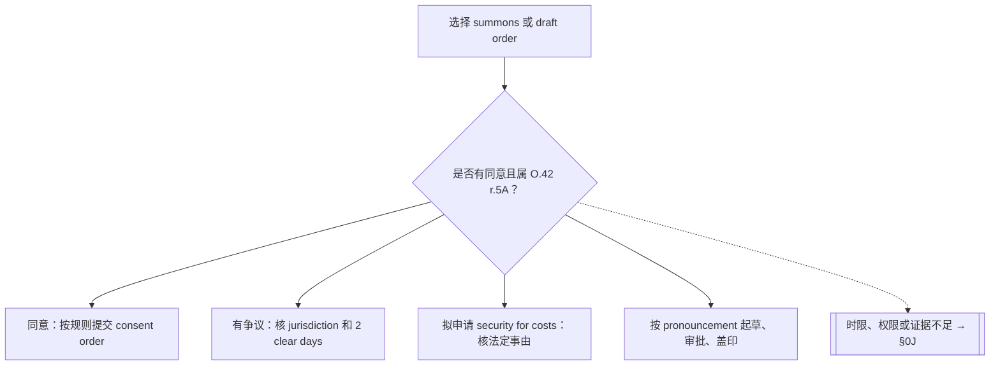
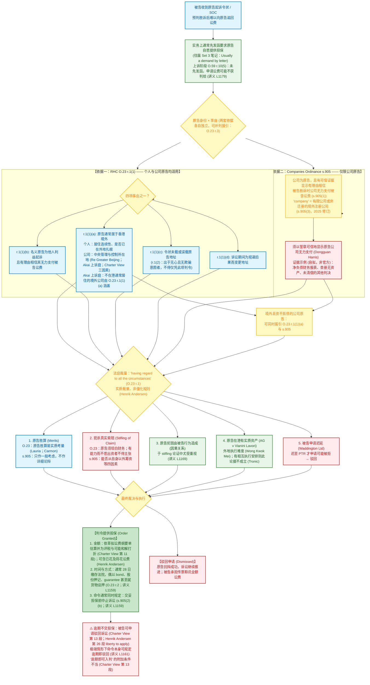
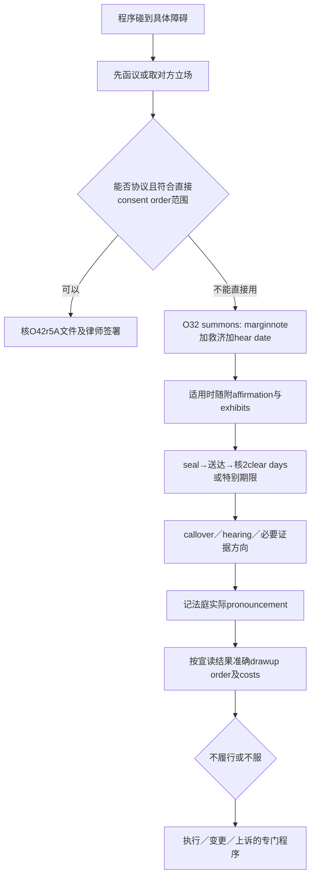
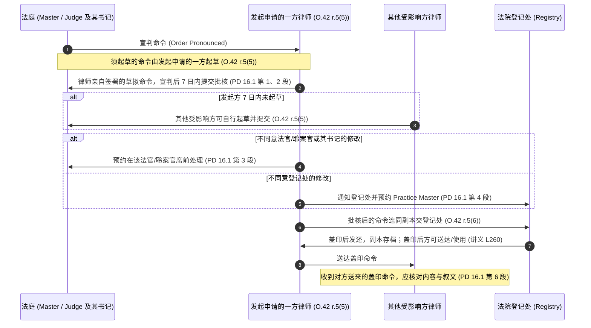
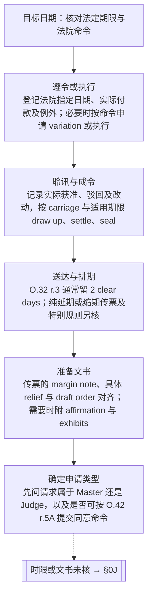

# 08 专题卡片 — 非正审传票起草、非正审申请与命令、讼费担保全景实务精要（Drafting Summonses, Interlocutory Applications, Orders & Security for Costs）

## 速读定位层

> 本层为 2026-10-10 按主规范 §18.4 新增的开篇导引；具体规则、条件、例外、攻防与全部引注见下方 §0–§7 深节，按本层术语定位后直达。

### 适用范围

**覆盖（按程序时序）**——自中间程序需求发生到命令盖印、再到讼费担保攻防与上诉阶段延伸的完整链：
1. **传票起草与定性（O.32 r.1–r.3）**：非正审申请的法定介质——标准抬头、左栏 margin note 叙文（载明依据，缺失者登记处可拒绝受理或盖印）、relief 命令项须达"法官可原样签成令"的精度；传票入禀后非经法庭许可不得修改或撤回（O.32 r.2(2)）；。 <small style="opacity: 0.55">〔LG7V L104 "provide in the left column the “margin note” that indicates on what legislation"；LG7V L106 "the Court via the Registrar may reject the filing and/or sealing of the summons"；LG7V L112 "a summons may not be amended after issue without leave of the Court as per O.32, r.2"〕</small>
2. **送达时限（O.32 r.3＋O.3 r.2＋O.65 r.7）**：一般传票须于聆讯前至少 **2 clear days** 送达每一其他方；仅申请延长／缩短期限的时间传票可在聆讯前一日送达；O.14 简易判决传票须 **10 clear days**；下午 4 点后（或指定日）送达视为下一非指定日送达；。 <small style="opacity: 0.55">〔LG7V L114 "A summons must be filed not less than 2 clear days ahead of the date specified for the hearing"；LG7V L78 "may be served on the day before the day specified in the summons for the hearing"；LG3V L523 "will be deemed served the next day that is not a specified day"〕</small>
3. **管辖分流与聆讯（PD 14.2 Part A＋O.32 r.5）**：除另有规定外一切非正审申请以传票向**聆案官**提出（禁制令保留予法官：O.32 r.11(1)(d)／O.29 Pt I）；聆案官内庭传票通常只列 3 分钟 call over（Law Society Circular 03-141）；一方缺席时法庭可在其缺席下审理，但以**已送达**传票为前提、不得免除送达（*Westminster*）；。 <small style="opacity: 0.55">〔LG7V L841 "all interlocutory applications should be made by summons to a Master"；LG7V L110 "Inter partes summonses to a Master in chambers are usually listed for 3 minutes only"；LG7V L118 "the Court may only do so where a party fails to attend the hearing after being served with the summons"；LG13V L78 "The power to grant an injunction resides with a judge as per O 32 r 11(1)(d) and excludes the Registrar and masters"〕</small>
4. **命令文书流（O.42＋PD 16.1）**：carriage 归**发起申请的一方**（7 日内未起草→其他受影响方可起草，r.5(5)）；律师亲自签署、宣判后 7 日内提交批核；须起草的命令通常盖印后才送达正式文本／使用（r.5(6)）；**同意命令**（r.5A：By Consent＋各方律师背书、无须到庭）与**同意传票**（r.5A 以外事项、仍须排 inter partes 聆讯）之分，及 Tomlin Order；Penal Notice 背书在**命令**上而非传票上；。 <small style="opacity: 0.55">〔LG7V L250 "must be drawn up by the party initiating the application upon which the order was made"；LG7V L935 "not later than 7 days after the pronouncement of the order"；LG7V L260 "Only after sealing is the order effective and fit to be served / used"；LG7V L130 "where all the parties to a cause or matter are agreed upon the terms"〕</small>
5. **讼费担保攻防（RHC O.23＋Cap. 622 s.905）**：四事由（r.1(1)(a)–(d)，个人与公司原告**均**涵盖）与 s.905 公司原告事由**可并列援引**（r.3）；s.905 须誓章可信显示公司无力支付（*Dongguan Harris*）；金额按草拟讼费纲要单估算并为评税与可能和解打折、通常分阶段并由法院酌定期限（讲义28日仅示例）；命令通常附"未提供担保前诉讼中止"；原告侧五大抗辩（stifling 坦白／因果关系／在港资产／反诉地位／被告迟延）；。 <small style="opacity: 0.55">〔LG7V L1084 "that the plaintiff is ordinarily resident out of the jurisdiction"；LG7V L1153 "supported by an affidavit which credibly and reasonably shows"；LG7V L1159 "typically within units of 7 days, i.e. 28 days"；LG7V L1169 "it is for the plaintiff to be candid about his financial resources"〕</small>
6. **上诉阶段 S4C（O.59 r.10(5)）**：答辩人应先致函上诉人索取担保再向上诉庭申请，否则申请的讼费可能不获判给；上诉人资力不足可为判令理由，但须显示实际无力支付（*Chan Man Shun*）；。 <small style="opacity: 0.55">〔LG7V L1179 "The respondent should first write to the appellant seeking security for costs before applying"；LG7V L1189 "Impecuniosity (and/or insolvency) of the appellant may be a reason for the Court of Appeal to grant security for costs"〕</small>
7. **中间讼费处理（O.62 r.9A＋PD 14.3）**：裁决后即席评定、14 日付款、五种 costs terms 术语——出处全在**往届** LG17 讼费讲义（本届未讲，仅供参照）。 <small style="opacity: 0.55">〔OLD-LG17 L607 "the old rules relating to gross sum assessments will be replaced by a summary assessment of costs"·往届仅参考〕</small>

**不覆盖（边界声明，相关主卡承担）**：① 案件管理时表主体——排期问卷／CMS／CMC／里程碑／unless order 与 relief from sanctions（→ [CO11 案件管理主卡](%5BCO11%5D%20Case%20Management%20and%20Trial%20Organisation%20System.md)；本卡只在 §5.2 交叉"S4C 申请不产生自动中止"与 §3.4 迟延抗辩）；② 送达规则本体与推定送达细则（→ [CO03 送达与 AOS 卡](%5BCO03%5D%20Service%20and%20AOS.md)；本卡只取 2 clear days 算法与 O.65 r.7 接口）；③ O.14 简易判决实体门槛（→ [CO09 审前判决卡](./%5BCO06-09%5D%20Pre-Trial%20Judgments,%20Admissions%20and%20Interim%20Payment.md)；本卡只管其 10 clear days 送达差异与时序博弈）；④ 禁制令实体与 Mareva／Anton Piller（→ [CO13 临时救济卡](%5BCO13%5D%20Interim%20Relief%20and%20Risk%20Protection%20System.md)；本卡只取 O.32 r.11(1)(d) 分流与 Penal Notice 范本措辞）；⑤ 撤销缺席判决的条件本体（→ [CO06 默认判决卡](./%5BCO06-09%5D%20Pre-Trial%20Judgments,%20Admissions%20and%20Interim%20Payment.md)；本卡只在 §7 案卷接口交叉）；⑥ 誓章规则本体 O.41（本卡只取传闻来源标注一节，出处为往届 LG16 讲义·往届仅参考）。

### 术语

| 术语 | 定义与章节 |
| --- | --- |
| 非正审传票（Summons） | 当事人提出中间申请的法定传票：在诉讼进行过程中，当事人向法庭正式提出程序性诉求的法定文书；须载明标准抬头、左栏标注、逐项命令条款及聆讯引导语，经登记处盖印排期后送达对方当事人。  [§0C](#0C.%20Summons%20%E8%B5%B7%E8%8D%89%E3%80%81%E8%AF%81%E6%8D%AE%E4%B8%8E%202%20clear%20days)。 <small style="opacity: 0.55">〔LG7V L102 "any application made to the Court will normally will be by inter partes summons supported by an affidavit / affirmation"〕</small> |
| 内庭聆讯（hearing in Chambers） | 法官或聆案官审理程序性申请的审理方式：依据 RHC O.32 r.1，法官或聆案官在内庭处理中间传票申请（不当然排除公众旁听，须与闭门审讯 in camera 区分）；聆案官内庭的常规双方传票首次通常仅排 3 分钟提讯（call over），若无法当庭解决则押后另定正式聆讯期日并下达誓章证据交换方向。  [§0B](#0B.%20%E4%B8%AD%E9%97%B4%E7%94%B3%E8%AF%B7%E3%80%81%E5%91%BD%E4%BB%A4%E4%B8%8E%20security%20for%20costs%20%E6%80%BB%E6%A1%86%E6%9E%B6)。 <small style="opacity: 0.55">〔LG7V L110 "Inter partes summonses to a Master in chambers are usually listed for 3 minutes only"〕</small> |
| 净日（clear days） | 法定送达与通知期限的严密计算规则：计算期限时行为发生日与指定到期日均不计入、期间必须完整间隔的法定天数；如要求 2 clear days，则送达日、聆讯日及周日公假均须扣除。  [§0H](#0H.%20%E7%94%B3%E8%AF%B7%E4%B8%8E%E6%93%8D%E4%BD%9C%E5%B7%A5%E7%A8%8B%EF%BC%9A%E6%96%87%E4%B9%A6%E3%80%81%E9%80%81%E8%BE%BE%E5%92%8C%E6%9C%9F%E9%99%90)。 <small style="opacity: 0.55">〔LG3S L76 "at least that number of days must intervene between the day on which the act is done and that date"〕</small> |
| 指定日（specified day） | 期间为 7 日或以下时须扣除的周六、一般假期（含周日与公众假期）、八号风球日、黑雨日及法院休署日。  [§0H](#0H.%20%E7%94%B3%E8%AF%B7%E4%B8%8E%E6%93%8D%E4%BD%9C%E5%B7%A5%E7%A8%8B%EF%BC%9A%E6%96%87%E4%B9%A6%E3%80%81%E9%80%81%E8%BE%BE%E5%92%8C%E6%9C%9F%E9%99%90)。 <small style="opacity: 0.55">〔LG3S L98-L101 "Saturday … General holiday (including Sunday and public holidays) … Black rainstorm warning day"〕</small> |
| 左栏叙文（margin note） | 传票左栏的法定授权条文标注：在传票左栏必须明确载明申请人据以提出该项申请的具体条例及法例规则依据；若遗漏标注或法条援引错误，法院登记处有权直接拒绝受理或拒绝盖印。  [§0C](#0C.%20Summons%20%E8%B5%B7%E8%8D%89%E3%80%81%E8%AF%81%E6%8D%AE%E4%B8%8E%202%20clear%20days)。 <small style="opacity: 0.55">〔LG7V L104 "provide in the left column the “margin note” that indicates on what legislation"；LG7V L106 "the Court via the Registrar may reject the filing and/or sealing of the summons"〕</small> |
| 同意命令（Consent Order，O.42 r.5A） | 双方合意达成的法定判决或命令：属于 RHC O.42 r.5A(2) 所列范围且各方当事人已达成合意的命令；注明“By Consent”并由各方代理律师签署背书后即可向登记处提交盖印，无需当事人出庭聆讯，其效力完全等同于由法官或聆案官当庭作出的正式命令。  [§0D](#0D.%20Consent%20Order%20%E4%B8%8E%20Tomlin%20Order)。 <small style="opacity: 0.55">〔LG7V L130 "where all the parties to a cause or matter are agreed upon the terms"；LG7V L168 "it must be indorsed by solicitors acting for each of the parties"；LG7V L180 "A consent order has the same effect as if made by a Judge or Master"〕</small> |
| 同意传票（Consent Summons） | 超出简易合意范围的传票申请：当双方达成的和解或程序条款超出 RHC O.42 r.5A 的法官免到庭签字范围时，当事人须以传票形式向排期聆案官（Practice Master）提出；通常由法院直接书面批核并撤销原定开庭期日。  [§0D](#0D.%20Consent%20Order%20%E4%B8%8E%20Tomlin%20Order)。 <small style="opacity: 0.55">〔LG7V L188 "A consent summons is used where the terms of settlement fall outside O 42 r 5A"；LG7V L194 "a consent summons should be made to the Practice Master with the appropriate reference"〕</small> |
| 汤姆林命令（Tomlin Order） | 兼顾保密与执行力的双层和解命令：命令正文仅载明诉讼程序中止并保留直接申请执行权（liberty to apply），具体的商业和解条款则载于不公开的附表（Schedule）中；若一方日后违约，另一方可依据预留条款直接回原案申请强制执行，无需重新提起新的违约诉讼。  [§0D](#0D.%20Consent%20Order%20%E4%B8%8E%20Tomlin%20Order)。 <small style="opacity: 0.55">〔LG7V L147 "terms which are scheduled to the order but which are not otherwise part of it"〕</small> |
| 命令起草权（carriage of the order） | 生效命令的书面拟定职责：法庭作出命令后，拟定正式判决书文稿的法定职责归属于发起申请的一方当事人；若获令方在命令作出后 7 天内未拟定并送交对方，则受命令影响的其他当事人有权接管起草权。  [§0E](#0E.%20Court%20Order%20%E8%B5%B7%E8%8D%89%E3%80%81%E5%AE%A1%E6%89%B9%E4%B8%8E%E7%9B%96%E5%8D%B0)。 <small style="opacity: 0.55">〔LG7V L250 "must be drawn up by the party initiating the application upon which the order was made"〕</small> |
| 盖印（sealing） | 传票经盖印而发出（O.32 r.2(1)）；法院命令依 O.42 r.3 从命令所载日期生效，通常是宣告日；须起草的命令获批并盖印后，律师送达正式文本。  [§0E](#0E.%20Court%20Order%20%E8%B5%B7%E8%8D%89%E3%80%81%E5%AE%A1%E6%89%B9%E4%B8%8E%E7%9B%96%E5%8D%B0)。 <small style="opacity: 0.55">〔LG7V L260 "Only after sealing is the order effective and fit to be served / used"〕</small> |
| 刑罚告示（Penal Notice） | 强制执行命令中的法定刑事藐视警告：附注于禁制令或特定履行命令首页顶部的法定警告；明确告知受令人：若其在指定时限内拒绝或怠于履行命令要求之行为，将被裁定构成藐视法庭，法院可对其判处监禁、处以高额罚款或依法扣押其资产。  [§0E](#0E.%20Court%20Order%20%E8%B5%B7%E8%8D%89%E3%80%81%E5%AE%A1%E6%89%B9%E4%B8%8E%E7%9B%96%E5%8D%B0)。 <small style="opacity: 0.55">〔LG13V L734 "If you disobey this Order you may be found guilty of contempt of court and you may be fined or your assets may be seized"〕</small> |
| 即席评定（summary assessment） | 中间传票裁决后的当庭讼费评定：法官或聆案官在中间申请裁决后，当庭对各方费用清单进行简易评估并直接确定具体的应付金额（RHC O.62 r.9A）；受令方必须在命令下达后 14 天内全额付清，按往届讲义，法院作即席评定后无需另开详细评税程序。  [§0E](#0E.%20Court%20Order%20%E8%B5%B7%E8%8D%89%E3%80%81%E5%AE%A1%E6%89%B9%E4%B8%8E%E7%9B%96%E5%8D%B0)。 <small style="opacity: 0.55">〔OLD-LG17 L607 "the old rules relating to gross sum assessments will be replaced by a summary assessment of costs"·往届仅参考；OLD-LG17 L609 "need to be paid within 14 days of the order"·往届仅参考〕</small> |
| 讼费担保（security for costs，S4C） | 防范原告逃避讼费的司法担保制度：当被告举证证明原告居于境外或属无资产空壳公司时，依据 RHC O.23 或《公司条例》Cap. 622 s.905 申请法庭命令原告预先向法院缴存保证金；若原告败诉，被告可直接从该担保金中优先受偿诉讼费用。  [§0F](#0F.%20Security%20for%20Costs%20%E7%94%B3%E8%AF%B7%E4%B8%8E%E8%A3%81%E9%87%8F)。 <small style="opacity: 0.55">〔LG7V L1083 "Where, on the application of a defendant to an action or other proceeding"〕</small> |
| 扼杀真实索赔抗辩（stifling of a genuine claim） | 对抗讼费担保命令的正当抗辩：原告主张若法庭命令其提供巨额担保，将实质导致其因资金匮乏而被迫放弃正当诉讼；O.23 下原告须全盘坦白财务资源并证明无法自外部筹资；在 Cap. 622 s.905 下法庭审慎审查四大制约因素（包括被告迟延与筹资能力）。  [§0F](#0F.%20Security%20for%20Costs%20%E7%94%B3%E8%AF%B7%E4%B8%8E%E8%A3%81%E9%87%8F)。 <small style="opacity: 0.55">〔LG7V L1169 "it is for the plaintiff to be candid about his financial resources"；LG7V L1171 "whether the plaintiff can raise funds outside its own resources to continue litigation"〕</small> |
| 草拟讼费纲要单（draft skeleton bill of costs） | 被告支撑担保金额估算的讼费预算文件；所请求全额很少不打折即获批准（须为评税与可能和解预留折扣）。  [§0F](#0F.%20Security%20for%20Costs%20%E7%94%B3%E8%AF%B7%E4%B8%8E%E8%A3%81%E9%87%8F)。 <small style="opacity: 0.55">〔LG7V L1167 "it is rare that the full amount being sought by the defendant would be granted without deduction"〕</small> |
| 申请许可回转（liberty to apply） | 命令中保留各方就执行事项迳向法庭申请而无须重新立案的自由；S4C 场景下为被告于原告违约时的常用后手。  [§0E](#0E.%20Court%20Order%20%E8%B5%B7%E8%8D%89%E3%80%81%E5%AE%A1%E6%89%B9%E4%B8%8E%E7%9B%96%E5%8D%B0)。 <small style="opacity: 0.55">〔LG7B2 L100 "I would give D5, D9 and the B & M Defendants liberty to apply"〕</small> |
| 通常居住（ordinarily resident） | r.1(1)(a) 门槛事实：指"通常或惯常安排事务"之地、须有连续性；公司按中央管理与控制所在地判定（*Re Greater Beijing*；*Charter View* 三因素）。  [§0F](#0F.%20Security%20for%20Costs%20%E7%94%B3%E8%AF%B7%E4%B8%8E%E8%A3%81%E9%87%8F)。 <small style="opacity: 0.55">〔LG7V L1117 "a reference to the way in which things are usually or habitually ordered"〕</small> |
| 缴存法院（payment into court） | 担保的通常提供方式：在法庭指定日期（通常为 7 日的倍数即 28 日）前把款项缴存法院；偶以 bond、股份押记、保证或就货物设押替代。  [§0F](#0F.%20Security%20for%20Costs%20%E7%94%B3%E8%AF%B7%E4%B8%8E%E8%A3%81%E9%87%8F)。 <small style="opacity: 0.55">〔LG7V L1159 "typically within units of 7 days, i.e. 28 days"；LG7V L1159 "occasionally by bond, by charging of shares, guarantee, or even over goods"〕</small> |


### 环节定位

| 环节 | 实际操作 |
| --- | --- |
| 起草传票（六要素＋margin note） | 把程序诉求变成法庭可直接裁决的命令项集合；margin note 固定法律依据，登记处据此决定是否受理。 <small style="opacity: 0.55">〔LG7V L104 "provide in the left column the “margin note” that indicates on what legislation"〕</small> |
| 誓章支持 | 给中间申请提供事实基础；传闻内容须注明来源与确信理由，否则该段证据可被剔除。 <small style="opacity: 0.55">〔LG7V L102 "supported by an affidavit / affirmation"；OLD-LG16O L225 "clearly identify the source (e.g. person, document) of this 'hearsay' information"·往届仅参考〕</small> |
| 2 clear days 送达 | 保障对方最低限度的抗辩准备（自然公正底线）；不足即程序瑕疵，除非法庭另令或对方放弃，聆讯不得照常。 <small style="opacity: 0.55">〔LG7V L114 "A summons must be filed not less than 2 clear days ahead of the date specified for the hearing"；LG7V L118 "it does not allow the Court to dispense with service"〕</small> |
| Master／Judge 分流 | 让权限对路：常规中间事项归聆案官，禁制令保留予法官。 <small style="opacity: 0.55">〔LG7V L841 "all interlocutory applications should be made by summons to a Master"；LG13V L78 "The power to grant an injunction resides with a judge as per O 32 r 11(1)(d)"〕</small> |
| 3 分钟 call over | 以最低司法成本消化无争议事项；未能 3 分钟内处理或有争议者押后另定聆讯日并附证据方向。 <small style="opacity: 0.55">〔LG7V L110 "usually listed for 3 minutes only"〕</small> |
| 裁决＋即席讼费 | 法院可在中间申请裁决后即席评定讼费；受令方按法定或指定期限付款（O.62 r.9A／PD 14.3，往届仅参考）。 <small style="opacity: 0.55">〔OLD-LG17 L609 "need to be paid within 14 days of the order"·往届仅参考〕</small> |
| 命令起草—批核—盖印 | 把口头裁决固化为可送达、可执行、可作为执行与藐视程序依据的正式文书；carriage 规则防止双方都不起草。 <small style="opacity: 0.55">〔LG7V L250 "must be drawn up by the party initiating the application"；LG7V L260 "Only after sealing is the order effective and fit to be served / used"〕</small> |
| Consent Order／Tomlin | 双方已达共识时不耗开庭资源；附表承载保密条款，liberty to apply 保住违约时在原案的直接执行力。 <small style="opacity: 0.55">〔LG7V L147 "terms which are scheduled to the order but which are not otherwise part of it"；LG7V L180 "A consent order has the same effect as if made by a Judge or Master"〕</small> |
| S4C 申请（O.23／s.905） | 平衡"赢了官司拿不回讼费"的被告风险与境外／空壳原告的诉讼准入；门槛事由先行，金额与形式由裁量调校。 <small style="opacity: 0.55">〔LG7V L1070 "the plaintiff normally bears the burden of proof as well as the burden for costs"；LG7V L1072 "the winning party may be unable to recover costs from a losing party"〕</small> |
| Stifling 抗辩 | 防止担保令异化为把真实索赔拒之门外的工具：以财务坦白与外部筹资审查区分"不能"与"不愿"。 <small style="opacity: 0.55">〔LG7V L1169 "if the plaintiff is able but unwilling to fund litigation, it is not open to the plaintiff"；LG7V L1171 "factors include (1) whether the plaintiff company is using its lack of funds as being a form of pressure"〕</small> |
| 上诉阶段 S4C（O.59 r.10(5)） | 上诉程序的同类衡平：先致函义务＋单法官审理；未先发函者，申请的讼费可能不获判给。 <small style="opacity: 0.55">〔LG7V L1179 "The respondent should first write to the appellant seeking security for costs before applying to the Court of Appeal"〕</small> |


---


## 🗺️ 本卡地图



申请人先确认谁可批令及是否须开庭，再核证据和送达；法院批令后，负责起草的一方须将实际宣告写入命令，并按时呈批。

| 任务 | 直达 |
| --- | --- |
| 中间申请、命令与 security for costs 总框架 | [§0B](#0B.%20%E4%B8%AD%E9%97%B4%E7%94%B3%E8%AF%B7%E3%80%81%E5%91%BD%E4%BB%A4%E4%B8%8E%20security%20for%20costs%20%E6%80%BB%E6%A1%86%E6%9E%B6) |
| Summons 起草、证据与 2 clear days | [§0C](#0C.%20Summons%20%E8%B5%B7%E8%8D%89%E3%80%81%E8%AF%81%E6%8D%AE%E4%B8%8E%202%20clear%20days) |
| Consent Order 与 Tomlin Order | [§0D](#0D.%20Consent%20Order%20%E4%B8%8E%20Tomlin%20Order) |
| Court Order 起草、审批与盖印 | [§0E](#0E.%20Court%20Order%20%E8%B5%B7%E8%8D%89%E3%80%81%E5%AE%A1%E6%89%B9%E4%B8%8E%E7%9B%96%E5%8D%B0) |
| Security for Costs 申请与裁量 | [§0F](#0F.%20Security%20for%20Costs%20%E7%94%B3%E8%AF%B7%E4%B8%8E%E8%A3%81%E9%87%8F) |
| 攻防、案例边界与实务暗礁 | [§0G](#0G.%20%E6%94%BB%E9%98%B2%E3%80%81%E6%A1%88%E4%BE%8B%E8%BE%B9%E7%95%8C%E4%B8%8E%E5%AE%9E%E5%8A%A1%E6%9A%97%E7%A4%81) |
| 文书与期限倒排 | [§0H](#0H.%20%E7%94%B3%E8%AF%B7%E4%B8%8E%E6%93%8D%E4%BD%9C%E5%B7%A5%E7%A8%8B%EF%BC%9A%E6%96%87%E4%B9%A6%E3%80%81%E9%80%81%E8%BE%BE%E5%92%8C%E6%9C%9F%E9%99%90) |
| 提交前核对 | [§0I](#0I.%20%E6%94%BB%E9%98%B2%E4%B8%8E%E6%89%A7%E8%A1%8C%E5%89%8D%E6%A0%B8%E5%AF%B9) |
| 失误、制裁与补救 | [§0J](#0J.%20%E7%A8%8B%E5%BA%8F%E5%A4%B1%E8%AF%AF%E5%8F%8A%E5%85%B6%E5%90%8E%E6%9E%9C) |
| SG 实务应用 | [§0K](#0K.%20SG%20%E5%AE%9E%E5%8A%A1%E5%BA%94%E7%94%A8%E4%B8%8E%E5%AF%BC%E5%B8%88%E5%8F%A3%E5%BE%84) |

#### 核心参数与计算口径
- **双方传票常规排期与送达时限（Inter Partes Summons - O.32 r.3 / PD 5.3）**：必须在聆讯日前不少于 **2 clear days** 送达并向法庭存档；
- **禁制令的 summons day 排期（PD 5.3）**：
  ① 课堂算例：若拟在周五 10:00 聆讯，按周二 10:00 倒排通知；遇假期或法院另定日期时重新计算；
  ② Court bundle 至少提前 **24 小时**交付法庭，能提前则提前 48 小时；
  ③ 申请人 Skeleton Argument：聆讯日前第二日（D-2）**09:30 前**；
  ④ 被告回应 Skeleton：聆讯日前第一日（D-1）**14:30 前**。
- **讼费担保核心事由（Security for Costs - O.23 r.1(1) & Companies Ordinance s.905）**：
  ① (a) 原告通常居于香港域外（Ordinarily resident out of the jurisdiction）；
  ② (b) 名义原告（Nominal plaintiff）；
  ③ (c) 原告地址不详或虚假；
  ④ (d) 原告在诉讼中变更地址以规避后果；
  ⑤ 公司法特别事由（Companies Ordinance s.905）：有令人信服的证据表明原告香港有限公司若败诉将无力支付被告讼费。
- **两阶段裁量权测试（*Sir Lindsay Parkinson* Two-Stage Test）**：
  第一阶段：是否存在法定门槛事由（Gateway established）；
  第二阶段：命令提供担保在整体考量下是否公正（Just in all circumstances - 审查原告胜诉前景、是否扼杀真实诉求 Stifling genuine claim、被告自身过错等）。

<!-- BEGIN:cite-legend -->
> [!info]- 引注图例（出处码 → 文件；点开折叠）
> 
> | 码 | 文件 | 层级 | 学年 |
> |---|---|---|---|
> | LG7V | [本届讲义·LG7 传票／非正审／讼费担保大纲（1275 行·L271 起为 Focused Exercise）](../../04%20Base%20Lectures/00%20This%20Year%20Moodle%202026-27/Lecture%20Outlines,%20Powerpoints%20&%20Materials/LG7%20-%20Drafting%20Summonses.%20Interlocutory%20Applications,%20Security%20for%20Costs.md) | 本届讲义 | 2026-27 |
> | LG7A1 | [本届课堂幻灯·CL LG7 A 1-2（传票与 consent order／summons·167 行）](../../04%20Base%20Lectures/00%20This%20Year%20Moodle%202026-27/Lecture%20Outlines,%20Powerpoints%20&%20Materials/CL%20LG7%20A%202026-2027%201-2.md) | 本届讲义 | 2026-27 |
> | LG7A2 | [本届课堂幻灯·CL LG7 A 2-2（Focused Exercise：HCA 9999 起草·71 行）](../../04%20Base%20Lectures/00%20This%20Year%20Moodle%202026-27/Lecture%20Outlines,%20Powerpoints%20&%20Materials/CL%20LG7%20A%202026-2027%202-2.md) | 本届讲义 | 2026-27 |
> | LG7B1 | [本届课堂幻灯·CL LG7 B 1-2（O.23：Henrik Andersen、Vianini、Tronic 等·179 行）](../../04%20Base%20Lectures/00%20This%20Year%20Moodle%202026-27/Lecture%20Outlines,%20Powerpoints%20&%20Materials/CL%20LG7%20B%202026-2027%201-2.md) | 本届讲义 | 2026-27 |
> | LG7B2 | [本届课堂幻灯·CL LG7 B 2-2（s.905、Akai 上诉庭、担保金额与 stifling·177 行）](../../04%20Base%20Lectures/00%20This%20Year%20Moodle%202026-27/Lecture%20Outlines,%20Powerpoints%20&%20Materials/CL%20LG7%20B%202026-2027%202-2.md) | 本届讲义 | 2026-27 |
> | LG13V | [跨讲次本届讲义·LG13 禁制令／Mareva／Anton Piller（1300 行·法官权限与 Penal Notice 范本所在）](../../04%20Base%20Lectures/00%20This%20Year%20Moodle%202026-27/Lecture%20Outlines,%20Powerpoints%20&%20Materials/LG13%20-%20Interlocutory%20Injunctions,%20Marevas,%20APs.md) | 本届讲义 | 2026-27 |
> | LG13S2 | [本届课堂幻灯·CL LG13 2-4（禁制令要件·126 行）](../../04%20Base%20Lectures/00%20This%20Year%20Moodle%202026-27/Lecture%20Outlines,%20Powerpoints%20&%20Materials/CL%20LG13%202026-2027%202-4.md) | 本届讲义 | 2026-27 |
> | LG13S3 | [本届课堂幻灯·CL LG13 3-4（152 行）](../../04%20Base%20Lectures/00%20This%20Year%20Moodle%202026-27/Lecture%20Outlines,%20Powerpoints%20&%20Materials/CL%20LG13%202026-2027%203-4.md) | 本届讲义 | 2026-27 |
> | LG13S4 | [本届课堂幻灯·CL LG13 4-4（187 行）](../../04%20Base%20Lectures/00%20This%20Year%20Moodle%202026-27/Lecture%20Outlines,%20Powerpoints%20&%20Materials/CL%20LG13%202026-2027%204-4.md) | 本届讲义 | 2026-27 |
> | LG3V | [跨讲次本届讲义·LG3 送达与认收 REV（803 行·O.65 r.7 所在）](../../04%20Base%20Lectures/00%20This%20Year%20Moodle%202026-27/Lecture%20Outlines,%20Powerpoints%20&%20Materials/LG3%20-%20Service%20and%20Acknowledgement%20of%20Service%20%28REV%29.md) | 本届讲义 | 2026-27 |
> | LG3S | [跨讲次本届课堂幻灯·LG3 ppt REV（697 行·Slides 11-13 clear days 与指定日扣除）](../../04%20Base%20Lectures/00%20This%20Year%20Moodle%202026-27/Lecture%20Outlines,%20Powerpoints%20&%20Materials/LG3%20ppt%20%28REV%29.md) | 本届讲义 | 2026-27 |
> | BATCH-B | [本届案卷·Negligence Batch B（PDF·库内无 md 伴生·pp.110-114／127-128 为讲义指定页）](../../99%20Moodle%20Mirror/Case%20Files/Negligence%20Case%20File/Negligence_Batch_B.pdf) | 本届官方 | 2026-27 |
> | BATCH-C | [本届案卷·Negligence Batch C（PDF·库内无 md 伴生·pp.41-65 为讲义指定页）](../../99%20Moodle%20Mirror/Case%20Files/Negligence%20Case%20File/Negligence_Batch_C.pdf) | 本届官方 | 2026-27 |
> | MATRIX | [凝结层·本库自撰 03 真题矩阵与解析（134 行）](../_meta/Master%20Archive%202026-11-14/03%20Past%20Paper%20Matrix%20and%20Analysis.md) | 凝结层 | 2026-27 |
> | OLD-LG16O | [往届讲义·LG16 Drafting Afidavits Lecture Outline（413 行·O.41 r.5 传闻证据规则所在）](../../04%20Base%20Lectures/%5BLG16%5D%20Drafting%20Affidavits/LG16%20Drafting%20Afidavits%20Lecture%20Outline.md) | 往届官方 | 2025-26 |
> | OLD-LG17 | [往届讲义·LG17 Costs (Substantive)（1232 行·O.62 r.9A／PD 14.3／常规讼费命令术语所在）](../../04%20Base%20Lectures/%5BLG17%5D%20Costs%20%28Substantive%29/LG17%20-%20Costs%20%28Substantive%29.md) | 往届官方 | 2025-26 |
> | OLD-LG18 | [往届讲义·LG18 Enforcement Lecture Outline（941 行·判令后执行程序）](../../04%20Base%20Lectures/%5BLG18%5D%20Enforcement/LG18%20Lecture%20Outline.md) | 往届官方 | 2025-26 |
> | OLD-SET3L7 | [往届学生稿·Set 3「LG7 Summons + Interlocutory Application + Security for costs」（666 行·非官方）](../../06%20Base%20Exam%20Notes/Set%203/LG7%20Summons%20+%20Interlocutory%20Application%20+%20Security%20for%20costs.md) | 往届学生稿 | 2025-26 |
> | CAP-C7 | [PCLL8010 LG7 PT](../../99%20Moodle%20Mirror/Lecture%20Outlines,%20Powerpoints%20&%20Materials/LG7%20-%20Drafting%20Summonses.%20Interlocutory%20Applications,%20Security%20for%20Costs/Panopto%20Captions%20%28local%20export%29/8010_LG07_PT.md) | 本届讲义 | 2026-27 |


> | R32 | [RHC O32再刊本](obsidian://open?vault=3b1e77255f6c6e29&file=output%2Fresearch%2FCivil%20Litigation%20Rules%20Verification%20-%202026-10-23%2FRHC%20O32.md) | 库外法源 | 2026-27 |
> | R23 | [RHC O23再刊本](obsidian://open?vault=3b1e77255f6c6e29&file=output%2Fresearch%2FCivil%20Litigation%20Rules%20Verification%20-%202026-10-23%2FRHC%20O23.md) | 库外法源 | 2026-27 |
> | S6-AP | [1. SG6 (Civil Procedure 1)](../../04%20Base%20Lectures/00%20This%20Year%20Moodle%202026-27/Small%20Group%20Activity%20Plans/1.%20SG6%20%28Civil%20Procedure%201%29.md) | 本届官方 | 2026-27 |
> | S6-L7 | [LG7 - Drafting Summonses. Interlocutory Applications, Security for Costs](../../04%20Base%20Lectures/00%20This%20Year%20Moodle%202026-27/Lecture%20Outlines,%20Powerpoints%20&%20Materials/LG7%20-%20Drafting%20Summonses.%20Interlocutory%20Applications,%20Security%20for%20Costs.md) | 本届讲义 | 2026-27 |
> | R65 | [RDC O65](obsidian://open?vault=3b1e77255f6c6e29&file=output%2Fresearch%2FCivil%20Litigation%20SG07%20Authorities%20-%202026-11-02%2FRDC%20O65.md) | 库外法源 | 2026-27 | 区院规则一手文本再刊；整合2025-03-28 |
> | R10 | [RDC O10](obsidian://open?vault=3b1e77255f6c6e29&file=output%2Fresearch%2FCivil%20Litigation%20SG07%20Authorities%20-%202026-11-02%2FRDC%20O10.md) | 库外法源 | 2026-27 | 区院规则一手文本再刊；整合2025-03-28 |
> | P111 | [PD11.1 - Judiciary Text.md](obsidian://open?vault=3b1e77255f6c6e29&file=output%2Fresearch%2FCivil%20Litigation%20SG08%20-%202026-11-09%2FPD11.1%20-%20Judiciary%20Text.md) | 库外法源 | 2026-27 |
> | P27 | [PD27 - Judiciary Text.md](obsidian://open?vault=3b1e77255f6c6e29&file=output%2Fresearch%2FCivil%20Litigation%20SG08%20-%202026-11-09%2FPD27%20-%20Judiciary%20Text.md) | 库外法源 | 2026-27 |
<!-- END:cite-legend -->

## 0B. 中间申请、命令与 security for costs 总框架

### 流程图一：非正审传票起草、送达、聆讯与命令盖印全景流（Summonses & Orders Lifecycle）

```mermaid
flowchart TD
    classDef init fill:#E1F5FE,stroke:#0288D1,stroke-width:2px,color:#01579B;
    classDef check fill:#FFF9C4,stroke:#FBC02D,stroke-width:2px,color:#F57F17;
    classDef action fill:#E8F5E9,stroke:#388E3C,stroke-width:2px,color:#1B5E20;
    classDef warn fill:#FFEBEE,stroke:#D32F2F,stroke-width:2px,color:#B71C1C;
    classDef clock fill:#EDE7F6,stroke:#7E57C2,stroke-width:2px,color:#4A148C;

    subgraph Step1 ["【第一阶段：申请方式定性与起草】"]
        AppNeed["诉讼推进中发生程序争议或中间救济需求<br>(延期 / 批注 / 剔除 / 文件透露 / 担保)"]:::init
        ModeChoice{"法定申请形式？(O.32 r.1)"}:::check
        Summons["普通法形式：传票 (Summons)<br>载明法庭、案号、当事人、具体命令项、法定依据、聆讯时间"]:::action
        Affidavit["证据准备：宣誓誓章 (Affidavit/Affirmation)<br>由事务律师/当事人作出，陈述事实与附连物料 (O.38 / O.41)"]:::action
    end

    subgraph Step2 ["【第二阶段：入禀盖印与严苛送达时限】"]
        Issue["向登记处入禀并获排期盖印 (Sealing of Summons)<br>[O.32 r.2]"]:::init
        ServiceCheck{"送达给对方之时间？(O.32 r.3)"}:::check
        ClearDays["【硬性规则：至少提前 2 Clear Days】<br>普通传票：除首尾两天外必须整整间隔 2 个工作日！<br>下午 4 点后送达视为次一日送达 (O.65 r.7)<br>(例外：仅申请延长/缩短期限的传票可在聆讯前一日送达 O.32 r.3；<br>O.14 简易判决须提前整整 10 Clear Days)"]:::clock
        ShortService["⚠️ 送达不合规 (Short Service)<br>构成程序瑕疵；除非对方自愿放弃或法庭批准缩短时限，否则不得强行推进"]:::warn
    end

    subgraph Step3 ["【第三阶段：开庭分流与聆讯裁决】"]
        Forum{"管辖权分流 (PD 14.2)"}:::check
        MasterList["聆案官内庭 (Master in Chambers)<br>3分钟清单 / 审前审查 / 延期 / S4C / 宣誓书批注"]:::action
        JudgeChambers["法官席前 (Judge in Chambers)<br>禁制令：权力保留予法官 O.32 r.11(1)(d)、O.29 Pt I 排除 Registrar 与 Master"]:::action
        Hearing{"聆讯出庭状况 (O.32 r.5)"}:::check
        BothAttend["双方出席抗辩 → 听取辩论并即席裁决 / 押后宣判<br>可即席评定讼费 (Summary Assessment: O.62 r.9A & PD 14.3)"]:::action
        OneAbsent["一方缺席 → 法庭可在其缺席下审理 (O.32 r.5(1))<br>申请方缺席致传票被驳回者，法庭可准予恢复 (O.32 r.5(4))"]:::warn
    end

    subgraph Step4 ["【第四阶段：法庭命令起草、核对与盖印】"]
        Carriage["发起申请的一方起草命令 (O.42 r.5(5))<br>该方 7 日内未起草 → 其他受影响方可起草"]:::init
        DraftOrder["律师亲自签署草拟命令 (PD 16.1 第 2 段)<br>宣判后 7 日内提交法庭 (Registrar / 法官书记) 批核 (PD 16.1 第 1 段)"]:::action
        OrderType{"命令性质？"}:::check
        Consent["同意命令 (Consent Order / Tomlin Order)<br>属 O.42 r.5A(2) 所列类型：By Consent + 各方律师背书，无须到庭<br>r.5A 以外事项 → Consent Summons，仍须排 inter partes 聆讯"]:::action
        SealedOrder["提交登记处盖印 (Sealed Order, O.42 r.5(6))<br>命令日期为宣判日 (O.42 r.3)；盖印后方可送达/使用 (讲义 L260)<br>Penal Notice 背书在命令上 (非传票)"]:::action
    end

    AppNeed --> ModeChoice
    ModeChoice --> Summons & Affidavit
    Summons & Affidavit --> Issue
    Issue --> ServiceCheck
    ServiceCheck --> ClearDays
    ServiceCheck -.-> ShortService
    ClearDays --> Forum
    Forum --> MasterList & JudgeChambers
    MasterList & JudgeChambers --> Hearing
    Hearing --> BothAttend & OneAbsent
    BothAttend --> Carriage
    OneAbsent --> Carriage
    Carriage --> DraftOrder
    DraftOrder --> OrderType
    OrderType --> Consent & SealedOrder
```



---

### 流程图二：讼费担保（Security for Costs）双轨分流与审查裁量决策树

> 2026-09-27 更正（2026-09-29 复核并补出处）：原图"个人走 O.23、公司走 s.905"的双轨划分有误。O.23 r.1(1)(a) 对个人与公司原告均适用，s.905 仅就公司原告另设一条依据，两者可并列援引。标题保留原文以免断链。 <small style="opacity: 0.55">〔LG7V L1115 "the plaintiff is ordinarily resident out of the jurisdiction"；LG7V L1121 "Whether a plaintiff (company) is"；LG7B2 L70 "An overseas companies which is not ordinarily resident in Hong Kong is covered"〕〔LG7V L1096 "This Order is without prejudice to the provisions of any written law"〕</small>



---


### 1. 第一性原理：自然公正、程序效益与诉讼经济衡平（First Principles）

非正审申请（Interlocutory Applications）与讼费担保（Security for Costs）是民事诉讼从启动令状到实体开审之间，控制诉讼节奏、规制当事人行为以及平衡各方程序利益的最核心工具：

1. **非正审申请的第一性原理：程序推进介质与自然公正对抗权（RHC O.32；另有 O.1A 之相称性目标）**： <small style="opacity: 0.55">〔LG7V L841 "all interlocutory applications should be made by summons to a Master"；❓「RHC O.1A 相称性目标」本届 LG7 五件材料（讲义与 A／B 两组幻灯）全文无 O.1A 或 proportionate 表述·待核，已登记文末 open 块〕</small>
   * 民事诉讼并非静态的文书交换，而是充满动态争议的过程（如一方文书逾期需延期、诉答含混需澄清批注、起诉状无理需剔除、关键书证隐匿需披露）。传票（Summons）是当事人向法庭正式提出程序性诉求的法定介质。 <small style="opacity: 0.55">〔LG7V L102 "any application made to the Court will normally will be by inter partes summons supported by an affidavit / affirmation"〕</small>
   * **自然公正底线（Audi Alteram Partem）**：非正审申请原则上严禁突袭。除极少数法定单方面申请外，必须以传票形式提前向对方披露诉求与理由，并严格保障对方**至少 2 Clear Days 的准备与抗辩权（O.32 r.3）**。 <small style="opacity: 0.55">〔LG7V L78 "but, except as aforesaid and unless the Court otherwise orders"；LG7V L114 "A summons must be filed not less than 2 clear days ahead of the date specified for the hearing"；LG3S L76 "at least that number of days must intervene between the day on which the act is done and that date"〕</small>
2. **讼费担保的第一性原理：司法准入权与胜诉补偿权的双向衡平（Access to Justice vs Protection against Unrecoverable Costs）**：
   * **原告维度的宪制权利**：任何人均享有向法院起诉以寻求救济的权利（Basic Law Art. 35）。法庭绝不能仅因原告贫穷或身处境外，就滥发命令将其关在正义大门之外；且境外原告须提供担保并非僵化规则、担保不得要求于行使抗辩权的被告。 <small style="opacity: 0.55">〔❓《基本法》第 35 条之条文本届 LG7 材料未载·本卡仅取其作为本层法理论述，待核〕〔LG7V L1074 "There is no inflexible practice that a plaintiff ordinarily resident out of Hong Kong must be ordered to give security for costs"〕〔LG7V L1074 "security for costs cannot be required from a defendant who is exercising his right to defend"〕</small>
   * **被告维度的正当防卫权**：诉讼是被告被动卷入的法律战。若原告败诉且身处无法跨国执行判决的法域，或原本就是空壳公司（Straw Claimant），被告即使打赢官司，亦将面临"赢了判决、赔光律师费"的致命不公。 <small style="opacity: 0.55">〔LG7V L1070 "the plaintiff normally bears the burden of proof as well as the burden for costs"；LG7V L1072 "the winning party may be unable to recover costs from a losing party"〕</small>
   * **衡平调节阀（Judicial Balancing Exercise）**：因此，法庭在 O.23 及 s.905 下行使的是**完全的自由裁量权（complete discretion，Henrik Andersen）**，通过金额估算与打折（Charter View 第 11 段）、担保形式变通（缴存法院、bond、股份押记、guarantee）及审查"扼杀索赔（Stifling）"抗辩，实现两者之间的平衡。 <small style="opacity: 0.55">〔LG7V L1101 "The Court has a real discretion to consider the circumstances of the case which is not an inflexible or rigid rule"〕〔LG7V L1159 "the amount is subject to what is appropriate in the circumstances and also a date for such payment"〕〔LG7V L1169 "if the plaintiff argues that an order for security for costs will stifle a genuine claim"；LG7V L1171 "For s.905, if the plaintiff argues that an order for security for costs will stifle a genuine claim"〕</small>

---


### 2. 构成要件与核心控制闸门（Control Gates & Elements）

### 2.1 四大控制闸门（Control Gates）

| 闸门 | 触发条件与依据 | 物理拦截机制 | 避坑/硬性规则 |
| --- | --- | --- | --- |
| **闸门 1：传票送达与 2 Clear Days 阀** | O.32 r.3。 <small style="opacity: 0.55">〔LG7V L78 "A summons asking only for the extension or abridgement of any period of time"；LG7V L114 "A summons must be filed not less than 2 clear days ahead of the date specified for the hearing"〕</small> | Registry 审查送达证书与开庭排期。传票送达必须在聆讯日前**至少整整 2 Clear Days** 送达其他各方（O.3 r.2(4)）。**例外**：仅申请延长或缩短期限的传票，可在聆讯前一日送达（O.32 r.3；LG7V L114 "save for a time summons seeking an extension or abridgement of time which may be served only a day before"）；O.14 传票须 10 clear days。 <small style="opacity: 0.55">〔LG3S L76 "at least that number of days must intervene between the day on which the act is done and that date"〕〔LG7V L78 "may be served on the day before the day specified in the summons for the hearing"〕〔LG7V L114 "most notably a summons for summary judgment which requires not less than 10 clear days before the return date"〕</small> | ⚠️ **首尾两天均严格排除！** 若周五开庭，最迟必须在周二**下午 4 点前**送达（周三、周四为净日；下午 4 点后送达视为次一日送达，O.65 r.7）；若送达不足（Short Service），除非法庭另有命令（O.32 r.3 "unless the Court otherwise orders"，且法庭对此有裁量——裁量因素见 O.62 r.3(2)，其条文出处在本层只有往届讼费讲义转述），聆讯不能照常进行。 <small style="opacity: 0.55">〔LG3V L521 "If served on a specified day or after 4pm O. 65 r. 7"；LG3V L523 "served on a specified day or after 4 p.m. on a business day will be deemed served the next day"〕〔LG7V L78 "except as aforesaid and unless the Court otherwise orders"〕〔OLD-LG17 L288 "which the Court shall take into account in exercise of its discretion under O 62 r 3(2)"·往届仅参考〕〔❓时间传票之「前一日」若恰逢指定日（周末／假期）如何计算，库内无明文·待核，已登记文末 open 块〕</small> |
| **闸门 2：聆讯权限与法官分流阀** | PD 14.2 Part A 与 RHC O.32。 <small style="opacity: 0.55">〔LG7V L841 "Unless otherwise required by the Rules of the High Court or any other enactment"；LG7V L102 "requires all interlocutory applications are to be made by summons to a Master save where to be heard by a Judge"〕</small> | 除规则或其他成文法另有规定外，**所有非正审申请一律以传票向聆案官（Master）提出**（PD 14.2 Part A 第 1 段；另有 PD 5.4 适用），登记处据此排期分流。聆案官内庭传票通常仅列 **3 分钟 call over**，未能于 3 分钟内处理或有争议者押后另定聆讯日并附证据方向（Law Society Circular 03-141）。 <small style="opacity: 0.55">〔LG7V L841 "Practice Direction 5.4 shall apply to such summonses"〕〔LG7V L110 "Inter partes summonses to a Master in chambers are usually listed for 3 minutes only"〕〔LG7V L110 "Pursuant to Law Society Circular 03-141, the parties' solicitors should attempt to agree"〕</small> | ⚠️ 禁制令属**法官**权限：颁发禁制令的权力依 **O.32 r.11(1)(d)** 保留予法官，并依 **O.29 Part I** 排除司法常务官与聆案官；LG7 讲义亦指出 Master 无权处理禁制令，故同意传票不向之提出。⚠️ 原稿另列"藐视法庭起诉许可、司法复核属法官专有管辖"：本层材料（LG7／LG13 讲义与幻灯）未见明文，仅保留 O.52 与禁制令之关系。延期、文件透露、批注、诉答剔除及 S4C 讼费担保一律依 PD 14.2 Part A 向聆案官提出。 <small style="opacity: 0.55">〔LG13V L78 "The power to grant an injunction resides with a judge as per O 32 r 11(1)(d) and excludes the Registrar and masters"〕〔LG7V L194 "save where a Master has no such jurisdiction to hear the matter such as those relating to injunctions"〕〔❓藐视法庭起诉许可与司法复核属法官专有管辖，LG7／LG13 材料无明文·待核〕〔LG13V L620 "Breach of an injunction is subject to a contempt of Court as per O 52"〕〔LG7V L841 "all interlocutory applications should be made by summons to a Master"〕</small> |
| **闸门 3：同意令无须到庭核验阀** | O.42 r.5A 与 PD 16.1。 <small style="opacity: 0.55">〔LG7V L128 "5A. Consent judgment and orders (O. 42, r. 5A)"；LG7V L130 "where all the parties to a cause or matter are agreed upon the terms"〕</small> | **Consent Order**：属 r.5A(2) 所列类型的判决／命令，按 r.5 程序起草、注明 "By Consent" 并由各方律师背书（r.5A(3)），无须到庭即可盖印（讲义 L178–180）。**Consent Summons**：用于 r.5A 范围以外的事项（如逾时修改诉答、F&BP、文件透露），仍须排 inter partes 聆讯，实务上通常照准并撤销聆讯日期；一般向 Practice Master 提出，Master 无权处理者（如禁制令）除外。 <small style="opacity: 0.55">〔LG7V L168 "it must be drawn up in the terms agreed and expressed as"；LG7V L178 "is within the scope of O 42 r 5A it should be drawn up in accordance with O 42 r 5"〕〔LG7V L188 "A consent summons is used where the terms of settlement fall outside O 42 r 5A"；LG7V L192 "A consent summons requires an inter partes hearing and in practice will normally be approved"〕〔LG7V L194 "a consent summons should be made to the Practice Master with the appropriate reference"〕</small> | ⚠️ r.5A **不适用**：(4) Admiralty 管辖或 Commercial List 的案件；(5) 任何一方为亲身诉讼人（litigant in person）或无行为能力人（person under a disability）。注意："撤销缺席判决"正是 r.5A(2)(b)(v) 所列**适用**事项。 <small style="opacity: 0.55">〔LG7V L170 "This rule shall not apply to any judgment or order in proceedings which are pending in the Admiralty jurisdiction"〕〔LG7V L172 "any of the parties is a litigant in person or a person under a disability"〕〔LG7V L150 "the setting aside of a judgment in default"〕</small> |
| **闸门 4：讼费担保法定门槛与扼杀审查阀** | O.23 r.1 与 Cap. 622 s.905。 <small style="opacity: 0.55">〔LG7V L1083 "Where, on the application of a defendant to an action or other proceeding"；LG7V L1139 "This section applies where"〕</small> | 申请人须先确立法定事由：O.23 r.1(1)(a)–(d)（个人或公司原告通常居于境外等）和／或 s.905（公司原告有可信证据显示无力支付讼费）；二者可并列援引（O.23 r.3）。原告如以"担保将扼杀真实索赔"抗辩，法庭再予审查。 <small style="opacity: 0.55">〔LG7V L1084 "that the plaintiff is ordinarily resident out of the jurisdiction"；LG7V L1085 "is a nominal plaintiff who is suing for the benefit of some other person"；LG7V L1087 "has changed his address during the course of the proceedings with a view to evading the consequences"〕〔LG7V L1141 "a company is a plaintiff in an action or other legal proceedings"；LG7V L1142 "it appears, by credible testimony, to the court having jurisdiction in the matter that there is reason to believe"〕</small> | ⚠️ 实务上通常先发函要求自愿提供担保——此 "usually" 一语出自往届 Set 3 学生笔记；"未发函即受讼费惩罚"只见于上诉阶段 O.59 r.10(5)。原告主张 stifling：O.23 下须坦白财务、有能力而不愿出资者不得主张；s.905 下考虑能否从自身以外筹资等。 <small style="opacity: 0.55">〔OLD-SET3L7 L252 "Usually a demand by letter before the summons is issued"·往届仅参考〕〔LG7V L1179 "The respondent should first write to the appellant seeking security for costs before applying"〕〔LG7V L1169 "it is for the plaintiff to be candid about his financial resources"；LG7V L1169 "if the plaintiff is able but unwilling to fund litigation"〕〔LG7V L1171 "whether the plaintiff company is using its lack of funds as being a form of pressure"〕</small> |

**总表索引**：闸门 1–4 的"不做／做错"后果分别归并 [§2.3 后果链总表](#2.3%20不做或做错的后果链总表（环节·后果·依据%20索引）) 行 2、行 1、行 6、行 9–12。

---

### 2.2 即席讼费评定与反馈回路（Summary Assessment & Costs Feedback）

在非正审传票聆讯中，司法机构全面贯彻民事司法改革（CJR）精神，杜绝当事人滥用传票拖延诉讼：

1. **即席讼费评定（Summary Assessment of Costs under O.62 r.9A & PD 14.3）**——此项规则之出处全在**往届** LG17 讼费讲义（本届未讲，仅供参照）： <small style="opacity: 0.55">〔OLD-LG17 L607 "the old rules relating to gross sum assessments will be replaced by a summary assessment of costs"·往届仅参考〕</small>
   * 依 O.62 r.9A（O.62 r.9C 所列情形除外，如须处理实质理由、涉及受助人或无行为能力人等），非正审申请裁决后，法庭可即席评定讼费，命令败诉方支付一笔确定金额以代替评税；PD 14.3 另有 summary assessment／provisional summary assessment／taxation 三种选择，并要求拟申请即席评定一方预备讼费陈述书（以上均为**往届**讲义所述）。 <small style="opacity: 0.55">〔OLD-LG17 L607 "cases where substantive grounds are raised and the matter cannot be dealt with summarily"·往届仅参考；OLD-LG17 L574 "PD 14.3 is for costs only proceedings in the High Court, District Court and Lands Tribunal"·往届仅参考；OLD-LG17 L576 "various options open to order a (a) summary assessment of costs"·往届仅参考〕</small>
   * 该笔款项须于命令后 **14 日内付清**；败诉方仍可要求评税，但若评税被认为不必要或结果不成比例地低，可能受进一步制裁（同为**往届** LG17 讲义所述）。 <small style="opacity: 0.55">〔OLD-LG17 L609 "Payment of the said sum pursuant to an order of the Court would need to be paid within 14 days of the order"·往届仅参考；OLD-LG17 L609 "if the taxation is deemed unnecessary"·往届仅参考〕</small>
   * ⚠️ 原稿"一日以内聆讯原则上必须即席评定"及"逾期未付可申请中止后续程序"两项；原稿举例金额"HK$30,000 – HK$80,000"无出处，已删。 <small style="opacity: 0.55">〔❓「一日以内聆讯必须即席评定」与「逾期未付即可中止后续程序」两项，往届 LG17 讲义与本届材料均无明文·待核〕</small>
   * 本届讲义指定阅读：Negligence Case File Batch B pp.110–114、127–128，看撤销缺席判决非正审申请中讼费如何即席评定（见 §7）。案卷实态：。 <small style="opacity: 0.55">〔LG7V L52 "Read Negligence Case File Batch B pages 110 to 114 and 127 to 128"〕〔📄BATCH-B p.112 "Total: $47,126"；📄BATCH-B p.114 "as assessed by Master Leung on 16 October 2020"〕</small>
2. **常规讼费命令术语（Standard Terms as to Costs）**：以下五种术语的**定义出自往届 LG17 讼费讲义**（本届未列），仅用词与顺序为本层自拟。
   * **Costs in the cause（诉讼费随本案结果）**：本次申请讼费归最终获判全案讼费的一方（最常见于双方无重大过错的正当程序申请）——往届讲义列为第 (d) 项。 <small style="opacity: 0.55">〔OLD-LG17 L635 "Costs of and incidental to this application be in the cause"·往届仅参考〕</small>
   * **Costs to [Party] in any event（无论结果如何均归某方）**：不论日后全案谁胜谁负，本次传票讼费均由另一方确定支付（惩罚程序失误方）——往届讲义列为第 (b) 项。 <small style="opacity: 0.55">〔OLD-LG17 L631 "Costs of and incidental to the application be to the plaintiff / defendant in any event"·往届仅参考〕</small>
   * **[Party]'s costs in the cause（某方的诉讼费随本案结果）**：若该方最终赢得官司，该方可获赔本次传票讼费；但若该方最终败诉，对方亦不得就本次传票索赔讼费——往届讲义列为第 (c) 项。 <small style="opacity: 0.55">〔OLD-LG17 L633 "costs of and incidental to the application be in the cause"·往届仅参考〕</small>
   * **No order as to costs（不作讼费命令）**：各自承担各自为本次传票支出的律师费——往届讲义列为第 (f) 项。 <small style="opacity: 0.55">〔OLD-LG17 L639 "neither party receives costs from the other and hence bears its own costs"·往届仅参考〕</small>
   * **Costs reserved（讼费保留）**：留待日后主审法官或后续阶段另行定夺——往届讲义列为第 (e) 项。 <small style="opacity: 0.55">〔OLD-LG17 L637 "the question of costs will be adjourned to be dealt with on a later occasion"·往届仅参考〕</small>

---

#### O.32 传票起草三大必须相合要件与 Minute of Order 格式
1. 传票诉求与拟定命令必须完全一致（Match between Summons and Draft Order）：传票申请的内容必须直接反映在呈交给法官签署的命令草案中，严禁传票所求与命令授予脱节。
2. 传票必须列明法条权源（Legal Grounds / Orders）：文首必须明确载明引用的 RHC 规则（如 O.3 r.5, O.23 r.1, O.14 r.1），并声明依托随附提交之誓章证据（Upon reading the Affirmation of...）。
3. 命令草案必须包含标准附带条款：明确讼费处理命令（Costs in the cause / Costs reserved）与自由申请条款（Liberty to apply）。

> **Exam / Drafting Formulation:** "The summons must identify the order sought, its legal basis, the supporting evidence and the return date."

## 0C. Summons 起草、证据与 2 clear days

#### 第一步：传票起草标准结构（Six Indispensable Elements）
起草非正审传票（Summons）必须严格符合法定格式，遗漏任何核心要素均可能导致登记处拒收或开庭受挫： <small style="opacity: 0.55">〔LG7V L176 "it shall have the “standard” heading of the action as seen generally for pleadings"；LG7A1 L58 "Without the correct “margin note”, the Court via the Registrar may reject the filing"〕</small>

1. **诉讼抬头与案件基本信息（Heading & Court Details）**：
   * 法院名称：`IN THE HIGH COURT OF THE HONG KONG SPECIAL ADMINISTRATIVE REGION / COURT OF FIRST INSTANCE`
   * 案件类别与编号：`ACTION NO. [XXXX] OF 2026`
   * 当事人完整名称：原告（Plaintiff）与被告（Defendant）之完整法人/自然人名称与地位。
2. **聆讯时间与地点指引（Hearing Details）**：
   * `LET ALL PARTIES CONCERNED ATTEND before the Master / Judge in Chambers in Room [...], High Court Building, 38 Queensway, Hong Kong on [Day], the [...] day of [...] 2026, at [...] o'clock in the [...] noon...`
3. **具体的命令申请项（Precise Operative Relief Sought）**：
   * 必须逐条列明请求法庭作出的确切命令，语言必须达到“法官可直接原样照抄签署成令”的精密程度。
   * 示例（延期抗辩）：`1. The Defendant do have an extension of time of 28 days to file and serve its Defence until [Date];` 
   * 示例（文件透露）：`2. The Plaintiff do within 14 days file and serve an Affidavit specifying the documents requested in paragraph [...] of the Defendant's Summons;` 
4. **程序依据与法定规则（Statutory Authority Cited）**：
   * 明确注明依据之规则：`pursuant to the Rules of the High Court Order 3, rule 5 / Order 23, rule 1 / Order 24, rule 3 and under the inherent jurisdiction of the Court.`
5. **讼费命令请求（Costs Provision）**：
   * 必须明确主张讼费归属：`3. The costs of and occasioned by this application be paid by the [Plaintiff/Defendant] to the [Defendant/Plaintiff] on an indemnity / party-and-party basis, to be summarily assessed.`
6. **落款、发函人与受送达人信息（Endorsement & Addresses for Service）**：
   * 载明日戳：`Dated this [...] day of [...] 2026.`
   * 申请方律师行签名与送达地址：`Messrs. [ABC & Co.], Solicitors for the [Applicant]`
   * 标明受送达各方：`TO: Messrs. [XYZ & Co.], Solicitors for the [Respondent]`

#### 第二步：誓章支持与事实举证（Affidavit Evidence under O.38 / O.41）
1. **原则**：非正审申请除纯法律争议外，涉及事实陈述、财务状况或诉讼理由者，**必须附连支持誓章（Affidavit / Affirmation in Support）**。 <small style="opacity: 0.55">〔LG7V L102 "any application made to the Court will normally will be by inter partes summons supported by an affidavit / affirmation"〕</small>
2. **传闻证据例外（Hearsay in Interlocutory Affidavits）**：
   * 依 O.41 r.5(2)（⚠️ 库内仅见往届 LG16 讲义 L183、L225 引 "O 41 r 5"：誓章只陈述能凭亲身知悉或所述来源证明的事实、须指明传闻来源；"(2)" 款号及"非正审"限定库内无出处），在非正审申请的誓章中，**允许宣誓人陈述其“基于知悉与确信”（Information and belief）之事实**，但**前提是必须明确注明该信息的消息来源（Sources）与确信理由（Grounds）**！若仅泛泛而谈传闻而不注明来源，法庭可直接剔除该段证据！ <small style="opacity: 0.55">〔OLD-LG16O L183 "Contain only such facts as the deponent is able to prove, either from his own knowledge or from the sources stated"·往届仅参考；OLD-LG16O L225 "clearly identify the source (e.g. person, document) of this ‘hearsay’ information"·往届仅参考〕〔❓O.41 r.5 之「(2)」款号与「非正审」限定，库内只见往届讲义引「O 41 r 5」而无该款号·待核，已登记文末 open 块〕</small>
3. **附连证物（Exhibits）**：所有支持性函件、审计报告、财务清单必须制作规范的证物证书（Certificate of Exhibit），并在宣誓日前完成宣誓。

#### 第三步：严密计算 2 Clear Days 送达规则（O.32 r.3）
```
【2 Clear Days 计算模型】
送达日 (Service Date) ➔ [净日 1 (Clear Day 1)] ➔ [净日 2 (Clear Day 2)] ➔ 聆讯日 (Hearing Date)
※ 排除规则：送达当天不计、开庭当天不计（O.3 r.2(4)）；期间 7 日或以下时，周六、周日、公众假期等"specified day"不计（O.3 r.2(5)(6)，LG3 ppt REV Slides 11–13）！
※ 下午 4 点后（或在 specified day）送达的文件，视为下一个非 specified day 送达（O.65 r.7，LG3 REV L521–523）。
※ 例外：仅申请延长或缩短期限的传票，可在聆讯前一日送达（O.32 r.3，讲义 L78、L114）。
```
* **实战推演**：若聆讯排在 **下周一上午 9:30**：
  * 开庭日（周一）不计；
  * 周六、周日为非法庭工作日，不计入净日；
  * 必须倒推两个完整的工作净日：周五（净日 2）、周四（净日 1）；
  * **结论：传票最迟必须在上周三下午 4 点前完成合法送达！**（下午 4 点后送达视为周四送达，O.65 r.7）若拖至周四送达，即构成 Short Service！ <small style="opacity: 0.55">〔LG3V L523 "A document (besides a writ or other originating process) … will be deemed served the next day that is not a specified day"〕</small>
  * 若该传票只申请延长或缩短期限，则可在"聆讯日的前一日"送达（O.32 r.3）；前一日遇周末/假期时如何处理，库内无例示，待核。 <small style="opacity: 0.55">〔LG7V L78 "A summons asking only for the extension or abridgement of any period of time"；LG7A1 L29 "may be served on the day before the day specified in the summons"〕〔❓时间传票之「前一日」若恰逢指定日（周末／假期）如何计算，库内无明文·待核，已登记文末 open 块〕</small>

**总表索引**：short service 的程序瑕疵与救济归并 §2.3 总表行 2；"前一日遇指定日"未决项见文末 open 块。

---


### 0C.4 LG7 课堂技术、例外与 SG06 应用

已读本届LG7 PT字幕全部1208条正文，并对照Notes／PPT与O.32／O.23公开再刊。讲师把传票比作案件进程中的“纠偏工具”：先定位争端所处阶段、需何种令及其证据，再分清谁是**申请人**。原告掌握整项诉讼，不代表每份summons必由原告发；被告亦可成为applicant。 <small style="opacity: 0.55">〔CAP-C7 L877 "That party is called the applicant"〕</small>



#### 0C.4.1 传票和命令的三个必须相合点

| 节点 | 操作 | 不做的实际后果 |
| --- | --- | --- |
| Margin note | 写所依Order／rule；与正文具体relief同一制度。 | 规则栏写specificdiscovery、正文却要AP搜查，Registry可能退回或法院要求改。 <small style="opacity: 0.55">〔CAP-C7 L1588 "they have to match the margin note with the body"〕</small> |
| 事实基础 | 先核是否规则要求誓章；要求时与summons同file。证人正文说何事，证物证明哪项，不把所有附件无差别夹入。 | “所有summons必有誓章”并非O32r1原文；consent／某些time application可能另有路径。 <small style="opacity: 0.55">〔R32 L17 "where, under the provisions of these rules, such summons must be supported by affidavit"〕</small> |
| Issue与serve | 法院封印才issue；issue后未经leave不得改；通常至少2clear days送所有其他方。 | r3仅求extend／abridge time的summons可前一日送；不另命时不能把这例外给全部申请。 <small style="opacity: 0.55">〔R32 L27 "may be served on the day before"〕〔R32 L24 "may not be amended after issue without the leave"〕</small> |
| 缺席处理 | 可在他方不到庭时开审前核真实送达及是否合适继续。 | 课上“已裁不得重来只能上诉”不是无例外：r5(3)未完善令可酌rehear；r5(4)申请人不来而未经hear驳回可restore。 <small style="opacity: 0.55">〔R32 L41 "provided that any order made on the hearing has not been perfected"〕</small> |
| 宣读后成令 | 律师逐项记pronouncement，drawup与实际获准／驳回／修改一致，并核费用；另一方也可依规则在申请人拖延时起草。 | 口头胜败宣读与书面理由稍后出并行；“reserved decision”仍未裁，不能先写order in terms。 <small style="opacity: 0.55">〔CAP-C7 L2080 "once I make that pronouncement"〕</small> |
| 同意途径 | O42r5A只对明定事项且满足适用主体／律师签核；复杂顺序义务可Tomlin；范围外常用consent summons请求法院。 | 签字不等于法院必封令；consent summons不一律必须口头聆讯，法院可纸面批准或问讯，视程序及命令。 <small style="opacity: 0.55">〔CAP-C7 L2395 "What if it falls outside of those specified matters?"〕</small> |

“abridgment像时光机”的课堂比喻说明O3r5可改长短；**过期补救要明确求retrospective extension／leave并解释迟延**，不只写abridgment便视为此前已按期交件。此条件主述CO11。 <small style="opacity: 0.55">〔CAP-C7 L1138 "Order three. Rule five is not just for extension of time."〕</small>

> **Exam / Drafting Formulation:** "The Applicant seeks the orders set out below on the grounds stated in the supporting affirmation."

## 0D. Consent Order 与 Tomlin Order

当双方就非正审事项（如互相同意延期、自愿披露特定文件、达成和解）达成共识时，无需耗费司法资源实际开庭：

#### 1. 同意命令（Consent Order，O.42 r.5A）与同意传票（Consent Summons）之分
> 2026-09-27 更正：本小标题原为"普通同意传票（Consent Summons under O.42 r.5A）"，把两种程序混为一谈，已改。 

**(a) Consent Order —— 适用 O.42 r.5A，无须到庭**（讲义 L128–186）。 <small style="opacity: 0.55">〔LG7V L130 "where all the parties to a cause or matter are agreed upon the terms in which a judgment should be given"；LG7A1 L85 "Consent judgment and orders (O. 42, r. 5A)"〕</small>
* **适用范围**：只限 r.5A(2) 列举的类型——(a) 支付算定款项/待评估损害赔偿、交付货物、非住宅土地的管有；(b) 驳回/终止/撤回诉讼、中止诉讼（含附付款条件）、**Tomlin order**（(iii)）、以分期付款为条件暂缓执行判决（(iv)）、**撤销缺席判决**（(v)）、移交区院或土地审裁处、发还法院存款、解除责任、讼费；(c) 附带的延期、撤回记录、liberty to apply / to restore（讲义 L130–166）。 <small style="opacity: 0.55">〔LG7V L136 "the payment of a liquidated sum, or damages to be assessed, or the value of goods to be assessed"；LG7V L147 "the stay of proceedings upon terms which are scheduled to the order but which are not otherwise part of it"；LG7V L150 "the setting aside of a judgment in default"；LG7V L166 "liberty to apply, or to restore"〕</small>
* **形式**：按 O.42 r.5 程序起草，注明 "By Consent"，并由代表各方的律师背书（r.5A(3)）；边注写明 O.42 r.5A；属 r.5A 范围的须按 r.5 起草，否则登记处不接受（Circular 03-142(PA)，讲义 L176–178）。 <small style="opacity: 0.55">〔LG7V L168 "it must be indorsed by solicitors acting for each of the parties"；LG7V L178 "is within the scope of O 42 r 5A it should be drawn up in accordance with O 42 r 5"〕</small>
* **效力**：与法官或聆案官作出的命令效力相同；因无人到庭审查，措辞须清楚准确（*Leung Kam Tai v Wong Chuen*），含糊者转交 Practice Master（L180）。 <small style="opacity: 0.55">〔LG7V L180 "A consent order has the same effect as if made by a Judge or Master"；LG7V L180 "Where there is a lack of clarity in the consent order, the matter will then be referred to the Practice Master"〕</small>
* **不适用（r.5A(4)(5)，讲义 L170–172）**：Admiralty 管辖或 Commercial List 的案件；任何一方为亲身诉讼人或无行为能力人的案件。 <small style="opacity: 0.55">〔LG7V L170 "This rule shall not apply to any judgment or order in proceedings which are pending in the Admiralty jurisdiction"；LG7V L172 "any of the parties is a litigant in person or a person under a disability"〕</small>

**(b) Consent Summons —— r.5A 范围以外，仍须排聆讯**（讲义 L188–194）。 <small style="opacity: 0.55">〔LG7V L188 "A consent summons is used where the terms of settlement fall outside O 42 r 5A"〕</small>
* **适用**：和解条款落在 r.5A 以外，例如一方已就逾时修改诉答、F&BP、文件透露等发出传票，对方其后同意传票条款。 <small style="opacity: 0.55">〔LG7V L190 "Typical examples of where a consent summons would be issued is where a summons has been issued"〕</small>
* **程序**：须排 inter partes 聆讯，实务上通常照所列条款批准并撤销聆讯日期；一般向 Practice Master 提出，Master 无权处理的事项（如禁制令）除外。 <small style="opacity: 0.55">〔LG7V L192 "A consent summons requires an inter partes hearing and in practice will normally be approved in the terms provided"；LG7V L194 "a consent summons should be made to the Practice Master with the appropriate reference"〕</small>

#### 2. Tomlin和解条款与履约主述

[Tomlin正文、附表、履行与违约处理](./%5BCO14%5D%20Settlement,%20Sanctioned%20Offers%20and%20Discontinuance.md#0G.2%20%E6%B1%A4%E5%A7%86%E6%9E%97%E5%91%BD%E4%BB%A4%EF%BC%88Tomlin%20Order%EF%BC%89%E4%B9%8B%E5%8F%8C%E5%B1%82%E6%9E%B6%E6%9E%84%EF%BC%9A%E6%AD%A3%E6%96%87%EF%BC%88Face%EF%BC%89%E4%B8%8E%E9%99%84%E8%A1%A8%EF%BC%88Schedule%EF%BC%89)已归入和解主卡；本卡保留上文一般同意命令／同意传票的形式与程序区分。

> **Exam / Drafting Formulation:** "By consent, the parties ask the Court to make the directions set out in the draft order."

## 0E. Court Order 起草、审批与盖印

依据 **RHC O.42 与 Practice Direction 16.1**，在聆讯结束法庭口头宣读命令后，必须将口头命令固化为正式的密封令状（Sealed Order）： <small style="opacity: 0.55">〔LG7V L256 "The draft order must be drawn up by a solicitor personally and submitted to the Registrar or judge’s clerk for approval"；LG7V L260 "Only after sealing is the order effective and fit to be served / used"〕</small>



* 草稿须经深思熟虑；须作超过轻微修改的，法庭会退回重拟（PD 16.1 第 5 段）。命令叙文须列明出席各方及代表（第 7 段）、所有相关传票与誓章（第 8 段），以及准许或拒绝援引誓章的命令（第 9 段）。 <small style="opacity: 0.55">〔LG7V L943 "it is their duty to submit a well-considered draft for approval"；LG7V L947 "A court order should properly recite parties who have attended and their representation"；LG7V L949 "they have included in the recital all summonses, affidavits or affirmations relevant to the hearing"〕</small>
* O.42 r.4(2)：只延长期限或只批准 r.4(3) 所列行为（如修改诉答、押后传票聆讯）、且无特别条款的命令，除非法庭另有指示，无须起草（讲义 L208–238）。 <small style="opacity: 0.55">〔LG7V L221 "need not be drawn up unless the Court otherwise directs"；LG7V L216 "extends the period within which a person is required or authorized by these rules"；LG7V L226 "the amendment of a writ of summons or other originating process or a pleading"〕</small>
* 2026-09-27 更正：原图"胜诉方起草、48 小时内起草、7 日内交对方审阅、对方逾期即可单方面盖印"均与 O.42 r.5(5) 及 PD 16.1 不符，已按原文重写。 <small style="opacity: 0.55">〔LG7V L250 "must be drawn up by the party initiating the application upon which the order was made"；LG7V L935 "submitted for approval as soon as practicable but in any case not later than 7 days"〕</small>

* **Penal Notice（刑罚告示）背书在命令上，不在传票上**（O.45 r.7 ⚠️ 库内无出处，未外部核实）： <small style="opacity: 0.55">〔LG13V L734 "If you disobey this Order you may be found guilty of contempt of court and you may be fined or your assets may be seized"〕〔❓O.45 r.7 之条文与「执行前须个人送达判决」之严格要件，本届 8010 材料无出处·待核，已登记文末 open 块〕</small>
  * 凡是要求当事人**作为（Do an act within specified time）**或**不作为（Restraining an act / Injunction）**的命令，若拟在违约时提起**藐视法庭（Committal for Contempt）**以监禁或罚款制裁违约人，**应在该命令上显眼背书 Penal Notice**。
  * **本届库内实证（改为可直接背诵的官方范本措辞）**：马瑞瓦禁令标准命令的叙文第 2 段——"If you disobey this Order you may be found guilty of contempt of court and you may be fined or your assets may be seized."（本届 LG13 讲义 L734＝标准命令叙文第 2 段，第 1 段在同讲义 L732；标准命令格式之依据为同讲义 L730 所称 PD 11.1／11.2。旧稿标「L733–734」，其中 L733 为空行，本轮订正为 L734）；搜查令第 10 段——"If you […] the defendant disobey this Order you may be found guilty of contempt of court and [any of your directors] may be sent to prison or fined [and you may be fined] or your assets seized."（同讲义 L844；另见 LG13 Slide 3-4 L35、Slide 4-4 L34）。违反禁令即构成藐视法庭的依据为 **O.52**（LG13 讲义 L620）。 <small style="opacity: 0.55">〔LG13V L844 "If you […] the defendant disobey this Order you may be found guilty of contempt of court"；LG13S3 L35 "If you disobey this Order you may be found guilty of contempt of court"；LG13S4 L34 "may be sent to prison or fined [and you may be fined] or your assets seized"；LG13V L620 "Breach of an injunction is subject to a contempt of Court as per O 52"；LG13V L730 "The procedure for applying for a Mareva injunction is now guided by"〕</small>
  * 另一库内实例：往届 LG18 讲义 L241——O.49B 程序中的草拟命令背书 penal notice（警告判定债务人不出席的后果）。 <small style="opacity: 0.55">〔OLD-LG18 L241 "draft order (endorsed with appointment i.e. for date of call-over hearing and penal notice"·往届仅参考〕</small>
  > *"IMPORTANT NOTICE: If you, the within-named [XYZ], neglect to obey this Order by the time therein limited, you will be liable to process of execution for the purpose of compelling you to obey the same and you may be held in contempt of court and imprisoned or have your assets seized."*（**自拟（非官方）**整合式模板；官方逐字措辞见上引 LG13 标准命令段落）
  * （原稿"若命令漏印 Penal Notice 或未亲自送达本人，后续绝无可能成功申请监禁"一句库内无出处，已删；O.45 r.7 与"须送达本人"要件均未在本届材料中出现，属**库内无依据／待外部核实**。）。 <small style="opacity: 0.55">〔❓「漏印 Penal Notice 或未亲自送达即绝无可能成功申请监禁」之严格后果，库内无出处·待核，已登记文末 open 块〕</small>

---

> **Exam / Drafting Formulation:** "The order must state precisely who must do what, by when, and the consequence of non-compliance."

## 0F. Security for Costs 申请与裁量

#### 第一步：必须发出前置催告函（Letter Before Summons）
* **实务做法（一审）**：申请以被告传票加誓章提出；实务上**通常**先致函原告律师，说明依据并要求自愿提供担保（往届 Set 3 笔记 L250–252："Usually a demand by letter before the summons is issued"）。原稿"必须""通常 7 至 14 天"及"不发函即受讼费惩罚"于一审阶段库内无出处，已改。 <small style="opacity: 0.55">〔OLD-SET3L7 L252 "Usually a demand by letter before the summons is issued"·往届仅参考〕</small>
* **上诉阶段（O.59 r.10(5)）**：答辩人应先致函上诉人要求提供担保，再向上诉庭申请，否则申请的讼费可能不获判给（讲义 L1179）。 <small style="opacity: 0.55">〔LG7V L1179 "The respondent should first write to the appellant seeking security for costs before applying to the Court of Appeal"〕</small>
* **申请时机**：应在合理可行范围内尽早申请；迟至 PTR 才申请可能因对原告备审造成不利而被拒（*Waddington Ltd v Chan Chun Hoo Thomas*，讲义 L1078）。 <small style="opacity: 0.55">〔LG7V L1078 "The time for applying for security for costs should be made as soon as reasonably practicable"；LG7B1 L43 "late application for security for costs, in particular when the trial is imminent"〕</small>

#### 第二步：依据定性——「原告身份 × 事由」矩阵
> 2026-09-27 更正：原稿此处是一张"个人／合伙 → O.23、公司 → s.905"的 ASCII 双轨图，并称"被告必须根据原告的法律人格，精确切入对应的法定轨道"。该划分错误：O.23 r.1(1)(a) 对个人与公司原告**均**适用（讲义 L1115、L1117、L1121；*Akai* 上诉庭），s.905 只针对公司原告另设一条依据，二者可**并列援引**（O.23 r.3，讲义 L1096）。图已改为下表。 <small style="opacity: 0.55">〔LG7V L1115 "the plaintiff is ordinarily resident out of the jurisdiction"；LG7V L1091 "The references in the foregoing paragraphs to a plaintiff and a defendant shall be construed as references to the person"；LG7V L1096 "This Order is without prejudice to the provisions of any written law"〕</small>

| 原告身份／情形 | 可援引依据 | 成立要件与举证要点 | 库内出处 |
| --- | --- | --- | --- |
| 任何原告（自然人／公司／合伙，含反诉中处于原告地位者）通常居于司法管辖权之外 | O.23 r.1(1)(a) | 举证责任在被告；"ordinarily resident" 属事实问题，须有连续性，指"things are usually or habitually ordered" | 讲义 L1084、L1115、L1117；*Re Greater Beijing Region Expressways (No 3)*；*Akai*（CA）。 <small style="opacity: 0.55">〔LG7V L1084 "that the plaintiff is ordinarily resident out of the jurisdiction"；LG7V L1117 "a reference to the way in which things are usually or habitually ordered"；LG7B1 L121 "has a connotation of continuity"〕</small> |
| 公司原告在港无中央管理与控制（含境外注册公司） | O.23 r.1(1)(a)（可与 s.905 并列） | 公司通常居住地按 central management and control 所在地判定；另审 *Charter View* 三因素 | 讲义 L1117、L1121；Slide B 1-2 Slides 15–18。 <small style="opacity: 0.55">〔LG7V L1121 "Whether a plaintiff (company) is “ordinarily resident” outside the jurisdiction, the Court will consider 3 factors"；LG7B1 L140 "The mere assertion of where the company's central management and control is is unsatisfactory"〕</small> |
| 名义原告（非以代表身份起诉）为他人利益起诉，且有理由相信其无力支付被告讼费 | O.23 r.1(1)(b) | 防止滥用；除"挂名"外须另证"有理由相信无力支付" | 讲义 L1085、L1127。 <small style="opacity: 0.55">〔LG7V L1085 "is a nominal plaintiff who is suing for the benefit of some other person"；LG7V L1127 "the Court may order security for costs against a nominal plaintiff since this is to prevent abuse"〕</small> |
| 令状或其他原始文书未载或误载原告地址 | O.23 r.1(1)(c) | 受 r.1(2) 限制：原告以平衡概率证明漏载／误载出于无心且无欺骗意图者，不得仅凭此项判令 | 讲义 L1086、L1089、L1129。 <small style="opacity: 0.55">〔LG7V L1086 "that the plaintiff’s address is not stated in the writ or other originating process or is incorrectly stated"；LG7V L1089 "was made innocently and without intention to deceive"；LG7V L1129 "the plaintiff may satisfy the Court that such an order should be not be made based on a balance of probabilities"〕</small> |
| 诉讼期间为规避诉讼后果而变更地址 | O.23 r.1(1)(d) | 因被迫迁离且贫穷致无新永久地址者不适用 | 讲义 L1087、L1131。 <small style="opacity: 0.55">〔LG7V L1087 "has changed his address during the course of the proceedings with a view to evading the consequences"；LG7V L1131 "not if the plaintiff has had his address changed due to being removed from that address and poverty"〕</small> |
| 公司为原告，且有可信证据显示被告胜诉时公司无力支付被告讼费 | Cap. 622 s.905(1)（可与 O.23 并列） | **须以誓章**可信、合理地显示无力支付（*Dongguan Harris Plastic Products*）；s.905(3) 之 "company" = 有限公司，或在港外注册成立且非迁册公司（经 2025 年第 14 号条例 s.71 替换） | 讲义 L1139–1153、L1155。 <small style="opacity: 0.55">〔LG7V L1141 "a company is a plaintiff in an action or other legal proceedings"；LG7V L1142 "there is reason to believe the company will be unable to pay the defendant’s costs"；LG7V L1153 "supported by an affidavit which credibly and reasonably shows"；LG7V L1152 "a company incorporated outside Hong Kong that is not a re-domiciled company"〕</small> |

1. **举证颗粒度（r.1(1)(a)）**： 
   * **自然人**：法庭审查离港原因、是否已在外地"up-rooted"，以及在某地停留时间、存在的性质、本人及家人的实际居所、工作地、与该地的联系、连续性或 permanency；持有 HKID 不必然等于在港通常居住，但通常作为起点（讲义 L1119）。原稿"出入境记录、海外通讯地址、公司聘用合同"属**自拟（非官方）**取证手法，可用作举证思路，但非讲义所列要件。 <small style="opacity: 0.55">〔LG7V L1119 "the Court will consider the reasons for the absence from the jurisdiction"；LG7V L1119 "a HKID card is usually the starting point"；LG7B1 L132 "A HKID card does not necessarily indicate ordinary residence"〕</small>
   * **公司**：*Charter View* 三因素——(1) 显示中央管理与控制的**基础事实**（仅"宣称"中央管理控制在某地并不足够）；(2) 公司经营方式的相关情况（目的条款、注册地、真实贸易地、账簿保存地、行政地、有否决权董事的开会／居住地、首席办公地、公司秘处、最重要资产所在地）；(3) 非贸易公司须特别考量其公司活动的性质（Slide B 1-2 Slide 17–18；讲义 L1121）。 <small style="opacity: 0.55">〔LG7V L1121 "circumstances relating to the manner in which the company carries on its business"；LG7B1 L141 "All the circumstances in which the company carries on its business should be taken into account"；LG7B1 L142 "it may be more important than would otherwise be the case to have regard to the nature of the company's corporate activities"〕</small>
2. **s.905 的举证门槛**：申请须由**誓章支持**，可信且合理地显示原告公司将无力支付胜诉被告的讼费（*Dongguan Harris Plastic Products Co Ltd v Chan Dai Chung*，HCA 289/1999；讲义 L1153）。原稿"净资产为负、查册无资产、未清偿的其他判决、已进入清盘程序（*Akai*）"清单为**自拟（非官方）**取证指引——其方向与 *Akai* 上诉庭借 s.357（s.905 前身在）作出的目的性解释一致（讲义 L1155），但讲义未如此列举。 <small style="opacity: 0.55">〔LG7V L1153 "An application for security for costs under s.905 would need to be supported by an affidavit"；LG7V L1155 "a purposive approach is taken which is meant to confer the protection of security for costs to defendants"；LG7B2 L67 "The purpose of section 357 is to confer the protection of security for costs on defendants who are sued by an impecunious limited company"〕</small>
3. **⚠️ 一般不判令／不得判令四种情形**：
   * 在诉讼中仅以传票提出非正审申请的**被告**，不得被令提供担保（讲义 L1113）。 <small style="opacity: 0.55">〔LG7V L1113 "a defendant in an action who makes an interlocutory application, such as by summons, cannot be ordered to give security"〕</small>
   * 不得对**行使抗辩权**的被告要求担保，纵使其居于司法管辖权之外（讲义 L1074）。 <small style="opacity: 0.55">〔LG7V L1074 "security for costs cannot be required from a defendant who is exercising his right to defend"〕</small>
   * 存在同一案由、在港通常居住的**共同原告**时，通常不判令担保，但仍属裁量（讲义 L1123）。 <small style="opacity: 0.55">〔LG7V L1123 "ordinarily the Court will not make an order for security for costs but this is again subject to the discretion"〕</small>
   * **受法律援助**的原告通常不受担保命令所及（讲义 L1133）。 <small style="opacity: 0.55">〔LG7V L1133 "Normally, a plaintiff who is legally aided will not be subject to any order for security for costs"〕</small>

#### 第三步：担保金额、时间与形式
> 2026-09-27 更正：原稿此处「起诉初期法庭**强制**要求分阶段判令（Phased Approach, *Henrik Andersen*）」与 15–20%／30–35%／45–50% 三阶段百分比表，经检阅本届讲义（L1157–1167）、四组幻灯及所引判例原文后确认**库内全无出处**（*Henrik Andersen* 第 48 段只述裁量原则，第 26 段是 liberty to apply），已删。库内与"阶段"有关的材料只有两处，且均非规则：*Dongguan Harris* 第 27 段是** counsel 的陈词**——担保通常判令计至把案件**排上审讯（setting down）**、含作出证人证言的费用，并另建议从被告数字打 30% 或 50% 折扣；*Charter View* 第 12 段则是该案被告传票本身只请求至 setting down、登记的 HK$250,000 被法官认为恰当。 <small style="opacity: 0.55">〔LG7B2 L50 "it would normally be ordered up to the stage of setting-down the action for trial"；LG7B2 L111 "sought security only for the costs of the action up to setting down"〕</small>

1. **金额基础**：申请方须计算"将会支出、以及可能已经支出"的合理金额，故担保可涵盖**已花**与**将花**讼费；例外情况下该申请亦可能在审讯进行中提出（*Henrik Andersen*，讲义 L1163–1165）。 <small style="opacity: 0.55">〔LG7V L1163 "to calculate what will be (and what might have already been) the sums of money to be reasonably spent"；LG7V L1165 "can be for amounts to be spent and possibly already spent with such an application possibly taking place during the course of a trial"〕</small>
2. **打折（高频踩分点）**：被告以**草拟讼费纲要单（draft skeleton bill of costs）**支撑金额；但金额须为**评税（taxation）**、以及诉讼可能**和解或被终止**预留折扣，故被告所请求的全额**很少**不打折即获批准（*Charter View Holdings* 第 11 段；讲义 L1167）。
3. **时间与缴付方式**：金额与缴付日期由法庭按情况决定，实务上通常为 7 日的倍数、即 28 日，**缴存法院**；偶以 bond、股份押记、保证（guarantee）甚至就货物设定押记的方式提供（讲义 L1159；方式、时间与条件均由法庭指示，O.23 r.2，L1094）。实例：*Charter View* 第 11 段为 28 日；*Henrik Andersen* 上诉庭第 26 段改为 14 日。 <small style="opacity: 0.55">〔LG7V L1159 "typically within units of 7 days, i.e. 28 days"；LG7V L1159 "occasionally by bond, by charging of shares, guarantee, or even over goods"；LG7V L1094 "the security shall be given in such manner, at such time, and on such terms"；LG7B2 L106 "the Plaintiff has already paid the sum of $250,000.00 into court"；LG7B2 L100 "ordered to provide security for their costs in the sum of $700,000.00 within 14 days"〕</small>
4. **中止效力**：命令**通常**同时规定"未提供担保前诉讼中止"，以防原告滥用（讲义 L1159）；s.905(2)(b) 亦明文授权法庭中止全部程序至担保提供为止（讲义 L1145–1146）。 <small style="opacity: 0.55">〔LG7V L1159 "It is usually also a part of the order that security for costs first be given otherwise the proceedings shall be stayed"；LG7V L1146 "stay all proceedings until the security is given"〕</small>
5. **逾期不提供的后果**：原则上**不得**在命令中写"逾期即入判"——*Charter View* 第 13 段认为登记处该项命令并不适当，正确做法是由被告**另行申请驳回诉讼**；仅在极端情形（法庭认定原告未以应有勤奋推进、款项显然无望支付）下，担保命令本身方可直接规定逾期即驳回（讲义 L1161）；另一常规做法是予被告 **liberty to apply**（*Henrik Andersen* 第 26 段）。 <small style="opacity: 0.55">〔LG7V L1161 "the order for security for costs may be made so that default in payment will result in the action being dismissed"；LG7B2 L112 "I do not think that that was an appropriate order for her to make"；LG7B2 L100 "I would give D5, D9 and the B & M Defendants liberty to apply to Sears J."〕</small>

#### 第四步：法庭综合衡平裁量（"having regard to all the circumstances of the case"）
O.23 r.1 与 s.905 均赋予法庭**完全裁量**（讲义 L1076、L1099），是否判令与判令金额皆然；该裁量"并非僵化或硬性规则"（*Henrik Andersen*，讲义 L1101）。库内明列的考量因素： <small style="opacity: 0.55">〔LG7V L1076 "the Court has complete discretion whether or not to order security for costs against the plaintiff"；LG7V L1099 "granting of such an order is discretionary both on whether the application is allowed and the amount of security"；LG7V L1101 "The Court has a real discretion to consider the circumstances of the case which is not an inflexible or rigid rule"〕</small>

1. **原告胜算（merits）**：以 **broad-brush** 方式审查，原告须显示其案情有"high degree of probability of success"，法庭不会预先裁断本案成败，当事人亦不得在担保程序中细究案情（*Carmon Reestrutura* 第 38–48 段转引 *Hannelore de Lasala-Debring* 第 8 段，Slide B 1-2 Slide 9；讲义 L1105）。于 s.905 的 stifling 争点下，merits 只作**一般性**考量、不作详细论辩（讲义 L1171）。 <small style="opacity: 0.55">〔LG7V L1105 "by taking into account the strength and merits of the plaintiff’s claim"；LG7B1 L73 "Although the merits of a plaintiff’s claim may be a relevant consideration in deciding whether security should be ordered"；LG7V L1171 "merits are considered generally without detailed arguments"〕</small>
2. **扼杀真实索赔（stifling）**：要件与举证见 §4.2 抗辩 1（讲义 L1169、L1171）。 <small style="opacity: 0.55">〔LG7V L1169 "if the plaintiff argues that an order for security for costs will stifle a genuine claim"；LG7V L1171 "factors include (1) whether the plaintiff company is using its lack of funds as being a form of pressure"〕</small>
3. **被告行为造成原告贫困（因果关系）**：讲义 L1169 将此作为 stifling 论证中"尤受重视"的一环（"particularly where the plaintiff's impecuniosity was caused by the defendant's conduct establishing a causal link"），**并非**独立的自动驳回事由。⚠️ 原稿此处及"法庭将直接驳回被告的担保申请！"援引 *Sir Lindsay Parkinson*：全库检索无该判例（仅见于本卡与 README、审计清单的转述），属**库内无依据／自拟**，已删引注（原句一并改正）。 <small style="opacity: 0.55">〔LG7V L1169 "particularly where the plaintiff’s impecuniosity was caused by the defendant’s conduct establishing a causal link"；LG7V L1169 "it is for the plaintiff to be candid about his financial resources"〕</small>
4. **在港有可执行资产**：原告在港有实质资产时通常不判令担保，例如"仅营运资金即已远超所请求担保额"（*AG v Vianini Lavori SpA*，讲义 L1107）；以在港固定资产抗辩可行，但**私募股权公司的股份**因变现困难而较难成立（同处）。 <small style="opacity: 0.55">〔LG7V L1107 "Security is unlikely to be ordered by the Court if the plaintiff has substantial assets within Hong Kong"；LG7V L1107 "shareholdings in a private equity company is more difficult to justify by the plaintiff"〕</small>
5. **外地执行难度与相互执行安排**：法庭会审查在相关法域执行讼费命令的难度（*Wong Kwok Mei, Sanrita v Eversonic Inc*，讲义 L1109）⚠️ 原稿把该案引作"在港资产"依据，属误置，已归位；若香港与该法域间有相互执行制度，则"执行困难"论据不成立（*Tronic International v Topco Scientific*，讲义 L1111，并参 Cap.319、Cap.597、Cap.319A）。 <small style="opacity: 0.55">〔LG7V L1109 "The Court will also consider the difficulty in enforcing an order for costs against the plaintiff"；LG7V L1111 "if there is a reciprocal enforcement regime in place between Hong Kong and the related jurisdiction"〕</small>
6. **被告迟延（delay）**：见 §4.2 抗辩 5；*Henrik Andersen* 第 48 段：迟延可能是重要因素，尤其当原告已因迟延作出损害自身之举或将在后续诉讼中受苦；审讯进行中极少判令担保。 <small style="opacity: 0.55">〔LG7B1 L60 "Delay may be an important factor to bear in mind especially when the plaintiff has been led to act to his own detriment"；LG7B1 L60 "It is rare to order security during the course of a trial"〕</small>
7. **重复申请**：法庭先前已拒绝担保申请时，须有**实质情况变化**方会重新行使裁量（*Henrik Andersen* 第 48 段）。 <small style="opacity: 0.55">〔LG7B1 L60 "there must be a substantial change in circumstances before it would consider exercising its discretion afresh"〕</small>
8. **诉讼行为（conduct of litigation）**：亦属相关因素——*Henrik Andersen* 第 48 段引 *Keary Developments Ltd v Tarmac Construction Ltd* [1995] 3 All ER 534 at 540。⚠️ *Keary* 在库内**仅存于此段引文**（未另判阅原判决），属"转引"层级，不宜作为独立权威引用。 <small style="opacity: 0.55">〔LG7B1 L60 "The conduct of the litigation is also relevant"；LG7B1 L60 "Keary Developments Ltd v. Tarmac Construction Ltd and another"〕〔❓*Keary* 于本库仅存于 Henrik Andersen 第 48 段之转引，不得作为独立权威·待核〕</small>

#### 第五步：传票命令项起草与后续执行
* 命令项参考格式（**自拟（非官方）**，依讲义 L1159、L1146 要素组合）：
  `1. The Plaintiff do within 28 days pay into court the sum of HK$[...] as security for the Defendant's costs of this action; 2. All further proceedings in this action be stayed until such security is given; 3. The Defendant have liberty to apply in the event of default; 4. The costs of and occasioned by this summons be [reserved / in the cause].` 
* ⚠️ 原稿本步三处表述库内无出处，已改正：(1) "由在港持牌一级商业银行出具等额、不可撤销的银行保函"——讲义只列 bond／股份押记／guarantee／就货物设定押记（L1159），并无"一级商业银行""不可撤销"等限定；(2) "命令固定包含 stay 措辞"——讲义用语为"usually also a part of the order"（L1159），属惯例而非强制；(3) "依 O.23 r.2 发出传票申请彻底驳回并由原告承担全部诉讼费用"——O.23 r.2 仅规定担保的**方式、时间与条件**由法庭指示（L1094），不含驳回机制；驳回的正确进路见第三步第 5 项（*Charter View* 第 13 段；讲义 L1161）。 <small style="opacity: 0.55">〔LG7V L1159 "occasionally by bond, by charging of shares, guarantee, or even over goods"；LG7V L1094 "the security shall be given in such manner, at such time, and on such terms"；LG7V L1161 "In an extreme case where the Court finds against the plaintiff with prejudice"〕</small>

**总表索引**：S4C 链条的迟延／获批不提供／stifling 失据三段后果归并 §2.3 总表行 9–11；上诉阶段先致函义务归并行 12。

---


#### *Sir Lindsay Parkinson v Triplan* [1973] 讼费担保裁量八大原则
① 申索真实性（Bona fides of Plaintiff's claim）：原告申索是否真诚而非虚假滥诉；
② 胜诉概率（Prospect of success）：原告是否有极高胜诉几率，若胜诉几率高则倾向于不命令担保；
③ 被告自认或有实质还款（Admission or open offer）：被告是否已承认部分款项；
④ 是否构成扼杀申索（Whether order would stifle genuine claim）：若命令巨额担保将导致贫困但有理的原告无法继续诉讼，且该贫困是由被告违约所导致，法庭绝对不予命令；
⑤ 被告申请是否过迟（Laches / Late application）：被告迟至正审前夕才申请担保，可因迟延被驳回。


### 0F.1 Security for costs：先问事由，再问是否公正及金额

| 判断 | D需证明及P回应 | 来源边界 |
| --- | --- | --- |
| O23r1四门 | (a)通常居境外、(b)有无支付能力根据的名义P、(c)地址缺／错（无欺骗意图抗辩）、(d)为规避诉讼后果而迁址。 | O23r1： <small style="opacity: 0.55">〔R23 L18 "ordinarily resident out of the jurisdiction"〕</small> |
| 公司另s905 | 有credible testimony合理相信公司败诉无力付D费用；可与O23并看。 | 不是O23r1另设“所有P无力支付”独立事由；固定当前起点及来源。 <small style="opacity: 0.55">〔CAP-C7 L3073 "it appears by credible testimony"〕</small> |
| 是否just | 迟延、P案情强弱、诉讼行为、HK实际可执行资产、国外costs可执行性、原告真实stifling证据、有关反申索身份。 | 外地P可命但非自动；迟到trial临近可能只因delay驳。 <small style="opacity: 0.55">〔CAP-C7 L2584 "on the ground of delay alone."〕</small> |
| 金额与范围 | 以有明细草拟costsbill及实际诉讼阶段估；评税后可回收比率、被申请方承担来源及多被告成本分别校正。 | 讲师60–75%是说明可能折减，非每案固定taxation百分比；安全金额不是所有律师费用总额。 <small style="opacity: 0.55">〔CAP-C7 L3430 "attaching a draft skeleton bill of costs."〕</small> |
| 时限及违令 | O23r2由法院定金额、方式、期限及可能stay；极端dismissal须清楚命令和比例，通常先给申请机会。 | 课堂18小时→14日及1m→700k是Henrik个案，非每个案件的缴款期或七折公式。 <small style="opacity: 0.55">〔R23 L32 "at such time, and on such terms"〕</small> |

### 3.5 讼费担保判例出处对照

> 2026-09-27 新增：原稿在溯源码 `[S-CASE]` 行预告了"本卡 §3.5 判例出处对照"但该节从未存在，且正文多处判例与讲义段落脱钩。本表逐一列出本卡引用的每个判例**在库内的确切出处**（讲义行号／幻灯 Slide／判决段号），并注明**引用层级**：直接引 = 本届讲义或幻灯原文引用该判决段号；转引 = 该判决仅出现在另一判决的引文内；自拟 = 库内无出处。考试引用只宜用"直接引"层级者。

| 案件（简称） | 在本卡中的用途 | 库内确切出处 | 引用层级 |
| --- | --- | --- | --- |
| *Henrik Andersen & Anor v Huang Kuang Yuan & Ors* CACV 208/1997, [1997] HKLRD 1360 | 担保属真正裁量、非僵化规则；可含已花讼费、例外时于审讯中申请；迟延为重要因素、审讯中极少判令、曾被拒后须有实质情况变化 | 讲义 L1101、L1163–1165；Slide B 1-2 Slide 7（第 48 段全文）；第 26 段 liberty to apply 见 Slide B 2-2 L100。 <small style="opacity: 0.55">〔LG7V L1101 "The Court has a real discretion to consider the circumstances of the case which is not an inflexible or rigid rule"〕</small> | 直接引 |
| *Akai Holdings Ltd (in cq) v Ernst & Young* HCCL 29/2004（原讼庭）；CACV 255/2008（上诉庭） | 法庭一般不行使固有管辖权、成文依据为穷尽；公司"通常居住"按中央管理与控制；s.357（s.905 前身）目的性解释 | 讲义 L1103、L1117、L1155；Slide B 1-2 Slide 8、Slide 15。 <small style="opacity: 0.55">〔LG7V L1103 "The Court will not normally invoke its inherent jurisdiction to grant security for costs"〕</small> | 直接引 |
| *Re Greater Beijing Region Expressways Ltd (No 3)* [2000] 2 HKLRD 776 | "ordinarily resident" 须有连续性；公司采中央管理与控制测试 | 讲义 L1117；Slide B 1-2 Slide 15–16（第 29–31 段）。 <small style="opacity: 0.55">〔LG7V L1117 "is to be determined by reference to the location of the central management and control of the company"〕</small> | 直接引 |
| *Charter View Holdings (BVI) Ltd v Corona Investments Ltd* [1998] 1 HKLRD 469 | 公司通常居住三因素；担保金额须为评税与可能和解打折、全额照批甚为罕见；逾期即入判的命令不适当 | 讲义 L1121、L1167；Slide B 1-2 Slide 17–18（第 3 段）；第 11–13 段见 Slide B 2-2 L106、L111–112。 <small style="opacity: 0.55">〔LG7V L1167 "it is rare that the full amount being sought by the defendant would be granted without deduction"〕</small> | 直接引 |
| *Lauria v Le Salon Orient (Hong Kong) Ltd* [1996] 2 HKLR 37；*Hannelore de Lasala-Debring v Perez de La Sala* HCMP 1029/2013 | 原告胜算为 O.23 下的实质考量；merits 以 broad-brush 方式审查、须显示高度胜算 | 讲义 L1105；*Hannelore* 第 8 段另见 Slide B 1-2 Slide 9。 <small style="opacity: 0.55">〔LG7V L1105 "A substantive consideration for the Court on whether security for costs will be ordered against a foreign plaintiff"〕</small> | 直接引 |
| *Carmon Reestrutura v Carmon Restrutura Ltd* HCA 1812/2022, [2025] HKCFI 2163 | merits 抗辩的成功范例：原告显示高度胜算后担保申请被拒 | Slide B 1-2 Slides 9–11（第 38–48 段）；讲义 L1105。 <small style="opacity: 0.55">〔LG7B1 L89 "there are indeed strong merits in"〕</small> | 直接引 |
| *AG v Vianini Lavori SpA* [1991] 1 HKC 423 | 原告在港有实质资产（仅营运资金即已足够）时不判令担保 | 讲义 L1107；Slide B 1-2 Slide 12（第 12 段）。 <small style="opacity: 0.55">〔LG7V L1107 "Security is unlikely to be ordered by the Court if the plaintiff has substantial assets within Hong Kong"〕</small> | 直接引 |
| *Wong Kwok Mei, Sanrita v Eversonic Inc* [1992] 2 HKC 62 | 在相关法域执行讼费命令的**难度**（⚠️ 非"在港资产"） | 讲义 L1109；Slide B 1-2 Slide 13。 <small style="opacity: 0.55">〔LG7V L1109 "The Court will also consider the difficulty in enforcing an order for costs against the plaintiff"〕</small> | 直接引（本卡原为误置，已归位） |
| *Tronic International Pte Ltd v Topco Scientific Co Ltd* CACV 235/2013 | 有相互执行制度时"执行困难"论据不成立（Cap.319、Cap.597、Cap.319A） | 讲义 L1111；Slide B 1-2 Slide 13。 <small style="opacity: 0.55">〔LG7V L1111 "if there is a reciprocal enforcement regime in place between Hong Kong and the related jurisdiction"〕</small> | 直接引 |
| *Waddington Ltd v Chan Chun Hoo Thomas* HCA 3291/2003（DHCJ Lok, 5 July 2013） | 申请应尽早；迟延可**单独**成为驳回理由（无须先裁通常居住）；PD 5.2 §34 | 讲义 L1078；Slide B 1-2 Slide 5（第 31–34 段）。 <small style="opacity: 0.55">〔LG7V L1078 "The time for applying for security for costs should be made as soon as reasonably practicable"〕</small> | 直接引 |
| *Ai Zhong v Metrofond Ltd* [2010] 1 HKLRD 213 | 反诉出自同一事项不影响判令原告担保；独立 cross-action 时域外被告亦可被令担保；"real attacker" 九项归纳 | 讲义 L1125；Slide B 1-2 Slides 19–21（第 22、30–31 段）。 <small style="opacity: 0.55">〔LG7V L1125 "The fact that a defendant’s counterclaim arises out of the same matters as a plaintiff’s claim"〕</small> | 直接引 |
| *Dongguan Harris Plastic Products Co Ltd v Chan Dai Chung* HCA 289/1999, [2001] HKLRD (Yrbk) 132 | s.905 申请须由誓章可信、合理显示公司无力支付；担保通常计至 setting down（第 27 段系** counsel 陈词**） | 讲义 L1153；第 27 段见 Slide B 2-2 L50。 <small style="opacity: 0.55">〔LG7V L1153 "An application for security for costs under s.905 would need to be supported by an affidavit"〕</small> | 直接引（金额部分为陈词层级） |
| *Chan Man Shun v Sze Ching Lok* [2020] HKCA 458 | 上诉阶段：上诉人资力不足可为判令担保之理由，但须显示实际无力支付，仅未缴原判讼费不足够 | 讲义 L1189。 <small style="opacity: 0.55">〔LG7V L1189 "Impecuniosity (and/or insolvency) of the appellant may be a reason for the Court of Appeal to grant security for costs"〕</small> | 直接引 |
| *Premier Fashion Wears Ltd v Li Hing Chung* [1994] 1 HKC 213；*Yan Yu Ying v Leung Wing Hei* [2023] HKCFI 1839；*Success Lane Development Ltd v Fergurson HK Ltd* [2024] HKDC 792 | 传票左栏叙文（margin note）的重要性与功能 | 讲义 L108。 <small style="opacity: 0.55">〔LG7V L108 "Regarding the importance and function of a “margin note” please note the cases of"〕</small> | 直接引 |
| *Westminster City Council v Government of Iran* [1986] 1 WLR 979 | 缺席聆讯须以**已送达**传票为前提，法庭不得借 O.32 r.5 免除送达 | 讲义 L118。 <small style="opacity: 0.55">〔LG7V L118 "the Court may only do so where a party fails to attend the hearing after being served with the summons"〕</small> | 直接引 |
| *Leung Kam Tai v Wong Chuen* [1998] 4 HKC 214 | 同意命令无人到庭审查，措辞须清楚准确，含糊者转交 Practice Master | 讲义 L180。 <small style="opacity: 0.55">〔LG7V L180 "A consent order has the same effect as if made by a Judge or Master"〕</small> | 直接引 |
| *Keary Developments Ltd v Tarmac Construction Ltd* [1995] 3 All ER 534 at 540 | 诉讼行为（conduct of litigation）与迟延属裁量相关因素 | **仅**见于 *Henrik Andersen* 第 48 段引文（Slide B 1-2 Slide 7；讲义未单列）。 <small style="opacity: 0.55">〔LG7B1 L60 "The conduct of the litigation is also relevant"〕</small> | ⚠️ **转引**：库内无独立文本，原稿以其为 stifling 证明标准属误用 |
| *Sir Lindsay Parkinson* | 原稿用作"被告致贫抗辩"与"综合衡平裁量"依据 | **全库检索无此文**（仅见于本卡原稿、README 与审计清单的转述） | ⚠️ **库内无依据／自拟（非官方）**，本卡已删引用 |

---

> **Exam / Drafting Formulation:** "The Defendant seeks security for costs in the sum of HK$[amount] under [ground], supported by the costs estimate exhibited."

## 0G. 攻防、案例边界与实务暗礁

### 4.1 客户诉求与程序打法反向映射表

| 客户当下的真实目标 | 顺向对应制度 | 逆向实务进路与暗礁防范 |
| --- | --- | --- |
| **客户（被告）被身处海外或空壳公司起诉，担心打赢官司拿不回百万律师费** | 讼费担保 O.23 / s.905 | **先定性、再入禀，切勿裸发传票**：第一步：全面调查原告在港财产与资信，确定可援引的法定事由（O.23 r.1(1)(a)–(d) 和/或 s.905，见 §3.4 第二步矩阵）；第二步：**实务上通常**先致函原告律师要求自愿提供担保（往届 Set 3 笔记 L252："usually"，非义务）；第三步：在**尽早**（抗辩阶段、远早于 PTR）入禀传票＋誓章，担保金额按"计至排上审讯（setting down）"估算并为评税与可能和解打折（*Dongguan Harris* 第 27 段；*Charter View* 第 11–12 段）。 <small style="opacity: 0.55">〔LG7V L1083 "Where, on the application of a defendant to an action or other proceeding"；LG7V L1096 "This Order is without prejudice to the provisions of any written law"；OLD-SET3L7 L252 "Usually a demand by letter before the summons is issued"·往届仅参考；LG7V L1078 "The time for applying for security for costs should be made as soon as reasonably practicable"；LG7B2 L50 "it would normally be ordered up to the stage of setting-down the action for trial"；LG7V L1167 "it is rare that the full amount being sought by the defendant would be granted without deduction"〕</small> |
| **客户（原告）突遭被告发传票索要巨额讼费担保，公司资金紧张面临被停摆** | 阻击讼费担保抗辩 | **组织证据链打出"组合拳"**：<br>1. 举证被告行为与原告贫困之间的因果链（讲义 L1169，作为 stifling 论证的一环）；<br>2. 证明香港境内有可执行资产（营运资金／固定资产，*AG v Vianini Lavori*，L1107）或该法域与港有相互执行安排（*Tronic*，L1111）；<br>3. 主张以替代性担保方式提供（bond、股份押记、保证、就货物设押，L1159）；<br>4. 主张 Stifling 时**对自身财务资源坦白**（L1169），并就"能否从自身以外的资源筹款"举证（s.905 因素 (3)，L1171）。⚠️ 原稿"必须证明背后的股东、母公司、亲友、第三方法资方均无法出资"是 *Keary* 式标准，库内**未见**该等主体穷尽举证的要求（见 §4.2 抗辩 1）。 <small style="opacity: 0.55">〔LG7V L1169 "it is for the plaintiff to be candid about his financial resources"；LG7V L1169 "particularly where the plaintiff’s impecuniosity was caused by the defendant’s conduct establishing a causal link"；LG7V L1107 "Security is unlikely to be ordered by the Court if the plaintiff has substantial assets within Hong Kong"；LG7V L1111 "if there is a reciprocal enforcement regime in place between Hong Kong and the related jurisdiction"；LG7V L1159 "occasionally by bond, by charging of shares, guarantee, or even over goods"；LG7V L1171 "whether the plaintiff can raise funds outside its own resources to continue litigation"〕</small> |
| **客户（原告）起诉后发现需要紧急保护商业秘密，防止离职员工继续篡改数据** | 传票申请单方面/即时非正审禁制令（O.29 r.1） | ⚠️ **Penal Notice 背书在命令上，不在传票上**（见 §3.3 与流程图一第四阶段；O.45 r.7 ⚠️ 库内无出处）。单方面申请的要害是：法庭未听取对方即作命令，故申请人须作出**全面坦白披露（full and frank disclosure）**，包括申请前已作充分查询，否则命令可**不问实体胜败即被撤销**（本届 LG13 讲义／Slide 2-4 L20–21、L32）；并须备妥**损害赔偿之反承诺（cross-undertaking as to damages）**（LG13 讲义 L250–264），法庭可要求以 bond 或付款入庭加以强化（L264）。⚠️ 原稿"取得口头命令后 24 小时内完成盖印送达"库内无出处，属自拟，待核。 <small style="opacity: 0.55">〔LG13V L78 "The power to grant an injunction resides with a judge as per O 32 r 11(1)(d) and excludes the Registrar and masters"；LG13S2 L20 "the applicant must make “full and frank disclosure” of all material facts"；LG13S2 L21 "the duty to make full and frank disclosure requires the plaintiff to make sufficient enquiries"；LG13S2 L32 "an ex parte injunction is subject to the highest good faith and a requirement to make full and frank disclosure"；LG13V L252 "the plaintiff to give an undertaking to pay damages to the defendant for any loss suffered"；LG13V L264 "the Court may require the fortification of the undertaking by giving security"〕</small> |
| **双方经过数轮拉锯决定和解分期付款，客户（债权人）要求绝对保密且违约即执** | 汤姆林命令（Tomlin Order） | **绝对不要签普通的终止诉讼通知（Notice of Discontinuance）！** 必须起草标准 Tomlin Order：主文载明 Stay of action + Liberty to apply；附表将分期金额及加速到期违约金设为保密附件，一旦对方赖账可直接在原案申请强制执行。⚠️ 注意 **dismissal 与 discontinuance 的实体差别**：以同意命令**驳回**起诉后，即使被告日后违约，原告亦不得就同一诉因再行起诉，仅得就同意命令条款提契约之诉；**撤回／终止**则视条款而定，未必禁止再诉（讲义 L186）。 <small style="opacity: 0.55">〔LG7V L147 "the stay of proceedings upon terms which are scheduled to the order but which are not otherwise part of it"；LG7V L186 "the plaintiff may not sue on the same cause of action even if the defendant defaults"；LG7V L186 "Whereas discontinuation or withdrawing a claim does not prohibit a plaintiff from subsequent action"〕</small> |
| **客户（申请方）传票开庭在即，突然发现因邮寄延误对方实际少于 2 Clear Days** | 传票延期与瑕疵救济 | **切勿侥幸开庭强推！** 传票须于聆讯前不少于 2 clear days 送达每一其他方（O.32 r.3），不足者除非法庭另有命令（"unless the Court otherwise orders"）或被申请方放弃抗辩，否则不能照常进行；正确做法是立即联络对方律师同意延押／撤销聆讯，并重新核定送达。⚠️ 原稿"法庭不仅会强制休会，还会**直接判处**申请方承担流产开庭的全额即席讼费"属自拟的确定性表述：讼费命令在 O.62 r.3(2) 下仍属法庭裁量（CJR 后非正审讼费不再当然随诉讼结果，往届 LG17 讲义 L270、L288），即席评定亦仅在法庭作出裁决时为之（见 §2.2）。 <small style="opacity: 0.55">〔LG7V L114 "A summons must be filed not less than 2 clear days ahead of the date specified for the hearing"；LG7V L118 "the Court may only do so where a party fails to attend the hearing after being served with the summons"〕〔OLD-LG17 L270 "for interlocutory proceedings, the principle that costs normally follow the event is no longer the prescribed usual order"·往届仅参考；OLD-LG17 L288 "which the Court shall take into account in exercise of its discretion under O 62 r 3(2)"·往届仅参考〕</small> |

---

### 4.2 原告狙击被告讼费担保的五大黄金抗辩路径

当原告面临被告的 O.23 或 s.905 传票围剿时，必须逐项检索下列五大实体抗辩盾牌： 

1. **“扼杀真实索赔”抗辩（The "Stifling" Defense）**：
   * **O.23 路径（讲义 L1169）**：原告主张担保将扼杀真实索赔时，**须对自己的财务资源坦白（be candid about his financial resources）**，法庭据此行使裁量；讲义特别指出——**原告"有能力但不愿"为诉讼出资者，不得主张其诉讼将被扼杀**。因果关系（贫困由被告行为造成并构成因果链）在该抗辩中"尤其受重视"（同处）。 <small style="opacity: 0.55">〔LG7V L1169 "it is for the plaintiff to be candid about his financial resources"；LG7V L1169 "if the plaintiff is able but unwilling to fund litigation, it is not open to the plaintiff"；LG7V L1169 "particularly where the plaintiff’s impecuniosity was caused by the defendant’s conduct establishing a causal link"〕</small>
   * **s.905 路径（讲义 L1171）**：四因素——(1) 原告公司是否把"无钱"当作向被告施压的工具；(2) merits 仅作一般性考量、不作详细论辩；(3) **能否从自身以外的资源筹得款项**以继续诉讼；(4) 被告有无迟延。 <small style="opacity: 0.55">〔LG7V L1171 "whether the plaintiff company is using its lack of funds as being a form of pressure"；LG7V L1171 "merits are considered generally without detailed arguments"；LG7V L1171 "whether the plaintiff can raise funds outside its own resources to continue litigation"；LG7V L1171 "any delay by the defendant"〕</small>
   * ⚠️ 分层提示：原稿所称"依 *Keary Developments* 确立的高难度证明标准——须逐一证明股东、管理层、投资人、亲友、第三方法资方客观上均无法筹资"，在库内**无出处**（*Keary* 仅出现在 *Henrik Andersen* 第 48 段关于"诉讼行为亦属相关"的转引中，讲义与幻灯均未采其 stifling 标准）；讲义层面的 stifling 举证要求即上述 L1169 的"坦白"＋L1171(3) 的"自身以外资源"。原稿"只出示自身银行对账单即被推定股东有能力支持诉讼"亦属自拟，实务上虽可作方向性理解，但不得作为法定要件背诵。
2. **被告行为造成原告贫困（因果关系抗辩）**：
   * 定位须准确：这不是独立的"必驳"事由，而是 stifling 论证中被加重权重的因素——"particularly where the plaintiff's impecuniosity was caused by the defendant's conduct establishing a causal link"（讲义 L1169）。 <small style="opacity: 0.55">〔LG7V L1169 "particularly where the plaintiff’s impecuniosity was caused by the defendant’s conduct establishing a causal link"〕</small>
   * ⚠️ 原稿在此引用 *Sir Lindsay Parkinson* 并称"法庭**将直接驳回**被告的担保申请"：该判例全库无出处、结论亦过于绝对（O.23 与 s.905 均为"having regard to all the circumstances"的裁量，L1076、L1099），已改正。工程类拒付导致现金流断裂的举例保留为**自拟（非官方）**教学示例。 <small style="opacity: 0.55">〔LG7V L1076 "the Court has complete discretion whether or not to order security for costs against the plaintiff"；LG7V L1099 "granting of such an order is discretionary both on whether the application is allowed and the amount of security"〕</small>
3. **境内实质性可执行资产（Substantial and Available Assets in Hong Kong）**：
   * 原告在港有实质资产时通常不判令担保，例如"仅营运资金即已远超请求的担保额"（*AG v Vianini Lavori SpA* [1991] 1 HKC 423，讲义 L1107、Slide B 1-2 Slide 12）。 <small style="opacity: 0.55">〔LG7V L1107 "the amount of [working] capital alone is more than sufficient to cover the amount of security that has been claimed"；LG7V L1107 "Security is unlikely to be ordered by the Court if the plaintiff has substantial assets within Hong Kong"〕</small>
   * 惟注意区分资产类型：以**在港固定资产**抗辩可能足够；持有**私人（股权）公司股份**则因股份变现困难而较难成立（同处）。 <small style="opacity: 0.55">〔LG7V L1107 "it has fixed assets in Hong Kong which may suffice … shareholdings in a private equity company is more difficult to justify"〕</small>
   * ⚠️ 原稿将 *Wong Kwok Mei, Sanrita v Eversonic Inc* 归作"在港资产"依据属误置：该案是"在相关法域执行讼费命令之难度"的依据（讲义 L1109）；若该法域与港之间有相互执行制度，则该论据不成立（*Tronic International v Topco Scientific*，讲义 L1111，并参 Cap.319、Cap.597、Cap.319A）。 <small style="opacity: 0.55">〔LG7V L1109 "The Court will also consider the difficulty in enforcing an order for costs against the plaintiff"；LG7V L1111 "if there is a reciprocal enforcement regime in place between Hong Kong and the related jurisdiction"；LG7V L1111 "Foreign Judgment (Reciprocal Enforcement) Ordinance (Cap.319)"〕</small>
4. **反诉地位抗辩（Counterclaim: cross-action 抑或仅作防卫）**：
   * **先厘清方向**：被告的反诉若与原告诉求出自**同一事项**，原则上**不影响**法庭判令**原告**就本诉提供担保（*Ai Zhong v Metrofond Ltd* [2010] 1 HKLRD 213；讲义 L1125）。故原告不能单以"被告已提反诉"抗辩。 <small style="opacity: 0.55">〔LG7V L1125 "The fact that a defendant’s counterclaim arises out of the same matters as a plaintiff’s claim"；LG7B1 L158 "The existence of a counterclaim out of the same matters as that in the plaintiff"〕</small>
   * **反向申请**：只有当反诉与原告诉求出自**不同事项**、实为独立的 cross-action 时，居于域外的**被告**才可能被令就其反诉提供担保（讲义 L1125；Slide B 1-2 Slides 19–21）。 <small style="opacity: 0.55">〔LG7V L1125 "if there is a counterclaim that arises out of different matters from the statement of claim"；LG7V L1125 "a defendant if resident out of the jurisdiction, may be ordered to give security for costs as well"〕</small>
   * **"shield / sword" 检验**（*Ai Zhong* 归纳的 *Hutchison*／*Crabtree* 原则，Slide B 1-2 Slides 20–21）：核心问题是本诉与反诉是否"提出实质上相同的争点、反正都会被全面审理"；若反诉仅相当于抗辩（merely operates as a defence），则被告仅系自我防卫，不得被令担保（第 (8) 项，*Hutchison* per Bingham LJ）；双方皆为"攻击者"时待遇应相同（第 (9) 项，*The Silver Fir*）。*Ai Zhong* 第 30–31 段：该案反诉（第二期订金）与原诉出自同一事项、被告可被视为攻击者，而被告无法被令担保，故最终**双方均无须**提供担保。 <small style="opacity: 0.55">〔LG7B1 L159 "It is pertinent to ask whether in the particular case the counterclaim is a cross-action or operates as a defence"；LG7B1 L163 "raise essentially the same issues and are going to be fully litigated anyway"；LG7B1 L165 "A defendant should not be required to give security for costs if he is only defending himself"；LG7B1 L166 "When both the plaintiff and defendant can be viewed as attackers, the treatment of both parties"；LG7B1 L168 "I am satisfied that the defendant’s counterclaim arose out of essentially the same matter"〕</small>
   * 另注意一般规则：**在诉讼中以传票提出非正审申请的被告，不得被令提供担保**（讲义 L1113）。 <small style="opacity: 0.55">〔LG7V L1113 "a defendant in an action who makes an interlocutory application, such as by summons, cannot be ordered to give security"〕</small>
5. **申请迟延与程序权利放弃（Delay by Defendant）**：
   * 担保申请应在合理可行范围内**尽早**提出（讲义 L1078）。*Waddington Ltd v Chan Chun Hoo Thomas*（HCA 3291/2003，DHCJ Lok，5 July 2013，讲义 L1078；Slide B 1-2 Slide 5 第 31–34 段）：法院甚至**无须裁定原告是否通常居于境外**，仅以迟延即足以驳回担保传票；CJR 后迟延申请易打乱作为里程碑日期的审讯日期，PD 5.2 §34 明言 PTR 并非 CMC 的延伸，法院期望案件于 PTR 时已备审，迟延的非正审申请可能**单以迟延为由被驳回**；审讯在即时的迟延申请本身即对原告构成非常真实的损害（原告除缴纳担保外别无选择，否则前功尽弃）。 <small style="opacity: 0.55">〔LG7V L1078 "The time for applying for security for costs should be made as soon as reasonably practicable"；LG7B1 L41 "I do not consider it necessary to rule on this particular issue as I would dismiss the Security for Costs Summons"；LG7B1 L42 "late applications should be discouraged as such kind of applications can easily disrupt the trial dates"；LG7B1 L42 "Practice Direction 5.2 (at §34) has expressly provided that the PTR is not an extension of the CMC"；LG7B1 L42 "late interlocutory applications may be dismissed on the basis of delay alone"；LG7B1 L43 "late application for security for costs, in particular when the trial is imminent, per se constitutes very real prejudice to a plaintiff"〕</small>
   * ⚠️ 原稿"迟延 → 直接以迟延为由**大幅缩减担保金额**"缺库内依据：迟延在库内的效果是**是否判令**层面的裁量因素（可致申请被整体驳回；*Henrik Andersen* 第 48 段亦仅列"Delay may be an important factor"、"It is rare to order security during the course of a trial"），金额层面另按评税与和解可能性打折（*Charter View* 第 11 段）。 <small style="opacity: 0.55">〔LG7B1 L60 "Delay may be an important factor to bear in mind especially when the plaintiff has been led to act to his own detriment"；LG7B1 L60 "It is rare to order security during the course of a trial"；LG7V L1167 "it is rare that the full amount being sought by the defendant would be granted without deduction"〕</small>
   * **追加／重复申请的反向限制**：法庭先前已拒绝担保者，须有**实质情况变化**才重新裁量（*Henrik Andersen* 第 48 段），原告可据此抵抗被告日后再提。 <small style="opacity: 0.55">〔LG7B1 L60 "there must be a substantial change in circumstances before it would consider exercising its discretion afresh"〕</small>

**总表索引**：五大抗辩举证失败的后果归并 §2.3 总表行 11（链回行 10）；本抗辩 5（迟延）作为抗辩方武器的成功面，对应行 9 的申请方视角。

---

### 4.3 七大实务暗礁与避坑清单

* [ ] **暗礁 1：把 2 Clear Days 当作普通 48 小时计算**  
  *破局*：严守”除送达日与聆讯日外，中间必须完整间隔 2 日”（O.3 r.2(4)：at least that number of days must intervene）；期间为 7 日或以下时，周六、一般假期（含周日与公众假期）、八号风球日、黑雨日及法院休署日一律扣除（O.3 r.2(5)(6)）；下午 4 点后送达视为次日送达（O.65 r.7），故原稿”周二**下班前**”须收紧为”**下午 4 点前**”。实例推演见本节 §3.1 第三步（周一聆讯 → 上周三下午 4 点前）。 <small style="opacity: 0.55">〔LG3S L76 "at least that number of days must intervene between the day on which the act is done and that date"；LG3S L98-L101 "Saturday … General holiday (including Sunday and public holidays) … Black rainstorm warning day"；LG3V L523 "served on a specified day or after 4 p.m. on a business day will be deemed served the next day"〕</small>
* [ ] **暗礁 2：讼费担保申请未先发函即入禀，误以为”必然”受讼费惩罚**  
  *破局*：区分两个阶段——**一审**：实务上”通常”先致函要求自愿提供担保（往届 Set 3 笔记 L252：”Usually a demand by letter before the summons is issued”），库内**并无**”未发函即必受不利讼费命令”的规则；原稿”给予 7–14 天””未发函即受罚”均无出处。**上诉阶段**才有明文后果：答辩人应先致函上诉人要求提供担保，再向上诉庭申请，否则**申请的讼费可能不获判给**（O.59 r.10(5)；讲义 L1179）。 <small style="opacity: 0.55">〔OLD-SET3L7 L252 "Usually a demand by letter before the summons is issued"·往届仅参考〕〔LG7V L1179 "The respondent should first write to the appellant seeking security for costs before applying"〕</small>
* [ ] **暗礁 3：传票主文用词含混，留待法官替律师起草命令**  
  *破局*：传票申请项必须达到”精准代入即为最终法庭命令”的精密度。严禁写”申请法庭作出适宜命令”，必须逐项载明确切日期、具体文件名称及法定法例编号。⚠️ 另注意**左栏叙文（margin note）**须载明依据，否则登记处可拒绝受理或盖印传票（讲义 L104–106）；传票一经入禀非经法庭许可不得修改（O.32 r.2(2)），亦不得未经许可撤回（讲义 L112）。 <small style="opacity: 0.55">〔LG7V L104 "provide in the left column the “margin note” that indicates on what legislation, sub-legislation, and/or basis the applicant is entitled"；LG7V L106 "the Court via the Registrar may reject the filing and/or sealing of the summons"；LG7V L112 "a summons may not be amended after issue without leave of the Court as per O.32, r.2"；LG7V L112 "A summons may not be withdrawn without leave of the Court"〕</small>
* [ ] **暗礁 4：把 Penal Notice 当作传票的必备盖印内容，或反之遗漏在命令上的背书**  
  *破局*：Penal Notice 是**命令（order）**上的醒目背书，不是传票（summons）上的（见 §3.3；O.45 r.7 ⚠️ 库内无出处，未外部核实）。原稿”传票遗漏加盖 Penal Notice””盖印本第一页必须”两处表述已按此改正。凡要求当事人作为或不作为、拟于违约时提起藐视法庭程序者，须在命令上作该背书；库内实例为往届 LG18 讲义 L241（O.49B 程序草拟命令背书 penal notice）。 <small style="opacity: 0.55">〔LG13V L734 "If you disobey this Order you may be found guilty of contempt of court and you may be fined or your assets may be seized"〕〔OLD-LG18 L241 "draft order (endorsed with appointment i.e. for date of call-over hearing and penal notice"·往届仅参考〕</small>
* [ ] **暗礁 5：和解时误用普通终止诉讼（Discontinuance）代替 Tomlin Order**  
  *破局*：分期付款和解协议绝对不可直接签署终止令状。一旦对方停止还款，原告只能重新立案打官司；必须使用带有”Liberty to apply”的 Tomlin Order 保留原案直接强制执行力。⚠️ 若误以同意命令**驳回（dismiss）**起诉，后果比撤回更重：原告不得再就同一诉因起诉，仅得就同意命令条款提契约之诉（讲义 L186）。 <small style="opacity: 0.55">〔LG7V L186 "Whereas discontinuation or withdrawing a claim does not prohibit a plaintiff from subsequent action"；LG7V L147 "the stay of proceedings upon terms which are scheduled to the order but which are not otherwise part of it"〕</small>
* [ ] **暗礁 6：主张 Stifling 却未对自身财务状况坦白**  
  *破局*：讲义层面的要件是原告**须对自己的财务资源坦白**，法庭据此行使裁量；”有能力而不愿出资”者根本不得主张 stifling（O.23，讲义 L1169）。s.905 路径另审”能否从自身以外的资源筹款”等四因素（L1171）。原稿”必须证明股东、实际控制人、近亲属、利益关联方均无法出资，否则抗辩必败”为 *Keary* 式标准，库内无出处（见 §4.2 抗辩 1 的分层说明），不得当法定要件背诵。 <small style="opacity: 0.55">〔LG7V L1169 "it is for the plaintiff to be candid about his financial resources"；LG7V L1169 "if the plaintiff is able but unwilling to fund litigation, it is not open to the plaintiff"；LG7V L1171 "whether the plaintiff can raise funds outside its own resources to continue litigation"〕</small>
* [ ] **暗礁 7：命令起草权（carriage）与时限弄错对象**  
  *破局*：起草命令的是**发起申请的一方**，而非”胜诉方”（O.42 r.5(5)；该方 7 日内未起草时，其他受影响方方可起草）；律师须**亲自签署**草拟命令，并于**宣判后 7 日内提交法庭**（Registrar／法官书记）批核，而不是”交对方审阅”（PD 16.1 第 1、2 段；讲义 L254–260）。原稿”胜诉方必须在判决后 7 天内将 Draft Order 送交对方审阅，否则对方可接管起草权或请求剔除不利条款”把两个 7 日与提交对象混淆，已改正。对方对已批核命令有异议时的正确出口是核对内容与叙文并另寻程序救济（PD 16.1 第 6 段）。 <small style="opacity: 0.55">〔LG7V L250 "must be drawn up by the party initiating the application … any other party affected by the order may draw it up"；LG7V L256 "The draft order must be drawn up by a solicitor personally and submitted to the Registrar or judge’s clerk for approval"；LG7V L935 "submitted for approval as soon as practicable but in any case not later than 7 days"；LG7V L260 "Only after sealing is the order effective and fit to be served / used"；LG7V L943 "it is their duty to submit a well-considered draft for approval"〕</small>

---


### 材料回流与课堂误词

教材结尾链接及课上引用的“＋”是找最新案例的**线索**，不能因为一页有蓝字就声称判词全文已审。CO07的旧图“通常28日缴存”按本届Notes的经验示例阅读；现行O23r2让法院定**每案具体期限**。讲师把英文“chambers”口头称作“私人书房”随后已更正为通常可旁听的非open-court程序，in camera又是另一回事；不要因术语误译出席权限。讼费三基准及申请制裁的一般法以CO17为主述。

> **Exam / Drafting Formulation:** "The order should protect recoverable costs without stifling a genuine claim or delaying the action disproportionately."

## 0H. 申请与操作工程：文书、送达和期限

先以实际事件确定起算点，再核适用规则和个案命令。法院指定的期限、送达方式与普通规则不同时，按实际命令操作。下图从目标日期倒排；确定日期后，再按下表顺序办理。



| 步骤 | 应备文书及操作 |
| --- | --- |
| 确定申请类型 | 先问请求属于 Master 还是 Judge，以及是否可按 O.42 r.5A 提交同意命令 |
| 准备文书 | 传票的 margin note、具体 relief 与 draft order 对齐；需要时附 affirmation 与 exhibits |
| 送达与排期 | O.32 r.3 通常留 2 clear days；纯延期或缩期传票及特别规则另核 |
| 聆讯与成令 | 记录实际获准、驳回及改动，按 carriage 与适用期限 draw up、settle、seal |
| 遵令或执行 | 登记法院指定日期、实际付款及例外；必要时按命令申请 variation 或执行 |

- **文书包**：律师将 margin note、summons 的 relief、supporting affirmation 及 draft order 逐项对照。若走 O.42 r.5A，先查条款是否在规则列明范围，并核各方签署；超出范围时按适当程序提交 consent summons。
- **倒排**：申请人从 hearing date 倒排通常适用的 2 clear days，并核例外、公众假期及法庭方向。聆讯后，发起方对照 pronouncement 起草；须呈批的 draft order 按 PD 16.1 尽早提交，最迟为宣告后七日。律师安排审批、sealing、送达与证明。

> **Exam / Drafting Formulation:** "The Defendant do have an extension of time until [date] to file and serve the Defence."

## 0I. 攻防与执行前核对

### 0I.1 申请人或原告的准备与核对

申请人先把请求逐项写成可执行条款；担保申请附法定事由、费用估算和对方立场。

### 0I.2 答辩人、被告与第三方的应对

对方可挑战时限、证据来源、权限和金额；原告若主张 stifling，应坦白财务与外部筹资能力。

### 0I.3 签署、送达或执行前的最终核对

核命令主文、附表、costs、liberty to apply 及 penal notice 所在文书；签署前与宣读内容逐项对照。


## 0J. 程序失误及其后果

### 2.3 不做或做错的后果链总表（环节·后果·依据 索引）

> 2026-10-10 按主规范 §18.6 新增：把全卡各环节"不做／做错会怎样"集中在一张总表，正文各环节以行号回点（§2.1→行 1、2、6、9–12；§3.1→行 1–3；§3.2→行 6–7；§3.3→行 4–5、8；§3.4→行 9–11；§4.2→行 9、11；§5.2→行 10）。【自动后果】＝无需对方动作即发生；【制裁暴露】＝对方或法院可启动的不利命令／费用后果；【举证负担】＝想止血者要证明什么；【救济门槛】＝按哪条规则求宽。库内无明文者如实标"库内无明文"并进文末 open 块（本轮新增 O-1、O-2 两项），不臆造。

| # | 失误 | 后果及下一步 |
| --- | --- | --- |
| 1 | 传票起草载明 margin note 与六要素：左栏叙文缺失、依据不准或命令项含混 | 【制裁暴露】登记处可拒绝受理或盖印该传票；命令项含混则聆讯受阻。【救济门槛】传票一经入禀，非经法庭许可不得修改、不得撤回（O.32 r.2(2)），只能申请许可修正后重新送达并重算送达期限。 <small style="opacity: 0.55">〔LG7V L104 "provide in the left column the “margin note” that indicates on what legislation"；LG7V L106 "the Court via the Registrar may reject the filing and/or sealing of the summons"；LG7V L112 "a summons may not be amended after issue without leave of the Court as per O.32, r.2"〕</small> |
| 2 | 聆讯前至少 2 clear days 送达传票：送达不足（short service）／算错净日／下午 4 点后才送达 | 【自动后果】程序瑕疵：除非法庭另有命令（O.32 r.3 "unless the Court otherwise orders"）或被申请方放弃／同意延押，聆讯不得照常进行；缺席聆讯以已送达为前提，法庭不得借 O.32 r.5 免除送达（*Westminster*）。【制裁暴露】讼费不当然随败方：CJR 后非正审讼费不再当然随诉讼结果，归 O.62 r.3(2) 裁量（往届仅参考）。【救济门槛】立即联络对方同意延押／撤销聆讯并重新送达。 <small style="opacity: 0.55">〔LG7V L114 "A summons must be filed not less than 2 clear days ahead of the date specified for the hearing"；LG7V L78 "except as aforesaid and unless the Court otherwise orders"；LG7V L118 "the Court may only do so where a party fails to attend the hearing after being served with the summons"；OLD-LG17 L270 "no longer the prescribed usual order"·往届仅参考〕</small> |
| 3 | 誓章传闻注明来源与确信理由：支持誓章包含无来源的 information and belief | 【制裁暴露】该段传闻证据可被法庭直接剔除（往届 LG16 讲义口径）。【举证负担】申请的事实基础随之落空；剔除后申请是否必然被驳回，库内无明文 → 文末 open 块 O-2。【救济门槛】以亲身知悉事实重作誓章；传闻段落逐处注明 source 与 grounds。 <small style="opacity: 0.55">〔OLD-LG16O L183 "Contain only such facts as the deponent is able to prove, either from his own knowledge or from the sources stated"·往届仅参考；OLD-LG16O L225 "clearly identify the source (e.g. person, document) of this 'hearsay' information"·往届仅参考〕</small> |
| 4 | 命令起草：carriage 与两个 7 日窗：发起方不起草；或宣判后逾 7 日未提交批核 | 【自动后果】发起方 7 日内不起草 → 其他受影响方取得起草权（O.42 r.5(5)）。【制裁暴露】逾 PD 16.1 七日提交批核的直接后果，库内无明文 → 文末 open 块 O-1。【举证负担】草稿不周（须作超过轻微修改）会被法庭退回重拟（PD 16.1 第 5 段）。【救济门槛】尽快提交（"as soon as practicable"）；对批核修改不服：不同意法官／聆案官书记的修改→预约该法官席前处理（第 3 段）；不同意登记处的修改→预约 Practice Master（第 4 段）。 <small style="opacity: 0.55">〔LG7V L250 "must be drawn up by the party initiating the application upon which the order was made"；LG7V L935 "submitted for approval as soon as practicable but in any case not later than 7 days"；LG7V L943 "it is their duty to submit a well-considered draft for approval"〕</small> |
| 5 | 命令盖印后方送达／使用：口头裁决后不走批核—盖印即行动 | 命令依 O.42 r.3 从所载日期生效。须起草的命令未盖印时，先完成审批和盖印再送达正式文本；如命令要求先送达才触发后续期限，该期限不能从口头宣告日起算。 <small style="opacity: 0.55">〔LG7V L260 "Only after sealing is the order effective and fit to be served / used"〕</small> |
| 6 | 同意文书走对通道（r.5A 事项按 r.5 起草）：r.5A 范围内事项误走 consent summons，或 consent order 未按 r.5 起草／缺 "By Consent" 与律师背书 | 【制裁暴露】登记处不接受按错误程序起草的同意文书（Circular 03-142(PA)，讲义 L176–178）；措辞含糊者转交 Practice Master 审查（*Leung Kam Tai* 背景）。【救济门槛】先查明事项是否落在 r.5A(2) 清单；范围外事项（逾时修改诉答、F&BP、文件透露等）死心走 consent summons 排聆讯。 <small style="opacity: 0.55">〔LG7V L168 "it must be indorsed by solicitors acting for each of the parties"；LG7V L178 "is within the scope of O 42 r 5A it should be drawn up in accordance with O 42 r 5"；LG7V L180 "Where there is a lack of clarity in the consent order, the matter will then be referred to the Practice Master"〕</small> |
| 7 | 和解文书选型（Tomlin vs discontinuance／dismissal）：分期和解误签普通终止诉讼通知，或误以同意命令驳回起诉 | 【自动后果】以同意命令**驳回**起诉后，即使被告日后违约，原告不得就同一诉因再诉，仅得就同意命令条款提契约之诉；误签 Notice of Discontinuance 者，对方停付时只能重新立案（本卡 §4.1 破局推演）。【救济门槛】保留原案执行力＝Tomlin 主文 stay＋liberty to apply＋附表承载保密条款。 <small style="opacity: 0.55">〔LG7V L186 "the plaintiff may not sue on the same cause of action even if the defendant defaults"；LG7V L147 "terms which are scheduled to the order but which are not otherwise part of it"〕</small> |
| 8 | 作为／不作为命令背书 Penal Notice：拟以藐视程序执行却未在命令上背书 | 【制裁暴露】"未背书即不得 committal"的严格要件及 O.45 r.7 条文，本届材料无出处 → 已登记 open 块（既有项）；库内可核者：背书范本措辞见 LG13 标准命令（Mareva 叙文第 2 段／搜查令第 10 段），违反禁令即藐视的依据为 O.52。【救济门槛】起草命令时逐字采用官方范本措辞。 <small style="opacity: 0.55">〔LG13V L734 "If you disobey this Order you may be found guilty of contempt of court and you may be fined or your assets may be seized"；LG13V L620 "Breach of an injunction is subject to a contempt of Court as per O 52"〕</small> |
| 9 | （被告）S4C 申请时机：迟至 PTR／审讯在即才申请 | 【制裁暴露】可**单以迟延**被整体驳回：法院甚至无须裁定通常居住问题（*Waddington* 第 33–34 段）；迟延申请打乱里程碑审日（PD 5.2 §34），审讯在即本身即对原告构成 very real prejudice。【举证负担】申请应在合理可行范围内尽早；曾被拒后再申请须有实质情况变化（*Henrik Andersen* 第 48 段）。 <small style="opacity: 0.55">〔LG7V L1078 "The time for applying for security for costs should be made as soon as reasonably practicable"；LG7B1 L42 "late interlocutory applications may be dismissed on the basis of delay alone"；LG7B1 L43 "per se constitutes very real prejudice to a plaintiff"；LG7B1 L60 "there must be a substantial change in circumstances before it would consider exercising its discretion afresh"〕</small> |
| 10 | （原告）担保令生效后按期提供担保：逾期不缴存／不提供 | 【自动后果】命令通常已附"未提供担保前诉讼中止"（stay 随命令生效直至提供；s.905(2)(b) 同旨）。【制裁暴露】被告可**另行申请驳回诉讼**（*Charter View* 第 13 段：命令内附"逾期即入判"不适当）；仅极端情形下命令本身方可规定逾期即驳回；常规后手为被告持 liberty to apply 迳行申请（*Henrik Andersen* 第 26 段）。 <small style="opacity: 0.55">〔LG7V L1159 "It is usually also a part of the order that security for costs first be given otherwise the proceedings shall be stayed"；LG7V L1146 "stay all proceedings until the security is given"；LG7V L1161 "default in payment will result in the action being dismissed"；LG7B2 L112 "I do not think that that was an appropriate order for her to make"〕</small> |
| 11 | （原告）stifling 抗辩的举证：主张扼杀却未坦白财务／未回应外部筹资 | 【举证负担】O.23 下未坦白即失裁量基础；"有能力而不愿"出资者**根本不得主张**（抗辩直接失格）；s.905 下未回应四因素（无钱施压／merits／外部筹资／迟延）。【后果】抗辩失败 → 担保令照批＋诉讼中止至提供为止（链回行 10）——**S4C 抗辩失败反被担保**。 <small style="opacity: 0.55">〔LG7V L1169 "it is for the plaintiff to be candid about his financial resources"；LG7V L1169 "if the plaintiff is able but unwilling to fund litigation, it is not open to the plaintiff"；LG7V L1171 "whether the plaintiff can raise funds outside its own resources to continue litigation"〕</small> |
| 12 | （答辩人）上诉阶段 S4C 先致函：未致函上诉人即向上诉庭申请 | 【制裁暴露】申请的讼费可能不获判给（O.59 r.10(5) 讲义口径）；此类申请通常由上诉庭单法官审理、多于上诉排期后提出。 <small style="opacity: 0.55">〔LG7V L1179 "otherwise costs of eventual application for security for costs may be refused"〕</small> |
| 13 | 传票聆讯出席：被送达后不到庭 | 【自动后果】法庭可在其缺席下审理并裁决（O.32 r.5(1)）；法庭可要求先信纳传票已妥为送达（r.5(2)）。【救济门槛】缺席下作出的命令未 perfected 前，法庭认为公正时可重聆（r.5(3)）；申请方缺席致传票被驳回者，法庭认为公正时可准予恢复排期（r.5(4)）。 <small style="opacity: 0.55">〔LG7V L88 "the Court may proceed in his absence if, having regard to the nature of the application, it thinks it expedient so to do"；LG7V L90 "may require to be satisfied that the summons … was duly served on that party"；LG7V L94 "may allow the summons to be restored to the list"〕</small> |
| 14 | 即席评定款 14 日内付清（往届仅参考）：评定命令后逾期未付 | 【制裁暴露】败诉方可要求评税，但评税被认为不必要或结果不成比例地低时，可能受进一步制裁（往届 LG17 口径）；"逾期未付可申请中止后续程序"库内无明文 → 既有 open 项。 <small style="opacity: 0.55">〔OLD-LG17 L609 "Payment of the said sum pursuant to an order of the Court would need to be paid within 14 days of the order"·往届仅参考；OLD-LG17 L609 "if the taxation is deemed unnecessary"·往届仅参考〕</small> |

**点题三条（先背这三链，再回各行展开）**：① 传票未给足 **2 clear days** → 程序瑕疵，除非法庭另令或对方放弃，聆讯不得照常（行 2）；② 誓章传闻**未注明来源** → 该段证据可被剔除、申请事实基础落空（行 3，剔除后是否必然驳回见 open 块 O-2）；③ S4C 抗辩方**未坦白财务** → stifling理由可能失败 → 法院仍须评其他因素再定担保／stay，不能自动照批（行 11→行 10）；反向地，**申请方迟延** → 可单以迟延被整体驳回（行 9）。

**使用口径**：行 1–3 回 §3.1（传票与誓章），行 4–5 回 §3.3（命令起草），行 6–7 回 §3.2（同意令／Tomlin），行 8 回 §3.3 Penal Notice 段，行 9–12 回 §3.4 与 §4.2（S4C 攻防与上诉），行 13 回 §2.1 闸门 1 与流程图一第三阶段，行 14 回 §2.2（即席评定）。

---

## 0K. SG 实务应用与导师口径

### 0K.1 SG06：Summons Drafting & Time Extension（中间传票起草、延期申请与法庭命令拟定）

#### 1. 法律关系与核心争点拆解
- **时序与申请依据**：诉讼进行中面临法定或法院指令时限届满（如提交抗辩书、证据交换清单），当事人双方无法达成一致或已用尽 O.3 r.5(4) 28 天自动协议延期窗口。
- **核心争议**：申请延期是否具备充分理由（Good reasons under O.3 r.5）；是否会造成不可挽回的审讯迟延。

#### 2. 答题/起草要件映射与操作落点
- **传票标准起草四项**：
  1. 准确列明传票抬头与当事人（Action title & parties）；
  2. 明确请求项目：将提交 Defence 之时限延展至指定日期（如 [Date]）；
  3. 讼费承担提议：若系因申请人自身原因导致延期，主动提出承担本次申请讼费（Applicant's costs in any event）；
  4. 随附事务律师支持誓章（Affirmation of Solicitor explaining delay）。
- **SG06 本届课堂实操校准**：
**Security两案分开**：Ann是Sydney退休讲师，用O23海外ordinary residence，不套company s905；Kennedy是澳洲公司，O23须查actual management／control，s905须credible testimony支持不能付costs。注册地与现金周转困难都不是自动命令。 <small style="opacity: 0.55">〔S6-AP L51 "retired lecturer living in Sydney, Australia"〕〔S6-AP L97 "cash flow problems as a result of the Defendant’s breach"〕〔S6-L7 L1117 "central management and control"〕〔S6-L7 L1142 "there is reason to believe the company will be unable to pay"〕</small>

本届应用将gateway与discretion分开：资产／境外执行、真实claim的大体胜算、困境与D breach因果、是否stifle及外部资助能力、时点和分阶段合理费用估算。Ann无需先被证明贫穷才可落O23(a)；Kennedy不能只说“案强”而拒绝财务举证。 <small style="opacity: 0.55">〔S6-L7 L1074 "There is no inflexible practice"〕〔S6-L7 L1169 "caused by the defendant’s conduct establishing a causal link"〕</small>

**Kennedy的Tomlin**：stay正文＋schedule拟100部替代电视与最低现金1.3m；30Nov是shipment，不改为arrival；费用／利息、型号／验收、risk／title、default及full performance前不release需谈妥。Schedule不是即时可执行money judgment，不可凭违约直接committal；用liberty to apply取得实施条款的适当命令。 <small style="opacity: 0.55">〔S6-AP L95 "by 30 November 2026"〕〔S6-AP L97 "not less than HK$1.3 million"〕〔S6-L7 L147 "terms which are scheduled to the order but which are not otherwise part of it"〕</small>

[Question 1完整答案](../../01%20SG/SG06%20Civil%20Procedure%201/01%20Question%201%20-%20Walter,%20Ann%20and%20Clement.md) · [Question 3完整答案](../../01%20SG/SG06%20Civil%20Procedure%201/03%20Question%203%20-%20Kennedy,%20Settlement%20and%20Interim%20Recovery.md) · [课堂任务与双时间轴](../../01%20SG/SG06%20Civil%20Procedure%201/00%20Classroom%20&%20Desk.md) · [Q1材料与法源](../../01%20SG/SG06%20Civil%20Procedure%201/01%20Question%201%20-%20Walter,%20Ann%20and%20Clement.md#%E6%9D%90%E6%96%99%E7%9F%A9%E9%98%B5%E4%B8%8E%E5%AE%9E%E9%99%85%E4%BD%BF%E7%94%A8) · [Q3材料与法源](../../01%20SG/SG06%20Civil%20Procedure%201/03%20Question%203%20-%20Kennedy,%20Settlement%20and%20Interim%20Recovery.md#%E6%9D%90%E6%96%99%E7%9F%A9%E9%98%B5%E4%B8%8E%E5%AE%9E%E9%99%85%E4%BD%BF%E7%94%A8)

本节为已入库本届AP的应用回流；规则主述仍在本卡既有深节。旧材料日期及历史快照保留，不把本节学习分析当导师反馈。

> **Exam / Drafting Formulation:** "The Defendant do have an extension of time until [date] to file and serve the Defence."

#### 3. 导师课堂口径与考场红线（Tutor's Takeaways）
- **绝不使用「工作繁忙」作为延期借口**：讲义与导师反复强调，单纯律师业务繁忙（Solicitor's pressure of work）被法庭明确裁定为坏理由（Bad reason），必须提供不可归责的客观事实（如证人突发疾病、海外取证迟延）。

---

### 0K.2 SG07：Order Drafting & Execution Protocols（从申请证据到可执行的送达命令起草）

#### 1. 法律关系与核心争点拆解
- **传票结果转化为执行效力**：中间申请聆讯获批后，胜诉方必须草拟正式法庭命令（Minute of Order），提交法庭盖印并送达受令人。

#### 2. 答题/起草要件映射与操作落点
**送达order须让执行人知道向谁送什么、完成哪些动作及哪日生效。** 本案r.4申请入口容许以誓章提出，AP要求的交件是支持申请affidavit及draft order，不另造一份必交summons。 <small style="opacity: 0.55">〔R65 L34 "An application for an order for substituted service may be made by an affidavit"〕</small>

本案示范明确列sealed Writ＋blank AOS form＋sealed order，WhatsApp／Messenger／email三项累计；Messenger须补真实recipient ID。deemed service采用最后要求动作完成且满足所列delivery条件的日期，是**向法院提出的具体条款**，不是r.4自动生效公式。法院最终改令时以实际批准条件为准；一项强制渠道失败不得自行当作完成。 <small style="opacity: 0.55">〔R10 L36 "Every copy of a writ for service on a defendant shall be sealed"〕〔R65 L36 "taking such steps as the Court may direct"〕</small>

[命令完整MD、Word及逐条理由](../../01%20SG/SG07%20Drafting%20Affidavit%20and%20Order%20%28Affirmation%20of%20Service%29/03%20Exercise%203%20-%20Substituted%20Service%20Affidavit%20and%20Order.md#3.%20Draft%20Order%EF%BC%9A%E5%AE%8C%E6%95%B4%E8%8B%B1%E6%96%87%E6%AD%A3%E6%96%87)，与[CO03实体门槛](./%5BCO03%5D%20Service%20and%20AOS.md#2026-11-02%20SG07%EF%BC%9A%E9%97%B4%E6%8E%A5%E9%80%81%E8%BE%BE%E7%9A%84%E4%B8%A4%E9%A1%B9%E8%AF%81%E6%98%8E%E4%B8%8E%E5%8F%AF%E6%89%A7%E8%A1%8C%E5%91%BD%E4%BB%A4)及[CO16证据执行](./%5BCO16%5D%20Affidavits,%20Affirmations%20and%20Exhibits.md)对应。本次未改SG06实质答案。

> **Exam / Drafting Formulation:** "Service shall be effected by the steps set out in paragraphs [X] to [Y] of this order."

#### 3. 导师课堂口径与考场红线（Tutor's Takeaways）
- **命令必须具有自足执行性（Self-contained terms）**：受令人凭命令文字必须能明确知悉何日何地必须采取何种行动，不得包含模糊模棱两可的用词。

---

### 0K.3 跨场次接口：SG06 security for costs 与 SG08 Mareva 传票

#### 1. 法律关系与核心争点拆解
- **资金保全与防卫性申请联动**：原告在香港无资产或为离岸公司，被告申请 O.23 r.1 / Companies Ordinance s.905 讼费担保；原告则主张被告违约导致其财务困境并申请紧急临时救济。
- **SG06 案卷实战映射（Kennedy v Clinton & Walter v Ann）**：
**SG06 Q3 Kennedy／Clinton**：Kennedy为澳洲注册P，Clinton以此威胁security；先调查Kennedy实际management／control、香港资产、澳洲costs可执行性、诉讼导致的现金困难及是否将真实claim窒息。Clinton在7日和解限期届满即申请，不自动取得security；其仅baredenials与P可能可取summaryjudgment／interimpayment的路径分别由CO09判断。和解金额Carmen已说明不得低于HK$1.3m，不能把Clinton提出HK$1m视为客户接受。课堂第二部分的“通常境外P可能担保”须与全部just因素同行。 <small style="opacity: 0.55">〔CAP-C7 L2497 "there's no inflexible practice"〕</small>

**SG06 Q1 Walter／Ann**：Ann居Sydney是适用事由线索，还需资金及在港资产、成本估计、澳洲执行等事实；不能只因个人住澳洲即对客户许诺必获令。Walter拟向澳门Clement发第三方通知与Ann的原告身份是不同一方的费用风险，不能偷换申请人。第三方程序CO10，境外serviceCO03。


#### 2. 答题/起草要件映射与操作落点
[四问的程序与复讯](../../01%20SG/SG08%20Drafting%20Affidavit%20and%20Order%20%28Mareva%29/01%20Exercise%201%20-%20Mareva%20Knowledge%20Questions.md) · [CO13 临时救济](./%5BCO13%5D%20Interim%20Relief%20and%20Risk%20Protection%20System.md)。原告在紧急情形可凭誓章申请；通常先发令状，未发而要求先听须把紧急性和立即发令状条款交法院。短通知要写对象、时间、方式、文件和回应，法官决定能否先给窄期限保全。区院由 Listing Officer 接洽（PD27 ¶30、30A）。备拟令写明受令方及资产范围、上限、许可开支、承诺、复讯／变更与通常保留讼费；获令后向被告及银行实际通知。费用预存、银行合理遵令开支、法院赔偿承诺各自承担不同风险。题目只要求口述拟令及交一份四节支持誓章。 <small style="opacity: 0.55">〔P27 L145 "The functions of the Clerk of Court will be discharged by the Listing Officer"〕〔P111 L141 "a draft minute of the Order sought"〕〔P111 L161 "for the costs to be reserved"〕</small>
- **案卷与核心考题精析（自原第 6、7 节归拢）**：
| 考题 / 演练场景 | 典型考查形式 | 核心踩分点与法定依据 | 往届失分盲点警示 |
| --- | --- | --- | --- |
| **商业秘密侵权演练案**<br>(HCA 9999/2024 Trade Secrets：HAL Research Ltd 及 C&E Investment Ltd v Dave Bowman Lam) | 要求起草一份申请非正审禁制令／交付（deliver up）或特定透露的规范传票，并据对方部分让步起草命令 | 1. 严格书写法院抬头、案号、当事人全称与聆讯排期引导语；<br>2. 准确引用法定规则（左栏叙文须载明依据，否则登记处可拒绝受理：讲义 L104–106）；<br>3. 精准起草命令主文与讼费申请项（'standard terms' relating to costs，讲义 L276 第 (4) 项）；<br>4. ⚠️ **Penal Notice 背书在（禁制令）命令上，不在传票上**——见 §3.3 与暗礁 4。 | 遗漏命令上的 Penal Notice；漏引／叙文错误；命令主文用词模糊（如仅写"要求被告提供信息"而未限定范围和期限）；未把对方让步期限（restraint 仅至 30 September 2025、deliver up 需 21 天，讲义 L276）写入条款。⚠️ 讲义 Annex 之作 HCA 9999/**2024**，A 2-2 幻灯则作 ACTION NO. 9999 OF **2023**，两处不一致，未择一。 <small style="opacity: 0.55">〔LG7V L106 "the Court via the Registrar may reject the filing and/or sealing of the summons"；LG7V L276 "the duration of 'restraint' against the Defendant be only to 30 September 2025"；LG7V L276 "that ‘standard terms’ relating to costs be given"〕〔D-9999YR〕</small> |
| **外国公司原告资不抵债案**<br>(S4C against Foreign Company) | 被告发现原告系 BVI 空壳公司且连年亏损，要求评估并申请 S4C | 1. 依"原告身份 × 事由"矩阵定性：O.23 r.1(1)(a)（公司通常居住地按 central management and control 判定）与 Cap. 622 s.905(1) **可并列援引**（O.23 r.3；讲义 L1096、L1117、L1121）；<br>2. 以**誓章**可信、合理地显示公司无力支付胜诉被告讼费（*Dongguan Harris*；讲义 L1153）；<br>3. 金额按草拟讼费纲要单估算，并为评税与可能和解／终止打折（*Charter View* 第 11 段；讲义 L1167）；<br>4. 时间 28 日、缴存法院，命令同时规定未提供担保前中止（讲义 L1159）。 | ⚠️ 原稿踩分点"漏写前置催告函导致面临讼费处罚""未采纳 Phased Approach""混淆自然人与公司原告法条"三项均非库内规则（催告函仅实务惯例，惩罚只见于上诉阶段 O.59 r.10(5)；无分阶段规则；O.23 r.1(1)(a) 对本人与公司皆适用），已按讲义改正。真实高频失分点：忘记 s.905 须**誓章**支持、忘记为评税与和解打折、忘记申请应尽早（迟延可致整体驳回）。 <small style="opacity: 0.55">〔LG7V L1096 "This Order is without prejudice to the provisions of any written law"；LG7V L1153 "An application for security for costs under s.905 would need to be supported by an affidavit"；LG7V L1167 "it is rare that the full amount being sought by the defendant would be granted without deduction"；LG7V L1159 "typically within units of 7 days, i.e. 28 days"〕〔MATRIX L63 "法律援助 Legal Aid 与 O.23"〕</small> |
| **扼杀诉讼抗辩综合题**<br>(Stifling Claim Defense) | 原告抗辩称一旦被判令担保将彻底破产被迫撤诉 | 1. O.23 路径：原告**须对自身财务资源坦白**，"有能力但不愿出资"者不得主张 stifling（讲义 L1169）；因果关系（贫困由被告行为造成）在该论证中尤受重视（同处）；<br>2. s.905 路径四因素：是否把"无钱"当施压工具／merits 仅作一般考量／**能否从自身以外资源筹款**／被告迟延（讲义 L1171）；<br>3. 金额折衷：打折后数额、替代提供方式（bond、股份押记、guarantee、就货物设押，讲义 L1159）；<br>4. *Charter View* 第 11 段：全额照批甚为罕见。 | ⚠️ 原稿"援引 *Keary Developments* 及 *Charter View Holdings* 证明标准""审查原告是否证明其股东及母公司无力出资"以 *Keary* 为独立权威，库内无据（*Keary* 仅存于 *Henrik Andersen* 第 48 段关于诉讼行为的转引）。真实盲点：只出示公司账面无钱即主张 stifling，未说明能否自外部资源筹款、亦未坦白自身财务。 <small style="opacity: 0.55">〔LG7V L1169 "it is for the plaintiff to be candid about his financial resources"；LG7V L1169 "if the plaintiff is able but unwilling to fund litigation, it is not open to the plaintiff"；LG7V L1171 "whether the plaintiff can raise funds outside its own resources to continue litigation"；LG7V L1159 "occasionally by bond, by charging of shares, guarantee, or even over goods"；LG7V L1167 "it is rare that the full amount being sought by the defendant would be granted without deduction"〕</small> |
| **和解结案与命令审批**<br>(Settlement & Tomlin Order) | 双方商定分期清偿欠款并约定违约金，要求起草结案法律文书 | 1. 明确否定直接终止诉讼（Discontinuance）；注意 dismissal 与 discontinuance 的**实体差别**（讲义 L186）；<br>2. 撰写标准的 Tomlin Order：主文载明 Stay of action 配合 Liberty to apply；<br>3. 附表独立承载保密商业条款与分期执行细则（r.5A(2)(b)(iii)："terms which are scheduled to the order but which are not otherwise part of it"）；<br>4. 符合 O.42 r.5A(3) 签署规范："By Consent"＋各方律师背书；属 r.5A 范围者须按 r.5 起草，否则登记处不接受（Circular 03-142(PA)；讲义 L176–178）。 | 错误地把保密还款细节直接写进公开的主文令状中；遗漏 Liberty to apply 导致违约时无法在原案强制执行；⚠️ 若案件属 Admiralty 管辖／Commercial List，或任一方为亲身诉讼人／无行为能力人，r.5A **不适用**（讲义 L170–172），只能走 consent summons。 <small style="opacity: 0.55">〔LG7V L186 "the plaintiff may not sue on the same cause of action even if the defendant defaults"；LG7V L147 "the stay of proceedings upon terms which are scheduled to the order but which are not otherwise part of it"；LG7V L168 "it must be drawn up in the terms agreed and expressed as"；LG7V L178 "is within the scope of O 42 r 5A it should be drawn up in accordance with O 42 r 5"；LG7V L170 "This rule shall not apply to any judgment or order in proceedings which are pending in the Admiralty jurisdiction"〕</small> |
| **2 Clear Days 计算纠错题**<br>(Procedural Irregularity in Summons) | 给出具体周几发传票、周几开庭的时间表，要求判断程序合法性 | 1. 严格排除送达当天与聆讯当天（O.3 r.2(4)："at least that number of days must intervene"）；<br>2. 期间为 7 日或以下时，扣除周六、一般假期（含周日与公众假期）、八号风球日、黑雨日及法院休署日（O.3 r.2(5)(6)，LG3 ppt REV Slides 11–13）；<br>3. 下午 4 点后送达视为次日送达（O.65 r.7，LG3 REV L521–523），故须于**下午 4 点前**完成送达；<br>4. 指出 Short Service 之后果（除非法庭另有命令或对方放弃，聆讯不得照常进行）与救济（同意延押／重新排期）；<br>5. 牢记两个例外：仅申请延长／缩短期限的传票可于聆讯前一日送达（O.32 r.3）；O.14 传票须 10 clear days（讲义 L114）。 | 误将周末／假期计入净日；算入首尾其中一天；把 2 clear days 当作 48 小时；混淆普通传票与 O.14 简易判决之送达要件。 <small style="opacity: 0.55">〔LG3S L76 "at least that number of days must intervene between the day on which the act is done and that date"；LG3S L98-L101 "Saturday … General holiday (including Sunday and public holidays) … Black rainstorm warning day"；LG3V L523 "served on a specified day or after 4 p.m. on a business day will be deemed served the next day"；LG7V L78 "A summons asking only for the extension or abridgement of any period of time"；LG7V L114 "most notably a summons for summary judgment which requires not less than 10 clear days before the return date"〕〔MATRIX L128 "某日前 X 个 clear days"〕</small> |

---
> 2026-09-27 新增：本届 LG7 讲义两处 PREPARATION 明列**案卷页码**，原卡仅在 §2.2 提过一句、其余从未落地，故本节把指定页码与其**实际内容**一次补齐（页码已与案卷印刷页码逐页核对）。

| 讲义出处 | 指定阅读 | 该页实际内容与本卡接口 |
| --- | --- | --- |
| 讲义 **L52**（Part 1 PREPARATION）："see how costs are summarily assessed in the interlocutory application to set aside the default judgment" | Negligence Case File **Batch B pp.110–114、127–128** | **pp.110–114**：B53 电邮（事务律师邀同席聆讯 2D 撤销默认判决申请）＋两份 **"Statement of Costs for Gross Sum Assessment under Order 62 rule 9A"**（DCCJ 12345/2020，撤销默认判决一份总额 **HK$47,126**（p.112）；charging order 一份总额 **HK$8,752**，并注明 2D 最终默认判决讼费经 Master Leung 于 2020-10-16 评定为 **HK$12,000**（p.114）。<br>**pp.127–128**：B60 出席记录——Master 信纳 2D 有**可能的抗辩（possible defence）**，但注意到其迟至 charging order 聆讯前 **4 日**始申请撤销，故判令**附条件**撤销默认判决：2D 须于 **14 日内缴存 HK$100,000**；其后撤销 charging order nisi 的申请获准而讼费判归原告，Master 并依事务律师预备的讼费分解表**即席评定（summarily assessed）**原告讼费为 **HK$50,000**（涵盖撤销判决申请连取得最终默认判决之讼费＋charging order 申请）。<br>**接口**：§2.2 即席评定（O.62 r.9A／PD 14.3；14 日付款）、[CO06 默认判决卡](./%5BCO06-09%5D%20Pre-Trial%20Judgments,%20Admissions%20and%20Interim%20Payment.md) 撤销缺席判决之条件与讼费裁量。 <small style="opacity: 0.55">〔LG7V L52 "Read Negligence Case File Batch B pages 110 to 114 and 127 to 128"〕〔📄BATCH-B p.111 "Statement of Costs for Gross Sum Assessment Under Order 62 rule 9A"；📄BATCH-B p.112 "Total: $47,126"；📄BATCH-B p.114 "as assessed by Master Leung on 16 October 2020"；📄BATCH-B p.127 "did not apply to set aside the Judgment until 4 days before the hearing"；📄BATCH-B p.128 "set aside the judgment on the condition that D2 pays $100,000 into Court within 14 days"；📄BATCH-B p.128 "The Master assessed P’s costs to be $50,000"〕</small> |
| 讲义 **L1055**（Part 2 PREPARATION）："see how security for costs was dealt with" | Negligence Case File **Batch C pp.41–65** | 该区段实为**区域法院案件管理（CMC）文件组**，而非高院担保传票：<br>**C25**（pp.41–51）原告 Timetabling Questionnaire——**Item I1「Do you intend to apply for security for costs?」**（可填拟申请日期），本案原告勾选 **No**（p.48）；原告建议的方向条款（p.51）。<br>**C26**（pp.52–54）原告 **Mediation Certificate**。<br>**C27**（pp.55–57）原告 **Case Management Summons**，左栏叙文为 **"Order 25 Rule 1 of the Rules of the District Court (Cap 336H) and Practice Direction 5.2"**，2021-09-20 提出、排于 2021-10-11（星期一）10:00 前向 Master Wong 应讯（证人证言／专家报告交换、专家人数上限、争点范围、liberty to apply）。<br>**C28**（p.58）被告律师行 Wu & Yim 送达函（随函送达其当事人之问卷与 Mediation Certificate）。<br>**C29**（pp.59–69）第二被告 Timetabling Questionnaire，其 **Item I1** 亦勾选 **No**，惟该页为 **p.66**，即**在讲义指定区段 pp.41–65 之外**；**C30**（p.70 起）第二被告 Mediation Certificate 亦已在该区段之外。<br>**要点（本卡采为结论）**：讼费担保的**申请意图须在案件管理问卷中披露**并指明拟申请日期；本案两造均表明**不**申请（原告 p.48、第二被告 p.66，后者在指定区段之外），故讲义所谓"如何被处理"即"于 CMC 阶段被申报并排除"。<br>⚠️ **不可混用**：以上为**区院**表格与 **Cap.336H** 依据；本卡正文的担保制度属**高院** O.23／Cap.622 s.905（讲义 L53 亦提醒本讲以"interlocutory summons applications"为脉络）。 <small style="opacity: 0.55">〔LG7V L1055 "Read Negligence Case File Batch C pages 41 to 65 and see how security for costs was dealt with"〕〔📄BATCH-C p.41 "PLAINTIFF’S TIMETABLING QUESTIONNAIRE"；📄BATCH-C p.48 "Do you intend to apply for security for costs"；📄BATCH-C p.52 "PLAINTIFF’S MEDIATION CERTIFICATE"；📄BATCH-C p.55 "Let all parties concerned attend before Master Wong in Chambers"；📄BATCH-C p.58 "We enclose by way of service a copy of our client’s Questionnaire and Mediation Certificate"；📄BATCH-C p.59 "2nd DEFENDANT’S TIMETABLING QUESTIONNAIRE"；📄BATCH-C p.66 "Do you intend to apply for security for costs"〕</small> |
| 讲义 L268–270（Part 2 课堂练习指示）、L54、L1056–1057 | Annex (1)–(2)（传票与命令起草）、Annex (3)（讼费担保）、reading list | 练习素材：HCA 9999/2024 商业秘密案（Annex (2) 起）——起草传票、依被告部分让步（restraint 只至 30 September 2025、deliver up 予 21 天、讼费取"standard terms"）起草命令；文件须于**上课前一日下午 5 时前**电邮递交。⚠️ 讲义 Annex 之作 **2024**、A 2-2 幻灯作 **2023**，两处编号年份不一致，本卡不择一。 <small style="opacity: 0.55">〔LG7V L54 "Please see the attached Annex (1) and (2) for drafting summonses, interlocutory applications"；LG7V L269 "submit the same via Internet (send to nhui@hku.hk by no later than 5:00 pm of the day preceding the lecture)"；LG7V L276 "the Defendant needs more time to ‘deliver up’ sought items and related relief, namely 21 days"；LG7V L1056 "Please see the attached Annex (3) for security for costs"〕〔D-9999YR〕</small> |

---

> **Exam / Drafting Formulation:** "The Plaintiff shall give security for the Defendant’s costs in the sum of [amount] by [date]."

#### 3. 导师课堂口径与考场红线（Tutor's Takeaways）
- **数额必须经过审慎测算**：被告申请担保金额必须提交详细的费用预算表（Costs budget），法庭仅支持至正审或下一关键里程碑的合理预估费用，绝非漫天要价。

## 1. 第一性原理

| 问题 | 比较方法 |
| --- | --- |
| 本阶段先控制什么风险？ | 申请人先把请求逐项写成可执行条款；担保申请附法定事由、费用估算和对方立场。 |
| 对方怎样暴露错误？ | 对方可挑战时限、证据来源、权限和金额；原告若主张 stifling，应坦白财务与外部筹资能力。 |
| 两条相近程序如何区分？ | O.42 r.5A 的同意令限列明事项；Tomlin order 中 stay 与附表义务的执行途径不同。 |
| 如何把结果变成下一步？ | 登记法院指定日期、实际付款及例外；必要时按命令申请 variation 或执行 |

## 2. 顺向推进

| 步骤 | 参与者完成的工作 | 交接物 |
| --- | --- | --- |
| 确认目标 | 律师确认客户要取得的结果及当前程序状态。 | 行动范围 |
| 核法律入口 | 先问请求属于 Master 还是 Judge，以及是否可按 O.42 r.5A 提交同意命令 | 事实与权源清单 |
| 选程序 | 传票的 margin note、具体 relief 与 draft order 对齐；需要时附 affirmation 与 exhibits | 程序与期限记录 |
| 准备材料 | O.32 r.3 通常留 2 clear days；纯延期或缩期传票及特别规则另核 | 文书与支持证据 |
| 检查对方立场 | 对方可挑战时限、证据来源、权限和金额；原告若主张 stifling，应坦白财务与外部筹资能力。 | 异议和回应 |
| 完成下一步骤 | 记录实际获准、驳回及改动，按 carriage 与适用期限 draw up、settle、seal | 送达记录、法院命令或已完成的步骤 |
| 管理余项 | 登记法院指定日期、实际付款及例外；必要时按命令申请 variation 或执行 | 更新后的时间表 |
| 确认执行与补救 | 核命令主文、附表、costs、liberty to apply 及 penal notice 所在文书；签署前与宣读内容逐项对照。 | 交接及待办记录 |

## 3. 本届规则与操作边界

| 客户所求 / 核心规则节点 | 与本卡主制度的区别及操作边界 |
| --- | --- |
| 同意与履行 | O.42 r.5A 的同意令限列明事项；Tomlin order 中 stay 与附表义务的执行途径不同。 |
| 担保与进度 | 单提交 security for costs 申请不会自动中止；如需暂停其他步骤须另求命令。 |

## 4. 办案流程控制与关键节点核查（Procedural Control & Case Verification）

| 核对项 | 当事人如何核对 | 发现缺口后的行动 |
| --- | --- | --- |
| 确定申请类型 | 先问请求属于 Master 还是 Judge，以及是否可按 O.42 r.5A 提交同意命令 | 申请人先把请求逐项写成可执行条款；担保申请附法定事由、费用估算和对方立场。 |
| 送达与排期 | O.32 r.3 通常留 2 clear days；纯延期或缩期传票及特别规则另核 | 对方可挑战时限、证据来源、权限和金额；原告若主张 stifling，应坦白财务与外部筹资能力。 |
| 遵令或执行 | 登记法院指定日期、实际付款及例外；必要时按命令申请 variation 或执行 | 核命令主文、附表、costs、liberty to apply 及 penal notice 所在文书；签署前与宣读内容逐项对照。 |

## 5. 横向程序联动与机制衔接（Inter-Procedural Coordination & Interface）

| 接口 | 两个程序如何衔接 |
| --- | --- |
| 同意与履行 | O.42 r.5A 的同意令限列明事项；Tomlin order 中 stay 与附表义务的执行途径不同。 |
| 担保与进度 | 单提交 security for costs 申请不会自动中止；如需暂停其他步骤须另求命令。 |

```
                     ┌── O.14 简易判决 ──► 传票须提前 10 clear days（讲义 L114）；与 S4C 的审理顺序库内无规则（⚠️ 见 §5.1）
                     │
                     ├── O.18/19 诉答与默认 ──► 提出 S4C 申请不产生自动中止效力；须另按 O.42 r.4(2)/O.32 r.1 以传票（或同意）申请延期
                     │
                     ├── O.29 临时禁制令 ──► 法官内庭保留事项（PD 14.2）；单方面申请须全面坦白披露，并备妥损害赔偿之反承诺（LG13）
                     │
                     ├── O.59 上诉审程序 ──► r.10(5)：特殊情形下上诉庭可令就上诉讼费提供担保；上诉人资力不足可为理由（Chan Man Shun）
                     │
                     └── O.62 r.9A & PD 14.3 ──► 非正审裁决后可即席评定讼费（r.9C 情形除外），该笔款项须于命令后 14 日内付清
```
> 2026-09-27 更正：原图末项"O.62 & PD 14.1 ──► 1 日内非正审聆讯必须即席评定讼费"与库内文件不符：即席评定的依据是 **O.62 r.9A**（排除 r.9C 情形）与 **PD 14.3**（summary assessment／provisional summary assessment／taxation 三选一，并要求预备讼费陈述书），见往届 LG17 讲义 L572–576、L607–609；"聆讯一日以内即必须即席评定"及"PD 14.1"于库内**无出处**，已删。O.24 项下"阶段性担保估算之分水岭"亦改回 *Dongguan Harris* 第 27 段／*Charter View* 第 12 段的"计至 setting down"（见 §3.4 第三步）。 <small style="opacity: 0.55">〔OLD-LG17 L607 "the old rules relating to gross sum assessments will be replaced by a summary assessment of costs"·往届仅参考；OLD-LG17 L574 "PD 14.3 is for costs only proceedings in the High Court, District Court and Lands Tribunal"·往届仅参考；OLD-LG17 L576 "various options open to order a (a) summary assessment of costs"·往届仅参考；OLD-LG17 L609 "Payment of the said sum pursuant to an order of the Court would need to be paid within 14 days of the order"·往届仅参考〕</small>
* **库内可核点 1（时限差异）**：O.14 简易判决传票须于回院日前不少于 **10 clear days** 送达（讲义 L114）；一般非正审传票只需 2 clear days（O.32 r.3）。故 S4C 传票通常可更早入禀。 <small style="opacity: 0.55">〔LG7V L114 "most notably a summons for summary judgment which requires not less than 10 clear days before the return date"；LG7V L114 "A summons must be filed not less than 2 clear days ahead of the date specified for the hearing"；LG7V L78 "A summons asking only for the extension or abridgement of any period of time"〕</small>
* **库内可核点 2（merits 的审查方式）**：S4C 程序中法庭对胜算只作 **broad-brush** 审查，原告须显示"high degree of probability of success"，法庭不预先裁断本案成败（*Carmon Reestrutura* 第 38–48 段引 *Hannelore de Lasala-Debring* 第 8 段，Slide B 1-2 Slide 9）；换言之，法庭不会因"O.14 一定赢"而在担保程序中直接判决本案。 <small style="opacity: 0.55">〔LG7B1 L72 "the plaintiff would need to demonstrate that it has a high degree of probability of success"；LG7B1 L73 "this is to be approached in a broad-brush manner"；LG7B1 L73 "It is not the function of the court to make a preliminary run at deciding the ultimate success or failure of the claim"〕</small>
* **库内可核点 3（排期分流的权限）**：所有非正审申请一律以传票向聆案官提出，除非法庭应由法官聆讯（PD 14.2、讲义 L102）；聆案官内庭传票通常仅列 3 分钟 call over，未能于 3 分钟内处理或有争议者押后另定聆讯日并附方向（讲义 L110；两造应先以往来函件商定证据方向，并以 consent summons 或 consent order 落实，Law Society Circular 03-141）。两纸传票的审理次序实务上由法庭在排期／方向阶段裁量，**库内无"O.14 优先"或"担保优先"的规则**。 <small style="opacity: 0.55">〔LG7V L841 "all interlocutory applications should be made by summons to a Master"；LG7V L102 "any application made to the Court will normally will be by inter partes summons supported by an affidavit / affirmation"；LG7V L110 "Inter partes summonses to a Master in chambers are usually listed for 3 minutes only"；LG7V L110 "the parties’ solicitors should attempt to agree to such directions on the filing of evidence by way of correspondence"〕</small>
* ⚠️ **致命盲区**：提出 S4C 申请（入禀或送达传票）**本身不产生任何自动中止（automatic stay）效力**，交付抗辩书的期限不会因此暂停。⚠️ 分层提示：此结论依"库内无自动中止之条文"而立（属推论式表述），讲义未就此明文，答题时建议同时引 §3.4 第三步第 4 项——**法庭判令担保时通常同时规定"未提供担保前诉讼中止"（讲义 L1159；s.905(2)(b) L1146）**，那是"命令造成的中止"，与"申请本身的中止"完全不同。 <small style="opacity: 0.55">〔LG7V L1159 "It is usually also a part of the order that security for costs first be given otherwise the proceedings shall be stayed"；LG7V L1146 "stay all proceedings until the security is given"〕</small>
* **破局要诀**：被告在 S4C 传票中（或另以时间传票）**同时包含一项独立申请项**，请求延长交付抗辩书期限，例如：`The Defendant's time for filing and serving its Defence be extended until 28 days after the Plaintiff provides the security ordered by this Court.` 延期申请可由聆案官处理（O.42 r.4(2)：仅延长期限、无特别条款的命令无须起草；讲义 L208–238），且**仅申请延长或缩短期限的传票可在聆讯前一日送达**（O.32 r.3）。从而合法锁定抗辩时限，避免自身落入 O.19／O.13 未抗辩的默认判决陷阱（另见 [CO06 默认判决卡](./%5BCO06-09%5D%20Pre-Trial%20Judgments,%20Admissions%20and%20Interim%20Payment.md)）。 <small style="opacity: 0.55">〔LG7V L78 "A summons asking only for the extension or abridgement of any period of time"；LG7V L221 "need not be drawn up unless the Court otherwise directs"〕</small>

## 6. 目标倒推与实务应对策略（Goal-Driven Strategy & Strategic Remedies）

| 客户目标 | 从目标倒推所需材料与行动 |
| --- | --- |
| 取得可执行的程序命令 | 从拟执行的行为倒推执行主体、时间、通知、costs 与 liberty to apply。 |
| 保障未来讼费 | 先证明担保事由及金额；以分阶段或较低担保回应相称性与 stifling 争议。 |


###### 0A.1 传票和命令的三个必须相合点

见 [现行章节](#0C.4.1%20%E4%BC%A0%E7%A5%A8%E5%92%8C%E5%91%BD%E4%BB%A4%E7%9A%84%E4%B8%89%E4%B8%AA%E5%BF%85%E9%A1%BB%E7%9B%B8%E5%90%88%E7%82%B9)。

###### 5. 横向程序联动与机制衔接（Horizontal Inter-Procedural Interface）

见 [现行章节](#5.%20%E6%A8%AA%E5%90%91%E7%A8%8B%E5%BA%8F%E8%81%94%E5%8A%A8%E4%B8%8E%E6%9C%BA%E5%88%B6%E8%A1%94%E6%8E%A5%EF%BC%88inter-procedural%20coordination%20&%20interface%EF%BC%89)。

###### 5.1 讼费担保与简易判决（O.14）的时序博弈与冲突化解

见 [现行章节](#5.%20%E6%A8%AA%E5%90%91%E8%80%A6%E5%90%88)。

###### 5.2 讼费担保申请对其他诉讼时限的影响（No Automatic Stay）

见 [现行章节](#5.%20%E6%A8%AA%E5%90%91%E8%80%A6%E5%90%88)。

<!-- === AUDIT_ZONE_START (DO NOT SEND BELOW THIS LINE TO GPT) === -->
> [!abstract]- 审计留痕：材料矩阵、待核事项与历史修订记录
> 
> **本轮修订**：按现行节号统一正文及跳转标签，归并高阶模型表，补全程序行动句，并将原引注移至段末、列表项末或相应单元格末。
> 
> 本轮统一操作、攻防、后果与实务应用的章节编号，并保留原有资料与历史核对记录。
> 
> ### 原导航层来源与版本留痕
> 
> > **2026-10-23本轮更新**：新增／校准落点 §0A；当前材料链见[全科当前进度](../_meta/Current%20Progress%20and%20Material%20Uptake.md)。下方带日期的旧快照保留为历史。
> 
> > **定位**：PCLL8010 民事诉讼核心制度专题凝结卡片（Level B 七位一体深度下沉版；原"黄金范本"系本卡自拟标签，非官方评级）  
> > **整课互指**：[00 Master Overview §2 / §3.3](../00%20Master/00%20Master%20Overview%20&%20Flowcharts.md) · [Structure Map](../00%20Master/00%20Master%20Overview%20&%20Flowcharts.md#1.%20%E5%8D%81%E4%B8%89%E5%BC%A0%E4%B8%BB%E5%8D%A1%E7%9A%84%E4%B8%89%E4%B8%AA%E7%BB%B4%E5%BA%A6) · [01 时限表](../00%20Master/01%20Master%20Deadlines%20&%20Case%20Matrix.md) · [02 流程图](../00%20Master/00%20Master%20Overview%20&%20Flowcharts.md#2.%20%E5%85%A8%E6%B5%81%E7%A8%8B%E7%8A%B6%E6%80%81%E6%9C%BA) · [03 真题矩阵](../00%20Master/02%20Exam%20&%20SG%20Decision%20Router.md#2.2%20%E7%9C%9F%E9%A2%98%E5%A4%8D%E5%90%88%E8%B7%AF%E7%BA%BF) · [05 送达与AOS卡片](%5BCO03%5D%20Service%20and%20AOS.md) · [06 诉答文书卡片](./%5BCO04-05-10%5D%20Pleadings,%20Defence,%20Counterclaims%20and%20Third%20Party%20Proceedings.md) · [07 默认判决卡片](./%5BCO06-09%5D%20Pre-Trial%20Judgments,%20Admissions%20and%20Interim%20Payment.md)
> 
> ---
> 
> ## 0. 底层材料溯源库与代码表（Source Provenance Index）
> 
> 为确保凝结层每一项法定规则、判例要旨、实务操作与时间算法均可**无缝回溯查验到原始材料与证据链**，本卡旧版以 `` `[S-…: L…]` `` 方括号标签标注出处；2026-09-29 起按《PCLL Provenance Manual 2026-09-29》§2.2 改为**行内引注**（出处码＋行号或页码＋原文摘录三段，以全角方括号包裹；pdf 只写页码，不写行号），旧式标签与其对照表已按用户同日决定抹除，**下表只保留材料说明**（码→文件→层级→学年见文首引注图例）。**下列材料并非全为本届**：`OLD-*` 均为往届，引用其出处一律带「·往届仅参考」，行文亦须点明届别：
> 
> | 溯源码 | 材料性质 | 底层文件位置（直接可点） | 核心贡献内容 |
> |---|---|---|---|
> | `LG7V` | **本届讲义·LG7 大纲（1275 行）** | [LG7 讲义（md）](../../04%20Base%20Lectures/00%20This%20Year%20Moodle%202026-27/Lecture%20Outlines,%20Powerpoints%20&%20Materials/LG7%20-%20Drafting%20Summonses.%20Interlocutory%20Applications,%20Security%20for%20Costs.md) · [docx](../../04%20Base%20Lectures/00%20This%20Year%20Moodle%202026-27/Lecture%20Outlines,%20Powerpoints%20&%20Materials/LG7%20-%20Drafting%20Summonses.%20Interlocutory%20Applications,%20Security%20for%20Costs.docx) · [pdf](../../04%20Base%20Lectures/00%20This%20Year%20Moodle%202026-27/Lecture%20Outlines,%20Powerpoints%20&%20Materials/LG7%20-%20Drafting%20Summonses.%20Interlocutory%20Applications,%20Security%20for%20Costs.pdf) | 2026-27 最新官方讲义（本卡 `L` 行号均指该 md 文件）：Part 1 O.32 原文（L66–98）与传票通则（L100–120）、O.42 r.5A 原文（L128–172）、consent order / consent summons 程序（L174–194）、O.42 r.3–r.5 原文（L196–252）、命令起草（L254–260）、PD 14.2（L835–929）、PD 16.1（L931–967）；Part 2 讼费担保 Annex (3)（L1058–1195：O.23、Cap. 622 s.905、O.59 r.10(5)）  |
> | `LG7A1`／`LG7A2`／`LG7B1`／`LG7B2` | **本届课堂幻灯四组（167／71／179／177 行）** | [LG7 A 1-2](../../04%20Base%20Lectures/00%20This%20Year%20Moodle%202026-27/Lecture%20Outlines,%20Powerpoints%20&%20Materials/CL%20LG7%20A%202026-2027%201-2.md) · [LG7 A 2-2](../../04%20Base%20Lectures/00%20This%20Year%20Moodle%202026-27/Lecture%20Outlines,%20Powerpoints%20&%20Materials/CL%20LG7%20A%202026-2027%202-2.md)<br>[LG7 B 1-2](../../04%20Base%20Lectures/00%20This%20Year%20Moodle%202026-27/Lecture%20Outlines,%20Powerpoints%20&%20Materials/CL%20LG7%20B%202026-2027%201-2.md) · [LG7 B 2-2](../../04%20Base%20Lectures/00%20This%20Year%20Moodle%202026-27/Lecture%20Outlines,%20Powerpoints%20&%20Materials/CL%20LG7%20B%202026-2027%202-2.md)（同目录另有 pptx 原件） | 课堂幻灯四组：A 1-2 传票与 consent order / summons；A 2-2 Focused Exercise（HCA 9999 起草传票与命令）；B 1-2 O.23（含 Henrik Andersen 第 48 段引文、Vianini、Wong Kwok Mei、Tronic、通常居住地、共同原告、法援）；B 2-2 s.905、Akai（上诉庭第 33 段）、担保金额（Henrik Andersen、Charter View 第 11–13 段）、stifling、上诉担保  |
> | （**已弃用·未入图例**） | **往届（2025-26）讲义加注版** | [EDITED LG7 讲义（往届 2025-26）](../../04%20Base%20Lectures/%5BLG07%5D%20Drafting%20Summonses,%20Interlocutory%20Applications,%20Orders,%20Security%20for%20Costs/%5BEDITED%5D%20LG7%20-%20Drafting%20Summonses.%20Interlocutory%20Applications,%20Security%20for%20Costs.md) | 往届讲义加注本，结构与本届讲义基本一致（含 PD 14.2、PD 16.1 原文）；冲突时以本届讲义为准  |
> | `LG7V`／`LG3S`／`LG3V`／`OLD-LG17` | **法定法例规程（条文原文出处；分属本届讲义与往届讼费讲义）** | [本届 LG7 讲义](../../04%20Base%20Lectures/00%20This%20Year%20Moodle%202026-27/Lecture%20Outlines,%20Powerpoints%20&%20Materials/LG7%20-%20Drafting%20Summonses.%20Interlocutory%20Applications,%20Security%20for%20Costs.md) · [往届（2025-26）LG17 讲义](../../04%20Base%20Lectures/%5BLG17%5D%20Costs%20%28Substantive%29/LG17%20-%20Costs%20%28Substantive%29.md) · [LG3 REV 讲义](../../04%20Base%20Lectures/00%20This%20Year%20Moodle%202026-27/Lecture%20Outlines,%20Powerpoints%20&%20Materials/LG3%20-%20Service%20and%20Acknowledgement%20of%20Service%20%28REV%29.md) · [LG3 ppt REV](../../04%20Base%20Lectures/00%20This%20Year%20Moodle%202026-27/Lecture%20Outlines,%20Powerpoints%20&%20Materials/LG3%20ppt%20%28REV%29.md) | LG7 讲义附条文：O.32 r.1–6（L66–98）、O.42 r.3–5A（L128–172, L196–252）、O.23 r.1–3（L1080–1096）、Cap. 622 s.905（含 2025 年修订的 s.905(3)，L1137–1152）、O.59 r.10(5)（L1175–1177）、PD 14.2、PD 16.1；O.62 r.9A 与 PD 14.3 见往届 LG17 讲义（L572–609）；O.3 r.2(4)(5) 见 LG3 ppt REV Slides 11–13；O.65 r.7 见 LG3 REV 讲义 L521–523  |
> | `OLD-SET3L7` | **往届学生稿·高分备考精要（非官方）** | [Set 3 LG7 传票／非正审／讼费担保笔记](../../06%20Base%20Exam%20Notes/Set%203/LG7%20Summons%20+%20Interlocutory%20Application%20+%20Security%20for%20costs.md) | 往届学生 LG7 专题复习笔记：O.32 传票程序、2 clear days vs 10 clear days (O.14) 送达要件、O.23 S4C 裁量要素与扼杀抗辩门槛；"Usually a demand by letter before the summons is issued"（L252）  |
> | `LG7V`／`LG7B1`／`LG7B2`／`LG13V`／`📄BATCH-B`／`📄BATCH-C` | **权威司法先例（按其在**本库内**的转述处挂靠）** | [本届 LG7 讲义](../../04%20Base%20Lectures/00%20This%20Year%20Moodle%202026-27/Lecture%20Outlines,%20Powerpoints%20&%20Materials/LG7%20-%20Drafting%20Summonses.%20Interlocutory%20Applications,%20Security%20for%20Costs.md) · [本卡 §3.5 讼费担保判例出处对照](#0F.%20Security%20for%20Costs%20%E7%94%B3%E8%AF%B7%E4%B8%8E%E8%A3%81%E9%87%8F) | *Premier Fashion Wears*, *Yan Yu Ying*, *Success Lane*（margin note）；*Westminster City Council v Government of Iran*（O.32 r.5）；*Leung Kam Tai v Wong Chuen*（consent order 措辞）；*Waddington Ltd*, *Henrik Andersen*, *Akai Holdings (in liq) v Ernst & Young*（原讼庭与上诉庭）, *Lauria v Le Salon Orient*, *Hannelore de Lasala-Debring*, *Carmon Reestrutura*, *AG v Vianini Lavori*, *Wong Kwok Mei, Sanrita v Eversonic*, *Tronic v Topco*, *Re Greater Beijing Region Expressways*, *Charter View Holdings (BVI) Ltd*, *Ai Zhong v Metrofond*, *Dongguan Harris Plastic*, *Chan Man Shun v Sze Ching Lok*；*Keary Developments* 仅见于 Henrik Andersen 第 48 段引文（B 1-2 Slide 7）  |
> | `MATRIX` | **凝结层·历年真题矩阵** | [03 真题矩阵](../_meta/Master%20Archive%202026-11-14/03%20Past%20Paper%20Matrix%20and%20Analysis.md) | 历年真题中非正审传票起草缺陷纠错、讼费担保申请门槛举证、反诉原告担保免除、扼杀抗辩举证缺陷分析与即席讼费分担  |
> 
> > ⚠️ **学年、编号与出处边界提示（2026-09-29 引注改造时复核）**：
> > 1. `OLD-*` 四码（`OLD-LG16O`／`OLD-LG17`／`OLD-LG18`／`OLD-SET3L7`）均为**往届材料**，本卡引用其出处一律带「·往届仅参考」，同一行文亦须点明届别（检查器 C7／C8）。本届 8010 讲义只下发至 LG1–LG9、LG13、LG15，故 LG16／LG17／LG18 三段内容**必然**只能取自往届。
> > 2. **讲次编号**：与本届 LG4／LG5／LG6 之于旧 `[LG05]`／`[LG06]`／`[LG04]` 的三段错位不同，**本讲新旧同号**（本届 LG7 ＝ 旧 `[LG07]`，LG7 之后亦同号）；本卡 H1 的「08 专题卡片」是 03 Condensation 内的**排序号**（`[LG04-05]`＝06、`[LG06]`＝07、`[LG07]`＝08），与 LG 号无关。H1 编号是否统一，HANDOFF §6 明示留用户决定，本卡未动。
> > 3. **旧 `[S-STATUTE]`／`[S-CASE]` 两码已并入**：法条出处按其**实际所在文件**分挂 `LG7V`（O.32／O.42 r.3–r.5A／O.23／Cap. 622 s.905／O.59 r.10／PD 14.2／PD 16.1）、`LG3S`／`LG3V`（O.3 r.2(4)(5)、O.65 r.7）、`OLD-LG17`（O.62 r.9A 与 PD 14.3，属**往届**讼费讲义）；判例出处按其**在本库内的转述所在文件**分挂 `LG7V`／`LG7B1`／`LG7B2`／`LG13V`，案卷事实挂 `📄BATCH-B`／`📄BATCH-C`；判例报告原文不在本库，故本卡只引「讲义如何转述」，按用户 2026-09-29 口径不到库外核实。
> > 4. ⚠️ **旧卡四处行号／页码与原件不符，本轮已订正**：①O.32 r.3 的条文文字在本届讲义 L78，旧卡标 L76–78，而 L76 只是小节标题；②PD 14.2 Part A 第 1 段在 L841，旧卡标 L838–839，而该两行实为「PROCEEDINGS BEFORE MASTERS」与「A Interlocutory Applications」两个标题；③往届讼费讲义里「interlocutory 之讼费不再是预设命令」在该件 L270、「circumstances of the case」在 L288，旧卡标 L115／L132；④本届案卷 Batch C 的**页码↔文件对照**有误（含 Item I1 实际落在讲义指定区段之外），详见 §7 与文末 open 块。〔LG7V L78 "A summons asking only for the extension or abridgement of any period of time"；LG7V L841 "all interlocutory applications should be made by summons to a Master"；OLD-LG17 L270 "for interlocutory proceedings, the principle that costs normally follow the event is no longer the prescribed usual order"·往届仅参考〕
> > 5. ⚠️ **Focused Exercise 案卷（HCA 9999）的年份与全部日期，本届讲义与本届课堂幻灯整体不一致**：两侧皆本届材料，本卡**并列保留、不作裁决**〔D-9999YR〕。
> > 6. ⚠️ **旧 `[S-LG07-EDITED]`（往届 2025-26 加注版讲义）本轮改造后全卡无一处引用，故未入图例**（图例登记而未使用会触发检查器 C11 WARN）；该件仍在 `04 Base Lectures/[LG07] …/` 原处可查。
> > 7. ⚠️ **库内无出处之主张已就地以「❓」形全角方括号标注**并登记文末 open 块待核清单（《基本法》第 35 条、RHC O.1A 相称性、O.41 r.5 之「(2)」款号、O.45 r.7 与个人送达、藐视法庭起诉许可／司法复核是否法官专有、Tomlin 附表须否密封、时间传票前一日遇指定日、「一日以内聆讯必须即席评定」与「逾期未付可中止」、24 小时内盖印送达、「先审 O.14 抑或先审 S4C」、*Keary Developments* 之引用层级）；按用户 2026-09-29 决定**不到库外核实**，一律留待其本人处理。
> 
> ---
> 
> ## 复审修订记录
> 
> * 2026-10-10 §18 整卡重构（任务分派：仅本卡；无并入）——
>   1. **新增三件套**：文首「速读定位层」（a 程序辐射范围＋边界指向 [LG03]／[LG06]／[LG09]／[LG13]／[LG15] 主卡；b 关键术语 18 行一句定义＋英文原词＋引注；c 各环节解决什么 11 行）；「🗺️ 本卡地图」（中间程序母题分支 mermaid——Summons 程序／命令文书流／S4C 攻防（申请方门槛 vs 抗辩方 Stifling）／上诉 S4C，后果挂虚线＋章节导航图＋任务直达表）；「§2.3 不做或做错的后果链总表」（14 行：环节 × 不做后果 × 依据，含点题三条与使用口径）。
>   2. **五原则落位标注**：五条分析线本卡原已有实质节（§1 第一性／§3 顺向／§4 逆向／§5 横向／§2＋§2.2＋§2.3 工程控制论），本轮只在地图节补落位说明，未空挂新标题。
>   3. **正文回点**：§2.1 末、§3.1 第三步末、§3.4 第五步末、§4.2 末各加一行「总表索引」点题行。
>   4. **frontmatter 富化**：补 type／created／material_snapshot／enriched／status／preservation／涵盖LG／关联LG／LG课表安排（LG7 2026-09-22，出处 工作表4!C13:C19，自 [LG15] 卡已核记录转录）／覆盖SG（SG4 经案卷锚点、SG7 作业知识底座）／课表来源与版本；原有 cohort 与字幕校核两字段保留。
>   5. **open 块**：追加 O-1（PD 16.1 七日批核逾期后果无明文）、O-2（誓章传闻段被剔除后申请是否必然被驳回无明文）两项待核实。
>   6. **零删减核对**：本轮全部为插入式编辑；既有 §0–§7、两张全景流程图、修订记录、字幕校核、open 块原有条目一字未删；标题未改（含历史 H1「08 专题卡片」编号，沿 HANDOFF §6 留用户决定）；编辑前备份于 `_workspace/backup-2026-10-10-8010-institutions/` 同相对路径，可逐行 diff 复核。
> * 2026-09-27 前序会话修订（本卡既有、已逐项复核为**与原件相符**）：§0 溯源码行号重标；流程图一改命令起草阶段（carriage＝发起申请方、PD 16.1 七日内提交法庭、48 小时与"交对方审阅"之说删除）；流程图二改"原告身份 × 事由"（O.23 r.1(1)(a) 对个人与公司均适用）；§2.1 闸门 3 补 O.42 r.5A(2)(b)(v)「撤销缺席判决」属**适用**事项、(4)(5) 除外情形；§2.2 即席评定改依 O.62 r.9A（r.9C 除外）＋PD 14.3，删"1 日内必须评定"与举例金额；§3.2 consent order 与 consent summons 分列；§3.3 命令起草时序按 O.42 r.5(5)(6) 与 PD 16.1 重写。 
> * 2026-09-28 复审修订（任务包 T7；依据 `_workspace/audit-2026-09-27/reports/8010-COND-LG04-07.md` 问题 3–7、14、15 与 `linkfix/F7-8010-LG04-07.txt`）：逐项回本届原件（LG7 讲义 L60–120、L128–194、L252–260、L1050–1189；CL LG7 A 1-2／A 2-2／B 1-2／B 2-2 四组幻灯；LG13 讲义与幻灯；LG3 REV／ppt REV；往届 LG17；Set 3 笔记）核对后落地——
> * **实质纠正（本轮）**
>   1. **§3.4 第二步**：删"个人走 O.23、公司走 s.905"的 ASCII 双轨图与"按原告法律人格精确切入轨道"表述，改"原告身份 × 事由"矩阵（r.1(1)(a)–(d)＋s.905(1)＋反诉双向），并补"一般不判令／不得判令"四种情形（讲义 L1074、L1113、L1123、L1133）与 r.1(3) 反诉适用（L1091）。 
>   2. **§3.4 第三步**：**删除 15–20%／30–35%／45–50% 分阶段百分比表**与"法庭早期强制分阶段判令（Phased Approach, *Henrik Andersen*）"——经逐页检阅讲义 L1157–1167、四组幻灯及 *Henrik Andersen*／*Charter View*／*Dongguan Harris* 原文，**库内无任何百分比或分阶段规则**；改为有出处内容（已花＋将花、skeleton bill、评税与和解折扣、28 日／缴存法院、bond／股份押记／guarantee／货物设押、未交担保前中止、逾期不即入判）。 
>   3. **§3.4 第四步**：衡平因素全部改配讲义行号；**删除全库不存在的 *Sir Lindsay Parkinson***（该名称仅出现在本卡原稿、README 与审计清单转述中）；*Keary Developments* 降为"转引"层级并说明其仅存于 *Henrik Andersen* 第 48 段；"被告致贫→直接驳回担保申请"改为 stifling 论证中的权重因素（L1169）。
>   4. **§3.4 第五步**：删"21 或 28 日＋一级商业银行不可撤销保函""命令固定包含 stay""依 O.23 r.2 传票申请彻底驳回"，改按 L1094／L1159／L1161 与 *Charter View* 第 13 段。 
>   5. **§4.1**：催告函改"实务上通常"（Set 3 L252），讼费惩罚限定于上诉阶段 O.59 r.10(5)（L1179）；**Penal Notice 由"传票严禁漏印"改为"背书在命令上"**；补 full and frank disclosure 与 cross-undertaking 的**真实出处**（本届 LG13 讲义 L78／L250–264、Slide 2-4 L20–21、L32），"24 小时内盖印送达"标为库内无出处；补 dismissal 与 discontinuance 的实体差别（L186）；Short Service 后果去绝对化（O.62 r.3(2) 裁量）。 
>   6. **§4.2 五大抗辩**：stifling 改依 L1169（坦白＋"有能力不愿者不得主张"）与 L1171 四因素；在港资产归 *AG v Vianini*（L1107）、*Wong Kwok Mei* 归位为"执行难度"（L1109）＋*Tronic* 相互执行（L1111）；反诉抗辩按 L1125 与 Slide B 1-2 Slides 19–21 重写（同一事项不影响判令原告担保；独立 cross-action 且被告居境外方可反向申请；L1113 一般规则）；迟延抗辩补 *Waddington* 第 32–34 段"单以迟延即可驳回、无须先裁通常居住"、PD 5.2 §34，并删"迟延→大幅缩减金额"。 
>   7. **§4.3 暗礁**：暗礁 1"下班前"→"下午 4 点前"（O.65 r.7）并补 O.3 r.2(5)(6) 指定日扣除；暗礁 2 改两阶段区分；暗礁 3 补叙文与 O.32 r.2(2)／不得撤回；**暗礁 4 改为"Penal Notice 在命令上不在传票上"**；暗礁 6 改 stifling 举证为坦白标准；暗礁 7 改正 carriage 与两个 7 日的对象。 
>   8. **§5 与 §5.1／§5.2**：末项"O.62 & PD 14.1 ──► 1 日内必须即席评定"改为 O.62 r.9A＋PD 14.3；O.24 项去"阶段性估算分水岭"；O.29 项改引 O.32 r.11(1)(d)／O.29 Pt I（LG13 L78）；O.59 项补 *Chan Man Shun*；**"先审 O.14 还是先审 S4C"整段标注为库内无规则的自拟推演**，只保留三条可核点（10 clear days、broad-brush merits、PD 14.2 Part A 与 3 分钟 call over）。 
>   9. **§2.1 闸门 2**：原"PD 14.2 ＋藐视法庭、司法复核属法官专有"改依 PD 14.2 Part A（一切非正审向聆案官提出）与 LG13 讲义 L78；藐视法庭／司法复核部分标为库内无出处待核。流程图一对应节点同步改正。 
>   10. **§3.3 Penal Notice**：由"措辞自拟"升格为**可背的本届官方范本措辞**（LG13 讲义 L734 马瑞瓦标准命令叙文第 2 段、L844 搜查令第 10 段；O.52 为藐视依据，L620。2026-09-29 引注改造时订正：旧记 L733–734，其中 L733 为空行，第 1 段在同讲义 L732）。 
>   11. **§6 矩阵**：五行踩分点与盲点栏全部重标出处；删 *Keary*／Phased Approach／"混淆自然人与公司原告法条"等非库内规则表述。 
> * **新增**
>   1. **§3.5 讼费担保判例出处对照**（原 `[S-CASE]` 行预告却从未存在的节；18 行锚点链接因此断链，现已闭合）：逐案列明讲义行号／Slide 编号／判决段号与"直接引／转引／库内无依据"三级标注。
>   2. **§7 本届讲义指定案卷页与课堂练习**：讲义 L52（**Batch B pp.110–114、127–128**＝两份 O.62 r.9A 讼费陈述书 HK$47,126／HK$8,752、Master 附条件撤销默认判决（14 日内缴存 HK$100,000）并即席评定原告讼费 HK$50,000）与 L1055（**Batch C pp.41–65**＝区院 CMC 文件组，Timetabling Questionnaire **Item I1** 须申报是否拟申请讼费担保，本案两造均勾 No；C27 CMS 依 Cap.336H O.25 r.1＋PD 5.2），并警告区院与高院两套规则不可混用。§2.2 原悬空"见 §7"因此闭合。 
>   3. 暗礁 3 补叙文规则（L104–106、L112、O.32 r.2(2)）。 
> * **链接卫生**：§0 `[S-LG07-SET3]` 行原本唯一残留的**裸 wikilink**（`[[LG7 Summons + Interlocutory Application + Security for costs.md]]`，与 `98 Duplicates`／`moodle-sync` 同名文件构成 Obsidian 撞名）改为相对路径编码 md 链接；`[S-CASE]` 行指向"§3.5 判例出处对照（本届讲义）"的**失效锚点**（标题含括号且目标不存在）改为与新标题逐字一致的 `#3.5%20讼费担保判例出处对照`；§5.2、§7 新增的 LG06 互链一律用编码相对路径、链接文字内不含方括号。**本卡现有 `##`／`###` 标题全部未改**（以 pre-fix 快照 diff 验证，唯一新增为 `### 3.5` 与 `## 7`）。
> * **未修 · 待用户决定**
>   1. **卡片 H1 编号**：正文标题仍作"# 08 专题卡片 …"，与文件名 `[LG07]` 不一致——HANDOFF §6 明示"卡片 H1 标题的编号先不动"，故未改，留用户统一处理。
>   2. **§1 第 2 项 Basic Law Art. 35**：仍带"⚠️ 库内无出处，未外部核实"标记（本包不联网核实），未删。
>   3. **流程图二标题**"双轨分流与审查裁量决策树"含已被更正的"双轨"字样：按"现有标题一律不改"规则保留，仅在其下保留更正说明。
>   4. **HCA 9999/2024 vs 2023**：讲义 Annex (2) 与 A 2-2 幻灯年份不一致，已并列 ⚠️ 未择一。
> * **与审计清单的分歧（证据）**
>   1. 清单问题 6 称本卡"分阶段担保百分比"应"删"——核对后**部分采纳**：百分比确属无据（已删），但"担保通常计至 setting down"在库内**有材料**（*Dongguan Harris* 第 27 段、*Charter View* 第 12 段），故未按清单全删，改为标注其证据层级（陈词／个案事实）后保留。
>   2. 清单问题 7 建议以"PD 14.1"为即席评定依据——经核 PD 14.1 在库内不存在于此用途，即席评定为 **O.62 r.9A＋PD 14.3**（往届 LG17 讲义 L572–576、L607–609），采讲义不采清单。 
>   3. 清单问题 4 称"Penal Notice 背书在传票上亦有必要"之意（原文要求"区分"）——按 LG13 本届标准命令与 O.45 体系，本卡维持"在命令上"，并将 O.45 r.7 标为库内无出处待核。 
>   4. 清单问题 15 指"案例卷页未覆盖"——核对后 Batch C pp.41–65 **并非**高院担保程序，而是区院 CMC 问卷（Item I1），已按实际内容落地并加"不可混用"警告，未照清单想象补写高院流程。
> 
> * 2026-09-29 引注改造（P6／《PCLL Provenance Manual 2026-09-29》§4；按 §4「选项A」三批写入：b1＝frontmatter＋文首图例＋§0＋§00＋§1＋§2＋open 块，b2＝§3.1–§3.5，b3＝§4–§7 与本节）——
>   1. **结构与格式**：frontmatter 加 `cohort: "2026-27"`；文首新增引注图例 18 码；§0 由旧式 `[S-…: L…]` 对照表改为材料说明表；文末新增「未决与待核实登记」open 块。旧式标签全部改为行内引注（出处码＋行号＋原文摘录），案卷按页码引（只写页码不写行号），库内无出处者就地以「❓」标注并镜像至 open 块，本层自拟／教学举例与记录性文字以「—」标示。
>   2. **就地订正 5 处行号／页码**（一律以原件为准，另见 §0 边界提示第 4 条）：①O.32 r.3 之条文在本届讲义 L78，旧标 L76–78（L76 为小节标题）；②PD 14.2 Part A 第 1 段在 L841，旧标 L838–839（该两行为标题）；③往届讼费讲义相应两段在 L270、L288，旧标 L115、L132（本卡 §4.1 表内已同步改正）；④本届案卷 Batch C 页码↔文件对照（见下第 3 项）；⑤LG13 马瑞瓦标准命令 Penal Notice 段在 L734，旧标 L733–734。〔LG7V L78 "A summons asking only for the extension or abridgement of any period of time"；LG7V L841 "all interlocutory applications should be made by summons to a Master"；LG13V L734 "If you disobey this Order you may be found guilty of contempt of court and you may be fined or your assets may be seized"〕 〔OLD-LG17 L270 "for interlocutory proceedings, the principle that costs normally follow the event is no longer the prescribed usual order"·往届仅参考；OLD-LG17 L288 "which the Court shall take into account in exercise of its discretion under O 62 r 3(2)"·往届仅参考〕
>   3. **§7 Batch C 页码↔文件对照重做**：逐页核对后改为 C25 pp.41–51、C26 pp.52–54（原告 Mediation Certificate）、C27 pp.55–57（Case Management Summons，2021-10-11 前向 Master Wong 应讯）、C28 p.58（Wu & Yim 送达函）、C29 pp.59–69（第二被告问卷），其中第二被告之 Item I1 落在 **p.66**，已在讲义指定区段 pp.41–65 之外，故「两造均表明不申请」之结论须带此限定；C30 起于 p.70，亦在区段之外。
>   4. **未决**：open 块登记冲突 1 件〔D-9999YR〕与待核实 11 条（《基本法》第 35 条、RHC O.1A 相称性、O.41 r.5「(2)」款号、O.45 r.7 与个人送达、藐视法庭起诉许可／司法复核是否法官专有、Tomlin 附表须否密封、时间传票前一日遇指定日、一日以内聆讯须否即席评定与逾期未付可中止、24 小时内盖印送达、先审 O.14 抑或先审 S4C、*Keary* 之引用层级）。本节上方「未修·待用户决定」四项一律未动。
>   5. **边界**：本轮只改本卡；`04 Base Lectures`／`06 Base Exam Notes`／`99 Moodle Mirror` 与 `00 Master`、其他制度卡一律只读取证、未改一字；8051 课程与用户同期并发制作之凝结层卡未动（用户 2026-09-29 指示）。
> 
> ---
> 
> ## 2026-10-05 字幕补充与校核 (Caption Supplement & Check)
> 
> > 校核时间：2026-10-05（Asia/Shanghai）。依据本届2026–27课堂字幕；每项标注讲次、相对录像时间及可核对的MD行号。原制作时间、历史材料快照及原稿保留。本轮为定向校核，未逐句回听所有录音；新字幕入库不等于未来SG补充指示、评分范本或整条材料链已齐。
> 
> **程序路由：卡住时先找案件处在哪一站。** 教师把程序图定位为考试与实务的roadmap：从问题性质找阶段，再回具体讲义和规则。（根据字幕：PCLL8010 LG7 PT，00:16:21–00:16:45；〔CAP-C7 L478 "not only is this a roadmap"〕） 本卡控制回路可落成四问：要法院作什么命令→现在是哪阶段→用什么申请/支持证据→获准后谁须何时完成。此为课堂方法的学习应用，不产生新的程序权限。
> 
> **跨科连接校核。** LG7提到LG13是Civil Advocacy SG3的骨干，而不是Civil Litigation SG3合同SOC。（根据字幕：PCLL8010 LG7 PT，00:23:08–00:23:12；〔CAP-C7 L670 "the backbone for SG three in civil advocacy"〕） 同理LG9所说LG7/LG9对应SG2应在Civil Advocacy语境读取；不据同号修改本课SG3/SG4题面或日期。
> 
> 
> <!-- BEGIN:open -->
> > [!warning]- 未决与待核实登记（2026-09-29 引注改造时形成；未决项不阻断阅读，一律留用户本人处理）
> >
> > **冲突（两侧皆本届材料，并列保留、不作裁决）**
> >
> > - **D-9999YR**「Focused Exercise 案卷 HCA 9999 的**案号年份与全部日期**，本届讲义与本届课堂幻灯不一致」：讲义作 2024 年（聆讯／指示日期 17 与 21 December 2024、被告让步之 restraint 期至 30 September 2025、案号 HCA 9999/2024 与 ACTION NO. 9999 OF 2024）；A 2-2 幻灯作 2023 年（17 与 21 December 2023、restraint 至 30 September 2024、ACTION NO. 9999 OF 2023）。差异及于**四个日期加案号年份**，非单点笔误，无法以"其中一处显然是打印错误"了结；两侧同为本届材料，按用户口径不择一。本卡 §6 与 §7 就地并列。
> >   - 讲义侧：〔LG7V L271 "The date is (Monday) 17 December 2024"；LG7V L274 "The date is (Thursday) 21 December 2024"；LG7V L280-L288 "HCA 9999/2024 … ACTION NO. 9999 OF 2024"；LG7V L276 "the duration of 'restraint' against the Defendant be only to 30 September 2025"〕
> >   - 幻灯侧：〔LG7A2 L19 "The date is (Monday) 17 December 2023"；LG7A2 L58 "The date is (Thursday) 21 December 2023"；LG7A2 L28 "ACTION NO. 9999 OF 2023"；LG7A2 L60 "against the Defendant be only to 30 September 2024"〕
> >
> > **待核实（库内无出处；按用户 2026-09-29 决定不到库外核实；2026-10-10 §18 重构追加 O-1／O-2）**
> >
> > - **§1 第 2 项**《基本法》第 35 条之诉讼权利：〔❓《基本法》第 35 条条文本届 LG7 材料未载·待核〕。本卡仅取其作为本层法理论述，未附条文出处；判例法上的"诉讼不应因贫穷而被阻断"之表述见 〔LG7V L1074 "There is no inflexible practice that a plaintiff ordinarily resident out of Hong Kong"〕。
> > - **§1 第 1 项与 §2.1 闸门 2**「践行 RHC O.1A 相称性目标」：〔❓「O.1A 相称性／proportionate」本届 LG7 五件材料全文未援引·待核〕，已逐件检索讲义与四组幻灯，均无 O.1A 或 proportionate 之表述。
> > - **§2.1 闸门 2**「藐视法庭起诉许可、司法复核属法官专有管辖」：〔❓藐视法庭起诉许可与司法复核属法官专有管辖，LG7／LG13 材料无明文·待核〕；本卡只保留可核之 O.52 与禁制令关系及 O.32 r.11(1)(d)／O.29 Pt I（见 §2.1）。
> > - **§2.1 闸门 1 与 §3.1**「时间传票之『聆讯前一日』若恰逢指定日（周末／公众假期）如何计算」：〔❓时间传票之前一日遇指定日如何计算，库内无明文·待核〕；O.65 r.10（不于主日送达）与 O.3 r.2(5)(6) 之扣除规则见 LG3 幻灯，但均未直接回答本问。
> > - **§2.2 第 1 项**「一日以内之聆讯原则上必须即席评定」与「逾期未付可申请中止后续程序」：〔❓「一日以内聆讯必须即席评定」与「逾期未付即可中止后续程序」两项，往届 LG17 讲义与本届材料均无明文·待核〕；往届讲义只有 O.62 r.9A／r.9C 之适用范围与 14 日付款（见上）。
> > - **§3.1 六要素之传闻证据项** O.41 r.5 的「(2)」款号：〔❓O.41 r.5 之「(2)」款号本届无条文原文可核，规则实体内容见往届 LG16 讲义·待核〕，规则实体（信息／信念须载明来源与根据）在往届讲义有明文（见 §3.1）。
> > - **§3.2 Tomlin order 附表**「附表须否另行盖印／密封」：〔❓Tomlin 附表须否另行盖印或密封，库内无出处·待核〕；本卡只引 r.5A(2)(b)(iii) 对 Tomlin 命令的定义原文。
> > - **§3.3／§4.2 判令后执行** O.45 r.7 与"须先个人送达判决"：〔❓O.45 r.7 之条文与「执行前须个人送达判决」本届 8010 材料无出处·待核〕，程序骨架取自往届 LG18 执行讲义。
> > - **§4.1**「禁制令命令须于 24 小时内盖印并送达」：〔❓24 小时内盖印并送达之规定，本届 LG13／LG7 材料无明文·待核〕；full and frank disclosure 与 cross-undertaking 之出处本身可核（见 §4.1）。
> > - **§5.1**「先审 O.14 简易判决抑或先审 S4C 担保」：〔❓「先审 O.14 抑或先审 S4C」之排序规则库内不存在，属本层自拟推演·待核〕，本卡只保留三条可核点（10 clear days、broad-brush merits、PD 14.2 Part A 与 3 分钟 call over）。
> > - **§3.4／§4.2** *Keary Developments Ltd v Tatterfield* 之引用层级：〔❓*Keary* 于本库仅存于 Henrik Andersen 第 48 段之转引，不得作为独立权威·待核〕；如引用须标注为转引。
> > - **§2.3 总表行 4（O-1）**「PD 16.1 宣判后 7 日提交草拟命令批核的逾期后果」：〔❓逾七日提交批核的直接后果，本届 LG7 材料所载 PD 16.1（L931–967）无明文·待核〕；可核者仅"as soon as practicable but in any case not later than 7 days"（L935）与"草稿须超轻微修改者退回重拟"（第 5 段）。
> > - **§2.3 总表行 3（O-2）**「誓章传闻段被法庭剔除后，申请是否必然被驳回」：〔❓剔除证据段之后的申请命运，库内无明文·待核〕；可核者仅往届 LG16 讲义之"法庭可直接剔除该段证据"口径（见 §3.1 第二步，往届仅参考）。
> >
> > **已删之无据项（记录，不再待核）**
> >
> > - *Sir Lindsay Parkinson* 一名在本库**全库无文**（仅见于本卡旧稿与其转述），已从 §3.4 删除；同理删去 15–20%／30–35%／45–50% 分阶段担保百分比表与「Phased Approach」，以及"混淆自然人与公司原告法条"之踩分点（O.23 r.1(1)(a) 对本人与公司皆适用）。
> > - **§7 案卷页码对照订正**：Batch C pp.41–65 实为**区域法院案件管理文件组**，旧卡把页码↔文件对应写错（C25 为 pp.41–51；pp.52–54 是原告的 Mediation Certificate 而非 Case Management Summons；CMS 在 pp.55–57；p.58 是被告律师行函件；第二被告问卷在 pp.59–69），且第二被告问卷之 Item I1 实际落在 **p.66**，即**讲义指定区段（pp.41–65）之外**，故"两造均勾 No"之结论须带此限定。〔📄BATCH-C p.48 "Do you intend to apply for security for costs"；📄BATCH-C p.66 "Do you intend to apply for security for costs"〕，详见 §7。
> 
> 
> <!-- END:open -->
> ## 2026-10-06 实质内容入口
> 
> 本轮在以下主题稿的0A节新增具体规则、条件、证据、程序选择、后果和演练示例。此页原有正文及引注保留；同一细节从下列入口阅读，避免另复制一份。
> 
> - [🗺️ 本卡地图](%5BCO13%5D%20Interim%20Relief%20and%20Risk%20Protection%20System.md#%F0%9F%97%BA%EF%B8%8F%20%E6%9C%AC%E5%8D%A1%E5%9C%B0%E5%9B%BE)
> - [0A. 从管理命令到可开审案件：时限、补救和庭审准备](%5BCO11%5D%20Case%20Management%20and%20Trial%20Organisation%20System.md#0B.%20%E6%A1%88%E4%BB%B6%E7%AE%A1%E7%90%86%E6%80%BB%E6%A1%86%E6%9E%B6%EF%BC%9A%E4%B8%89%E6%96%87%E4%B9%A6%E3%80%81%E4%B8%A4%E4%BC%9A%E8%AE%AE%E3%80%81%E4%B8%89%E9%87%8C%E7%A8%8B%E7%A2%91)
> 
> **留痕**：2026-10-06新增本入口；未将导航页/清单改造成另一份重复主题稿。
> 
> > **2026-10-06引注边界恢复**：只在既有来源表和既有未决内容外补回机器标记，表格、旧结论及冲突正文保留。
> 
> > **2026-10-06 链接修复留痕**：按本机Obsidian内部链接解析修正编码、跨库或定位问题；本次仅调整链接与技术标注，原有正文行序保留。逐处记录见课程总库 `output/reviews/Obsidian Link Repair - 2026-10-06.md`。 [完整修复记录](obsidian://open?vault=3b1e77255f6c6e29&file=output%2Freviews%2FObsidian%20Link%20Repair%20-%202026-10-06.md)
> 
> ## 2026-10-23 LG7课堂完整回流
> 
> PT字幕整份阅读，新增§0A；O32r3时间传票前一日例外、r5缺席恢复路、O23四门及SG06Q1／Q3落点均按再刊版校正。旧讲师口头简写原字在字幕保留。
> 
