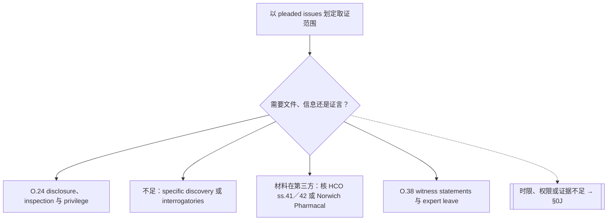
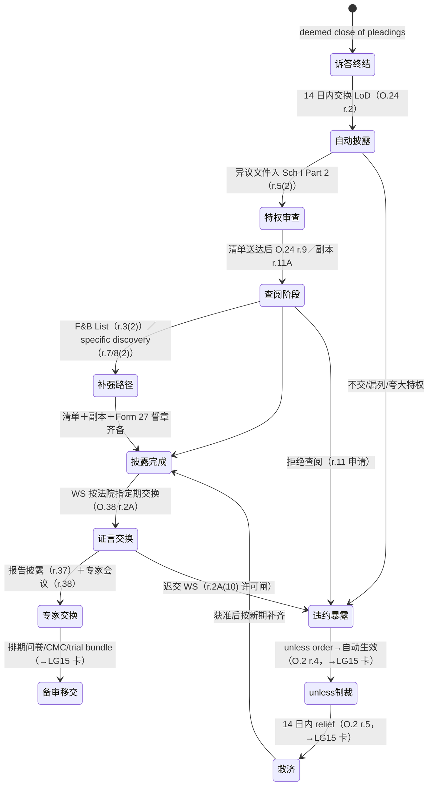
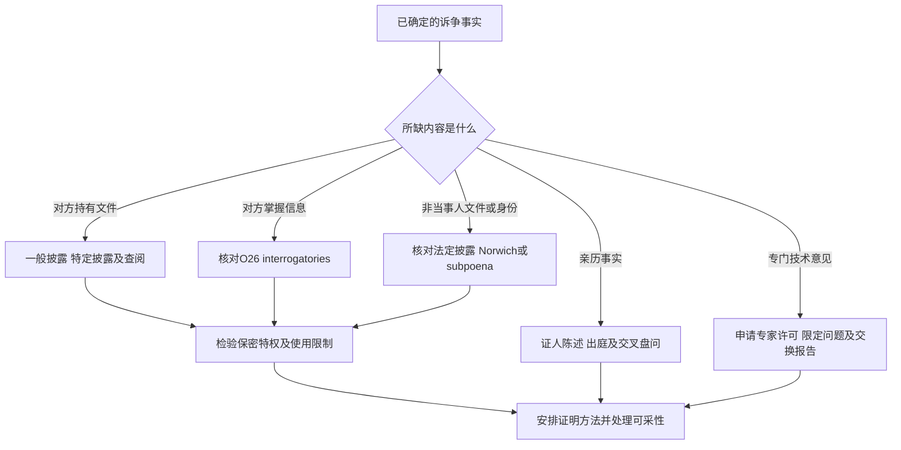
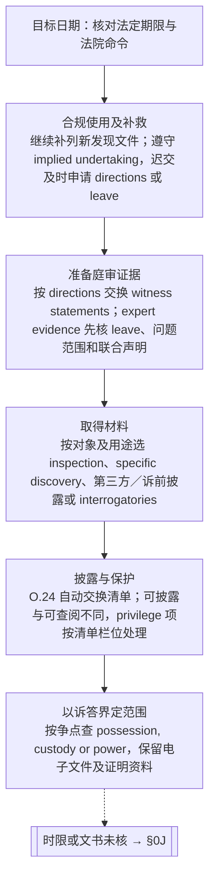

# 民事证据准备体系 披露 证人及专家

## 速读定位层

> 本层为 2026-10-10 深化重构新增的开篇导引；具体规则、条件、例外与引注见下方 §0A（既有）与 §0B–§0P（本轮深化），按本层术语定位后直达。本卡主题＝**证据准备（Evidence Preparation）**：从 pleadings 锁定争议，到文件、证言、专家意见三方面取证并进入审讯。 <small style="opacity: 0.55">〔CL12 L76 "Civil litigation operates on “cards on the table” basis"〕</small>

### 适用范围

**覆盖（按程序时序）**——自诉答终结（close of pleadings）到证据齐备可交案件管理的完整"取证"链：
1. **O.24 自动披露**：诉答终结后 14 日交换 List of Documents（Form 26）；文件定义（Cap.1 s.3＋PDSL 1.2 电子文件）、Peruvian Guano 相关性口径与 CJR 限缩（O.24 r.15A）、possession/custody/power、持续义务与补充清单；。 <small style="opacity: 0.55">〔CL8 L25 "within 14 days of the close of the pleadings"〕</small>
2. **异议与特权**：without prejudice、legal advice privilege、litigation privilege、自陷罪特权；特权不免列单（Schedule I Part 2）与特权放弃六径；。 <small style="opacity: 0.55">〔CL8 L40 "privileged documents must still be listed"〕</small>
3. **查阅与真实性**：inspection（O.24 r.9）、付费副本（r.11A）、拒绝查阅救济（r.11）、文书中提及文件的查阅（r.10，4 日回复）、O.27 r.4 真实性视为承认；。 <small style="opacity: 0.55">〔CL8 L45 "Discovery and inspection are 2 distinct concepts"〕</small>
4. **补强路径**：Further and Better List（r.3(2)）与 specific discovery（r.7／r.8(2) 五要件＋负担转移＋否认誓章终局性）；。 <small style="opacity: 0.55">〔CL8 L50 "Why the document sought is thought to exist"〕</small>
5. **implied undertaking**：披露文件只限本诉讼使用、违反＝contempt、open court 例外与 release 固有管辖；。 <small style="opacity: 0.55">〔CL8 L55 "not to use the documents for any purpose other than the proceedings"〕</small>
6. **诉前／第三方披露**：HCO ss.41/42（DCO ss.47A/47B）、Norwich Pharmacal、subpoena duces tecum；。 <small style="opacity: 0.55">〔CL8 L65 "Governs discovery against a potential party before the commencement"〕</small>
7. **interrogatories（O.26）**：两次免许可、14 日反对窗、不少于 28 日答复期、r.6 制裁；。 <small style="opacity: 0.55">〔CL8 L80 "The time allowed must be at least 28 days from the date of service."〕</small>
8. **证人陈述（O.38 r.2A）**：交换方向、SoT、迟交／新增许可、stand as EIC 与传闻边界；。 <small style="opacity: 0.55">〔CL12 L96 "The failure to file witness statement(s) according to directions given"〕</small>
9. **专家证据（O.38 rr.35–38、r.4、r.4A）**：许可门槛、overriding duty、Code of Conduct、专家会议／联合声明、SJE 与反驳 SJE；。 <small style="opacity: 0.55">〔CL12 L148 "parties need to obtain leave to adduce expert evidence"〕</small>
10. **披露违规制裁与攻防**：unless order 交叉 [CO11 卡](%5BCO11%5D%20Case%20Management%20and%20Trial%20Organisation%20System.md)、后果链总表（0J）、暗礁（0M）、SG 应用（0O）与材料矩阵（0P）。

**不覆盖（边界声明，相关主卡承担）**：① 排期问卷／CMS／CMC／里程碑／EOT／unless order 形式与 relief 十因素的主体规则（→ [CO11 案件管理卡](%5BCO11%5D%20Case%20Management%20and%20Trial%20Organisation%20System.md)；本卡只在 0L 引接口）；② 诉答起草与 F&BP（→ [CO04-05 诉答卡](./%5BCO04-05-10%5D%20Pleadings,%20Defence,%20Counterclaims%20and%20Third%20Party%20Proceedings.md)；F&BP 与质问书的分工见 0I.5）；③ 传票／誓章／命令起草本体（→ [CO07 传票卡](./%5BCO07%5D%20Drafting%20Summonses,%20Interlocutory%20Applications,%20Orders%20&%20Security%20for%20Costs.md)）；④ 临时救济（→ [CO13 临时救济卡](%5BCO13%5D%20Interim%20Relief%20and%20Risk%20Protection%20System.md)）；⑤ 审讯组织、trial bundles、缺席与 O.35（→ LG15 卡 0F）；⑥ Evidence Ordinance ss.46–55 传闻机制本体——库内无条例原文，本卡只按材料覆盖范围处理（见 0J.5 与 open 块）。

### 术语

| 术语 | 定义与章节 |
| --- | --- |
| Discovery（披露／文件透露） | 诉答终结后的法定文件开示程序：各方当事人依据 RHC O.24 把与诉答争议相关的涉案**文件**以 Form 26 清单形式向对方全面披露，开示对象严格限于文件本身而非抽象信息。 O.24 [§0C](#0C.%20O.24%20%E8%87%AA%E5%8A%A8%E6%8A%AB%E9%9C%B2%EF%BC%9A%E8%8C%83%E5%9B%B4%E3%80%81Peruvian%20Guano%20%E5%8F%A3%E5%BE%84%E4%B8%8E%20List%20of%20Documents%20%E7%BB%93%E6%9E%84)。 <small style="opacity: 0.55">〔CL8 L20 "discovery is concerned with documents, and interrogatories with information"〕</small> |
| Interrogatories（质问书） | 要求对方宣誓答复的法定书面质问：一方当事人依 RHC O.26 请求法庭许可，命令对方在指定时限内以誓章形式正式回答的**书面问题**；其调查对象严格为事实信息而非文件。 O.26 [§0F](#0F.%20%E8%A1%A5%E5%85%85%E6%B8%85%E5%8D%95%E3%80%81Further%20&%20Better%20List%20%E4%B8%8E%20Specific%20Discovery)。 <small style="opacity: 0.55">〔CL8 L20 "discovery is concerned with documents, and interrogatories with information"〕</small> |
| Peruvian Guano test | 相关性起点：可合理推测文件所载信息能推进己方或损害对方，或可公平引向有此后果的调查线索。 (1882) 11 QBD 55 [§0C](#0C.%20O.24%20%E8%87%AA%E5%8A%A8%E6%8A%AB%E9%9C%B2%EF%BC%9A%E8%8C%83%E5%9B%B4%E3%80%81Peruvian%20Guano%20%E5%8F%A3%E5%BE%84%E4%B8%8E%20List%20of%20Documents%20%E7%BB%93%E6%9E%84)。 <small style="opacity: 0.55">〔CL8 L20 "either to advance his own case or to damage that of his adversary"〕</small> |
| O.24 r.15A 限缩 | CJR 下法院可把披露限缩至直接相关文件，排除仅引向调查线索者。 O.24 r.15A(a) [§0C](#0C.%20O.24%20%E8%87%AA%E5%8A%A8%E6%8A%AB%E9%9C%B2%EF%BC%9A%E8%8C%83%E5%9B%B4%E3%80%81Peruvian%20Guano%20%E5%8F%A3%E5%BE%84%E4%B8%8E%20List%20of%20Documents%20%E7%BB%93%E6%9E%84)。 <small style="opacity: 0.55">〔CL8 L25 "limit the scope of discovery to directly relevant documents only"〕</small> |
| List of Documents（LoD，Form 26） | 披露载体：按法院格式列出持有／保管／权力内（或曾持有）相关文件的清单。 RHC App A Form 26 [§0C](#0C.%20O.24%20%E8%87%AA%E5%8A%A8%E6%8A%AB%E9%9C%B2%EF%BC%9A%E8%8C%83%E5%9B%B4%E3%80%81Peruvian%20Guano%20%E5%8F%A3%E5%BE%84%E4%B8%8E%20List%20of%20Documents%20%E7%BB%93%E6%9E%84)。 <small style="opacity: 0.55">〔CL8 L20 "in his possession/custody/power (or was in his possession)"〕</small> |
| Schedule I Part 1 | 现持有且**不反对**出示的相关文件。 O.24 r.2 [§0C](#0C.%20O.24%20%E8%87%AA%E5%8A%A8%E6%8A%AB%E9%9C%B2%EF%BC%9A%E8%8C%83%E5%9B%B4%E3%80%81Peruvian%20Guano%20%E5%8F%A3%E5%BE%84%E4%B8%8E%20List%20of%20Documents%20%E7%BB%93%E6%9E%84)。 <small style="opacity: 0.55">〔CL8 L25 "to which disclosure to the other side is not objected"〕</small> |
| Schedule I Part 2 | 现持有但**反对**出示（如特权）的相关文件。 O.24 r.5(2) [§0C](#0C.%20O.24%20%E8%87%AA%E5%8A%A8%E6%8A%AB%E9%9C%B2%EF%BC%9A%E8%8C%83%E5%9B%B4%E3%80%81Peruvian%20Guano%20%E5%8F%A3%E5%BE%84%E4%B8%8E%20List%20of%20Documents%20%E7%BB%93%E6%9E%84)。 <small style="opacity: 0.55">〔CL8 L25 "to which disclosure to the other side is objected"〕</small> |
| Schedule II | 曾持有但现已不再持有的文件，须说明何时曾持有。 O.24 r.2 [§0C](#0C.%20O.24%20%E8%87%AA%E5%8A%A8%E6%8A%AB%E9%9C%B2%EF%BC%9A%E8%8C%83%E5%9B%B4%E3%80%81Peruvian%20Guano%20%E5%8F%A3%E5%BE%84%E4%B8%8E%20List%20of%20Documents%20%E7%BB%93%E6%9E%84)。 <small style="opacity: 0.55">〔CL8 L25 "documents which were once in the possession of the party"〕</small> |
| possession, custody or power | 持有／保管／权力三态：不以所有权为限，含保管中的他人文件与有权向他人索取的文件。 O.24 [§0C](#0C.%20O.24%20%E8%87%AA%E5%8A%A8%E6%8A%AB%E9%9C%B2%EF%BC%9A%E8%8C%83%E5%9B%B4%E3%80%81Peruvian%20Guano%20%E5%8F%A3%E5%BE%84%E4%B8%8E%20List%20of%20Documents%20%E7%BB%93%E6%9E%84)。 <small style="opacity: 0.55">〔CL8 L30 "not restricted to actual ownership"〕</small> |
| Specific discovery（特定披露） | 针对遗漏文件的强制开示程序：当一方有合理依据确信对方遗漏了特定关键文件时，可依据 RHC O.24 r.7 发出传票；申请法院下达命令，强制对方披露指明的文件或特定文件类别并准予查验。 O.24 r.7 [§0F](#0F.%20%E8%A1%A5%E5%85%85%E6%B8%85%E5%8D%95%E3%80%81Further%20&%20Better%20List%20%E4%B8%8E%20Specific%20Discovery)。 <small style="opacity: 0.55">〔CL8 L20 "the court orders a party to discover document specified by the court under O.24 r.7"〕</small> |
| Further and Better List（补充完整清单） | 命令补交通用开示清单的救济：依据 RHC O.24 r.3(2)，当在案诉答文书或已披露文件明确表明对方必然还持有未披露的相关文件时，申请人可请求法庭命令对方限期补交一份更详尽完整的 Form 26 文件清单。 O.24 r.3(2) [§0F](#0F.%20%E8%A1%A5%E5%85%85%E6%B8%85%E5%8D%95%E3%80%81Further%20&%20Better%20List%20%E4%B8%8E%20Specific%20Discovery)。 <small style="opacity: 0.55">〔CL8 L45 "must have documents not yet disclosed"〕</small> |
| Inspection（查阅） | 查验与复制开示文件的独立程序：当事人在交换 Form 26 清单后，依据 RHC O.24 r.9 正式要求在 7 天内查验对方持有的非特权文件原件并提取副本；查阅与清单披露属于两个前后独立的程序环节。 O.24 r.9 [§0E](#0E.%20%E6%9F%A5%E9%98%85%EF%BC%88Inspection%EF%BC%89%E3%80%81%E5%89%AF%E6%9C%AC%E4%B8%8E%E6%96%87%E4%BB%B6%E7%9C%9F%E5%AE%9E%E6%80%A7)。 <small style="opacity: 0.55">〔CL8 L45 "Discovery and inspection are 2 distinct concepts"〕</small> |
| Implied undertaking（默示承诺） | 接收方对法院承担的法定保密承诺：当事人接收对方开示的文件时，依法对法庭作出默示保证：绝不将所获文件用于本诉讼正当推进以外的任何其他目的（尤其严禁用于外部商业或附随诉讼）。 普通法 [§0G](#0G.%20Implied%20Undertaking%EF%BC%9A%E6%8A%AB%E9%9C%B2%E6%96%87%E4%BB%B6%E7%9A%84%E4%BD%BF%E7%94%A8%E8%BE%B9%E7%95%8C%E4%B8%8E%E8%A7%A3%E9%99%A4)。 <small style="opacity: 0.55">〔CL8 L55 "not to use the documents for any purpose other than the proceedings"〕</small> |
| Without prejudice 通讯 | 和解谈判特权保护：当事人为了真诚达成和解而进行的书面通讯与口头让步，在后续审讯中依法不予接纳为不利证据；法庭依通讯真实性质全盘判断，不受是否标注特权标签拘束。 普通法 [§0D](#0D.%20%E5%BC%82%E8%AE%AE%E4%B8%8E%E7%89%B9%E6%9D%83%EF%BC%9AWithout%20Prejudice%E3%80%81%E6%B3%95%E5%BE%8B%E4%B8%93%E4%B8%9A%E7%89%B9%E6%9D%83%E4%B8%8E%E8%87%AA%E9%99%B7%E7%BD%AA%E7%89%B9%E6%9D%83)。 <small style="opacity: 0.55">〔CL8 L30 "negotiations genuinely aimed at settlement"〕</small> |
| Legal advice privilege（法律意见特权） | 律师与客户为取得法律意见的保密沟通，不限于已有诉讼。 LPP 一支 [§0D](#0D.%20%E5%BC%82%E8%AE%AE%E4%B8%8E%E7%89%B9%E6%9D%83%EF%BC%9AWithout%20Prejudice%E3%80%81%E6%B3%95%E5%BE%8B%E4%B8%93%E4%B8%9A%E7%89%B9%E6%9D%83%E4%B8%8E%E8%87%AA%E9%99%B7%E7%BD%AA%E7%89%B9%E6%9D%83)。 <small style="opacity: 0.55">〔CL8 L30 "Communications between lawyers and clients for the purpose of obtaining legal advice"〕</small> |
| Litigation privilege（诉讼特权） | 以现有或可预期诉讼为 dominant purpose 的沟通，可涉第三方。 LPP 一支 [§0D](#0D.%20%E5%BC%82%E8%AE%AE%E4%B8%8E%E7%89%B9%E6%9D%83%EF%BC%9AWithout%20Prejudice%E3%80%81%E6%B3%95%E5%BE%8B%E4%B8%93%E4%B8%9A%E7%89%B9%E6%9D%83%E4%B8%8E%E8%87%AA%E9%99%B7%E7%BD%AA%E7%89%B9%E6%9D%83)。 <small style="opacity: 0.55">〔CL8 L30 "dominant purpose of existing or contemplated litigation"〕</small> |
| Privilege against self-incrimination（自陷罪特权） | 免自证己罪（含配偶）的宪法性特权，须以誓章及时主张。 EO (Cap.8) s.65(1)(a) [§0D](#0D.%20%E5%BC%82%E8%AE%AE%E4%B8%8E%E7%89%B9%E6%9D%83%EF%BC%9AWithout%20Prejudice%E3%80%81%E6%B3%95%E5%BE%8B%E4%B8%93%E4%B8%9A%E7%89%B9%E6%9D%83%E4%B8%8E%E8%87%AA%E9%99%B7%E7%BD%AA%E7%89%B9%E6%9D%83)。 <small style="opacity: 0.55">〔CL8 L40 "must be specifically claimed by filing an affidavit"〕</small> |
| Form 27 誓章 | 对方在 CMS 前要求时，14 日内确认清单真确的誓章。 O.24 r.2(7)、r.5(3) [§0C](#0C.%20O.24%20%E8%87%AA%E5%8A%A8%E6%8A%AB%E9%9C%B2%EF%BC%9A%E8%8C%83%E5%9B%B4%E3%80%81Peruvian%20Guano%20%E5%8F%A3%E5%BE%84%E4%B8%8E%20List%20of%20Documents%20%E7%BB%93%E6%9E%84)。 <small style="opacity: 0.55">〔CL8 L40 "in the form of RHC Appendix, Form 27"〕</small> |
| Witness statement（WS，证人陈述） | 事实证人的庭前书面主问证据：依据 RHC O.38 r.2A，由证人亲自签署、全面载明其将于审讯庭上陈述的全部事实事项的法定文件；开庭时通常作为主问证言并直接接受对方盘问。 O.38 r.2A [§0G](#0G.%20Implied%20Undertaking%EF%BC%9A%E6%8A%AB%E9%9C%B2%E6%96%87%E4%BB%B6%E7%9A%84%E4%BD%BF%E7%94%A8%E8%BE%B9%E7%95%8C%E4%B8%8E%E8%A7%A3%E9%99%A4)。 <small style="opacity: 0.55">〔CL12 L86 "a document including all matters which a witness is going to say at trial"〕</small> |
| Statement of truth（SoT，属实声明） | 证言真实的法定签署担保：依据 RHC O.41A，由当事人或证人在诉答文书及证人陈述书末尾亲自签署的声明，确认内容完全真确；若签署人明知内容虚假仍签署，将构成刑事藐视法庭。 O.41A [§0G](#0G.%20Implied%20Undertaking%EF%BC%9A%E6%8A%AB%E9%9C%B2%E6%96%87%E4%BB%B6%E7%9A%84%E4%BD%BF%E7%94%A8%E8%BE%B9%E7%95%8C%E4%B8%8E%E8%A7%A3%E9%99%A4)。 <small style="opacity: 0.55">〔CL12 L88 "include a statement of truth signed by the witness: O.41A"〕</small> |
| Stand as evidence-in-chief | 证人陈述书直接替代庭上主问的常规命令：法庭依据 RHC O.38 r.2A(7) 裁定以已交换的证人陈述书直接作为主问证据；开庭时证人无需在庭上朗读重复证言，出庭确认签名后直接接受对方律师盘问。 O.38 r.2A(7) [§0G](#0G.%20Implied%20Undertaking%EF%BC%9A%E6%8A%AB%E9%9C%B2%E6%96%87%E4%BB%B6%E7%9A%84%E4%BD%BF%E7%94%A8%E8%BE%B9%E7%95%8C%E4%B8%8E%E8%A7%A3%E9%99%A4)。 <small style="opacity: 0.55">〔CL12 L66 "ordered to “stand as evidence in chief”."〕</small> |
| Subpoena ad testificandum | 强制证人出庭作证的令状。 O.38 r.14 [§0G](#0G.%20Implied%20Undertaking%EF%BC%9A%E6%8A%AB%E9%9C%B2%E6%96%87%E4%BB%B6%E7%9A%84%E4%BD%BF%E7%94%A8%E8%BE%B9%E7%95%8C%E4%B8%8E%E8%A7%A3%E9%99%A4)。 <small style="opacity: 0.55">〔CL12 L128 "Subpoena ad testificandum: O.38 r.14"〕</small> |
| Subpoena duces tecum | 强制证人携文件出庭的令状，门槛严于 specific discovery。 O.38 r.14 [§0F](#0F.%20%E8%A1%A5%E5%85%85%E6%B8%85%E5%8D%95%E3%80%81Further%20&%20Better%20List%20%E4%B8%8E%20Specific%20Discovery)。 <small style="opacity: 0.55">〔CL8 L70 "requires the production of documents"〕</small> |
| Norwich Pharmacal order | 针对第三方的纯披露衡平命令：当无辜第三方被动卷入或协助了他人的不法行为时，法院可命其向受害人披露侵权人身份或去向材料以协助受害人提起诉讼。 [1974] AC 133 [§0F](#0F.%20%E8%A1%A5%E5%85%85%E6%B8%85%E5%8D%95%E3%80%81Further%20&%20Better%20List%20%E4%B8%8E%20Specific%20Discovery)。 <small style="opacity: 0.55">〔CL8 L70 "gets “mixed up” in another person’s wrongdoing"〕</small> |
| Expert evidence（专家证据） | 就需专门知识的争点提供的意见证据，援引须法院许可。 O.38 r.36 [§0G](#0G.%20Implied%20Undertaking%EF%BC%9A%E6%8A%AB%E9%9C%B2%E6%96%87%E4%BB%B6%E7%9A%84%E4%BD%BF%E7%94%A8%E8%BE%B9%E7%95%8C%E4%B8%8E%E8%A7%A3%E9%99%A4)。 <small style="opacity: 0.55">〔CL12 L68 "The Court’s leave is required to adduce expert evidence."〕</small> |
| Code of Conduct（Appendix D，专家行为守则） | 聘方须在专家撰报告前提供、专家须声明受其约束的守则。 O.38 r.37B/37C [§0G](#0G.%20Implied%20Undertaking%EF%BC%9A%E6%8A%AB%E9%9C%B2%E6%96%87%E4%BB%B6%E7%9A%84%E4%BD%BF%E7%94%A8%E8%BE%B9%E7%95%8C%E4%B8%8E%E8%A7%A3%E9%99%A4)。 <small style="opacity: 0.55">〔CL12 L188 "Parties to provide Code of Conduct to their experts before the latter compile"〕</small> |
| Single joint expert（SJE，单一联合专家） | 法院可命多方共委一名专家（或各方自委），直接向法庭提供证据。 O.38 r.4A [§0G](#0G.%20Implied%20Undertaking%EF%BC%9A%E6%8A%AB%E9%9C%B2%E6%96%87%E4%BB%B6%E7%9A%84%E4%BD%BF%E7%94%A8%E8%BE%B9%E7%95%8C%E4%B8%8E%E8%A7%A3%E9%99%A4)。 <small style="opacity: 0.55">〔CL12 L210 "The Court can appoint (or the parties can agree on"〕</small> |
| Hearsay（传闻证据） | EO s.46 意义下的传闻；民事审讯原则上容许，除非法院另有命令。 EO Part IV；O.38 Part III [§0G](#0G.%20Implied%20Undertaking%EF%BC%9A%E6%8A%AB%E9%9C%B2%E6%96%87%E4%BB%B6%E7%9A%84%E4%BD%BF%E7%94%A8%E8%BE%B9%E7%95%8C%E4%B8%8E%E8%A7%A3%E9%99%A4)。 <small style="opacity: 0.55">〔CL15 L424 "Hearsay is permitted in a civil trial save where the court orders otherwise"〕</small> |


### 环节定位

| 环节 | 实际操作 |
| --- | --- |
| 诉答终结 → 14 日交换 LoD | 在无人催办下把"双方各持什么文件"摆上台面：披露范围由 pleadings 锁定，防止证据埋伏。 O.24 r.2。 <small style="opacity: 0.55">〔CL8 L25 "within 14 days of the close of the pleadings"；CL12 L76 "Civil litigation operates on “cards on the table” basis"〕</small> |
| 特权审查 → Sch I Part 2 | 相关但有特权／异议的文件如何处理：列存在而不交内容，保留争议空间。 O.24 r.5(2)。 <small style="opacity: 0.55">〔CL8 L40 "privileged documents must still be listed"〕</small> |
| 查阅与副本 | 清单只给"存在"，查阅给"内容"：r.9 查阅原件、r.11A 付费取副本、r.11 拒绝查阅救济。 O.24 rr.9–11A。 <small style="opacity: 0.55">〔CL8 L45 "Discovery and inspection are 2 distinct concepts"〕</small> |
| 真实性视为承认 | 避免审讯纠缠文书真伪：O.27 r.4 视为承认，21 日内可争议。 O.27 r.4。 <small style="opacity: 0.55">〔CL8 L45 "deemed admission of authenticity of the documents listed"〕</small> |
| F&B list ／ specific discovery | 对方清单不足时的两条补强路：不知是什么用前者，能识别就用后者。 O.24 rr.3(2)、r.7。 <small style="opacity: 0.55">〔CAP-C8 L1684 "then a much better way to get a document is to use specific discovery instead."〕</small> |
| implied undertaking | 让当事人敢交文件：使用范围锁死本诉讼，违反＝contempt。 普通法。 <small style="opacity: 0.55">〔CAP-C8 L2011 "so breach of the implied undertaking is a contempt of court."〕</small> |
| 诉前／第三方披露 | 起诉前定被告身份、或向案外人取文件：HCO ss.41/42＋Norwich Pharmacal。 HCO ss.41/42。 <small style="opacity: 0.55">〔CL8 L65 "Governs discovery against a potential party before the commencement"〕</small> |
| Interrogatories | 文件之外的信息缺口：对方须宣誓回答，不同于 WS 的自愿陈述。 O.26。 <small style="opacity: 0.55">〔CL8 L75 "if the interrogatories satisfy the requirements under O.26, must be provided"〕</small> |
| WS 交换 | 把口头证据书面化固定：对方预知证据、法院据以控审期。 O.38 r.2A。 <small style="opacity: 0.55">〔CL12 L92 "Parties are to name witnesses to be called in their respective timetabling questionnaires"〕</small> |
| 专家许可与报告 | 专门知识争点由谁、以什么范围进入法庭：leave 门槛＋行为守则＋报告交换。 O.38 rr.36–37C。 <small style="opacity: 0.55">〔CL12 L148 "parties need to obtain leave to adduce expert evidence"〕</small> |
| 违规制裁 | 披露义务不是软约束：unless order → 自动制裁 → relief 回路（主体在 LG15 卡）。 O.26 r.6；O.32 r.11B。 <small style="opacity: 0.55">〔CL8 L80 "for sanctions (e.g. striking out an action, entering judgment)"〕</small> |


## 🗺️ 本卡地图



各方先用 pleaded issues 确定取证范围，再按文件、信息和证言分别选程序。文件交付后仍受 implied undertaking 约束；专家证据另须核许可和职责。

| 任务 | 直达 |
| --- | --- |
| 证据准备总框架：三大核心支柱、时序主干与程序推进 | [§0B](#0B.%20%E8%AF%81%E6%8D%AE%E5%87%86%E5%A4%87%E6%80%BB%E6%A1%86%E6%9E%B6%EF%BC%9A%E4%B8%89%E5%A4%A7%E6%A0%B8%E5%BF%83%E6%94%AF%E6%9F%B1%E3%80%81%E6%97%B6%E5%BA%8F%E4%B8%BB%E5%B9%B2%E4%B8%8E%E7%A8%8B%E5%BA%8F%E6%8E%A8%E8%BF%9B) |
| O.24 自动披露：范围、Peruvian Guano 口径与 List of Documents 结构 | [§0C](#0C.%20O.24%20%E8%87%AA%E5%8A%A8%E6%8A%AB%E9%9C%B2%EF%BC%9A%E8%8C%83%E5%9B%B4%E3%80%81Peruvian%20Guano%20%E5%8F%A3%E5%BE%84%E4%B8%8E%20List%20of%20Documents%20%E7%BB%93%E6%9E%84) |
| 异议与特权：Without Prejudice、法律专业特权与自陷罪特权 | [§0D](#0D.%20%E5%BC%82%E8%AE%AE%E4%B8%8E%E7%89%B9%E6%9D%83%EF%BC%9AWithout%20Prejudice%E3%80%81%E6%B3%95%E5%BE%8B%E4%B8%93%E4%B8%9A%E7%89%B9%E6%9D%83%E4%B8%8E%E8%87%AA%E9%99%B7%E7%BD%AA%E7%89%B9%E6%9D%83) |
| 查阅（Inspection）、副本与文件真实性 | [§0E](#0E.%20%E6%9F%A5%E9%98%85%EF%BC%88Inspection%EF%BC%89%E3%80%81%E5%89%AF%E6%9C%AC%E4%B8%8E%E6%96%87%E4%BB%B6%E7%9C%9F%E5%AE%9E%E6%80%A7) |
| 补充清单、Further & Better List 与 Specific Discovery | [§0F](#0F.%20%E8%A1%A5%E5%85%85%E6%B8%85%E5%8D%95%E3%80%81Further%20&%20Better%20List%20%E4%B8%8E%20Specific%20Discovery) |
| Implied Undertaking：披露文件的使用边界与解除 | [§0G](#0G.%20Implied%20Undertaking%EF%BC%9A%E6%8A%AB%E9%9C%B2%E6%96%87%E4%BB%B6%E7%9A%84%E4%BD%BF%E7%94%A8%E8%BE%B9%E7%95%8C%E4%B8%8E%E8%A7%A3%E9%99%A4) |
| 文书与期限倒排 | [§0H](#0H.%20%E5%AE%9E%E5%8A%A1%E6%93%8D%E4%BD%9C%E6%B8%85%E5%8D%95%EF%BC%9A%E6%96%87%E4%B9%A6%E3%80%81%E9%80%81%E8%BE%BE%E4%B8%8E%E6%97%B6%E9%99%90%E5%80%92%E6%8E%92) |
| 提交前核对 | [§0I](#0I.%20%E6%94%BB%E9%98%B2%E4%B8%8E%E6%89%A7%E8%A1%8C%E5%89%8D%E6%A0%B8%E5%AF%B9) |
| 失误、制裁与补救 | [§0J](#0J.%20%E7%A8%8B%E5%BA%8F%E5%A4%B1%E8%AF%AF%E5%8F%8A%E5%85%B6%E5%90%8E%E6%9E%9C) |
| SG 实务应用 | [§0K](#0K.%20SG%20%E5%AE%9E%E5%8A%A1%E5%BA%94%E7%94%A8%E4%B8%8E%E5%AF%BC%E5%B8%88%E5%8F%A3%E5%BE%84) |

#### 核心参数与计算口径
- **文件清单自动披露时限（List of Documents - O.24 r.2）**：诉答完结（Close of Pleadings）后 **14 天内**，当事人必须相互送达按表格 26 起草之文件清单。
- **Inspection（O.24 rr.9–10）**：列单方送达 List of Documents 时，应同时通知对方在送达后七日内可到指定地点查阅文件；如对方要求查阅的是 pleadings、affidavit、witness statement 或 expert report 提及的文件，收通知方须在四日内回复，列明反对及理由，并指定回复通知送达后七日内可查阅的时间。见 [RHC O.24 rr.9–10](https://www.elegislation.gov.hk/hk/cap4A)。
- **Notice of Non-admission（O.27 r.4）**：从实际查阅或查阅期限届满中较迟一日起算 21 日。收单方在期限内送达通知，可要求列单方在正审证明真实性；若已在 pleading 中否认真实性，该项推定也不适用。
- **默示承诺使用边界（Implied Undertaking - *Harman v Home Office*）**：依披露程序取得之文件只能用于本诉讼目的，在法庭公开审讯宣读或正式呈堂前，绝对严禁挪作任何他用（包括媒体曝光、用于其他独立仲裁或域外诉讼），违者构成藐视法庭（Contempt of court under O.52）。
- **证人陈述书交换与失权（Witness Statements - O.38 r.2A）**：依案件管理指示（CMC Timetable）同步交换；未在陈述书中列明之证人或事实，未经法庭特别许可不得在正审主问中提出（No evidence without leave）。
- **专家证据许可制度（Expert Evidence - O.38 r.36 & PD 18.3）**：未经法庭事先许可严禁呈交专家证据；法庭优先考虑单一联合专家（Single Joint Expert - SJE）；专家必须签署守则附录 D（Code of Conduct for Expert Witnesses）。

<!-- BEGIN:cite-legend -->
> [!info]- 引注图例
> 
> | 码 | 文件 | 层级 | 学年 |
> |---|---|---|---|
> | CL8 | [LG8 Discovery（本届大纲，04 Base 伴生 md，80 行长行版）](../../04%20Base%20Lectures/00%20This%20Year%20Moodle%202026-27/Lecture%20Outlines,%20Powerpoints%20&%20Materials/LG8%EF%BC%9A%20Discovery/LG8%20Discovery%20Lecture%20Outline.md) | 本届讲义 | 2026-27 |
> | WC8 | [LG8 Discovery（同 CL8 所指文件；2026-10-05 字幕校核轮所用旧码，保留兼容）](../../04%20Base%20Lectures/00%20This%20Year%20Moodle%202026-27/Lecture%20Outlines,%20Powerpoints%20&%20Materials/LG8%EF%BC%9A%20Discovery/LG8%20Discovery%20Lecture%20Outline.md) | 本届讲义 | 2026-27 |
> | CL8S | [LG8-Discovery 本届课堂幻灯伴生 md（476 行，39 张幻灯）](../../04%20Base%20Lectures/00%20This%20Year%20Moodle%202026-27/Lecture%20Outlines,%20Powerpoints%20&%20Materials/LG8%EF%BC%9A%20Discovery/LG8-Discovery.md) | 本届讲义 | 2026-27 |
> | CL8D | [Sample List of Doc（本案卷宗范本清单，含 Notice of Inspection）](../../04%20Base%20Lectures/00%20This%20Year%20Moodle%202026-27/Lecture%20Outlines,%20Powerpoints%20&%20Materials/LG8%EF%BC%9A%20Discovery/Sample%20List%20of%20Doc.md) | 本届讲义 | 2026-27 |
> | CAP-C8 | [PCLL8010 LG8 PT 课堂字幕（2026-09-29 授课，2725 行）](../../99%20Moodle%20Mirror/Lecture%20Outlines,%20Powerpoints%20&%20Materials/LG8%EF%BC%9A%20Discovery/Panopto%20Captions%20%28local%20export%29/8010_LG08_PT.md) | 本届讲义 | 2026-27 |
> | CL12 | [LG12 证人陈述与专家（99 镜像伴生 md，248 行；04 Base 本届库另有内容全同副本）](../../99%20Moodle%20Mirror/Lecture%20Outlines,%20Powerpoints%20&%20Materials/LG12%20Witness%20Statements%20and%20Expert%20Reports/LG12%20-%20Witness%20Statements%20and%20Expert%20Reports.md) | 本届讲义 | 2026-27 |
> | CL12R | [LG12 Reference Material（RHC O.38 条文附载，Version date 1.10.2025，455 行）](../../04%20Base%20Lectures/00%20This%20Year%20Moodle%202026-27/Lecture%20Outlines,%20Powerpoints%20&%20Materials/LG12%20Witness%20Statements%20and%20Expert%20Reports/LG12%20-Reference%20Material.md) | 本届讲义 | 2026-27 |
> | CL15 | [LG15 - Trial Preparation Trial Procedure](../../04%20Base%20Lectures/00%20This%20Year%20Moodle%202026-27/Lecture%20Outlines,%20Powerpoints%20&%20Materials/LG15%20-%20Trial%20Preparation%20Trial%20Procedure.md) | 本届讲义 | 2026-27 |
> | OLD-LG12O | [往届（2025-26）LG12 Witness Statements and Expert Evidence 大纲（278 行）](../../04%20Base%20Lectures/%5BLG12%5D%20Witness%20Statements%20and%20Expert%20Reports/2025-2026%20LG12%20-%20Witness%20Statements%20and%20Expert%20Reports%20%28Updated%206%20Oct%202025%29.md) | 往届官方 | 2025-26 |
> | OLD-SET3L8 | [往届学生稿·Set 3「LG8 Discovery」（718 行·非官方）](../../06%20Base%20Exam%20Notes/Set%203/LG8%20Discovery.md) | 往届学生稿 | 2025-26 |
> | OLD-SET3L12 | [往届学生稿·Set 3「LG12 Witness statement and expert reports」（494 行·非官方）](../../06%20Base%20Exam%20Notes/Set%203/LG12%20Witness%20statement%20and%20expert%20reports.md) | 往届学生稿 | 2025-26 |
> | T12 | [8010_LG12_FT_8463578c.md](../../04%20Base%20Lectures/00%20This%20Year%20Moodle%202026-27/Lecture%20Outlines,%20Powerpoints%20&%20Materials/LG12%20Witness%20Statements%20and%20Expert%20Reports/Panopto%20Captions%20%28local%20export%29/8010_LG12_FT_8463578c.md) | 本届讲义 | 2026-27 |
> | S6-AP | [1. SG6 (Civil Procedure 1)](../../04%20Base%20Lectures/00%20This%20Year%20Moodle%202026-27/Small%20Group%20Activity%20Plans/1.%20SG6%20%28Civil%20Procedure%201%29.md) | 本届官方 | 2026-27 |
> | S6-L8 | [LG8 Discovery Lecture Outline](../../04%20Base%20Lectures/00%20This%20Year%20Moodle%202026-27/Lecture%20Outlines,%20Powerpoints%20&%20Materials/LG8%EF%BC%9A%20Discovery/LG8%20Discovery%20Lecture%20Outline.md) | 本届讲义 | 2026-27 |
<!-- END:cite-legend -->

> **2026-10-23本轮更新**：新增／校准落点 §0Q；当前材料链见[全科当前进度](../_meta/Current%20Progress%20and%20Material%20Uptake.md)。下方带日期的旧快照保留为历史。
> **2026-10-10 §18 深化重构**：先读新增「速读定位层」与「🗺️ 本卡地图」取得全景，再按任务直达表进入 0B–0P 深节；既有 0A（2026-10-06）、§1–§8 五原则节与全部修订日志零删减保留。LG8 Discovery 已于 2026-09-29 授课（PT），课堂字幕已入库并全读；LG12 PT课表为2026-10-16，现已过；本届正式提供的FT替代录像（实际录制2026-10-09）整份本地字幕已读，新增解释及ASR校正在§0Q；不冒称PT实录。Moodle新增录像／PT字幕仍须恢复会话核对。

> **2026-10-06内容扩充**：先读新增“0A. 证据取得、保护及进入审讯的完整路径”，其中逐条展开条件、例外、证据、行动和后果；原有分析与引注保留。课堂字幕只作教师解释及核对，ASR内容与书面规则有别。


> 制作时间：2026-10-01（Asia/Shanghai）；材料快照为制作时本地已入库文件。以topic为单位，编号是本课现行目录锚点，不限制辐射讲次。
> 本文件是新增体系稿；相关旧卡的原文、引注和未决项仍保留。下述“学习建模／策略分析”是对已引规则的组织，不是新增法条或本届案情。

## 0B. 证据准备总框架：三大核心支柱、时序主干与程序推进

**此时案件处在什么状态？** Pleadings 刚告一段落（close of pleadings）：双方已经用起诉与答辩把"争什么"锁定，但彼此还没看到对方手里的证据材料。**本节在干嘛？** 给出从诉答终结到证据齐备的完整路线图——14 日内自动交换文件清单、特权审查、查阅、不够再补强，然后证人陈述与专家报告，最后移交案件管理轨道；每一步的产出都是下一步的前提，跳步就会在后面被卡住。**和谁区分？** 本卡管"证据怎么取得、怎么保护、怎么进入审讯"；排期问卷、里程碑与 unless order 的主体规则在 [CO11 卡](%5BCO11%5D%20Case%20Management%20and%20Trial%20Organisation%20System.md)，本卡只在 0J 接口引接。 <small style="opacity: 0.55">〔CL8 L25 "within 14 days of the close of the pleadings"〕</small>

> 本节为 2026-10-10 深化重构新增的主体之一（对应 §18.4 深节序列"总框架（含程序流转图）"）。主线：**close of pleadings → 14 日自动披露（交换 LoD）→ 异议/特权审查 → inspection → 补强路径（F&B list / specific discovery）→ 披露完成 → WS 交换 → 专家报告与专家会议 → 移交案件管理**；旁挂：**implied undertaking**（文件到手即受约束）与**违规→制裁→救济**回路（主体在 LG15 卡）。主体依据：本届 LG8 大纲、本届 LG8 幻灯（CL8S）、本案卷宗 Sample List of Doc（CL8D）、2026-09-29 课堂字幕（CAP-C8）、LG12 大纲＋O.38 条文附载（CL12/CL12R）；往届 LG12 大纲与 Set 3 笔记均带"往届仅参考"。 <small style="opacity: 0.55">〔CL8 L15 "Lecture (LG) 8 Lecture title Discovery"〕</small>

### 0B.1 证据准备全流程一览：从诉答终结到证据齐备（Evidence Preparation Progression）

**这张图怎么读？** 从上往下是正常推进的主线：诉答终结 → 自动披露 → 特权审查 → 查阅 → 补强 → 披露完成 → 证言交换 → 专家报告 → 移交备审；分叉出的"违约暴露"支线是任一步没做或做错时的出口，通向 unless 制裁与救济回路。**为什么不能跳步？** 每一步的产出都是下一步的前提——没有清单就无法查阅，没有 pleadings 锁定争点就无法判断相关性。



**图后依据（逐项）**：①14 日自动交换；②特权文件仍须列单入 Sch I Part 2；③披露与查阅两概念、副本与拒绝救济；④补强两径；⑤Form 27 清单确认誓章；⑥WS 交换由法院在 CMS 定方向；⑦迟交 WS 许可闸；⑧专家报告披露与专家会议；⑨unless→自动生效→relief 回路主体在 [CO11 卡](%5BCO11%5D%20Case%20Management%20and%20Trial%20Organisation%20System.md) 0E（本卡 0L 引接口）。各"违约暴露"节点的后果链集中见 [§0J 后果链总表](#0J.2%20%E7%8E%AF%E8%8A%82%20%C3%97%20%E4%B8%8D%E5%81%9A%E5%90%8E%E6%9E%9C%20%C3%97%20%E4%BE%9D%E6%8D%AE%EF%BC%9A%E5%90%8E%E6%9E%9C%E9%93%BE%E6%80%BB%E8%A1%A8)。 <small style="opacity: 0.55">〔CL8 L25 "within 14 days of the close of the pleadings"；CL8S L108 "Parties must exchange documents within 14 days"〕〔CL8 L40 "privileged documents must still be listed"〕〔CL8 L45 "Discovery and inspection are 2 distinct concepts"；CL8 L45 "Upon undertaking to pay reasonable photocopying charges"〕〔CL8 L45 "must have documents not yet disclosed"；CL8 L50 "Why the document sought is thought to exist"〕〔CL8 L40 "in the form of RHC Appendix, Form 27"〕〔CL12R L44 "the Court shall direct every party to serve on the other parties, within such period as the Court may specify"〕〔CL12R L84 "he shall not be entitled to adduce evidence to which the direction related without the leave of the Court"〕〔CL12 L192 "Expert reports are disclosed and exchanged prior to trial"；CL12 L200 "direct “without prejudice” meetings between the experts prior to trial"〕</small>

### 0B.2 每一步交什么文书、期限几天（披露面时限）

**此时案件处在什么状态？** 披露程序已经启动或正准备交文书；程序丢分最多的地方就是死线的起算点与天数。**本表在干嘛？** 把披露面每一步"交什么文书、期限几天、依据哪条"排成速查表——先找行为，再看起算事件，最后核表式。**怎么用？** 背数字不如记方法：起算事件 → 期间 → 日历日 → 查公众假期（0C.3 课堂演示）；法院另有命令时以实际命令为准（0C.4 范本备注）。

| 文书／行为 | 时限（起算点 → 死线） | 表式／依据 | 性质与备注 |
| --- | --- | --- | --- |
| 交换 List of Documents（各方） | 诉答终结后 **14 日**内。 <small style="opacity: 0.55">〔CL8 L25 "within 14 days of the close of the pleadings"〕</small> | RHC App A **Form 26**；O.24 r.2、r.5(1)。 <small style="opacity: 0.55">〔CL8 L20 "in the form of RHC Appendix A, Form 26"〕</small> | 自动披露，无需命令；课堂另提醒：PD 5.2 下不等管理方向即推进披露（→LG15 卡 0C）（字幕口径）。 <small style="opacity: 0.55">〔CAP-C8 L520 "Right by filing and serving a list of document in the automatic discovery."〕</small> |
| Form 27 清单确认誓章 | 对方在 **CMS 前**请求后 **14 日**内。 <small style="opacity: 0.55">〔CL8 L40 "within 14 days of the request to swear to the truth and accuracy"〕</small> | RHC App **Form 27**；O.24 r.2(7)、r.5(3)。 <small style="opacity: 0.55">〔CL8 L40 "in the form of RHC Appendix, Form 27"〕</small> | 被迫以誓章担保清单真确——清单造假的成本从"重列"升级为"宣誓作假" |
| 补充清单（Supplemental List） | 新相关文件到手后**持续**补交，无固定天数。 <small style="opacity: 0.55">〔CL8 L40 "has a continuous duty to discover documents. This"〕</small> | *Vernon v Bosley (No.2)*。 <small style="opacity: 0.55">〔CL8 L40 "Supplemental List(s) of Documents: Vernon v Bosley (No.2)"〕</small> | 首次清单不是终点；庭审前新文件到手即触发 |
| 查阅（inspection） | 列单时一并送达查阅通知；通知指定送达后七日内的查阅时间。 <small style="opacity: 0.55">〔CAP-C8 L1525 "I think that should be seven days after receiving the list of document"〕</small> | O.24 r.9 | 拒绝查阅 → 对方向法院申请 O.24 r.11。 <small style="opacity: 0.55">〔CL8 L45 "If inspection is refused, then the other party can apply to Court"〕</small> |
| 索取副本 | 承诺支付合理影印费后。 <small style="opacity: 0.55">〔CL8 L45 "Upon undertaking to pay reasonable photocopying charges"〕</small> | O.24 r.11A | 实务主流：约九成九案件只取副本不看原件（字幕）。 <small style="opacity: 0.55">〔CAP-C8 L1501 "I think generally 99% of the case you don't really inspect the document"〕</small> |
| r.10 文书中提及文件的查阅 | 收到查阅请求后 **4 日**内回复是否反对。 <small style="opacity: 0.55">〔CL8 L45 "must within 4 days send a notice to the requesting party"〕</small> | O.24 r.10 | 覆盖 pleadings／誓章／WS／专家报告中提及的文件 |
| 真实性争议通知 | 查阅后 **21 日**（或查阅期限后 21 日，取较后）。 <small style="opacity: 0.55">〔CL8 L45 "21 days after inspection, or 21 days after the time limited for inspection, whichever is later"〕</small> | O.27 r.4(2) | 逾期＝视为承认清单文件为真 |
| 反对 interrogatories | 收到后 **14 日**内申请。 <small style="opacity: 0.55">〔CL8 L75 "apply to the Court within 14 days of the receipt of the interrogatories"〕</small> | O.26 r.3(2) | 逾窗不反对＝须逐条作答 |
| 答复 interrogatories | 质问书所载期限，且**不少于送达起 28 日**。 <small style="opacity: 0.55">〔CL8 L80 "The time allowed must be at least 28 days from the date of service."〕</small> | O.26 r.2(2) | 以誓章逐条作答；特权异议另以誓章提出（r.5(1)） |
| WS 交换 | 法院在 CMS 指定期内；**O.3 r.5(3) 书面同意延期不适用**。 <small style="opacity: 0.55">〔CL12R L48 "Order 3, rule 5(3) shall not apply to any period specified by the Court under this paragraph."〕</small> | O.38 r.2A(2) | 多起案件为"同时进行"交换。 <small style="opacity: 0.55">〔CL12R L58 "where they are to be served by more than one party, be exchanged simultaneously"〕</small> |

**逾期的代价**：本条时限不履／逾期的后果链集中列于 [§0J 后果链总表](#0J.%20环节%20×%20不做后果%20×%20依据：后果链总表（2026-10-10%20深化））行 1、4、5、9。

### 0B.3 三类证据的分工：文件（documents）／证言（witness statements）／专家意见（expert reports）

**为什么要先分三类？** 每类证据走不同的准入闸门：文件靠披露与查阅取得，证言靠按时交换的证人陈述加证人到庭，专家意见须先取得法院许可——混着走就会在准入环节被拦下。**和谁区分？** 文件回答"有什么书面材料"，证人陈述回答"亲历者看到了什么"，专家报告回答"专门问题上怎么看"；一个案件常常三样都要，但取得路径互不替代。 <small style="opacity: 0.55">〔CL12 L148 "parties need to obtain leave to adduce expert evidence"〕</small>

本届 LG8 课堂开宗明义把民事证据分三类： documentary（走 discovery）、witness（走 WS＋出庭盘问）、expert（走许可＋报告）；这与 LG12 大纲"cards on the table"下告知证据的三条途径（pleadings／discovery／WS）互证。分工具的意义：**每类证据有自己的准入闸**——文件的相关性闸与特权闸（0C/0D）、证言的交换方向闸与出庭闸（0J）、专家的许可闸与职责闸（0K）；拿错闸=证据进不了法庭。 <small style="opacity: 0.55">〔CAP-C8 L130 "documentary evidence thereof in discovery witness evidence dealt with by way of the witness statement and expert evidence."〕〔CL12 L76 "Civil litigation operates on “cards on the table” basis"〕</small>

**总表索引**：本节各环节"不做/逾期"后果集中见 [§0J 后果链总表](#0J.2%20%E7%8E%AF%E8%8A%82%20%C3%97%20%E4%B8%8D%E5%81%9A%E5%90%8E%E6%9E%9C%20%C3%97%20%E4%BE%9D%E6%8D%AE%EF%BC%9A%E5%90%8E%E6%9E%9C%E9%93%BE%E6%80%BB%E8%A1%A8)。


### 0B.4 先分清要取得的是文件、信息、证言还是意见

Discovery针对文件，interrogatories针对对方须宣誓回答的信息；证人陈述整理事实证言，专家报告处理需要专门知识的争点。它们不是四个任意互换的取证渠道。先从pleadings确定争点，再问所缺的证明由谁掌握、如何合法取得，以及最终如何成为证据。 <small style="opacity: 0.55">〔CL8 L20 "discovery is concerned with documents, and interrogatories with information"〕〔CL12 L144 "There are disputes which involve resolution of issues other than"〕</small>



这张图按取得对象区分工具；具体准入、权限及程序见下文，不是先搜集一切再猜用途。 <small style="opacity: 0.55">〔CL8 L20 "Civil Litigation Large Group 8: Discovery Lecture Notes 1. Discovery"〕〔CL8 L65 "The RHC provides ways to enable parties to seek discovery"〕〔CL12 L148 "In practice, parties need to obtain leave to adduce expert"〕</small>

> **Exam / Drafting Formulation:** "Each party must disclose documents within its possession, custody or power that fall within the applicable discovery test."

### 制度原理与个案核验

民事证据准备要同时解决“有什么材料、对方能取得什么、哪些需要保护、审讯时如何使用”。披露、查阅、证人陈述和专家意见是不同闸门；把文件放进bundle不是证明相关事实，也不是取得使用专家的许可。

**2026-10-10 实质化增补（解释框架，不冒充独立法源；法律结论仍以 0B–0J 引注为准）**：三问串成本卡全部证据机制与程序工具——①**为什么披露是强制的**：民事以"cards on the table"为基础，争议由 pleadings 锁定后，双方须把相关文件摆上台面，防止证据埋伏并促成早和解；②**为什么又要设特权与 implied undertaking 两重闸**：没有特权，律师—客户沟通与和解谈判会被披露义务吞掉（LAP/LP 护法律求助、WP 护和解空间）；没有 undertaking，交文件的一方会因文件外流而抗拒披露——所以制度以"列出义务＋使用限制"换取"敢交"；③**为什么 WS 与专家要走"交换＋许可"**：WS 交换把口头证据书面化以压缩审讯意外、而证人仍须到庭受盘问（口头证据原则 O.38 r.1）；专家则因"意见"天然影响裁判，须先经许可闸过滤必要性、比例性与独立性。制度代价：合规方便宜、拖延方与滥用方贵——这正与 CO11 卡诉讼文化转变（Change in Litigation Culture）及制裁机制同源。 <small style="opacity: 0.55">〔CL12 L76 "Civil litigation operates on “cards on the table” basis"；CAP-C8 L70 "you need to play with your hands open."〕〔CL8 L55 "not to use the documents for any purpose other than the proceedings"〕〔CL12R L24 "shall be proved by the examination of the witnesses orally and in open court"；CL12 L148 "parties need to obtain leave to adduce expert evidence"〕</small>

## 0C. O.24 自动披露：范围、Peruvian Guano 口径与 List of Documents 结构

**此时案件处在什么状态？** 诉答刚终结，法院没有下发任何命令——O.24 的自动披露义务已经"自行启动"：各方须在 14 日内把相关文件清单交给对方。**本制度在干嘛？** 把"cards on the table"落到实处：将与争点相关、自己持有／保管或有权取得的文件列成 List of Documents（Form 26），让对方不必靠猜。**和谁区分？** 自动披露是无需申请的默认义务，不同于要向法院申请的特定披露（0F）；清单只交代"存在与持有状况"，本身不是证据——对方在 CMS 前还可要求以 Form 27 誓章担保其真确（0C.4）；"列出来"也不等于"给你看"，看文件另走查阅（0E）。 <small style="opacity: 0.55">〔CL8 L25 "within 14 days of the close of the pleadings"〕</small>

> 对应 §18.6"细节穷尽"：披露范围四问（是什么文件／是否相关／在谁手里／有无拒绝基础）逐条落表，每条带可回查引注。既有 0C.7 四判断为本节的浓缩版，此处展开。

### 0C.1 什么是文件：Cap.1 s.3 与 PDSL 1.2 电子文件

| 层 | 规则 | 引注 |
| --- | --- | --- |
| 法例定义 | 《释义及通则条例》(Cap.1) s.3：任何出版物及以文字、符号等在任何载体上书写、表达或描述的事项；**不限纸张**——延及以设备可理解方式记录信息或证据的任何东西。 <small style="opacity: 0.55">〔CL8 L20 "the meaning of document is not restricted to paper writing"〕</small> | Cap.1 s.3；HKCP 2026 §24/2/3（大纲转述） |
| 典型形式 | 录音带、USB、微缩胶片、电脑数据库，含相关信息即为可披露文件。 <small style="opacity: 0.55">〔CL8 L20 "tape recordings, USB disks, microfilms and even computer databases"〕</small> | O.24 |
| 电子文件 | PDSL 1.2："文件"明含电子储存信息、电邮、通讯软件、**元数据**与云端储存——纵屏幕上或打印件通常不可见亦然；字幕补充：甚至已从硬盘删除而未被覆写的文件也计。 <small style="opacity: 0.55">〔CL8 L20 "emails, messaging apps, metadata and cloud storage, even where such information is not typically visible"〕〔CAP-C8 L208 "things like metadata and files deleted from the tab from the hard disk"〕</small> | PDSL 1.2 |
| 商事名单门槛 | 商事名单案件申索或反申索逾 **HK$8 million** 且待检索文件逾 **10,000** 份（或各方同意／法院指示）→ PDSL 1.2 指示适用；非商事名单亦可经申请或法院自行适用。 <small style="opacity: 0.55">〔CL8 L25 "if the claim or counterclaim exceeds HK$8 million and there are at least 10,000 Documents"〕</small> | PDSL 1.2（大纲转述） |

**实务含义（自拟）**："我打印出来看了没有"不是检索标准——元数据、已删未覆写文件、云端副本都在定义内；设计检索范围时按"信息载体"而非"纸"思考。课堂用例（幻灯）：A 售电脑予 B、B 以瑕疵拒付，书面合同、瑕疵质检报告、显示 A 交货前已得质检报告的消息，均是相关性判断的操练对象。 <small style="opacity: 0.55">〔CL8S L92 "A sell a computer to B in consideration of $10,000."；CL8S L93 "Whether the following documents are discoverable?"〕</small>

### 0C.2 Peruvian Guano 口径与 CJR 限缩

1. **起点（Peruvian Guano）**：可合理推测该文件所含信息**能推进己方或损害对方**，或**可公平引向其有任一后果的调查线索**。课堂口径：该判例"remains a very good law"、相关性不限于直接相关——间接相关（引向调查线索）也相关。 <small style="opacity: 0.55">〔CL8 L20 "enable the party either to advance his own case or to damage that of his adversary"；CL8 L20 "may fairly lead him to a train of inquiry"〕〔CAP-C8 L268 "remains a very good law, applicable for now deciding what is relevant"；CAP-C8 L271 "relevancy is not limited to direct relevant documents directly relevant"〕</small>
2. **CJR 限缩（O.24 r.15A(a)）**：法院**有权**限缩至直接相关文件，排除仅引向调查线索者；无硬性规则，常见于（a）文件所涉争点仅属边缘、（b）某争点的争议范围窄；法院常援引 O.1A 基本原则支持限缩（*Sunny Tadjudin v Bank of America NA*）。 <small style="opacity: 0.55">〔CL8 L25 "limit the scope of discovery to directly relevant documents only"；CL8 L25 "if the issue to which the documents are related are only peripheral"〕</small>
3. **不得滥用**：广义相关性**不是**无限搜索权；拿"train of inquiry"当借口扩检，会被 r.15A 与比例原则截回；往届 Set 3 笔记同口径（往届学生稿，仅参考）。 <small style="opacity: 0.55">〔CL8 L25 "There is no hard and fast rule on when discovery will be restricted"〕〔OLD-SET3L8 L100 "Court has the power to limit the scope of discovery to only directly relevant documents"·往届仅参考〕</small>

### 0C.3 何时披露：14 日自动交换与时点算术

规则：争议只能由 pleadings 确定，故披露在 pleadings 结束后进行；终结后 **14 日**内自动交换 LoD（O.24 r.2）。 <small style="opacity: 0.55">〔CL8 L25 "discovery takes place after pleadings are closed"；CL8 L25 "within 14 days of the close of the pleadings"；CL8S L102 "Disputes between parties are identified through pleadings"〕</small>

**时点算术（2026-09-29 课堂演示，上届知识卷题型）**：答辩于 1 月 6 日送达、客户不交 Reply → pleadings 于答辩送达后 28 日（2 月 3 日）视为终结 → 加 14 日＝2 月 17 日 → 17 日逢农历新年公众假期 → 顺延至下一工作日 2 月 20 日为 LoD 死线；Timetabling Questionnaire 则按 28 日（终结后 28 日＝3 月 3 日，交叉 LG15 卡）。**方法**：起算事件 → 期间 → 日历日 → 查公众假期，四步缺一不可（课堂原话提醒）。 <small style="opacity: 0.55">〔CAP-C8 L2572 "28 days after the service of the defense."；CAP-C8 L2590 "do you remember to check whether there is a public holiday?"；CAP-C8 L2596 "So the next working day should be the 20th of February."；CAP-C8 L2620 "the timeline is 28 days from the close of pleadings"〕〔CAP-C8 L2590 "Whenever you check a deadline, do you remember to check"〕</small>

### 0C.4 List of Documents 结构逐栏：Schedule I 两栏 · Schedule II · Form 27

**怎么用这张表？** Form 26 的分栏回答的是"这份文件给不给看"：Part 1 是愿意出示的，Part 2 是有反对理由（如特权）只列存在、不交内容的，Schedule II 是曾经持有、现已不在手的——填错栏位都会在查阅或对方挑战时暴露。**易混切割：** 列入 Part 2 不是隐匿，漏列才是清单不实；本应留在 Part 2 的文件放进 Part 1，等于把内容交给了对方；Schedule II 也不是"可以不提"，要说明何时曾持有与去向。

**法定形式**：RHC Appendix A Form 26（O.24 r.2、r.5(1)）。三段式结构（大纲 ¶9 + 课堂走位 + 范本互证）： <small style="opacity: 0.55">〔CL8 L20 "in the form of RHC Appendix A, Form 26"；CL8S L42 "List must follow RHC Appendix A, Form 26"〕</small>

| 栏 | 放什么 | 明细要求 | 引注 |
| --- | --- | --- | --- |
| Schedule I Part 1 | 现持有且**不反对**出示的相关文件 | **逐件**列明：编号、描述、日期；描述不写"copy"即推定指**原件**（课堂：清单写"a letter from X to Y dated…"而被持有的是副本，查阅时会被要求交原件）。 <small style="opacity: 0.55">〔CAP-C8 L613 "the item number, uh, description of the document, date of documents actually."；CAP-C8 L628 "it will be presumed to be the original document"〕</small> | <small style="opacity: 0.55">〔CL8 L25 "to which disclosure to the other side is not objected"；CL8D L16 "which are or have been in the possession, custody or power of the above-named Defendant"〕</small> |
| Schedule I Part 2 | 现持有但**反对**出示的相关文件（特权等） | **概括描述类别即可**，无需载明每份性质（O.24 r.5(2)）；范本类别串：与法律顾问的通讯、给予大律师的指示与通讯、大律师意见、与证人的通讯及 proofs of evidence、诉答草稿、为诉讼目的自第三方取得之文件。 <small style="opacity: 0.55">〔CL8 L40 "no need to expressly state the nature of the privileged document"；CL8D L35 "Communications between the Defendant and its legal advisers; instructions to and communications with Counsel"〕</small> | O.24 r.5(2) |
| Schedule II | 曾持有但已不持有的文件 | 说明何时曾持有／去向（灭失或转交他人）；范本写法："last in the Defendant's custody or power on the dates therein mentioned when they were filed at Court or forwarded"。 <small style="opacity: 0.55">〔CL8 L25 "documents which were once in the possession of the party"；CL8D L21 "were last in the Defendant’s custody or power on the dates therein mentioned"〕</small> | O.24 r.2 |
| 尾段声明＋Notice of Inspection | 声明除两栏所列外别无其他相关文件；附查阅通知（地点、时间） | 范本声明原文见 CL8D；查阅通知载明可在律师行预约查阅（Part 2 与 Schedule II 除外）。 <small style="opacity: 0.55">〔CL8D L21 "have now or have ever had in their possession, custody or power any document of any description"〕〔CL8D L40 "may be inspected at the offices of the solicitors of the Defendant"〕</small> | 范本（本案卷宗 C39–C43 脉络；HCA 3388/2021） |
| Form 27 誓章 | 对方在 CMS 前要求时确认清单真确 | 14 日内按 Form 27 存档。 <small style="opacity: 0.55">〔CL8 L40 "in the form of RHC Appendix, Form 27"〕</small> | O.24 r.2(7)、r.5(3) |

**原件与副本两件计**：原件与副本视为两份文件——原件已碎、副本仍在：副本入 Sch I Part 1、原件入 Sch II；课堂走位：寄出的信件，原件入 Schedule II（已离手）、自备副本入 Schedule I Part 1。课堂还提醒描述副本时**必须写明 "copy"**，否则查阅时按原件索。 <small style="opacity: 0.55">〔CL8 L25 "The original and the copy of a document are considered to be two separate documents"；CL8S L123 "Original and copy are considered distinct documents"〕〔CAP-C8 L673 "It's once in my possession when I produced that, and then it's no longer in my possession"；CAP-C8 L700 "and that copy of the letter is still discoverable."〕〔CAP-C8 L634 "Then you should describe that as a copy of a letter from Ophelia to Samuel"〕</small>

**范本时点备注**：本案卷宗范本注明"in compliance with the Case Management Directions of Master Liu dated 23rd November 2021"——真实案件中 LoD 亦常按案件管理命令所定时限交换，而非死板 14 日；起草时以**实际命令**为准。 <small style="opacity: 0.55">〔CL8D L16 "in compliance with the Case Management Directions of Master Liu dated 23rd November 2021"〕</small>

**总表索引**：不交换／漏列清单的后果链见 [§0J 总表](#0J.2%20%E7%8E%AF%E8%8A%82%20%C3%97%20%E4%B8%8D%E5%81%9A%E5%90%8E%E6%9E%9C%20%C3%97%20%E4%BE%9D%E6%8D%AE%EF%BC%9A%E5%90%8E%E6%9E%9C%E9%93%BE%E6%80%BB%E8%A1%A8) 行 1。

### 0C.5 "Possession, custody or power"：持有三态的边界

| 态 | 含义 | 材料例 | 引注 |
| --- | --- | --- | --- |
| possession | 文件在手且属你。 <small style="opacity: 0.55">〔CAP-C8 L712 "Possession means a document that you have with you."〕</small> | 自收纸质银行月结单 | <small style="opacity: 0.55">〔CAP-C8 L763 "Those hard copies are within your what possession"〕</small> |
| custody | 文件在手但不属你（代管）。 <small style="opacity: 0.55">〔CAP-C8 L721 "Custody refers to documents that is with you, but not belong to you."〕</small> | 同 0C.4；代他人保管的文件 | <small style="opacity: 0.55">〔CL8 L30 "a document that does not belong to the party but is in that party’s custody is discoverable"〕</small> |
| power | 不在手但**有权**向持有者索取／促成交付。 <small style="opacity: 0.55">〔CL8 L30 "has a right to obtain from the person who has them"〕</small> | 账户持有人向银行调取交易记录（课堂：烧毁月结单不等于免披露）；大股东兼董事向公司取文件；单纯董事则未必（公司可拒绝）。 <small style="opacity: 0.55">〔CAP-C8 L787 "the bank must have the record and they could produce the transaction record to you upon your request"；CAP-C8 L805 "is under obligation to produce the documents to you."；CAP-C8 L820 "those documents as known is not within your power."〕</small> | *Lonhro Ltd v Shell*；*Sun Yuet Tai*。 <small style="opacity: 0.55">〔CL8 L30 "Lonhro Ltd v Shell Petroleum Ltd [1980] QB 358"〕</small> |
| power 的新近弹性 | 2025 年英国案例：control 可按 **practical access** 而非法律权利评估。 <small style="opacity: 0.55">〔CL8 L30 "control may be assessed by practical access rather than legal entitlement"〕</small> | *Baroness Lawrence of Clarendon v Associated Newspapers*。 <small style="opacity: 0.55">〔CL8 L30 "Baroness Lawrence of Clarendon v Associated Newspapers Ltd [2025] EWHC 2930"〕</small> | 英国案例（参考性） |
| 反面边界 | "不是我的电脑/不属我"≠无义务：判断的是控制与索取权。 <small style="opacity: 0.55">〔CL8 L30 "not restricted to actual ownership"〕</small> | 往届 Set 3 笔记补充例：大股东兼董事可促成交付公司文件（*Ngan In Leng*，往届学生稿，仅参考）；账户持有人视为持有银行月结单（往届学生稿，仅参考）。 <small style="opacity: 0.55">〔OLD-SET3L8 L174 "may have a power to procure the production of the company’s documents"·往届仅参考〕〔OLD-SET3L8 L180 "the account holder is considered to be in possession of the bank statements"·往届仅参考〕</small> | — |

### 0C.6 持续义务与律师职责

- **持续义务**：首次清单后新到手的相关文件须以 **Supplemental List(s)** 补交（*Vernon v Bosley (No.2)*）；课堂口播：披露义务 **ongoing**，"is not finished after you make your first discovery"。 <small style="opacity: 0.55">〔CL8 L40 "has a continuous duty to discover documents. This"；CL8 L40 "will need to file Supplemental List(s) of Documents"〕〔CAP-C8 L166 "You should tell the other party what is in your hand by way of discovery whenever you find anything relevant"；CAP-C8 L1429 "is not finished after you make your first discovery in the automatic list."〕</small>
- **双向披露**：相关文件**无论有利或不利**均须披露；课堂强调要提醒客户"damage your case"的文件也须交出，再想办法应对，不得抽起。 <small style="opacity: 0.55">〔CL8 L40 "whether they are useful or harmful to his own case"〕〔CAP-C8 L1441 "it also means that documents that may damage your case"〕</small>
- **律师两道职责**：正确告知披露义务＋主动追问客户是否尚有其他相关文件；往届笔记另记"须对法庭坦诚——曾持有而后销毁也要交代"（往届学生稿，仅参考）。 <small style="opacity: 0.55">〔CL8 L45 "have to probe the client’s case to see whether there are further relevant documents"〕〔OLD-SET3L8 L328 "need to be frank to the court; it was once there but was later destroyed"·往届仅参考〕</small>
- **迟披露代价（课堂警告）**：临审才披露，文件可能不获接纳或致押后＋费用。 <small style="opacity: 0.55">〔CAP-C8 L1459 "late disclosure of the document may lead to the document not to be accepted by the court."〕</small>

**总表索引**：持续义务违反（迟披露）与不补清单的后果链见 [§0J 总表](#0J.2%20%E7%8E%AF%E8%8A%82%20%C3%97%20%E4%B8%8D%E5%81%9A%E5%90%8E%E6%9E%9C%20%C3%97%20%E4%BE%9D%E6%8D%AE%EF%BC%9A%E5%90%8E%E6%9E%9C%E9%93%BE%E6%80%BB%E8%A1%A8) 行 1、行 9。


#### *Peruvian Guano* [1882] 广义相关性测试与文件清单结构
- **广义相关性（Peruvian Guano Relevance）**：凡是直接支持或削弱任何一方案情的文件，或者**有理由相信可能直接或间接促成该方推进其自身案情或损害对方案情的文件，或可能引出线索探寻此类文件的文件（Train of inquiry）**，均属必须披露之相关文件。
- **表格 26 文件清单（List of Documents, Form 26）三栏结构**：
  ① Schedule 1 Part 1：当事人管有、保管或支配且不主张特权之文件（必须提供查阅）；
  ② Schedule 1 Part 2：当事人管有但主张特权（Privilege）拒绝提供查阅之文件；
  ③ Schedule 2：当事人曾经管有但现已不再管有之文件（必须说明文件下落及何时由谁接收）。


### 0C.7 一般discovery的四个实质判断

**第一，什么是文件。** 不限纸张，包括录音、数据库、电子邮件、通讯软件及适用规则下的元数据；是否能直接在打印件上看到不是唯一判断。 <small style="opacity: 0.55">〔CL8 L20 "the meaning of document is not restricted to paper writing"〕</small>

**第二，是否相关。** Peruvian Guano是起点：推进己方、损害对方，或合理引向相应调查线索；但CJR下可限制到直接相关文件，特别要考虑比例、争点范围及成本。不能把广义相关性写成无限搜索权。 <small style="opacity: 0.55">〔CL8 L20 "enable the party either to advance his own case or to damage that of his adversary"〕〔CL8 L25 "limit the scope of discovery to directly relevant documents only"〕</small>

**第三，是否在possession、custody或power。** 所有权不是唯一标准；文件在保管中，或有权要求他人交付，也可能落入义务。实际控制的具体边界应结合所引规则和事实，不只问电脑是不是客户的。 <small style="opacity: 0.55">〔CL8 L30 "not restricted to actual ownership"〕</small>

**第四，是否有拒绝出示的基础。** 相关但有特权的文件通常仍须列在适当部分，区别“列出其存在”和“交出内容”。文件不利于己方不是特权理由；披露还是持续义务，后来取得相关文件须补充。 <small style="opacity: 0.55">〔CL8 L40 "privileged documents must still be listed"〕〔CL8 L40 "whether they are useful or harmful to his own case"〕</small>

### 0C.8 List of Documents如何分类，出错后影响什么

通常pleadings结束后14日交换文件清单，按具体命令及程序核对。 <small style="opacity: 0.55">〔CL8 L25 "within 14 days of the close of the pleadings"〕</small>

| 类别 | 放什么 | 要避免的错误 |
| --- | --- | --- |
| Schedule I Part 1 | 现有、相关且不反对出示的文件 | 不能因为内容不利就移除 |
| Schedule I Part 2 | 现有但主张拒绝出示的文件 | 写适当类别及理由，不因特权就完全不列 |
| Schedule II | 曾有但现已不在持有中的文件 | 交代先前持有及去向，不能把不存在副本与丢失原件混同 |

原件与副本分别考虑：原件已销毁而副本仍在，不表示该文件可以整体从清单消失。 <small style="opacity: 0.55">〔CL8 L25 "The original and the copy of a document are considered to be two separate documents"〕</small>

律师的职责不止接收客户挑好的文件；应解释持续、双向披露义务，追问是否还有相关资料。客户首次说“只有这些”不是停止调查的法律依据。 <small style="opacity: 0.55">〔CL8 L45 "have to probe the client’s case"〕</small>

> **Exam / Drafting Formulation:** "The List of Documents identifies discoverable documents, privileged documents and documents no longer in the party's possession, custody or power."

## 0D. 异议与特权：Without Prejudice、法律专业特权与自陷罪特权

**此时案件处在什么状态？** 双方已交换文件清单，现在处理"哪些文件可以拒绝交出"。**本制度在干嘛？** 特权是在"全面披露"原则上开出的有限豁口：法律意见特权护律师与客户为取得法律意见的沟通，诉讼特权护为诉讼向第三方取得的材料，without prejudice 护真正的和解谈判，自陷罪特权护"不必交出可能让自己入罪的东西"。**和谁区分？** "保密"不是特权——第三方保密交付不足以反对披露；特权只免"交出"、不免"列单"；特权还可能因自己的行为丧失（0D.4），比如在庭上主动使用特权材料。 <small style="opacity: 0.55">〔CL8 L35 "this is insufficient to oppose discovery"〕〔CL8 L40 "privileged documents must still be listed in the List of Documents"〕</small>

> 披露义务以"相关＋在持有三态"为前提；**反对出示**的理由只有讲义所及的有限几类。课堂顺序提醒：先判断是否 discoverable（相关＋持有），**不满足就不用讨论特权**——"they are not discoverable in the first place"。既有 0D.7 为浓缩版，此处展开。 <small style="opacity: 0.55">〔CAP-C8 L865 "they are not discoverable in the first place"〕</small>

### 0D.1 三类保护与两条"不是特权"的边界

| 保护 | 成立要件 | 不足以成立的情形 | 引注 |
| --- | --- | --- | --- |
| Without prejudice 通讯 | 真正旨在解决**现有争议**的和解协商，按全文内容判断。 <small style="opacity: 0.55">〔CL8 L30 "negotiations genuinely aimed at settlement"〕</small> | 只在信上盖 "without prejudice" 标记；愤怒指控信无和解内容。 <small style="opacity: 0.55">〔CAP-C8 L886 "the contents of the document rather than the label"；CAP-C8 L901 "Nothing in that letter relate to a genuine attempt for settlement."〕</small> | Unilver v P&G；Libertarian Investments。 <small style="opacity: 0.55">〔CL8 L30 "Unilver Plc v Proctor & Gamble Co [2000] WLR 2436"〕</small> |
| Legal advice privilege | 律师—客户间为取得法律意见的保密沟通，不限于已起诉。 <small style="opacity: 0.55">〔CL8 L30 "Communications between lawyers and clients for the purpose of obtaining legal advice"〕</small> | 律师处理一般商业／行政事务不当然受保护。 <small style="opacity: 0.55">〔CL8 L35 "not business or administrative matters"〕</small> | CITIC Pacific。 <small style="opacity: 0.55">〔CL8 L35 "CITIC Pacific Ltd v Secretary for Justice (No 2) [2015] 4 HKLRD 20"〕</small> |
| Litigation privilege | 以**现有或可预期诉讼**为 dominant purpose 的沟通，可涉律师—第三方或客户—第三方。 <small style="opacity: 0.55">〔CL8 L30 "dominant purpose of existing or contemplated litigation"〕</small> | 仅因文件日后可能有用、或仅属保密。 <small style="opacity: 0.55">〔CL8 L35 "Even if the document is supplied to a party in confidence by a 3rd party"〕</small> | Tam Yuk Kwan；Rockefeller。 <small style="opacity: 0.55">〔CL8 L30 "Tam Yuk Kwan v Chu Cheuk To [1989] 1 HKC 23"〕</small> |
| **不是特权**：一般保密 | 保密义务本身不抗披露——讲义明示第三方保密交付亦不足反对。 <small style="opacity: 0.55">〔CL8 L35 "this is insufficient to oppose discovery"〕</small> | Alfred Crompton；课堂解释：保密已由 implied undertaking 保护，故不能再作反对理由。 <small style="opacity: 0.55">〔CL8 L35 "Alfred Crompton Amusement Machines Ltd v Commissioners of Customs and Excise"〕〔CAP-C8 L1186 "The confidentiality is already protected by the implied undertaking."〕</small> | — |
| **不是特权**：付款记录 | 客户向律师行付款的收据不显示法律意见内容即不属 LPP（幻灯引 *Pang Yiu Hung v Commissioner of Police*）；课堂例：receipt 载 "costs on account" 不构成法律意见。 <small style="opacity: 0.55">〔CL8S L172 "Not subject to LPP, as long as the documents do not show the advice given or sought"〕〔CAP-C8 L1195 "being costs on account that received a loan is not privileged because there is no legal advice."〕</small> | — | 幻灯/字幕 |

### 0D.2 Without prejudice 保护的判断层次与例外

**怎么判断一份"without prejudice"信受不受保护？** 分两层：先看整份通讯的内容是否真正旨在和解（标签本身不创设也不否定保护），再看有没有例外——如用来掩护伪证、勒索等 unambiguous impropriety 时仍可采纳。**易错点：** 把标签当开关——贴了 WP 标签的纯指控威胁信不受保护，真正想和解的信不贴标签也受保护。 <small style="opacity: 0.55">〔CL8 L30 "the whole content of the document will be considered, irrespective of whether privilege was claimed"〕</small>

1. **内容重于标签**：是否 WP 看整份通讯是否"真正旨在和解"，标记既不创设也不否定保护。 <small style="opacity: 0.55">〔CL8 L30 "the whole content of the document will be considered, irrespective of whether privilege was claimed"〕</small>
2. **例外（unambiguous impropriety）**：若排除该证据会掩护伪证、勒索或其他"unambiguous impropriety"，仍予采纳。 <small style="opacity: 0.55">〔CL8 L30 "cloak for perjury, blackmail or other “unambiguous impropriety”"〕</small>
3. **攻防含义（自拟）**：和解信的"可列不可交"位置在 Schedule I Part 2；起草和解函时把让步写成"无损害基础＋真正和解目的"结构，反之一封纯指控信贴 WP 标签只会被对方在庭上拆穿。

### 0D.3 LPP 的四个细分规则

1. **内部律师（in-house）**：就**法律事项**与私人执业同受保护，但**商业／行政**事项不受保护（CITIC Pacific (No 2)）。 <small style="opacity: 0.55">〔CL8 L35 "in-house lawyers may enjoy LPP in the same way as lawyers in private practice"；CL8 L35 "not business or administrative matters"〕</small>
2. **先有文件（pre-existing document）**：特权通讯中取得的**原已不具特权**文件不因此受保护（*Ventouris v Mountain*）——客户把旧合同夹进给律师的信：信可受保护，旧合同仍可披露；香港 CFI 补充：客户**自己**（非律师）为求法律意见而 merely 整理归集自有文件，不自动获特权（*Wong Wai Keung v Commissioner of Police* [2022] HKCFI 374）。 <small style="opacity: 0.55">〔CL8 L35 "Any pre-existing, unprivileged document obtained under privileged communication"；CL8 L35 "The pre-existing document itself is still discoverable; the letter itself is not."〕〔CL8 L35 "pre-existing unprivileged documents merely collated by the client"〕</small>
3. **副本规则（Sumitomo）**：原件不具特权时，副本仅在（i）为诉讼／求意见而制作 **且**（ii）该方从未持有原件时，才可获特权；课堂版：有原件再印十份，原件无特权副本亦然；无原件而副本专为求意见制作，则可受保护。 <small style="opacity: 0.55">〔CL8 L35 "a copy of an original document, which is not itself privileged, can only become privileged"；CL8 L35 "the party has never had possession of the original document"〕〔CAP-C8 L1147 "If the original doesn't subject to any privilege, how would the copies subject to the privilege?"；CAP-C8 L1159 "but that's on the condition that you don't have the original."〕</small>
4. **第三方保密交付不足反对**：见 0D.1 表（Alfred Crompton）。 <small style="opacity: 0.55">〔CL8 L35 "Even if the document is supplied to a party in confidence by a 3rd party"〕</small>

### 0D.4 特权放弃与丧失（Giving up LPP）

*Mohammed v Ministry of Defence* 总结的六径（大纲）： <small style="opacity: 0.55">〔CL8 L35 "The law relating when will a party lose the claim to LPP has been summarized"〕</small>

| 径 | 规则 | 引注 |
| --- | --- | --- |
| 明示同意 | 可限定特定目的；其余目的上特权仍在（CITIC Pacific）；CFA 2024：授权大律师向法援署披露经济状况＝对该信息放弃（*MK v Director of Legal Aid*）。 <small style="opacity: 0.55">〔CL8 L35 "But consent can be limited to a specific purpose only"〕〔CL8 L35 "privilege over that information had been waived"〕</small> | CITIC；MK v DLA |
| 庭上故意使用 | 在该材料**及同一事项**其他信息上丧失 LPP（Great Atlantic）。 <small style="opacity: 0.55">〔CL8 L35 "Deliberately using privileged material in Court will cause the loss of LPP on that material and other information relating to the same subject matter"〕</small> | Great Atlantic |
| 起诉己方律师 | 诉法律代表专业疏忽即丧失（Paragon Finance）；课堂解释：否则律师无法答辩。 <small style="opacity: 0.55">〔CAP-C8 L1258 "how could the lawyer formulate a defense at all?"〕</small> | Paragon v Freshfields |
| 不再保密 | 材料失去保密性质。 <small style="opacity: 0.55">〔CL8 L40 "When the privileged material ceases to have confidential character"〕</small> | — |
| 对方取得（含误给） | 一方取得特权材料，纵未经对方知悉或同意（可就 **inadvertent discovery** 争议）；课堂用回收纸事故说明：背面印有特权内容误交对方＝特权丧失＋典型专业疏忽。 <small style="opacity: 0.55">〔CL8 L40 "even without the knowledge or consent of the other party (subject to argument on inadvertent discovery)"〕〔CAP-C8 L1294 "your privilege will be lost by providing to the other party accidentally."；CAP-C8 L1300 "This is a typical case of professional negligence."〕</small> | 补救路径见 0I.4.3 与 open 块 O-E3 |

### 0D.5 自陷罪特权（privilege against self-incrimination）

- **基础**：宪法性权利——刑事责任由控方证明；可就暴露自己（及配偶）任何刑事罪责的文件主张特权（Evidence Ordinance (Cap.8) s.65(1)(a)）；课堂从"presumed innocent／no duty to help prosecution"展开。 <small style="opacity: 0.55">〔CL8 L40 "one can claim privilege against documents which may expose the guilt of himself"〕〔CAP-C8 L1348 "the client is entitled to claim the privilege against self-incrimination"〕</small>
- **IP 例外**：不及于披露侵犯知识产权的责任（HCO s.44A）。 <small style="opacity: 0.55">〔CL8 L40 "does not extend to disclosing any liability for infringing IP rights"〕</small>
- **程序与时点**：须**以誓章具体主张**；**且须在交出可能自陷的材料时即主张**——*Techtronic Product Development Ltd v Fauteux* [2024] HKCFI 518：遵披露令交出时未主张者，不得事后据此反对解除 implied undertaking；课堂同口径：先交出再反对"cannot be done"。 <small style="opacity: 0.55">〔CL8 L40 "privilege against self-incrimination must be claimed at the time the potentially incriminating material is supplied"；CL8 L40 "must be specifically claimed by filing an affidavit"〕〔CAP-C8 L1366 "you should do it when you are required to produce the document."〕</small>

### 0D.6 主张特权的程序纪律

- **特权不免列单**：特权只免**交出**，不免**列入清单**——须入 Schedule I Part 2。 <small style="opacity: 0.55">〔CL8 L40 "privileged documents must still be listed in the List of Documents"〕</small>
- **概括描述即可**：无需载明每份特权文件性质，类别性描述足够（O.24 r.5(2)）；课堂示范类别写法："without prejudice correspondence between the solicitors of the plaintiff and solicitors of the defendant"；范本 Schedule I Part 2 类别串见 0C.4。 <small style="opacity: 0.55">〔CL8 L40 "a general description of the class of documents is sufficient"〕〔CAP-C8 L1387 "You can just give a general description of the document."〕〔CL8D L35 "correspondence with, and proofs of evidence obtained from witnesses"〕</small>
- **Form 27 担保**：CMS 前对方可要求 14 日内以 Form 27 誓章确认清单真确（见 0C.4）。 <small style="opacity: 0.55">〔CL8 L40 "within 14 days of the request to swear to the truth and accuracy"〕</small>

**总表索引**：夸大／误主张特权与特权程序失误的后果链见 [§0J 总表](#0J.2%20%E7%8E%AF%E8%8A%82%20%C3%97%20%E4%B8%8D%E5%81%9A%E5%90%8E%E6%9E%9C%20%C3%97%20%E4%BE%9D%E6%8D%AE%EF%BC%9A%E5%90%8E%E6%9E%9C%E9%93%BE%E6%80%BB%E8%A1%A8) 行 2。


#### 法律专业特权（LPP）双轨分流测试标准
1. 法律咨询特权（Legal Advice Privilege - LAP）：
   - 仅保护客户（Client）与事务律师/大律师之间的机密沟通，其主要目的是寻求或提供法律意见；
   - 关键判例：*Three Rivers DC (No 5)* 确立「狭义客户规则」，仅公司内部被专门授权负责法律联络的小组成员才算客户，其他员工陈述不享有 LAP！
2. 诉讼特权（Litigation Privilege - LP）：
   - 适用于与第三方（如证人、专家）的沟通或获取之材料；
   - 严格双要件（*Waugh v British Railways Board* [1980]）：
     ① 沟通之时诉讼处于合理期待或进行中（Reasonable prospect of litigation）；
     ② 材料产生的主要目的（Dominant purpose）是供诉讼中使用。


### 0D.7 三类保护不能混用

| 保护 | 关键条件 | 不足以成立的情形 |
| --- | --- | --- |
| Without prejudice | 真正旨在解决争议的协商，按内容判断 | 单在威吓或普通商业信上盖标记 |
| Legal advice privilege | 律师与客户为法律意见的相关保密沟通；不只限已起诉 | 律师参与一般商业/行政事务不当然成立 |
| Litigation privilege | 现有或可预期诉讼的dominant purpose，可涉及第三方沟通 | 只因文件日后可能有用，或一般保密就足够 |

具体类别及例外见本届LG8，特别是WP不能用来掩护unambiguous impropriety。 <small style="opacity: 0.55">〔CL8 L30 "negotiations genuinely aimed at settlement"〕〔CL8 L30 "dominant purpose of existing or contemplated litigation"〕〔CL8 L35 "not business or administrative matters"〕</small>

**自拟常见问题**：把旧合同寄给律师，法律意见信可能有特权，旧合同本身不会因此被“染成”特权文件。课堂字幕也直接用此情形说明：原已不具特权的文件，不因被夹在律师函内而获得保护。 <small style="opacity: 0.55">〔CL8 L35 "Any pre-existing, unprivileged document obtained under privileged communication"〕〔CAP-C8 L1093 "There is no privilege attached to the document and it's"〕</small>

特权放弃要结合具体授权和使用范围判断；为了赢当前一点而主动依赖法律意见，可能产生同一事项的披露后果。不能只说“曾经有LPP，所以以后怎样使用都没关系”。 <small style="opacity: 0.55">〔CL8 L35 "Deliberately using privileged material in Court"〕</small>

> **Exam / Drafting Formulation:** "The document is withheld from inspection on the ground of litigation privilege because it was created for the dominant purpose of the litigation."

## 0E. 查阅（Inspection）、副本与文件真实性

**此时案件处在什么状态？** 双方的 List of Documents 已交换——但清单只告诉你"有什么文件"，还没让你看到内容。**本制度在干嘛？** 查阅把清单变成"能读到的证据"：r.9 查原件，r.11A 承诺付合理影印费取副本，r.10 索取诉答、誓章等文书中提及的文件；O.27 r.4 再把"不在期限内争真伪"变成默认承认真伪。**和谁区分？** 披露（列清单）与查阅（看文件）是两个独立程序——只在清单上见过名字、没安排查阅的文件，你实际拿不到。 <small style="opacity: 0.55">〔CL8 L45 "Discovery and inspection are 2 distinct concepts"〕</small>

### 0E.1 披露 ≠ 查阅：三个规则号三种工具

| 工具 | 规则 | 要点 | 引注 |
| --- | --- | --- | --- |
| 查阅（inspection） | O.24 r.9 | 清单交换后有权查阅对方清单内文件（原件）；课堂：清单描述未写 copy 即推定原件，查阅时须交原件。 <small style="opacity: 0.55">〔CL8 L45 "After the parties have served and exchanged their respective Lists of Documents, parties can inspect"〕〔CAP-C8 L1486 "entitled to inspect the document listed in the list of documents, the original of those documents."〕</small> | 拒绝查阅 → r.11 申请法院命令；违令再犯＝contempt（字幕）。 <small style="opacity: 0.55">〔CL8 L45 "If inspection is refused, then the other party can apply to Court"〕〔CAP-C8 L1519 "any further breach of the order will be a contempt of court"〕</small> |
| 副本（copies） | O.24 r.11A | 承诺付合理影印费即可索取副本；课堂：实务上约九成九案件只取副本不看原件，除非争真伪。 <small style="opacity: 0.55">〔CL8 L45 "Upon undertaking to pay reasonable photocopying charges, parties may also request copies"〕〔CAP-C8 L1501 "generally 99% of the case you don't really inspect the document"；CAP-C8 L1507 "upon paying of appropriate photocopying fees"〕</small> | 往届笔记口径：只有争真伪才需原件（往届学生稿，仅参考）。 <small style="opacity: 0.55">〔OLD-SET3L8 L340 "May only request original when they dispute the authenticity of the doc"·往届仅参考〕</small> |
| 文书中提及文件 | O.24 r.10 | 可要求查阅对方 pleadings／誓章／WS／专家报告中**提及**的文件；对方收请求后 **4 日**内须回复是否反对。 <small style="opacity: 0.55">〔CL8 L45 "which are referred to in the other party’s pleadings, affidavits, witness statements, or expert reports"；CL8 L45 "must within 4 days send a notice"〕</small> | 课堂例：SoC 引述的书面买卖协议，未待披露即可先按 r.10 索阅。 <small style="opacity: 0.55">〔CAP-C8 L1585 "B can request inspection of that particular sale and purchase agreement"〕</small> |

### 0E.2 真实性：O.27 r.4 视为承认与 21 日争议窗

- **视为承认**：清单所列文件**推定为真**（deemed admission of authenticity），除非对方争议；课堂："presumed to be authentic"。 <small style="opacity: 0.55">〔CL8 L45 "deemed admission of authenticity of the documents listed in the List"〕〔CAP-C8 L1531 "The document listed in the list of documents are presumed to be authentic."〕</small>
- **两条争议路径**：(1) 在 pleadings 中争议（可修改诉答加入）；(2) 送达通知——**查阅后 21 日或查阅期限后 21 日，取较后**（O.27 r.4(2)）。 <small style="opacity: 0.55">〔CL8 L45 "the pleadings: O.27 r.4(1)"；CAP-C8 L1561 "then you amend your pleadings to challenge the authenticity that can happen."〕〔CL8 L45 "21 days after inspection, or 21 days after the time limited for inspection, whichever is later"〕</small>
- **争议后负担**：出示文件一方须证明其为真，而非对方证明其为假。 <small style="opacity: 0.55">〔CAP-C8 L1621 "the party who produced the document bear the obligation to prove that it is authentic"〕</small>
- **攻防含义（自拟）**：不收 21 日窗的"睡后价格"＝清单文件全数成真；收到清单后第一件事是按 0E.1 取副本并逐件核真伪，把争议决定写进日历。

**总表索引**：拒绝查阅与真伪争议逾窗的后果链见 [§0J 总表](#0J.2%20%E7%8E%AF%E8%8A%82%20%C3%97%20%E4%B8%8D%E5%81%9A%E5%90%8E%E6%9E%9C%20%C3%97%20%E4%BE%9D%E6%8D%AE%EF%BC%9A%E5%90%8E%E6%9E%9C%E9%93%BE%E6%80%BB%E8%A1%A8) 行 7、行 8。

> **Exam / Drafting Formulation:** "The receiving party requires inspection and copies of the documents identified in Schedule I, Part 1."

## 0F. 补充清单、Further & Better List 与 Specific Discovery

**此时案件处在什么状态？** 对方清单已到手，读完发现它没覆盖你要的关键材料。**本制度在干嘛？** 给两条补强路径：能指明具体文件或类别的走 specific discovery；确定对方还有未披露文件、但说不出具体是什么的走 Further and Better List。材料不在对方手里而在案外人手里时，另走诉前／第三方披露（0F.7）。**和谁区分？** 0C 的自动披露是无需命令的默认义务，这里相反——是对方披露不足时向法院申请的命令；要的是文件走本节，要的是对方须宣誓回答的信息改用质问书（0F.8）。

### 0F.1 对方清单不足时的两条补强路径对照

| 维度 | Further and Better List of Documents | Specific discovery | 引注 |
| --- | --- | --- | --- |
| 规则 | O.24 r.3(2)。 <small style="opacity: 0.55">〔CL8 L45 "A party can apply for the other party to give a Further and Better List of Documents"〕</small> | O.24 r.7／r.8(2)。 <small style="opacity: 0.55">〔CL8 L50 "Why the document sought is thought to exist"〕</small> | — |
| 何时用 | 从（a）清单（b）pleadings（c）清单内文件可读知对方**必有未披露文件**，但说不出具体是什么。 <small style="opacity: 0.55">〔CL8 L45 "the other party must have documents not yet disclosed"〕</small> | **能识别**具体文件或类别。 <small style="opacity: 0.55">〔CL8 L55 "identified at least by a class or category"〕</small> | 课堂取舍："能识别就用 specific discovery；真的说不出是什么才用 F&B list"。 <small style="opacity: 0.55">〔CAP-C8 L1684 "then a much better way to get a document is to use specific discovery instead."；CAP-C8 L1690 "If you really cannot tell what the document is."〕</small> |
| 弱点 | 补交的清单**仍由对方制作**——"still the other party to decide what it's going to put in"。 <small style="opacity: 0.55">〔CAP-C8 L1666 "It's still the other party to decide what it's going to put in that further and better list of document."〕</small> | 五要件举证（0F.2） | — |
| 先行步骤 | 先函件请求；被拒再传票。 <small style="opacity: 0.55">〔CL8 L45 "should first request a Further and Better List by way of correspondence"〕</small> | 同样先函件请求（0F.3） | — |

### 0F.2 Specific discovery：五要件、举证负担与负担转移

**为什么要五要件？** 这是法院强制对方交出指明文件的命令，侵扰性强，所以申请人要逐点证明"相关、存在、在对方持有、必要、具体"；前三点证成后，负担才转移到对方解释为什么不必交。**易错点：** 拿它当钓鱼工具试探"有没有可以新提出的指控"，法院不会批。 <small style="opacity: 0.55">〔CL8 L50 "cannot be used to seek documents in order to see whether an allegation can be pleaded"〕</small>

**流程**：函件请求确认文件存在 → 对方配合：补交清单（存在）或誓章确认不存在 → 不配合：传票＋支持誓章（O.24 r.7）。支持誓章须交代（大纲 ¶29）： <small style="opacity: 0.55">〔CL8 L50 "begins with a letter requesting the other party to confirm, via affidavit, whether the specified document exists"〕</small>

| # | 要件 | 内容与门槛 | 引注 |
| --- | --- | --- | --- |
| 1 | 相关性 | 与 pleadings **已识别**的争点相关（Peruvian Guano）；**不得**用以试探可否新 plead 指控（fishing expedition 不准）；也不能靠"乱 plead 一切"构造相关——经分析不相关的 averment 不支撑申请（*Allington Investments*）；仅为损毁对方信誉的申请不批。 <small style="opacity: 0.55">〔CL8 L50 "cannot be used to seek documents in order to see whether an allegation can be pleaded"〕〔CL8 L50 "no specific discovery is allowed based on that plea"〕〔CL8 L50 "solely for the purpose of impeaching the credit of the opposite party"〕</small> | 负担在申请人 |
| 2 | 存在 | 可从周遭情况或具体事实显示**或然性**，如某类文件按商业惯例应存在（*Union Bank of India v General Nice Resources*）。 <small style="opacity: 0.55">〔CL8 L50 "by assessing whether it is business practice for a certain type of document to exist"〕</small> | 或然即可 |
| 3 | 在对方持有 | 在对方 possession/custody/power（O.24 r.7）。 <small style="opacity: 0.55">〔CL8 L50 "Why the document sought is thought to be in the other party’s possession"〕</small> | 三态同 0C.5 |
| 4 | 必要性 | 为公平处理本案或节省费用所必需（O.24 r.8(2)）；法院考虑 RHC/RDC 基本原则（成本效益、迅速、比例、程序经济、公平）。 <small style="opacity: 0.55">〔CL8 L50 "The order is necessary either for fairly disposing of the matter or for saving costs"〕</small> | 反例：要求**大量**类别（oppressive）可拒；文件保密性可纳入考量（*Tullett Prebon*）。 <small style="opacity: 0.55">〔CL8 L50 "If the specific discovery being sought is oppressive"；CL8 L50–L54 "whether the documents are … confidential in nature"〕</small> |
| 5 | 具体性 | 至少可按类别识别；大纲给传票措辞示范："file an affidavit stating whether he is and/or has been in possession of the written contract signed between the Plaintiff and the Defendant dated 1 June 2009"。 <small style="opacity: 0.55">〔CL8 L55 "It must be able to be identified at least by a class or category"〕〔CL8 L55 "the written contract signed between the Plaintiff and the Defendant dated 1 June 2009"〕</small> | — |

**负担转移（课堂口径）**：申请人先证相关性＋存在＋持有，满足后负担转移到反对一方，由其说明为何不必为公平处理／节省费用而交出；法院对披露有裁量，纵三要件齐备仍可拒绝。 <small style="opacity: 0.55">〔CAP-C8 L1912 "Once those are satisfied, the burden shifts on the respondent."〕〔CAP-C8 L1885 "Still, the court has the discretion to refuse disclosure because discovery again actually falls within the discretionary power of the court."〕</small>

### 0F.3 函件先行的实务纪律

- **非强制但强烈建议**：先以函件指明文件并设回复期限（课堂示范："I know there is a sale and purchase agreement, and which has not been disclosed in your list of documents. Please disclose that within seven days"）；课堂答问：不视为 mandatory，但无紧急情况应先行——否则对方交出文件后可能就**费用**反咬你"没先问"。 <small style="opacity: 0.55">〔CAP-C8 L1732 "which has not been disclosed in your list of documents."；CAP-C8 L1735 "Please disclose that within seven days."〕〔CAP-C8 L1801 "I won't say that it's mandatory, but generally speaking, you should do so."〕</small>
- **对方配合的落地动作**：补交 **supplemental list**、入 Schedule I Part 1（课堂走位）。 <small style="opacity: 0.55">〔CAP-C8 L1759 "File a supplemental list of document."；CAP-C8 L1765 "One part one. You are not opposing. So put that in schedule one, part one."〕</small>

### 0F.4 抗辩方：否认存在誓章的终局性与唯一救济

- **终局性**：对方按命令提交誓章称文件不存在，即为**conclusive**——披露程序就此终结，除非誓章被证为错误／不足：五类反证（Lee Sai Nam v Li Shu Chung）：①pleadings 承认；②清单或誓章自身内容；③已披露的其他文件；④其他来源的承认；⑤因误解案情而明显排除文件；课堂版："end of story for the purpose of discovery"。 <small style="opacity: 0.55">〔CL8 L55 "it is conclusive that the documents do not exist, unless the affidavit is shown to be wrong/insufficient"；CL8 L55 "an apparent exclusion of documents from discovery by a party under a misconception of the case"〕〔CAP-C8 L1981 "it's conclusive for the purpose of discovery."〕</small>
- **唯一救济**：审讯时就该誓章内容**盘问**对方（HKCP 2026 24/7/1；*Lonhro plc v Al-Fayed (No.3)*）；课堂：披露阶段不能再挑战，只能留待 trial cross-examine。 <small style="opacity: 0.55">〔CL8 L55 "the only remedy is to cross-examine the other party on the content of the affidavit at trial"〕〔CAP-C8 L1975 "you can only do so in trial."〕</small>
- **不得无限反复**：不能仅凭怀疑重复申请（0F.6 既有）。 <small style="opacity: 0.55">〔CL8 L55 "unless the affidavit is shown to be wrong/insufficient"〕</small>

### 0F.5 披露命令的撤销与变更（O.24 r.17）

O.24 命令可因**充分因由**被撤销或变更：*Chan May May v Raymond Yu*（命令过宽且履行困难→收窄）；对比 *Bruce James Stinson v Gu Ming Gao*（拒绝在同一申请中重审披露决定→拒绝变更）。 <small style="opacity: 0.55">〔CL8 L60 "may be revoked or varied on sufficient cause being shown"；CL8 L60 "an earlier discovery order was narrowed down because the judge thought it was too wide"〕</small>

**总表索引**：申请失误（fishing／不具体）与命令后违规的后果链见 [§0J 总表](#0J.2%20%E7%8E%AF%E8%8A%82%20%C3%97%20%E4%B8%8D%E5%81%9A%E5%90%8E%E6%9E%9C%20%C3%97%20%E4%BE%9D%E6%8D%AE%EF%BC%9A%E5%90%8E%E6%9E%9C%E9%93%BE%E6%80%BB%E8%A1%A8) 行 5。


### 0F.6 对方说没有文件：specific discovery要怎样证明

先具体请求，必要时以summons及affidavit申请。誓章须交代文件与已plead争点的关系、相信文件存在的理由、相信在对方持有/控制中的理由，以及为什么为公平处理或节省费用有必要。请求至少应能按明确类别识别。 <small style="opacity: 0.55">〔CL8 L50 "Why the document sought is thought to exist"〕〔CL8 L55 "identified at least by a class or category"〕</small>

不能为了看看是否有理由新增指控而捕鱼；也不能仅为攻击对方名声请求大量材料。对方已宣誓否认持有/存在时，要指出既有pleadings、清单、已披露文件等如何显示其答复不充分，不能仅凭怀疑无限反复申请。 <small style="opacity: 0.55">〔CL8 L50 "cannot be used to seek documents in order to see whether an allegation can be pleaded"〕〔CL8 L55 "unless the affidavit is shown to be wrong/insufficient"〕</small>

**查阅与披露不同**：文件列出来后，还需inspection或索取副本；对拒绝查阅及文书中提及文件的查阅，有相应O.24路径。先辨认卡在哪一环，再申请所需命令。 <small style="opacity: 0.55">〔CL8 L45 "Discovery and inspection are 2 distinct concepts"〕</small>

> **Exam / Drafting Formulation:** "The Applicant seeks specific discovery of the identified class because the documents are relevant, necessary and proportionate."

### 0F.7 诉前与第三方披露：HCO ss.41/42、Norwich Pharmacal 与 Subpoena Duces Tecum

**此时案件处在什么状态？** 你要的文件根本不在诉讼对方手里——可能还没起诉（连被告身份都没确定），也可能在案外人手里。**本制度在干嘛？** 按对象与时点分路径：起诉前对潜在当事人用 HCO s.41；诉讼开始后对第三方用 s.42；第三方是无辜卷入他人不法行为的人，可用 Norwich Pharmacal 令要其披露不法者身份；审讯时强制证人携文件到庭则用 subpoena duces tecum。**和谁区分？** 诉前披露的范围窄于 Peruvian Guano（限直接相关）；subpoena 的门槛严于 specific discovery，法院倾向走正式第三方披露——让对方有陈词机会。 <small style="opacity: 0.55">〔CL8 L65 "the scope of discovery is much more restricted than the Peruvian Guano test"〕〔CL8 L70 "more stringent than a specific discovery application"〕</small>

#### 0F.7.1 HCO s.41（诉前）vs HCO s.42（第三方）对照

| 维度 | HCO s.41／DCO s.47A（诉前对潜在当事人） | HCO s.42／DCO s.47B（诉后对第三方） | 引注 |
| --- | --- | --- | --- |
| 时点 | 任何诉讼**开始前**。 <small style="opacity: 0.55">〔CL8 L65 "Governs discovery against a potential party before the commencement"〕</small> | 诉讼**已开始后**。 <small style="opacity: 0.55">〔CL8 L65 "Governs discovery against 3rd parties after an action has been commenced"〕</small> | — |
| 范围 | **直接相关**：可能对拟针对该潜在当事人之申索所生争点直接相关；且限于（a）任何一方可能在证据中依赖、或（b）支持或不利于任何一方之案件者（s.41(2)）——**窄于** Peruvian Guano。 <small style="opacity: 0.55">〔CL8 L65 "the scope of discovery is much more restricted than the Peruvian Guano test"；CL8 L65 "supports or adversely affects any party’s case"〕</small> | 与既诉双方申索所生争点相关——**回到** Peruvian Guano 正常口径，但受 O.24 r.15A 限缩权约束；课堂：不限直接相关，但仍考必要性。 <small style="opacity: 0.55">〔CL8 L65 "It should follow the normal Peruvian Guano test but subject to the Court’s power to limit discovery"〕〔CAP-C8 L2143 "third party discovery is not restricted to direct relevant evidence."；CAP-C8 L2152 "whether those documents are necessary for the fair disposal of the case"〕</small> | 第三方交出文件不违反《个人资料（私隐）条例》（*Tse Lai Yin Lily*）。 <small style="opacity: 0.55">〔CL8 L65 "does not contravene the Personal Data (Privacy) Ordinance"〕</small> |
| 形式 | **originating summons**（尚无诉讼）＋支持誓章。 <small style="opacity: 0.55">〔CL8 L65 "by originating summons (s.41) or summons (s.42) together with supporting Affidavit"〕</small> | **summons**＋支持誓章；须送达该第三方（课堂）。 <small style="opacity: 0.55">〔CAP-C8 L2173 "But of course you need to serve that on the third party."〕</small> | O.24 r.7A |
| 誓章内容 | s.41 须另说明被申请人**为何可能成为**后续诉讼一方；其余基础同 specific discovery 各要件。 <small style="opacity: 0.55">〔CL8 L65 "Why the respondent is likely to become a party in subsequent proceedings to be issued"〕</small> | 同 specific discovery 基础。 <small style="opacity: 0.55">〔CL8 L65 "The basis for the application – same as any other specific discovery application"〕</small> | — |

#### 0F.7.2 Norwich Pharmacal order

- **触发**：某人非因己过而**卷入**他人不法行为，即负义务协助受害人——披露全部信息及不法者身份（*Norwich Pharmacal v C&E Commissioners*）。 <small style="opacity: 0.55">〔CL8 L70 "gets “mixed up” in another person’s wrongdoing"；CL8 L70 "a duty to assist the victim by disclosing full information and the identity of the wrongdoer"〕</small>
- **用途边界**：源起于 PI 以外诉前披露不能的场景；现今典型用途是**不知被告身份**时向第三方取得识别信息——**不是**对一切旁观者的一般搜寻令；范围不限于身份，可及有助受害人的其他信息／文件（*A v B*）。 <small style="opacity: 0.55">〔CL8 L70 "It is now still useful when P does not know the exact identity of D"〕〔CL8 L70 "the order can also order to disclose other information and/or documents which may assist the victim"〕</small>
- **典型场景**：知识产权（海关披露进口者、ISP 披露上传者）、资金追踪（*Bankers Trust v Shapira*＝Bankers Trust order）；课堂 YouTube 例：版权人不知上传者身份→要求平台提供身份及上传细节；不限 IP 案件类型。 <small style="opacity: 0.55">〔CL8 L70 "the whereabouts of money so that tracing can be performed"〕〔CAP-C8 L2197 "to provide you with the identity of the person who uploaded that document."〕〔CAP-C8 L2224 "It doesn't limit to IP could be in any different type of action."〕</small>
- **费用**：申请人通常须付被申请人遵令的费用。 <small style="opacity: 0.55">〔CL8 L70 "the applicants for a Norwich Pharmacal order have to pay costs of the respondent in complying with the order"〕</small>

#### 0F.7.3 Subpoena duces tecum

- **定位**：法院可发 subpoena 强制证人到庭作证（ad testificandum）或**携文件**到庭（duces tecum）。 <small style="opacity: 0.55">〔CL8 L70 "compel witnesses to attend trial to give oral evidence (subpoena ad testificandum), or to produce documents"〕</small>
- **实务流程**：证人于"notional first date of trial"到庭交文件，随后审讯押后至真实审期（*Khanna v Lovell White Durrant*）；课堂同述。 <small style="opacity: 0.55">〔CL8 L70 "the witness will come on a day assigned as the “notional first date of trial”"；CL8 L70 "the “trial” will be adjourned to the actual dates fixed for the trial"〕〔CAP-C8 L2242 "the court will fix a notional trial date so that the witness could attend court"〕</small>
- **门槛**：**严于** specific discovery——须向法院说明要向证人取得的特定文件。 <small style="opacity: 0.55">〔CL8 L70 "more stringent than a specific discovery application"〕</small>
- **与第三方披露的关系（课堂口径）**：功能相近，实务上法院**倾向**走正式第三方披露——subpoena 经 ex parte 申请，第三方披露则让对方有陈词机会；纵已发 subpoena，对方仍可申请撤销。 <small style="opacity: 0.55">〔CAP-C8 L2260 "the court would ask you to use the third party discovery instead of issuing the subpoena"；CAP-C8 L2266 "It's an ex parte application while the third party discovery is in the party."〕</small>
- **程序细节（O.38 r.14 附载）**：发令须法官／聆案官批准并缴存 **$500** 证人费用按金；令状须**面交**，12 周内送达方有效，且不迟于出庭日前 4 日。 <small style="opacity: 0.55">〔CL12R L270 "the sum of $500 shall be deposited in the Registry"；CL12R L294 "must be served personally and, subject to rule 19, the service shall not be valid unless effected within 12 weeks"〕</small>

**总表索引**：误用 subpoena 替代披露程序的后果链见 [§0J 总表](#0J.2%20%E7%8E%AF%E8%8A%82%20%C3%97%20%E4%B8%8D%E5%81%9A%E5%90%8E%E6%9E%9C%20%C3%97%20%E4%BE%9D%E6%8D%AE%EF%BC%9A%E5%90%8E%E6%9E%9C%E9%93%BE%E6%80%BB%E8%A1%A8) 行 10。


> 【*Norwich Pharmacal v Customs and Excise* [1974] 揭示令要件】
> - **第三方无辜卷入（Innocent involvement）**：第三方（如银行、网络服务商 ISP、港口管理局）无辜卷入侵权人的不法行为中，负有协助受害人发现真正侵权人身份的衡平法义务。
> - **四大法定门槛**：① 存在明显可成立之违法侵权行为；② 申请旨在查明侵权人身份以提起诉讼；③ 证据表明被申请人掌握该关键信息；④ 命令披露是必要且相称的（Necessary and proportionate）。


> 
#### 0F.7.4 不在对方手上的资料

起诉前针对潜在当事人的法定披露，与起诉后针对第三人的披露范围和申请形式不同：讲义分别处理HCO ss.41/42、DCO ss.47A/47B及O.24 r.7A。前者须说明拟诉关系及直接相关材料，不把既诉双方的一般discovery范围照搬。 <small style="opacity: 0.55">〔CL8 L65 "Governs discovery against a potential party before the commencement"〕</small>

不知道侵权人身份时，Norwich Pharmacal针对卷入他人不法行为的第三方协助识别等目的；不是对所有无关目击者的一般搜寻令。Subpoena duces tecum是要求证人向法庭带来明确文件，也不能代替不受限制的发现程序。 <small style="opacity: 0.55">〔CL8 L70 "gets “mixed up” in another person’s wrongdoing"〕〔CL8 L70 "requires the production of documents"〕</small>

Interrogatories要求对方而非潜在证人宣誓回答；围绕争点、公平处理及节省费用，不能拿来提前交叉盘问或索取对方怎样证明整个案件。须区分反对期限、答复期限及需不需要许可，不能把它当普通来往信件。 <small style="opacity: 0.55">〔CL8 L75 "not some other (potential) witnesses"〕〔CL8 L75 "to cross-examine the other party"〕〔CL8 L80 "at least 28 days from the date of service"〕</small>

### 0F.8 Interrogatories（O.26）：质问书的取得、反对与执行

**此时案件处在什么状态？** 缺的不是文件而是"对方掌握的信息"——例如口头协议里到底是谁代表订约。**本制度在干嘛？** 允许你向对方发出书面问题，对方必须以誓章宣誓作答；准入口径与披露相同：争点相关＋公平处理或节省费用所必需。**和谁区分？** 它是强制的——这一点与 witness statement 不同：WS 里给不给、给多少是自愿的；也与 F&BP 不同：F&BP 补的是 pleadings，答案成为诉答的一部分，质问书的答案成为证据的一部分。 <small style="opacity: 0.55">〔CL8 L75 "The written questions must be ones which are to be answered by the other party, but not some other (potential) witnesses"〕</small>

#### 0F.8.1 定位与准入测试

- **定位**：向**对方**（而非潜在证人）发出的书面问题，须以誓章宣誓作答（O.26）。 <small style="opacity: 0.55">〔CL8 L75 "The written questions must be ones which are to be answered by the other party, but not some other (potential) witnesses"〕</small>
- **准入三问**：①与 pleadings 所示争点相关的信息（例：口头协议的订约人身份、是否承认按约付款）；②相关性测试同 discovery；③为公平处理或节省费用所必需（O.26 r.1(1)）。 <small style="opacity: 0.55">〔CL8 L75 "Obtaining information relating to an issue between the parties as revealed in the pleadings"〕〔CL8 L75 "Test of relevance: same as discovery"〕〔CL8 L75 "necessary for disposing of the matter fairly or for saving costs"〕</small>
- **禁止用途**：(a) 探取对方**如何证明**其案件；(b) 变相盘问对方；(c) 问题数量构成压迫。 <small style="opacity: 0.55">〔CL8 L75 "how the party is to prove its case"；CL8 L75 "to cross-examine the other party on a particular point"；CL8 L75 "the extent of the questions is oppressive"〕</small>

#### 0F.8.2 次数、反对与答复的时限结构

| 环节 | 规则 | 引注 |
| --- | --- | --- |
| 免许可次数 | 可**两次**免法院许可送达；其后须 leave（O.26 r.3(1)、r.4）。 <small style="opacity: 0.55">〔CL8 L75 "A party can serve interrogatories twice without the need to seek leave from the Court"〕</small> | — |
| 反对窗口 | 挑战对方发问权：**收到后 14 日**内申请变更或撤回（O.26 r.3(2)）；反对理由：与争点无关（r.1(3)）或非必要（r.1(1)）。 <small style="opacity: 0.55">〔CL8 L75 "has to apply to the Court within 14 days of the receipt of the interrogatories"〕〔CL8 L75 "the interrogatory does not relate to any matter in question"〕</small> | — |
| 答复 | 按质问书所载期限以**誓章**逐条作答，且期限**不少于送达起 28 日**（O.26 r.2(2)）。 <small style="opacity: 0.55">〔CL8 L80 "The time allowed must be at least 28 days from the date of service."〕</small> | 见 2026-10-05 修订留痕 F5／C1-01（28 日为下限而非"通常"） |
| 特权异议 | 答案涉 LPP 者，以誓章正式提出异议（O.26 r.5(1)）。 <small style="opacity: 0.55">〔CL8 L80 "may take objection formally by way of an affidavit setting out the objection"〕</small> | *Daimler AG v Leiduck*（大纲引） |
| 答案不足 | 可申请对答案作 F&BP（O.26 r.5(3)）。 <small style="opacity: 0.55">〔CL8 L80 "If a party thinks that the answer to the interrogatories is insufficient, it can apply for F&BP"〕</small> | — |

#### 0F.8.3 与 witness statement 的分工（why interrogatories 仍然存在）

*Re Parfums Yves Saint Laurent*：满足 O.26 要求的信息**必须提供**；WS 的信息若给也是**自愿给**——质问书能拿到"whole story"，WS 可能只是"edited"版本；幻灯对照表同构：interrogatories＝mandatory disclosure、WS＝voluntary selective；课堂比喻：WS 是证人自选内容，质问书像被盘问——必须回答指定问题。 <small style="opacity: 0.55">〔CL8 L75 "if the interrogatories satisfy the requirements under O.26, must be provided"；CL8 L75 "Information in a witness statement, if provided at all, is given voluntarily"〕〔CL8S L459 "Mandatory if O.26 is satisfied"〕〔CAP-C8 L2395 "you are required to provide the information request under the interrogatories."〕</small>

#### 0F.8.4 不答复的后果

| 情形 | 后果 | 引注 |
| --- | --- | --- |
| 免许可质问（无法院命令） | 发问方可按 O.26 r.6(1) 申请制裁（如剔除诉讼、登录判决）；法院按一切情况定何为"just"（*Hui Sui Hop*）。 <small style="opacity: 0.55">〔CL8 L80 "for sanctions (e.g. striking out an action, entering judgment)"〕</small> | — |
| 经命令质问（ordered interrogatories） | 不答可被**藐视法庭**传究（O.26 r.6(2)）；课堂同口径。 <small style="opacity: 0.55">〔CL8 L80 "If the receiving party does not answer the ordered interrogatories, then it may be cited for contempt"〕〔CAP-C8 L2416 "any breach of the order is a contempt of court."〕</small> | — |

#### 0F.8.5 与 F&BP 的分工（课堂口径）

F&BP 针对 pleadings——补全对方的"故事"，答案成为 pleading 一部分；interrogatories 针对**信息**——答案成为**证据**一部分。F&BP 本体规则在 [CO04-05 诉答卡](./%5BCO04-05-10%5D%20Pleadings,%20Defence,%20Counterclaims%20and%20Third%20Party%20Proceedings.md)，本卡不展开。 <small style="opacity: 0.55">〔CAP-C8 L2350 "the answer, or further and better particular, will become part of the pleading."；CAP-C8 L2359 "The answer will become part of the evidence."〕</small>

**总表索引**：不答质问书的后果链见 [§0J 总表](#0J.2%20%E7%8E%AF%E8%8A%82%20%C3%97%20%E4%B8%8D%E5%81%9A%E5%90%8E%E6%9E%9C%20%C3%97%20%E4%BE%9D%E6%8D%AE%EF%BC%9A%E5%90%8E%E6%9E%9C%E9%93%BE%E6%80%BB%E8%A1%A8) 行 5。

## 0G. Implied Undertaking：披露文件的使用边界与解除

**此时案件处在什么状态？** 你刚从对方手里拿到一批披露文件——拿到了，但使用方式从此受限。**本制度在干嘛？** implied undertaking 是收受方对法院的默示承诺：披露文件及从中衍生的信息只能用于本诉讼；想拿去报警、报税务局、用在别案或公开，都要先获得解除（release）或等文件在公开法庭使用。**和谁区分？** 它保护的不是文件的秘密性，而是强制披露制度本身——正因为有这层约束，当事人才敢把不利文件交出来。 <small style="opacity: 0.55">〔CL8 L55 "not to use the documents for any purpose other than the proceedings"〕</small>

### 0G.1 承诺范围：谁受约束、约束什么

- **内容**：一切经披露（一般或特定）取得的文件，收受方对法院负**默示承诺**：只为本诉讼目的使用。 <small style="opacity: 0.55">〔CL8 L55 "not to use the documents for any purpose other than the proceedings"〕</small>
- **约束主体与客体延伸**：不只收受方，还及于其**律师及任何经手人**，并及于从文件**衍生**的信息（*Leung Hong Wah Andy v Shum Wang Chiu* [2021] HKCU 1599）。 <small style="opacity: 0.55">〔CL8 L55 "The implied undertaking binds not only the receiving party but also his solicitors and anyone into whose hands the documents fall"〕</small>
- **禁止行为**：不得向第三方公开文件存在、不得利用其中知识谋己利（*Crest Homes Plc v Marks*）；课堂具体到：**不得拿去报警或报税务局**——除非先获 release。 <small style="opacity: 0.55">〔CL8 L55 "cannot publicise to 3rd parties the existence of those documents, or to use the knowledge in those documents to further his own interests"〕〔CAP-C8 L2017 "they cannot be released to third parties, even including to the Hong Kong police"；CAP-C8 L2020 "You cannot use the document to make a report of crime to the police"〕</small>

### 0G.2 违反后果：contempt 与 committal

课堂明示：对法院的 undertaking"as good as a court order"，违反＝**contempt of court**，可经 committal 程序惩处；往届笔记同记"contempt to court + sentencing"（往届学生稿，仅参考）。 <small style="opacity: 0.55">〔CAP-C8 L2005 "undertaking to the court is as good as a court order"；CAP-C8 L2011 "so breach of the implied undertaking is a contempt of court."〕〔OLD-SET3L8 L486 "contempt to court + sentencing"·往届仅参考〕</small>

### 0G.3 承诺失效与解除的两条路径

| 路径 | 规则 | 引注 |
| --- | --- | --- |
| open court 失效（O.24 r.14A） | 文件被向法院读出或在公开法庭被提及后，承诺不再适用：①庭上朗读（*The Cambridgeshire*）；②在 skeleton／口头陈词中提及（*Derby & Co v Weldon*）；③法官为预备或裁决而读阅（*SmithKline Beecham*；*Barings*）。 <small style="opacity: 0.55">〔CL8 L60 "ceases to apply after the document has been read to or by the Court, or referred to in open court"；CL8 L60 "Documents which the judge read in preparation or in determination of the case"〕</small> | 课堂：成为 public document，可自由使用。 <small style="opacity: 0.55">〔CAP-C8 L2038 "it becomes a public document now and no longer subject to the implied undertaking."〕</small> |
| release（固有管辖） | 法院可在**例外情况**下解除承诺，以传票申请；罕准（*Miller v Scorrey*："rare"）；*Techtronic*：须 **cogent and persuasive reasons and special circumstances**；获准两例：用于外国平行程序（实为同一申索）、用于追踪原诉讼标的财产之他案；公益打击严重跨境欺诈可压倒 collateral use 管控（*Unicredit Bank Austria v Dragon Wise*）。 <small style="opacity: 0.55">〔CL8 L60 "release a party from the implied undertaking in exceptional circumstances"；CL8 L60 "it would be rare that such implied undertaking can be relaxed"；CL8 L60 "must show cogent and persuasive reasons and special circumstances"〕〔CL8 L60 "The public interest in combating serious and extra-territorial fraud took precedence"〕</small> | 课堂补充平行程序例：被告在两法域作矛盾答辩，可用本案文件质其可信性。 <small style="opacity: 0.55">〔CAP-C8 L2086 "Then you can apply for leave to use the document in the following parallel proceedings."〕</small> |

**攻防含义（自拟）**：把"诉讼里见过"当"公开"是 0M 暗礁之一；要用披露文件于别案／举报，**先 release 后使用**，次序不可倒。

**总表索引**：擅自使用披露文件的后果链见 [§0J 总表](#0J.2%20%E7%8E%AF%E8%8A%82%20%C3%97%20%E4%B8%8D%E5%81%9A%E5%90%8E%E6%9E%9C%20%C3%97%20%E4%BE%9D%E6%8D%AE%EF%BC%9A%E5%90%8E%E6%9E%9C%E9%93%BE%E6%80%BB%E8%A1%A8) 行 3。


#### *Harman v Home Office* [1983] 默示承诺规则与例外
- **绝对保密义务**：当事人因诉讼程序强制披露取得的文件，受衡平法默示承诺约束，不得用于诉讼以外之任何附带商业利益、媒体通报或第三方维权。
- **解除条件**：
  ① 文件已在公开法庭上被宣读或正式呈堂作为证据（Open court exception under O.24 r.14A）；
  ② 获得法庭事先特别许可（Leave of the court，必须证明存在特殊情事 Special circumstances）。


### 0G.4 事实证人陈述（Witness Statements under O.38 r.2A）

**此时案件处在什么状态？** 披露阶段结束、案件管理会议已排定方向，法院命令各方在指定期内交换证人陈述。**本制度在干嘛？** WS 把口头证据提前书面化：审讯前对方就知道你的证人要说什么，法院据此排期；开庭时陈述书通常直接 stand as evidence-in-chief，证人到庭确认后接受盘问。**和谁区分？** WS ≠ 誓章——誓章经宣誓可作中间程序证据，WS 本身不是证据，靠的是证人到庭；证人不到庭，法院不考虑其陈述；未按时交换的证人不得传唤，除非对方同意或法院许可。事实证人说亲历事实，专家证人（0G.5）就专门争点发表意见且须法院许可。 <small style="opacity: 0.55">〔CL12 L100 "A party may not call a witness if a witness statement of that witness has not been previously served"〕〔CL12 L124 "if a witness is ultimately not called at trial, the Court will not consider the witness statement"〕〔CL15 L342 "Evidence by affidavit (O. 38, r. 2)"〕</small>

> 【O.38 r.2A 证人陈述书规则与庭审失权】
> - **陈述书替代主问（Statement stands as evidence-in-chief）**：证人出庭宣誓核实其陈述书后，陈述书直接作为其主问证言，通常不允许律师再进行详尽口头主问。
> - **未交换的制裁**：未按法庭时限交换陈述书之证人，在正审时绝对严禁传唤作证，除非取得法庭特别准许；申请补交陈述书必须证明不可抗力及对方未受实质损害。

> LG12（PT 2026-10-16）**尚未授课**：本节以本届 LG12 大纲（CL12）＋O.38 条文附载（CL12R）为主据，往届大纲（OLD-LG12O）与往届 Set 3 笔记（OLD-SET3L12）均带"往届仅参考"；授课后按字幕校核流程回补（open 块 O-E1）。既有 0A.8 为浓缩版，此处展开。

##### 0G.4.1 体系与文书要求

- **cards on the table**：民事诉讼以摊牌为基础，各方须告知将在审讯依赖的证据（O.38 r.2A(2)）；告知证据的三条途径：pleadings、discovery、交换 WS。WS＝载明证人将于庭上所述**全部事项**的文件。 <small style="opacity: 0.55">〔CL12 L76 "Civil litigation operates on “cards on the table” basis"〕〔CL12 L86 "a document including all matters which a witness is going to say at trial"〕</small>
- **方向与交换**：CMS 定案时法院**应**命各方于指定期内相互送达 WS；多方送达时**同时交换**；各方在排期问卷中报证人名单并协商交换时表（交叉 LG15 卡 0C 栏 F）。 <small style="opacity: 0.55">〔CL12R L44 "the Court shall direct every party to serve on the other parties, within such period as the Court may specify"〕〔CL12R L58 "where they are to be served by more than one party, be exchanged simultaneously"〕〔CL12 L92 "Parties are to name witnesses to be called in their respective timetabling questionnaires"〕</small>
- **O.3 r.5(3) 排除**：法院指定的 WS 交换期**不能**以书面同意私延——这是 non-milestone 中最硬的一日（LG15 卡 0E.5 行 3 同口径）。 <small style="opacity: 0.55">〔CL12R L48 "Order 3, rule 5(3) shall not apply to any period specified by the Court under this paragraph."；CL15 L362 "Order 3, rule 5(3) shall not apply to any period specified by the Court under this paragraph."〕</small>
- **形式要件（r.2A(4)）**：注明日期；除有充分理由（随函说明）外由证人**签署**；按 O.41A 以 **statement of truth** 核证；充分识别所提及文件。往届笔记细化（往届学生稿，仅参考）：第一人称、证人自己的语言、编年排列、不含不可采内容（不相关／意见）。 <small style="opacity: 0.55">〔CL12R L54 "be signed by the intended witness and must be verified by a statement of truth in accordance with Order 41A"；CL12 L88 "include a statement of truth signed by the witness: O.41A"〕〔OLD-SET3L12 L132 "hearsay evidence is now generally permissible, it is of less weight than evidence on matters within the witness’s own knowledge"·往届仅参考〕</small>
- **WS ≠ 证据**：与誓章不同——誓章经宣誓可直接作证据，WS 未经出庭采纳**不是**证据（往届学生稿对比，仅参考）；一般原则：以令状开始的诉讼，事实须由证人**口头公开**证明（O.38 r.1）；誓章证据的特别路径（O.38 r.2）见 LG15 卡 0F.5。 <small style="opacity: 0.55">〔OLD-SET3L12 L54 "Affidavit: evidence tendered by someone + certified by a person that it was true"·往届仅参考；OLD-SET3L12 L56 "Witness statement: what I said + statement of trust BUT there is no officer certify its truth"·往届仅参考〕〔CL12R L24 "shall be proved by the examination of the witnesses orally and in open court"〕〔CL15 L342 "Evidence by affidavit (O. 38, r. 2)"〕</small>
- **每位证人一份**：通常每位拟传唤证人一份 WS；程序要求合规下各方可自由决定传什么证据（*Chan Cheung Ming Jacky*）。 <small style="opacity: 0.55">〔CL12 L98 "each party to file 1 witness statement for each of the witness(es) it intends to call"〕〔CL12 L94 "a party is at liberty to call whatever evidence he or she considers necessary"〕</small>

##### 0G.4.2 迟交、新增与补充：同意或许可两道门

- **未交不得传唤**：未事先送达该证人 WS 者，**不得传唤**该证人（r.2A(10)）；想加新证人或补交陈述，须**对方同意**或**法院许可**；不遵交换方向者非经许可不得援引相关证据；往届笔记补充：未经许可不得迟传该证人，许可须 good cause（*Woonsing*，往届学生稿，仅参考）。 <small style="opacity: 0.55">〔CL12 L100 "A party may not call a witness if a witness statement of that witness has not been previously served"〕〔CL12R L84 "he shall not be entitled to adduce evidence to which the direction related without the leave of the Court"〕〔OLD-SET3L12 L230 "may not later call that witness at trial, without leave of the Court"·往届仅参考〕</small>
- **许可权衡**：公共利益（全部相关证据在庭，助得正确结论）↔ 迟交损害（审讯受阻、他方损害、违 CJR 目标）；若对方可经**押后＋费用**充分补偿，通常无损害。 <small style="opacity: 0.55">〔CL12 L108 "potential disruption of trial; (ii) prejudice to other parties; (iii) contrary to the underlying objectives of CJR"；CL12 L110 "no prejudice will be caused if the other party can be sufficiently compensated by suitable adjournment"〕</small>
- **迟交实务**：越到 set down 后越难——不得以补充陈述提出**新案件**（*Parsad*；PD 5.2 §31）；须非常强理由／例外原因（如迟发现证据、原证据因前任律师无能而有缺陷）；申请附**拟交陈述草稿＋誓章**全叙迟交原因与应获采纳理由（*Liu Chen v Chan Poon Wing*）；往届笔记：补充陈述以法院固有权力批 leave（*Allington Investments*，往届学生稿，仅参考）；若在 PTR 才申请，可单以延误被驳（PD 5.2 §34，往届学生稿，仅参考）。 <small style="opacity: 0.55">〔CL12 L114 "Once the case has reached the stage of setting down, it becomes increasingly difficult for a party to raise a new case"〕〔CL12 L116 "Very strong grounds and/or exceptional reasons would be required"〕〔CL12 L118 "there should be a draft witness statement, together with an affidavit setting out the full account on the lateness"〕〔OLD-SET3L12 L214 "Court has inherent power to grant leave to serve supplemental statements"·往届仅参考〕〔OLD-SET3L12 L494 "if the application is only made at PTR, the Court can dismiss it because of delay alone"·往届仅参考〕</small>

##### 0G.4.3 庭上使用：stand as EIC、top-up 与"不叫到庭＝不看"

- **通常命令**：各方几乎总会争取 WS **stand as evidence-in-chief**——主问免重新发问，只就 WS 未覆盖或需澄清处问 **top-up** 问题；条文依据 r.2A(7)(a)。 <small style="opacity: 0.55">〔CL12 L120 "parties will invariably ask for a direction that witness statements will stand as the examination-in-chief"；CL12 L122 "parties are usually allowed to ask “top up” questions"〕〔CL12R L66 "direct that the statement served, or part of it, shall stand as the evidence in chief"〕</small>
- **证人仍须到庭**：证人不出庭，法院**不考虑**其 WS；送达方不传，他方不得径用该陈述（r.2A(6)）；陈述一经法官内庭读阅，视为已在公开法庭读出（*Barings*；*SmithKline Beecham*）。 <small style="opacity: 0.55">〔CL12 L124 "if a witness is ultimately not called at trial, the Court will not consider the witness statement"〕〔CL12R L62 "no other party may put the statement in evidence at the trial"〕〔CL12 L126 "treated as having been read out in open court once they are considered by the judge"〕</small>
- **amplify 与新事项**：经许可证人可补充陈述或就送达后新发生事项作证，许可仅在"有充分理由不局限于陈述内容"时给（r.2A(7)(b)、(7A)）；盘问方可就 WS 任何部分盘问，不论主问是否提及（r.2A(7)(c)）。 <small style="opacity: 0.55">〔CL12R L70–L72 "amplify his witness statement … give evidence in relation to new matters"；CL12R L76 "only if it considers that there is good reason not to confine the evidence"〕〔CL12R L74 "any party may put the statement or any part of it in cross-examination"〕</small>
- **credibility 例外（往届学生稿，仅参考）**：证人可信性成焦点或证据重大冲突时，法院通常**不**命 stand as EIC（*Hanwa Kozai*）；但 CA 在 *Bam Ganesh* 提醒裁量要 sensible，不能每案都走完整主问。 <small style="opacity: 0.55">〔OLD-SET3L12 L262 "not normally direct that a witness’s statement should stand as examination-in-chief where the witness’s credibility is in issue"·往届仅参考；OLD-SET3L12 L264 "Trials would be needlessly prolonged if in every case where the evidence of a witness is controversial"·往届仅参考〕</small>
- **使用限制**：他案不得挪用本案 WS，除非书面同意／法院许可／已放为证据（r.2A(11)）。 <small style="opacity: 0.55">〔CL12R L86 "no other person may make use of that statement for any purpose other than the purpose of the proceedings"〕</small>

##### 0G.4.4 Subpoena ad testificandum（O.38 r.14）

未给 WS（多因不愿）的证人，可强制其出庭作证；签发须先申请（r.14(5)），聆案官／法官只作**初步过滤**（防滥用、确认适宜口头证据），不审相关性深度；CJR 后权衡申请迟延与证据重要性；相关性可以律师按 r.2A(5) 提供的书面陈述显示。 <small style="opacity: 0.55">〔CL12 L130 "A party may compel the attendance of a witness (who did not give a witness statement, perhaps because he was unwilling to do so)"；CL12 L136 "only to provide a preliminary filter to ensure the application is not an abuse of process"；CL12 L140 "may be demonstrated by a written statement provided by the party’s solicitors under O.38 r.2A(5)"〕</small>

##### 0G.4.5 传闻（hearsay）：材料覆盖范围声明

本卡**材料范围内**的传闻依据只有三层：①O.38 Part III 条文附载——rr.20–22：传闻证据指 EO s.46 意义下的传闻；一方法庭上不传唤陈述人而以传闻提交时，法院可准许他方传唤并盘问该陈述人、或传附加证据攻其可靠性；②r.2A(9)：WS 适用 EO 时 r.2A(6)(7) 受 EO 与 Part III/IV 规限，送达 WS 不当然等于 EO 通知——若仅凭 EO 可采，须随陈述送达相应通知；③LG15 大纲一句：民事审讯原则上容许传闻，除非法院另有命令；往届笔记补一句：传闻可采但**权重低于**亲历事项（往届学生稿，仅参考）。**EO ss.46–55 原文不在库内**，通知格式、多重传闻与权重细则登记 open 块 O-E4，不展开。 <small style="opacity: 0.55">〔CL12R L322 "means evidence consisting of hearsay within the meaning of section 46 of the Ordinance"〕〔CL12R L330 "allow another party to call and cross-examine the person who made the statement on its contents"〕〔CL12R L80 "paragraphs (6) and (7) shall take effect subject to the provisions of that Ordinance"〕〔CL15 L424 "Hearsay is permitted in a civil trial save where the court orders otherwise"〕〔OLD-SET3L12 L132 "it is of less weight than evidence on matters within the witness’s own knowledge"·往届仅参考〕</small>

**总表索引**：迟交／未交 WS 的后果链见 [§0J 总表](#0J.2%20%E7%8E%AF%E8%8A%82%20%C3%97%20%E4%B8%8D%E5%81%9A%E5%90%8E%E6%9E%9C%20%C3%97%20%E4%BE%9D%E6%8D%AE%EF%BC%9A%E5%90%8E%E6%9E%9C%E9%93%BE%E6%80%BB%E8%A1%A8) 行 4。


> 
##### 0G.4.6 事实证人：文件交换、出庭和追加是三个问题

按命令交换的witness statement通常作为evidence-in-chief，证人到庭确认后接受盘问；不能从“已经送达”推定其内容自动得到采纳。LG12的通常路径应与传闻或法庭另行容许誓章证据等特别路径分开，不能写成任何未到庭陈述绝无可采可能。 <small style="opacity: 0.55">〔CL12 L96 "The failure to file witness statement(s) according to directions given"〕〔CL15 L342 "Evidence by affidavit (O. 38, r. 2)"〕</small>

新增证人或补充陈述应处理同意/许可；迟交时说明迟交原因，附拟交稿及完整理由，并面对对方准备、审期和公平性损害。set-down后不能用补充陈述悄悄提出新案件。 <small style="opacity: 0.55">〔CL12 L100 "A party may not call a witness if a witness"〕</small>

##### 0G.5.6 专家：从需要专门知识到可用报告

先定义pleadings中的实际技术争点，再说明必要性、相关性及证明价值；申请许可并限定专业领域、专家人选及问题。不是聘了专家或付了费用就有权在庭上使用其意见。 <small style="opacity: 0.55">〔CL12 L148 "In practice, parties need to obtain leave to adduce expert"〕</small>

专家的首要责任是帮助法庭，优于对付款方的责任。提供Code of Conduct、确认受其约束、Statement of Truth、交换报告及可能的专家会议/联合报告，分别用于减少“受雇支持立场”的倾向。 <small style="opacity: 0.55">〔CL12 L184 "To help the Court to resolve issues within his expertise:"〕</small>

SJE适合争点较窄、金额较低或知识领域较成熟等情形，仍由法院判断；不是SJE一出意见即终局。要另请专家反驳，须提出真实理由，并评估额外成本、延误、案件价值和整体公正。 <small style="opacity: 0.55">〔CL12 L210 "The Court can appoint (or the parties can agree on"〕</small>

---

### 0G.5 专家证据（Expert Evidence under O.38 r.36 & PD 18.3）

**此时案件处在什么状态？** 争议里出现了法律之外的技术问题（货是否符合约定标准、损失如何量化），而法院不会替你请专家。**本制度在干嘛？** 专家证据要过三道闸：先拿法院许可（leave）；专家受行为守则约束、首要职责是帮助法院而非帮聘方；报告经 statement of truth 核证并审前交换。**和谁区分？** 事实证人凭亲历作证、无需许可；专家就专门争点发表意见、除法院许可或各方同意外不得援引；单一联合专家（SJE）是多方共委一名专家的省钱选项，但其意见不必然被法院接受。 <small style="opacity: 0.55">〔CL12R L368 "Except with the leave of the Court or where all parties agree, no expert evidence may be adduced"〕〔CL12 L224 "his opinion will not be necessarily accepted by the Court"〕</small>

> 已于2026-10-23完成本届FT替代字幕全文阅读，见§0Q；旧版“未授课”状态作废。既有 0A.9 为浓缩版，此处展开。任务书点名 O.38 r.35–36 与 SJE，本节按"何时需要 → 许可门槛 → 职责机制 → 会议与 SJE"展开。

##### 0G.5.1 何时需要专家与法院的不能强制

- **场景**：争点涉及法律以外事项（例：交货是否符合约定标准）。 <small style="opacity: 0.55">〔CL12 L144 "There are disputes which involve resolution of issues other than the law"〕</small>
- **法院不能强迫**：纵法院认为需要，也不能强制当事人取得专家证据（*Yee Tung Fibre Glass*）。 <small style="opacity: 0.55">〔CL12 L146 "the Court cannot force parties to obtain expert evidence, even if it actually thinks expert evidence is necessary"〕</small>

##### 0G.5.2 许可门槛（O.38 r.36 + r.4）

- **leave 必需**：除法院许可或各方同意外，不得援引专家证据；并须已申请法院决定是否给 r.37／r.41 方向且遵从之；人数可被限制（r.4）。 <small style="opacity: 0.55">〔CL12R L368 "Except with the leave of the Court or where all parties agree, no expert evidence may be adduced"；CL12 L148 "parties need to obtain leave to adduce expert evidence: O.38 r.36"〕〔CL12 L148 "The Court has the power to limit the number of experts to be called by each party"；CL12R L138 "the number of medical or other expert witnesses who may be called at the trial shall be limited"〕</small>
- **三重说服**：①解决 pleadings 所示 **live issue** 所需（*China Gold Finance*）；②范围 **fair and proportionate** 且合 CJR 目标（*Pak Ko Batteries*）；③**necessary, relevant and of probative value**（*Chan Kwok Ming*；*Ip Sau Lin*）。 <small style="opacity: 0.55">〔CL12 L152 "Expert evidence is required to resolve a live issue between the parties, as revealed from the pleadings"〕〔CL12 L154 "The scope of expert evidence must be no more than fair and proportionate"〕〔CL12 L158 "such evidence is necessary, relevant and of probative value"〕</small>
- **申报时点与内容**：在排期问卷或 CMC 申报——专业领域、专家姓名、精确争点（宜 Yes/No 或选择题式）、并评审可否 SJE（PD 5.2 §20；*Kam Hing Trading*）；未获批先取证据的费用自担（PD 5.2 §20(2)，交叉 LG15 卡 0C 栏 G）。 <small style="opacity: 0.55">〔CL12 L160 "The parties will first state their need to call expert evidence (and the identity of such expert) in the questionnaire"〕</small>

##### 0G.5.3 报告可采性与越界剔除

法院有**固有管辖**在审前裁定专家报告可采性（*Wong Hoi Fung*）：①专家是否真有相关专长——**行业经验≠充分专长**；②是否真正独立、能给无偏意见；③报告越出法院认可范围——违规段落**乃至全份**可剔除；迟申请专家证据或补交报告，适用与事实证人 WS 相同原则（*Chok Yick*；*Fung Chun Man*）。 <small style="opacity: 0.55">〔CL12 L174 "working in a particular trade does not equate to sufficient expertise in that area"〕〔CL12 L176 "Is the expert truly independent of the parties"〕〔CL12 L178 "the offending paragraphs (or even the whole report) can be struck out"〕〔CL12 L180 "The same principles apply in relation to the late application of expert evidence"〕</small>

##### 0G.5.4 Overriding duty 与反 "hired gun" 机制链

- **首要职责**：帮助法院解决其专长范围内事项；**优于**对指示方／付款方的义务（O.38 r.35A；*The Ikarian Reefer*；*Chinachem Charitable Foundation*）。 <small style="opacity: 0.55">〔CL12R L360 "It is the duty of an expert witness to help the Court on the matters within his expertise."；CL12R L362 "overrides any obligation to the person from whom the expert witness has received instructions"〕</small>
- **机制链（四件）**：①聘方在专家撰报告前提供 **Code of Conduct**（Appendix D；书面指示必须随附）；②报告须含 r.37C **声明**（已读守则、同意受约束、明白并已履行对法院之责）——**无声明不可采**；以誓章给专家证据亦宜附同意守则（*Chen Ha Ping Hepburn*）；③报告须按 O.41A **statement of truth** 核证（r.37A）；④报告**审前披露交换**（r.37）。 <small style="opacity: 0.55">〔CL12 L188 "Parties to provide Code of Conduct to their experts before the latter compile their expert reports"；CL12R L396 "If the instruction is in writing, it must be accompanied by a copy of the code of conduct"〕〔CL12R L402 "is not admissible in evidence unless the report contains a declaration by the expert witness"〕〔CL12 L188 "even if expert evidence is provided in the form of an affidavit rather than an expert report"〕〔CL12 L190 "Experts are required to sign a statement of truth for their expert reports"〕〔CL12 L192 "Expert reports are disclosed and exchanged prior to trial"；CL12R L380 "it shall direct that the substance of the evidence be disclosed in the form of a written report"〕</small>
- **责任外缘**：严重失职的专家可被判付对方讼费（*Philips v Symes (No.2)*）；专家不享诉讼豁免、可被委聘方起诉（*Jones v Kaney* [2011] UKSC 13）。 <small style="opacity: 0.55">〔CL12 L194 "The expert may be ordered to pay the costs of the opposite party"〕〔CL12 L196 "expert witnesses are not immune from being sued"〕</small>

##### 0G.5.5 专家会议、联合声明与 SJE

- **专家会议（r.38）**：法院可指示专家于审前作 **without prejudice** 会议，识别证据中真正有争部分，并可备**联合声明**列明同意与不同意之处；会议价值：法院按逻辑与一致性取舍（*Chinachem* para.491）；往届笔记引 *Leung Wai Kee*：联合声明须**说明不同意之理由**，只复述分歧结论＝违反专家首要职责（往届学生稿，仅参考）。 <small style="opacity: 0.55">〔CL12 L200 "direct “without prejudice” meetings between the experts prior to trial"；CL12R L430 "for the purpose of identifying those parts of their evidence which are in issue"〕〔CL12 L208 "decide whose expert evidence to prefer, based on the logic and consistency"〕〔OLD-SET3L12 L415 "state the reasons for any non-agreement"·往届仅参考〕</small>
- **SJE（O.38 r.4A）**：法院可命两方以上共委**单一联合专家**，争议人选时法院可从双方名单挑选或指定选法；纵一方不同意，法院经考虑（争点可否预定、争议程度、申索价值与分聘成本比较、已聘专家费用、选人与指示困难）并给其陈词机会后仍可任命。 <small style="opacity: 0.55">〔CL12 L210 "The Court can appoint (or the parties can agree on their own) a single joint expert"；CL12R L142 "order 2 or more parties to the action to appoint a single joint expert witness"；CL12R L156 "whether the issues requiring expert evidence can readily be identified in advance"〕</small>
- **SJE 适用情景**：争点窄、申索金额低、知识领域成熟无需取样多种意见、复杂案件可共委 lead expert 汇总各方专家意见、PI 案件。 <small style="opacity: 0.55">〔CL12 L212 "Single joint expert (SJE) is useful in the following situations:-"〕</small>
- **SJE 非终局**：意见通常获重视，但法院不必然接受（*Coopers Payer*）；任后可准各方另聘专家反驳——不满须**非 "fanciful"**（*Daimler AG v Leiduck*；HKCP 2023 §38/4A/6），考量九项因素：争议性质、需专家争点数、要第二专家的理由、标的金额、对审讯进行的影响、申请迟延、对审期之延误、其他特别情况、整体公正；纵不同意 SJE 任命，法院亦可事后撤销任命并准各自聘专家。 <small style="opacity: 0.55">〔CL12 L224 "his opinion will not be necessarily accepted by the Court"〕〔CL12 L226 "if the party’s dissatisfaction was not “fanciful”"；CL12 L228 "The factors to be considered when the Court is deciding whether parties should be allowed to instruct their own experts"〕〔CL12R L174 "it may set aside the order and allow the parties concerned to appoint their own expert witnesses"〕</small>
- **往届教学答案（往届官方讲义内嵌示范，仅参考）**：受雇友人的独立性会被盘问——建议另聘独立专家；WS／专家报告交换期属 non-milestone，可先求同意再申请，且不得牵动 CMC 里程碑。 <small style="opacity: 0.55">〔OLD-LG12O L49 "filing WS is not a milestone date; does not affect CMC date try to get consent / court application"·往届仅参考〕</small>

**总表索引**：未获许可用专家证据的后果链见 [§0J 总表](#0J.2%20%E7%8E%AF%E8%8A%82%20%C3%97%20%E4%B8%8D%E5%81%9A%E5%90%8E%E6%9E%9C%20%C3%97%20%E4%BE%9D%E6%8D%AE%EF%BC%9A%E5%90%8E%E6%9E%9C%E9%93%BE%E6%80%BB%E8%A1%A8) 行 6。


> 
### 0G.6 课堂例：证言、专家指示与举证顺序

本节按“证据准备能否真正进入审讯”串接§0J／§0K。已读整份T12（860条字幕正文，至课末答疑），排除休息与无实质内容，不把自动转录中的误词当法条。

#### 0G.6.1 把文件、事实和证人串成可核的故事

| 环节 | 课堂技术与具体用法 | 失误／补救 |
| --- | --- | --- |
| 写作前 | 按争点核对pleadings、双方List of Documents及证人亲知范围。文件本身不说明完整故事；WS须解释发票／照片为何证明相应事实。 <small style="opacity: 0.55">〔T12 L179 "the witness statements would provide the rest of that story."〕</small> | 不能把诉答换成第一人称便算证据。交换后按文件逐项对照，列冲突与证据空缺。 <small style="opacity: 0.55">〔T12 L191 "check whether all of the contents tally with the documents"〕</small> |
| 写作 | 第一人称、证人自己的话、身份、编号事实段；注明亲历与来源，具体识别文件。补充List继续编号，避免同一D1对应两份文件。 <small style="opacity: 0.55">〔T12 L347 "use the witnesses own words"〕〔T12 L425 "Your supplemental list of documents should start with 21"〕</small> | 律师可起草整理，但最终由证人确认、签名及签SoT；律师不得代签证人／专家的SoT。 <small style="opacity: 0.55">〔T12 L2111 "we can't have a legal representative signed that document"〕</small> |
| SoT | 功能是责任、诚实与可信性；不诚实虚假陈述可能引发contempt，但普通证据冲突不自动等于藐视。 <small style="opacity: 0.55">〔T12 L446 "if false and made without honest belief"〕</small> | 区分可采、权重、可信性和制裁，不以一句“签了SoT”保证真实。 |
| TQ至交换 | TQ报人名与可交期；名单可随真实可用证人变化，但可能要解释为何重要原证人不作供。通常同时交换，提前约定实际交接方法。 <small style="opacity: 0.55">〔T12 L569 "there's no rule as to limit the actual persons"〕〔T12 L578 "exchanged time on a fixed date"〕</small> | 56天、法院registry下午3点等是教学例子，不是固定规则或唯一合法交换方式。 |
| 延期 | 即使WS是non-milestone，O.3r.5(3)也被排除；先求同意，再consent summons交法院认可，未同意则争议summons。 <small style="opacity: 0.55">〔T12 L2342 "you cannot just both agree and then just extend without endorsement from the court"〕</small> | 不能把“双方同意”写成已延长期限。还须检验WS→专家报告→CMC连锁，预留对方回应时间。 |
| 迟交 | 附草稿及解释迟延的誓章；证明重要性、为何现在才发现、他方实际损害及怎样补救。 <small style="opacity: 0.55">〔T12 L806 "provide a draft witness statements and an affidavit explaining the lateness"〕</small> | 课堂准许审前一两周补交的例子：原文件由他方签署，对方原已知，不是突然冒出的陌生事件；不能推广为“只要付费就准”。 <small style="opacity: 0.55">〔T12 L845 "they had all along known"〕</small> |
| 违令 | r.2A(10)先限制援引证据；若持续拖延可求明确unless order及费用。剔除claim／defence须相应命令与程序，不是每次迟交自动发生。 <small style="opacity: 0.55">〔T12 L908 "we have sought, unless orders against the opponents"〕</small> | 已准备的一方别任对方拖住；申请法院给出可执行交换机制。具体relief与unless另见CO11。 |

#### 0G.6.2 到庭、top-up、未传唤及传闻的区别

通常证人宣誓后确认签名及更正、申请WS作为EIC，再作必要top-up并接受盘问；有争议的可信性问题不自动逼每案重做全部主问。扩展或新事项依r.2A(7)(b)、(7A)须许可。 <small style="opacity: 0.55">〔T12 L974 "confirm whether it's the signature"〕〔T12 L1046 "good reason not to limit the scope"〕</small>

**撤回错误扩大解释**：字幕L1076口语可被读成“对方连该证人也不能叫”，准确规则是另一方不能径把已交换但未获传唤者的WS投入证据；独立依法传唤证人、或适用EO／O.38传闻路径，是不同问题。§0J.3“不叫到庭＝不看”须服从其传闻例外，不能当绝对规则。字幕L365“hearsay not generally permissible”同样不能取代本卡已引的民事传闻法。 <small style="opacity: 0.55">〔T12 L1079 "except by way of hearsay evidence allowable under the evidence ordinance."〕</small>

#### 0G.6.3 从争点倒推专家方向与指示信

| 阶段 | 必须落实 | 边界／课堂解释 |
| --- | --- | --- |
| TQ／许可 | 报姓名、领域、具体问题、必要性与范围，并评估SJE；不能只写liability或quantum。 <small style="opacity: 0.55">〔T12 L1406 "You actually need to write exactly what it is."〕</small> | 未定专家时可求方向在一定期内另发summons；课堂42天是示例，字幕下一句43天不可当新期限。 |
| 选择 | 核专业经验、独立性、CV、利益关系、是否能完成。SJE需给双方／法院足够资历资料选择。 <small style="opacity: 0.55">〔T12 L1511 "copies of their CVS containing all their experiences"〕</small> | “对方暂不质疑CV”不是免查资历。法院不能强迫聘专家，但可能提示技术争点缺证；不理会会承担举证风险。 |
| 指示信 | 列scope、法院方向、双方文件、诉答、WS、期限及Code。共聘须先同意整封共同指示。 <small style="opacity: 0.55">〔T12 L1724 "both parties need to agree on the whole instruction letter."〕</small> | 通常先WS后报告，使专家有完整事实；并非固定不可变次序。 <small style="opacity: 0.55">〔T12 L1706 "most of the time the witness statements are exchanged first"〕</small> |
| 报告 | SoT＋已获Code＋已读／同意受约束／履行法院职责的声明，三件都要；专家对客户胜诉期待不负“给好答案”之责。 <small style="opacity: 0.55">〔T12 L2465 "The statement of truth, um,"〕〔T12 L1757 "It's not to give an opinion that your client wants."〕</small> | 聘用朋友不能单凭关系自动判不可采，但“保证给支持意见”加密切关系使独立性、权重乃至可采性风险更大。 |
| 专家会议 | 分开初步报告、WP会议及joint statement；每一分歧须理由，不只是把两结论并排。 <small style="opacity: 0.55">〔T12 L1838 "state their reasons for any non agreement."〕</small> | 数量调查例：300项缩至20争项，是缩争效果示例，不是固定比例或本届卷宗数字。 |
| 不服SJE | 具体找过时公式、被替代教材、无依据假设等缺陷，再依非fanciful标准求准另聘。 <small style="opacity: 0.55">〔T12 L2045 "the expert actually is using a formula that has been outdated."〕</small> | 不满意金额本身不够；另核迟延、费用、对审期影响与整体公正。 |

#### 0G.6.4 课堂问题的回答结构与SG06接口

- **Larry／Brown延期题（课堂示例，不是SG06事实）**：先分WS／专家报告；量化所需延期，再验CMC及中间证据链是否受影响；及时求同意→法院认可，给理由、草稿／证据、回应期与费用。教师认为短延期可能获准，是题面判断，不是一般保证。 <small style="opacity: 0.55">〔T12 L2321 "must act promptly. Delay is a significant factor."〕</small>
- **好友专家题**：先讲overriding duty，再讲三项保障（Code、声明、SoT），随后才用密切关系和“支持意见”指示解释为何建议另找独立专家；只答“不是独立所以别聘”会漏课堂明确考点。 <small style="opacity: 0.55">〔T12 L2471 "don't miss these three things"〕〔T12 L2477 "you will miss all of those other points"〕</small>
- **SG06 Q2 Norman**：把同一结构用于本届专家与已毁fax；但先定fax真实性／内容、报告身份、是否在possession、毁弃时点和LPP条件，不能从“朋友”推定fax受特权。披露与销毁后果回§0C–0F，证据独立性回本节。
- **进一步通知**：教师课末承诺另补counterclaim／contribution notice说明；尚未取得不能自行把其未回答问题写成定论，CO10已有登记。 <small style="opacity: 0.55">〔T12 L2600 "I will give you an extra note"〕</small>

### 0G.7 文件已经拿到，仍不等于可以任意使用

Discovery取得的文件及其衍生信息受implied undertaking约束，原则上限于该诉讼，不应转发公众、用于别案或自己的商业目的。公开法庭使用、法院解除承诺等有各自条件；不能自行认定“诉讼里见过就是公开”。 <small style="opacity: 0.55">〔CL8 L55 "not to use the documents for any purpose other than the proceedings"〕〔CL8 L60 "release a party from the implied undertaking in exceptional circumstances"〕</small>

> **Exam / Drafting Formulation:** "The disclosed documents may be used only for the purposes of these proceedings unless the Court grants leave or the undertaking otherwise ends."


> ### 材料回流记录
> 
> T12整份已读并在上述表格落实；不是新增一条链接即视为融合。字幕指示信样本页码自我更正“C26–30”且承诺核实，而本卡既有矩阵列Contract C31–32，二者**尚未核定为同一文件**，不修改原件页码；正式引用按实际案卷标签为准。Moodle新增／PT版字幕及本地SG03录音未取得可读文字者继续列缺口。

## 0H. 实务操作清单：文书、送达与时限倒排

**此时案件处在什么状态？** 制度规则都清楚了，现在要落地办件：算期限、备文书、定送达顺序。**本节在干嘛？** 把 0B–0G 的规则折成操作顺序——从目标日期倒排，每步列出应备文书与期限起算点。**易混切割：** 本节的默认期限会被法院个案命令改动（范本清单即按 Master 的案件管理指示定时限），操作时永远以实际命令核对默认值。

先以实际事件确定起算点，再核适用规则和个案命令。法院指定的期限、送达方式与普通规则不同时，按实际命令操作。下图从目标日期倒排；确定日期后，再按下表顺序办理。



| 步骤 | 应备文书及操作 |
| --- | --- |
| 以诉答界定范围 | 按争点查 possession, custody or power，保留电子文件及证明资料 |
| 披露与保护 | O.24 自动交换清单；可披露与可查阅不同，privilege 项按清单栏位处理 |
| 取得材料 | 按对象及用途选 inspection、specific discovery、第三方／诉前披露或 interrogatories |
| 准备庭审证据 | 按 directions 交换 witness statements；expert evidence 先核 leave、问题范围和联合声明 |
| 合规使用及补救 | 继续补列新发现文件；遵守 implied undertaking，迟交及时申请 directions 或 leave |

- **文书包**：律师先按 pleaded issues 整理 Form 26、拒绝查阅的 grounds、已不持有文件及检索结果。对方依法要求核实清单时，再备 Form 27。申请 specific discovery 时，逐项用 supporting affirmation 连接文件类别、存在或持有的根据、争点与必要性。
- **倒排**：从 deemed close 计算自动披露期，法院另定日期时按命令执行。列单时同时送达 r.9 的 inspection notice；r.10 的请求在四日内答复。律师再从 trial 往前安排 witness statements、expert leave、报告交换和 joint statement；仅书面同意不能延长法院按 O.38 r.2A 指定的期限。

> **Exam / Drafting Formulation:** "The Applicant seeks specific discovery of [class] because the documents are necessary to resolve [pleaded issue]."

**2026-10-10 增补（深化轮新落卡的规则点，细节见 0B–0J 对应小节）**：

| 规则节点 | 凝结后的规则或边界 | 明确出处 |
| --- | --- | --- |
| Form 27 清单担保 | CMS 前对方可要求 14 日内以 Form 27 誓章确认清单真确。 | <small style="opacity: 0.55">〔CL8 L40 "in the form of RHC Appendix, Form 27"〕</small> |
| r.10 查阅回复 | 文书中提及文件的查阅请求，4 日内须回复是否反对。 | <small style="opacity: 0.55">〔CL8 L45 "must within 4 days send a notice to the requesting party"〕</small> |
| 真伪 21 日窗 | 清单文件视为真确，争议须于查阅后 21 日（或查阅期限后 21 日，取较后）提出。 | <small style="opacity: 0.55">〔CL8 L45 "21 days after inspection, or 21 days after the time limited for inspection, whichever is later"〕</small> |
| 否认誓章终局性 | specific discovery 后对方否认存在的誓章原则终局，仅五类反证可破；审讯盘问为唯一救济。 | <small style="opacity: 0.55">〔CL8 L55 "it is conclusive that the documents do not exist, unless the affidavit is shown to be wrong/insufficient"；CL8 L55 "the only remedy is to cross-examine the other party on the content of the affidavit at trial"〕</small> |
| undertaking 延伸 | implied undertaking 及于律师与经手人、及于衍生信息。 | <small style="opacity: 0.55">〔CL8 L55 "The implied undertaking binds not only the receiving party but also his solicitors"〕</small> |
| 自陷罪时点 | 自陷罪特权须在交出可能自陷材料时以誓章主张，不得事后追补。 | <small style="opacity: 0.55">〔CL8 L40 "must be claimed at the time the potentially incriminating material is supplied"〕</small> |
| 副本特权两条件 | 原件无特权时，副本仅在"为诉讼／求意见而作＋从未持有原件"时可获特权。 | <small style="opacity: 0.55">〔CL8 L35 "the party has never had possession of the original document"〕</small> |
| 诉前披露范围 | HCO s.41 诉前披露限直接相关文件，窄于 Peruvian Guano；s.42 第三方披露回到正常口径。 | <small style="opacity: 0.55">〔CL8 L65 "the scope of discovery is much more restricted than the Peruvian Guano test"〕</small> |
| WS 交换硬期 | O.38 r.2A 指定交换期不适用 O.3 r.5(3) 书面同意延期。 | <small style="opacity: 0.55">〔CL12R L48 "Order 3, rule 5(3) shall not apply to any period specified by the Court under this paragraph."〕</small> |
| 不叫到庭＝不看 | 证人终不到庭，法院不考虑其 WS。 | <small style="opacity: 0.55">〔CL12 L124 "if a witness is ultimately not called at trial, the Court will not consider the witness statement"〕</small> |
| 专家报告准入声明 | 无 r.37C 声明的专家报告不可采。 | <small style="opacity: 0.55">〔CL12R L402 "is not admissible in evidence unless the report contains a declaration by the expert witness"〕</small> |
| SJE 非终局 | SJE 意见不必然被接受；不满须非 fanciful 才可另聘专家反驳。 | <small style="opacity: 0.55">〔CL12 L224 "his opinion will not be necessarily accepted by the Court"；CL12 L226 "if the party’s dissatisfaction was not “fanciful”"〕</small> |

### 程序交接与具体步骤

以下是学习与办案准备的顺向模型；每一闸门的实际法律条件回到第3节对应规则，不能仅凭箭头推定程序已完成。

1. 由pleadings建立争议清单，再对应文件、证人和专业问题。
2. 搜索曾经或现在possess/custody/power的资料，检查相关性和特权。
3. 制作和交换list；持续补充，回应查阅、particular discovery和必要interrogatories。
4. 准备证人陈述，区分亲历事实、转述与意见；检查statement of truth和出庭安排。
5. 证明专家意见必要，申请permission、选合适专家并给完整平衡指示。
6. 把证据程序状态交给案件管理和trial bundle；逐项确认争议和可用性。

**2026-10-10 实质化增补（每步触发→行动→产出）**：①触发：defence 送达→（无 Reply 时）28 日后 deemed close → 行动：14 日内交换 LoD → 产出：Form 26 清单（0C.3–0C.4）；②触发：清单分类完成 → 行动：异议文件入 Sch I Part 2、类别描述 → 产出：特权清单＋可交文件副本（0C.4/0D.6）；③触发：收到对方清单 → 行动：r.11A 取副本、21 日窗内核真伪、评估补强（F&B list／specific discovery）→ 产出：副本＋真伪决定＋补强申请与否（0E/0F）；④触发：CMS 方向 → 行动：指定期内交换 WS（SoT 齐备）→ 产出：可 stand as EIC 的陈述（0J）；⑤触发：技术争点确定 → 行动：leave 申请＋Code of Conduct＋报告交换＋专家会议 → 产出：可采专家证据（0K）；⑥触发：文件到手 → 行动：implied undertaking 合规使用 → 产出：证据包交 LG15 案件管理轨道（0G/0L）。 <small style="opacity: 0.55">〔CL8 L25 "within 14 days of the close of the pleadings"；CL12R L48 "Order 3, rule 5(3) shall not apply to any period specified by the Court under this paragraph."〕</small>

### 适用范围与程序选择

| 规则节点 | 凝结后的规则或边界 | 明确出处 |
| --- | --- | --- |
| 文件与信息 | Discovery主要针对文件，interrogatories针对信息，两者不能互作替代。 | <small style="opacity: 0.55">〔CL8 L20 "broad terms, discovery is concerned with documents, and interrogatories"〕</small> |
| 披露争议基础 | 披露范围由pleadings中揭示的争议决定。 | <small style="opacity: 0.55">〔CL8 L20 "to the disputes as revealed from the pleadings. 3. Governing"〕</small> |
| 相关性 | Peruvian Guano是相关性起点，须看材料如何推进本方或损害对方。 | <small style="opacity: 0.55">〔CL8 L20 "either to advance his own case or to damage that of"〕</small> |
| 范围限制 | CJR下法庭可限制至直接相关文件；并非任何train of inquiry都必获披露。 | <small style="opacity: 0.55">〔CL8 L25 "power to limit the scope of discovery to directly"〕</small> |
| 清单时点 | 讲义列close of pleadings后14天自动交换文件清单的框架。 | <small style="opacity: 0.55">〔CL8 L25 "of documents within 14 days of the close of the"〕</small> |
| 曾有文件 | 曾在控制中但不再持有的文件亦须按清单结构交代。 | <small style="opacity: 0.55">〔CL8 L25 "schedule lists documents which were once in the"〕</small> |
| 原件副本 | 原件和副本视为不同文件；只保留副本不抹去曾持有原件的事实。 | <small style="opacity: 0.55">〔CL8 L25 "to be two separate documents. If a party"〕</small> |
| 控制范围 | 权力包括有权取得材料；不只限实际拥有权。 | <small style="opacity: 0.55">〔CL8 L30 "has a right to obtain from the person"〕</small> |
| 特权文件 | 特权免交付不免列入清单，应按规则登记。 | <small style="opacity: 0.55">〔CL8 L40 "being produced; privileged documents must still be listed in the"〕</small> |
| 持续披露 | 有新相关材料到手后应考虑supplemental list。 | <small style="opacity: 0.55">〔CL8 L40 "has a continuous duty to discover documents. This"〕</small> |
| 不利材料 | 相关文件无论有利或不利都在披露判断内。 | <small style="opacity: 0.55">〔CL8 L40 "relevant documents, whether they are useful or harmful to his"〕</small> |
| 披露与查阅 | discovery和inspection是独立概念，交换list后仍须安排查阅。 | <small style="opacity: 0.55">〔CL8 L45 "Inspection 21. Discovery and inspection are 2 distinct concepts. 22."〕</small> |
| specific discovery | 申请应具体指明文件或类别；不能以泛称代替可识别范围。 | <small style="opacity: 0.55">〔CL8 L55 "has to set out the documents sought with specificity. It must"〕</small> |
| interrogatories回复 | 无须法院许可而送达的质问书，按书面所载期限以誓章答复；自送达起**不少于28日**，并非仅“通常28天”。最多两次无许可送达，再需leave；法院命令质问书及不答复后果另区分 | <small style="opacity: 0.55">〔CL8 L80 "The time allowed must be at least 28 days from the date of service."；CL8 L75 "A party can serve interrogatories twice without the need to seek leave"〕</small> |
| statement of truth | 本届讲义要求证人陈述有证人签署的statement of truth。 | <small style="opacity: 0.55">〔CL12 L88 "include a statement of truth signed by the witness: O.41A"〕</small> |
| 出庭 | 证人statement通常仍须本人在审讯采用，并接受盘问和覆问。 | <small style="opacity: 0.55">〔CL12 L64 "be admissible unless the witness attends trial to give"〕</small> |
| evidence in chief | 民事trial通常命令证人陈述作为主问证据。 | <small style="opacity: 0.55">〔CL12 L66 "ordered to “stand as evidence in chief”."〕</small> |
| 专家许可 | 提出expert evidence须取得法庭leave。 | <small style="opacity: 0.55">〔CL12 L68 "The Court’s leave is required to adduce expert evidence."〕</small> |
| 专家独立职责 | 专家帮助法庭解决专长问题，职责优先于聘用方。 | <small style="opacity: 0.55">〔CL12 L184 "r.35A. This overrides the expert’s duty to the"〕</small> |
| 实际专长 | 行业工作经验不当然等于对拟解问题有充分expertise。 | <small style="opacity: 0.55">〔CL12 L174 "particular trade does not equate to sufficient expertise in that"〕</small> |
| joint expert | 本届讲义提供single joint expert的适用情景，应与争议及费用一起判断。 | <small style="opacity: 0.55">〔CL12 L212 "Single joint expert (SJE) is useful in the"〕</small> |

## 0I. 攻防与执行前核对

**此时案件处在什么状态？** 规则与操作都齐了，换一个防错视角：同一个制度，申请方与被申请方要盯的点完全不同。**本节在干嘛？** 0I.1–0I.3 给双方立场与签署、送达前的核对，0I.4 的"暗礁十条"把考场与实务高频失误逐一列出，每条带依据。**和谁区分？** 与 0J 互补：0J 按"环节 × 不做的后果"检索，0I 按"谁在操作、哪一步易错"检索。

### 0I.1 申请人或原告的准备与核对

申请人逐项把文件类别与争点、持有情况和必要性连起来，并选择侵扰较低的取证手段。

### 0I.2 答辩人、被告与第三方的应对

答辩人可说明不持有、类别过宽或适用 privilege，并提出范围、查阅方式及保密的替代方案。

### 0I.3 签署、送达或执行前的最终核对

送单前分清列明、拒绝查阅与已不持有；提交专家材料前核 leave、声明及实际命令范围。

### 0I.4 实务核对：披露异议与执行

> 对应 §18.4"实务 playbook 与暗礁"。考场与实务高频失误，逐条带依据；库内无明文的两处（redaction 边界、inadvertent inspection 补救细则）如实登记，进 open 块。

### 0I.4.1 暗礁十条

* [ ] **暗礁 1：把披露范围想成"有利才交"**。相关＝有利**或**不利；抽起不利文件违反持续双向义务。 <small style="opacity: 0.55">〔CL8 L40 "whether they are useful or harmful to his own case"；CAP-C8 L1441 "it also means that documents that may damage your case"〕</small>
* [ ] **暗礁 2：特权就完全不列**。特权只免**交出**不免**列入**——须入 Sch I Part 2、类别描述即可；漏列＝清单不实。 <small style="opacity: 0.55">〔CL8 L40 "privileged documents must still be listed in the List of Documents"〕</small>
* [ ] **暗礁 3：标签迷信**。贴 "without prejudice" 不创设保护，内容才是真正和解才算；反之真正和解信不贴标也受保护。 <small style="opacity: 0.55">〔CL8 L30 "the whole content of the document will be considered, irrespective of whether privilege was claimed"；CAP-C8 L886 "the contents of the document rather than the label"〕</small>
* [ ] **暗礁 4：把"保密"当特权**。第三方保密交付不抗披露（Alfred Crompton）；保密已由 implied undertaking 兜底。 <small style="opacity: 0.55">〔CL8 L35 "this is insufficient to oppose discovery"；CAP-C8 L1186 "The confidentiality is already protected by the implied undertaking."〕</small>
* [ ] **暗礁 5：擅自使用披露文件**。拿去报警、报 IRD、用于别案＝contempt；**先 release 后使用**。 <small style="opacity: 0.55">〔CAP-C8 L2020 "You cannot use the document to make a report of crime to the police"；CAP-C8 L2011 "so breach of the implied undertaking is a contempt of court."〕</small>
* [ ] **暗礁 6：迟交 WS 想靠同意书私延**。O.38 r.2A 指定期明文排除 O.3 r.5(3)——私延无效，只能求法院方向。 <small style="opacity: 0.55">〔CL12R L48 "Order 3, rule 5(3) shall not apply to any period specified by the Court under this paragraph."〕</small>
* [ ] **暗礁 7：把 specific discovery 当捕鱼竿**。用以试探可否新 plead 指控＝fishing expedition 不批；只为损毁对方信誉也不批。 <small style="opacity: 0.55">〔CL8 L50 "cannot be used to seek documents in order to see whether an allegation can be pleaded"〕</small>
* [ ] **暗礁 8：原件副本混写**。描述不写 copy 即推定原件——查阅时拿不出原件就要澄清或改清单；寄出信件的原件入 Sch II、自备副本入 Sch I Part 1。 <small style="opacity: 0.55">〔CAP-C8 L628 "it will be presumed to be the original document"；CAP-C8 L700 "and that copy of the letter is still discoverable."〕</small>
* [ ] **暗礁 9：睡过 21 日真伪争议窗**。逾窗＝清单文件全数视为真确，盘问弹药自废。 <small style="opacity: 0.55">〔CL8 L45 "21 days after inspection, or 21 days after the time limited for inspection, whichever is later"〕</small>
* [ ] **暗礁 10：临审才披露／迟交证据**。文件可不获接纳；或押后＋费用自负。 <small style="opacity: 0.55">〔CAP-C8 L1459 "late disclosure of the document may lead to the document not to be accepted by the court."〕</small>

### 0I.4.2 Redaction（遮盖）边界：库内无明文登记

实务中"相关文件中遮盖不相关／特权部分"的 redaction 边界，**本届 LG8 大纲、幻灯、字幕、Sample List、往届 LG8/LG12 材料与 Set 3 笔记均未涉及**（本轮 rg 全库仅在 LG7 字幕与凝结层索引出现该词，均非本主题规则）。如实登记：**库内无明文**，进 open 块 O-E2，不臆造规则。

### 0I.4.3 Inadvertent inspection／误交特权文件的补救：材料覆盖范围

库内材料只有两点：①大纲把"对方（纵未经同意）取得特权材料"列为 LPP 丧失途径之一，并括注 **subject to argument on inadvertent discovery**；②课堂以回收纸事故说明误交后果——特权丧失＋专业疏忽风险，并要求团队操作谨慎。**误交后的具体补救路径**（如 return／injunction／禁止使用之申请要件）在库内无明文，进 open 块 O-E3；可按 0D.4 先行预防（文件送出前的特权复核流程）。 <small style="opacity: 0.55">〔CL8 L40 "even without the knowledge or consent of the other party (subject to argument on inadvertent discovery)"〕〔CAP-C8 L1294 "your privilege will be lost by providing to the other party accidentally."；CAP-C8 L1300 "This is a typical case of professional negligence."〕</small>


### 核对项目及缺口补救

**建模目的**：把“读过讲义”变成可检查的状态。法定条件见第3节；这里记录信息输入、闸门及失败后的反馈动作。

| 状态变量 | 检查闸门 | 未通过时的反馈 |
| --- | --- | --- |
| 材料控制 | 是否在占有保管权力范围 | 没有拥有权不等于无披露义务 |
| 特权状态 | 是否应列出但反对提供 | 不要将列明与实际提供混为一谈 |
| 证人状态 | 有statement是否仍需出庭 | 把出庭、采用及盘问安排列为独立检查 |
| 专家状态 | 是否获许可且资格与问题适配 | 不能靠聘用专家自行制造可接纳性 |

**办案全周期控制链（2026-10-10 增补）**：案件状态 → 触发事实 → 审查要点 → 申请行动 → 程序制裁反馈 → 救济申请（Relief）。与 [§0B.1 证据准备全流程一览](#0B.1%20%E8%AF%81%E6%8D%AE%E5%87%86%E5%A4%87%E5%85%A8%E6%B5%81%E7%A8%8B%E4%B8%80%E8%A7%88%EF%BC%9A%E4%BB%8E%E8%AF%89%E7%AD%94%E7%BB%88%E7%BB%93%E5%88%B0%E8%AF%81%E6%8D%AE%E9%BD%90%E5%A4%87%EF%BC%88Evidence%20Preparation%20Progression%EF%BC%89) 相互对应；每行后果归并 [§0J 后果链总表](#0J.2%20%E7%8E%AF%E8%8A%82%20%C3%97%20%E4%B8%8D%E5%81%9A%E5%90%8E%E6%9E%9C%20%C3%97%20%E4%BE%9D%E6%8D%AE%EF%BC%9A%E5%90%8E%E6%9E%9C%E9%93%BE%E6%80%BB%E8%A1%A8)。

| 状态变量 | 触发事实（输入信号） | 决策点 | 行动 | 反馈（制裁） | 补救（relief） |
| --- | --- | --- | --- | --- | --- |
| **L＝清单台账**（14 日死线、Sch 分类、原件/副本标注） | 死线逼近而检索未完；新文件到手 | 先交后补还是申请延期？ | 检索按"possession/custody/power"三态做全；清单按 0C.4 逐栏 | 漏列被对方 Form 27 逼签＋unless 暴露。 <small style="opacity: 0.55">〔CL8 L40 "in the form of RHC Appendix, Form 27"〕</small> | supplemental list 即补；已 unless 化走 O.2 r.5（→LG15 卡） |
| **P＝特权审查**（Sch I Part 2 类别） | 特权主张被挑战；误交对方 | 类别是否成立？waiver 风险多大？ | 按 0D.1 四类逐个文件定档；送出前复核 | 夸大被挑战→费用；庭上故意使用→同一事项 waiver。 <small style="opacity: 0.55">〔CL8 L35 "Deliberately using privileged material in Court will cause the loss of LPP on that material"〕</small> | inadvertent discovery 之争（库内无明文→open O-E3）；事前流程预防 |
| **U＝使用合规**（implied undertaking） | 想把披露文件用于别案／举报 | open court 失效还是 release？ | 先查 r.14A 三形态；否则传票申请 release | 擅自使用＝contempt。 <small style="opacity: 0.55">〔CAP-C8 L2011 "so breach of the implied undertaking is a contempt of court."〕</small> | release 须 cogent reasons＋special circumstances。 <small style="opacity: 0.55">〔CL8 L60 "must show cogent and persuasive reasons and special circumstances"〕</small> |
| **W＝证人链**（WS 交换期、SoT、出庭安排） | 交换期将到而陈述未成；证人不配合 | 求同意、求许可，还是 subpoena？ | 按 0J.1 形式要件定稿；迟交即备草稿＋迟因誓章 | 不得传唤（r.2A(10)）／O.32 r.11B 制裁。 <small style="opacity: 0.55">〔CL12R L84 "he shall not be entitled to adduce evidence to which the direction related without the leave of the Court"〕</small> | 许可权衡：公共利益 vs 损害；set down 后极难 |
| **X＝专家链**（live issue、许可、独立性） | 技术争点浮现；对方申报 SJE | 自有专家还是同意 SJE？ | PD 5.2 §20 三项申报（专业领域、专家姓名、精确争点）；守则＋SoT＋37C 声明齐备 | 未许可不得援引（r.36）。 <small style="opacity: 0.55">〔CL12R L368 "Except with the leave of the Court or where all parties agree, no expert evidence may be adduced"〕</small> | 反驳 SJE 须非 fanciful（0K.5）；越界段落可剔除 |

**四类常见实务失误（重点防范）**：(1) 把"不相关/不在手"当特权问题讨论——先 discoverable 后 privilege（字幕口径）；(2) 把 Sch I Part 2 当"不列清单"；(3) 把 WS 当证据本身——未到庭不采纳；(4) 把聘专家当获许可——leave 是独立闸。 <small style="opacity: 0.55">〔CAP-C8 L865 "they are not discoverable in the first place"〕〔CL8 L40 "privileged documents must still be listed"〕〔CL12 L124 "if a witness is ultimately not called at trial, the Court will not consider the witness statement"〕〔CL12 L68 "The Court’s leave is required to adduce expert evidence."〕</small>

## 0J. 程序失误及其后果

**此时案件处在什么状态？** 不是每一步都会按时做完——本节回答"没做会怎样、对方会怎么利用、还有没有回头路"。**本节在干嘛？** 0J.1 按违规形态对应制裁路径；0J.2 的后果链总表按"环节 × 不做后果 × 依据"一站查清，正文各环节末尾的"总表索引"行号直接跳到本表。**和谁区分？** unless order 的形式要件、自动生效与 relief 十因素的主体规则在 [CO11 卡](%5BCO11%5D%20Case%20Management%20and%20Trial%20Organisation%20System.md)，本节只作接口与本环节适用对照。

### 0J.1 披露违规的制裁（交叉 LG15 卡）

> 本卡范围是**证据准备环节的违规形态**；unless order 的形式要件（O.42 r.2(1)＋PD 16.5）、自动生效（O.2 r.4）、relief 十四日窗与十因素（O.2 r.5）的**主体规则在 [CO11 卡](%5BCO11%5D%20Case%20Management%20and%20Trial%20Organisation%20System.md) 0E**，此处只作接口登记与本环节适用对照，不复制。

### 0J.1.1 本环节违规形态 → 制裁路径对照

| 违规形态 | 首选路径 | 规则依据 | 引注 |
| --- | --- | --- | --- |
| 不交／漏交 LoD | 对方先请求 Form 27 誓章；案件管理层面催办→unless order | O.24 r.2(7)；O.32 r.11B | <small style="opacity: 0.55">〔CL8 L40 "within 14 days of the request to swear to the truth and accuracy"〕</small> |
| 迟披露（持续义务违反） | 补充清单立即补；临审披露的文件可不获接纳、或致押后＋费用 | *Vernon v Bosley*；课堂警告 | <small style="opacity: 0.55">〔CL8 L40 "will need to file Supplemental List(s) of Documents"；CAP-C8 L1459 "late disclosure of the document may lead to the document not to be accepted by the court."〕</small> |
| 拒绝查阅 | 对方向法院申请查阅命令；违令＝contempt | O.24 r.11 | <small style="opacity: 0.55">〔CL8 L45 "If inspection is refused, then the other party can apply to Court"；CAP-C8 L1519 "any further breach of the order will be a contempt of court"〕</small> |
| 不答质问书 | 无命令者：O.26 r.6(1) 制裁申请（剔除／入判）；有命令者：r.6(2) contempt | O.26 r.6 | <small style="opacity: 0.55">〔CL8 L80 "for sanctions (e.g. striking out an action, entering judgment)"；CL8 L80 "it may be cited for contempt"〕</small> |
| 不遵 WS 交换方向 | 非经许可不得援引该证据；可被禁传证人、判费用，重则剔除 claim/defence | O.38 r.2A(10)；O.32 r.11B；*Chow Kwok Fai* | <small style="opacity: 0.55">〔CL12R L84 "he shall not be entitled to adduce evidence to which the direction related without the leave of the Court"；CL12 L96 "may result in an order barring that party from calling witnesses, or an order for costs, or worse still, striking out of his claim/defence"〕</small> |
| 擅自使用披露文件 | implied undertaking 违反＝contempt（committal 程序） | 普通法 | <small style="opacity: 0.55">〔CAP-C8 L2011 "so breach of the implied undertaking is a contempt of court."〕</small> |

### 0J.1.2 unless order 接口（三段式，详见 LG15 卡）

1. **作出／下达（Making of Order）**：法院作命令可载明不遵后果（O.1B r.1(3)）；CMS 后除特殊情况**须**载后果（O.32 r.11B(2)）——本环节的披露／WS 期限均属可被 unless 化的"方向"。
2. **生效**：逾期不遵，制裁**自动即时生效**，对方无需再申请（O.2 r.4）。
3. **救济**：唯一回头路＝违后 **14 日**内传票＋誓章申请 relief from sanction（O.2 r.5 十因素）；逾期仍有延展裁量但加背延迟因素。
以上三段的逐条引注与程序流转在 [CO11 卡](%5BCO11%5D%20Case%20Management%20and%20Trial%20Organisation%20System.md) 0E.1–0E.4；本卡 0J 行 1/4/5 的"制裁暴露"均回到该回路。

### 0J.1.3 与本卡时限的衔接提示（自拟）

披露面死线（14 日 LoD、4 日 r.10 回复、21 日真伪争议窗、28 日质问答复）在 CJR 诉讼文化转变（Change in Litigation Culture）与严苛制裁机制下不是软目标：**预见逾期先磋商／申请延期**（O.3 r.5 的三条延期途径，CO11 卡 0D），**不要**等对方 unless 化后再救——relief 常带 indemnity 讼费代价（CO11 卡 0E.3）。


### 0J.2 环节 × 不做后果 × 依据：后果链总表

> 对应 §18.6"逆向后果"：本卡各程序环节"不做／做错会怎样"一站查清；正文各环节以"总表索引"回点本表行号。【自动后果】＝无需对方动作即发生；【制裁暴露】＝对方或法院可启动的不利命令；【举证负担】＝想止血者要证明什么；【救济门槛】＝按哪条规则求宽。库内无明文者如实标注并进 open 块。

| # | 失误 | 后果及下一步 |
| --- | --- | --- |
| 1 | 不交换／漏交 List of Documents（14 日自动披露）：清单未交或漏列相关文件 | 【制裁暴露】对方可在 CMS 前请求 Form 27 誓章（14 日内）担保清单真确；案件管理层面可被催办→unless order→自动制裁（→LG15 卡 0E）。【自动后果】持续义务不因此消灭：新到文件仍须补充清单。【举证负担】清单由己方签署（或誓章担保），漏列被对方举证时＝可信度与费用双重损失。【救济门槛】立即补 supplemental list＋说明；已 unless 化者走 O.2 r.5 relief（14 日窗）。 <small style="opacity: 0.55">〔CL8 L40 "within 14 days of the request to swear to the truth and accuracy"；CL8 L40 "has a continuous duty to discover documents. This"；CL8 L40 "will need to file Supplemental List(s) of Documents"〕</small> |
| 2 | 夸大／误主张特权：把不成立特权的文件放入 Sch I Part 2，或应列而不列 | 【制裁暴露】特权只免交出不免列单；概括描述即可不等于任意扩张——对方可按清单、pleadings、已披露文件挑战（0F.4 五类反证）。【自动后果】主动在庭上使用特权材料＝在该材料及同一事项上丧失 LPP（Great Atlantic）。【举证负担】主张方须能交代类别基础（WP／LAP／LP／自陷罪）；in-house 仅限法律事项。【救济门槛】误交对方者仅余 inadvertent discovery 之争（库内无明文→open O-E3）；事前预防＝送出前特权复核。 <small style="opacity: 0.55">〔CL8 L40 "privileged documents must still be listed in the List of Documents"；CL8 L35 "Deliberately using privileged material in Court will cause the loss of LPP on that material"；CL8 L35 "not business or administrative matters"；CL8 L40 "subject to argument on inadvertent discovery"〕</small> |
| 3 | 擅自使用披露文件（implied undertaking 违反）：把披露文件／衍生信息用于本诉讼外（报警、别案、商业目的、公开） | 【自动后果】contempt of court，可经 committal 程序惩处——undertaking 等同 court order；及于己方律师与任何经手人。【制裁暴露】对方可循藐视程序追究。【举证负担】想用者须证明 open court 失效（r.14A 三形态）或获批 release。【救济门槛】release 属固有管辖且罕准：须 cogent and persuasive reasons＋special circumstances（Techtronic）；公益打击严重跨境欺诈为例（Unicredit）。 <small style="opacity: 0.55">〔CAP-C8 L2005 "undertaking to the court is as good as a court order"；CAP-C8 L2011 "so breach of the implied undertaking is a contempt of court."；CL8 L55 "The implied undertaking binds not only the receiving party but also his solicitors"；CL8 L60 "must show cogent and persuasive reasons and special circumstances"〕</small> |
| 4 | 迟交／未交 witness statement：未按法院指定期交换 WS（含想私延） | 【自动后果】未送达该证人 WS 者**不得传唤**该证人（r.2A(10)）；不遵方向者非经许可不得援引相关证据。【制裁暴露】O.32 r.11B：禁传证人、费用，重则剔除 claim/defence（*Chow Kwok Fai*）；set down 后补充陈述几乎无路（*Parsad*）。【举证负担】许可权衡＝公共利益 vs 损害；迟交申请须附草稿＋全叙迟因的誓章（*Liu Chen*）。【救济门槛】对方同意或法院许可；**不能**靠 O.3 r.5(3) 书面同意私延。 <small style="opacity: 0.55">〔CL12 L100 "A party may not call a witness if a witness statement of that witness has not been previously served"；CL12R L84 "he shall not be entitled to adduce evidence to which the direction related without the leave of the Court"；CL12 L96 "may result in an order barring that party from calling witnesses, or an order for costs, or worse still, striking out of his claim/defence"；CL12R L48 "Order 3, rule 5(3) shall not apply to any period specified by the Court under this paragraph."〕</small> |
| 5 | 不答 interrogatories／披露命令：逾 28 日下限不答，或不遵披露命令 | 【制裁暴露】无命令质问：O.26 r.6(1) 制裁申请（剔除诉讼、登录判决），法院按一切情况定"just"（*Hui Sui Hop*）；有命令质问：r.6(2) contempt。披露命令层面：unless order 自动生效（→LG15 卡 0E）。【举证负担】反对者须在 14 日窗内申请（r.3(2)），证明无关或非必要。【救济门槛】特权异议以誓章提出（r.5(1)）；不足答案可被 F&BP（r.5(3)）。 <small style="opacity: 0.55">〔CL8 L80 "for sanctions (e.g. striking out an action, entering judgment)"；CL8 L80 "it may be cited for contempt"；CL8 L75 "has to apply to the Court within 14 days of the receipt of the interrogatories"；CL8 L80 "may take objection formally by way of an affidavit setting out the objection"〕</small> |
| 6 | 未获许可援引专家证据：未申请 leave 或超许可范围用专家报告 | 【自动后果】O.38 r.36：除许可或各方同意外不得援引——报告进不了法庭。【制裁暴露】未获批先取证据，费用自担（PD 5.2 §20(2)，交叉 LG15 卡 0C 栏 G）；越界报告段落乃至全份可剔除（*Wong Hoi Fung*）；严重失职专家本人可被判付对方费用（*Philips v Symes*）、可被诉（*Jones v Kaney*）。【举证负担】live issue＋fair and proportionate＋necessary/relevant/probative 三重说服。【救济门槛】迟申请适用与 WS 相同权衡；人数与 SJE 由法院按 r.4/r.4A 控制。 <small style="opacity: 0.55">〔CL12R L368 "Except with the leave of the Court or where all parties agree, no expert evidence may be adduced"；CL12 L178 "the offending paragraphs (or even the whole report) can be struck out"；CL12 L152 "Expert evidence is required to resolve a live issue between the parties"〕</small> |
| 7 | 拒绝查阅／不交副本：列入 Sch I Part 1 却拒绝查阅 | 【制裁暴露】对方向法院申请查阅命令（O.24 r.11）；违令＝contempt、committal 程序。【举证负担】拒绝方须交代合法反对基础（如特权——但特权文件本应在 Part 2）。【救济门槛】以 r.11 命令化解；实务九成九案件以 r.11A 副本处理。 <small style="opacity: 0.55">〔CL8 L45 "If inspection is refused, then the other party can apply to Court"；CAP-C8 L1519 "any further breach of the order will be a contempt of court and subject to the committal proceedings to be commenced."〕</small> |
| 8 | 真伪争议逾窗：未在 21 日窗内争清单文件真伪 | 【自动后果】视为承认清单文件为真（O.27 r.4）——盘问弹药自废。【救济门槛】可申延期（课堂口径），但须解释；争议须**明示**（pleadings 或通知）。 <small style="opacity: 0.55">〔CL8 L45 "21 days after inspection, or 21 days after the time limited for inspection, whichever is later"；CAP-C8 L1633 "you need to spell it out to let other parties know you are disputing the authenticity."〕</small> |
| 9 | 持续义务违反（迟披露）：文件早已在手，临审才披露 | 【制裁暴露】文件可不获接纳；或押后审理＋由披露方付对方费用（课堂警告）。【举证负担】须解释迟延并求许可。【救济门槛】发现即补 supplemental list——越早越轻。 <small style="opacity: 0.55">〔CAP-C8 L1459 "late disclosure of the document may lead to the document not to be accepted by the court."；CL8 L40 "has a continuous duty to discover documents. This"〕</small> |
| 10 | 误用 subpoena duces tecum 替代披露：以传召令绕过第三方披露程序 | 【制裁暴露】门槛严于 specific discovery，须特定文件；法院倾向第三方披露（inter partes），对方可申请撤销 subpoena。【举证负担】申请人须说明文件特定性与必要性。【救济门槛】改走 HCO s.42／O.24 r.7A 第三方披露。 <small style="opacity: 0.55">〔CL8 L70 "more stringent than a specific discovery application"；CAP-C8 L2260 "the court would ask you to use the third party discovery instead of issuing the subpoena"〕</small> |

**使用口径**：任务书点名四行——**行 1（不交换清单）、行 2（夸大特权）、行 3（擅自使用披露文件）、行 4（迟交 WS）**——与 0M 暗礁 1/2/5/6 互为表里；各行回到正文 0C–0L 对应小节展开。

## 0K. SG 实务应用与导师口径

**此时案件处在什么状态？** 知识齐备，要接到本届 SG 的具体题目上。**本节在干嘛？** 0K.1 承接 SG06 的披露题（Norman 传真、Gary 法律意见、Joey 信逐项判断特权与披露），0K.2 对照 SG07 的誓章起草，把规则变成答题步骤与导师红线。**怎么用？** 规则主述仍在 0B–0J；本节是应用层，答题细节以链接的完整答案文件为准。

### 0K.1 SG06：Discovery Timeline & Specific Discovery（文件清单交换、Specific Discovery 传票与争议裁决）

#### 1. 法律关系与核心争点拆解
- **文件隐匿与特定文件索要僵局**：原告或被告在文件清单（Form 26）中遗漏关键交易记录、电子通讯记录或内部账簿，对方依据线索主张其管有且相关，申请 Specific Discovery under O.24 r.7。
- **核心争议**：申请文件是否属于 Peruvian Guano 相关性范畴；被申请人辩称「文件已销毁/不存在」或「主张法律专业特权 LPP」之审查。

#### 2. 答题/起草要件映射与操作落点
- **Specific Discovery 传票与誓章起草**：
  1. 准确列明索要的特定文件或文件类别（Class of documents）；
  2. 誓章阐明有坚实理由相信对方曾经或现在管有该文件（Prima facie evidence that documents exist in D's possession）；
  3. 阐明该文件对公正审讯之必要性（Necessary for fair disposal of the cause）。
- **SG06 本届课堂校准实录**：
**Norman传真与Gary意见必须分别判断。** 技术调查先于求法律意见；现有事实不证明制作fax的dominant purpose为合理预期诉讼。pre-existing无特权文件不因发律师而变有特权。20Jun正本已毁须Schedule II交代实际日期及处置，现存非特权copy在Schedule I Part1；存于Gary案卷而在client power内也不排除。 <small style="opacity: 0.55">〔S6-AP L75 "fax to Sam on 20 June 2026"〕〔S6-L8 L30 "dominant purpose of existing or contemplated litigation"〕〔S6-L8 L35 "Any pre-existing, unprivileged document"〕〔S6-L8 L25 "the original is a document once in possession (Schedule II)"〕</small>

22Jun Gary保密法律意见属于LAP，列I Part2并拒inspection；特权不是毁件权，持续义务须保存／恢复材料。现有事实未明确求助绝对日，“yesterday”须核实，不照抄往届日期。披露fax与O38是否准许其作为专家证据是独立问题。 <small style="opacity: 0.55">〔S6-AP L77 "Gary sent an advice to Sam on 22 June 2026"〕〔S6-L8 L40 "privilege only exempts documents from being produced"〕</small>

**Joey信**：WP标签不决定；实际拒绝停工、保险说法及威胁索损，未见真正协商交换，故本题主张公开可用。仍核上下文；若整条沟通确属真实和解，不能只为“显示不合理”而破WP，也不把普通索损威胁硬说成blackmail例外。 <small style="opacity: 0.55">〔S6-AP L113 "I see no ground for your demand"〕〔S6-L8 L30 "irrespective of whether privilege was claimed by marking"〕</small>

[Question 2完整答案](../../01%20SG/SG06%20Civil%20Procedure%201/02%20Question%202%20-%20Sam,%20Default%20Judgment%20and%20Discovery.md) · [Question 4完整答案](../../01%20SG/SG06%20Civil%20Procedure%201/04%20Question%204%20-%20Vivian,%20Injunction%20and%20Without%20Prejudice.md) · [课堂任务与双时间轴](../../01%20SG/SG06%20Civil%20Procedure%201/00%20Classroom%20&%20Desk.md) · [Q2材料与法源](../../01%20SG/SG06%20Civil%20Procedure%201/02%20Question%202%20-%20Sam,%20Default%20Judgment%20and%20Discovery.md#%E6%9D%90%E6%96%99%E7%9F%A9%E9%98%B5%E4%B8%8E%E5%AE%9E%E9%99%85%E4%BD%BF%E7%94%A8) · [Q4材料与法源](../../01%20SG/SG06%20Civil%20Procedure%201/04%20Question%204%20-%20Vivian,%20Injunction%20and%20Without%20Prejudice.md#%E6%9D%90%E6%96%99%E7%9F%A9%E9%98%B5%E4%B8%8E%E5%AE%9E%E9%99%85%E4%BD%BF%E7%94%A8)

本节为已入库本届AP的应用回流；规则主述仍在本卡既有深节。旧材料日期及历史快照保留，不把本节学习分析当导师反馈。

> **Exam / Drafting Formulation:** "The Applicant seeks specific discovery of [class] because the documents are necessary to resolve [pleaded issue]."

#### 3. 导师课堂口径与考场红线（Tutor's Takeaways）
- **绝不发出「钓鱼式取证传票」（No Fishing Expedition）**：传票索要之文件必须有证据链依托，严禁笼统请求「所有与项目相关的内部电邮与会议记录」。

---

### 0K.2 SG07：中间申请的 affirmation 与正审 witness statement 的区别

#### 1. 法律关系与核心争点拆解

本届 SG07 起草及修订 affirmation 和 substituted service order。以下 witness statement 和 expert evidence 是对照：前者用于正审事实证言，后者由法院许可后用于专门意见；两者均不能替代证明送达经过或支持替代送达申请的 affirmation。
- **事实证人证据固化**：以第一人称起草证人陈述书（Witness Statement），叙述亲身经历事实，满足法庭直接主问之要求。
- **专家指定与独立性**：专家证人对法庭负有超越指示委托人的压倒性职责（Overriding duty to the court）。

#### 2. 答题/起草要件映射与操作落点
- **证人陈述书结构规范**：
  1. Title & Action Number;
  2. 证人全名、地址、职业及与当事人关系；
  3. 事实陈述（按严格时间先后排序，每一段仅叙述一个明确事实）；
  4. 结尾包含真实声明（Statement of Truth）并由证人亲笔签字。
- **SG 应用映射与练习精析（自原第 0O 节归拢）**：
#### 0O.1 SG06（Civil Procedure 1，Knowledge，2026-10-29）＝本卡最直接的知识型挂接

- **定位**：SG06 主控明示本场为"民事诉讼程序实务研讨课（涵盖送达、缺席判决及**文件披露**）"，其核心讲义链接含本届 LG8 Discovery 大纲；该句原为2026-10-06历史状态，**2026-10-28作废**：本届AP已入库，四题16问已完整制作，要求课前书面准备但未列另行上传deadline——本卡 0B–0I（披露全线）即其披露部分的知识底座，0J 总表为其"违规后果"题型的断点清单。
- **题型预告（课堂口径）**：2026-09-29 LG8 课堂末段即演上届知识卷真题——答辩送达日 → deemed close（28 日）→ LoD 死线（14 日）→ 公众假期顺延 → 问卷死线（28 日）的连环计算（详见 0C.3 时点算术）；此类"程序日历算术"正是知识卷的得分点，备考时把 0B.2 时限表当公式表用。 <small style="opacity: 0.55">〔CAP-C8 L2572 "28 days after the service of the defense."；CAP-C8 L2596 "So the next working day should be the 20th of February."〕</small>
- **挂接入口**：[SG06 主控](../../01%20SG/SG06%20Civil%20Procedure%201/00%20Classroom%20&%20Desk.md)（AP 到货后按本卡 0C–0I 定位答案骨架）。

#### 0O.2 SG3–SG5、SG7 的辐射用法

| SG | 与本卡的接口 | 用法 |
| --- | --- | --- |
| SG03（2026-10-08 已上，SoC I Contract） | 争议事实分解 → 证据清单；SoC 中提及的文件已可被 r.10 索阅 | 起草时同步建"文件地图"：每个 pleaded fact 对应手上有／对方有／第三方有的文件（0B.4 路径图；0E.1 r.10）。 <small style="opacity: 0.55">〔CL8 L45 "which are referred to in the other party’s pleadings, affidavits, witness statements, or expert reports"〕</small> |
| SG04（2026-10-15，SoC II Negligence） | 排期问卷 F 栏（证人）／G·H 栏（专家）申报——证人名单＝盘问地图，专家申报三项（姓名／领域／精确争点）＋SJE 评审 | 交叉 [CO11 卡](%5BCO11%5D%20Case%20Management%20and%20Trial%20Organisation%20System.md) 0C 栏 F/G/H 与 0H.1 逐栏映射；本卡 0J.1／0K.2 给规则底座 |
| SG05（2026-10-22，DCC Contract） | 抗辩／反诉后争议范围重定 → 披露范围跟着 pleadings 走（0C.2） | DCC 落笔前重跑 Peruvian Guano 四问（0C.7），确认披露范围未随新诉答漂移 |
| SG07（2026-11-05，Affidavit & Order） | 誓章与 WS 的分界：中间程序用誓章（O.38 r.2 特别路径），审讯主证据用 WS＋出庭 | 起草案情誓章时区分"中间申请证据"与"审讯证据"（0J.1；往届学生稿对比仅参考）。 <small style="opacity: 0.55">〔OLD-SET3L12 L54 "Affidavit: evidence tendered by someone + certified by a person that it was true"·往届仅参考〕</small> |

**使用纪律**：本届 SG 题面未到者只作辐射定位（§0 快照口径）；不得把往届 SG 案情代入本届。

> **Exam / Drafting Formulation:** "The expert’s overriding duty is to assist the Court on matters within their expertise."

#### 3. 导师课堂口径与考场红线（Tutor's Takeaways）
- **严禁代证人编造事实**：陈述书文字必须符合证人自身教育程度与用词习惯，严禁律师使用高度复杂的法律术语包装证人证言；若发现伪证，律师将面临严重职业纪律惩处。

## 1. 第一性原理

| 问题 | 比较方法 |
| --- | --- |
| 本阶段先控制什么风险？ | 申请人逐项把文件类别与争点、持有情况和必要性连起来，并选择侵扰较低的取证手段。 |
| 对方怎样暴露错误？ | 答辩人可说明不持有、类别过宽或适用 privilege，并提出范围、查阅方式及保密的替代方案。 |
| 两条相近程序如何区分？ | 文件清单交代材料存在及持有状况；witness statement 交代证人将作出的事实证言。 |
| 如何把结果变成下一步？ | 继续补列新发现文件；遵守 implied undertaking，迟交及时申请 directions 或 leave |

## 2. 顺向推进

| 步骤 | 参与者完成的工作 | 交接物 |
| --- | --- | --- |
| 确认目标 | 律师确认客户要取得的结果及当前程序状态。 | 行动范围 |
| 核法律入口 | 按争点查 possession, custody or power，保留电子文件及证明资料 | 事实与权源清单 |
| 选程序 | O.24 自动交换清单；可披露与可查阅不同，privilege 项按清单栏位处理 | 程序与期限记录 |
| 准备材料 | 按对象及用途选 inspection、specific discovery、第三方／诉前披露或 interrogatories | 文书与支持证据 |
| 检查对方立场 | 答辩人可说明不持有、类别过宽或适用 privilege，并提出范围、查阅方式及保密的替代方案。 | 异议和回应 |
| 完成下一步骤 | 按 directions 交换 witness statements；expert evidence 先核 leave、问题范围和联合声明 | 送达记录、法院命令或已完成的步骤 |
| 管理余项 | 继续补列新发现文件；遵守 implied undertaking，迟交及时申请 directions 或 leave | 更新后的时间表 |
| 确认执行与补救 | 送单前分清列明、拒绝查阅与已不持有；提交专家材料前核 leave、声明及实际命令范围。 | 交接及待办记录 |

## 3. 本届规则与操作边界

| 客户所求 / 核心规则节点 | 与本卡主制度的区别及操作边界 |
| --- | --- |
| 文件与证言 | 文件清单交代材料存在及持有状况；witness statement 交代证人将作出的事实证言。 |
| 专家与事实 | 专家意见在许可范围内协助法院；事实证人陈述自己能够证明的事实。 |

## 4. 办案流程控制与关键节点核查（Procedural Control & Case Verification）

| 核对项 | 当事人如何核对 | 发现缺口后的行动 |
| --- | --- | --- |
| 以诉答界定范围 | 按争点查 possession, custody or power，保留电子文件及证明资料 | 申请人逐项把文件类别与争点、持有情况和必要性连起来，并选择侵扰较低的取证手段。 |
| 取得材料 | 按对象及用途选 inspection、specific discovery、第三方／诉前披露或 interrogatories | 答辩人可说明不持有、类别过宽或适用 privilege，并提出范围、查阅方式及保密的替代方案。 |
| 合规使用及补救 | 继续补列新发现文件；遵守 implied undertaking，迟交及时申请 directions 或 leave | 送单前分清列明、拒绝查阅与已不持有；提交专家材料前核 leave、声明及实际命令范围。 |

## 5. 横向程序联动与机制衔接（Inter-Procedural Coordination & Interface）

| 接口 | 两个程序如何衔接 |
| --- | --- |
| 文件与证言 | 文件清单交代材料存在及持有状况；witness statement 交代证人将作出的事实证言。 |
| 专家与事实 | 专家意见在许可范围内协助法院；事实证人陈述自己能够证明的事实。 |
| Pleadings ↔ 披露范围 | 诉答一改，Peruvian Guano 四问要重跑；乱 plead 构造不了相关性；*Allington Investments*：经分析不相关的 averment 不支撑 specific discovery；诉答规则→[CO04-05 卡](./%5BCO04-05-10%5D%20Pleadings,%20Defence,%20Counterclaims%20and%20Third%20Party%20Proceedings.md)。 <small style="opacity: 0.55">〔CL8 L50 "no specific discovery is allowed based on that plea"〕</small> |
| 排期问卷 ↔ 证人／专家申报 | 问卷 F/G/H 栏申报＝WS 与专家方向的起点，晚申报天然低分；证人名单与交换时表在问卷；专家申报三项（领域／姓名／精确争点）；逐栏映射→LG15 卡 0C/0H.1。 <small style="opacity: 0.55">〔CL12 L92 "Parties are to name witnesses to be called in their respective timetabling questionnaires"〕〔CL12 L160 "The parties will first state their need to call expert evidence (and the identity of such expert) in the questionnaire"〕</small> |
| 案件管理 ↔ 披露死线 | 14 日自动披露是默认值；实际案件常按管理命令定死线（范本即按 Master 命令）；范本 LoD 注明按 2021-11-23 案件管理命令；unless/relief→LG15 卡 0E。 <small style="opacity: 0.55">〔CL8D L16 "in compliance with the Case Management Directions of Master Liu dated 23rd November 2021"〕</small> |
| 誓章 ↔ WS | 中间程序以誓章举证，审讯以 WS＋出庭；两套文书不可互替；O.38 r.2 特别路径；0J.1 WS ≠ 证据对照。 <small style="opacity: 0.55">〔CL15 L342 "Evidence by affidavit (O. 38, r. 2)"〕</small> |
| Interrogatories ↔ WS／F&BP | 质问书取"whole story"（强制）；WS 自愿；F&BP 补 pleadings 非证据；*Re Parfums YSL*；课堂分工。 <small style="opacity: 0.55">〔CL8 L75 "Information in a witness statement, if provided at all, is given voluntarily"〕〔CAP-C8 L2359 "The answer will become part of the evidence."〕</small> |
| Discovery ↔ trial bundle | 披露完成度决定 bundle 内容；迟披露直接冲击 PTR 与审期；LG15 卡 0F；迟披露后果。 <small style="opacity: 0.55">〔CAP-C8 L1459 "late disclosure of the document may lead to the document not to be accepted by the court."〕</small> |
| 第三方披露 ↔ 私隐／费用 | 向第三方取证不违私隐条例；但 Norwich 申请人付遵令费用；*Tse Lai Yin Lily*；费用。 <small style="opacity: 0.55">〔CL8 L65 "does not contravene the Personal Data (Privacy) Ordinance"〕〔CL8 L70 "the applicants for a Norwich Pharmacal order have to pay costs of the respondent"〕</small> |

## 6. 目标倒推与实务应对策略（Goal-Driven Strategy & Strategic Remedies）

| 客户目标 | 从目标倒推所需材料与行动 |
| --- | --- |
| 取得缺失证据 | 先确认文件是否由当事人控制；如由非当事人持有，另核适当权源与准入条件。 |
| 把证据带入庭审 | 从审讯日倒排证人到庭、证言交换、专家许可和联合声明，并保留逾期补救时间。 |
| 取得对方资料 | 先检查相关性与文件存在基础，再用specific discovery；不能进行fishing expedition。 |
| 保护敏感材料 | 分清保密、without prejudice与法律专业特权；仅保密不当然产生特权。 |
| 证明专业问题 | 说明expert evidence的必要性并获得permission；多找专家不一定提高效率或可接纳性。 |
| 减少证人出庭 | 先看真实同意与审讯命令；单靠交换statement不能代替必要的出庭程序。 |
| **A 拿到对方关键文件** | 副本到手 → r.11A／r.9 查阅 → 清单列明 → 补强：能识别走 specific discovery、不能走 F&B list → 函件先行；断环 1：直接传票不先函件→费用反咬（0F.3）；断环 2：誓章四要件缺一→申请被驳。对策：函件指明文件＋誓章备齐相关/存在/持有/必要；0F；0J 行 5。 <small style="opacity: 0.55">〔CAP-C8 L1801 "I won't say that it's mandatory, but generally speaking, you should do so."〕</small> |
| **B 守住己方敏感文件** | 文件不交出 → 特权成立 → 正确入 Sch I Part 2 → 类别描述 → 不被挑战；断环 1：保密误当特权（0D.1）；断环 2：庭上故意使用→同一事项 waiver；断环 3：误交对方→inadvertent 之争（库内无明文）。对策：送出前特权复核流程；0D；0J 行 2。 <small style="opacity: 0.55">〔CL8 L35 "this is insufficient to oppose discovery"〕</small> |
| **C 证据链完整上庭** | 证人出庭采纳 → WS 已按时交换＋SoT → 专家已获 leave＋37C 声明 → 报告已交换；断环 1：WS 期私延无效（0J.1）；断环 2：证人不到庭＝陈述不看；断环 3：专家未许可＝不得援引。对策：死线倒排＋出庭确认清单；0J/0K；0J 行 4/6。 <small style="opacity: 0.55">〔CL12 L124 "if a witness is ultimately not called at trial, the Court will not consider the witness statement"〕</small> |
| **D 防止披露文件外溢** | 文件只用在本案 → implied undertaking 合规 → 需他用时先 release；断环：把"诉讼里见过"当公开→contempt。对策：任何外用前先核 r.14A 失效情形，否则申请 release 并备 cogent reasons；0G；0J 行 3。 <small style="opacity: 0.55">〔CL8 L60 "must show cogent and persuasive reasons and special circumstances"〕</small> |


###### 0C. O.24 自动披露：范围、Peruvian Guano 口径与 List of Documents 结构（2026-10-10 深化）

见 [现行章节](#0C.%20O.24%20%E8%87%AA%E5%8A%A8%E6%8A%AB%E9%9C%B2%EF%BC%9A%E8%8C%83%E5%9B%B4%E3%80%81Peruvian%20Guano%20%E5%8F%A3%E5%BE%84%E4%B8%8E%20List%20of%20Documents%20%E7%BB%93%E6%9E%84)。

###### 0J. 证人陈述（O.38 r.2A）：交换、迟交与庭上使用（2026-10-10 深化）

见 [现行章节](#0G.4%20%E4%BA%8B%E5%AE%9E%E8%AF%81%E4%BA%BA%E9%99%88%E8%BF%B0%EF%BC%88Witness%20Statements%20under%20O.38%20r.2A%EF%BC%89)。

###### 0K. 专家证据：许可、职责、Code of Conduct 与 SJE（2026-10-10 深化）

见 [现行章节](#0G.5%20%E4%B8%93%E5%AE%B6%E8%AF%81%E6%8D%AE%EF%BC%88Expert%20Evidence%20under%20O.38%20r.36%20&%20PD%2018.3%EF%BC%89)。

###### 0A. 证据取得、保护及进入审讯的完整路径

见 [现行章节](#0B.%20%E8%AF%81%E6%8D%AE%E5%87%86%E5%A4%87%E6%80%BB%E6%A1%86%E6%9E%B6%EF%BC%9A%E4%B8%89%E5%A4%A7%E6%A0%B8%E5%BF%83%E6%94%AF%E6%9F%B1%E3%80%81%E6%97%B6%E5%BA%8F%E4%B8%BB%E5%B9%B2%E4%B8%8E%E7%A8%8B%E5%BA%8F%E6%8E%A8%E8%BF%9B)。

###### 0Q. LG12完整课堂解释回流（2026-10-23）

见 [现行章节](#0G.6%20%E8%AF%BE%E5%A0%82%E4%BE%8B%EF%BC%9A%E8%AF%81%E8%A8%80%E3%80%81%E4%B8%93%E5%AE%B6%E6%8C%87%E7%A4%BA%E4%B8%8E%E4%B8%BE%E8%AF%81%E9%A1%BA%E5%BA%8F)。

###### 0A.1 先分清要取得的是文件、信息、证言还是意见

见 [现行章节](#0B.4%20%E5%85%88%E5%88%86%E6%B8%85%E8%A6%81%E5%8F%96%E5%BE%97%E7%9A%84%E6%98%AF%E6%96%87%E4%BB%B6%E3%80%81%E4%BF%A1%E6%81%AF%E3%80%81%E8%AF%81%E8%A8%80%E8%BF%98%E6%98%AF%E6%84%8F%E8%A7%81)。

###### 0A.2 一般discovery的四个实质判断

见 [现行章节](#0C.7%20%E4%B8%80%E8%88%ACdiscovery%E7%9A%84%E5%9B%9B%E4%B8%AA%E5%AE%9E%E8%B4%A8%E5%88%A4%E6%96%AD)。

###### 0A.3 List of Documents如何分类，出错后影响什么

见 [现行章节](#0C.8%20List%20of%20Documents%E5%A6%82%E4%BD%95%E5%88%86%E7%B1%BB%EF%BC%8C%E5%87%BA%E9%94%99%E5%90%8E%E5%BD%B1%E5%93%8D%E4%BB%80%E4%B9%88)。

###### 0A.4 三类保护不能混用

见 [现行章节](#0D.7%20%E4%B8%89%E7%B1%BB%E4%BF%9D%E6%8A%A4%E4%B8%8D%E8%83%BD%E6%B7%B7%E7%94%A8)。

###### 0A.5 对方说没有文件：specific discovery要怎样证明

见 [现行章节](#0F.6%20%E5%AF%B9%E6%96%B9%E8%AF%B4%E6%B2%A1%E6%9C%89%E6%96%87%E4%BB%B6%EF%BC%9Aspecific%20discovery%E8%A6%81%E6%80%8E%E6%A0%B7%E8%AF%81%E6%98%8E)。

###### 0A.7 文件已经拿到，仍不等于可以任意使用

见 [现行章节](#0G.7%20%E6%96%87%E4%BB%B6%E5%B7%B2%E7%BB%8F%E6%8B%BF%E5%88%B0%EF%BC%8C%E4%BB%8D%E4%B8%8D%E7%AD%89%E4%BA%8E%E5%8F%AF%E4%BB%A5%E4%BB%BB%E6%84%8F%E4%BD%BF%E7%94%A8)。

###### 0M. 攻防与暗礁：披露攻防十条与实务陷阱

见 [现行章节](#0I.4%20%E5%AE%9E%E5%8A%A1%E6%A0%B8%E5%AF%B9%EF%BC%9A%E6%8A%AB%E9%9C%B2%E5%BC%82%E8%AE%AE%E4%B8%8E%E6%89%A7%E8%A1%8C)。

###### 0M.1 暗礁十条

见 [现行章节](#0I.4.1%20%E6%9A%97%E7%A4%81%E5%8D%81%E6%9D%A1)。

###### 0M.2 Redaction（遮盖）边界：库内无明文登记

见 [现行章节](#0I.4.2%20Redaction%EF%BC%88%E9%81%AE%E7%9B%96%EF%BC%89%E8%BE%B9%E7%95%8C%EF%BC%9A%E5%BA%93%E5%86%85%E6%97%A0%E6%98%8E%E6%96%87%E7%99%BB%E8%AE%B0)。

###### 0M.3 Inadvertent inspection／误交特权文件的补救：材料覆盖范围

见 [现行章节](#0I.4.3%20Inadvertent%20inspection%EF%BC%8F%E8%AF%AF%E4%BA%A4%E7%89%B9%E6%9D%83%E6%96%87%E4%BB%B6%E7%9A%84%E8%A1%A5%E6%95%91%EF%BC%9A%E6%9D%90%E6%96%99%E8%A6%86%E7%9B%96%E8%8C%83%E5%9B%B4)。

###### 0L. 披露违规的制裁（交叉 LG15 卡）

见 [现行章节](#0J.1%20%E6%8A%AB%E9%9C%B2%E8%BF%9D%E8%A7%84%E7%9A%84%E5%88%B6%E8%A3%81%EF%BC%88%E4%BA%A4%E5%8F%89%20LG15%20%E5%8D%A1%EF%BC%89)。

###### 0L.1 本环节违规形态 → 制裁路径对照

见 [现行章节](#0J.1.1%20%E6%9C%AC%E7%8E%AF%E8%8A%82%E8%BF%9D%E8%A7%84%E5%BD%A2%E6%80%81%20%E2%86%92%20%E5%88%B6%E8%A3%81%E8%B7%AF%E5%BE%84%E5%AF%B9%E7%85%A7)。

###### 0L.2 unless order 接口（三段式，详见 LG15 卡）

见 [现行章节](#0J.1.2%20unless%20order%20%E6%8E%A5%E5%8F%A3%EF%BC%88%E4%B8%89%E6%AE%B5%E5%BC%8F%EF%BC%8C%E8%AF%A6%E8%A7%81%20LG15%20%E5%8D%A1%EF%BC%89)。

###### 0L.3 与本卡时限的衔接提示（自拟）

见 [现行章节](#0J.1.3%20%E4%B8%8E%E6%9C%AC%E5%8D%A1%E6%97%B6%E9%99%90%E7%9A%84%E8%A1%94%E6%8E%A5%E6%8F%90%E7%A4%BA%EF%BC%88%E8%87%AA%E6%8B%9F%EF%BC%89)。

<!-- === AUDIT_ZONE_START (DO NOT SEND BELOW THIS LINE TO GPT) === -->
> [!abstract]- 审计留痕：材料矩阵、待核事项与历史修订记录
> 
> **2026-11-15 修订（可读性重构：接通逻辑断头路＋还原制度真实功能＋清除伪黑话）。** ①20 个主节新增三问式导语（0C 清单不是证据、列出≠给你看；0D 保密≠特权、免交不免列；0G 拿文件之日即受 implied undertaking 限制；0G.4 WS≠誓章、未交换不得传唤等），原导语合并保留；②清除「母题/三件套/三渠道/三层判断/制裁谱系/流转全景」等黑话（14 处命中全量处理）；③改后自锚断链 0，全库入站锚经扫描无外部引用；④引注守恒 496→513，旧引注逐条比对 0 缺失。改名 7 条：`0B.1 证据准备程序流转全景：… → 0B.1 证据准备全流程一览：…`；`0B.2 文书链与时限链一览（披露面时限记忆） → 0B.2 每一步交什么文书、期限几天（披露面时限）`；`0B.3 证据三件套的分工（文件／证言／意见） → 0B.3 三类证据的分工：文件（documents）／证言（witness statements）／专家意见（expert reports）`；`0D.2 Without prejudice 的三层判断与例外 → 0D.2 Without prejudice 保护的判断层次与例外`；`0H. 申请与操作工程：文书、送达和期限 → 0H. 实务操作清单：文书、送达与时限倒排`；`0J.1 披露违规的制裁谱系（交叉 LG15 卡） → 0J.1 披露违规的制裁（交叉 LG15 卡）`；`0L. 披露违规的制裁谱系（交叉 LG15 卡） → 0L. 披露违规的制裁（交叉 LG15 卡）（重定向存根）`。门禁：cite_check error 0／warn 33（与基线持平）；check_one non-ok 0（改前 1，本轮修复既有坏自锚后改善）。备份：`_workspace/backup-2026-11-15-co-readable-batch/`。
>
> **本轮修订**：按现行节号统一正文及跳转标签，归并高阶模型表，补全程序行动句，并将原引注移至段末、列表项末或相应单元格末。
> 
> 本轮统一操作、攻防、后果与实务应用的章节编号，并保留原有资料与历史核对记录。
> 
> ## 0. 辐射范围与制作时的材料状态
> 
> > **快照分层**：下表保留2026-10-01制作时状态；2026-10-06新增阅读范围见0A。**2026-10-10 深化轮更新**：LG8（2026-09-29 PT）已授课、课堂字幕已入库并全读；LG12 本届大纲的 04 Base 本届库副本与 99 镜像内容全同（本轮 diff 核验）；LG12（PT 2026-10-16）尚未授课，证人／专家部分以本届大纲＋往届材料为据（授课后回补，见 open 块 O-E1）。本轮内容扩充不表示每个关联SG的全部补充指示已齐。
> 
> | 辐射 | 对应课程及用途 |
> |---|---|
> | LG | 主辐射LG8、LG12；接口LG4争议范围、LG7申请、LG15审讯准备 |
> | SG03 | [工作台](../../01%20SG/SG03%20Drafting%20SoC%20I%20-%20Contract/02%20Exercise%202%20-%20Statement%20of%20Claim%20&%20Case%20Analysis.md)；把争议事实分解为证据清单；材料状态：本届AP已见 |
> | SG04 | [工作台](../../01%20SG/SG04%20Drafting%20SoC%20II%20-%20Negligence/00%20Classroom%20&%20Desk.md)；疏忽案责任与损失证据；材料状态：2026-10-28本届SG06 AP四题16问已核齐；完整答案与新增应用见本卡末（SG09状态另列） |
> | SG05 | [工作台](../../01%20SG/SG05%20Drafting%20DCC%20-%20Contract/00%20Classroom%20&%20Desk.md)；抗辩后确定争议和证据；材料状态：2026-10-28本届SG06 AP四题16问已核齐；完整答案与新增应用见本卡末（SG09状态另列） |
> | SG06 | [工作台](../../01%20SG/SG06%20Civil%20Procedure%201/00%20Classroom%20&%20Desk.md)；披露和程序工具应用；材料状态：2026-10-28本届SG06 AP四题16问已核齐；完整答案与新增应用见本卡末（SG09状态另列） |
> | SG07 | [工作台](../../01%20SG/SG07%20Drafting%20Affidavit%20and%20Order%20%28Affirmation%20of%20Service%29/00%20Classroom%20&%20Desk.md)；誓章的事实与证据边界；材料状态：2026-10-28本届SG06 AP四题16问已核齐；完整答案与新增应用见本卡末（SG09状态另列） |
> 
> **底层材料快照**：本届Discovery讲义、课件和List of Documents范本已见；LG12本届日期讲义及Reference Material、Batch C已见，但LG12仍在99且页眉旧年。没有把完整专家报告、实际证人出庭和后续SG答疑视为齐全。
> 
> | 已到源文 | 版本和用途 |
> |---|---|
> | [LG8 Discovery](../../04%20Base%20Lectures/00%20This%20Year%20Moodle%202026-27/Lecture%20Outlines,%20Powerpoints%20&%20Materials/LG8%EF%BC%9A%20Discovery/LG8%20Discovery%20Lecture%20Outline.md) | 本届发布／2026-27；本卡按所选段落核引，不以文件存在宣称全部法源/课堂补充已核完。 |
> | [LG12 证人陈述与专家](../../99%20Moodle%20Mirror/Lecture%20Outlines,%20Powerpoints%20&%20Materials/LG12%20Witness%20Statements%20and%20Expert%20Reports/LG12%20-%20Witness%20Statements%20and%20Expert%20Reports.md) | 本届2026授课日期；内页仍写2025-2026；尚在99镜像；本卡按所选段落核引，不以文件存在宣称全部法源/课堂补充已核完。 |
> | [LG4 Pleadings](../../04%20Base%20Lectures/00%20This%20Year%20Moodle%202026-27/Lecture%20Outlines,%20Powerpoints%20&%20Materials/LG4%20-%20Pleadings.md) | 本届发布／2026-27；本卡按所选段落核引，不以文件存在宣称全部法源/课堂补充已核完。 |
> 
> **总体判断**：书面讲义可支撑下列规则和体系，但本届材料链不视为全齐。具体缺口列在末尾open块；未发本届SG题面只登记辐射用途，不套用往届案情。
> 
> 
> ## 0P. 材料矩阵（2026-10-10）
> 
> | 材料 | 身份／届别 | 本轮使用 |
> |---|---|---|
> | CL8：本届 LG8 Discovery 大纲（04 Base 伴生 md，80 行长行版）〔CL8 L15 "Lecture (LG) 8 Lecture title Discovery"〕 | 本届讲义 | **全读**；0B–0I 主体依据 |
> | CL8S：本届 LG8 幻灯伴生 md（476 行，39 张） | 本届讲义 | **全读**；0C.1 课堂用例、0D.1 付款记录、0I.3 对照表 |
> | CL8D：Sample List of Doc（46 行，本案卷宗范本） | 本届讲义 | **全读**；0C.4 结构逐栏与 Notice of Inspection |
> | CAP-C8：本届 LG8 PT 课堂字幕（2026-09-29，2725 行） | 本届讲义（课堂字幕） | **全读**（阅读版 md；ASR 未人工校对、未回听音频）；课堂口径、走位与警告均逐段标注字幕身份 |
> | CL12：本届 LG12 大纲（99 镜像伴生 md，248 行） | 本届讲义 | **全读**；0J/0K 主体依据。04 Base 本届库副本与其内容全同（本轮 diff 核验：仅 frontmatter 与空行差；行号以 99 镜像本为准） |
> | T12：本届FT替代课堂字幕，录制2026-10-09 | 本届讲义／自动字幕 | **全文阅读**；§0Q及0J／0K校正；未冒称PT实录 |
> | CL12R：LG12 Reference Material（RHC O.38 附载，Version date 1.10.2025，455 行） | 本届讲义（条文附载） | **全读**；O.38 条文细节（r.2A、r.4、r.4A、r.14、rr.20–22、r.35A–r.43） |
> | OLD-LG12O：2025-26 LG12 大纲（278 行） | 往届官方 | **全读（往届仅参考）**；pre-lecture 内嵌教学答案、deposition 教学口径 |
> | OLD-SET3L8：Set 3「LG8 Discovery」（718 行） | 往届学生稿 | **全读（往届仅参考）**；power 例子、原件规则、contempt 笔记 |
> | OLD-SET3L12：Set 3「LG12 Witness statement and expert reports」（494 行） | 往届学生稿 | **全读（往届仅参考）**；WS 形式要件、可信度例外、补充陈述 |
> | 往届 [LG08] Discovery 夹（outline pdf/pptx/两 md） | 名义往届夹 | **已读并经实机 diff**：其 outline pdf 与 pptx 同本届文件**全同**（疑同步刷新）；仅 `LG8 Discovery Lecture Outline.docx`（2025-12）为真 2025-26 版——内容约为本届大纲子集，缺四则新增判例（Baroness Lawrence／Techtronic／MK v DLA／Wong Wai Keung）；**仅作版本链登记，不作引注源**（无 md 伴生，不伪造行号） |
> | CL15／LG15 卡 | 本届讲义／凝结层 | unless order、relief、排期问卷、审讯组织的**承担卡**；本卡只引接口 |
> | 本案卷宗 Batch C（Contract C31–32 专家指示信样本；Negligence C45–59、C61 WS 样本） | 本届官方案卷 | **未读**——LG12 课前作业指向；授课周前补读（open 块 O-E1） |
> | EO (Cap.8) ss.46–55／O.24／O.26／O.27 条文官方原文 | 库外法源 | 库内无原文档（O.38 有 CL12R 附载）；本卡均沿讲义与附载转述，判案使用前应核官方版本（open 块 O-E5） |
> | LG12 课堂（PT 2026-10-16）与字幕 | 本届（未来） | **未取得**——授课后按字幕校核流程回补 0J/0K（open 块 O-E1） |
> 
> 
> ## 7. 既有卡片关系和使用方法
> 
> **本轮新增接口**：[Pleadings与诉讼文书体系 本届增补（已并入 LG04-05 主卡）](./%5BCO04-05-10%5D%20Pleadings,%20Defence,%20Counterclaims%20and%20Third%20Party%20Proceedings.md)；[案件管理与审讯组织体系](%5BCO11%5D%20Case%20Management%20and%20Trial%20Organisation%20System.md)。先看相邻体系的边界，再回本卡规则表核查。
> 
> **已有节点**：
> - [CO04–05–10 诉答、抗辩、反申索与第三方程序主卡](./%5BCO04-05-10%5D%20Pleadings,%20Defence,%20Counterclaims%20and%20Third%20Party%20Proceedings.md)：仅作已有脉络与原未决的入口；本卡法律规则仍由图例中的底层材料承重。
> - [LG07\] Drafting Summonses, Interlocutory Applications, Orders & Security for Costs\](%5BLG07%5D%20Drafting%20Summonses%2C%20Interlocutory%20Applications%2C%20Orders%20%26%20Security%20for%20Costs.m](%5BCO07%5D%20Drafting%20Summonses,%20Interlocutory%20Applications,%20Orders%20&%20Security%20for%20Costs.md)：仅作已有脉络与原未决的入口；本卡法律规则仍由图例中的底层材料承重。
> 
> **SG练习使用**：先明确本届题面与客户角色，再在第3节定位所需规则；把未知事实列成取指示问题；沿顺向模型定步骤，按控制表找缺失输入；最后用逆向表比较至少两个可能工具。相关SG尚无本届题面时，这套方法只用于制度练习。
> 
> **证据与写法自检**：把每一句拆成“事实来自哪里／法律条件来自哪里／结论强度多大”。客户说法、模拟训练、自拟建议与法定规则各自标明；不要把本卡策略分析当成讲义原话。
> 
> ## 8. 更新记录
> 
> - 2026-10-01：按本次用户要求新增topic体系稿，列明LG/SG辐射、材料快照及五原则；已有凝结正文未改写。
> - 2026-10-10：**§18 全规格深化重构**——新增速读定位层（范围/术语/环节任务）、🗺️ 本卡地图（母题结构图＋章节导航图＋任务直达表）、0B–0P 十五个深节（总框架状态机、O.24 自动披露、异议与特权、查阅与真实性、F&B list 与 specific discovery、implied undertaking、诉前/第三方披露、interrogatories、证人陈述、专家证据、制裁谱系、攻防暗礁、后果链总表、SG 应用、材料矩阵）；§1/§2/§4/§5/§6 五原则节实质化增补（保留原文，增补逐条标注）；§3 规则表增补十二行；引注图例新增 CL8S/CL8D/CL12R/OLD-LG12O/OLD-SET3L8/OLD-SET3L12 六码；修复 §0 五条既有失效 SG 链接（SG03 研究文件正名、SG04–07 主控正名，与 [LG15] 卡 2026-10-09 同款修理）；frontmatter enriched/enrichment_snapshot 更新为 2026-10-10；open 块新增 O-E1–O-E5。既有 0A、§0 快照、全部日志零删减保留。
> 
> ## 2026-10-05 字幕补充与校核 (Caption Supplement & Check)
> 
> > 校核时间：2026-10-05（Asia/Shanghai）。依据本届2026–27课堂字幕；每项标注讲次、相对录像时间及可核对的MD行号。原制作时间、历史材料快照及原稿保留。本轮为定向校核，未逐句回听所有录音；新字幕入库不等于未来SG补充指示、评分范本或整条材料链已齐。
> 
> **披露的顺向过滤：先discoverable，再看反对披露理由。** 先问文件是否满足披露范围/控制等条件，再审特权及其他反对理由；不能因为文件不利就不列，也不能见“without prejudice”标签便跳过分析。（根据字幕：PCLL8010 LG8 PT，00:34:08–00:34:24；〔CAP-C8 L865 "they are not discoverable in the first place"〕） 各项法律边界仍按本卡原规则表，不把一句课堂提醒扩成完整LG12证据课程。
> 
> **标签不创造without-prejudice保护。** 要看整份通信内容是否真正为了和解谈判，不能仅靠信头。（根据字幕：PCLL8010 LG8 PT，00:34:57–00:35:26；〔CAP-C8 L886 "the contents of the document rather than the label"〕） 已对照本届LG8第14段：〔WC8 L30 "negotiations genuinely aimed at settlement of a dispute"〕。留在文件清单中的事实、是否列出与能否要求inspection须分别判断；不因标签直接推断保密后果。
> 
> 
> <!-- BEGIN:open -->
> ### ❓ 制作时未齐的材料与待核事项
> - LG12课堂口头补充、具体专家指示及全部SG后续题面未齐；只用讲义中可核的制度范围。
> - Discovery PDF阅读版按整页长行转换；行号引用同时应回原PDF相应页看完整条件。
> - 没有对本次未读取的原医疗/技术报告或每份判例作内容断言；具体报告和判例要旨仍须原件核查。
> - 未来新讲义、修订稿、课堂答疑及本届SG题面到货时，按本卡已登记来源定位补丁；不可用“本届”目录名消解原件内的学年或版本差异。
> 
> - **【O-E1｜2026-10-23更新】** LG12本地FT替代字幕已全文消化，原“未授课／无字幕”状态撤回。仍未核Moodle是否另有PT实录／后续教师更正；会话已过期，现有浏览器接口超时。此缺口影响新增平台材料完整性，不影响已读本届Notes、Reference及FT字幕的身份。
> - **【O-E2｜2026-10-10】Redaction（遮盖）边界库内无明文**：相关文件中遮盖不相关／特权部分的容许度与程序，本届 LG8 大纲、幻灯、字幕、Sample List、往届 LG8/LG12 材料与 Set 3 笔记均未涉及（本轮 rg 全库仅 LG7 字幕与凝结层索引出现该词，均非本主题规则）。如需规则级依据须到库外 Blue Book／条文核字句；已如实登记，不臆造（0M.2）。
> - **【O-E3｜2026-10-10】Inadvertent inspection／误交特权文件的补救路径无明文**：库内仅两点——大纲把"对方取得特权材料"列为 LPP 丧失途径并括注 "subject to argument on inadvertent discovery"〔CL8 L40 "even without the knowledge or consent of the other party (subject to argument on inadvertent discovery)"〕；课堂以回收纸事故说明后果〔CAP-C8 L1294 "your privilege will be lost by providing to the other party accidentally."〕。误交后 return／injunction／禁止使用之申请要件库内无载，不编造（0M.3）。
> - **【O-E4｜2026-10-10】Hearsay 机制覆盖范围**：本届 LG12 大纲正文未展开传闻；库内覆盖＝CL12R 附载 O.38 rr.20–22 与 r.2A(9)＋LG15 大纲一句＋Set 3 笔记一句（0J.5）。EO (Cap.8) ss.46–55 原文、通知格式与权重细则不在库内，判案使用前须核官方版本。
> - **【O-E5｜2026-10-10】条文原文版面**：除 O.38 经 CL12R 附载（Version date 1.10.2025）外，O.24／O.26／O.27、HCO ss.41/42、DCO ss.47A/47B、PDSL 1.2 的官方原文不在库内；本卡一切条文内容沿本届讲义与附载转述，判案使用应先核 e-legislation 定本。判例要旨均沿讲义转述，判词不在库内。
> - **【O-E6｜2026-10-10】往届 [LG08] Discovery 夹身份核验**：该夹 outline pdf／pptx／两 md 经本轮实机 diff 与本届文件全同（疑 Moodle 同步刷新所致），**不作往届独立来源引注**；仅 `LG8 Discovery Lecture Outline.docx`（2025-12 修改）为真 2025-26 版（FT 2025-09-26／PT 2025-09-30，讲师同 Sam Liu）——内容约为本届大纲子集，缺本届新增四则判例（Baroness Lawrence／Techtronic／MK v DLA／Wong Wai Keung）。该 docx 无 md 伴生，仅作版本链登记（0P 材料矩阵），未逐条引注。
> 
> > **2026-10-06 SG-USE材料状态更正**：本届LG11现已入99镜像，[📄本届原件](../../99%20Moodle%20Mirror/Lecture%20Outlines,%20Powerpoints%20&%20Materials/1.%20LG11%20LECTURE%20OUTLINE%20%282026-2027%29.docx)封面与课程日期已核。此前“未核齐／未到货”不再代表有无原件的现状；SG04 Questionnaire已接入其Timetabling Questionnaire及case-management directions章节。正文未因本次到货而冒称已逐句融合整份LG11。
> 
> 
> - **【O-R1】O-R1｜2026-11-15｜§0B.2 后一处改前即存在的畸形链接「[§0J 后果链总表](#0J. 环节 ×…（2026-10-10 深化））」：收括号为全角、锚点目标与现行 0J.2 标题不符，check_one 解析器不识别该形式故未计断链；建议后续改指 0J.2 并改用 ASCII 右括号。另「三段式」（0J.1.2／Form 26／0L.2）与 CO11 口径一致、机制链（四件）等未纳入本轮词表，保留。**
> <!-- END:open -->
> ## 2026-10-05 复审修订留痕
> 
> **F5／C1-01**：更正28日下限，区分自行送达与ordered interrogatories，不修改原讲义。
> 
> <details><summary>修订1：修改前原文（保留）</summary>
> 
> ````text
> | interrogatories回复 | 按命令要求以誓章回答；通常列28天，必须核实际文件指定时限。 | 〔CL8 L80 "each interrogatory in the form of an affidavit within the"〕 |
> ````
> 
> </details>
> 
> 
> ## 2026-10-06 内容扩充记录
> 
> 补充文件分类与持续义务、特权、特定/第三方披露、interrogatories、用途限制、证人出庭与迟交、专家许可和SJE，并加入按取证对象选择程序的图。
> 
> 旧文和此前未决事项保留；本次增加的规则分别回到本届底层来源，例子标注为自拟，不代入未取得的本届案情。
> 
> > **2026-10-06 链接修复留痕**：按本机Obsidian内部链接解析修正编码、跨库或定位问题；本次仅调整链接与技术标注，原有正文行序保留。逐处记录见课程总库 `output/reviews/Obsidian Link Repair - 2026-10-06.md`。 [完整修复记录](obsidian://open?vault=3b1e77255f6c6e29&file=output%2Freviews%2FObsidian%20Link%20Repair%20-%202026-10-06.md)
> 
> ## 2026-10-10 深化重构记录（本轮）
> 
> **依据**：①用户任务分派——把骨架卡重构为 §18 全规格主卡（本届 LG8 Discovery 已于 2026-09-29 授课）；②主规范 §18（2026-10-10／1.1 固化）十条；样板为同目录 [LG15] 卡。
> 
> **做了什么**：
> 1. **frontmatter**：`enrichment_snapshot` 与 `enriched` 更新为 "2026-10-10"；`status` 加注本轮重构；新增 `深化重构` 字段。涵盖LG／关联LG／覆盖SG／课表各行保留。
> 2. **速读定位层**：新增 a. 程序辐射范围＋不覆盖边界（指向 LG15/LG04-05/LG07/LG13 承担卡）；b. 关键术语 28 条（一句中文定义＋英文原词＋引注）；c. 各环节解决什么问题（11 行）。
> 3. **🗺️ 本卡地图**：新增母题结构图（close of pleadings→14 日自动披露→异议/特权→inspection→specific discovery/制裁时序主干，旁挂 WS／专家两分支，虚线为不做后果）、章节导航图、任务直达表。
> 4. **深节十五节（0B–0P）**：0B 总框架（状态机＋文书时限链）；0C O.24 自动披露（文件定义／Peruvian Guano／14 日时点算术／LoD 逐栏／持有三态／持续义务）；0D 异议与特权（WP／LAP／LP／自陷罪／放弃六径／程序纪律）；0E 查阅·副本·真实性；0F F&B list 与 specific discovery（五要件／负担转移／否认誓章终局性）；0G implied undertaking；0H 诉前/第三方披露·Norwich·subpoena duces tecum；0I interrogatories；0J 证人陈述（交换/迟交/庭上使用/传闻覆盖声明）；0K 专家证据（许可/职责/守则/SJE）；0L 制裁谱系（交叉 LG15 卡）；0M 攻防暗礁十条＋redaction/inadvertent 无明文登记；0N 后果链总表十行（含任务点名四行）；0O SG 应用（SG06 知识型挂接＋SG3/4/5/7 辐射）；0P 材料矩阵。
> 5. **五原则实质化**：§1 增补三问解释框架；§2 增补六步触发→行动→产出；§3 规则表增补十二行；§4 增补主闭环状态机五变量＋四类反模式；§5 增补七条耦合各附例子；§6 增补四条倒推链。原文全部保留。
> 6. **引注图例**：新增 CL8S／CL8D／CL12R／OLD-LG12O／OLD-SET3L8／OLD-SET3L12 六码；既有 CL8／WC8／CAP-C8／CL12／CL15 保留。往届码均标"往届仅参考"；正文往届引注同行均带限定语气。
> 7. **链接修理（本卡内 5 条既有失效）**：SG03 研究文件 `06 Shared Original Questions and Detailed Research` → 正名 `03 Research - Questions, Facts & Evidence`；SG04–SG07 主控 `00 Classroom` → 正名 `00 Classroom & Desk`（与 [LG15] 卡 2026-10-09 同款修理）。
> 8. **open 块**：新增 O-E1（LG12 未授课回补计划＋Batch C 未读登记）、O-E2（redaction 无明文）、O-E3（inadvertent 补救无明文）、O-E4（hearsay 覆盖范围）、O-E5（条文原文版面）、O-E6（往届 [LG08] 夹身份核验）。
> 9. **零删减核验**：既有 0A 全节、§0 快照、§1–§8 正文、2026-10-04/05/06 日志、F5/C1-01 修订留痕、open 旧四条全部保留；本轮 diff 仅为：frontmatter 字段、新增章节、§0 五条链接正名、open 块新增六条。
> 
> **未做什么**：未改 README.md／Structure Map.md／其他卡／SG 文件／04·99 原件（只读使用）；未删任何行；未把 LG12 内容写成"已授课"；未对未读的 Batch C 与判例原文作内容断言；redaction 与 inadvertent 补救未编造规则。
> 
> ## 2026-10-23 LG12回流修订记录
> 
> 旧版未授课状态作废；补入§0Q课堂技术、问答和ASR边界；旧状态原文备份保留。规则正文既有引用不移行重写。
> 
> <details><summary>撤回的材料状态（仅历史）</summary>
> 
> ```text
> - **【O-E1｜2026-10-10】LG12（PT 2026-10-16 19:00–21:00，FT 已 2026-10-09 授课）尚未对本人开课**：0J/0K 以本届 LG12 大纲（CL12）＋O.38 附载（CL12R）为主据，往届大纲与 Set 3 笔记均带"往届仅参考"。授课后按 LG8 同款"定向补充与交叉核对"流程回补：讲师口头解释、课堂例子、Batch C 专家指示信（Contract C31–32）与 WS 样本（Negligence C45–59、C61）逐段校读，并在 §8 更新记录留痕。Batch C 本轮**未读**，登记不声称已融合。
> ```
> 
> </details>
> 
