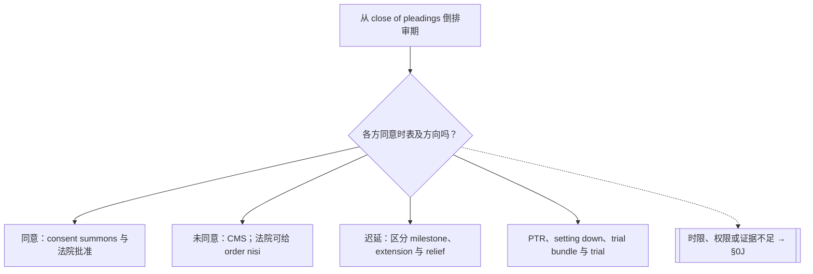
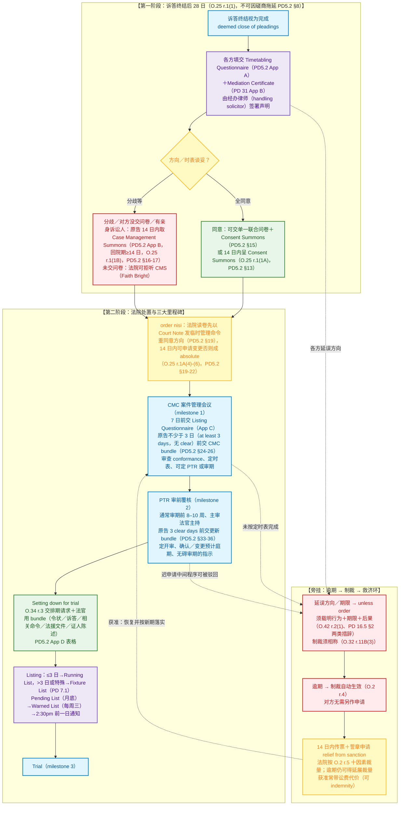
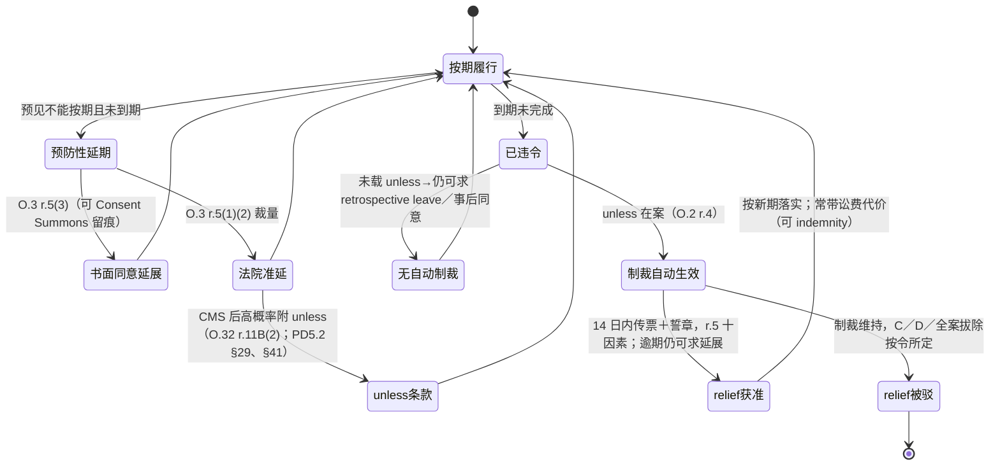
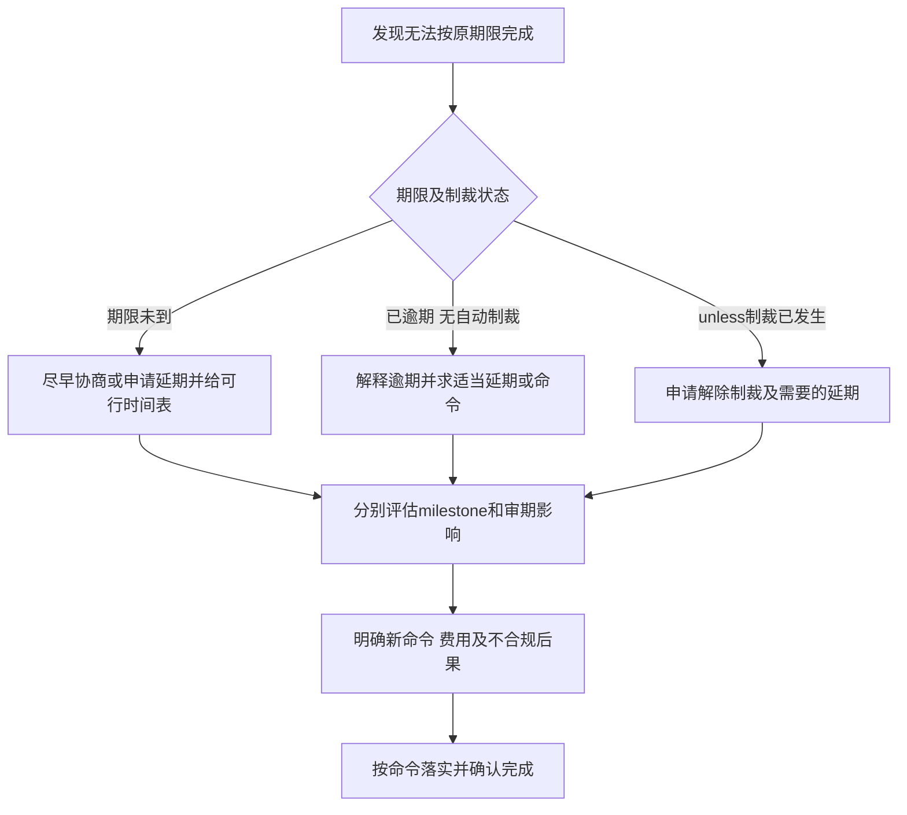
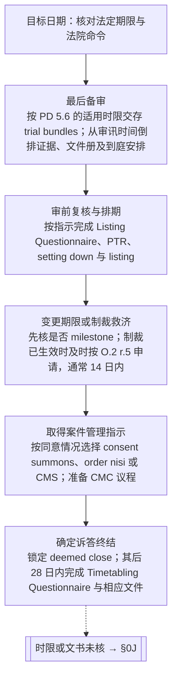

# 案件管理与审讯组织体系

## 速读定位层

> 本篇为案件管理与审讯组织全周期速读定位导引。各层具体规则、准入条件、例外与权威引注见下方 §0A 既有条文梳理与 §0B–§0H 各专题专章。

### 适用范围

**覆盖（按程序时序）**——自诉答终结（deemed close of pleadings）到审讯开审与判令基础的完整“案件管理 → 开审”链：
1. **诉答终结后 28 日**：排期问卷（Timetabling Questionnaire）＋调解证明（Mediation Certificate）的交换时限、逐栏填写逻辑（A–O 全栏目）、无意填表的后果；。 <small style="opacity: 0.55">〔CL11M L179 "each and every party shall complete a Timetabling Questionnaire (as set out in Appendix A"〕</small>
2. **方向（Directions）与时表（Timetable）的确定**：书面同意 → Consent Summons（联合单一问卷亦可）／分歧 → Case Management Summons（CMS）／法院书面临时命令 order nisi 与 14 日变更窗口；。 <small style="opacity: 0.55">〔CL11M L311 "by an order nisi (i.e. a temporary order made in writing by way of a Court Note"〕</small>
3. **三大里程碑（milestone dates）**：CMC → PTR → Trial，各自文件要求、出席资格、缺席后果、更改门槛（exceptional circumstances）；。 <small style="opacity: 0.55">〔CL11M L169 "There are only 3 “milestone dates”: Case Management Conference, Pre-Trial Review and Trial"〕</small>
4. **延期（Extension of Time）三渠道**：法院命令（可追溯 retrospective leave）、书面同意（无需命令）、缩短（abridgement），及其裁量架构（The Decurion／Zida）；。 <small style="opacity: 0.55">〔CL11M L565 "although the application for extension is not made until after the expiration of that period"〕</small>
5. **逾期后果谱系**：unless order（形式要件 O.42 r.2(1)＋PD 16.5 两类措辞）→ 制裁自动生效（O.2 r.4）→ relief from sanctions（14 日窗口＋十因素）→ 恢复或维持；。 <small style="opacity: 0.55">〔CL11M L679 "any sanction for failure to comply imposed by the rule or court order has effect unless the party in default applies"〕</small>
6. **审讯组织**：PTR 四动作、Certificate of Counsel 审期估算、setting down 与两组审讯清单（Running List／Fixture List／Warned List）、trial bundles 规格（A–E／250 页／72 小时）、审讯当日证据与缺席处理、O.37 损害评定；。 <small style="opacity: 0.55">〔CL15 L120 "a pre-trial review (“PTR”) will be held, in particular for “Fixture List” cases"〕</small>
7. **攻防与 SG 应用**：问卷填写的策略含义、制裁文化与和解压力、SG04 排期问卷 Exercise 逐栏映射、SG6/9/10 挂接、材料矩阵与 open 待补（见本卡 0G／0H／文末 open 块）。

**不覆盖（边界声明，相关主卡承担）**：① 诉答文书的起草与剔除、修改（→ [CO04-05 诉答卡](./%5BCO04-05-10%5D%20Pleadings,%20Defence,%20Counterclaims%20and%20Third%20Party%20Proceedings.md)）；② 传票／非正审申请／讼费担保本身的起草细则与 O.42 命令起草—审批—盖印全流（→ [CO07 传票卡](./%5BCO07%5D%20Drafting%20Summonses,%20Interlocutory%20Applications,%20Orders%20&%20Security%20for%20Costs.md)§3.3；本卡只在 OE.7 作交叉）；③ 披露与证人陈述、专家报告的规则主体（→ [CO08 证据准备卡](%5BCO08%5D%20Evidence%20Preparation%20System%20-%20Discovery%20Witnesses%20and%20Experts.md)；本卡只引接口）；④ 临时救济（→ [CO13 临时救济卡](%5BCO13%5D%20Interim%20Relief%20and%20Risk%20Protection%20System.md)）；⑤ 证人传唤文件（writ of subpoena）——本届材料仅见 O.37 评定一只，已登记文末 open 块待补，不臆造。

### 术语

| 术语 | 定义与章节 |
| --- | --- |
| 排期问卷（Timetabling Questionnaire） | 诉答终结后的推进时表规划文件：当诉答程序视为终结后 28 天内，各方当事人必须依据 PD 5.2 附录 A 表格（Appendix A）填写推进诉讼的具体建议时限；向法庭交存并送达其他各方当事人。 O.25 r.1(1) [§0C](#0C.%20Timetabling%20Questionnaire%20%E9%80%90%E6%A0%8F%E5%A1%AB%E5%86%99%E9%80%BB%E8%BE%91)。 <small style="opacity: 0.55">〔CL11M L179 "each and every party shall complete a Timetabling Questionnaire (as set out in Appendix A"〕</small> |
| 调解证明（Mediation Certificate） | 与排期问卷同时入禀的 PD 31 Appendix B 表格，由律师签署确认已向当事人解释调解可及性与费用对比，并载明当事人是否愿意尝试调解及理由。 PD 31 [§0B](#0B.%20%E6%A1%88%E4%BB%B6%E7%AE%A1%E7%90%86%E6%80%BB%E6%A1%86%E6%9E%B6%EF%BC%9A%E4%B8%89%E6%96%87%E4%B9%A6%E3%80%81%E4%B8%A4%E4%BC%9A%E8%AE%AE%E3%80%81%E4%B8%89%E9%87%8C%E7%A8%8B%E7%A2%91)。 <small style="opacity: 0.55">〔CL11M L211 "shall file in Court a Mediation Certificate (as set out in Appendix B of PD 31)"；CL11M L215 "the party has to certify whether he is willing to attempt mediation"〕</small> |
| 同意传票（Consent Summons） | 方向或时表全部谈妥时，由原告在收到全部被告问卷后 14 日内（或期限届满时）呈交法院审批的程序文书，载明各方同意的方向。 O.25 r.1(1A)；PD 5.2 §13 [§0B](#0B.%20%E6%A1%88%E4%BB%B6%E7%AE%A1%E7%90%86%E6%80%BB%E6%A1%86%E6%9E%B6%EF%BC%9A%E4%B8%89%E6%96%87%E4%B9%A6%E3%80%81%E4%B8%A4%E4%BC%9A%E8%AE%AE%E3%80%81%E4%B8%89%E9%87%8C%E7%A8%8B%E7%A2%91)。 <small style="opacity: 0.55">〔CL11M L275 "procure and file a Consent Summons containing the agreed Directions or Timetable for the Court’s consideration"〕</small> |
| 案件管理传票（Case Management Summons，CMS） | 时表未达成合意时的法定管理传票：若各方就审理方向或推进时表存在分歧（或被告未交问卷、案涉亲身诉讼人），则原告须在 14 天内依据 PD 5.2 附录 B 发出传票，回院期不少于 14 天；**其性质为程序申请文书，绝非开庭进行的 CMC 会议**。 O.25 r.1(1B)；PD 5.2 §16–18 [§0B](#0B.%20%E6%A1%88%E4%BB%B6%E7%AE%A1%E7%90%86%E6%80%BB%E6%A1%86%E6%9E%B6%EF%BC%9A%E4%B8%89%E6%96%87%E4%B9%A6%E3%80%81%E4%B8%A4%E4%BC%9A%E8%AE%AE%E3%80%81%E4%B8%89%E9%87%8C%E7%A8%8B%E7%A2%91)。 <small style="opacity: 0.55">〔CL11M L295 "take out a summons (referred to as a Case Management Summons) (as set out in Appendix B"；CL15AX L80 "the plaintiff shall take out a case management summons"〕</small> |
| 暂准命令（order nisi） | 法院书面审查下达的附条件管理裁定：法院审阅排期问卷后无需开庭聆讯，以法庭便条（Court Note）形式径行批出的临时性指示；若任何一方在 14 天内未向法庭提出书面异议或变更申请，则该暂准命令自动转为最终生效的绝对命令（order absolute）。 O.25 r.1A(4)-(6)；PD 5.2 §19–22 [§0B](#0B.%20%E6%A1%88%E4%BB%B6%E7%AE%A1%E7%90%86%E6%80%BB%E6%A1%86%E6%9E%B6%EF%BC%9A%E4%B8%89%E6%96%87%E4%B9%A6%E3%80%81%E4%B8%A4%E4%BC%9A%E8%AE%AE%E3%80%81%E4%B8%89%E9%87%8C%E7%A8%8B%E7%A2%91)。 <small style="opacity: 0.55">〔CL11M L311 "by an order nisi (i.e. a temporary order made in writing by way of a Court Note"；CL11M L319 "failing which the order nisi and the directions therein becomes absolute (i.e. final)"〕</small> |
| 里程碑日期（milestone date） | 法院严格锁定的三大核心审判节点：法庭审讯时表中专指案件管理会议（CMC）、审前复核（PTR）及开审日（Trial）；除非当事人举证确立极端例外情况（exceptional circumstances），否则法庭一律严禁准许延期，当事人亦绝对不得以协议形式私自变更。 O.25 r.1B(8)、(2)(3) [§0B](#0B.%20%E6%A1%88%E4%BB%B6%E7%AE%A1%E7%90%86%E6%80%BB%E6%A1%86%E6%9E%B6%EF%BC%9A%E4%B8%89%E6%96%87%E4%B9%A6%E3%80%81%E4%B8%A4%E4%BC%9A%E8%AE%AE%E3%80%81%E4%B8%89%E9%87%8C%E7%A8%8B%E7%A2%91)。 <small style="opacity: 0.55">〔CL11M L169 "There are only 3 “milestone dates”: Case Management Conference, Pre-Trial Review and Trial"；CL11M L171 "Milestone dates can only be varied in exceptional circumstances"〕</small> |
| 非里程碑日期（non-milestone date） | 可依法合意微调的中间准备期限：审理时表中除三大核心里程碑外的一切期限（如文件开示、证人陈述书交换）；当事人可依规以书面同意或传票申请调整，但证人证言交换须经法庭认可且调整绝不得拖延审期。 O.25 r.1B(4)-(7) [§0D](#0D.%20Extension%20of%20Time%EF%BC%9AO.3%20r.5%20%E7%9A%84%E4%B8%89%E6%B8%A0%E9%81%93%E3%80%81%E8%A3%81%E9%87%8F%E6%9E%B6%E6%9E%84%E4%B8%8E%E9%80%BE%E6%9C%9F%E5%90%8E%E6%9E%9C%E8%B0%B1%E7%B3%BB)。 <small style="opacity: 0.55">〔CL11M L543 "All other dates or period fixed by the Court (i.e. not the milestone dates) are “non-milestone dates”"；CL11M L553 "the Court will not grant such an application if it changes a trial date or trial period (O.25 r.1B(7))"〕</small> |
| 案件管理会议（CMC） | 法院按先定时表召开的备审管理聆讯（第一阶段通常由聆案官主持），核查各方 conformance、定后续时表、可定 PTR 或审期；其日期属于里程碑。 O.25；PD 5.2 §23–32 [§0B](#0B.%20%E6%A1%88%E4%BB%B6%E7%AE%A1%E7%90%86%E6%80%BB%E6%A1%86%E6%9E%B6%EF%BC%9A%E4%B8%89%E6%96%87%E4%B9%A6%E3%80%81%E4%B8%A4%E4%BC%9A%E8%AE%AE%E3%80%81%E4%B8%89%E9%87%8C%E7%A8%8B%E7%A2%91)。 <small style="opacity: 0.55">〔CL11M L461 "review the parties’ preparation of the case for trial (especially their compliance with Court directions)"；CL11M L415 "The date fixed for a Case Management Conference is a “milestone date” (O.25 r.1B (8))"〕</small> |
| 排期审讯问卷（Listing Questionnaire） | CMC（或 PTR）前不少于 7 日交存的 PD 5.2 Appendix C 表格，逐项确认备审是否就绪（A1–A19），并附审期估算与语言／传译需求。 PD 5.2 §24–25 [§0B](#0B.%20%E6%A1%88%E4%BB%B6%E7%AE%A1%E7%90%86%E6%80%BB%E6%A1%86%E6%9E%B6%EF%BC%9A%E4%B8%89%E6%96%87%E4%B9%A6%E3%80%81%E4%B8%A4%E4%BC%9A%E8%AE%AE%E3%80%81%E4%B8%89%E9%87%8C%E7%A8%8B%E7%A2%91)。 <small style="opacity: 0.55">〔CL11M L423 "each party shall file and serve their Listing Questionnaire (as set out in Appendix C of PD 5.2)"〕</small> |
| 审前覆核（PTR） | 通常在审期前 8–10 周、由主审法官主持的覆核，预期案件已可开审；定开审日起、确认或变更预计庭期、作不影响审期的补充指示；里程碑之二。 PD 5.2 §33–36 [§0F](#0F.%20%E5%AE%A1%E8%AE%AF%E7%BB%84%E7%BB%87%EF%BC%9APTR%20%E2%86%92%20Setting%20Down%20%E2%86%92%20Listing%20%E2%86%92%20Trial%20Bundles%20%E2%86%92%20%E5%BD%93%E6%97%A5%20%E2%86%92%20O.37)。 <small style="opacity: 0.55">〔CL11M L479 "normally about 8 to 10 weeks before the trial date (para 33 of PD 5.2)"；CL11M L491 "late interlocutory applications may be dismissed on the basis of delay alone"〕</small> |
| 大律师估算证书（Certificate of Counsel） | 由拟出庭大律师（或经办律师）就己方开案陈词、各己方证人主问、盘问对方证人、结案陈词四段分别作的时间估算证明。 PD 5.2 §14、§25 [§0F](#0F.%20%E5%AE%A1%E8%AE%AF%E7%BB%84%E7%BB%87%EF%BC%9APTR%20%E2%86%92%20Setting%20Down%20%E2%86%92%20Listing%20%E2%86%92%20Trial%20Bundles%20%E2%86%92%20%E5%BD%93%E6%97%A5%20%E2%86%92%20O.37)。 <small style="opacity: 0.55">〔CL15 L122 "a document usually referred to as “Certificate of Counsel”"〕</small> |
| 除外令／若不遵守即受罚命令（unless order） | 附带自执行剥夺制裁的最终司法命令：法庭对违规拖延当事人下达的最后通牒命令；命令中明确载明：“除非某方在指定时限内履行特定程序步骤，否则无需法院另作命令，其诉状或抗辩书即被自动剔除（struck out）”。 O.1B r.1(3)；PD 16.5 [§0E](#0E.%20%E5%88%B6%E8%A3%81%E4%B8%8E%20Relief%20from%20Sanctions%EF%BC%9A%E8%87%AA%E5%8A%A8%E7%94%9F%E6%95%88%E5%BC%95%E6%93%8E%E4%B8%8E%2014%20%E6%97%A5%E8%A1%A5%E6%95%91%E7%AA%97%E5%8F%A3)。 <small style="opacity: 0.55">〔CL11M L637 "the sanction imposed in the order will automatically take effect upon failure to comply within the time"〕</small> |
| 制裁宽免（relief from sanctions） | 自执行制裁生效后的司法宽免救济：当 unless order 设定的自执行制裁生效后，违令方必须在违规后 14 天内以传票及支持誓章向法院申请解除制裁；法院依据 RHC O.2 r.5 综合权衡十项法定因素行使自由裁量权。 O.2 rr.4–5 [§0E](#0E.%20%E5%88%B6%E8%A3%81%E4%B8%8E%20Relief%20from%20Sanctions%EF%BC%9A%E8%87%AA%E5%8A%A8%E7%94%9F%E6%95%88%E5%BC%95%E6%93%8E%E4%B8%8E%2014%20%E6%97%A5%E8%A1%A5%E6%95%91%E7%AA%97%E5%8F%A3)。 <small style="opacity: 0.55">〔CL11M L681 "once a breach of the unless order occurs, the only recourse is to apply for relief from sanction"〕</small> |
| 时限传票（Time Summons） | 专门申请延长（或缩短）期限的时间传票，列聆案官内庭 3 分钟单；事务律师 trainee 有出庭权；通常不要求支持誓章，但事实复杂者宜备。 O.3 r.5 [§0D](#0D.%20Extension%20of%20Time%EF%BC%9AO.3%20r.5%20%E7%9A%84%E4%B8%89%E6%B8%A0%E9%81%93%E3%80%81%E8%A3%81%E9%87%8F%E6%9E%B6%E6%9E%84%E4%B8%8E%E9%80%BE%E6%9C%9F%E5%90%8E%E6%9E%9C%E8%B0%B1%E7%B3%BB)。 <small style="opacity: 0.55">〔CL11M L729 "A summons only seeking for extension of time are often referred to as “Time Summons”"；CL11M L733 "trainee solicitors has the right of audience"〕</small> |
| 排期审讯令（setting down） | 向司法常务官正式交付排期审讯的法定程序：当事人依据 RHC O.34 r.3 交付排期审讯请求并提交法官专用卷宗；经由填写 PD 5.2 附录 D 表格（Appendix D）向法庭正式确定正审开庭期日。 O.34 rr.2–3 [§0F](#0F.%20%E5%AE%A1%E8%AE%AF%E7%BB%84%E7%BB%87%EF%BC%9APTR%20%E2%86%92%20Setting%20Down%20%E2%86%92%20Listing%20%E2%86%92%20Trial%20Bundles%20%E2%86%92%20%E5%BD%93%E6%97%A5%20%E2%86%92%20O.37)。 <small style="opacity: 0.55">〔CL15 L206 "The request for setting down is done by filing Appendix D as attached to PD 5.2."；CL15 L210 "must deliver to the Registrar, by post or otherwise, a request that the action may be set down for trial"〕</small> |
| 流动审讯单（Running List） | 预计庭期 3 日或以下的短案进入的审讯名单，无定日；案件在备妥后才会被放入 Warned List。 PD 7.1 [§0F](#0F.%20%E5%AE%A1%E8%AE%AF%E7%BB%84%E7%BB%87%EF%BC%9APTR%20%E2%86%92%20Setting%20Down%20%E2%86%92%20Listing%20%E2%86%92%20Trial%20Bundles%20%E2%86%92%20%E5%BD%93%E6%97%A5%20%E2%86%92%20O.37)。 <small style="opacity: 0.55">〔CL15 L262 "A Running List case is one with an estimated length of trial of 3 days or less"；CL15AX L298 "will be assigned to and set down in the Running List"〕</small> |
| 定期审讯单（Fixture List） | 预计庭期较长、案情较复杂（或有无律师当事人的区院案件）进入的名单，设有固定审讯日期。 PD 7.1 [§0F](#0F.%20%E5%AE%A1%E8%AE%AF%E7%BB%84%E7%BB%87%EF%BC%9APTR%20%E2%86%92%20Setting%20Down%20%E2%86%92%20Listing%20%E2%86%92%20Trial%20Bundles%20%E2%86%92%20%E5%BD%93%E6%97%A5%20%E2%86%92%20O.37)。 <small style="opacity: 0.55">〔CL15 L268 "A Fixture List case is one where the court has determined at the setting down stage"〕</small> |
| 被警示名单（Warned List） | 每周三从 Pending List 摘录、可于下周起随时开审的名单；入单案件须能随时开审。 PD 7.1 §4 [§0F](#0F.%20%E5%AE%A1%E8%AE%AF%E7%BB%84%E7%BB%87%EF%BC%9APTR%20%E2%86%92%20Setting%20Down%20%E2%86%92%20Listing%20%E2%86%92%20Trial%20Bundles%20%E2%86%92%20%E5%BD%93%E6%97%A5%20%E2%86%92%20O.37)。 <small style="opacity: 0.55">〔CL15AX L306 "will be extracted from the Pending List and put in another list – the Warned List"〕</small> |
| 审讯文件册（trial bundle） | 按类别分套的审讯用文件夹（A 法庭文书／B 证人陈述／C 专家报告／D 披露文件／E 函件），每册不超 250 页，开庭前 72 小时交存。 PD 5.6 [§0F](#0F.%20%E5%AE%A1%E8%AE%AF%E7%BB%84%E7%BB%87%EF%BC%9APTR%20%E2%86%92%20Setting%20Down%20%E2%86%92%20Listing%20%E2%86%92%20Trial%20Bundles%20%E2%86%92%20%E5%BD%93%E6%97%A5%20%E2%86%92%20O.37)。 <small style="opacity: 0.55">〔CL15 L230 "The “trial bundles” will normally be divided by letter categories"；CL15AX L276 "at least 72 hours before the date fixed for the hearing (excluding Saturdays, Sundays and general holidays)"〕</small> |


### 环节定位

| 环节 | 实际操作 |
| --- | --- |
| 诉答终结 → 28 日内交换问卷 | 防止案件在 pleadings 后停滞：法院须在无人催办下取得"各方拟怎样推进"的结构化信息，同时锁定调解立场。 O.25 r.1(1)。 <small style="opacity: 0.55">〔CL11M L185 "The purpose of a Timetabling Questionnaire is to enable the Court to give directions relating to management"〕</small> |
| 同意 → Consent Summons | 双方都同意的方向如何变成有效命令：无需开庭呈请法院批准，但法院**不是橡皮图章**（见 0B.3 Li Shiu To 例）。 PD 5.2 §13–15。 <small style="opacity: 0.55">〔CL11M L317 "it will give great weight to the parties’ agreed directions"〕</small> |
| 分歧 → CMS | 谈不拢时谁把案件推回法院：由原告先取，经 PD 5.2 §16 时窗；原告不取，被告可取 CMS 或申请驳回（O.25 r.1(4)）。 O.25 r.1(1B)(4)。 <small style="opacity: 0.55">〔CL11M L303 "If the Plaintiff does not take out a Case Management Summons, the Defendant may (a) take out"〕</small> |
| order nisi | 如何在不开会的情况下先给方向、又保留 14 日异议窗：避免一项项方向都开 3 分钟单。 O.25 r.1A。 <small style="opacity: 0.55">〔CL11M L321 "The Court shall, on an application to vary the order nisi, hear the Case Management Summons (O.25 r.1A(6))"〕</small> |
| CMC | 把"纸面时表"转成"实际备审"的检查点：法院核对 predisposition 进展、把未决事项收口、定 PTR／审期。 PD 5.2 §32。 <small style="opacity: 0.55">〔CL11M L467 "adjourn the Case Management Conference to another date, or fix a date for the Pre-Trial Review"〕</small> |
| 逾期 → unless order | 常规期限的执行力：以"不遵守即自动自决式制裁"改变守期激励，而非靠法院事后逐项追讨。 O.1B r.1(3)。 <small style="opacity: 0.55">〔CL11M L643 "Such order can be made upon application by a party, by consent of the party, or of the court’s own motion under O.1B r.2."〕</small> |
| 违令 → relief | 制裁生效后唯一的回头路：在 14 日窗口内用证据解释违约，并接受费用代价。 O.2 rr.4–5。 <small style="opacity: 0.55">〔CL11M L685 "Evidence in support (normally in the form of affidavit) of the application is expressed required by O.2 r.5(2)"〕</small> |
| PTR | 排审讯前的最后校正：定开审日起、核对 Certificate of Counsel 估算并作无碍审期的补充指示。 PD 5.2 §33–36。 <small style="opacity: 0.55">〔CL11M L493 "fix the starting date for the trial (para 36(1) PD 5.2)"〕</small> |
| setting down → listing | 案件如何占用司法资源：短案进 Running List 随时被 warn、长案进 Fixture List 定日，名单与成本挂钩。 PD 7.1。 <small style="opacity: 0.55">〔CL15 L264 "will not be “warned” (i.e. placed on the Warned List) until the court is satisfied that all preparatory steps have been completed"〕</small> |
| trial bundles | 让法官在庭上 30 秒翻到证据：分套、编页、按类别、限页数、提早交存。 PD 5.6。 <small style="opacity: 0.55">〔CL15AX L262 "arranged in chronological order from the front"〕</small> |


## 🗺️ 本卡地图



法院先固定案件时表和 milestone dates。各方预见迟延时须核延期渠道；制裁已生效时须申请 relief from sanctions。获准排期后再倒排 PTR、文件册与证人到庭。

| 任务 | 直达 |
| --- | --- |
| 案件管理总框架：三文书、两会议、三里程碑 | [§0B](#0B.%20%E6%A1%88%E4%BB%B6%E7%AE%A1%E7%90%86%E6%80%BB%E6%A1%86%E6%9E%B6%EF%BC%9A%E4%B8%89%E6%96%87%E4%B9%A6%E3%80%81%E4%B8%A4%E4%BC%9A%E8%AE%AE%E3%80%81%E4%B8%89%E9%87%8C%E7%A8%8B%E7%A2%91) |
| Timetabling Questionnaire 逐栏填写逻辑 | [§0C](#0C.%20Timetabling%20Questionnaire%20%E9%80%90%E6%A0%8F%E5%A1%AB%E5%86%99%E9%80%BB%E8%BE%91) |
| Extension of Time：O.3 r.5 的三渠道、裁量架构与逾期后果谱系 | [§0D](#0D.%20Extension%20of%20Time%EF%BC%9AO.3%20r.5%20%E7%9A%84%E4%B8%89%E6%B8%A0%E9%81%93%E3%80%81%E8%A3%81%E9%87%8F%E6%9E%B6%E6%9E%84%E4%B8%8E%E9%80%BE%E6%9C%9F%E5%90%8E%E6%9E%9C%E8%B0%B1%E7%B3%BB) |
| 制裁与 Relief from Sanctions：自动生效引擎与 14 日补救窗口 | [§0E](#0E.%20%E5%88%B6%E8%A3%81%E4%B8%8E%20Relief%20from%20Sanctions%EF%BC%9A%E8%87%AA%E5%8A%A8%E7%94%9F%E6%95%88%E5%BC%95%E6%93%8E%E4%B8%8E%2014%20%E6%97%A5%E8%A1%A5%E6%95%91%E7%AA%97%E5%8F%A3) |
| 审讯组织：PTR → Setting Down → Listing → Trial Bundles → 当日 → O.37 | [§0F](#0F.%20%E5%AE%A1%E8%AE%AF%E7%BB%84%E7%BB%87%EF%BC%9APTR%20%E2%86%92%20Setting%20Down%20%E2%86%92%20Listing%20%E2%86%92%20Trial%20Bundles%20%E2%86%92%20%E5%BD%93%E6%97%A5%20%E2%86%92%20O.37) |
| 攻防与暗礁：问卷的策略含义与制裁文化 | [§0G](#0G.%20%E6%94%BB%E9%98%B2%E4%B8%8E%E6%9A%97%E7%A4%81%EF%BC%9A%E9%97%AE%E5%8D%B7%E7%9A%84%E7%AD%96%E7%95%A5%E5%90%AB%E4%B9%89%E4%B8%8E%E5%88%B6%E8%A3%81%E6%96%87%E5%8C%96) |
| 文书与期限倒排 | [§0H](#0H.%20%E7%94%B3%E8%AF%B7%E4%B8%8E%E6%93%8D%E4%BD%9C%E5%B7%A5%E7%A8%8B%EF%BC%9A%E6%96%87%E4%B9%A6%E3%80%81%E9%80%81%E8%BE%BE%E5%92%8C%E6%9C%9F%E9%99%90) |
| 提交前核对 | [§0I](#0I.%20%E6%94%BB%E9%98%B2%E4%B8%8E%E6%89%A7%E8%A1%8C%E5%89%8D%E6%A0%B8%E5%AF%B9) |
| 失误、制裁与补救 | [§0J](#0J.%20%E7%A8%8B%E5%BA%8F%E5%A4%B1%E8%AF%AF%E5%8F%8A%E5%85%B6%E5%90%8E%E6%9E%9C) |
| SG 实务应用 | [§0K](#0K.%20SG%20%E5%AE%9E%E5%8A%A1%E5%BA%94%E7%94%A8%E4%B8%8E%E5%AF%BC%E5%B8%88%E5%8F%A3%E5%BE%84) |

#### 核心参数与计算口径
- **排期问卷法定提交死线（Timetabling Questionnaire - O.25 r.1(1)）**：诉答完结（close of pleadings）后 **28 天内**，各方须入禀并向其他各方送达 PD 5.2 Appendix A 的 Timetabling Questionnaire。
- **书面延期与 milestone dates（O.3 r.5(3)；RHC O.25 r.1B）**：适用 O.3 r.5(3) 的文件期限可经书面同意延期；法院指定的 O.38 r.2A witness statements 交换期限排除这一渠道。CMC、PTR、trial 或已固定的 trial period 只能由法院在 exceptional circumstances 下变更。
- **除非命令自动生效与制裁救济（Unless Order & Relief from Sanctions - O.2 r.4 / PD 5.2 ¶44）**：违反 Unless Order 之违约方，其诉状被剔除或判决生效自动发生；违约方必须在未遵令之日起 **14 天内**发出传票申请 Relief from Sanctions。
- **审前复核（PTR）与审讯文件册（Trial Bundles under PD 5.6）**：
  ① 审前复核（PTR）：通常在正审前 8–10 周召开；
  ② 申请排期开审（Setting Down under O.34 r.2）：按法院的许可与命令期限入禀并缴费；
  ③ 审讯文件册（Trial Bundles）：负责一方须依 PD 5.6 §8 在聆讯前至少 72 小时向法庭交存 trial bundles；不计周六、周日及公众假期。

<!-- BEGIN:cite-legend -->
> [!info]- 引注图例
> 
> | 码 | 文件 | 层级 | 学年 |
> |---|---|---|---|
> | CL12 | [LG12 证人陈述与专家](../../99%20Moodle%20Mirror/Lecture%20Outlines,%20Powerpoints%20&%20Materials/LG12%20Witness%20Statements%20and%20Expert%20Reports/LG12%20-%20Witness%20Statements%20and%20Expert%20Reports.md) | 本届讲义 | 2026-27 |
> | CL15 | [LG15 审讯准备和程序](../../04%20Base%20Lectures/00%20This%20Year%20Moodle%202026-27/Lecture%20Outlines,%20Powerpoints%20&%20Materials/LG15%20-%20Trial%20Preparation%20Trial%20Procedure.md) | 本届讲义 | 2026-27 |
> | CL15S1 | [本届课堂幻灯·CL LG15 1-2（Trial Preparation）](../../04%20Base%20Lectures/00%20This%20Year%20Moodle%202026-27/Lecture%20Outlines,%20Powerpoints%20&%20Materials/CL%20LG15%202026-2027%201-2.md) | 本届讲义 | 2026-27 |
> | CL15S2 | [本届课堂幻灯·CL LG15 2-2（Trial Procedure）](../../04%20Base%20Lectures/00%20This%20Year%20Moodle%202026-27/Lecture%20Outlines,%20Powerpoints%20&%20Materials/CL%20LG15%202026-2027%202-2.md) | 本届讲义 | 2026-27 |
> | CL15AX | [本届 LG15 Annex（PD 5.2／5.6／7.1／16.1／21.1／27 全文附载）](../../04%20Base%20Lectures/00%20This%20Year%20Moodle%202026-27/Lecture%20Outlines,%20Powerpoints%20&%20Materials/CL%20LG15%20Trial%20Prep%20-%20Annex.md) | 本届讲义 | 2026-27 |
> | CAP-C15 | [8010_LG15_PT_51238ed8.md](../../99%20Moodle%20Mirror/Lecture%20Outlines,%20Powerpoints%20&%20Materials/LG15%20-%20Trial%20Prep%20&%20Procedure/Panopto%20Captions%20%28local%20export%29/8010_LG15_PT_51238ed8.md) | 本届讲义 | 2026-27 |
> | CL7 | [LG7 中间申请和讼费担保](../../04%20Base%20Lectures/00%20This%20Year%20Moodle%202026-27/Lecture%20Outlines,%20Powerpoints%20&%20Materials/LG7%20-%20Drafting%20Summonses.%20Interlocutory%20Applications,%20Security%20for%20Costs.md) | 本届讲义 | 2026-27 |
> | CL8 | [LG8 Discovery](../../04%20Base%20Lectures/00%20This%20Year%20Moodle%202026-27/Lecture%20Outlines,%20Powerpoints%20&%20Materials/LG8%EF%BC%9A%20Discovery/LG8%20Discovery%20Lecture%20Outline.md) | 本届讲义 | 2026-27 |
> | CAP-C7 | [PCLL8010 LG7 PT](../../99%20Moodle%20Mirror/Lecture%20Outlines,%20Powerpoints%20&%20Materials/LG7%20-%20Drafting%20Summonses.%20Interlocutory%20Applications,%20Security%20for%20Costs/Panopto%20Captions%20%28local%20export%29/8010_LG07_PT.md) | 本届讲义 | 2026-27 |
> | CAP-C9 | [PCLL8010 LG9 PT](../../99%20Moodle%20Mirror/Lecture%20Outlines,%20Powerpoints%20&%20Materials/LG9%20-%20Summary%20Judgment%20&%20Interim%20Payment/Panopto%20Captions%20%28local%20export%29/8010_LG09_PT.md) | 本届讲义 | 2026-27 |
> | CL11 | [1. LG11 LECTURE OUTLINE (2026-2027)](../../99%20Moodle%20Mirror/Lecture%20Outlines,%20Powerpoints%20&%20Materials/1.%20LG11%20LECTURE%20OUTLINE%20%282026-2027%29.docx) | 本届讲义 | 2026-27 |
> | CL11M | [1. LG11 LECTURE OUTLINE (2026-2027)（04 Base 伴生 md，756 行，本卡新引均用其行号）](../../04%20Base%20Lectures/00%20This%20Year%20Moodle%202026-27/Lecture%20Outlines,%20Powerpoints%20&%20Materials/1.%20LG11%20LECTURE%20OUTLINE%20%282026-2027%29.md) | 本届讲义 | 2026-27 |
> | CL11T | [LG11 本届课堂录音转录（Otter 合并稿：8010_LG11_PT_Otter_Transcript_Combined.md，209 行；William Jones 执教，2026-10-09 晚堂）](../../04%20Base%20Lectures/00%20This%20Year%20Moodle%202026-27/Lecture%20Outlines,%20Powerpoints%20&%20Materials/LG11%20-%20Case%20Management%20and%20Extension%20of%20Time/8010_LG11_PT_Otter_Transcript_Combined.md) | 本届讲义 | 2026-27 |
> | APPA | [本届 PD 5.2 Appendix A 排期问卷表伴生 md](../../04%20Base%20Lectures/00%20This%20Year%20Moodle%202026-27/Lecture%20Outlines,%20Powerpoints%20&%20Materials/PD5.2_App_A_V2%20Timetabling%20Questionnaire.md) | 本届讲义 | 2026-27 |
> | APPB | [本届 PD 5.2 Appendix B Case Management Summons 样本伴生 md](../../04%20Base%20Lectures/00%20This%20Year%20Moodle%202026-27/Lecture%20Outlines,%20Powerpoints%20&%20Materials/PD5.2_App_B%20Case%20Management%20Summons.md) | 本届讲义 | 2026-27 |
> | APPC | [本届 PD 5.2 Appendix C 排期审讯问卷表伴生 md](../../04%20Base%20Lectures/00%20This%20Year%20Moodle%202026-27/Lecture%20Outlines,%20Powerpoints%20&%20Materials/PD5.2_App_C_V2%20Listing%20Questionnaire.md) | 本届讲义 | 2026-27 |
> | APPD | [本届 PD 5.2 Appendix D Setting Down for Trial 表伴生 md](../../04%20Base%20Lectures/00%20This%20Year%20Moodle%202026-27/Lecture%20Outlines,%20Powerpoints%20&%20Materials/PD5.2_App_D%20Setting%20Down%20for%20Trial.md) | 本届讲义 | 2026-27 |
> | OLD-LG11O | [往届（2025-26）LG11 Case Management & EOT 讲义大纲（717 行·含 O.1B 权力例示与 CMC 缺席后果）](../../04%20Base%20Lectures/%5BLG11%5D%20Case%20Management%20and%20Extension%20of%20Time/LG11%20Case%20Management%20and%20EOT%20Lecture%20Outline.md) | 往届官方 | 2025-26 |
> | OLD-LG11S | [往届（2025-26）LG11 课堂幻灯伴生 md（564 行）](../../04%20Base%20Lectures/%5BLG11%5D%20Case%20Management%20and%20Extension%20of%20Time/LG11%20Case%20Management%20and%20EoT.md) | 往届官方 | 2025-26 |
> | OLD-LG11TQ | [往届（2025-26）LG11 夹排期问卷范本（与本届 App A 自 L11 起逐行全同）](../../04%20Base%20Lectures/%5BLG11%5D%20Case%20Management%20and%20Extension%20of%20Time/Timetabling%20Questionnaire.md) | 往届官方 | 2025-26 |
> | OLD-SET3L11 | [往届学生稿·Set 3「LG11 case management」（1213 行·非官方）](../../06%20Base%20Exam%20Notes/Set%203/LG11%20case%20management.md) | 往届学生稿 | 2025-26 |
> | OLD-SET3L15 | [往届学生稿·Set 3「LG15 Trial Preparation」（663 行·非官方）](../../06%20Base%20Exam%20Notes/Set%203/LG15%20Trial%20Preparation.md) | 往届学生稿 | 2025-26 |
> | SG4TQ | [本届 SG04 Exercise 1—Contract Case 排期问卷完整填报稿（含逐栏依据）](../../01%20SG/SG04%20Drafting%20SoC%20II%20-%20Negligence/01%20Exercise%201%20-%20Timetabling%20Questionnaire.md) | 凝结层 | 2026-27 |
> | SG4CD | [本届 SG04 主控「00 Classroom & Desk」（任务总览与大作业 DDL）](../../01%20SG/SG04%20Drafting%20SoC%20II%20-%20Negligence/00%20Classroom%20&%20Desk.md) | 凝结层 | 2026-27 |


> | SG4AP | [本届 SG4 Activity Plan（SG04 原任务书）](../../04%20Base%20Lectures/00%20This%20Year%20Moodle%202026-27/Small%20Group%20Activity%20Plans/SG4%20Activity%20Plan%20.md) | 本届官方 | 2026-27 |
> | LG11UP | [本届Updated Word修订阅读核对](obsidian://open?vault=3b1e77255f6c6e29&file=output%2Fresearch%2FCivil%20Litigation%20LG11%20Updated%20Tracked%20Changes%20Verification%20-%202026-10-23.md) | 本层自拟 | 2026-27 |
<!-- END:cite-legend -->

## 0B. 案件管理总框架：三文书、两会议、三里程碑

> **核心推进主线**：**诉答终结（deemed close of pleadings）→ 排期问卷（28 日）→ Consent Summons／Case Management Summons（14 日）→ order nisi（14 日窗口）→ CMC → PTR → setting down → listing → trial**；旁挂：**逾期 → unless order → 自动制裁 → relief** 回路。主体依据为本届 LG11 大纲、本届 LG15 大纲＋Annex（内附 PD 5.2／5.6／7.1 全文）、往届 LG11 三件套（往届仅参考）与 Set 3 应试笔记（往届仅参考）。 <small style="opacity: 0.55">〔CL11M L23 "Lecture title | Case Management & Extension of Time"；CL11M L27 "Ophelia Chan on Case Management &  Sam Liu on Extension of Time"〕</small>

### 0B.1 全景状态机：从 pleadings 结案到开审，以及制裁—救济环



**图后依据（逐项）**：①28 日问卷＋调解证明同交；②磋商不得拖累交卷；③同意路径两形态；④分歧路径与 Faith Bright 门槛；⑤order nisi 与 14 日窗口；⑥CMC 文件与时点；⑦PTR 时点与动作；⑧setting down 与 bundle 清单；⑨Running／Fixture 分界；⑩制裁链。 <small style="opacity: 0.55">〔CL11M L159 "the Timetabling Questionnaire together with the Mediation Certificate shall be filed with the Court"；CL11M L211 "at the same time as the filing of the Timetabling Questionnaire (i.e. within 28 days after the deemed date of close of pleadings)"〕〔CL11M L181 "the process of consultation must not delay the filing of the Timetabling Questionnaire"；CL15AX L52 "the process of consultation must not delay the filing of the Timetabling Questionnaire"〕〔CL11M L263 "file a single set of Timetabling Questionnaire (still within 28 days after the deemed date of close of pleadings)"；CL15AX L64 "within 14 days after receiving the Timetabling Questionnaire from all defendants"〕〔CL11M L305 "the Court will decline to hear the Case Management Summons unless the Timetabling Questionnaire has been filed"；CL15AX L88 "the plaintiff (whether legally represented or not) must take out a case management summons for directions"〕〔CL11M L319 "failing which the order nisi and the directions therein becomes absolute (i.e. final)"；CL15AX L114 "the Court will make orders nisi giving case management directions and fix a timetable"〕〔CL11M L423 "At least 7 days before the Case Management Conference, each party shall file and serve their Listing Questionnaire"；CL11M L433 "At least 3 days before the Case Management Conference, the Plaintiff shall lodge the Case Management Conference bundle"〕〔CL11M L479 "normally about 8 to 10 weeks before the trial date (para 33 of PD 5.2)"；CL15 L142 "At the PTR, the Court will:"〕〔CL15 L206 "The request for setting down is done by filing Appendix D as attached to PD 5.2."；CL15 L210 "must deliver to the Registrar, by post or otherwise, a request that the action may be set down for trial"〕〔CL15 L262 "A Running List case is one with an estimated length of trial of 3 days or less"；CL15AX L298 "will be assigned to and set down in the Running List"〕〔CL11M L643 "Such order can be made upon application by a party, by consent of the party, or of the court’s own motion under O.1B r.2."；CL11M L679 "any sanction for failure to comply imposed by the rule or court order has effect unless the party in default applies"〕</small>

### 0B.2 文书链与时限链一览（28‑14‑7‑3 时限记忆）

| 文书／行为 | 时限（起算点 → 死线） | 表式／依据 | 性质与备注 |
| --- | --- | --- | --- |
| Timetabling Questionnaire（各方） | 诉答终结视为完成后 28 日内。 <small style="opacity: 0.55">〔CL11M L179 "each and every party shall complete a Timetabling Questionnaire (as set out in Appendix A"〕</small> | PD 5.2 App A。 <small style="opacity: 0.55">〔APPA L24 "urged to proceed with discovery without waiting for case management directions"〕</small> | 经办律师签署并声明答案真确；不可写"subject to counsel's advice"；不得改表式文字。 <small style="opacity: 0.55">〔APPA L36 "this questionnaire MUST be completed by the handling solicitor of this case"〕〔APPA L32 "reserving rights to take certain steps are NOT acceptable."〕〔APPA L40 "Parties are NOT allowed to change any wordings of this questionnaire"〕</small> |
| Mediation Certificate（各方） | 与问卷同时（28 日内）。 <small style="opacity: 0.55">〔CL11M L211 "shall file in Court a Mediation Certificate (as set out in Appendix B of PD 31)"〕</small> | PD 31 App B | 律师确认已解释调解与原讼费用对比、当事人确认理解；不乐意须给理由。 <small style="opacity: 0.55">〔CL11M L217 "the solicitor acting for the party has to confirm by signing that he explained to his client"〕</small> |
| 磋商方向／时表 | 交卷死线之前完成，但**不得拖延交卷**。 <small style="opacity: 0.55">〔CL15AX L52 "the process of consultation must not delay the filing of the Timetabling Questionnaire"〕</small> | PD 5.2 §8 | 原告在收齐对方问卷后仍有义务继续沟通争取一致。 <small style="opacity: 0.55">〔CL15AX L58 "The duty remains on him to communicate with the other parties with a view to agreeing the directions"〕</small> |
| Consent Summons（同意时） | 原告收到全部被告问卷后 14 日内，或对方交卷期届满时，取较早者。 <small style="opacity: 0.55">〔CL11M L275 "procure and file a Consent Summons containing the agreed Directions or Timetable for the Court’s consideration"〕</small> | O.25 r.1(1A)；PD 5.2 §13 | 拟求审期／审段者须附 Certificate of Counsel；联合单一问卷亦可行。 <small style="opacity: 0.55">〔CL15AX L66 "shall be attached to the consent summons referred to in paragraph 13 a certificate prepared by trial counsel"〕〔CL15AX L76 "filing a single set of Timetabling Questionnaire containing the joint views of the parties"〕</small> |
| Case Management Summons（分歧时） | 收到对方问卷后 14 日内，或交卷期满 28 日＋14 日内，取较早者；回院期不少于 14 日。 <small style="opacity: 0.55">〔CL11M L291 "within 14 days upon expiry of the period for the Defendant to file and serve a Timetabling Questionnaire"；CL11M L295 "take out a summons (referred to as a Case Management Summons) (as set out in Appendix B"〕</small> | O.25 r.1(1B)；PD 5.2 §16–18；PD 5.2 App B。 <small style="opacity: 0.55">〔APPB L16 "Parties to exchange all statements of factual witnesses within 28 days"〕</small> | 原告不取：被告可取 CMS，或申请驳回本案；法院亦可视之为 CMS 处置；有亲身诉讼人必须取。 <small style="opacity: 0.55">〔CL11M L303 "If the Plaintiff does not take out a Case Management Summons, the Defendant may (a) take out"〕〔CL15AX L88 "the plaintiff (whether legally represented or not) must take out a case management summons for directions"〕</small> |
| order nisi | 法院读卷后随时作出；14 日内无变更申请即成 absolute。 <small style="opacity: 0.55">〔CL11M L319 "failing which the order nisi and the directions therein becomes absolute (i.e. final)"〕</small> | O.25 r.1A(4)-(6)；PD 5.2 §19–22 | 申请变更 → 法院聆讯 CMS；就上诉人可用 relative 条款；课堂补充：master 纸面裁定以 court note **传真（fax）**送达律师行，且 14 日 vary 窗自命令作出日起算、**不以收到传真起算**。 <small style="opacity: 0.55">〔CL11M L321 "The Court shall, on an application to vary the order nisi, hear the Case Management Summons (O.25 r.1A(6))"〕〔CL11T L44 "The court might have faxed you the court note a day later."〕</small> |
| Listing Questionnaire（各方） | CMC 前不少于 7 日。 <small style="opacity: 0.55">〔CL11M L423 " At least 7 days before the Case Management Conference"〕</small> | PD 5.2 App C。 <small style="opacity: 0.55">〔APPC L20 "to be filed before Case Management Conference or Pre-Trial Review"〕</small> | 由经办律师签署；Section A 答 No 须于 Section B 解释；课堂口径：与 TQ 同样由 handling solicitor 填写、不得改 wording。 <small style="opacity: 0.55">〔APPC L38 "You MUST provide an explanation in Section B if you answer “No” to any of the questions"〕〔CL11T L68 "it should be filled in by the handling solicitor, and you're not allowed to change the wording"〕</small> |
| CMC bundle（原告） | CMC 前不少于 3 日（at least 3 days，**无 clear**）。 <small style="opacity: 0.55">〔CL11M L165 "at least 3 days before the Case Management Conference hearing, the Plaintiff shall lodge and serve the Case Management Conference bundle"；CL11M L433 "At least 3 days before the Case Management Conference, the Plaintiff shall lodge the Case Management Conference bundle"；CL11T L72 "at least three days before the case management conference"〕</small> | PD 5.2 §26 | 含诉答、证人陈述、专家报告、文件册草稿索引；其后 CMC／PTR 可更新重用、更新处须标示。 <small style="opacity: 0.55">〔CL11M L443 "should be updated and re-used at subsequent Case Management Conferences"；CL15AX L134 "should highlight the updated parts to assist the master or judge"〕</small> |
| PTR bundle（原告） | PTR 前不少于 3 clear days（同上更新版）。 <small style="opacity: 0.55">〔CL11M L483 "At least 3 clear days before the Pre-Trial Review, the Plaintiff shall lodge an updated bundle"〕</small> | PD 5.2 §35 | 内容与 CMC bundle 同（§26） |
| Certificate of Counsel | 求审期时同 Listing Questionnaire／Consent Summons 附交。 <small style="opacity: 0.55">〔CL15AX L124 "the parties should file and serve together with his Listing Questionnaire a certificate"〕</small> | PD 5.2 §14、§25 | 四段独立估算：己方开案／己方证人主问／盘问对方证人／己方结案。 <small style="opacity: 0.55">〔CL15 L124 "(1) his own opening submission"〕</small> |
| Setting down（App D） | 按授令期限（或授令时未定）；O.34 r.3 bundle 同交。 <small style="opacity: 0.55">〔CL15 L190 "the defendant may set the action down for trial or may apply to the Court to dismiss the action for want of prosecution"〕</small> | PD 5.2 App D；O.34 r.8(2) 持续信息义务。 <small style="opacity: 0.55">〔APPD L26 "The time estimated for trial in the Order granting leave to set down"〕〔APPD L58 "shall be the duty of all parties to an action entered in any list to furnish without delay"〕</small> | 24 小时内告诉对方；排期 leave 通常在 CMC 上申请。 <small style="opacity: 0.55">〔CL15 L272 "must, within 24 hours after doing so, notify the other parties to the action"〕〔CL15AX L342 "shall generally be made at the Case Management Conference"〕</small> |

**逾期的代价**：本条时限不履/逾期的后果链集中列于 [§0E.5 后果链总表](#0E.5%20不做或逾期的后果链总表（索引）) 行 1–2（问卷缺席与 CMC 缺席）。

### 0B.3 法院收到问卷后的两种处置与"同意≠批准"

法院读问卷及所附文件后的两条路径（往届大纲归纳为 "2 options"，本届同构；往届口径与其整理均带往届仅参考）：①**书面处置**——不经聆讯自行定方向，多以 order nisi 形式作出，当事人 14 日内可申请变更，否则成为 absolute；②**直接排 CMS 聆讯**，在聆讯中作方向与时表。 <small style="opacity: 0.55">〔OLD-LG11O L187 "Gives directions on its own motion upon reading the Questionnaire"·往届仅参考；OLD-LG11O L196 "The Court can fix a CMS. At the CMS, the Court can give directions leading up to trial"·往届仅参考；CL11M L321 "The Court shall, on an application to vary the order nisi, hear the Case Management Summons (O.25 r.1A(6))"〕</small>

- **重同意但不照单全收**：法院对同意方向给予重大重视，但对不合理者保留下裁量推翻空间。往届判例示范：*Li Shiu To v Li Shiu Tsang* HCA 416/2003——双方以 Consent Summons 把第二次剔除申请押后，法院因案件已可排期审讯（仅两天）而**拒绝批准**，以延误悬殊、继续推进剔除申请属不相称为由。 <small style="opacity: 0.55">〔CL11M L317 "it will give great weight to the parties’ agreed directions"；CL15AX L100 "retain discretion to override the agreement where it considers the agreed directions and time limits to be unreasonable"〕〔OLD-LG11O L171 "Allowing the strike out application to continue forward despite severe delay is wholly disproportionate."·往届仅参考〕</small>
- **未交问卷＝门都未进**：法院已在往届判例表明，一方未交 Timetabling Questionnaire，法院拒听其 CMS。 <small style="opacity: 0.55">〔CL11M L305 "the Court will decline to hear the Case Management Summons unless the Timetabling Questionnaire has been filed"；OLD-LG11O L157 "The Court has said that it would refuse to hear CMS if parties failed to file Timetabling Questionnaires"·往届仅参考〕</small>
- **谁也不推动的死锁**：原告交卷死线后不交卷或不出 CMS，被告既可自出 CMS、亦可申请驳回本案，法院亦可拟该申请为 CMS 处置——双方都不是"等法院来救"，往届大纲特别点出被告亦然承担审时推进责任。 <small style="opacity: 0.55">〔CL11M L201 "If the Plaintiff does not file a Timetabling Questionnaire, the Defendant may (a) take out a Case Management Summons"；CL11M L303 "or (b) apply for an order to dismiss the action"〕〔OLD-LG11O L178 "Plaintiff has the primary duty, but D also has duty to proceed with the case in reasonable timely manner"·往届仅参考〕</small>
- **CMS 与 CMC 一字之差**：往届笔记示意 Sample CMS 中各方的"同意项"与"分歧项"并列（如证人陈述 28 日互相同意、中间程序 14 日 vs 28 日分歧、是否定 CMC 分歧）。参 §0A.2 防止混淆的保留点。 <small style="opacity: 0.55">〔APPB L18 "Parties to seek counsel’s opinion within 28 days thereafter. [Agreed]"；APPB L20 "Parties to take out all interlocutory applications within 14 days thereafter. [Plaintiff]"〕</small>
- **课堂更正（2026-10-09 讲师当场自纠）**：课件所载样本命令标题为 "Order for case management conference"，讲师当场说明——实务命令抬头**仅写 "Order"**，不写命令内容描述，该样本 "not a very good sample"；命令起草板块仍以 [CO07 卡](./%5BCO07%5D%20Drafting%20Summonses,%20Interlocutory%20Applications,%20Orders%20&%20Security%20for%20Costs.md)§3.3 为准。 <small style="opacity: 0.55">〔CL11T L97 "only order without describing what the order is about. … this is not a very good sample"〕</small>

### 0B.4 CMC 聆讯实务：谁出席、没出席的代价

| 议题          | 规则与细节                                                                                                                                                                                                                                                                                                                                                                                                                                 | 引注                              |
| ----------- | ------------------------------------------------------------------------------------------------------------------------------------------------------------------------------------------------------------------------------------------------------------------------------------------------------------------------------------------------------------------------------------------------------------------------------------- | ------------------------------- |
| 谁主持 | 案件初期通常由聆案官主持，聆案官可移交法官（其决定为终局）。 <small style="opacity: 0.55">〔CL11M L451 "usually heard by a master (initial stage) (para 27 of PD 5.2)"；CL15AX L136 "a CMC is generally heard by a master"〕</small> | PD 5.2 §27 |
| 谁出席 | 各方或其法律代表须出席；法席（法官前）聆讯由出庭大律师出席；出席律师须是经办人、熟案、有足够授权答复；往届笔记建议由受聘大律师出席以利即时磋商。 <small style="opacity: 0.55">〔CL11M L449 "attend by handling solicitor (paras 44 & 46 of PD 5.2), and if before judge, attend by counsel (para 45 of PD 5.2)"；CL15AX L206 "must in any event be familiar with it, be able to provide the Court with the information"〕〔OLD-SET3L11 L357 "It has been suggested that CMC should be attended by the counsel instructed"·往届仅参考〕</small> | PD 5.2 §44–46 |
| 法院在 CMC 做什么 | 审查备审进展及遵从、定后续时表、落实可作的承认与同意、押后 CMC 或定 PTR 或定审期／审段、查明 ADR 意向。 <small style="opacity: 0.55">〔CL11M L461 "review the parties’ preparation of the case for trial (especially their compliance with Court directions)"；CL11M L467 "adjourn the Case Management Conference to another date, or fix a date for the Pre-Trial Review"〕</small> | PD 5.2 §32 |
| CMC 时再申请延期 | 预期各方已遵时表；无充分理由不准延期，纵准也大概率是 unless 基诊。 <small style="opacity: 0.55">〔CL11M L455 "it will most likely be an unless order basis with costs"；CL15AX L140 "the grant of extension will most likely be on an unless order basis with self-executing sanctions"〕</small> | PD 5.2 §29 |
| 新中间程序的可见性 | 应尽早在问卷／CMS 阶段集中提出；越近审期越不受理；CMC 不是补做问卷阶段该要方向的"第二次机会"。 <small style="opacity: 0.55">〔CL11M L457 "the closer to a trial date, the less likely the Court would entertain it"；CL15AX L144 "The later in time and the closer to a trial date an application is made"〕〔CL15AX L138 "It is not a second opportunity for the parties to ask for directions"〕</small> | PD 5.2 §28、§30–31 |
| 出席不足的代价 | 因一方过错或不合作导致开会，可即席评定并即时支付费用；出席者不足／指示不足致押后 → wasted costs。 <small style="opacity: 0.55">〔CL11M L473 "may be ordered to pay forthwith the costs (summarily assessed) of any other party who has attended"；CL11M L475 "adjournment of hearing due to inadequacy of legal representative = an order for costs wasted"〕</small> | PD 5.2 §47–48 |
| 会议讼费默认（CMC／PTR 同口径） | **法院安排CMC或PTR并要求当事人参加时**，这类会议讼费通常**默认 costs in the cause**（按最终案件费用处理）；当事人行为可能支持其他命令，例如（不遵 PD 5.2 程序、出席代表不足致客观无产出）才例外——summarily assessed 即付或 wasted costs（字幕 ASR 将 "costs in the cause" 误录，按术语还原引述）。 <small style="opacity: 0.55">〔CL11T L72 "not complying with the procedure in practice direction 5.2, then you might be asked to pay costs immediately and summarily assessed"；CL11T L117 "the parties would have to go through this PTR stage"〕</small> | PD 5.2 §47–48（课堂口径） |
| 原告缺席 CMC | 其诉请暂时剔除（provisionally struck out）；无反诉时全案暂时剔除。 <small style="opacity: 0.55">〔OLD-LG11O L220 "If P fails to attend the CMC, his claim will be provisionally struck out"·往届仅参考〕</small> | RHC O.25 r.1C(1)（往届口径） |
| 被告缺席 CMC | 其反诉（如有）暂时剔除。 <small style="opacity: 0.55">〔OLD-SET3L11 L306 "his counterclaim (if any) will be provisionally struck out"·往届仅参考〕</small> | RHC O.25 r.1C(2)（往届口径） |
| 恢复路径 | 3 个月内可申请恢复：Stage 1 先证明违约的"充分理由"（疏忽、无知或纯惰性不足）；Stage 2 裁量看案情与对对方损害；Stage 3 可附条件。 <small style="opacity: 0.55">〔OLD-LG11O L224 "Once struck out, the relevant party may apply to restore the claim/counterclaim within 3 months."·往届仅参考；OLD-LG11O L228 "The defaulting party should first meet the threshold of showing “good reasons” for default."·往届仅参考；OLD-LG11O L230 "negligence, ignorance or sheer indolence are insufficient to constitute good reasons"·往届仅参考〕</small> | World Chinese／Top One（往届判例；仅参考） |
| 3 个月死线后 | 未申请 → 全案**自动驳回**，无需法院再作命令；超期后申请恢复 → O.25 无权再管，但除非令式制裁可经 O.2 r.5 求宽免。 <small style="opacity: 0.55">〔OLD-LG11O L238 "The action is automatically dismissed, without the need for the Court to give a further order"·往届仅参考〕〔OLD-LG11O L242 "The Court has no power under O.25 to entertain the application"·往届仅参考；OLD-LG11O L244 "But the Court can use O.2 r.5 to entertain the application"·往届仅参考〕</small> | Chau Ming Shuen（往届判例；仅参考） |

**后果索引**：本格"缺席 CMC"的完整后果链（暂时剔除 → 3 个月恢复 → 自动驳回 → O.2 r.5），见 [§0E.5 后果链总表](#0E.5%20不做或逾期的后果链总表（索引）) 行 2；出席不足致押后的 wasted costs 属同表行 2 与 PD 5.2 §47–48 口径。

### 0B.5 法院的主动管理权：O.1A 目标与 O.1B 例示权力

案件管理的底盘是 CJR 写入的**基本原则（underlying objectives）**：本届大纲引 O.1A r.1(e) 以促进和解为目标之一、引 O.1A rr.4(2)(e)(f) 为法院协助和解的具体动作；往届学生稿整理六项：成本效益、按合理可行的迅速、相称与程序经济、公平、促进和解、公平分配法院资源，且法院行使权力与解释规则时均须给予效果（O.1A r.2(1)(2)）。 <small style="opacity: 0.55">〔CL11M L205 "is to facilitate the settlement of disputes (O.1A r.1(e))"；CL11M L207 "encouraging the parties to use an alternative dispute resolution procedure"〕〔OLD-SET3L11 L17 "cost-effectiveness of any practice and procedure"·往届仅参考；OLD-SET3L11 L29 "Court must give effect to these objectives when exercising any of its powers"·往届仅参考〕</small>

O.1B 例示（非穷尽；以下例示沿往届大纲整理，往届仅参考）权力——法院可就个别案件"度身订造"管理命令：延长或缩短遵守期限、押后或提前聆讯、要求当事人或其律师出庭、**分拆审讯**、中止全部或部分程序、合并程序、同案多案同审、决定争点先后、剔除争点、在初步争点决定后即下判决。 <small style="opacity: 0.55">〔OLD-LG11O L133 "has power to tailor make orders for a particular case depending on the circumstances"·往届仅参考；OLD-LG11S L22 "O.1B provides examples, not an exhaustive list"·往届仅参考〕〔OLD-LG11O L320 "Extend or shorten the time for compliance for any rule, direction or court order"·往届仅参考；OLD-LG11O L326 "Direct a split trial of different issues in a case"·往届仅参考；OLD-LG11O L334 "Decide the order in which issues are to be tried in an action"·往届仅参考〕</small>

| 运作方式 | 细节 | 引注 |
| --- | --- | --- |
| 启动权 | 可应申请，也可由法院自行启动（own motion）。 <small style="opacity: 0.55">〔OLD-LG11O L353 "can be exercised upon the parties’ application or on the Court’s own motion"·往届仅参考〕</small> | O.1B r.2（往届口径） |
| 给当事人发表的机会 | 聆讯中：法院应最少 3 日通知；不经聆讯：法院订明提交意见的期限与方式。 <small style="opacity: 0.55">〔OLD-LG11O L361 "the Court can request the parties to make comment at a forthcoming hearing"·往届仅参考〕</small> | O.1B r.2(2)(3)（往届口径） |
| 先作命令后救济 | 法院未征求同意即作的管理命令，受影响方可申请撤销、变更或解除。 <small style="opacity: 0.55">〔OLD-LG11O L363 "the affected party can apply to set aside, vary or discharge the order"·往届仅参考〕</small> | O.1B r.2(4)-(6)（往届口径） |
| order nisi 泛化机制 | 程序事宜可先作 order nisi，14 日内无人申请即成 absolute。 <small style="opacity: 0.55">〔OLD-LG11O L367 "which will turn into an order absolute in 14 days if there is no application from either party"·往届仅参考〕</small> | O.1B r.3（往届口径） |
| 命令可附条件／后果 | 可附付款入法院等条件；可订明不遵守后果（即 unless 的权源，见 0E）。 <small style="opacity: 0.55">〔CL11M L641 "specify the consequence of failure to comply with the order (r.1(3)(b))"〕</small> | O.1B r.1(3) |
| 管理决定的上诉属性 | 案件管理决定属主持聆案官／法官的裁量，一般不可上诉。 <small style="opacity: 0.55">〔CL15AX L182 "case management decisions are matters within the discretion of the master or the judge making that decision and are generally not susceptible to appeals"〕</small> | PD 5.2 §38 |
| 情况变化的自调 | 方向作后情况有变，法院可应申请或自行撤销、变更该方向或加给新方向。 <small style="opacity: 0.55">〔CL15AX L184 "the Court may set aside or vary a direction it has given or give further directions"〕</small> | PD 5.2 §39 |

### 0B.6 里程碑日期 vs 非里程碑日期：更改规则对照

| 维度 | milestone dates（CMC／PTR／Trial） | non-milestone dates（其余一切日期） | 引注 |
| --- | --- | --- | --- |
| 定义 | 只有三类：CMC、PTR、Trial，且属法院时表中被标明者。 <small style="opacity: 0.55">〔CL11M L169 "There are only 3 “milestone dates”: Case Management Conference, Pre-Trial Review and Trial"〕</small> | 法院时表中除里程碑日期外的一切日期（如 CMS 聆讯日、证人陈述交换日）。 <small style="opacity: 0.55">〔CL11M L543 "All other dates or period fixed by the Court (i.e. not the milestone dates) are “non-milestone dates”"〕</small> | O.25 r.1B(8) |
| 可否书面同意变动 | **不可**——不得以 consent 变动；非向法院申请并提供例外情况，法院不得准。 <small style="opacity: 0.55">〔CL11M L505 "unless there are exceptional circumstances justifying the variation (O.25 r.1B(3))"；OLD-LG11O L310 "Milestone dates will only be varied in exceptional circumstances: RHC O.25 r.1B(3); RDC O.25 r.3(7)"·往届仅参考〕</small> | **可以**——先磋商，同意者以 Consent Summons 记录。 <small style="opacity: 0.55">〔CL11M L549 "if the other party agrees, file a Consent Summons to that effect (O.25 r.1B(4))"；CL15AX L186 "provided that the agreed variations do not involve or necessitate changes to any milestone date"〕</small> | O.25 r.1B(2)(3)/(4) |
| 不同意时 | 同左：仅例外情况例外变动（同一依据） | 尽快向法院申请，须显示充分理由；同时不得牵动审期／审段。 <small style="opacity: 0.55">〔CL11M L551 "make an application to the Court (O.25 r.1B(5)) as soon as possible (para 41 of PD 5.2) showing sufficient grounds (O.25 r.1B(6))"；CL11M L553 "the Court will not grant such an application if it changes a trial date or trial period (O.25 r.1B(7))"〕</small> | O.25 r.1B(5)-(7) |
| 延期追加条件 | — | 经申请获准：通常以即时 unless order 形式并载明再违约制裁。 <small style="opacity: 0.55">〔CL11M L555 "extension will only be granted on the basis of an immediate “unless order”"；CL15AX L194 "on the basis of an immediate unless order prescribing a suitable sanction"〕</small> | PD 5.2 §41 |
| 不算例外情况 | 当事人迟给指示、更换律师团队、以及"对方无损而可用讼费补偿"三项明文除外。 <small style="opacity: 0.55">〔CL11M L417 "NOT late instructions from client (para 42 of PD 5.2)"；CL15AX L196 "late instructions from client, change in the team of lawyers, the absence of prejudice to the other party which cannot be compensated for by costs"〕</small> | — | PD 5.2 §42 |
| 正面判定例子 | 证人无法到庭：按 *Arko Ship Leasing* 九项因素逐项评估；拟定大律师不空不属理由；法援迟批亦不属；譬予改答辩纵废审日的 *Lok Wai Yee*；关键专家证据临审始得的 *Interprocom*。 <small style="opacity: 0.55">〔CL11M L511 "matters to be considered are set out in Arko Ship Leasing Ltd v Winsmart Int’l Shipping Ltd"〕〔CL11M L507 "the unavailability of preferred leading and junior counsel was considered NOT sufficient justification"〕〔CL11M L509 "NOT late legal aid application (which grants a statutory stay of the proceedings)"〕〔CL11M L621 "Just and fair to allow ex-husband to amend Defence very late, even if it would result in the vacation of the trial dates"〕〔CL11M L623 "exceptional circumstances were demonstrated to vacate the dates of trial pending the completion"〕</small> | 祈愿性变动可商榷但无理拒绝可能招来讼费惩处（往届笔记整理）。 <small style="opacity: 0.55">〔OLD-SET3L11 L429 "Unreasonable refusal to agree to a variation may attract penalty on costs"·往届仅参考〕</small> | 判例（本届大纲转述；判词不在库内） |

**为什么要在 milestone／non-milestone 之间分硬软**：CJR 后只有把三大节点钉死，前面各步的"延期"才有边界；若延期影响任何里程碑，法院倾向拒绝、或缩短准予长度使其不冲击。往届笔记对 non-milestone 延期的三要点：同意优先、无理由才诉讼、任何变动不得改变审日（"whether or not sufficient grounds"）。 <small style="opacity: 0.55">〔CL11M L617 "the Court is likely to refuse the extension or shorten the extension granted so that the milestone dates would not be affected"〕〔OLD-SET3L11 L435 "the requesting party may apply for variation, but the court shall not vary unless sufficient grounds"·往届仅参考；OLD-SET3L11 L437 "the court shall not vary the non-milestone date"·往届仅参考〕</small>

**后果索引**：私改 non-milestone、到期不求延的后果链见 [§0E.5 后果链总表](#0E.5%20不做或逾期的后果链总表（索引）) 行 3、行 4；exceptional circumstances 的举证口径另见 0D.2。

### 0B.7 高院（RHC）与区域法院（RDC）条文号对照

| 事项 | RHC（Cap.4A） | RDC（Cap.336H） | 引注 |
| --- | --- | --- | --- |
| 问卷义务与被告救济 | O.25 r.1(1)、r.1(1A)(1B)、r.1(4)(5) | O.25 r.1(3)(5)。 <small style="opacity: 0.55">〔OLD-LG11O L176 "RHC O.25 r.1(1B),(4); RDC O.25 r.1(3),(5)"·往届仅参考〕</small> | 往届讲义对照表（仅参考） |
| 法院书面方向→absolute | O.25 r.1A(4)-(6) | O.25 r.2(4)-(6)。 <small style="opacity: 0.55">〔OLD-LG11O L192 "RHC O.25 r.1A(4)-(6); RDC O.25 r.2(4)-(6)"·往届仅参考〕</small> | 往届讲义对照（往届仅参考） |
| 缺席→暂时剔除／恢复／自动驳回 | O.25 r.1C(1)-(6) | O.25 r.4(1)-(6)。 <small style="opacity: 0.55">〔OLD-LG11O L238 "RHC O.25, r.1C(6)(a); RDC O.25 r.4(6)(a)"·往届仅参考〕</small> | 往届讲义对照（往届仅参考） |
| milestone 定义与变动 | O.25 r.1B(8)、r.1B(2)-(7)。 <small style="opacity: 0.55">〔CL11M L169 "There are only 3 “milestone dates”"〕</small> | O.25 r.3(7)(8)。 <small style="opacity: 0.55">〔OLD-LG11O L290 "(RHC O.25 r.1B(8); RDC O.25 r.3(8))"·往届仅参考〕</small> | 往届讲义对照（往届仅参考） |
| PD 5.2 的适用 | 原讼庭全部民事（受 PD 5.7 规限）与区院均适用，专门名单除外。 <small style="opacity: 0.55">〔CL15AX L22 "applies to all civil actions in the Court of First Instance (subject to Practice Direction 5.7) and the District Court"〕</small> | 经 PD 27 §13 经必要变通适用。 <small style="opacity: 0.55">〔CL15AX L512 "Practice Direction 5.2 on Case Management applies with suitable adaptations to the District Court"〕</small> | PD 5.2 §A1；PD 27 §13 |
| 有事身诉讼人 | 取 CMS 必须（PD 5.2 §17） | 排方向聆讯为原则。 <small style="opacity: 0.55">〔CL15AX L514 "In cases involving litigants in person, a hearing will be fixed for giving case management directions"〕</small> | PD 27 §14 |
| 排期名单 | Running／Fixture 两分（PD 7.1） | **PD 5.7 与 PD 7.1 不适用区院**；区院 Running List 只及 PI／雇员补偿／交通车祸索赔三类，逾 3 日或有无律师当事人剔出。 <small style="opacity: 0.55">〔CL15AX L598 "do not apply to proceedings in the District Court."；CL15AX L528 "claims under the Employees’ Compensation Ordinance (Cap. 282)"〕</small> | PD 27 §J、§S35 |
| 和解会议（CSC／MASC） | 不适用 | **仅区院**（PD 31.1；本届大纲 key takeaway 明文）。 <small style="opacity: 0.55">〔CL11M L163 "Case Settlement Conference & Mediator-Assisted Case Settlement Conference only applies in District Court."〕</small> | PD 31.1（本届大纲转述） |

### 0B.8 调解与和解会议体系：CJR 的"和解压力"从什么制度件上发生

1. **Mediation Certificate／Notice／Response／Minute 的 PD 31 链条**：谁愿调解，交证明后发 Mediation Notice（App C）；对方 14 日内回 Mediation Response（App D）；拟定条款后 3 日内交 Mediation Minute。谈不拢的细分差异：联合申请法院作方向（限 venue／费用／参与充足度／开始时间四项单方申请面），以及为调解中止诉讼，但**中止不应扰乱里程碑、除例外情况不推迟审日**。课堂补充：调解达成后，原告须 promptly inform court 调解结果，并以 consent order 或 notice of discontinuance 正式了结程序。 <small style="opacity: 0.55">〔CL11M L225 "a Mediation Notice (as set out in Appendix C of PD 31)"；CL11M L245 "a Mediation Response (as set out in Appendix D of PD 31) within 14 days"；CL11M L247 "The Mediation Minute should be filed in Court within 3 days after being signed"〕〔CL11M L255 "bearing in mind to avoid disruption to milestone dates and, save in exceptional circumstances, postponement of the trial dates"〕〔CL11T L68 "the plaintiff would have to promptly inform the court the results of mediation"〕</small>
2. **Case Settlement Conference（CSC）与 Mediator-Assisted CSC（MASC）＝区院专属**：在 CMS／CMC 或 Consent Summons 阶段排；当事人可证案不适合或已完成足够调解来"退出"；聆讯前 7 日交 CSC bundle（一页案情摘要、争点表、关键文件、最新要约与反要约、调解报告）；聆讯不公开、无损害基础、法官／聆案官只作三类命令（押后／同意命令了结全部或部分／推进下一阶段方向）；若不和解，主持法官不再介入本案；讼费原则上 in the cause，不合规或无理行为可致制裁。往届讲义据旧 Guidance Notes 另有细节（"pilot scheme"、退出二门、文件清单）。 <small style="opacity: 0.55">〔CL11M L325 "PART F: Case Settlement Conference"；CL11M L339 "parties may contend that their case is not suitable for Case Settlement Conference"；CL11M L407 "generally, costs in the cause"〕〔OLD-LG11O L377 "a pilot scheme at the DC for CSC (without prejudice hearing) to be held"·往届仅参考〕</small>
3. **和解意向在问卷上的申报义务**：问卷 Part A 就是要法院锁定各方调解立场与"何时材料足够调解"；无理拒绝于问卷中作应有的承认／同意，可受讼费制裁。 <small style="opacity: 0.55">〔CL11M L187 "whether the parties attempted mediation, and if not, whether the party intends to settle the case by mediation"〕〔CL15AX L56 "Any unreasonable refusal to make any admission or agreement may be visited with costs sanctions."〕</small>
4. **无理拒绝调解的 adverse costs 风险（课堂口径）**：burden 在**拒绝方**给出合理解释，不在胜方证明调解有合理胜算；法院考量四因素——nature of dispute／merits／调解会否拖延审讯／调解费用是否不成比例地高。最低尝试＝一次 substantive mediation session，时长由 mediator 决定，实务常约 2–3 小时。合理豁免例：双方正进行 active without prejudice settlement negotiation（若谈判破裂须回到 mediation）。客户经解释讼费后果后仍坚持拒绝：告知其 adverse costs 后果，但终须听从客户指示。 <small style="opacity: 0.55">〔CL11T L52 "the burden is on the refusing party to give a reasonable explanation"〕〔CL11T L52 "What is the nature of the dispute? … Whether the cost of mediation would be disproportionately high"〕〔CL11T L52 "usually one substantive mediation session, and this will be decided by the mediator"〕〔CL11T L52 "there's an active without prejudice settlement negotiation between the parties"〕〔CL11T L56 "if your client insists that he does not want to do mediation, then you would have to listen"〕</small>
5. **Mediation Notice 栏目清单（课堂按 PD 31 样本逐项讲解）**：拟采用的组织 mediation rules；mediator 姓名＋CV；费用与分担（通常各方平分）；venue；sufficient attempt 的定义（通例为时长由 mediator 定的一次 substantive session）；何时启动（如出 witness statement／expert report 后）；是否求 stay。 <small style="opacity: 0.55">〔CL11T L64 "propose what should qualify as a sufficient attempt of mediation"；CL11T L64 "whether the applicant wants a stay of the legal proceedings"〕</small>
6. **调解谈不拢的两路径（课堂口径）**：①双方 joint application（consent summons）——法院可全项裁决；②单方 summons——法院**只能**定 venue／费用分担／sufficient level of participation／commencement time 四项，**不能裁定 mediator 人选**。 <small style="opacity: 0.55">〔CL11T L64 "The court cannot decide which mediator if only one party applies."〕</small>
7. **CSC 扩展分点（课堂口径）**：**cost statement**——各方律师须准备并交换"已发生费用＋预计至 trial（含 trial）"的费用报表，供主持者当场框算依据；**出席**——当事人本人必须到场＋法律代表（MASC 另有 mediator）；**律师角色**——support and advise 当事人，**不是** advocate（不作 litigation 论证）；**主持**——CSC 通常 master（多有调解背景）、MASC 通常 judge；**会上不处理任何 interlocutory applications**（settlement only）；主持者此后不再参与本案（上项已有，不重复）。**漏水案课堂实例（本届课堂例子）**：拖约四年的区院小额漏水案，CMC 已定 PTR 日，临 PTR 前数周法院以 court note 强制双方出席 CSC，master 以费用框算（继续上庭需聘 counsel、多花多少）促成当庭和解。 <small style="opacity: 0.55">〔CL11T L101 "cost incurred to date and estimate cost up to and including trial"〕〔CL11T L101 "It will be the parties themselves, right? They have to be there."〕〔CL11T L105 "support and advise the parties, but not to advocate in litigation"〕〔CL11T L101 "Usually, this master has a background of mediation"；CL11T L105 "if it's a mediator-assisted case settlement conference, it is usually before a judge"〕〔CL11T L105 "The court will not deal with any interlocutory applications."〕〔CL11T L97 "may fix a case settlement conference at the CMS"；CL11T L101 "I received a court note, asking the parties, well, actually compelling the parties to attend this case settlement conference"〕</small>
8. **MASC 子条（课堂口径）**：求 MASC 的 consent summons 须载——①appointed mediator 的联系资料；②已进行调解的 date and duration；③同意法院可在当事人缺席下与 mediator 联络。MASC bundle ＝ CSC bundle 全部＋mediator's note（common grounds／remaining issues／parties' concerns／latest proposal）。 <small style="opacity: 0.55">〔CL11T L101 "contact information of the appointed mediator"；CL11T L101 "the date and duration of the mediation undergone"；CL11T L101 "agreement that the court may liaise with the mediator in the party's absence"〕〔CL11T L105 "the mediator's note prepared by the mediator would include some common grounds, remaining issues"〕</small>


#### 民事司法改革（CJR）六大底层目标与法院主动案件管理
- **O.1A r.1 六大底层目标（Underlying Objectives）**：
  ① 提高诉讼成本效益（Cost-effectiveness）；
  ② 确保案件以相称速度审理（Expeditious handling）；
  ③ 促进相称性与诉讼经济（Proportionality to amount involved & importance）；
  ④ 促进当事人平等（Equality between parties）；
  ⑤ 促进争议和解协商（Facilitate settlement）；
  ⑥ 公平分配法庭有限资源（Allot appropriate share of court resources）。
- **Milestone dates（RHC O.25 r.1B；RDC O.25 r.3）**：当事人不能协议更改法院固定的 CMC、PTR、trial 或 trial period。申请人须说明足以达到 exceptional circumstances 门槛的事实，以及改期对既定审期和其他当事人的影响。见 [司法机构 Civil Justice Reform FAQ](https://rcul.judiciary.hk/rc/eng/faqCJR.jsp)。


### 0B.9 CMC、PTR、trial与一般期限的分界

只有三类milestone dates：CMC、PTR、trial。交换证人陈述、专家报告等日期通常属于non-milestone，但“不属milestone”不表示当事人可任意私下改动；要看所属命令、O.25专门安排及是否影响审期。 <small style="opacity: 0.55">〔📄CL11 第“PART K: Variation of Case Management Timetable”节〕〔CL15 L76 "Trial preparation matters are also to be read together with"〕</small>

**不要混淆CMS与CMC。** Case management summons是提出管理指示的程序文件/听证；case management conference是所列milestone。名称近似不表示期限和更改规则相同。 <small style="opacity: 0.55">〔📄CL11 第“PART K: Variation of Case Management Timetable”节〕</small>

| 当前要改变的安排 | 应先处理的程序问题 |
| --- | --- |
| 普通文件期限 | O.3 r.5一般延期能力及是否可书面同意；有特别规则时先用特别规则 |
| 管理时间表non-milestone | 先尝试同意；按O.25 r.1B及PD5.2处理Consent Summons或法院申请，不能影响trial date/period |
| CMC/PTR/trial | 按milestone更改的较严格要求，不能借延长前一步间接移动审期 |
| 已违反unless order | 查明制裁是否已发生，申请relief from sanction；不是补交文件后自动恢复 |

对应程序见LG11 Part K、Part L的Extension of Time、Unless Order及Relief from Sanction；O.3一般书面同意不能压过O.25或O.38的特别限制。 <small style="opacity: 0.55">〔📄CL11 第“PART K”及“Part L: Extension of Time”节〕〔CL15 L362 "Order 3, rule 5(3) shall not apply"〕</small>

> **Exam / Drafting Formulation:** "The parties must propose a realistic timetable that advances the action toward trial consistently with the underlying objectives."

### 制度原理与个案核验

> 本节回答"案件管理为什么存在、制度件为何长这样"。**所有法律结论仍以 0B–0H 对应条文的转述与判例为准**；本段是把它们串成因果链的解释，不当作新增规则引用。

**第一问：为什么不能让当事人自己定节奏？**
当事人自治（party autonomy）与司法效率（efficiency）天然对立：自治最大化＝无限磋商、任意改期、随时加项，但每件民事案件都要和其他案件抢同一批法官与庭室；效率最大化＝法院定好死线、超时不再受理，但僵化的死线会把有实体理据的人关在门外。CJR 的设计是**把中间点固化成程序**：让双方在 28 日内先把"想怎么推进"写成结构化问卷（0B.2），再由法院在 order nisi／CMS 中把同意项钉成里程碑、把分歧项裁成时间表——"同意"获得重大权重，但（往届讲义口径，仅作参考，本届核对前不作定本）"法院不受同意约束"的裁量兜底（Li Shiu To 例）。**公平**的护栏由 Decurion 两原则补位：守规则义务与"不因程序违约剥夺实体裁判"并存、都不是绝对。 <small style="opacity: 0.55">〔CL15AX L100 "It will give great weight to agreed directions and time limits"〕〔OLD-LG11O L171 "Allowing the strike out application to continue forward despite severe delay is wholly disproportionate."·往届仅参考〕〔CL11M L589 "to look at all relevant matters and consider the overall justice of the case"；CL11M L597 "But, the Court has treated the existence of such prejudice to be crucial and often decisive."〕</small>

**第二问：为什么把"逾期"设计成"自动制裁"而非"逐项追讨"？**
逐项追讨 = 法院每次都要开一场小聆讯，成本极高；自动制裁 = 把成本前置到命令本身——unless order 写明后果、O.2 r.4 令后果逾期自动生效（0E.2）、relief 的十四日窗口＋十因素让"真有理由的人"按证据回得去（0E.3）。这套机制改变了各方的激励结构：违约方自己承受证明负担；守方无需任何申请即获得制裁利益——"乖"在 CJR 下是成本最低的合规策略。 <small style="opacity: 0.55">〔CL11M L679 "any sanction for failure to comply imposed by the rule or court order has effect unless the party in default applies"〕</small>

**第三问：为什么只有三个里程碑？**
如果每个日期都不可动摇，当事人的一切申请都变"生死状"；如果每个日期都可协商，时间表等同没有。O.25 r.1B(8) 把不可移动性锁在三个检查点（CMC／PTR／Trial），把可磋商空间留给中间步骤——non-milestone 之间可经书面同意或 sufficient grounds 变动（0B.6）；O.38 r.2A 证人陈述交换期则明文关闭书面同意延长的后门（0D.5 梯度 3）。**制度代价**：对审日的可移动性几乎关闭（exceptional circumstances）换来"审日是真实承诺"的市场信号，listing 才敢据此排法官、对方才敢据此备审。 <small style="opacity: 0.55">〔CL15 L362 "Order 3, rule 5(3) shall not apply to any period specified by the Court under this paragraph."〕〔CL15AX L196 "late instructions from client, change in the team of lawyers, the absence of prejudice to the other party which cannot be compensated for by costs"〕</small>

**第四问：为什么把和解做成"证明链"而非"口号"？**
O.1A r.1(e) 写进原则，PD 31 把它变成证明义务：交 Mediation Certificate → 谁愿试谁发 Notice → 对方 14 日 Response → 3 日 Minute（0B.8）。每一步都有文件和死线，"愿意调解"从口头立场变成法院可管理的承诺。区院再进一步做 CSC／MASC（PD 31.1）把法官或调解员引入不公开、无损害的和解会谈——制度上"和解压力"是结构化的，不是劝善。 <small style="opacity: 0.55">〔CL11M L205 "is to facilitate the settlement of disputes (O.1A r.1(e))"；CL11M L207 "encouraging the parties to use an alternative dispute resolution procedure"〕</small>

**第五问：这些机制对谁最贵？**
对**想拖的人**最贵——迟延本身被设计成累积惩罚（Faith Bright 门槛、CMC 缺席链、unless 自动生效、PTR 延误单拒）；对**想做却做不好的人**次之（unless 谈判、relief 举证、wasted costs）；对**守规则的人**最便宜——所有加速路径（consent summons、order nisi、书面同意）都为他们铺路。这套不对称定价，正是案件管理存在的理由。

## 0C. Timetabling Questionnaire 逐栏填写逻辑

> 对应深度合同①"排期问卷逐栏对照表（问卷栏目 × 法律依据 × 往届范本怎么说）"。**表式身份核验**：上届 LG11 夹内所附问卷原件（.doc）与本届讲义目录内 `PD5.2_App_A_V2` 表，自 md 第 11 行起逐行全同（本轮实机 diff 核验）；SG04 Exercise 1 另逐字节核对了司法官网表式与本库 `.doc`（该 URL 为司法机构官网，非本库外检索所得）。故下表"往届范本原话"同时是本届表式原话，引注并列本届表（APPA）与上届夹本（OLD-LG11TQ）。 <small style="opacity: 0.55">〔OLD-LG11TQ L18 "Timetabling Questionnaire to be filed after close of pleadings"·往届仅参考〕〔SG4TQ L30 "与本库`.doc`原件逐字节相同"〕</small>

**填写纪律（Instructions 1–5）**：先读 PD 5.2，尤其 §5——不等方向即推进披露；**禁**"subject to counsel's advice"、**禁**保留权利式答案；由经办律师本人填并须出席管理方向聆讯；禁改表式文字（PD 27 §13 适配除外）。 <small style="opacity: 0.55">〔APPA L24 "urged to proceed with discovery without waiting for case management directions"〕〔APPA L32 "reserving rights to take certain steps are NOT acceptable."〕〔APPA L36 "this questionnaire MUST be completed by the handling solicitor of this case"〕〔APPA L40 "Parties are NOT allowed to change any wordings of this questionnaire"〕</small>

| 栏 | 原表问什么（节选） | 法律依据 | 往届范本标题原话 | 填表逻辑与策略含义 |
| --- | --- | --- | --- | --- |
| **0 表头** | 谁代为填写、案号 | O.25 r.1(1) | "Timetabling Questionnaire to be filed after close of pleadings"（往届范本原话，往届仅参考）。 <small style="opacity: 0.55">〔OLD-LG11TQ L18 "Timetabling Questionnaire to be filed after close of pleadings"·往届仅参考〕</small> | 各方独立填（除非联合单一问卷，0B.2） |
| **A Mediation** | A1 已交调解证明？A2 已试过？A3 是否愿以调解了结？A4 何时材料足够？A5 是否求暂停。 <small style="opacity: 0.55">〔APPA L48 "Have you filed and served any Mediation Certificate?"；APPA L54 "Have the parties attempted mediation so far?"；APPA L82 "Do you seek for a stay of proceedings to attempt mediation?"〕</small> | PD 31；O.1A r.4(2)(e)(f)。 <small style="opacity: 0.55">〔CL11M L207 "encouraging the parties to use an alternative dispute resolution procedure"〕</small> | "Mediation"（往届范本原话，往届仅参考）。 <small style="opacity: 0.55">〔OLD-LG11TQ L44–L48 "Mediation … Have you filed and served any Mediation Certificate?"·往届仅参考〕</small> | A3 答 Yes＝锁定调解立场；A4 选 "After filing of experts' reports" 等时点会被 CMS 拿来排调解窗；A5 求 stay＝明示周数——实务上 stay 也会牵动时表（0B.8），CJR 下 stay 与里程碑之间有张力 |
| **B Parties** | B1 是否拟加当事人（至何日、加何人、加为何身份）。 <small style="opacity: 0.55">〔APPA L94 "Do you intend to add another party to this case?"〕</small> | O.12／O.15 体系（本卡不展开） | "Parties"（往届范本原话，往届仅参考）。 <small style="opacity: 0.55">〔OLD-LG11TQ L90–L94 "Parties … Do you intend to add another party to this case?"·往届仅参考〕</small> | 拟加须给"on or before"日期——这决定下一步的方向顺序；设小三方须与时表配合 |
| **C Pleadings** | C1 是否修改诉答？C2 是否取 F&BP 传票？C3 对方 F&BP 请求是否未答？C4 拟何时答。 <small style="opacity: 0.55">〔APPA L110 "Do you intend to amend your pleadings?"；APPA L122 "Do you intend to take out a summons for Further and Better Particulars?"〕</small> | O.18 r.12；O.20（本卡不展开） | "Pleadings"（往届范本原话，往届仅参考）。 <small style="opacity: 0.55">〔OLD-LG11TQ L106–L110 "Pleadings … Do you intend to amend your pleadings?"·往届仅参考〕</small> | 修改、F&BP 都以"on or before"申报——法院据此定先期方向；别拿问卷当声讨台 |
| **D Related Proceedings** | D1 同当事人／相关当事人是否有另案悬于原讼庭、区院或审裁处？D2 应否合并或同庭审理。 <small style="opacity: 0.55">〔APPA L156 "Are there any proceedings pending in the Court of First Instance, District Court and/or any Tribunal"〕</small> | O.4 r.9（合并） | "Related Proceedings"（往届范本原话，往届仅参考）。 <small style="opacity: 0.55">〔OLD-LG11TQ L152–L158 "Related Proceedings … Are there any proceedings pending in the Court of First Instance"·往届仅参考〕</small> | 合并或以 O.4 r.9 由传票申请、或申请转移——**未发现≠不存在**；如答案为 Yes 而其後发现另案，法院视之为妨管理 |
| **E Split trial** | E1 是否拟申请分拆审讯。 <small style="opacity: 0.55">〔APPA L188 "Do you intend to apply for split trial in this case?"〕</small> | O.33 r.3；O.1B r.1(2)（本格要点沿往届大纲整理，往届仅参考）。 <small style="opacity: 0.55">〔OLD-LG11O L326 "Direct a split trial of different issues in a case"·往届仅参考〕</small> | "Split trial"（往届范本原话，往届仅参考）。 <small style="opacity: 0.55">〔OLD-LG11TQ L184–L188 "Split trial … Do you intend to apply for split trial in this case?"·往届仅参考〕</small> | 申报即暗示有"界定清楚、可实质了结全案"的争点（见 0F.4 分拆审讯专项）；责任／赔偿分拆原则上应避免（0F.6 Rise Tall） |
| **F Evidence** | F1 已 serve 文件清单？F2 是否补清单？F3 拟传多少事实证人、多少个净日。 <small style="opacity: 0.55">〔APPA L200 "Have you served any list of documents?"；APPA L228 "Do you intend to call any witnesses of fact including yourself at the trial?"〕</small> | O.24；O.38 r.2A | "Evidence"（往届范本原话，往届仅参考）。 <small style="opacity: 0.55">〔OLD-LG11TQ L196–L200 "Evidence … Have you served any list of documents?"·往届仅参考〕</small> | F3 填证人名单＋需要天数——**这就是盘问地图**，对方与法院都按此安排盘问与审期；due 日前把"同一卷的人"分清：先证真、后推测 |
| **G 责任方专家** | G1 是否拟援引？G2 几人、姓名、领域？G3 精确争点？G4 单一联合专家？G5 报告完日？G6 检验？G7 联合检验？G8 O.38 r.38 联合报告。 <small style="opacity: 0.55">〔APPA L248 "Do you intend to adduce expert evidence on liability at the trial?"；APPA L274 "Do you agree to appoint a single joint expert?"；APPA L312 "Do you agree to have a joint report by experts of each of the parties pursuant to Order 38 rule 38"〕</small> | PD 5.2 §20；O.38 r.38。 <small style="opacity: 0.55">〔CL15AX L106 "identified the expert by name and field"；CL15AX L108 "identified the issue to which the expert evidence will relate"；CL15AX L110 "considered the appropriateness of appointing a single joint expert"〕</small> | "Expert evidence on liability (Reminder: Application for expert directions should be made as early as possible after the close of pleadings)"（往届范本原话，往届仅参考）。 <small style="opacity: 0.55">〔OLD-LG11TQ L244 "Expert evidence on liability (Reminder: Application for expert directions should be made as early as possible after the close of pleadings)"·往届仅参考〕</small> | **许可要件三件**：姓名＋领域＋精确争点（仅写 "limited to the issue of liability/quantum" 不足）＋已审 SJE 合理性；未先获批即取得专家证据，费用自担风险；更早申报＝更容易在 CMS 拿到 expert directions；G8 联合会议＋联合报告建议时限（互发报告后 N 日会议、会后 N 日报告）是缩点利器。 <small style="opacity: 0.55">〔CL15AX L112 "does so at his own risk as to costs"〕</small> |
| **H 赔偿额专家** | 与 G 同构（人数／争点／SJE／完日／检验／联合报告） | 同 G | "Expert evidence on quantum"（往届范本原话，往届仅参考）。 <small style="opacity: 0.55">〔OLD-LG11TQ L328–L332 "Expert evidence on quantum … Do you intend to adduce expert evidence on quantum at the trial?"·往届仅参考〕</small> | 与 G 分开申报不等于多请一位专家——同一人可同时覆盖责任与赔偿；减损与修复成本议题明确对口（见 0H SG04 例证） |
| **I 中间程序** | I1 是否拟申请讼费担保？I2 其他未提的中间申请（O.14、特别披露等）？I3 已有未获处置申请？I4 自己未遵方向？I5 对方未遵方向。 <small style="opacity: 0.55">〔APPA L416 "Do you intend to apply for security for costs?"；APPA L424 "Are there any other interlocutory applications that you intend to make"；APPA L450 "Are there any outstanding directions which are yet to be complied with by you?"〕</small> | O.23；O.32（本卡不展开） | "Interlocutory Applications"（往届范本原话，往届仅参考）。 <small style="opacity: 0.55">〔OLD-LG11TQ L412–L416 "Interlocutory Applications … Do you intend to apply for security for costs?"·往届仅参考〕</small> | **I1 是行动信号**——填写"拟申请 S4C＋日期"等同预告对方筹措担保（上届 Negligence 案卷两造均填 No，见 [CO07 卡](./%5BCO07%5D%20Drafting%20Summonses,%20Interlocutory%20Applications,%20Orders%20&%20Security%20for%20Costs.md)§7 Batch C）；I4/I5 问遵令面：草拟／拟议不等于已违令，**draft≠filed、未完成≠已逾期** |
| **J CMC／PTR／Trial** | J1 求定 CMC？J2 在即将举行的 CMS 求定审日／审段？J3 求 PTR。 <small style="opacity: 0.55">〔APPA L478 "Do you request to have a Case Management Conference date fixed?"；APPA L484 "Do you request to have a trial date / trial period fixed at the forthcoming Case Management Summons hearing?"；APPA L490 "Do you request to have a Pre-Trial Review before the trial?"〕</small> | O.25；PD 5.2 §23、§33 | "Case Management Conference / Pre-Trial Review / Trial Date"（往届范本原话，往届仅参考）。 <small style="opacity: 0.55">〔OLD-LG11TQ L472–L474 "J … Case Management Conference / Pre-Trial Review / Trial Date"·往届仅参考〕</small> | **J2 是策略闸**：求审日前要诚实评进度——未就纉而填 Yes＝给自己 leeway 设里程碑，届时以 exceptional circumstances 几乎推不动；J3 求 PTR＝给自己一道备审关检 |
| **K 长案件** | K1 审期估会≥15 日？K2 已按 PD 5.7 申请指派主审法官。 <small style="opacity: 0.55">〔APPA L500 "Do you estimate that the trial of the present case will last for 15 days or more?"〕</small> | PD 5.7。 <small style="opacity: 0.55">〔CL15AX L60 "shall also comply with Practice Direction 5.7 on Long Cases"〕</small> | "Long Cases"（往届范本原话，往届仅参考）。 <small style="opacity: 0.55">〔OLD-LG11TQ L496–L500 "Long Cases … Do you estimate that the trial of the present case will last for 15 days or more?"·往届仅参考〕</small> | 仅原讼庭审期≥15 日触发；影响开始时间（尽早写信给 Listing Judge）。 <small style="opacity: 0.55">〔CL15 L248 "assigned to a trial judge by way of letter to the Listing Judge"〕</small> |
| **L Proposed Directions** | L1 附拟议方向／已交 consent summons？ <small style="opacity: 0.55">〔APPA L526 "filed a consent summons pursuant to Order 25 rule 1 of the Rules of the High Court"〕</small> | O.25 r.1 | "Proposed Directions"（往届范本原话，往届仅参考）。 <small style="opacity: 0.55">〔OLD-LG11TQ L522–L526 "Proposed Directions … Have you attached any proposed directions to this questionnaire"·往届仅参考〕</small> | 附件的拟议方向每一条都应能由 CMS 可直接照批——写空泛"as the Court thinks fit"等于把裁量双手奉给主持者；无律师者可不附 |
| **M Other** | M1 其他有助案件管理的信息 | — | "Other matters"（往届范本原话，往届仅参考）。 <small style="opacity: 0.55">〔OLD-LG11TQ L546–L550 "Other matters … Set out any other information you consider will help the court"·往届仅参考〕</small> | 跨境证人、客户年假、传译、文件量异常的"软事实"放这里——影响时表与审期估算 |
| **N 概要附件** | N1 是否附一页案情与争点摘要。 <small style="opacity: 0.55">〔APPA L558 "attach with this questionnaire a one-page summary of the brief factual background of this case"〕</small> | PD 5.2 §9 | "Brief Factual Background and Issues"（往届范本原话，往届仅参考）。 <small style="opacity: 0.55">〔OLD-LG11TQ L552–L556 "N … Brief Factual Background and Issues … You are required to attach with this questionnaire"·往届仅参考〕</small> | 法院读卷首先读的一页：不争的事实、争点列表；**一页**是硬性体量约束 |
| **O 声明** | 当事人本人或经办律师签署声明答案真确。 <small style="opacity: 0.55">〔APPA L566 "declare that the above answers are true and accurate to the best of my information and belief"〕</small> | O.25 r.1(1)；讲义 citing Blue Book。 <small style="opacity: 0.55">〔CL11M L183 "The Timetabling Questionnaire must be completed by the handling solicitor of the case"〕</small> | "Declaration"（往届范本原话，往届仅参考）。 <small style="opacity: 0.55">〔OLD-LG11TQ L564–L566 "Declaration … declare that the above answers are true and accurate to the best"·往届仅参考〕</small> | 由"有 conduct of the case"的律师签；问卷不实不是"填错表"而可能变成管理层面问题（无理由拒作承认亦可招讼费制裁，PD 5.2 §10） |

**配套 Listing Questionnaire（PD 5.2 App C）栏目结构**：预备审讯 A1–A19（诉答定稿与 SoT、遵令、无未决申请、不再取申请、披露完成、无拟交传闻证据通知、证人陈述已尽交且经 SoT、可同意免出席证人名单、专家报告合方向、已送 RHC App D 专家行为守则、O.38 r.37C(1) 声明、是否盘问对方专家、备审层面已尽、适宜排期、附 counsel's certificate、附拟议方向）；B1 逐项解释 Section A 的 "No"；C1–C5 审期估算、Running List 适合性、语言、双语法官、传译；D 另案；E 调解；F 其他；G 一页摘要与一页损失计算；H 声明。 <small style="opacity: 0.55">〔APPC L56 "Do you confirm that your pleadings are in order and require no amendment?"；APPC L76 "Do you confirm that there is no outstanding interlocutory application(s) / appeal(s)?"；APPC L82 "Do you confirm that no further interlocutory application(s) will be taken out?"；APPC L114 "Can any of the witness statements exchanged be agreed so as to dispense with attendance of the maker(s) of such witness statement(s) at the trial?"；APPC L132 "have been served with a copy of the Code of Conduct for expert witness"；APPC L138 "contain a declaration in compliance with Order 38 rule 37C(1) of the Rules of the High Court"；APPC L152 "Do you confirm that all steps that ought to be taken to prepare your case for trial have been duly taken?"；APPC L158 "Do you confirm that it is appropriate in all the circumstances to set the case down now for trial?"；APPC L164 "Have you attached hereto a counsel’s certificate giving time estimates for the trial?"；APPC L194 "What is your estimation of the total length of the trial?"；APPC L200 "Is this case suitable for trial in the Running List?"；APPC L212 "Do you request that the case be tried by a bilingual judge?"；APPC L304 "you are required to attach a one-page computation of the damages claimed"〕</small>

**后果索引**：问卷环节"不交／不实／无理拒绝承认或同意"的后果链集中见 [§0E.5 后果链总表](#0E.5%20不做或逾期的后果链总表（索引）) 行 1（Faith Bright 门槛、对方替代出 CMS、PD 5.2 §10 讼费制裁三线）。

> **Exam / Drafting Formulation:** "The completed Timetabling Questionnaire identifies the remaining steps, proposed directions and estimated trial requirements."

## 0D. Extension of Time：O.3 r.5 的三渠道、裁量架构与逾期后果谱系

> 对应深度合同②。核心：O.3 r.5 给法院广阔裁量，但 CJR 后这股裁量被两个边界收紧——**里程碑钉死** 与 **制裁文化**。

### 0D.1 三个渠道与两个例外

| 渠道 | 条件与后果 | 引注 |
| --- | --- | --- |
| 法院命令（O.3 r.5(1)） | 按其认为公正的条款，延长或缩短任何由规则／判决／命令／方向所订的行为期限；起草覆盖几乎所有情形。 <small style="opacity: 0.55">〔CL11M L563 "by order extend or abridge the period within which a person is required or authorized"；CL11M L571 "gives very wide discretionary power to the court to grant the same"〕</small> | O.3 r.5(1) |
| 届满后仍准（O.3 r.5(2)＝retrospective leave） | 申请未在期内提出，法院仍可在逾期后准延——常称 retrospective leave。 <small style="opacity: 0.55">〔CL11M L565 "although the application for extension is not made until after the expiration of that period"；CL11M L581 "which is commonly referred to as “retrospective leave” from the Court"〕</small> | O.3 r.5(2) |
| 书面同意（O.3 r.5(3)） | 送达／入禀／修改任何诉答或其他文件的期限，可以当事人书面同意延展，无需法院命令；追溯性同意延展亦可（Lawson v Midland Travellers）。 <small style="opacity: 0.55">〔CL11M L567 "may be extended by consent (given in writing) without an order of the Court being made for that purpose"；CL11M L583 "it is possible to give a retrospective extension of time by consent"〕</small> | O.3 r.5(3) |
| 缩短（abridgement） | 同权可缩短法定期限；例：可缩短 O.32 r.3 的传票 2 clear days 送达期。 <small style="opacity: 0.55">〔CL11M L573 "the Court has the power under O.3 r.5 to shorten the period required under O.32 r.3"〕</small> | O.3 r.5(1) |
| 例外一：上诉许可延长期 | 最常见不覆盖面：向 CA 求上诉许可的延长期。2017-12-01 起 O.59 r.2B(6) 赋原讼庭在期内或期后延展之权；之前仅区院有（O.58 r.2(10) DCO）。 <small style="opacity: 0.55">〔CL11M L575 "The most common situation that o.3 r.5 does not cover is to seek an extension of time for leave to appeal"〕</small> | O.59 r.2B(6) |
| 例外二：writ 有效期延展 | 纵可延令状有效期，仅例外情况且公正所需方受理（Singh (Joginder) v Duport Harper Foundries）。 <small style="opacity: 0.55">〔CL11M L577 "only in exceptional circumstances and where the interest of justice so require will the court entertain an application"〕</small> | 判例（大纲转述；判词不在库内） |

**同意延展的程序卫生**：书面同意无需命令，但 ADVISED 签交 Consent Summons 留痕——尤其预见对方会再求延而你这一次不想再给。课堂补充（角色不对称，2026-10-11 字幕）：推荐 Consent Summons 留痕是一般口径，但**代表求延一方**（如 plaintiff 客户住院求延）可选择 written consent without order 了事；**被求延一方**（defendant）则倾向 Consent Summons——在 court file 留下"已同意过一次"的记录，以便对抗其后第二、第三次求延。 <small style="opacity: 0.55">〔CL11M L727 "it is advisable that a Consent Summons be signed and filed for the extension so that the Court would have a record"〕〔CL11T L133 "They would want this in court's file in case the plaintiff later again asks us for a second time extension"〕</small>

### 0D.2 裁量架构：The Decurion 两原则 → Zida 四因素 → CJR 边界

1. **The Decurion [2012] 1 HKLRD 1063（CA）**：不看规则是否僵硬适用，而看一切相关事项与整体公正；两条张力并存——其一，守规则义务，违约可致被入判；其二，不因程序违约而剥夺实体裁判，除非对方损害不能以讼费补偿。两原则皆非绝对；CJR（2009-04-02 起）后该进路未被剧烈改写，迅速处理与公平目标并置。终院在 *Astro Nusantara* 认同（抗拒执行仲裁裁决的延期语境）。 <small style="opacity: 0.55">〔CL11M L589 "to look at all relevant matters and consider the overall justice of the case"；CL11M L595 "a party should not be deprived of an adjudication on the merits due to a procedural default unless there is prejudice"；CL11M L601 "An expeditious disposal of a case has to be considered together with the equally salutary objective of ensuring fairness"〕〔CL11M L603 "Astro Nusantara International BV v. PT Ayunda Prima Mitra (2018) 21 HKCFAR 118"〕</small>
2. **Zida Technologies 四因素（重要性降序）**：不公之展望（案情／胜算）＞延迟长度＞延迟理由＞对对方损害；对方无损害**本身**不是拒绝理由——"an additional period of uncertainty is prejudice in itself"；另衡量该损害能否以讼费补偿。 <small style="opacity: 0.55">〔CL11M L605 "the court considers all matters including the adequacy of any reason for the delay and these are weighted in the balance"；CL11M L607 "Prospect of injustice, meaning the merit or the prospect of success"〕〔CL11M L615 "“an additional period of uncertainty is prejudice in itself”"〕〔CL11M L615 "the court will also need to consider whether the prejudice suffered by the respondent can be compensated"〕</small>
3. **Kwok Lai Kwan v Kwok Biu [2023] HKCFI 17**：所有事项包括延迟理由是否足够，均入权衡。 <small style="opacity: 0.55">〔CL11M L605 "the court considers all matters including the adequacy of any reason for the delay and these are weighted in the balance"〕</small>
4. **CJR 后的制度边界**：影响里程碑的延期倾向被拒或被缩短至不碰里程碑；同时法院期待当事人尽可能就非里程碑期限相互同意，合理请求应以 O.3 r.5(3) 处理（Joytex：合理务实进路；否则虑及讼费制裁）；CJR 后法院亦更主动作管理指示与制裁。 <small style="opacity: 0.55">〔CL11M L617 "the Court is likely to refuse the extension or shorten the extension granted so that the milestone dates would not be affected"〕〔CL11M L627 "adopt a reasonable and practical approach to applications for extensions of time with respect to “non-milestone” dates"〕〔CL11M L625 "The court is also more robust in making case management directions including imposing sanctions"〕</small>

**exceptional circumstances（里程碑面）**：*Lok Wai Yee v Man Koon Hung*（虽审日被废亦准迟改答辩——显示可能抗辩浮现）；*Interprocom Ltd v Silver Wings Trading*（临审才获关键专家证据，废审日以完报告）——均为大纲所转述，判词不在库内。反例：拟用大律师不空、法援迟批（见 0B.6）。证人不能到庭的细化九项因素见 *Arko Ship Leasing*。 <small style="opacity: 0.55">〔CL11M L621 "Just and fair to allow ex-husband to amend Defence very late, even if it would result in the vacation of the trial dates"；CL11M L623 "exceptional circumstances were demonstrated to vacate the dates of trial pending the completion"〕〔CL11M L511 "matters to be considered are set out in Arko Ship Leasing Ltd v Winsmart Int’l Shipping Ltd"；CL11M L513–L529 "what is the nature of the proceedings? … wider implications for the administration of justice"〕</small>

### 0D.3 讼费谱系：求情者的默认单，与反对者的反转风险

| 场景 | 通常结果 | 引注 |
| --- | --- | --- |
| Time Summons（3 分钟单） | 请求宽限的通常费用处理仍受法院裁量及当事人行为影响。本届Updated Word修订阅读视图：**solicitor出席，高院$1,200／区院$800**；原1,045／700不再作为未更新的活动标准；trainee高院700／区院500为课堂对另一出席身份的口头例示，不能与solicitor费率混用。 <small style="opacity: 0.55">〔LG11UP L15 "The usual costs is HK$1,200 (High Court rate) and HK$800 (District Court rate)"〕〔CL11T L153 "if it's attended by trainee, high court trainee gets 700 and district court 500"〕</small> | 3分钟、出席身份与法院裁量均须分清；不是通用法定固定费率 |
| 反对不合理 | 被求同意却无理拒绝、或无理反对延期 → 可反转：不获讼费、甚至判付申请人讼费（Asgain）。 <small style="opacity: 0.55">〔CL11M L633 "has been asked to consent to the extension and has unreasonably refused"〕</small> | 判例（大纲转述） |
| 延期获批 | 往往带 unless 条件（尤其 CMS 后），且申请人承担费用同上 | O.32 r.11B；PD 5.2 §29、§41 |
| relief 获批 | 常带讼费代价，可至 indemnity。 <small style="opacity: 0.55">〔CL11M L711 "the court may order the default party to pay the innocent party’s costs on indemnity basis"〕</small> | HKCP 2024 2/5/3（大纲转述） |
| CMC／PTR 出席 | 因过错致开会：可即席评定并即时交；出席不足致押后＝ wasted costs。 <small style="opacity: 0.55">〔CL11M L473 "may be ordered to pay forthwith the costs (summarily assessed) of any other party who has attended"；CL11M L475 "an order for costs wasted"〕</small> | PD 5.2 §47–48 |

### 0D.4 Time Summons 实务 playbook（从预见逾期到庭后落令）

1. **先磋后诉**：预见不能按期，尽早书面求同意——说明理由、给合理新时表建议、定复函死线。答辩方首次且未逾期的请求**通常应同意**，除有特殊理由（如牵动里程碑）。 <small style="opacity: 0.55">〔CL11M L717 "you should briefly explain the reason for seeking the extension, give a reasonable proposal as to the new timetable"〕〔CL11M L719 "usually the time extension should be agreed, unless there are special reason justifies a refusal"〕</small>
2. **同意不等于同意长度**：嫌长可加建议较短者；亦可以 unless 为条件防再拖。 <small style="opacity: 0.55">〔CL11M L723 "you may propose a shorter period"；CL11M L725 "You can also consider propose an unless order be made for the extension of time"〕</small>
3. **谈不拢 → 取 Time Summons**：列入聆案官 3 分钟单，trainee solicitor 有出庭权（PD 14.1）。惯例不要求支持誓章，但事实复杂宜备；课堂补充例外二：**或已是第 4／5 次求延**时亦宜备，以向法院解释为何仍需宽限。 <small style="opacity: 0.55">〔CL11M L733 "Time Summons will be listed under the 3-minutes list before a Master, which trainee solicitors has the right of audience"〕〔CL11M L731 "a supporting affidavit is not necessary for Time Summons, however, if the ground of seeking extension involves complex factual issues"〕〔CL11T L133 "unless in very complex cases, or unless say this is the fourth or fifth time of the time extension"〕</small>
4. **出庭前带什么**：旧档里到底准过几次延期、有否先磋、理据是什么——无律师答辩人须先备送达誓章，否则可能押后。 <small style="opacity: 0.55">〔CL11M L735 "how many extensions of time have been granted before this application"；CL11M L739 "Unable to prove service may result in an adjournment of the summons pending service"〕</small>
5. **庭外最后一轮**：通常可收窄为两点——给多少天、要不要 unless。呈词序：申请人→答辩人→申请人复言；口头裁，讼费后议。 <small style="opacity: 0.55">〔CL11M L747–L751 "how many days of extension should be granted … whether the extension should be granted on an unless basis"〕〔CL11M L751 "the applicant will make submissions first, then the respondent will make submissions in opposition"〕</small>
6. **答辩方的实务姿态**：Time Summons 很少被整单驳回；与其求驳回，不如**缩期＋unless**。 <small style="opacity: 0.55">〔CL11M L743 "a Time Summons is rarely dismissed but Masters are more minded to give strict timelines"〕</small>
7. **庭后命令之起草**：仅涉延期与讼费的命令**无须起草**（O.42 r.4(2)(a)(i)）；含 unless 等特别方向者由申请人尽快起草（O.42 r.5）——起草与盖印实体细节交叉 [CO07 卡](./%5BCO07%5D%20Drafting%20Summonses,%20Interlocutory%20Applications,%20Orders%20&%20Security%20for%20Costs.md)§3.3（本卡 OE.7 再交叉）。 <small style="opacity: 0.55">〔CL11M L753 "If the order only involves an extension of time and costs, it is not required to draw up"；CL11M L753 "e.g. unless order being made, it must be drawn up by the applicant as soon as reasonably practicable"〕</small>

### 0D.5 逾期后果谱系（一张由轻至重的后果梯度）

| 梯度 | 状态 | 法律逻辑 | 引注 |
| --- | --- | --- | --- |
| 0 | 尚未逾期 | 预防：磋或先申请；对方向里程碑看 | O.3 r.5 |
| 1 | 逾期但无 unless／无自动制裁 | 仍可回法院求 retrospective leave／事后同意；按 Zida 因素裁量；法院亦可能只给较短者。 <small style="opacity: 0.55">〔CL11M L581 "which is commonly referred to as “retrospective leave” from the Court"〕</small> | O.3 r.5(2)(3) |
| 2 | CMC 时未完成时表 | 无充分理由不准延；纵准多为 unless 基诊。 <small style="opacity: 0.55">〔CL15AX L140 "the grant of extension will most likely be on an unless order basis with self-executing sanctions"〕</small> | PD 5.2 §29 |
| 3 | unless order 在案后违令 | 制裁**自动生效**，对方无需动作。 <small style="opacity: 0.55">〔CL11M L681 "the sanction imposed in any unless order takes effect automatically and immediately upon default"〕</small> | O.2 r.4 |
| 4 | 制裁生效后 | 唯一回头路：relief from sanction（0E） | O.2 rr.4–5 |
| 5 | CMC 缺席 | 暂时剔除 → 3 个月内可申请恢复 → 否则自动驳回 → 超期仅余 O.2 r.5（往届讲义口径，往届仅参考）。 <small style="opacity: 0.55">〔OLD-LG11O L238 "The action is automatically dismissed, without the need for the Court to give a further order"·往届仅参考〕</small> | O.25 r.1C（往届口径） |
| 6 | 长年怠于推进 | 被告于原告限期不排审讯时可申请 want of prosecution 驳回——通常以年计（若非十年）；Formative Way 两径测试。 <small style="opacity: 0.55">〔CL15 L194 "but this would normally need to be a lapse of several years"；CL15 L200 "inordinate and inexcusable delay on the part of the plaintiff or his lawyers"〕</small> | O.34 r.2(2)；固有管辖 |

**后果索引**：本梯度按 [§0E.5 后果链总表](#0E.5%20不做或逾期的后果链总表（索引）) 各行展开——梯度 1↔行 4、梯度 2↔行 3、梯度 3–4↔行 5、梯度 5↔行 2、梯度 6↔行 7。


#### O.3 r.5 延期申请三渠道与充分理由审查
1. **书面同意延期（O.3 r.5(3)）**：当事人可书面延长送达、入禀或修改 pleading 或其他文件的期限；特别规则排除书面延期或申请涉及 milestone date 时，须按相应规定向法院申请。见 [RHC O.3 与 O.25](https://www.elegislation.gov.hk/hk/cap4A)。
2. 传票前置函议：若协议不成，必须在现有期限届满前尽早发出传票（In-time application）。
3. 延期正当理由（Good Reasons）：不可归责当事人的突发事件、关键证人重大变故；律师繁忙、事务繁忙一律属坏理由（Bad reason）。


### 0D.6 延期申请要说明什么，不能只写“繁忙”

法院对延期有裁量，亦可在期限届满后延长，但这不保证获准。讲义要求结合所有情况，包括案情和公正、延迟长度、原因及对方损害；CJR的迅速处理与公平需一同考虑。 <small style="opacity: 0.55">〔📄CL11 第“Part L: Extension of Time”节，The Decurion、Astro Nusantara及Zida讨论〕</small>

**申请人可实际准备的五组事实**：原期限及先前延期次数；为何不能按期完成；已经做了什么；新期限为何确实可行；对后续步骤、对方和审期有什么影响。先给对方理由、合理替代时间表及答复期限。复杂事实宜用支持誓章，不把短time summons当作可以无根据申请。 <small style="opacity: 0.55">〔📄CL11 第“How to Apply for Time Extension – Time Summons”节〕</small>

**回应方不是只说反对**：如延期期限过长，提出较短期限；如有反复违令，考虑是否需要unless条件；说有prejudice须说明具体是什么。费用通常由请求宽限方承担，但无理拒绝合作也可能改变讼费结果。 <small style="opacity: 0.55">〔📄CL11 第“Costs for Time Extension Applications”及“How to Apply for Time Extension – Time Summons”节〕</small>

> **Exam / Drafting Formulation:** "The Applicant seeks an extension before expiry and explains the reason, length, prejudice and effect on milestone dates."

## 0E. 制裁与 Relief from Sanctions：自动生效引擎与 14 日补救窗口

> 对应深度合同③。两件机制件：**unless order（制裁随令预设，逾期自动生效）** 与 **O.2 rr.4–5 relief（制裁生效后的唯一回头路）**。本节末给状态机与补救顺序；另设 [§0E.5 后果链总表](#0E.5%20不做或逾期的后果链总表（索引）)——全卡各程序环节"不做／逾期"一站查清，§6 逆向亦以该表为断点清单。

### 0E.1 unless order 的生成、形式与相称

1. **权源与生成**：法院作命令时可附条件（如付款入庭），并订明不遵后果；可应一方申请、经同意或法院自行作出；典型场景是一方**反复**不按规则与命令期限推进。 <small style="opacity: 0.55">〔CL11M L641 "specify the consequence of failure to comply with the order (r.1(3)(b))"〕〔CL11M L643 "Such order can be made upon application by a party, by consent of the party, or of the court’s own motion under O.1B r.2."〕〔CL11M L643 "the parties, or one of the parties, has repeatedly failed to follow the deadlines"〕</small>
2. **形式要件（O.42 r.2(1)＋PD 16.5 §2 两类措辞）**：要求人作为的命令必须载明期限——**缺席／无代表的一方**由命令送达日起算："unless within 14 days of the service of this order ..."；**在场／有代表或同意命令**应订具体日时："unless by [4 p.m. on Thursday, 1st December 1988] ..."。不合 O.42 r.2 形式要求，据其入的缺席判决可能被撤销（*Van Houten v Foodsafe Ltd*, CA）。 <small style="opacity: 0.55">〔CL11M L645 "an order which requires a person to do an act must itself specify time after service of the order"；CL11M L651 "within 14 days of the service of this order the defendant"；CL11M L655 "unless by [4 p.m. on Thursday, 1st December 1988] etc. as above"〕〔CL11M L657 "may result in judgment entered pursuant to the unless order be set aside by the Court"〕</small>
3. **制裁相称（O.32 r.11B(3)）**：无限制可订何种制裁，但须与不遵行为相称——未交答辩：可禁再拟答辩，并因诉答缺失对被告入判；未交中间程序的反对誓章：仅禁其交誓章，仍可凭法律论点反对。 <small style="opacity: 0.55">〔CL11M L659 "it should be appropriate and proportionate in relation to the non-compliance (O.32 r.11B(3))"〕</small>
4. **CMS 前后的把关密度（O.32 r.11B）**：CMS 取出**前**，法院**可**（may）订后果；CMS 取出**后**，除特殊情况**须**（shall）订后果——故 CMS 后申请延期纵获批准，也高度可能附 unless。"违规史"的构成：CMS 前不轻易作 unless，但**此前按 O.3 r.5(3) 同意延期后仍未履行也计作违规史**（*Financial Holdings (BVI) Ltd v Chad C Holm*）。 <small style="opacity: 0.55">〔CL11M L665 "before a case management summons is taken out, it may specify the consequence of failing to comply (r.11B(1))"；CL11M L667 "after a case management summons is taken out, it shall, unless there are special circumstances, specify the consequence"；CL11M L669 "there is a high possibility that the court would make an unless order even if the extension is granted"〕〔CL11M L671 "failure to comply with the extended deadline may also demonstrate a history of failure to comply"〕</small>
5. **除非令本身的期限也可延**：但法院极不情愿。 <small style="opacity: 0.55">〔CL11M L661 "can be extended by the Court but the court would be very reluctant to do so"〕</small>

### 0E.2 制裁的自动生效（O.2 r.4）

条款原文：不遵规则或命令者，其所定制裁生效，除非违约方在违后 14 日内申请并获宽免。**运作要点**：一旦 unless order 被违，制裁即自动即时生效；**对方无需任何申请来"令制裁生效或加以执行"**——违约方的唯一出路是 relief。 <small style="opacity: 0.55">〔CL11M L679 "any sanction for failure to comply imposed by the rule or court order has effect unless the party in default applies"〕〔CL11M L681 "the sanction imposed in any unless order takes effect automatically and immediately upon default unless relief from sanction is obtained"；CL11M L681 "once a breach of the unless order occurs, the only recourse is to apply for relief from sanction"〕</small>

### 0E.3 relief from sanctions：14 日窗口、传票＋誓章、十因素裁量

| 要素 | 规则 | 引注 |
| --- | --- | --- |
| 提出方式 | 传票＋支持誓章（O.2 r.5(2) 明文要求证据）。 <small style="opacity: 0.55">〔CL11M L685 "Evidence in support (normally in the form of affidavit) of the application is expressed required by O.2 r.5(2)"〕</small> | O.2 r.5(2) |
| 时限 | 违后 **14 日**内；逾期仍有腾出裁量：看延迟长短、理由、拟议救济之案情、对方损害。 <small style="opacity: 0.55">〔CL11M L683 "the court still has the discretion to extend time to grant relief"〕</small> | O.2 r.4；HKCP 2024 2/4/1（大纲转述） |
| 十因素（r.5(1)） | ①司法公正利益；②申请是否迅速；③是否故意；④解释是否充分；⑤对其他规则与命令的遵从度；⑥违约由当事人还是律师造成；⑦无律师者是否知悉命令、且能不借法律协助做到；⑧审日或可能审日能否保住；⑨违约对各方的影响；⑩准予宽免对各方的影响。 <small style="opacity: 0.55">〔CL11M L687 "imposes a duty on the court to consider “all the circumstances” including the following factors"；CL11M L703 "whether the trial date or the likely trial date can still be met if relief is granted"〕</small> | O.2 r.5(1) |
| 清单非穷尽 | 裁量是多面平衡，无任何单一因素起决定作用。 <small style="opacity: 0.55">〔CL11M L709 "serve to highlight that the grant of relief is discretionary and a multi-facet balancing exercise"〕</small> | HKCP 2024 2/5/1（大纲转述） |
| 获准的代价 | 可判违约方按 indemnity basis 偿付无辜方讼费。 <small style="opacity: 0.55">〔CL11M L711 "the court may order the default party to pay the innocent party’s costs on indemnity basis"〕</small> | HKCP 2024 2/5/3（大纲转述） |

**补交文件 ≠ 制裁自动消失**：补交完成只是 r.5(1) 全面情况中的一项；制裁已生效在先，仍需 relief（见保留的 0A.4 既有框架）。

### 0E.4 逾序→制裁→救济：状态机与补救顺序



**补救顺序（自违约一刻向后推）**：①制裁未在案 → 立即补做＋与对方磋书面同意（O.3 r.5(3)）或申请 retrospective leave；②unless 已生效 → **立刻**传票＋誓章在 14 日内申请 relief，期间同步完成被欠行为；③超 14 日 → 仍可申请，加论证延迟长短／理由／对方损害；④前置：既然 relief 获批常带 indemnity 讼费，事前应把 unless 谈判成"较短履行窗＋相称制裁"而非"要就要最狠的制裁"。 <small style="opacity: 0.55">〔CL11M L683 "the court still has the discretion to extend time to grant relief"；CL11M L685 "Evidence in support (normally in the form of affidavit)"〕</small>

#### *Denton v TH White Ltd* [2014]：英国对照与香港 O.2 r.5
香港法院依 O.2 r.5(1) 审查全部情况及列明因素。下列 *Denton* 三问用于整理英国判例的分析顺序。

1. 违约的严重性与重要性（Seriousness and significance of the breach）：审查违约是否属于轻微（Trivial）或是否实质危及后续审讯或里程碑。
2. 为何发生违约的理由（Why the default occurred）：审查是否有正当合理解释（Good reason）。
3. 案情整体正义衡量（All the circumstances of the case）：重点考量司法效率与维护法庭命令之威严，以及对方是否受到实质偏见。


### 0E.6 Unless order与relief的两段式判断

Unless order必须明确规定应做行为、履行时间和不履行后果；制裁须相称。未交抗辩与未交某中间申请的反对誓章，可能对应不同后果，不能都写成“败诉”。有代表/同意命令和缺席方的起算表述还须按命令格式及送达核对。 <small style="opacity: 0.55">〔📄CL11 第“Unless Order”节〕</small>

违令时，所定制裁原则上自动发生；O.2 r.4–5的救济须及时申请并附证据。本届讲义记14日要求，同时说明逾期仍须另求延长期限并解释，不把14日后写成法院绝无权限。 <small style="opacity: 0.55">〔📄CL11 第“Relief from Sanction”节〕</small>

Relief应说明是否及时、有无故意、解释是否充分、过往合规、谁造成违令、对双方的影响，以及trial是否仍能如期举行。补交完成是有关情况，不自动抹除已生效制裁。 <small style="opacity: 0.55">〔📄CL11 第“Relief from Sanction”节，O.2 r.5因素〕</small>



以上把LG11各阶段的程序分开，既不能把所有延迟当自动剔除，也不能忽略真正的unless制裁。 <small style="opacity: 0.55">〔📄CL11 第“Part L: Extension of Time”“Unless Order”“Relief from Sanction”节〕</small>

> **Exam / Drafting Formulation:** "The defaulting party seeks relief from sanctions within 14 days and addresses every factor under O.2 r.5."

## 0F. 审讯组织：PTR → Setting Down → Listing → Trial Bundles → 当日 → O.37

> 对应深度合同④。主线：PTR 把"可开审"固化为命令，setting down 把案件推进名单，listing 决定何时在哪个法庭开审，trial bundles 决定法官在庭上看到什么。

### 0F.1 PTR（审前覆核）：法院预期的"备审成果展示"

- **时点与主持**：通常审期前 8–10 周（或审段开始前）、由主审法官主持；出席由出庭大律师（trial counsel）。 <small style="opacity: 0.55">〔CL11M L479 "normally about 8 to 10 weeks before the trial date"；CL11M L487 "attend by trial counsel (paras 44 & 45 of PD 5.2)"；CL11M L489 "before trial judge (para 33 of PD 5.2)"〕</small>
- **性质＝不是 CMC 的延长**：法院预期已可开审；迟来的中间申请可**单以延误为由驳回**；讲义同样点出：PTR 前一切中间程序本应已是既成事实。 <small style="opacity: 0.55">〔CL11M L491 "late interlocutory applications may be dismissed on the basis of delay alone"；CL15 L138 "A PTR is not an extension of the CMC. The Court expects a case to be ready for trial."〕〔CL15 L92 "prior to the PTR, all interlocutory applications should have already been made and determined."〕</small>
- **文件**：原告 3 clear days 前交更新 bundle（同 CMC bundle 内容、更新处标示）；法庭实务上 PTR 多在 Fixture List 案件，另 LG15 讲义以"2 个月前"为典型。 <small style="opacity: 0.55">〔CL11M L483 "the Plaintiff shall lodge an updated bundle"〕〔CL15 L120 "a pre-trial review (“PTR”) will be held, in particular for “Fixture List” cases, held 2 months before the trial"〕</small>
- **四个动作**：定开审日（若已著审段）／确认或变更预计庭期（按已完成的中间步骤）／补作无碍审日的指示（含未完成中间步骤的延期或 unless）／按 O.35 r.3A 作审讯面方向。 <small style="opacity: 0.55">〔CL11M L493 "fix the starting date for the trial (para 36(1) PD 5.2)"；CL11M L495 "confirm or vary the estimated length of the trial (in light of completed interlocutory steps)"；CL15 L148 "provided that such directions will not impinge upon the trial date"〕</small>
- **Certificate of Counsel**：四段独立估算（见 0B.2 与速读层 b）；督导件同时是裁判"证人数多寡与时间"的数据基础（见 0F.5 O.35 r.3A）。**审期估算的连环反应**：估算 → Running／Fixture 分单 → 对方对证人名单与盘问量的预判 → 谈判席位（见 0G.1）。 <small style="opacity: 0.55">〔CL15 L124 "(1) his own opening submission"〕</small>
- **证人陈述作为 EIC 的常态**：绝大多数民案 PTR Order 通例会命证人陈述 stand as evidence-in-chief——但"作为 EIC 采纳"与"证人不出庭"不是一回事：证人仍须到庭接受盘问，除非 by consent 免到庭（0C Listing Questionnaire A10–A11）。 <small style="opacity: 0.55">〔CL15 L132 "the PTR Order will typically order that the witness statements will stand as evidence-in-chief"〕</small>
- **例外：实地视察（site visit）**：涉案对象是实体场所的，可在 PTR 即安排庭、律、证人一起视察。 <small style="opacity: 0.55">〔CL15 L614 "usually at the PTR, an order will be made for the court, legal representatives and relevant witnesses"〕</small>
- **PTR 讼费默认＝costs in the cause（课堂口径）**：PTR 与 CMC 同是各方必经阶段，其讼费默认 costs in the cause；仅程序越轨才例外作 summarily assessed／wasted costs（同 0B.4 讼费默认行）。 <small style="opacity: 0.55">〔CL11T L117 "the parties would have to go through this PTR stage"；CL11T L72 "then you might be asked to pay costs immediately and summarily assessed"〕</small>

**后果索引**：缺席 PTR 与迟来中间申请的代价归并 [§0E.5 后果链总表](#0E.5%20不做或逾期的后果链总表（索引）) 行 6、行 10。

### 0F.2 Setting down for trial（排期审讯）

- **何时做**：一切事项于 PTR 获法院满意后即行；以 PD 5.2 App D "Application to Set a Case Down for Trial" 表格交。授令（O.34 r.2(1)）会定原告排期的期限；原告不动，**被告**可代为排期、或申请以 want of prosecution 驳回——但通常须以年计，乃至十年以上。 <small style="opacity: 0.55">〔CL15 L206 "The request for setting down is done by filing Appendix D as attached to PD 5.2."〕〔CL15 L190 "the defendant may set the action down for trial or may apply to the Court to dismiss the action for want of prosecution"；CL15 L194 "but this would normally need to be a lapse of several years"〕</small>
- **O.34 r.3 bundle 清单**（法官用，一份均须编年序装订）：(a) 令状；(b) 诉答（含奉令作诉答的誓章、详情请求与所给详情）；(c) 全部相关命令——问卷所发／CMS／CMC／PTR；(d) 所需法援文件；(e) O.38 r.2A 交达的证人陈述。CMC bundle 可经指示直接**兼作** setting down bundle（免重复装订）。 <small style="opacity: 0.55">〔CL15 L212–L228 "the writ … the pleadings … all orders made … the requisite legal aid documents … all witness statements"〕〔CL15AX L344 "may direct that the bundle lodged for Case Management Conference"〕</small>
- **命令要素**：排期令须载预计庭期及放入哪个名单（except Commercial 等特别名单）。 <small style="opacity: 0.55">〔CL15 L192 "shall contain an estimate of the length of the trial"〕</small>
- **App D 表格栏目（课堂口径）**：estimated length of trial、mode of trial、是否 bilingual judge（有中文文件时需要）、video conferencing facilities；VCF 是否另收费讲师答 "No… I don't think so"——存疑，登记文末 open 块待核，不作定本。 <small style="opacity: 0.55">〔CL11T L117 "estimate length of trial, mode of trial, whether it's before bilingual judge … video conferencing facilities"〕</small>
- **通知与持续信息义务**：排期后 24 小时内告知其他各方；凡入单案件各方须 [**无延滞**] 向列单人员提供和解或影响估期的信息；和解或撤回须即时通知并撤回档案；接受 O.22 付款或要约的原告亦须同案递交通知副本。 <small style="opacity: 0.55">〔CL15 L272 "must, within 24 hours after doing so, notify the other parties to the action"〕〔CL15 L274 "furnish without delay to the officer who keeps the list all available information"〕</small>

**want of prosecution 专段**：固有管辖下的驳回路径两径——（1）故意而辱慢（contumelious）的违约（如不遵 peremptory order、滥用程序）；（2）不可原谅的过度迟延且导致不能公平审讯或对被告严重损害；"迟延"不只看静着不动，也包括拖泥带水式推进；证人记忆消逝或身故消踪是最常见损害因素。 <small style="opacity: 0.55">〔CL15 L196 "An action may be dismissed for want of prosecution where the court"〕〔CL15S1 L86 "covers not only periods of passive inactivity, but is equally apt to describe periods where things are happening in desultory fashion"〕〔CL15S1 L92 "The effects of the lapse of time on the memory of witnesses or, in the course of such time of their death or disappearance"〕</small>

**后果索引**：原告不排期的被告替代与 want of prosecution 归并 [§0E.5 后果链总表](#0E.5%20不做或逾期的后果链总表（索引）) 行 7。

### 0F.3 Listing 体系：Running List／Fixture List／Warned List

| 事项 | Running List | Fixture List | 引注 |
| --- | --- | --- | --- |
| 准入 | 估庭期 ≤3 日（区院另限 PI／雇员补偿／交通索赔三类，且任一方有律师）。 <small style="opacity: 0.55">〔CL15 L262 "A Running List case is one with an estimated length of trial of 3 days or less"；CL15AX L528 "claims under the Employees’ Compensation Ordinance (Cap. 282)"〕</small> | 其余：估庭期较长、案情较复杂，或区院所定"good cause"。 <small style="opacity: 0.55">〔CL15 L268 "A Fixture List case is one where the court has determined at the setting down stage"〕</small> | PD 7.1 §2–3；PD 27 §J16–18 |
| 运作 | Pending List（每月末公示下月候选）→ 每周三抽出 Warned List → 按名单顺序开庭；各方有责自行留意位置并均候备审。 <small style="opacity: 0.55">〔CL15AX L306 "will be extracted from the Pending List and put in another list – the Warned List"；CL15AX L310 "to keep note of its position therein and to be ready for trial in due course"〕</small> | 授排期令时定审日／审段，或命各方到书记官面前定日；大律师档期的考虑不能凌驾法院日记。 <small style="opacity: 0.55">〔CL15AX L318 "the Master or Judge may fix the trial date or a trial period or direct the parties to attend before the Clerk of Court"〕〔CL15AX L322 "only to give effect to their wishes so far as may be convenient to the court diaries, which shall have priority"〕</small> | PD 7.1 §4–5 |
| 通知 | 开审前一日下午 2:30 前告示；上届口径：≤2 日案 1 日预告、3 日案 2 日预告。 <small style="opacity: 0.55">〔CL15AX L314 "not later than 2:30 p.m. on the day preceding the first day of the hearing"〕〔OLD-LG11O L433 "at least 1-day notice for trial of 2 days or less"·往届仅参考〕</small> | 审日固定，出席定于星期二到书记官前。 <small style="opacity: 0.55">〔CL15 L278 "the trial date to be fixed before the Clerk of Court on Tuesdays"〕</small> | PD 7.1；往届（仅参考） |
| 转单 | 一方随时可申请转单：传票向 Listing Master／Judge，≥1 clear day ＋誓章；已上 Warned List 则非例外情况不准。 <small style="opacity: 0.55">〔CL15AX L330 "No order will be made under this sub-paragraph in respect of an action already listed in the Warned List unless there are exceptional circumstances."〕</small> | 同左 | PD 7.1 §6(2) |
| 定日性质 | Listing Judge／Master 定日为**行政职能**（依 Cap. 4 s.28(2) 授权），非司法职能，RHC 上诉机制不适用。 <small style="opacity: 0.55">〔CL15AX L340 "The fixing of dates, either by a Judge or a Master, is an administrative function"；CL15AX L340 "the appeal procedures provided by those Rules are not applicable"〕</small> | 同左；被主审法官取消审日后，新日不可能私下与书记官安排，须回 Listing Judge／Master。 <small style="opacity: 0.55">〔CL15AX L350 "new trial date(s) should not be fixed without reference to the Listing Judge or the Listing Master"〕</small> | PD 7.1 §10、§15 |
| 督导警觉 | 排期内被警示前：法院须信纳备审步骤已全部完成；一个无需的 trial bundle 成本可在评税被拒（*Yip Sze Lung v Fairwood*，DCPI）。 <small style="opacity: 0.55">〔CL15 L264 "will not be “warned” (i.e. placed on the Warned List) until the court is satisfied that all preparatory steps have been completed"〕〔CL15S1 L116 "such costs relating to the unnecessary bundles may be refused at taxation"〕</small> | — | PD 7.1；判例（大纲转述） |

### 0F.4 Trial bundles（PD 5.6）：法官庭上看到什么

| 要求 | 细节 | 引注 |
| --- | --- | --- |
| 制作责任 | 各方律师行共同负责、以 loose-leaf 形式争取一致；一方不合作不是拖延理由，**原告方先行建议并预备**；新增页编 "88-1, 88-2" 而非加字母（原 PD 5.6 §1）。 <small style="opacity: 0.55">〔CL15AX L240 "to seek to agree and prepare a bundle of documents in loose-leaf files"〕</small> | PD 5.6 §1 |
| 只放会用的 | 不放多半不会在庭上提及的文件；联席 bundle >100 页宜另备 core bundle。 <small style="opacity: 0.55">〔CL15AX L244 "Bundles must not include documents which are unlikely to be referred to at the trial."；CL15AX L246 "should be done in all cases in which the agreed bundle exceeds 100 pages"〕</small> | PD 5.6 §1–2 |
| 真伪状态三层 | 在册封面明文标出：视为真确（O.27 r.4 实务上多数已列文件视为真确）／仅同意放入／另同意亦为文件内容证据（保留反对无关性权利）。 <small style="opacity: 0.55">〔CL15AX L248 "most listed documents are deemed to be authentic"〕</small> | PD 5.6 §3 |
| 装订 | 牢装非钉装、由前至后编年、右上角连页、清晰可读；判词与证据誊本不与文件钉同册。 <small style="opacity: 0.55">〔CL15AX L262 "arranged in chronological order from the front"〕</small> | PD 5.6 §4 |
| 页数与标签 | lever-arch／圈装每册≤250 页；超一册的书脊标 A/B/C…；超过 5 册的内封面右上角加标。 <small style="opacity: 0.55">〔CL15AX L270 "should never include more than 250 pages"〕</small> | PD 5.6 §5、§7 |
| 分类（讲义典型） | A 法庭文书（诉答／传票／命令／通知）、B 证人陈述、C 专家报告、D 披露文件（通常最厚，按原/被告分套编号 D1、D2…）、E 函件。 <small style="opacity: 0.55">〔CL15 L232 "(A) Court Documents (i.e. Pleadings, Summonses, Orders, Notices)"〕</small> | 大纲自拟典型（非 PD 5.6 原文） |
| 交存时限 | 聆讯日前至少 **72 小时**（周六日公众假期除外）。 <small style="opacity: 0.55">〔CL15AX L276 "at least 72 hours before the date fixed for the hearing (excluding Saturdays, Sundays and general holidays)"〕</small> | PD 5.6 §8 |
| 违规代价 | 无必要 bundle → 其费用在评税可拒（*Yip Sze Lung v Fairwood*）；调研用过多 bundle（如 *Ma Man Chun* 30 箱、含他案材料而未事先点出相关部分，且无 agreed facts/Scott Schedule、无联合专家报告）→ 可自行押后、给期修诉答。 <small style="opacity: 0.55">〔CL15S1 L116 "such costs relating to the unnecessary bundles may be refused at taxation"；CL15S1 L136 "it is necessary for the parties to identify and select in advance of the trial the material and relevant parts"；CL15S1 L140 "Mr Lim’s opening submissions plainly go beyond the scope of the plaintiffs’ pleadings."〕</small> | 判例（大纲转述） |

**后果索引**：逾期交册与无必要册页的成本面归并 [§0E.5 后果链总表](#0E.5%20不做或逾期的后果链总表（索引）) 行 8。

### 0F.5 审讯当日：证据进入、方向、缺席、时间表

1. **口头证据原则（O.38 r.1）**：以令状开始的诉讼中，须以证人**口头公开作证**证明；审讯的精髓在盘问。誓章亦可在法院命令下于审讯宣读（或可命宣誓人到庭受盘问）；original summons／motion 程序可以誓章举证，但有事实争时不可绕开审讯（*Shum Wah Ming*：original summons 非解决实质事实之争的捷径）。 <small style="opacity: 0.55">〔CL15 L338 "shall be proved by the examination of the witnesses orally and in open court"；CL15 L340 "The true essence of having a trial is the cross-examination of such witnesses"〕〔CL15 L350 "affidavit evidence may also be tendered as evidence at a trial"；CL15S2 L37 "The originating summons procedure is not and is never intended to be a short-cut"〕</small>
2. **证人陈述体系（O.38 r.2A）**：CMS 定案时法院应命各方于指定期内相互送达证人陈述；**O.3 r.5(3) 不适用于该期限**——交换证人陈述的期限不能靠书面同意延展；陈述须签署并附 SoT 或同时交换；不遵方向者**非经许可不得援引该证据**。送达方不传唤该证人，他方不得把该陈述放入证据；证人出庭时：非陪审案可命陈述（或部分）stand as EIC；证人**经许可**可 amplify 或就送达后新事作证，许可仅在有充分理由时给；其他案件不得挪用本案证人陈述，除非同意或许可或已放为证据。**传闻**：民事审讯原则上允许（Evidence Ordinance s.46 体系），除非法院另有命令。stand as EIC 的庭上五问范本（宣誓→取 Bundle B→页 100 陈述→签名核对→采纳为证据之一部分）；若送达方已交陈述但该证人未到庭，对方不得径用其陈述。 <small style="opacity: 0.55">〔CL15 L362 "Order 3, rule 5(3) shall not apply to any period specified by the Court under this paragraph."〕〔CL15 L390 "he shall not be entitled to adduce evidence to which the direction related without the leave of the Court"〕〔CL15 L376 "no other party may put the statement in evidence at the trial"〕〔CL15 L380 "direct that the statement served, or part of it, shall stand as the evidence in chief"；CL15 L384 "only if it considers that there is good reason not to confine the evidence of the witness"〕〔CL15 L392 "no other person may make use of that statement for any purpose other than the purpose of the proceedings"〕〔CL15 L424 "Hearsay is permitted in a civil trial save where the court orders otherwise"〕〔CL15S2 L75 "do you see a signature; Is that your signature?"〕〔CL15 L430 "the other party(s) may not rely on that evidence save and unless the court allows its admission"〕</small>
3. **专家证据**：无许可不得援引；法院可于审讯前或审讯中限制医学或其他专家证人的人数；专家的首要义务对法院而非聘用方；Court documents（office copies）任何案件任一方之间均与原件同等可采纳／接收。 <small style="opacity: 0.55">〔CL15 L454 "Expert evidence is not permitted without leave of the court"；CL15 L436 "order that the number of medical or other expert witnesses who may be called at the trial shall be limited"〕〔CL15 L442 "The duty under paragraph (1) overrides any obligation to the person from whom the expert witness has received instructions"〕〔CL15 L456 "Court documents are admissible and receivable in evidence at trial"〕</small>
4. **缺席（O.35 r.1）与撤销缺席裁决（O.35 r.2）**：双方均缺席 → 可从名单剔除、不无恢复可能；一方缺席 → 法官得在其缺席下开审——被告缺席时被给了恰当审讯与审日通知且已收 trial bundles，原告可行（*Remedy Asia*：被告未交答辩证据，其证人陈述一律被剔除，反诉亦被剔除）；原告缺席则驳回其诉请，仅余被告证其反诉（*Chan Yuet Ying*）。**撤销**：缺席方可在**审讯后 7 日内**申请撤销；上诉庭（*Lau Kam Chuen*）准则八项后由 *Forever Property Finance* 重申——最重要的是缺席解释（非故意＋意外错误才有重开余地）、重审全貌事实者须极强理由、申请人须真有胜算、迟延对被 申请人已采信效果、自身行状、对胜方损害、公共利益不再耗法院；O.35 r.2 不及清盘呈请（非"action"，*First Ocean*）。 <small style="opacity: 0.55">〔CL15 L464 "neither party appears, the action may be struck out of the list, without prejudice, however, to the restoration thereof"；CL15 L466 "the judge may proceed with the trial of the action or any counterclaim in the absence of that party"；CL15 L468 "the defendant was given proper notice of the trial and its dates, and the defendant being served with the trial bundles"；CL15S2 L108 "the witness statements hitherto filed and served by the Defendant were all struck out"〕〔CL15 L470 "the court shall dismiss the claim leaving only the defendant to proceed with proving any counterclaim"〕〔CL15 L476 "An application under this rule must be made within 7 days after the trial."〕〔CL15 L482 "it is the explanation for the absence of the absent party that is most important"；CL15 L496 "the most important matter for the court to decide whether to set aside a judgment"〕</small>
5. **押后（O.35 r.3）与时限（O.35 r.3A）**：法官可按其认为方便的速度与地点押后——但申请人通常至少花讼费代价（迟到修改可至 indemnity，*Gotland*）；实质理由（修诉答、迟到披露、证人缺席）在裁量之中。人生无常（病／证言缺席）的担保义务在申请人（*Teinaz*）；必要成分真确且无讼费补偿不了的不公正，法官**有责**押后（*Law Yin Pok Bosco* 引 *Dick v Piller*）。时间方向（r.3A）：限盘问／主问／传译、限证人数、限陈词时、限一方庭时、限整庭时、变更（裁量时看合理庭时、公平审讯、证据机会、案情、证人数、证据量、名单、预期、重要性）；庭时不够：先看法院与各方紧随的吉日（连续优先），随后另于吉日另定——继续仍须同一主审法官；两种典型的加时要因：证人或专家盘问超时、书面结案需时。 <small style="opacity: 0.55">〔CL15 L502 "may, if he thinks it expedient in the interest of justice, adjourn a trial for such time"；CL15 L504 "any party seeking such an adjournment will most likely suffer the consequences in costs"〕〔CL15 L510 "the inability of the litigant’s absence is genuine and the onus is on them to prove"〕〔CL15 L518 "limit the time to be taken in examining, cross-examining or re-examining a witness"；CL15 L532 "the time limited for a trial must be reasonable"〕〔CL15 L556 "require the immediate fixing of date(s) on clear days where the court and the parties are available"〕〔CL15 L560–L564 "completion of factual evidence … time required to file written closing submissions"〕</small>
6. **陈词顺序与典型 fixture 件程（O.35 r.7）**：开案通常由原告开始；书面开案通例提前 1–2 周交；双方开案→原告证人逐一（EIC→盘问→复问）→被告证人逐一（同上）→被告结案→原告结案（burden 在彼、last word）；呈词中新法点／新权威给最后人的，对方仅限该点再答（r.7(7)）。**争议事（unpleaded、lack of foundation、spent matter）的三步煞车**：证人出庭等候→即听取 objection 三面陈词→判定可否继续。 <small style="opacity: 0.55">〔CL15 L584 "written opening submissions, typically 1 – 2 weeks in advance"〕〔CL15 L586 "opening verbal submissions of the plaintiff as assisted by their written opening"；CL15 L596 "since the burden is on the plaintiff and they would have “the last word”"〕〔CL15 L580 "make a further speech in reply, but only in relation to that point of law"〕〔CL15 L600 "the relevant witness to step out of the witness box and wait outside the court room"〕</small>
7. **视察与证物（O.35 r.8、r.11）**：法官可视察涉案场所或物件（陪审案可授权陪审）；证物由法庭书记或出席人员管理并按提出方／证明证人逐一编号；一份文件册可当一件证物计数。 <small style="opacity: 0.55">〔CL15 L618 "and shall mark or label every exhibit with a letter or letters indicating the party"〕〔CL15 L625 "For the purpose of this rule a bundle of documents may be treated and counted as one exhibit"〕</small>

**后果索引**：缺席 trial 的双方格局与 7 日撤销窗归并 [§0E.5 后果链总表](#0E.5%20不做或逾期的后果链总表（索引）) 行 9。

### 0F.6 责任／赔偿分拆与 O.37 损害评定

- **分拆的反对**：责任与赔偿分拆**原则上应避免**——筹备负担、证人压力、损害可能、重复可能；主张分拆者负举证责任（*Rise Tall Developments v Yeuk Man*）；O.33 r.3 与 O.14A 的拆分仅在"界定清楚、结果可实质了结全案、无假设事实"时成（*Lee Yiu Kwan*／*Netwell* 引文）。 <small style="opacity: 0.55">〔CL15 L653 "Notably, split trials on liability and quantum should be avoided."；OLD-SET3L15 L663 "The party which seeks such a departure from hearing both a trial on liability and quantum bears the burden of such proof"·往届仅参考〕〔CL15 L162 "there should be no hypothetical facts and where the issues of fact are interwoven with the legal issues raised"；CL15 L156 "should be flagged and applied for the parties as soon as possible"〕</small>
- **O.37 r.1 损害评定**：判决"damages to be assessed"且未订方法 → 聆案官评定；负胜方在开庭日 7 日前通知对方；自动方向（除法院另订）：14 日披露＋7 日阅件、6 周内互交证人陈述；**证人与文件可以 writ of subpoena 强令出庭／交出**；责任既决，原告对赔偿额负举证。 <small style="opacity: 0.55">〔CL15 L631 "the damages shall, subject to the provisions of this Order, be assessed by a master"；CL15 L633 "the following directions shall, unless the Court directs otherwise, take effect automatically"〕〔CL15 L649 "may be compelled by writ of subpoena"〕</small>

### 0F.7 判令与命令基础：O.42／PD 16.1 在本卡位置（交叉 LG07 卡）

- 判令形式：O.42 r.2(1) 作为的命令明载期限（unless 的形式根源，见 0E.1）；O.42 r.4(2)(a)(i) 仅延期／仅含 r.4(3) 所列行为且无特别条款的命令无须起草；O.42 r.5 其余命令由发起申请一方起草并尽快呈批（unless 属起草之列）；PD 16.1：呈批应尽早参与并不迟于宣判后 7 日、律师亲签、登记处改动不服可约 Practice Master。 <small style="opacity: 0.55">〔CL11M L753 "If the order only involves an extension of time and costs, it is not required to draw up"〕〔CL11M L753 "e.g. unless order being made, it must be drawn up by the applicant as soon as reasonably practicable"〕〔CL15AX L370 "submitted for approval as soon as practicable but in any case not later than 7 days after the pronouncement"；CL15AX L372 "Draft orders will only be accepted by the Court if signed personally by a solicitor"〕</small>
- **细节承担**：命令起草、审批、盖印、送达与备案的主体规则在 [CO07 卡](./%5BCO07%5D%20Drafting%20Summonses,%20Interlocutory%20Applications,%20Orders%20&%20Security%20for%20Costs.md)§3.3（含 O.42 r.3 命令日期＝宣判日、r.5(5)(6) 起草权与盖印、r.5A 同意命令与 Consent Summons 的两路、PD 16.1 的叙文要件）；本卡不复制。
- **证人传唤文件**：本卡材料范围内，writ of subpoena 仅见于 O.37 评定程序（0F.6 上引）；传召证人到审讯的 subpoena ad testificandum／duces tecum 课程层面与流程未在已读材料出现 → **登记文末 open 块待补**（即不等于说其不存在）。


#### PD 5.6 审讯文件册（Trial Bundles）法定装订规则
- **严禁塞入无用文件（No Core/Bloat Bundles）**：审讯文件册必须按时序编目并加上清晰标签。严禁塞入与争议争点无关的往来信件、发票副本或重复草稿。若律师塞入大量垃圾文件（Inclusion of unnecessary documents），法庭将在审讯结束时作出不利的惩罚性讼费命令！


### 0F.9 PTR应当呈现一个准备好开审的案件

LG15引PD5.2：PTR通常在审期前约8–10周，并非CMC延长版；法院预期案件已可开审，迟来的中间申请可能因延误被拒。届时确认审期、时间估计和必要指示，余下工作不应冲击trial date。 <small style="opacity: 0.55">〔CL15 L134 "At the PTR, PD 5.2 (Section H) provides that:"〕</small>

时间估计要拆成己方开案、己方证人、对方证人盘问、结案等，而不是只给“大概三天”。如果报告未齐或核心证人无法出席，应尽早处理其实际影响，不等PTR当天首次告知。 <small style="opacity: 0.55">〔CL15 L120 "For trials in the District Court and High Court, under"〕</small>

**自拟准备表**：争点→由谁证明→使用哪个已披露文件→证人/专家是否获许可及已送达→出庭时间→预计庭上时长。这把discovery、witness statements、expert directions和审期连在一起；不是另设必须提交的课程文件。 <small style="opacity: 0.55">〔CL12 L100 "A party may not call a witness if a witness"〕〔CL12 L148 "In practice, parties need to obtain leave to adduce expert"〕〔CL15 L120 "For trials in the District Court and High Court, under"〕</small>

### 0F.10 先决定一个问题，还是全案一起审

O.33容许分别审理问题；若它能实质处置案件或使其余审讯不必要，法庭可作后续判决/命令。但问题须明确，真正节省全案时间和成本；不是把所有困难问题先拆出来反而造成反复取证。 <small style="opacity: 0.55">〔CL15 L100 "Subject to the provisions of these rules, the place of"〕〔CL15 L154 "Under special circumstances, there may eventually arise a summons for"〕</small>

课堂分析时同时问：该问题可否独立决定、是否需要同一批证人、若上诉会否延误其余部分，以及不同答案各剩什么要审。此是对规则目的的本卡分析，不是自动获准的条件清单。 <small style="opacity: 0.55">〔CL15 L154 "Under special circumstances, there may eventually arise a summons for"〕</small>

### 0F.11 出庭时证据如何进入，缺席又如何处理

通常证人陈述依方向作为evidence-in-chief，仍涉及出庭与盘问；誓章在特定程序中可用，法院也可命宣誓人接受盘问。不要把“已file”当“已经证明”。 <small style="opacity: 0.55">〔CL15 L342 "Evidence by affidavit (O. 38, r. 2)"〕〔CL12 L120 "Nowadays, parties will invariably ask for a direction that witness"〕</small>

缺席开审适用O.35等规则，与之前未AOS/未Defence的default judgment不同：双方缺席可从审讯表剔除；一方缺席法院可继续审讯；缺席判决另有申请撤销路径。是否已经正式通知和案件是否适宜继续都重要。 <small style="opacity: 0.55">〔CL15 L460 "“Rules of the High Court, Cap.4A"〕</small>

**材料状态**：本届LG11原Word已纳入，LG12、LG15用于证人与审讯阶段；没有把某一录音缺席写成讲义不存在，也没有把LG15全套内容都说成LG11已教。实际SG任务与提交文件以各SG入口所列本届AP为准。


### 0F.8 审讯准备与庭审操作要点（讲师口径补充）

### A. 审前阶段（LG15A：CMS→CMC→PTR→setting down）讲师口径补充

- **CMC 职权复述**：master 检视步骤与合规、定时间表（PD 5.2 ¶32）；底层目标＝active case management＋controlling costs；CMC 可押后、可定 PTR／审期、确认 ADR 意向；**简单案 CMC 可能是与审前最后一次到庭**。 <small style="opacity: 0.55">〔CAP-C15 L136-L151 "All right. So when we talk about CMC under PD 5.2 paragraph 32, what happens there?"〕〔CAP-C15 L220-L226 "This is what I'm explaining here. Okay, so you can also adjourn the CMC to another"〕〔CAP-C15 L238-L240 "if it is a very simple case, the last time the parties may meet before they get to trial is potentially a CMC"〕</small>
- **CMC 上的 admissions／agreements 实质**：控方式 s.65B 提问被讲师当场纠正（civil 无此制），正确方向是**披露文件中的传闻自认**（civil 可依赖 hearsay）；典型协议＝**witness statements stand as evidence in chief**——0F／0D 的 CMC 协议清单补此两项。 <small style="opacity: 0.55">〔CAP-C15 L262-L283 "Section 65. What does that mean? Admitted facts."〕〔CAP-C15 L349-L356 "Now we talked about hearsay admissions. Right. The other parallel to it, also a"〕</small>
- **时间估计机械学（0F 补，0B 时限表可挂）**：程序期间以 7 日为单位；非正审聆讯时段单位＝3/15/30 分钟、1/2/3 小时、半天/全天；**审讯时段单位另成一套**（15 分钟至数日）。certificate of counsel 逐项加总：opening（书面 opening 于审前 7–14 日交换；口头 15 分钟–1 小时）、evidence in chief 每证人约 15 分钟（只需在 bundle B 确认证人陈述签名与内容）、cross-examination 最长（通常 ≥30 分钟，事实证人典型 2–3 天）、closing（书面约 opening 两倍篇幅；口头 ≥1–2 小时）；**双方估计相加＝审期**（P 2 日＋D 2 日＝4 日 trial）。 <small style="opacity: 0.55">〔CAP-C15 L430-L466 "Now let me explain something to you. Um, in terms of time, as I've explained in HL7"〕〔CAP-C15 L496-L514 "the parties will file the written opening submissions anywhere between 7 to 14 days"〕〔CAP-C15 L520-L720 "Okay. The next question is evidence in chief of each of his own witnesses now in the"〕〔CAP-C15 L721-L754 "Now, remember the most single important reason why you need a trial is for"〕〔CAP-C15 L838-L859 "If the opening submission written submission, let's say, was 15 pages, whatever you're closing will easily be double of that"〕〔CAP-C15 L865-L877 "So let's assume after you add up all the time on the behalf of the plaintiff, let's"〕</small>
- **审讯日钟点表（实务，0F 补）**：DC 9:30 开庭（CFI 10:00）；9:30–11、11:00–11:15 小休、11:15–12:30（可延至 1 点以保全盘问链）、1:00–2:30 午休、2:30–3:30、3:30–3:40 小休、3:40–4:30 收庭（讲师自述不超过约 4:45）。 <small style="opacity: 0.55">〔CAP-C15 L757-L825 "Now, let me explain to you what is a day in the real world of a trial."〕</small>
- **PTR（0F 校准）**：PD 5.2 ¶33——审前约 8–10 周；通常由 trial judge 处理但非必然；**PTR 不是 CMC 的延长**，法院预期案件可开审，迟来的非正审申请可单因延误被拒；¶35 前更新 bundle 3 clear days；PTR 职权：定审期起日、确认/更改审期估计、再指示。 <small style="opacity: 0.55">〔CAP-C15 L880-L897 "Okay. Now. PD 5.2, paragraph 33, where the court decides to hold a PTR."〕〔CAP-C15 L910-L915 "All right. Paragraph 35, not less than three clear days before the date fixed for"〕〔CAP-C15 L916-L1027 "So at the Peter the court will one fix the starting date for the trial."〕</small>
- **排期实务（0F 新增）**：listing officer 持全院 diary，DC 四天 fixture 约 **1 年内**、CFI 约 **1 年半**；**2+2／1+3 拆分技巧**：可拆审期时与对方协议分段排期，小空档比长档易找，法院可允可拒；running list＝≤3 日 warned list（随时开审），fixture list＝>3 日或证人须从外地到庭。 <small style="opacity: 0.55">〔CAP-C15 L940-L970 "They will call the listing officer."〕〔CAP-C15 L982-L1024 "And that's how you fix the date. But let me tell you of a little trick."〕〔CAP-C15 L1393-L1411 "it mentioned in my notes there are two kinds of trials that will take place, generally"〕〔CAP-C15 L1600-L1642 "All right? All right. Directions relating to lists."〕</small>
- **Preliminary issue 罕用**：仅限界定清晰的法律/事实问题且确能省时省钱；Lee Yu Kwon（ASR）：事实与法律交织时不宜拆分、无假设事实。 <small style="opacity: 0.55">〔CAP-C15 L1033-L1075 "So under special circumstances, there may be eventually a rise of summons for"〕</small>
- **in camera 例外**：商业机密、家事、O.80（未成年人/MIP）；陪审团仅诽谤典型。 <small style="opacity: 0.55">〔CAP-C15 L1087-L1141 "So mentioned here, some potential and exceptional reasons for having a trial held in"〕〔CAP-C15 L1153-L1167 "Now you notice the wording here a judge shall whether the trial is to be with or"〕</small>
- **Setting down 与 want of prosecution（0B/0E.5 校准）**：O.34 r.2——P 逾期不 set down，D 可代为 set down **或申请因 want of prosecution 剔除**；讲师解释其滥用场景（P 兴讼施压、令银行/债权人却步后搁置）；**搁置至失效的经验尺度约 8–10 年**；Formative Way：delay 含 desultory／lethargic 推进；时效届满后的拖延构成 inordinate；**同期文件不保证仍可公平审讯**（证人记忆/死亡/失踪）。O-T6 第①项（缺席/搁置后果无明文）不受影响——此处是 want of prosecution 的经验尺度与规则出口，仍非「缺席 PTR 的通用后果」。 <small style="opacity: 0.55">〔CAP-C15 L1171-L1247 "Two. Where the plaintiff does not, within the period fixed under paragraph one, set"〕〔CAP-C15 L1252-L1255 "The general rule of thumb is 8 to 10 years"〕〔CAP-C15 L1297-L1318 "Paragraph 16 an action may be dismissed for want of prosecution."〕〔CAP-C15 L1321-L1330 "Continue with formative way. Paragraph 27, the effects of the lapse of time on the"〕</small>
- **set down bundle 内容（0F.2 佐证）**：writ、诉辩、全部命令、问卷、CMS/CMC/PTR 记录、全部证人陈述、trial bundles A–E（可 A1 A2／B1 B2 B3）；专家报告密度/费用例（音乐版权专家 USD 1m）；**Ma Man Chun 教训**：三日审 30 箱文件（把刑事卷证据整卷搬用）→ 法庭自行押后；专家程序链：指示→报告→WP 会议→联合报告→决定是否传召盘问。 <small style="opacity: 0.55">〔CAP-C15 L1336-L1360 "Now lodging documents when setting down order 34, rule three,"〕〔CAP-C15 L1363-L1381 "Now of course, the main thing we're talking about is usually a factual witnesses"〕〔CAP-C15 L1387-L1441 "Okay. Now sometimes you can overdo it."〕〔CAP-C15 L1483-L1510 "So paragraph 25, as far as the expert evidence is concerned, in the usual course of"〕</small>
- **阶段成本量级（0E.5 成本链佐证）**：pleadings $5／discovery 3–4／WS 2–3／experts 5 vs trial 80–100（审讯是此前全部的 3–4 倍）——任何回退阶段一级都要有人付费；Ma Man Chun 中 SoC 当庭需修改→押后连锁（修改→discovery→WS→expert）。 <small style="opacity: 0.55">〔CAP-C15 L1561-L1594 "Now, if steps one, two, three, four."〕〔CAP-C15 L1516-L1558 "None of that was done. Paragraph 34."〕</small>

### B. 审讯阶段（LG15B）讲师口径补充

- **证据形态与 OS 陷阱**：O.38 r.1 口头公开作证；**盘问是普通法审讯的核心**；OS 案以誓章证据，**有事实争议时按 O.28 当作 writ 处理**（Cham Mei?，ASR「chamois men」）——「OS 程序从来不是规避 writ 程序的捷径」；选 OS 多为求快。 <small style="opacity: 0.55">〔CAP-C15 L1657-L1672 "The core element of the trial, the core element of our common law system, is cross-examination"〕〔CAP-C15 L1699-L1741 "But if the plaintiff applies for a declaration by OS on affidavit, but there are"〕〔CAP-C15 L1744-L1774 "Now you must be wondering to yourself, well, why would anyone bother with an OS"〕</small>
- **证人陈述三规则（0F/接口 LG12 校准）**：①O.38 r.2A(7) 经 leave 可**补充/更正**证人陈述或就新事项作证——课堂定位为**纠正性质**（日期/地点口误例），实质新内容＝ambush 风险且可能触及诉因须改诉辩；②证人陈述仅限本诉使用，除非同意/leave/**或已入证据**——跨案使用须等该证人在庭上口头确认后（进入公共领域）；③证人缺席时他方不得依赖其陈述，法院通常拒准（无盘问机会）。 <small style="opacity: 0.55">〔CAP-C15 L1840-L1906 "Right? That's kind of how you do it. You'll notice here at order 38, rule two a sub"〕〔CAP-C15 L1909-L1969 "no other person may make use of that statement for any purpose other than the purpose of the proceedings"〕〔CAP-C15 L1987-L2008 "All right. Or words to that effect. So if a party has filed a witness statement on"〕</small>
- **盘问哲学（讲师个人意见，已自我标注）**：「cross-examination is to close doors, not to open them」——civil 程序是倒三角，问题应收拢至 prayer for relief；乱开门混淆法庭、稀释专家证言；re-examination 通则＝非必要不做，失败即证人报废。 <small style="opacity: 0.55">〔CAP-C15 L2056-L2167 "So I can only say this as my own opinion. Right. So what you're going to hear next,"〕〔CAP-C15 L2191-L2248 "Reexamination. The."〕</small>
- **证人隔离与隔夜战术**：证人入箱后休息前由司法书记标准警告——证据完毕前不得与任何人（尤其律师）谈论案件；刻意拖长盘问至翌日/周末以压制证人是实务战术，也是法院严格时间估计的原因。 <small style="opacity: 0.55">〔CAP-C15 L2275-L2305 "You are not allowed to speak to anyone about this case, in particular your legal advisors, so that they will not be coached"〕〔CAP-C15 L2307-L2345 "The witness is stuck. Not allowed to contact anyone and subject to more attack"〕</small>
- **缺席审讯（O.35 r.1–2）**：两造皆缺→剔除可回复；一方缺席→法官可继续审；Remedy Asia 例（送达/通知已证→照审并判）；缺席方判决可于**审后 7 日内**申请作废（O.35 r.2）；Forever Property（Herbert Young DHCJ）：缺席方须解释缺席，非意外/错误者难获重审；胜方受损与公众利益（终结诉讼、法庭资源）是反对重审的实质考量。 <small style="opacity: 0.55">〔CAP-C15 L2398-L2412 "not different causes or matters. Okay. Now, what happens if someone doesn't show up at"〕〔CAP-C15 L2724-L2752 "So absence of parties. As I mentioned, it's something that happens quite often as it"〕〔CAP-C15 L2758-L2770 "must be made within seven days after the trial"〕〔CAP-C15 L2773-L2803 "And the example given here is this case of forever property by Deputy High Court"〕</small>
- **审中修改与押后（O.35 r.3）**：审前修改通常获准除非必然失败；临审修改＝delay 是不利因素、或须誓章解释；Reply 提出新案与 SoC 矛盾可被剔除；审中修改致押后的费用可按 indemnity 令 D1–D3 承担（课堂例）；病弱证人押后以公正平衡，可先审第二证人。 <small style="opacity: 0.55">〔CAP-C15 L2896-L2916 "All right. So again talk about adjournment of a trial."〕〔CAP-C15 L2926-L2932 "A judge may strike out parts of a reply on the ground that they set up a new case,"〕〔CAP-C15 L2818-L2824 "The cost of an occasion by the adjournment was awarded against D1 to D3 on an indemnity basis"〕〔CAP-C15 L2935-L2986 "It was held by the CA where balance must be struck in the interests of justice in"〕</small>
- **审中新证据**：光谱问题——从「补充说明已披露文件」到「庭上扔出新文件」；关键＝与争点的 germane 程度；代价＝押后费用与「seeking the indulgence of the court」；程序＝证人退庭、双方就准许与否陈词、法院决定后证人复庭；获准的新证据**当庭编为 exhibit D1/D2…**（放大版文件亦可另编 exhibit 供合议时查看）。 <small style="opacity: 0.55">〔CAP-C15 L2590-L2660 "Your child is allowed to introduce evidence during trial."〕〔CAP-C15 L2662-L2722 "It happens. It happens during trial. Now, let me explain to you if I can just give"〕〔CAP-C15 L3244-L3307 "We shall now mark it as exhibit D1"〕</small>
- **结案陈词次序**：全部证据完毕后法院通常指示书面 closing——D 先交（1 周）P 后交（9 日）；复庭半天口头 closing 各 1 小时，**被告先、原告后**——原告有 carriage 与举证责任，故有最后发言权。 <small style="opacity: 0.55">〔CAP-C15 L3085-L3167 "Right. And cross-examination took longer. Now you'll notice here at number three, if"〕</small>
- **审讯时限 O.35 r.3A**：certificate of counsel 已框定时间；不够时法院与律师对话定追加量，并以 **list of issues** 判断剩余盘问涉哪些争点——0F「list of issues」在时间管理中的用途由课堂证实。 <small style="opacity: 0.55">〔CAP-C15 L2989-L3064 "is it related in relation to these issues which have been identified in the list of issues which was filed at the PTR?"〕</small>
- **Site visit（O.35 r.8）**：土地（adverse possession）/人身伤亡案典型；法官与司法书记同往。 <small style="opacity: 0.55">〔CAP-C15 L3196-L3241 "we typically call this a site visit"〕</small>
- **summary assessment 课堂复述**：statement of costs＝「shopping list」当庭评算；PD14.3 ¶8 不遵从后果（Cortland Enterprises）；三档费用基准复述（party-and-party 50–70%、common fund 70–80 余%、indemnity 80 余%至 100% 且具惩罚性）——与 CO17 §3 一致，接口不改判。 <small style="opacity: 0.55">〔CAP-C15 L2868-L2879 "So that is something we'll discuss more in civil advocacy."〕〔CAP-C15 L2881-L2893 "Okay. Still with Cortland Enterprises, paragraph 40."〕〔CAP-C15 L2827-L2863 "Are you always right? So just to remind you, in case I've not said it before."〕</small>

> **Exam / Drafting Formulation:** "The action is ready to be set down, subject to completion of the identified pre-trial directions."

## 0G. 攻防与暗礁：问卷的策略含义与制裁文化

> 对应深度合同⑤。问卷不是"走表"——每一项勾都成为对方与法院的行动信号、谈判筹码或日后的不利列项。本节从攻、防、暗礁三层拆。

### 0G.1 问卷填写的六条策略暗线

1. **F3 证人名单＝盘问地图**：填的不是"可能叫谁"，而是"将要叫谁＋交换需要多少净日"。对方按此预算盘问量，法院按此审期。日后不传唤的，他方不能径用该陈述（0F.5 r.2A(6)），但你在 LQ A16—A17 还要再确认一次"步骤已尽、适宜排期"——**前后两问卷口径不一就是管理层面问题**。 <small style="opacity: 0.55">〔APPA L228 "Do you intend to call any witnesses of fact including yourself at the trial?"〕</small>
2. **G/H 专家申报的先后手**：PD 5.2 §20 三件套（姓名／领域／精确争点／已审 SJE）意味着**晚申报天然低分**：CMS 后首次申报、CMS 前未取 expert directions，就要解释为什么不是"早就知道"。提议单一联合专家有双重含义——若对方拒绝，对方须说明理由（"No, because..."必填）；先取证据未获许可，费用自担（§20(2)）。 <small style="opacity: 0.55">〔CL15AX L112 "does so at his own risk as to costs"〕</small>
3. **I1 S4C 申报＝行动预告**：勾 Yes 并给"on or before"日期＝明白告诉对方筹款；勾 No 而其后发传票，答辩方举证"你申报后情况变了"会折损你的"迟延抗辩"面（*Waddington*：迟涉试期可单以延误驳）——LG07 卡 §4.2 抗辩 5 的镜像。 <small style="opacity: 0.55">〔APPA L416 "Do you intend to apply for security for costs?"〕</small>
4. **J 系列（CMC/PTR/审日）＝给自己上里程碑**：请求定审日＝把"必须能开审"的承诺提前做成 milestone，届时审日变动要过 exceptional circumstances；J2 在 CMS 求定审日的彻底姿态，对应 PD 5.2 §14 还要附 Certificate of Counsel——**候选大律师未落实前别轻易勾 Yes**。 <small style="opacity: 0.55">〔APPA L484 "Do you request to have a trial date / trial period fixed at the forthcoming Case Management Summons hearing?"〕</small>
5. **A3/A5 调解时间与中止申请**：A3 勾 Yes、A4 选 "After filing of experts' reports"，你就把调解点数写在了地图上——对方可用 court 层面推你去；A5 求 stay＝明示周数且须对里程碑后果有答（0B.8 PD 31 §16 后段）。若完全勾 No，理据会在问卷上撒下——CJR 下无理拒绝承认／同意可被讼费制裁（PD 5.2 §10）。 <small style="opacity: 0.55">〔CL15AX L56 "may be visited with costs sanctions"〕</small>
6. **审期估算＝分单＋席位**：估算 ≤3 日＝Running List 路线＋等待被 warn 的节奏；≥4 日＝Fixture List 定日＋谈判中"审日已钉死"压力的较早到来。**估大**会被告诫 PD 5.6 上的 bundle／庭时成本面（长庭=更贵）；**估小**会引 Listing Questionnaire C1 再确认、PTR 时再核（r.3A 方向可限证人数与庭时）。两段估算由各人独立作（"without taking into account the time estimates of other parties"）。 <small style="opacity: 0.55">〔CL15AX L124 "giving time estimates (without taking into account the time estimates of other parties)"〕</small>

### 0G.2 制裁文化与和解压力：规则如何改变行为

- **集中申请义务（O.25 r.7）**：CMS 前的中间申请错误不致命（2 clear days 通知即可），但"应提未提"的代价在 CMS 后累积——PD 5.2 §28 明文 CMC 不是第二次机会，§30–31 明言越近审日越不受理；PTR §34 甚至于**延误单**即可驳回。 <small style="opacity: 0.55">〔CL15 L70 "so far as practicable apply at the time fixed for determination of the summons"；CL15 L74 "Any application subsequent to the case management summons and before judgment"〕</small>
- **CJR 下的"乖成本"**：PD 5.2 §6(4) 无谓与不相称的申请**与无谓与无理的反对**都可由即席评定的不利讼费命令惩诫；§10 问卷中无理拒绝承认／同意同样可以；§47–48 因过错开会＝即席评定即付，出席不足误期＝wasted costs。实务连锁：你帮对方省一轮聆讯＝对方日后骂不动你"不合作"。 <small style="opacity: 0.55">〔CL15AX L44 "They will be met with adverse costs orders summarily assessed"〕〔CL15AX L56 "may be visited with costs sanctions"〕〔CL11M L475 "an order for costs wasted"〕</small>
- **unless 已成本能**：CMC 时未完成时表，纵准延期也多为 unless 基诊（§29）；CMS 后除非特殊情况，命令**须**载不遵后果（O.32 r.11B(2)）；PD 5.2 §41 非里程碑延期**仅**以 unless 形式。谈判时把 unless 当预设条款谈，而非当威胁谈。 <small style="opacity: 0.55">〔CL11M L555 "extension will only be granted on the basis of an immediate “unless order”"〕</small>
- **和解的制度化压力**：O.1A r.1(e)＋r.4(2)(e)(f)（0B.8）＋PD 31 证明链＋区院 CSC／MASC（可无 prejudice）＋排期的 Running List 藏着"3 日内随时被叫"的现实压力——和解意向不是问卷勾选，是由制度件层层推进的立场题。 <small style="opacity: 0.55">〔CL11M L255 "bearing in mind to avoid disruption to milestone dates and, save in exceptional circumstances, postponement of the trial dates"〕</small>

**后果索引**：本节制裁文化的"反面例证"以 [§0E.5 全表](#0E.5%20不做或逾期的后果链总表（索引）) 汇编——每条文化以及它的代价都有落点。

### 0G.3 实务暗礁十条（考场与实务都看的高频失误）

* [ ] **暗礁 1：把"28 日问卷＝软性 internal deadline"**。错过问卷即触发被告方的反对动作（自取 CMS 或申请驳回），且未交问卷的，法院可拒听其 CMS（Faith Bright）。 <small style="opacity: 0.55">〔CL11M L305 "unless the Timetabling Questionnaire has been filed"〕</small>
* [ ] **暗礁 2：磋商磋到误了 28 日**。PD 5.2 §8 明文磋商不得拖延问卷交存；联合单一问卷也要在 28 日内。 <small style="opacity: 0.55">〔CL15AX L52 "the process of consultation must not delay the filing"；CL11M L263 "(still within 28 days after the deemed date of close of pleadings)"〕</small>
* [ ] **暗礁 3：把 Consent 当批准**。法院不因双方同意而必然照单全收（Li Shiu To：不合理同意照拒）；PD 5.2 §19 只给重大权重。 <small style="opacity: 0.55">〔CL11M L317 "it will give great weight to the parties’ agreed directions"〕</small>
* [ ] **暗礁 4：order nisi 的 14 日窗睡觉**。反对方向须于 14 日内申请变更，否则成为 absolute；其后想动就不是"变更"而是上诉／自调层面。 <small style="opacity: 0.55">〔CL11M L319 "failing which the order nisi and the directions therein becomes absolute"〕</small>
* [ ] **暗礁 5：用 O.3 r.5(3) 书面同意延 O.38 r.2A 的证人陈述交换期**。**无效**——该条明文排除。 <small style="opacity: 0.55">〔CL15 L362 "Order 3, rule 5(3) shall not apply to any period specified by the Court under this paragraph."〕</small>
* [ ] **暗礁 6：磋商同意延期却不再二阶留痕**。书面同意免命令是 O.3 r.5(3) 正当渠道，但其后再被求延期时，无 Consent Summons 提醒法院"已同意过一次"，难免从宽。 <small style="opacity: 0.55">〔CL11M L727 "the Court would have a record"〕</small>
* [ ] **暗礁 7：在 unless order 面前慢半拍**。制裁自动生效（O.2 r.4），"自动生效"意味着你醒来时已被剔除／入判——"先补交再谈"不是出路；14 日 relief 窗以【违约日起算】，而非"你发现时"。 <small style="opacity: 0.55">〔CL11M L679 "has effect unless the party in default applies"〕</small>
* [ ] **暗礁 8：缺席 CMC 的三个月数学**。暂时剔除后 3 个月内申请恢复；未申诉＝自动驳回；超 3 月，O.25 已无权——仅剩 O.2 r.5 的裁量（往届讲义口径，往届仅参考）。 <small style="opacity: 0.55">〔OLD-LG11O L238 "The action is automatically dismissed"·往届仅参考〕</small>
* [ ] **暗礁 9：把 trial bundle 当档案柜**。每册≤250 页、72 小时前交存；不要放"以防万一"文件——超量 bundle 的成本，评税可拒；更糟的是如 *Ma Man Chun*，法院自行押后。 <small style="opacity: 0.55">〔CL15AX L276 "at least 72 hours before the date fixed for the hearing"；CL15S1 L127 "30 box files of trial bundles"〕</small>
* [ ] **暗礁 10：把 stand as EIC 当"免到庭"**。证人陈述被命 stand as EIC，是把主问换成书面，证人仍须出庭受盘问；免到庭要对方同意（LQ A10–A11）／其他法定机制。 <small style="opacity: 0.55">〔CL15 L132 "the witness statements will stand as evidence-in-chief"〕</small>

> **Exam / Drafting Formulation:** "The trial bundle is paginated, indexed, limited to relevant material and lodged within the prescribed time."

## 0H. 申请与操作工程：文书、送达和期限

先以实际事件确定起算点，再核适用规则和个案命令。法院指定的期限、送达方式与普通规则不同时，按实际命令操作。下图从目标日期倒排；确定日期后，再按下表顺序办理。



| 步骤 | 应备文书及操作 |
| --- | --- |
| 确定诉答终结 | 锁定 deemed close；其后 28 日内完成 Timetabling Questionnaire 与相应文件 |
| 取得案件管理指示 | 按同意情况选择 consent summons、order nisi 或 CMS；准备 CMC 议程 |
| 变更期限或制裁救济 | 先核是否 milestone；制裁已生效时及时按 O.2 r.5 申请，通常 14 日内 |
| 审前复核与排期 | 按指示完成 Listing Questionnaire、PTR、setting down 与 listing |
| 最后备审 | 按 PD 5.6 的适用时限交存 trial bundles；从审讯时间倒排证据、文件册及到庭安排 |

- **文书包**：各方按 PD 5.2 Appendix A 备 Timetabling Questionnaire 和适用的 Mediation Certificate；原告依共识情况备 consent summons 或 CMS。律师另备 Listing Questionnaire、适用的 Certificate of Counsel、CMC／PTR bundle，以及法院准许后用于 setting down 的 Appendix D。
- **倒排**：从 close of pleadings 起记问卷的 28 日期限；排 CMC 时分别登记 Listing Questionnaire 的 7 日和 CMC bundle 的 3 日。更新后的 PTR bundle 至少提前 3 clear days。trial bundles 按 PD 5.6 §8 至少提前 72 小时交存，不计周六、周日和公众假期。

> **Exam / Drafting Formulation:** "The Applicant seeks relief from sanctions and relies on the explanation, remedial steps and proposed timetable in the supporting affirmation."

### 程序交接与具体步骤

> 本节把案件从诉答终结到开审，按程序时序拆成十一步；每步的"触发 → 行动 → 产出"三问落到 0B／0F 对应小节，引注回主节不重复抄写。

1. 各方在 deemed close of pleadings 后 28 日内填写 A–O 栏，提交并送达 Timetabling Questionnaire 与 Mediation Certificate，另附适用的概要。各方先磋商 directions 和 timetable，但磋商不得延误提交。 <small style="opacity: 0.55">〔CL11M L159 "the Timetabling Questionnaire together with the Mediation Certificate shall be filed with the Court"；CL11M L179 "each and every party shall complete a Timetabling Questionnaire (as set out in Appendix A"；CL15AX L52 "the process of consultation must not delay the filing"〕</small>
2. 各方就 directions 达成一致时，原告依 §0B.2 所列窗口提交 consent summons；如同时请求排期，须附 Certificate of Counsel。法院审阅后可按同意条款给指示。 <small style="opacity: 0.55">〔CL11M L275 "procure and file a Consent Summons containing the agreed Directions or Timetable"；CL15AX L66 "shall be attached to the consent summons referred to in paragraph 13 a certificate prepared by trial counsel"〕</small>
3. 各方未达成一致、被告未交问卷或有当事人亲身应诉时，原告依 PD 5.2 Appendix B 在适用的 14 日期内发出 CMS，并预留至少 14 日至 return date。原告不申请时，被告可发 CMS 或依 O.25 申请驳回。 <small style="opacity: 0.55">〔CL11M L295 "take out a summons (referred to as a Case Management Summons)"；CL11M L303 "If the Plaintiff does not take out a Case Management Summons"〕</small>
4. 法院收到问卷与 CMS 后，如无需口头聆讯，可用 Court Note 发出 order nisi，定下 CMC 和会前时表。各方可在 14 日内申请变更；无人申请时，命令转为 absolute。 <small style="opacity: 0.55">〔CL11M L311 "by an order nisi (i.e. a temporary order made in writing by way of a Court Note"；CL11M L319 "failing which the order nisi and the directions therein becomes absolute"〕</small>
5. 各方须在 CMC 前至少 7 日提交并送达 Appendix C 的 Listing Questionnaire。经办律师签署，并在 Section B 解释 Section A 的 No，写明备审进度、预计审期及传译需求。 <small style="opacity: 0.55">〔CL11M L423 "each party shall file and serve their Listing Questionnaire"；APPC L38 "You MUST provide an explanation in Section B if you answer “No”"〕</small>
6. 原告须在 CMC 前至少 3 日（at least 3 days）交存及送达 CMC bundle，列入诉答、证人陈述、专家报告及文件册草稿索引。其后由原告更新文件册，供后续 CMC 和 PTR 使用。 <small style="opacity: 0.55">〔CL11M L433 "the Plaintiff shall lodge the Case Management Conference bundle"；CL11M L443 "should be updated and re-used at subsequent Case Management Conferences"；CL11T L72 "at least three days before the case management conference"〕</small>
7. 各方参加作为 milestone 的 CMC，由 Master 或 Judge 核查备审进度。法院可更新时表、附加 unless 条款，或定下 PTR、trial date 或 trial period。 <small style="opacity: 0.55">〔CL11M L461 "review the parties’ preparation of the case for trial"；CL11M L467 "adjourn the Case Management Conference to another date, or fix a date for the Pre-Trial Review"；CL15AX L138 "It is not a second opportunity for the parties to ask for directions"〕</small>
8. 法院通常在 trial 前约 8–10 周举行 PTR。原告至少提前 3 clear days 交更新 bundle；出庭大律师带同 Certificate of Counsel。法院可确认开审日和估期，并给不影响审期的后续指示，包括 unless order 和 O.35 r.3A 的审讯管理指示。 <small style="opacity: 0.55">〔CL11M L479 "normally about 8 to 10 weeks before the trial date"；CL11M L491 "late interlocutory applications may be dismissed on the basis of delay alone"；CL15 L148 "provided that such directions will not impinge upon the trial date"〕</small>
9. 法院准许 setting down 后，原告按命令期限提交 PD 5.2 Appendix D 及 O.34 r.3 文件册，并在完成后 24 小时内通知其他各方；案件按适用条件进入 Running List 或 Fixture List。 <small style="opacity: 0.55">〔CL15 L206 "The request for setting down is done by filing Appendix D as attached to PD 5.2."；CL15 L272 "must, within 24 hours after doing so, notify the other parties to the action"〕</small>
10. Running List 的案件须关注何时进入 Warned List；Fixture List 的案件按通知办理定日。各方如需变更名单或既定审期，须向有权的 Listing Master 或 Judge 提出请求。 <small style="opacity: 0.55">〔CL15AX L306 "will be extracted from the Pending List and put in another list – the Warned List"；CL15AX L340 "The fixing of dates, either by a Judge or a Master, is an administrative function"〕</small>
11. 法院开审后听取开案陈词、主问、盘问、复问及结案陈词。法官依 O.35 r.3A 管理庭时，书记登记证物，法院随后作出 judgment 或 orders。 <small style="opacity: 0.55">〔CL15 L338 "shall be proved by the examination of the witnesses orally and in open court"；CL15 L596 "since the burden is on the plaintiff and they would have “the last word”"〕</small>

### 适用范围与程序选择

| 规则节点 | 凝结后的规则或边界 | 明确出处 |
| --- | --- | --- |
| 集中申请 | 尽可能在CMS时提出需要的中间事项。 | <small style="opacity: 0.55">〔CL15 L70 "practicable apply at the time fixed for determination of the"〕</small> |
| 后续请求 | CMS后trial前的中间事项须按相应规则安排，不靠随意口头追加。 | <small style="opacity: 0.55">〔CL15 L74 "Any application subsequent to the case management summons and before"〕</small> |
| 三类milestone | 区分case management conference、PTR和trial等milestone，而不是一个泛称截止。 | <small style="opacity: 0.55">〔CL15 L76 "that the 3 milestone dates are (i) case"〕</small> |
| 时间表问卷 | 讲义要求当事人填写Timetabling Questionnaire并争取CMS中的方向。 | <small style="opacity: 0.55">〔CL15 L78 "r.1(1) the Timetabling Questionnaire needs to be filled out by"〕</small> |
| Running List状态 | Running List案件在法庭满意准备步骤已完成前不被warned。 | <small style="opacity: 0.55">〔CL15 L264 "Warned List) until the court is satisfied that all"〕</small> |
| 专家数量 | 法庭可在trial前或trial时限制medical或other expert witness人数。 | <small style="opacity: 0.55">〔CL15 L436 "that the number of medical or other expert witnesses who may"〕</small> |
| exhibits | trial中的文件或物件作为exhibit由法庭人员按规则标记。 | <small style="opacity: 0.55">〔CL15 L618 "and shall mark or label every exhibit with a"〕</small> |
| 审期变化反馈 | 当事人须及时提供settlement和估期变化等listing信息。 | <small style="opacity: 0.55">〔CL15 L274 "list to furnish without delay to the officer"〕</small> |
| 传票缺席补救 | 申请人缺席致传票未经聆讯被驳回时，恢复申请须看公正及适用规则。 | <small style="opacity: 0.55">〔CL7 L94 "has been dismissed without a hearing by reason"〕</small> |
| consent程序 | 双方agreement与法庭order不同；按consent summons/order程序处理。 | <small style="opacity: 0.55">〔CL7 L176 "The structure of a consent order or consent summons is also straightforward. In short,"〕</small> |
| 专家时序 | expert需要和身份应在问卷或CMC等阶段提出。 | <small style="opacity: 0.55">〔CL12 L160 "will first state their need to call expert evidence (and the"〕</small> |
| 证据持续更新 | 新相关文件到来后须持续考虑discovery；trial准备不是一次封包后永不更新。 | <small style="opacity: 0.55">〔CL8 L40 "has a continuous duty to discover documents. This"〕</small> |

**本届规则补充与操作边界注**：
1. **时间窗的层级**——28 日问卷、14 日 Consent/CMS、order nisi 14 日、CMC 前 7 日 LQ＋不少于 3 日 CMC bundle（at least 3 days，无 clear）、PTR 前 3 净日 bundle、bundle 提早 72 小时，是"由远到近"的六级梯级；每一级的规则出处见 0B.2／0F.4 各行，本表不再重复抄录。 <small style="opacity: 0.55">〔CL11M L179 "each and every party shall complete a Timetabling Questionnaire"；CL11M L275 "procure and file a Consent Summons"；CL11M L319 "failing which the order nisi and the directions therein becomes absolute"；CL11M L423 "each party shall file and serve their Listing Questionnaire"；CL11M L433 "the Plaintiff shall lodge the Case Management Conference bundle"；CL15AX L276 "at least 72 hours before the date fixed for the hearing"〕</small>
2. **CMS 与 CMC 两个"CM"不可混**——CMS 是程序文书（summons），CMC 是会议／里程碑（conference）；已写进 0A.2 与 0B.3，大综述防止再度混读。
3. **O.3 r.5 与 O.25／O.38 的优先级**——一般延期三渠道（命令／追溯／书面同意）在 O.38 r.2A 指定期上**失效**：该条明文排除 O.3 r.5(3)；milestone 的例外门在 O.25 r.1B(2)(3)；non-milestone 的同意通道止于不牵动审日。 <small style="opacity: 0.55">〔CL15 L362 "Order 3, rule 5(3) shall not apply to any period specified by the Court under this paragraph."；CL11M L553 "the Court will not grant such an application if it changes a trial date or trial period (O.25 r.1B(7))"〕</small>
4. **RHC 与 RDC 的分布线**——条文号在区院并非同一套：O.25 的问卷／nisi／缺席链条按 RDC r.1(3)(5)／r.2(4)-(6)／r.4 布局（0B.7）；PD 5.7 与 PD 7.1 不适用区院（区院的 Running List 仅三类案件、有任一方无律师即剔出）。 <small style="opacity: 0.55">〔OLD-LG11O L176 "RHC O.25 r.1(1B),(4); RDC O.25 r.1(3),(5)"·往届仅参考；CL15AX L598 "do not apply to proceedings in the District Court."〕</small>
5. **库内无明文处的诚实登记**——缺席 PTR 的一般规则、逾期交册的直接制裁，库内材料未写（只有 Remedy Asia 个案与 Ma Man Chun/Yip Sze Lung 成本面），均已登记 0E.5 行 6、行 8 与文末 open 块 O-T6，不小题大做按"有规则"引用。

## 0I. 攻防与执行前核对

### 0I.1 申请人或原告的准备与核对

申请人提交现实可行的 timetable；如需变更，交代原因、进度和对 milestone 的影响。

### 0I.2 答辩人、被告与第三方的应对

对方可核迟延缘由、已浪费费用和审期影响，并提出较短延期或附条件方向。

### 0I.3 签署、送达或执行前的最终核对

区分延期、变更里程碑和 relief from sanctions；递交前对照实际命令及法院已批准的日期。


### 核对项目及缺口补救

**建模目的**：把“读过讲义”变成可检查的状态。法定条件见第3节；这里记录信息输入、闸门及失败后的反馈动作。

| 状态变量 | 检查闸门 | 未通过时的反馈 |
| --- | --- | --- |
| 准备清单 | 是否完整列争议证据和请求 | 未完成的事项不得藏在“准备好”结论里 |
| 命令状态 | 请求、draft order和已批命令是否区分 | 按实际命令回填责任和期限 |
| 审期估计 | 证人和争议量是否支持时长 | 信息变化就更新估计，不等开庭才暴露 |
| 文件册状态 | 是否与交换证据和可采性一致 | 在bundle不等于已经admitted |

**主闭环**：状态 → 触发事实 → 决策点 → 行动 → 反馈（制裁）→ 补救（relief）。该闭环与 [§0E.4 状态机](#0E.4%20逾序→制裁→救济：状态机与补救顺序) 是同一台引擎的两个视图；每行的后果归并 [§0E.5 后果链总表](#0E.5%20不做或逾期的后果链总表（索引）)。

| 状态变量 | 触发事实（输入信号） | 决策点 | 行动 | 反馈（制裁） | 补救（relief） |
| --- | --- | --- | --- | --- | --- |
| **D＝期限台账**（法律死线、命令、Consent Summons 记录、order nisi absolute） | 距离死线趋近且进度未足；或既有书面同意延期快用尽 | 再延期走哪条道：书面同意（O.3 r.5(3)）／Time Summons／Consent Summons 备案？ | 先磋商后诉讼：给理由＋建议新时表＋复函死线 | 延过仍不能再履行＝"违规史"料堆，后茬 unless 概率上升。 <small style="opacity: 0.55">〔CL11M L671 "failure to comply with the extended deadline may also demonstrate a history of failure to comply"〕</small> | 谈不拢：在到期**前**取 Time Summons，3 分钟单＋缩期或 unless 的应对架。 <small style="opacity: 0.55">〔CL11M L719 "usually the time extension should be agreed, unless there are special reason justifies a refusal"〕</small> |
| **P＝实际进度**（draft≠filed、拟议≠命令） | 拟议方向未获批却按已批行事；Consent Summons 交而法院未批 | 立即标状态：哪一份是命令、哪一份是草拟、哪一份只是拟议？ | 找到已 absolute 的订单，回填责任与死线 | 混淆者会在 CMC 上被查出（LQ A3 问题恰招供）。 <small style="opacity: 0.55">〔APPC L70 "Do you confirm that all case management directions have been complied with?"〕</small> | 如实申报＋请求方向——不报不等于完成，而是把制裁留给自己 |
| **E＝证据链**（披露、证人陈述交换、专家许可与报告） | 证人陈述交换期将到而陈述未成；专家未获批 | 证人陈述期能否靠 consent 私延？——**不能**：O.38 r.2A 指定期明文排除 O.3 r.5(3)。 <small style="opacity: 0.55">〔CL15 L362 "Order 3, rule 5(3) shall not apply to any period specified by the Court under this paragraph."〕</small> | 按时交换；复杂事实备誓章 | 违方向 → 非经许可不得援引该证据。 <small style="opacity: 0.55">〔CL15 L390 "he shall not be entitled to adduce evidence to which the direction related without the leave of the Court"〕</small> | 陷 unless → 14 日内传票＋誓章 relief（0E.3），否则证据线断点落到 LQ A6/A8/A12 |
| **M＝里程碑闸**（CMC／PTR／Trial） | 某里程碑未到而设置未就续；想变相把留存事项挪到下一闸 | CMC 时被查出的概率：所有未决申请和未完成步骤都在 LQ 自报 | 闸前收口：补做＋书面记录进展，而非在闸上改口 | 未遵时的延期纵准多为 unless；再近审日起"matters closer to trial date"。 <small style="opacity: 0.55">〔CL11M L455 "it will most likely be an unless order basis with costs"；CL11M L457 "the closer to a trial date, the less likely the Court would entertain it"〕</small> | 缺席 CMC/PTR 的链见 0E.5 行 2／行 6——自动后果而非"再来一次" |
| **S＝制裁状态**（无 unless／有 unless／制裁生效／已 relief） | 是否已有 unless order 在案；是否已逾期 | 会不会已触发自动生效？若不、会不会快触发？ | 有 unless：立即补做并核违约日起算 | 自动生效。 <small style="opacity: 0.55">〔CL11M L681 "the sanction imposed in any unless order takes effect automatically and immediately upon default"〕</small> | 唯一出口 relief from sanction——14 日窗＋传票＋誓章＋十因素证据矩阵（0E.3；另 0E.4 补救顺序） |
| **B＝文件册与审期** | bundle 内容如何支持审日估算；各段估算是否仍真 | 估期是真的"证人×每人时长"还是拍脑袋？ | 按 PD 5.6 制作，留 fishing 检不合 PD 高列者 | 无必要 bundle 费用评税可拒。 <small style="opacity: 0.55">〔CL15S1 L116 "such costs relating to the unnecessary bundles may be refused at taxation"〕</small> | 在 PTR 前确认／变更估期（§36(2)），而非在开审时口喷 |

**四类反模式（该闭环专门捕）**：(1) 把 draft 当 filed、拟议当命令（断在 P）；(2) 把 non-milestone 当软期（断在 D，衍 M）；(3) 把证人陈述期当可 consent 延（断在 E）；(4) 把"看起来就绪"当可申报 ready（断在 M 闸上，LQ A16/A17 自报语）。 <small style="opacity: 0.55">〔APPC L152 "Do you confirm that all steps that ought to be taken to prepare your case for trial have been duly taken?"；APPC L158 "Do you confirm that it is appropriate in all the circumstances to set the case down now for trial?"〕</small>

## 0J. 程序失误及其后果

### 0E.5 不做或逾期的后果链总表（索引）

> **后果类型界定**：【自动后果】＝无需对方动作即发生；【制裁暴露】＝对方或法院可启动的不利命令；【举证负担】＝想止血者要证明什么；【救济门槛】＝按哪条规则求宽。库内材料未写者如实标"库内无明文"并进 open 块 O-T6，不臆造。

| # | 失误 | 后果及下一步 |
| --- | --- | --- |
| 1 | 不交换排期问卷（deemed close 后 28 日）：自己没交 Timetabling Questionnaire | 【制裁暴露】被告／对方可取 CMS 或申请驳回本案（O.25 r.1(4)）；原告不取 CMS 时被告同权，法院亦可视之为 CMS 处置（r.1(5)）。【自动后果】Faith Bright：未交问卷的当事人，法院可拒听其 CMS——对策前连手术台都进不去。【举证负担】问卷中无理拒绝承认／同意，可被讼费制裁（PD 5.2 §10）。【救济门槛】立即补交＋自出 CMS／说明；越早越不堕 PD 5.2 §6(4) 即席评定的反面。 <small style="opacity: 0.55">〔CL11M L305 "the Court will decline to hear the Case Management Summons unless the Timetabling Questionnaire has been filed"；CL11M L201 "the Defendant may (a) take out a Case Management Summons or (b) apply for an order to dismiss the action"；CL15AX L56 "may be visited with costs sanctions"〕</small> |
| 2 | 缺席 CMC（milestone 聆讯不到）：原告／被告未到 | 【制裁暴露】原告缺席 → 诉请暂时剔除（无反诉则全案）；被告缺席 → 反诉（如有）暂时剔除。【救济门槛】3 个月内可申请恢复：先证"充分理由"（疏忽、无知或纯惰性不足）→ 再按案情与对对方损害裁量 → 准许可附条件。【自动后果】3 个月不恢复 → 自动驳回、无需法院再令；超 3 个月 O.25 无权再管，仅剩 O.2 r.5 宽免路径。（以上为往届讲义口径，往届仅参考）。 <small style="opacity: 0.55">〔OLD-LG11O L220 "If P fails to attend the CMC, his claim will be provisionally struck out"·往届仅参考；OLD-LG11O L224 "Once struck out, the relevant party may apply to restore the claim/counterclaim within 3 months."·往届仅参考；OLD-LG11O L238 "The action is automatically dismissed, without the need for the Court to give a further order"·往届仅参考；OLD-LG11O L242 "The Court has no power under O.25 to entertain the application"·往届仅参考〕</small> |
| 3 | 擅自变更 non-milestone 日期（无同意、无申请）：私下推迟文件／证人陈述交换 | 【制裁暴露】其他各方可申请强制履行或制裁或两者（PD 5.2 §41(2)）；到 CMC 时已在"无充分理由不准延、纵准多为 unless 基诊"环境（§29）。【自动后果】证人陈述交换期尤甚：O.3 r.5(3) 的书面同意延期**不适用**于 O.38 r.2A 下法院指定期——以同意私延证人陈述交换，效力上与从未延期相同。【举证负担】事后求延：须显示充分理由，且不得牵动审日／审段（r.1B(5)-(7)）。 <small style="opacity: 0.55">〔CL15AX L192 "Alternatively, any other party may apply for an order to enforce compliance or for a sanction to be imposed or both of these."；CL15 L362 "Order 3, rule 5(3) shall not apply to any period specified by the Court under this paragraph."；CL11M L553 "the Court will not grant such an application if it changes a trial date or trial period (O.25 r.1B(7))"；CL15AX L140 "the grant of extension will most likely be on an unless order basis with self-executing sanctions"〕</small> |
| 4 | 到期不申请 Extension of Time：逾期在手、不闻不问 | 【举证负担】须立即核适用规则申请retrospective extension／relief；可合法私延的事项再核书面同意：依Zida核胜算、迟延时长、理由和损害，不作统一严格位阶，且"额外不确定期本身即损害"，不能赌"对方没损害"； CMC 后求延纵准多为 unless。【制裁暴露】拖到 3 分钟单：答辩者照例取回费用（Updated Word中solicitor出席示例$1,200／$800），无理反对才有反转风险。【救济门槛】若无 unless 在案未触发下一行；有 unless 转第 5 行。 <small style="opacity: 0.55">〔CL11M L581 "which is commonly referred to as “retrospective leave” from the Court"；CL11M L607 "Prospect of injustice, meaning the merit or the prospect of success"；CL11M L615 "“an additional period of uncertainty is prejudice in itself”"；LG11UP L15 "The usual costs is HK$1,200 (High Court rate) and HK$800 (District Court rate)"〕</small> |
| 5 | 违反 unless order：逾期未作被令行为 | 【自动后果】制裁自动即时生效，对方无需任何申请即可坐享成果。【救济门槛】唯一退路 relief from sanction：以违约日起算 14 日内、传票＋誓章（O.2 r.5(2)），按 r.5(1) 十因素全面裁量——非穷尽、无单一因素决定；超 14 日仍有延展裁量，但加背延迟长短／理由／救济之案情／对方损害。【制裁暴露】纵获宽免，亦可被判按 indemnity basis 偿付对方讼费。 <small style="opacity: 0.55">〔CL11M L681 "the sanction imposed in any unless order takes effect automatically and immediately upon default unless relief from sanction is obtained"；CL11M L679 "any sanction for failure to comply imposed by the rule or court order has effect unless the party in default applies"；CL11M L685 "Evidence in support (normally in the form of affidavit) of the application is expressed required by O.2 r.5(2)"；CL11M L683 "the court still has the discretion to extend time to grant relief"；CL11M L711 "the court may order the default party to pay the innocent party’s costs on indemnity basis"〕</small> |
| 6 | 缺席 PTR：审前覆核不到 | 【制裁暴露（个案口径）】Remedy Asia 个案：被告缺席 PTR，其反诉被依 O.25 r.1C 暂时剔除；至审讯日再缺席，其证人陈述与反诉俱被剔除。法院按适用的 O.25 规则暂时剔除缺席原告的 claim 或缺席被告的 counterclaim；申请恢复须在缺席聆讯日起三个月内提出并说明 good reason。见 [司法机构案件管理指引](https://rcul.judiciary.hk/rc/download.jsp?FN=documents%2Feng%2FLeaflet_03_Eng.pdf)。【救济门槛】照 0E.4 救济顺序：及时申请＋证据＋解释。 <small style="opacity: 0.55">〔CL15S2 L106 "At the pre-trial review which took place on 20 August 2019, the Defendant failed to appear"；CL15S2 L108 "the witness statements hitherto filed and served by the Defendant were all struck out"〕</small> |
| 7 | 不 setting down：原告于授令期内不排期 | 【制裁暴露】被告可**代为**排期，或申请以 want of prosecution 驳回本案——通常须以年计甚至十年以上的迟延；固有管辖下两径：故意辱慢的违约／滥用程序，或过度且不可原谅的迟延引起不公审讯风险或严重损害。【举证负担】"迟延"不只看静着不动，拖泥带水式长间隔推进亦计入；证人记忆消逝、身故而消踪最常见。 <small style="opacity: 0.55">〔CL15 L190 "the defendant may set the action down for trial or may apply to the Court to dismiss the action for want of prosecution"；CL15 L194 "but this would normally need to be a lapse of several years"；CL15 L196 "An action may be dismissed for want of prosecution where the court"；CL15S1 L86 "not only periods of passive inactivity, but is equally apt to describe periods where things are happening in desultory fashion"；CL15S1 L92 "The effects of the lapse of time on the memory of witnesses or, in the course of such time of their death or disappearance"〕</small> |
| 8 | 逾期交 bundle（72 小时死线后）／拖延制作：PD 5.6 §8 死线后交册 | 【自动后果】逾期交册的直接制裁规则库内无明文 → open O-T6。【制裁暴露】法官可自行押后审理并要求先筛出相关部分（Ma Man Chun：30 箱临审交册、无 agreed facts／Scott Schedule、无联合专家报告，开审前自行押后、另给修诉答时间）；无必要 bundle 的费用可在评税被拒（Yip Sze Lung）。【举证负担】一方不合作不得延误制作：原告方先行建议并预备（PD 5.6 §1）。 <small style="opacity: 0.55">〔CL15S1 L140 "Mr Lim’s opening submissions plainly go beyond the scope of the plaintiffs’ pleadings."；CL15S1 L116 "such costs relating to the unnecessary bundles may be refused at taxation"；CL15AX L240 "Delay in its preparation should not be permitted because one party fails to co-operate."〕</small> |
| 9 | 缺席 trial：开审日不到 | 【自动后果】双方均缺席 → 从审讯名单剔除（不影响其后恢复）；一方缺席 → 法官**得**在其缺席下续审。【制裁暴露】被告缺席且已获恰当通知＋已收 trial bundles：原告续审，被告证人陈述全被剔除，反诉亦剔除（Remedy Asia）；原告缺席 → 诉请驳回，仅余被告证其反诉（Chan Yuet Ying）。【救济门槛】缺席方于审讯后 **7 日内**申请撤销，按 Lau Kam Chuen 八项裁量——缺席解释居首，须非故意出于意外或错误才有望；须显真实胜算；迟延与公共利益均加成阻却。 <small style="opacity: 0.55">〔CL15 L464 "neither party appears, the action may be struck out of the list, without prejudice, however, to the restoration thereof"；CL15 L466 "the judge may proceed with the trial of the action or any counterclaim in the absence of that party"；CL15S2 L108 "the witness statements hitherto filed and served by the Defendant were all struck out"；CL15 L470 "the court shall dismiss the claim leaving only the defendant to proceed with proving any counterclaim"；CL15 L476 "An application under this rule must be made within 7 days after the trial."〕</small> |
| 10 | 在 CMS 阶段不申报、迟来才取中间程序（O.25 r.7 义务）：近审日才发新传票 | 【制裁暴露】越近审日越不受理（PD 5.2 §30–31）；PTR 上可**单以延误为由**驳回（§34）；S4C 的保护伞同样漏雨（Waddington，交叉 LG07 卡 §4.2）。【举证负担】失在排问卷／CMS 的可见性记录上，而非当天的理由——理由好的申请也可能死在"你早该要"上。 <small style="opacity: 0.55">〔CL15 L70 "must so far as practicable apply at the time fixed for determination of the summons"；CL11M L491 "late interlocutory applications may be dismissed on the basis of delay alone"；CL15AX L144 "The later in time and the closer to a trial date an application is made"〕</small> |

**使用口径**：本表每行均可在 本卡相应小节展开——行 1、2 回到了 0B.2／0B.4 的程序细节，行 3、4 回到 0B.6 与 0D，行 5 是全章 0E 的主轴，行 6–9 展开于 0F，行 10 回到 0B.4／0G.2。

## 0K. SG 实务应用与导师口径

### 0K.1 SG04：Timetabling Questionnaire Drafting（排期问卷 A–O 栏目填写实操与诉答完结时效）

#### 1. 法律关系与核心争点拆解
- **从诉答攻防进入法庭审前规程**：诉答完结后 28 天内，原被告向法庭呈现案件管理时间表方案，界定证据交换深度与审讯预估天数。
- **核心争议**：双方对专家证人人数、事实证人数量、审讯时长预估（Trial estimate）及替代争议解决（ADR / Mediation）立场的冲突。

#### 2. 答题/起草要件映射与操作落点
- **表格 53 排期问卷 A–O 栏目逐栏填写逻辑**：
  - Section A (Directions): 是否需要进一步诉答指示；
  - Section B (ADR): 是否同意调解（Mediation）及暂缓诉讼申请；
  - Section D (Discovery): 是否需要特定披露或电子证据披露；
  - Section F (Witnesses): 列明事实证人姓名及陈述书交换时限；
  - Section G (Experts): 是否需要专家，说明专家学科及是否可行 SJE；
  - Section L (Trial): 预估审讯所需天数（日数必须经大律师审慎测算）。
- **SG 应用映射与练习精析（自原第 0H 节归拢）**：
> 对应深度合同⑥。

#### 0H.1 本届 SG04 Exercise 1（Contract Case）作为本主题的最直接应用锚点

**场景**：SG04（2026-10-15 晚授课；Assignment 1（SoC，与本问卷不同项）DDL 2026-10-27 17:30）。Exercise 1 以 Contract Case（HCA 3388/2021）为背景、模拟日 2021-10-11，由被告方实习律师起草该方 Timetabling Questionnaire；完整答案与研究在 [SG04 Exercise 1 填报稿](../../01%20SG/SG04%20Drafting%20SoC%20II%20-%20Negligence/01%20Exercise%201%20-%20Timetabling%20Questionnaire.md)（本届官方表式一栏不漏）；原任务书见 [SG4 Activity Plan](../../04%20Base%20Lectures/00%20This%20Year%20Moodle%202026-27/Small%20Group%20Activity%20Plans/SG4%20Activity%20Plan%20.md)：AP 明示课前须上 LG11 并按 Exercise 1 备妥问卷、样本问卷于 2026-10-16 午后上 Moodle，Exercise 1 本体为课堂研讨与角色扮演、不需上传；模拟日与填表指示。 <small style="opacity: 0.55">〔SG4CD L8 "2026年10月15日（周四）19:00 – 21:00（Week 7）"；SG4CD L100 "2026年10月27日（周二）下午 5:30"〕〔SG4AP L39–L45 "Attend Civil Litigation LG11 … Prepare the Timetabling Questionnaire under Exercise 1"；SG4AP L72 "will be posted on Moodle after noon on Friday 16 October 2026"；SG4TQ L21 "Exercise 1 · Filling in Timetabling Questionnaire"；SG4TQ L25 "官方 10-16 午后发样本；无需上传 Moodle"〕〔SG4AP L92 "Assume today is 11 October 2021."；SG4AP L96 "download the current form of the Timetabling Questionnaire from the judiciary website"；SG4CD L20 "按假定 2021-10-11 程序状态，依据 PD 5.2"〕</small>

**逐栏映射（节选关键决策对应本卡模块）**：

| 栏 | SG04 Exercise 1 的填法（被告 Runway 方） | 对应本卡规则点 |
| --- | --- | --- |
| A1 | **No**——C25–26 是 draft 不能当已交；C21–24 是原告 certificate。 <small style="opacity: 0.55">〔SG4TQ L46 "C25–26是draft，不能当成已提交"〕</small> | 状态控制：draft≠filed（0C 栏 I 提示；SG4TQ 题解） |
| A3/A5 | 愿意试、但不会此刻停。 <small style="opacity: 0.55">〔SG4TQ L48 "客户同意将来尝试调解，不是永久拒绝"；SG4TQ L50 "不同意此时暂停程序"〕</small> | 调解立场的策略货币（0G.1 第 5 条；0B.8） |
| B1 | 不发 Mood Third Party Notice——以客户 19 Aug 明确指示为本。 <small style="opacity: 0.55">〔SG4TQ L51 "19 Aug客户明确指示不发Mood Third Party Notice"〕</small> | 申报意味着"on or before"承诺（0C 栏 B） |
| F1/F3 | 清单拟 1 Dec 2021 交换；证人陈述其后 56 日（26 Jan 2022）——由 C9 草函推算，实务人名与可达性留方括号。 <small style="opacity: 0.55">〔SG4TQ L57 "本次资料并无己方已served list；草函同意延期"；SG4TQ L59 "Yes; 56 days after exchange of lists, i.e.26 January2022"〕</small> | 排期算术的"触发事件→期限→日历日"三连（SG4TQ L139 的校核方式）；阶段的先后次序（0B.1） |
| G1–G8 ／ H1–H8 | 1 位纺织／服装专家 Posen 教授；拟与早期方向同取；建议 SJE（对方不同则各一）＋联合检验＋联合报告。 <small style="opacity: 0.55">〔SG4TQ L60 "Yes; apply by8 November2021"；SG4TQ L63 "Yes; propose Professor Jack Posen as single joint expert"〕</small> | PD 5.2 §20 三件套＋SJE 策略（0C 栏 G/H；0G.1 第 2 条） |
| I1 | **No**——被告无意 S4C；原告 C7 拟就反诉索担保是**对方**立场，不能照抄。 <small style="opacity: 0.55">〔SG4TQ L69 "此为己方是否申请；原告C7拟就反诉索security是对方立场，不能照抄"〕</small> | I1 行动信号（0G.1 第 3 条） |
| I4/I5 | 披露未完成但**不等于已违令**——"未完成步骤≠已违反 order"，须核验 deemed close 与正式限期。 <small style="opacity: 0.55">〔SG4TQ L72 "未完成步骤”不等于“已违反order”"〕</small> | unless 的两段式（0E.1–0E.2） |
| J1/J2/J3 | 求 CMC（首可排日 on/after 30 Mar 2022）；J2 此时**No**（披露／证人／专家未完）；求 PTR。 <small style="opacity: 0.55">〔SG4TQ L74 "first available date on／after30 March2022"；SG4TQ L75 "expert evidence未完成，不虚报readyfortrial"〕</small> | J2 里程碑的自我承诺（0G.1 第 4 条） |
| L1 | 附拟议方向（清楚区分 proposed 与 agreed）。 <small style="opacity: 0.55">〔SG4TQ L78 "未file consent summons，亦不同意对方全部方向"〕</small> | 拟议方向的可照批度（0C 栏 L） |
| O | 由经办律师签署，日期仅拟，不伪签。 <small style="opacity: 0.55">〔SG4TQ L81 "供handling solicitor审核签署；日期12 Oct2021仅拟稿"〕</small> | Declaration 责任（0C 栏 O） |
| 跨栏方法论 | 先由事件先后倒推期间，不虚填最早可能日；未知指示写方括号，不写"subject to counsel's advice"。 <small style="opacity: 0.55">〔SG4TQ L127 "Dates must allow those steps to happen in order, rather than simply fill every box"〕</small> | 问卷纪律（0C Instructions） |

**课堂时点对照**：该 Exercise 模拟日在 LG11 之后（10-09）、SG04 正课（10-15）之前交付审阅；官方样本于 10-16 发放——**LG11 课堂字幕已于 2026-10-11 到库并完成定向校核（CL11T，open 块 O-T1 已核销）**；仅余官方样本 10-16 发放后再校一次填法口径。

#### 0H.2 SG6／SG9／SG10 挂接（按本届 SG 总索引状态）

- **SG6（2026-10-29，Civ Proc 1，Knowledge）**：中间程序整体安排——本卡 0B（文书与里程碑链）、0D（EOT）、0E（unless／relief）是最强相关；本题面未出，按 [SG 总索引](../../01%20SG/00%20Index.md)与 [SG06 主控](../../01%20SG/SG06%20Civil%20Procedure%201/00%20Classroom%20&%20Desk.md)辐射定位（等 AP；无课后交付）。
- **SG9（2026-11-19，Civ Proc 2，Knowledge）**：即决判决／讼费担保推演——与本卡 0B.6（里程碑变动作程序背景）、0C 栏 I1、0D（想延期会牵动的 O.14 聆讯日）互馈；S4C 本体在 [CO07 卡](./%5BCO07%5D%20Drafting%20Summonses,%20Interlocutory%20Applications,%20Orders%20&%20Security%20for%20Costs.md)。
- **SG10（2026-11-20/26，Civ Proc 3，Knowledge）**：禁制令／O.22／若不遵守即受罚命令（unless order）——0E.1（unless 之形式与相称）、0D.5（逾期后果谱系）与 0A.4（既有）直接对应。

> **Exam / Drafting Formulation:** "The parties propose that lists of documents be exchanged by [date]."

#### 3. 导师课堂口径与考场红线（Tutor's Takeaways）
- **绝不隐瞒调解立场**：无合理理由拒绝调解（Unreasonable refusal to mediate）可使法院作不利的 costs order（PD 31 调解指引）。

---

### 0K.2 跨场次接口：Extension of Time 与 Unless Order

#### 1. 法律关系与核心争点拆解
- **时限危机与失权救济**：当事人因客观原因无法按期提交关键文件，面临 Unless Order 制裁或诉状被剔除风险。

#### 2. 答题/起草要件映射与操作落点
- **Unless Order 答辩要点**：
  1. 审查除非命令条款之明确性；
  2. 证明已有实质履行（Substantial compliance）；
  3. 若构成违约，立即在 14 天内提起 Relief 传票，提交誓章说明 O.2 r.5(1) 的相关因素，包括违约原因、补救进度、对各方的影响及申请速度。

> **Exam / Drafting Formulation:** "The Applicant seeks relief from sanctions and relies on the explanation and remedial steps set out in the supporting affirmation."

#### 3. 导师课堂口径与考场红线（Tutor's Takeaways）
- **绝不在期限过后被动等待**：必须在除非命令规定之截止日前采取行动或申请延期，一旦过期法庭无权以口头宽限改变自动生效的法律制裁。

---

### 0K.3 跨制度接口：审前复核、trial bundles 与 SG10 程序准备

#### 1. 法律关系与核心争点拆解
- **审前终极复核（PTR）**：审查所有证人陈述书、专家报告、核心争点清单（Agreed List of Issues）与事实年表（Chronology）是否已全部齐备。

#### 2. 答题/起草要件映射与操作落点
- **Trial Bundles 交付标准**：
  - 按 PD 5.6 §8 在聆讯前至少 72 小时向法庭交存；不计周六、周日及公众假期；
  - 核心文件册（Core Bundle）与证据文件册分立，严禁塞入无关杂件。

> **Exam / Drafting Formulation:** "The parties estimate that the trial will take [number] days, including [number] days for witness evidence."

#### 3. 导师课堂口径与考场红线（Tutor's Takeaways）
- **出庭律师与事务律师双轨检查**：出庭前夕必须核实证人传票（Subpoena ad testificandum）送达与交通住宿保障，确保审讯首日证人准时出庭。

## 1. 第一性原理

| 问题 | 比较方法 |
| --- | --- |
| 本阶段先控制什么风险？ | 申请人提交现实可行的 timetable；如需变更，交代原因、进度和对 milestone 的影响。 |
| 对方怎样暴露错误？ | 对方可核迟延缘由、已浪费费用和审期影响，并提出较短延期或附条件方向。 |
| 两条相近程序如何区分？ | 延期解决何时履行；relief from sanctions 处理已生效的制裁。补交材料不能自动恢复诉权。 |
| 如何把结果变成下一步？ | 按 PD 5.6 的适用时限交存 trial bundles；从审讯时间倒排证据、文件册及到庭安排 |

## 2. 顺向推进

| 步骤 | 参与者完成的工作 | 交接物 |
| --- | --- | --- |
| 确认目标 | 律师确认客户要取得的结果及当前程序状态。 | 行动范围 |
| 核法律入口 | 锁定 deemed close；其后 28 日内完成 Timetabling Questionnaire 与相应文件 | 事实与权源清单 |
| 选程序 | 按同意情况选择 consent summons、order nisi 或 CMS；准备 CMC 议程 | 程序与期限记录 |
| 准备材料 | 先核是否 milestone；制裁已生效时及时按 O.2 r.5 申请，通常 14 日内 | 文书与支持证据 |
| 检查对方立场 | 对方可核迟延缘由、已浪费费用和审期影响，并提出较短延期或附条件方向。 | 异议和回应 |
| 完成下一步骤 | 按指示完成 Listing Questionnaire、PTR、setting down 与 listing | 送达记录、法院命令或已完成的步骤 |
| 管理余项 | 按 PD 5.6 的适用时限交存 trial bundles；从审讯时间倒排证据、文件册及到庭安排 | 更新后的时间表 |
| 确认执行与补救 | 区分延期、变更里程碑和 relief from sanctions；递交前对照实际命令及法院已批准的日期。 | 交接及待办记录 |

## 3. 本届规则与操作边界

| 客户所求 / 核心规则节点 | 与本卡主制度的区别及操作边界 |
| --- | --- |
| 期限与制裁 | 延期解决何时履行；relief from sanctions 处理已生效的制裁。补交材料不能自动恢复诉权。 |
| 排期与证据 | 把 discovery、证人及专家交换日期纳入 timetable；先按 CO08 准备，发现缺口及时通知。 |

## 4. 工程控制论

| 核对项 | 当事人如何核对 | 发现缺口后的行动 |
| --- | --- | --- |
| 确定诉答终结 | 锁定 deemed close；其后 28 日内完成 Timetabling Questionnaire 与相应文件 | 申请人提交现实可行的 timetable；如需变更，交代原因、进度和对 milestone 的影响。 |
| 变更期限或制裁救济 | 先核是否 milestone；制裁已生效时及时按 O.2 r.5 申请，通常 14 日内 | 对方可核迟延缘由、已浪费费用和审期影响，并提出较短延期或附条件方向。 |
| 最后备审 | 按 PD 5.6 的适用时限交存 trial bundles；从审讯时间倒排证据、文件册及到庭安排 | 区分延期、变更里程碑和 relief from sanctions；递交前对照实际命令及法院已批准的日期。 |

## 5. 横向耦合

| 接口 | 两个程序如何衔接 |
| --- | --- |
| 期限与制裁 | 延期解决何时履行；relief from sanctions 处理已生效的制裁。补交材料不能自动恢复诉权。 |
| 排期与证据 | 把 discovery、证人及专家交换日期纳入 timetable；先按 CO08 准备，发现缺口及时通知。 |
| **诉答修改（pleadings）** | 修改意向申报于 TQ 栏 C1/C2、修改实际生效在后续 CMS/CMC 命令中；近审日的修改申请要背 Delay 与 prejudice 两道门槛；修答辩极迟但显"可能抗辩"仍可获准且致审日被废——Lok Wai Yee（exceptional circumstances 正面例）；开案后仍开 amendment：China Shanshui／China Forestry＝delay＋prejudice 权衡、China Forestry 允许修改；trial 时 pleadings 超纲被批：Ma Man Chun；诉答本体规则在 [CO04-05 卡](./%5BCO04-05-10%5D%20Pleadings,%20Defence,%20Counterclaims%20and%20Third%20Party%20Proceedings.md)。 <small style="opacity: 0.55">〔CL11M L621 "Just and fair to allow ex-husband to amend Defence very late, even if it would result in the vacation of the trial dates"〕〔CL15 L506 "Normally, leave to amend a pleading before trial is usually allowed unless the proposed amendment is bound to fail."〕〔CL15S1 L140 "Mr Lim’s opening submissions plainly go beyond the scope of the plaintiffs’ pleadings."〕</small> |
| **默认判决（default judgment）** | DJ 的撤销／附条件撤销把案件拉回时表——撤销后重新进入 CMS/CMC 节奏；LG07 卡 §7 Batch B：Master 附条件撤销默认判决（14 日内缴存 HK$100,000）、即席评定原告讼费 HK$50,000——"附条件"即案件管理语言；相关交叉在 LG07 卡 §2.2 与本卡 0E.1 的 unless。 |
| **O.14 简易判决** | O.14 传票须 10 clear days，与非正审传票 2 clear days 不同节拍；其入卷与 CMS 阶段中间程序可见性共用时间表；O.14 的 10 clear days 与一般传票 2 clear days 的时间差，LG07 卡 §5.1 已列；CMS 后申请"近审日"被阻的概率，0E.5 行 10＋Waddington。 <small style="opacity: 0.55">〔CL11M L491 "late interlocutory applications may be dismissed on the basis of delay alone"〕</small> |
| **S4C 讼费担保** | 问卷 I1 须申报拟申请与日期；不申报而迟来申请可被迟延驳回；问卷 I1；迟至 PTR 前申请被批反例（Waddington：单以迟延驳回）；担保本体规则在 [CO07 卡](./%5BCO07%5D%20Drafting%20Summonses,%20Interlocutory%20Applications,%20Orders%20&%20Security%20for%20Costs.md)§3.4–4.2。 <small style="opacity: 0.55">〔APPA L416 "Do you intend to apply for security for costs?"〕</small> |
| **证人陈述与专家** | 交换期是 non-milestone 里**最硬**的一日：O.38 r.2A 指明 O.3 r.5(3) 不适用；违者除非许可不得援引；证人陈述交换期不可由书面同意私延；PTR 通例证人陈述 stand as EIC 但证人仍到庭受盘问；专家许可三件套（姓名／领域／精确争点）在 PD 5.2 §20，晚申报天然低分。 <small style="opacity: 0.55">〔CL15 L362 "Order 3, rule 5(3) shall not apply to any period specified by the Court under this paragraph."〕〔CL15 L132 "the witness statements will stand as evidence-in-chief"〕〔CL15AX L106 "identified the expert by name and field"〕</small> |
| **披露与 bundle** | discovery 不等方向就推进（PD 5.2 §5）；文件册草稿索引在 CMC bundle 已要交，trial bundle 按 PD 5.6 制作；先行披露；CMC bundle 内容；trial bundle 每册≤250 页、72 小时前交存。 <small style="opacity: 0.55">〔CL15AX L34 "The parties should proceed with discovery without the need to wait for an order of the Court"〕〔CL11M L433 "the Plaintiff shall lodge the Case Management Conference bundle"；CL11M L443 "should be updated and re-used at subsequent Case Management Conferences"〕〔CL15AX L270 "should never include more than 250 pages"；CL15AX L276 "at least 72 hours before the date fixed for the hearing"〕</small> |
| **临时救济（interim）** | 禁制令／Mareva／Anton Piller 属法官权限且按 LG13 轨道走；其存在会在 TQ 栏 I2 申报为待办中间程序；LG13 卡 §0A 已系统展开；I2 的申报面。 <small style="opacity: 0.55">〔APPA L424 "Are there any other interlocutory applications that you intend to make"〕</small> |
| **和解与 Settlement→list** | 和解意向在问卷 A3/A5 申报；和解达成要及时通知名单人员并撤回档案；问卷 A3/A5；O.34 r.8(2) 持续信息义务。 <small style="opacity: 0.55">〔APPA L60 "Do you have intention to settle this case by mediation?"；APPA L82 "Do you seek for a stay of proceedings to attempt mediation?"〕〔CL15 L274 "furnish without delay to the officer who keeps the list all available information"；CL15 L274 "the action is settled or withdrawn, to notify that officer of the fact without delay"〕</small> |
| **中间申请集中义务（O.25 r.7）** | 该在 CMS 出的申请要全列，迟出要被延误单驳回；此为本卡"暗礁"与 LG07 传票规则的接点；O.25 r.7 三期限：CMS 前 7 日通知差异项／CMS 后 2 clear days 传票。 <small style="opacity: 0.55">〔CL15 L70 "so far as practicable apply at the time fixed for determination of the summons"；CL15 L74 "Any application subsequent to the case management summons and before judgment"〕</small> |

## 6. 逆向选择

| 客户目标 | 从目标倒推所需材料与行动 |
| --- | --- |
| 保住已定审期 | 从审讯日期倒排 bundle、证人及专家准备，先找不影响 milestone 的调整。 |
| 恢复被剔除的步骤 | 先核实际制裁及生效日，再及时申请 relief，提交解释、补救证据和新时间表。 |
| 让法庭批准中间请求 | 把请求、证据和draft order连成一套；选错程序或听取人员可能返工。 |
| 尽快排trial | 先证明准备步骤真已完成，再填写listing信息；不真实估期损害后续安排。 |
| 降低trial成本 | 识别可真正同意的证据和必要专家；不能假设对方同意或省略permission。 |
| 推迟审讯 | 按实际原因和适用adjournment规则提出；没有可用空档不代表能够随意追加审日。 |
| **A 准时开审（审日不动）** | 审日（milestone，exceptional 几乎不可移）→ PTR 时法院预期"已可开审"→ CMC 时预期"已遵时表"→ CMS 时所有中间程序已申报→ 问卷时证人专家已实名；TQ 栏 F/G/H 实名证人＋专家三件套；LQ A1–A19 全 Yes（或 B 栏解释）；Certificate of Counsel 四段估算；断环 1：证人陈述交换期想靠 consent 延——**O.3 r.5(3) 不适用**，只能求法院方向；断环 2：估算虚报——PTR 时按已完成中间步骤被改，且动摇后续信用。对策：交换期一遇风险立刻申请方向改动，不得转载同党见；0D.5 梯度 3；0F.1；0E.5 行 3、行 10。 <small style="opacity: 0.55">〔CL15 L362 "Order 3, rule 5(3) shall not apply to any period specified by the Court under this paragraph."〕</small> |
| **B 避免制裁（unless 不触发；触发也能退）** | 制裁生效 → relief 14 日窗 → 十因素裁量 → 获准带 indemnity 风险 → 败诉则制裁维持；relief 包：违约日起算的时限证明、非故意的解释（当事人／律师谁造成）、合规史、trial date 能否保、对各方影响；断环 1：错过 14 日——超期仍有延展裁量但加背延迟长短／理由／案情／损害；断环 2：unless 谈判时未争取"较短履行窗＋相称制裁"——制裁不对称即把退路压窄。对策：把 relief 当诉讼准备、不当文书补办；0E.2–0E.4；0E.5 行 5。 <small style="opacity: 0.55">〔CL11M L683 "the court still has the discretion to extend time to grant relief"；CL11M L711 "the court may order the default party to pay the innocent party’s costs on indemnity basis"〕</small> |
| **C 守住里程碑（审日不被别人移）** | 对方申请移审日 → 我方反对 → 判例尺度；反例包：late instructions／换律师团队／"无损可讼费补偿"三项明文非例外；DBS（拟大律师不空）、Chan Chun Shing（法援迟批）不算；证人缺席走 Arko 九项逐项问；断环：对 Arko 九项只看"证人是否可到"而漏掉"谁制造了困难"与"会否影响司法行政"。对策：把自己证人可用性做成日历级证据；0B.6；0D.2。 <small style="opacity: 0.55">〔CL11M L507 "the unavailability of preferred leading and junior counsel was considered NOT sufficient justification"；CL11M L509 "NOT late legal aid application"；CL11M L511 "matters to be considered are set out in Arko Ship Leasing Ltd v Winsmart Int’l Shipping Ltd"〕</small> |
| **D 应对对方延拖（不被程序战拖死）** | 对方求延 → 我方作为答辩人 → 反对或缩期或 unless → 结果与讼费；首延通常应同意，特别理由才可拒（牵里程碑等）；缩期与 unless 是常态对抗架；无理拒绝把讼费反转引到自己身上（Asgain）；断环：想一刀切驳回 Time Summons——实务上罕被全驳，硬拗反而输费用。对策：求"更短窗＋unless 基诊"，把制裁风险还给违约的人；0D.3–0D.4；0E.1。 <small style="opacity: 0.55">〔CL11M L719 "usually the time extension should be agreed, unless there are special reason justifies a refusal"；CL11M L725 "You can also consider propose an unless order be made for the extension of time"；CL11M L743 "a Time Summons is rarely dismissed"〕</small> |

**四个目标各自的倒推链**：每条从"成功那天需要出示什么"向回数环，断点直接落到 [§0E.5 后果链总表](#0E.5%20不做或逾期的后果链总表（索引）) 的行号；交叉 §0D／§0E 既有分析，不重复抄写。


###### 0A. 从管理命令到可开审案件：时限、补救和庭审准备

见 [现行章节](#0B.%20%E6%A1%88%E4%BB%B6%E7%AE%A1%E7%90%86%E6%80%BB%E6%A1%86%E6%9E%B6%EF%BC%9A%E4%B8%89%E6%96%87%E4%B9%A6%E3%80%81%E4%B8%A4%E4%BC%9A%E8%AE%AE%E3%80%81%E4%B8%89%E9%87%8C%E7%A8%8B%E7%A2%91)。

###### 0A.2 CMC、PTR、trial与一般期限的分界

见 [现行章节](#0B.9%20CMC%E3%80%81PTR%E3%80%81trial%E4%B8%8E%E4%B8%80%E8%88%AC%E6%9C%9F%E9%99%90%E7%9A%84%E5%88%86%E7%95%8C)。

###### 0A.3 延期申请要说明什么，不能只写“繁忙”

见 [现行章节](#0D.6%20%E5%BB%B6%E6%9C%9F%E7%94%B3%E8%AF%B7%E8%A6%81%E8%AF%B4%E6%98%8E%E4%BB%80%E4%B9%88%EF%BC%8C%E4%B8%8D%E8%83%BD%E5%8F%AA%E5%86%99%E2%80%9C%E7%B9%81%E5%BF%99%E2%80%9D)。

###### 0A.4 Unless order与relief的两段式判断

见 [现行章节](#0E.6%20Unless%20order%E4%B8%8Erelief%E7%9A%84%E4%B8%A4%E6%AE%B5%E5%BC%8F%E5%88%A4%E6%96%AD)。

###### 0A.5 PTR应当呈现一个准备好开审的案件

见 [现行章节](#0F.9%20PTR%E5%BA%94%E5%BD%93%E5%91%88%E7%8E%B0%E4%B8%80%E4%B8%AA%E5%87%86%E5%A4%87%E5%A5%BD%E5%BC%80%E5%AE%A1%E7%9A%84%E6%A1%88%E4%BB%B6)。

###### 0A.6 先决定一个问题，还是全案一起审

见 [现行章节](#0F.10%20%E5%85%88%E5%86%B3%E5%AE%9A%E4%B8%80%E4%B8%AA%E9%97%AE%E9%A2%98%EF%BC%8C%E8%BF%98%E6%98%AF%E5%85%A8%E6%A1%88%E4%B8%80%E8%B5%B7%E5%AE%A1)。

###### 0A.7 出庭时证据如何进入，缺席又如何处理

见 [现行章节](#0F.11%20%E5%87%BA%E5%BA%AD%E6%97%B6%E8%AF%81%E6%8D%AE%E5%A6%82%E4%BD%95%E8%BF%9B%E5%85%A5%EF%BC%8C%E7%BC%BA%E5%B8%AD%E5%8F%88%E5%A6%82%E4%BD%95%E5%A4%84%E7%90%86)。

<!-- === AUDIT_ZONE_START (DO NOT SEND BELOW THIS LINE TO GPT) === -->

---

## 审计留痕：材料矩阵、待核事项与历史修订记录

> [!abstract]- 审计留痕：材料矩阵、待核事项与历史修订记录

> ### 历史更新说明与各轮次修订留痕汇总（统一归档）
> 
> - **2026-11-13 本轮更新说明（LG15 PT 字幕回流与拆卡评估备忘）**：
>   - 校核时间 2026-11-13。依据【CAP-C15】＝ 2026-11-02 PT 实录字幕（1104 条，session 51238ed8，讲师 Norman Hui；LG15A Trial Preparation＋LG15B Trial Procedure 两部分），整份阅读后定向回流，MD 行号＋相对时间定位。ASR 案名照录不采信。本节只增不删；与本卡既有 0F／0B–0H 冲突处以讲义＋PD5.2（CL15AX 附载全文）为准并登记。
>   - **拆卡评估（O-T2 (ii) 结论）**：实录内容 70% 以上落在「审前冲刺→审讯日操作」闭环（时间估计、钟点表、证人程序、盘问、缺席/押后/新证据/证物），与 CO11 母题「案件管理与 EOT」的重叠主要为 PTR／list of issues／阶段成本三点。建议：以本届 LG15 大纲＋两份幻灯＋本节字幕为底，另立 [CO15] 审讯准备与程序卡；0F 保留「审讯组织」摘要与跳转。执行待用户批准。用户指示：暂时不做任何拆卡行为——本建议挂起，不执行、不排期；字幕实质内容已以补充节挂本卡，拆卡与否不影响其可用性。
>   - **未处理范围备忘**：① LG15A（10-21 FT）无字幕：其讲师口径缺口保留；本节不冒称覆盖 LG15A；② ASR 案名（Lee Yu Kwon、chamois men、Mamman Chun、Remedy Asia、Forever Property、Cortland Enterprises 等）未与判词核对；③ 盘问技巧细节（含 trial advocacy 选修提示）不在本卡深化范围。
> 
> - **2026-10-23 本轮更新说明**：
>   - 新增／校准落点费用修订及来源视图；当前材料链见全科当前进度。下方带日期的旧快照保留为历史。
>   - 原 frontmatter 登记项：`本轮更新: "2026-10-23：已入库材料回流；Moodle新增按用户选择后续接入"`。
> 
> - **2026-10-09 深化重构与回改说明**：
>   - 开篇速读定位层为 2026-10-09 深化重构新增的开篇导引；具体各层的规则、条件、例外与引注见下方 §0A（既有）与 §0B–§0H（本轮深化），按本层术语定位后直达。
>   - §0B 为 2026-10-09 深化重构新增的主体之一（对应深度合同①）。
>   - 规则补充、主闭环、四个目标倒推链等操作边界注由 2026-10-09 回改充实；
>   - 0E.5 后果链总表对应终审追加：把"不做／逾期会怎样"集中在一张总表，正文各环节以其行号回点（0B.2→行 1–2、0B.6→行 3、0D→行 4、0E→行 5、0F.1→行 6/10、0F.2→行 7、0F.4→行 8、0F.5→行 9、0G.2→全表）。
> 
> - **2026-10-06 内容扩充说明**：
>   - 先读新增“0A. 从管理命令到可开审案件：时限、补救和庭审准备”，其中逐条展开条件、例外、证据、行动和后果；原有分析与引注保留。课堂字幕只作教师解释及核对，ASR内容与书面规则有别。
>   - SG-USE材料状态更正：本届LG11现已入99镜像，封面与课程日期已核。此前“未核齐／未到货”不再代表有无原件的现状；SG04 Questionnaire已接入其Timetabling Questionnaire及case-management directions章节。
> 
> - **2026-10-05 字幕补充与校核说明**：
>   - 校核时间：2026-10-05（Asia/Shanghai）。依据本届 2026–27 课堂字幕；每项标注讲次、相对录像时间及可核对的MD行号。原制作时间、历史材料快照及原稿保留。
> 
> - **2026-10-04 N1–N3 补作与来源挂接说明**：
>   - 状态控制：draft≠filed；拟议directions≠已作order；对方填“否”≠己方可照抄；“未完成”≠“已逾期”。本轮使用司法机构当前AppendixA表式并与库内原表核对相同。
> 
> - **2026-10-01 初始制作说明与快照**：
>   - 制作时间：2026-10-01（Asia/Shanghai）；材料快照为制作时本地已入库文件。以topic为单位，编号是本课现行目录锚点，不限制辐射讲次。
>   - 本文件是新增体系稿；相关旧卡的原文、引注和未决项仍保留。下述“学习建模／策略分析”是对已引规则的组织，不是新增法条或本届案情。
> 
> ---
> 
> **本轮修订**：按现行节号统一正文及跳转标签，归并高阶模型表，补全程序行动句，并将原引注移至段末、列表项末或相应单元格末。
> 
> 本轮统一操作、攻防、后果与实务应用的章节编号，并保留原有资料与历史核对记录。
> 
> ### 0H.3 材料矩阵（纳入／参考／未读一览）
> 
> | 材料 | 届别／身份 | 本轮使用 |
> |---|---|---|
> | CL11M：本届 LG11 大纲（04 Base 伴生 md，756 行）〔CL11M L24 "9 October 2026, 1PM-3PM (FT), 7PM-9PM (PT)"〕 | 本届讲义 | **全读**；0B／0C／0D／0E 主体依据 |
> | CL11：同讲义的 99 镜像 docx 原件 | 本届官方 | 0A（既有，节名引注）保留 |
> | CL15：本届 LG15 大纲（1130 行；LG15A 2026-10-21 FT 1h／LG15B 2026-11-02 PT，授课未至）〔CL15 L26–L28 "21 October 2026 @ 9:00 … 2 November 2026 @ 7:00"〕 | 本届讲义 | **全读**；0F 主体依据；授课后补课堂口径 |
> | CL15S1／CL15S2：本届 LG15 幻灯两组 | 本届讲义 | **全读**；Formative Way 深段、Ma Man Chun、证人采纳五步 |
> | CL15AX：本届 LG15 Annex（PD 5.2／5.6／7.1／16.1／21.1／27 全文） | 本届讲义 | **全读**；程序性 PD 全文的库内主据 |
> | APPA／APPB／APPC／APPD：本届 PD 5.2 四表伴生 md | 本届讲义 | **全读**；0C 逐栏、CMS 样本、LQ、Setting Down 表 |
> | OLD-LG11O／OLD-LG11S／OLD-LG11TQ：上届 LG11 讲义＋幻灯＋问卷夹本 | 往届官方 | **全读（往届仅参考）**；O.1B 例示、CMC 缺席后果、设置名单个案、判例清单 |
> | OLD-SET3L11／OLD-SET3L15：Set 3 应试笔记 | 往届学生稿 | **全读（往届仅参考）**；O.1A 六目标整理、备考表式 |
> | SG4TQ／SG4CD：本届 SG04 Exercise 1 填报稿与主控 | 凝结层（本届） | **全读**；0H.1 映射锚点 |
> | SG4AP：本届 SG4 原任务书 | 本届官方 | 任务时点与 AP 行号沿 SG4TQ 援引（未逐行重读；不声称已融合全部） |
> | CL11T：LG11（2026-10-09 19:00–21:00）课堂字幕（Otter 合并稿 209 行） | 本届课堂实录 | **全读（2026-10-11）**；A 纠正 1 处＋B 补充 13 条已落卡，open 块 O-T1 已核销 |
> | LG15B（2026-11-02 PT）实录字幕（1104 条，session 51238ed8） | 本届 | 2026-11-12 入库、11-13 整份阅读并回流（见文末「本届LG15 PT字幕回流」）；**LG15A（10-21 FT）平台无字幕**，其口径仍缺——拆卡评估已完成，见 O-T2 |
> | Blue Book（Hong Kong Civil Court Practice）O.25 段 | 库外 | 未查；本节一切 "Blue Book" 字样仅沿大纲转述〔CL11M L183 "Blue Book O.25 [8849]-\[8850\](online)"〕 |
> | O.1A／O.1B／O.2／O.3／O.25／O.32／O.42 条文与 PD 5.2 正式文本的原版 | 库外法源 | 库内无该等原文档；本卡仅引讲义与大纲对条文及 PD 的转述（含 LG15 Annex 附载的 PD 全文），不冒充条文原文——PDF 原文取用属库外核验，登记文末 open 块 |
> 
> 
> ## 0. 辐射范围与制作时的材料状态
> 
> > **快照分层**：下表保留2026-10-01制作时状态；2026-10-06新增阅读范围见0A。本轮内容扩充不表示每个关联SG的全部补充指示已齐。
> 
> | 辐射 | 对应课程及用途 |
> |---|---|
> | LG | 主辐射LG7、LG15；接口LG8披露、LG12证人与专家；LG11本届原Word已于2026-10-06核读；其他后续材料另按到货状态 |
> | SG06 | [工作台](../../01%20SG/SG06%20Civil%20Procedure%201/00%20Classroom%20&%20Desk.md)；中间程序整体安排；材料状态：本届AP/追加资料未作为完整题面核齐；只作辐射定位 |
> | SG07 | [工作台](../../01%20SG/SG07%20Drafting%20Affidavit%20and%20Order%20%28Affirmation%20of%20Service%29/00%20Classroom%20&%20Desk.md)；宣誓材料与命令起草；材料状态：本届AP/追加资料未作为完整题面核齐；只作辐射定位 |
> | SG09 | [工作台](../../01%20SG/SG09%20Civil%20Procedure%202%20%28Knowledge%29/00%20Classroom%20&%20Desk.md)；中间申请时序；材料状态：本届AP/追加资料未作为完整题面核齐；只作辐射定位 |
> | SG10 | [工作台](../../01%20SG/SG10%20Civil%20Procedure%203%20%28Knowledge%29/00%20Classroom%20&%20Desk.md)；后续程序知识与审讯准备；材料状态：本届AP/追加资料未作为完整题面核齐；只作辐射定位 |
> 
> **底层材料快照**：本届LG7申请文书材料、LG15讲义/两份课件/Annex和PD5.2表格已见；LG8/12证据准备文件可作接口。没有完整核齐本届LG11独立案件管理材料、实际排期命令及后续SGAP，因此是已到材料范围的体系稿。
> 
> | 已到源文 | 版本和用途 |
> |---|---|
> | [LG7 中间申请和讼费担保](../../04%20Base%20Lectures/00%20This%20Year%20Moodle%202026-27/Lecture%20Outlines,%20Powerpoints%20&%20Materials/LG7%20-%20Drafting%20Summonses.%20Interlocutory%20Applications,%20Security%20for%20Costs.md) | 本届发布／2026-27；本卡按所选段落核引，不以文件存在宣称全部法源/课堂补充已核完。 |
> | [LG15 审讯准备和程序](../../04%20Base%20Lectures/00%20This%20Year%20Moodle%202026-27/Lecture%20Outlines,%20Powerpoints%20&%20Materials/LG15%20-%20Trial%20Preparation%20Trial%20Procedure.md) | 本届发布／2026-27；本卡按所选段落核引，不以文件存在宣称全部法源/课堂补充已核完。 |
> | [LG12 证人陈述与专家](../../99%20Moodle%20Mirror/Lecture%20Outlines,%20Powerpoints%20&%20Materials/LG12%20Witness%20Statements%20and%20Expert%20Reports/LG12%20-%20Witness%20Statements%20and%20Expert%20Reports.md) | 本届2026授课日期；内页仍写2025-2026；尚在99镜像；本卡按所选段落核引，不以文件存在宣称全部法源/课堂补充已核完。 |
> | [LG8 Discovery](../../04%20Base%20Lectures/00%20This%20Year%20Moodle%202026-27/Lecture%20Outlines,%20Powerpoints%20&%20Materials/LG8%EF%BC%9A%20Discovery/LG8%20Discovery%20Lecture%20Outline.md) | 本届发布／2026-27；本卡按所选段落核引，不以文件存在宣称全部法源/课堂补充已核完。 |
> 
> **总体判断**：书面讲义可支撑下列规则和体系，但本届材料链不视为全齐。具体缺口列在末尾open块；未发本届SG题面只登记辐射用途，不套用往届案情。
> 
> 
> ### 0A.1 2026-10-06材料更新：LG11已经到货
> 
> 本轮读取本届正式Word **1. LG11 LECTURE OUTLINE (2026-2027)**，题为Case Management & Extension of Time，文件表格列本届授课安排。旧稿“LG11未到”只代表10月1日快照，现已失效；以下把案件管理与LG15审讯准备接通。Word引定位采用原件节名，不虚构PDF页码或MD行号。〔📄CL11 第“Case Management & Extension of Time”讲义及Part K、Part L〕
> 
> 
> ## 7. 既有卡片关系和使用方法
> 
> **本轮新增接口**：[民事证据准备体系 披露 证人及专家](%5BCO08%5D%20Evidence%20Preparation%20System%20-%20Discovery%20Witnesses%20and%20Experts.md)；[临时救济与风险保障体系](%5BCO13%5D%20Interim%20Relief%20and%20Risk%20Protection%20System.md)。先看相邻体系的边界，再回本卡规则表核查。
> 
> **已有节点**：
> - [LG07\] Drafting Summonses, Interlocutory Applications, Orders & Security for Costs\](%5BLG07%5D%20Drafting%20Summonses%2C%20Interlocutory%20Applications%2C%20Orders%20%26%20Security%20for%20Costs.m](%5BCO07%5D%20Drafting%20Summonses,%20Interlocutory%20Applications,%20Orders%20&%20Security%20for%20Costs.md)：仅作已有脉络与原未决的入口；本卡法律规则仍由图例中的底层材料承重。
> 
> **SG练习使用**：先明确本届题面与客户角色，再在第3节定位所需规则；把未知事实列成取指示问题；沿顺向模型定步骤，按控制表找缺失输入；最后用逆向表比较至少两个可能工具。相关SG尚无本届题面时，这套方法只用于制度练习。
> 
> **证据与写法自检**：把每一句拆成“事实来自哪里／法律条件来自哪里／结论强度多大”。客户说法、模拟训练、自拟建议与法定规则各自标明；不要把本卡策略分析当成讲义原话。
> 
> ## 8. 更新记录
> 
> - 2026-10-01：按本次用户要求新增topic体系稿，列明LG/SG辐射、材料快照及五原则；已有凝结正文未改写。
> - 2026-10-04：新增 N1–N3 补作与来源挂接（SG04 Exercise 1 应用入口与状态控制）；见下方日志节。
> - 2026-10-06：读取本届 LG11 原 Word，补全 milestone／一般期限、延期、unless 与 relief、PTR、时间估计、分题审理和缺席开审；新增补救流程图，明确旧缺料状态已过时（详见"2026-10-06 内容扩充记录"节）。
> - 2026-10-11：**LG11 字幕入库校核（CL11T＝`8010_LG11_PT_Otter_Transcript_Combined.md`，本届 2026-27，William Jones 晚堂 2026-10-09）**——**A 纠正 1 处**：CMC bundle 死线原误写 "3 clear days/3 净日"（0B.1 mermaid、0B.2 表行、§2 步骤 6、§3 补充注 1 共四处），按大纲〔CL11M L433 "At least 3 days before the Case Management Conference"〕与字幕〔CL11T L72 "at least three days before the case management conference"〕改为 "不少于 3 日（at least 3 days，无 clear）"；PTR 之 3 clear days（CL11M L483）不动。**B 补充 13 条**：①0B.8 无理拒绝调解的 adverse costs 风险（burden 在拒绝方、四因素、最低尝试、WP 谈判豁免、客户坚持须听从）；②0B.8 Mediation Notice 栏目清单；③0B.8 谈不拢两路径（joint application 全项裁决／单方 summons 仅四项、不能定 mediator 人选）；④0B.4 表加"CMC／PTR 讼费默认 costs in the cause"行＋0F.1 补句；⑤0B.8 CSC 扩展分点（cost statement、出席构成、support & advise 非 advocate、CSC→master／MASC→judge、不处理 interlocutory applications；漏水案课堂例单列标注"本届课堂例子"）；⑥0B.8 MASC consent summons 三项必备与 MASC bundle＝CSC bundle＋mediator's note；⑦0B.2 order nisi 行补 court note 传真送达、14 日 vary 窗自作出日起算；⑧0D.3 补 trainee 出席费率（高院 $700／区院 $500）；⑨0D.1 补原被告不对称偏好（求延方可 written consent without order、被求延方倾向 Consent Summons 留痕）；⑩0D.4 补第 4/5 次求延宜备支持誓章；⑪0B.3 加课堂更正注（实务命令抬头仅写 "Order"，不写内容描述）；⑫0F.2 补 App D 表格栏目（estimated length／mode of trial／bilingual judge／VCF）；⑬0B.2 LQ 行补与 TQ 同样由 handling solicitor 填写且不得改 wording、0B.8 调解达成后 plaintiff 须 promptly inform court 并以 consent order／notice of discontinuance 了结。**C**：open 块 O-T1 核销（字幕已到库；讲师登记差异 William Jones vs 课纲 Ophelia Chan／Sam Liu 两说并存不裁决）；新增 O-T7（法援 stay "42 days" 存疑）／O-T8（VCF 收费 "I don't think so" 存疑）两条 disputed，均不入正文。cite-legend 新增 CL11T 码；frontmatter 字幕校核日期更新为 2026-10-11。改动前备份：同目录 `[CO11] Case Management and Trial Organisation System.bak-preLG11T.md`。既有内容零删减。
>   - **同日收尾三项**（核查代理报遗留后由主代理执行）：①恢复 `[CO11] Case Management 程序脑图.canvas`（改名批次中失联，自 `_workspace/backup-2026-10-10-co-rename/` 取回并将节点内 [LG15] 全部改指 [CO11]，38 节点 0 invalid）；②正文中两处指向 O-T1 的"字幕未取得"陈旧表述更新为已到库口径（0H.1 课堂时点对照、0H.3 材料矩阵 CL11T 行）；③0H.1 表 SG4TQ 引注行号与现行 SG04 文件全量重映射（15 条 C5 摘录失配系 SG04 本日 R1/R2 重组后的行号漂移，引注文本逐字命中无改），cite_check 693 条 0 error、check_one 56 链 0 non-ok。
> - 2026-10-09：**深化重构**——本届 LG11 题为 Case Management & Extension of Time〔CL11M L23 "Lecture title | Case Management & Extension of Time"〕，按用户指示把 LG11 由"关联LG"移入"涵盖LG"；LG11（2026-10-09 19:00–21:00 授课中）的课堂口径与字幕未到，夜间到货后按既有字幕校核流程补。SG4 增入"覆盖SG"（SG04 Exercise 1＝本主题最直接 SG 应用）。新增 0B–0H 深化主体、速读定位层、两张 Mermaid、TQ 逐栏对照；frontmatter 快照日、enriched 更新为 2026-10-09；**LG15A/B（2026-11-02）授课与材料富化后，再评估就 Trial 部分是否拆卡**。既有 0A、§1–§8 与日期日志全部保留（零删减）；只修复 6 条既有失效链接（SG06/07/09/10 主控文件正名、SG04 Exercise 1 与 Research 文件正名）。
> 
> ## 2026-10-04 N1–N3 补作与来源挂接
> 
> **本届SG04 Exercise1是本卡新增的直接应用入口**：[Contract Case完整问卷](../../01%20SG/SG04%20Drafting%20SoC%20II%20-%20Negligence/01%20Exercise%201%20-%20Timetabling%20Questionnaire.md)／[研究](../../01%20SG/SG04%20Drafting%20SoC%20II%20-%20Negligence/02%20Exercise%202%20-%20Statement%20of%20Claim%20&%20Case%20Analysis.md)。依据 [SG4 AP](../../04%20Base%20Lectures/00%20This%20Year%20Moodle%202026-27/Small%20Group%20Activity%20Plans/SG4%20Activity%20Plan%20.md) L39–45、90–96：LG11、Contract A／B／C1–24和特别提供的C25–26草稿。
> 
> 状态控制：draft≠filed；拟议directions≠已作order；对方填“否”≠己方可照抄；“未完成”≠“已逾期”。本轮使用司法机构当前AppendixA表式并与库内原表核对相同，所有未知指示在草稿方括号落地。【2026-10-05历史说明】当时未把“LG11整包未齐”改为齐全；2026-10-06现已取得并核读本届原Word，故“原讲义缺料”已补足，见0A；这仍不等于课堂后续材料全齐。
> 
> 留痕：仅新增SG4应用与回链，日期／具体填表理由在上述工作稿单点主述。【2026-10-09链接留痕】本节两链所指的SG04文件其后按SG-NAV约定正名（原`02 Exercise 1 - Timetabling Questionnaire - Contract Case`→`01 Exercise 1 - Timetabling Questionnaire`；原`06 Shared Research and Instructions - Current SG4`→`03 Research - Questions, Facts & Evidence`），本卡相应链已改为现行文件名；日志文字保留原状。
> 
> ## 2026-10-05 字幕补充与校核 (Caption Supplement & Check)
> 
> > 校核时间：2026-10-05（Asia/Shanghai）。依据本届2026–27课堂字幕；每项标注讲次、相对录像时间及可核对的MD行号。原制作时间、历史材料快照及原稿保留。本轮为定向校核，未逐句回听所有录音；新字幕入库不等于未来SG补充指示、评分范本或整条材料链已齐。
> 
> **阶段图与材料边界。** LG7的roadmap帮助从题目辨案件阶段，回相应规则；LG9接着提及trial procedure/preparation讲次。（根据字幕：PCLL8010 LG7 PT，00:16:28–00:16:45；〔CAP-C7 L484 "find the approximate answer"〕）；（根据字幕：PCLL8010 LG9 PT，01:29:11–01:29:17；〔CAP-C9 L2500 "trial procedure and um, preparation"〕） 此处仅补接口来源，不把LG7/9当成LG15完整讲课，也不推断后续SG材料已齐。SG4问卷的具体dates/directions仍按其本届题面和假设时点。
> 
> 
> <!-- BEGIN:open -->
> ### ❓ 制作时未齐的材料与待核事项
> - **2026-10-06已补足原讲义缺口**：LG11独立本届原Word已核读，相关内容在0A；课后澄清及尚未取得的字幕不作已齐声明。旧“LG11主包未核齐”状态作废留痕，不删除历史制作记录。
> - 本届实际trial orders、最新listing arrangements和后续SGAP未齐；每宗案件要按真实命令重新填写状态。
> - 未来新讲义、修订稿、课堂答疑及本届SG题面到货时，按本卡已登记来源定位补丁；不可用“本届”目录名消解原件内的学年或版本差异。
> - **【O-T1｜2026-10-09｜✅ 2026-10-11 已核销】今晚 LG11（2026-10-09 19:00–21:00，PT）课堂口径与字幕**（原纠文：字幕未取得）：字幕已到库——`8010_LG11_PT_Otter_Transcript_Combined.md`（209 行，Otter 合并稿，cite-legend 新码 CL11T）。**授课者登记差异**：字幕 frontmatter 载讲师为 **William Jones**，而课纲 CL11M L27 载 Ophelia Chan／Sam Liu——两说并存如实登记，不裁决。2026-10-11 本轮按字幕完成校核：**A 纠正 1 处**（CMC bundle 死线四处 "3 clear days/3 净日" → "不少于 3 日（at least 3 days，无 clear）"，PTR 之 3 clear days 不动）；**B 补充 13 条**（见 §8 2026-10-11 条）；**C**（本 open 块新增 O-T7／O-T8 两条 disputed）。历史记录保留不删。
> - **【O-T2｜2026-10-09；2026-11-13 评估完成】LG15A/B 授课后评估**：(i) 0F 讲师口径——LG15B（11-02 PT）实录已整份阅读并回流文末新节；**LG15A（10-21 FT）平台无字幕**（11-12 清单确认），其讲师口径仍缺，不开「已核」声明；(ii) **拆卡评估结论：建议拆卡**——本届实录中 Trial Prep＋Trial Procedure 合计约两小时自成闭环（时间估计机械学、审讯日钟点表、证人陈述确认程序、盘问哲学、缺席/押后/新证据/证物编号、结案陈词次序），与 0F 现有「审讯组织」段的重合度不足一半，继续塞入 CO11 会使母题从「案件管理」漂移；但拆卡属结构重组（涉及 README 主表／Structure Map §3.1／§4／Canvas 与本卡 0F 迁移），按 §18.1 范围纪律**待用户批准后另批执行**，本批只完成评估并把字幕实质内容以补充节挂在本卡。
> - **【O-T3｜2026-10-09】证人传唤文件（writ of subpoena）**：本库范围内，涉审讯的证人／文件传唤仅见 O.37 r.1(3) 损害评定程序一处〔CL15 L649 "may be compelled by writ of subpoena"〕；subpoena ad testificandum／duces tecum 于审讯（O.25／O.35 脉络）的形态、时限与实务格式，已读的本届 LG11 大纲、LG15 大纲与两组幻灯均未涉——只在库外条文与 Blue Book 可核，按本项目"不到库外核实"口径登记待补，不编造。
> - **【O-T4｜2026-10-09】RHC 与配套条文原文版面**：本卡对 O.1A／O.1B／O.2／O.3／O.25／O.32／O.42／PD 5.2／PD 16.5 的一切条文内容，均沿本届大纲引文（CL11M 内含 O.3 r.5 与 O.2 r.4 条文）与 LG15 Annex 附载的 PD 全文；条文官方版本（e-legislation）不在库内，引用时如需到判案面使用，**应先对官方版本核字句定本**。
> - **【O-T5｜2026-10-09】往届笔记残注**：往届学生稿（OLD-SET3L11）提到的"O.62 r.3(2A)（无理拒绝同意变动或招讼费惩处）"是过往学生笔记的转述，库内未另获核实；本卡只在引用时保持其笔记原样并带·往届仅参考，未作为规则主述。
> - **【O-T6｜2026-10-09】0E.5 后果链总表内"库内无明文"两处**：①缺席 PTR 的一般性后果规则——已读材料仅见 *Remedy Asia* 个案按 O.25 r.1C 暂时剔除（0E.5 行 6），缺席 PTR 的通用后果在 LG11/LG15 大纲与 PD 5.2 正文中未见明文（PD 5.2 §34 只及"迟来的中间申请可单以延误被驳回"）；②逾期交 bundle（72 小时死线后）的直接制裁——PD 5.6 仅述"at least 72 hours before"之义务，逾期后果未见明文，已读个案只见自行押后（Ma Man Chun）与评税拒付（Yip Sze Lung）两条间接成本面。两项如实登记，不臆造；如需规则级依据须到库外 PD／O.35 核字句。
> - **【O-T7｜2026-10-11｜disputed（不作定本入正文）】法援申请的 stay 期限**：讲师口述 "I think it's 42 days"〔CL11T L201 "If you apply for legal aid, usually there would be a stay. I think it's 42 days"〕——"I think" 属不确定表述，具体 stay 长度待核 Legal Aid Ordinance 条文；本卡 0B.6 已沿大纲记 "NOT late legal aid application（grants a statutory stay of the proceedings）"，"42 days" 数字不入正文。
> - **【O-T8｜2026-10-11｜disputed（不作定本入正文）】Setting down 申请 VCF 是否另收费**：讲师答 "No… I don't think so"〔CL11T L117 "Will that be extra cost for requiring these? No. No. No. I don't think so."〕——属存疑表述，待核；0F.2 正文只登记 App D 栏目含 video conferencing facilities，不登记收费结论。
> 
> 
> > **2026-10-06 SG-USE材料状态更正**：本届LG11现已入99镜像，[📄本届原件](../../99%20Moodle%20Mirror/Lecture%20Outlines,%20Powerpoints%20&%20Materials/1.%20LG11%20LECTURE%20OUTLINE%20%282026-2027%29.docx)封面与课程日期已核。此前“未核齐／未到货”不再代表有无原件的现状；SG04 Questionnaire已接入其Timetabling Questionnaire及case-management directions章节。正文未因本次到货而冒称已逐句融合整份LG11。
> 
> 
> <!-- END:open -->
> ## 2026-10-06 内容扩充记录
> 
> 读取新到LG11原Word，补全milestone/一般期限、延期、unless与relief、PTR、时间估计、分题审理和缺席开审；新增补救流程图，明确旧缺料状态已过时。
> 
> 旧文和此前未决事项保留；本次增加的规则分别回到本届底层来源，例子标注为自拟，不代入未取得的本届案情。
> 
> > **2026-10-06 链接修复留痕**：按本机Obsidian内部链接解析修正编码、跨库或定位问题；本次仅调整链接与技术标注，原有正文行序保留。逐处记录见课程总库 `output/reviews/Obsidian Link Repair - 2026-10-06.md`。 [完整修复记录](obsidian://open?vault=3b1e77255f6c6e29&file=output%2Freviews%2FObsidian%20Link%20Repair%20-%202026-10-06.md)
> 
> ## 2026-10-09 深化重构与 LG11 行同步记录（本轮）
> 
> **依据**：①用户 2026-10-09 指示——本主题为本届 LG11 Case Management & Extension of Time（2026-10-09 19:00–21:00 授课中）的主内容，主卡深化；②本届 LG11 大纲题名〔CL11M L23 "Lecture title | Case Management & Extension of Time"〕＋封面行〔CL11M L22 "Lecture (LG) | LG11"〕。
> 
> **做了什么**：
> 1. **frontmatter**：`涵盖LG` 增 LG11 为首位（LG7、LG15 保持元列）；`关联LG` 移除 LG11；`覆盖SG` 增 SG4（首位）；新增 SG4 课表行（以 SG04 主控为出处，非 xlsx 坐标）；`enrichment_snapshot` 与 `enriched` 更新为 "2026-10-09"。
> 2. **速读定位层**：新增开篇三层（a. 程序辐射范围与边界；b. 关键术语逐一定义＋引注；c. 各环节解决什么问题）。
> 3. **引注图例**：新增 CL15S1／CL15S2／CL15AX／CL11M／APPA／APPB／APPC／APPD（本届讲义）与 OLD-LG11O／OLD-LG11S／OLD-LG11TQ（往届官方，2025-26）／OLD-SET3L11／OLD-SET3L15（往届学生稿，2025-26）／SG4TQ／SG4CD（凝结层，本届）／SG4AP（本届官方）。既有 6 码保留。
> 4. **主体新增七节**（0B–0H）：案件管理总框架（含主 Mermaid 状态图）、TQ 逐栏对照（表式经本轮实机 diff 核验：上届夹本与本届 App A 自第 11 行起逐行全同）、Extension of Time、制裁与 relief（含 stateDiagram 状态机）、审讯组织（PTR／setting down／listing／bundles／当日／O.37）、攻防与暗礁、SG 应用与材料矩阵。
> 5. **保留全部既有内容**：0A（含既有 📄CL11 节名引注与既有 mermaid）、§0–§8、2026-10-04／2026-10-05／2026-10-06 三节日志，一字未减。
> 6. **链接修理（本卡内 6 条既有失效）**：SG06／07／09／10 "工作台" 由 `00 Classroom.md` 改为正名 `00 Classroom & Desk.md`；SG04 应用链由 `02 Exercise 1 ... Contract Case.md`、`06 Shared Research ... SG4.md` 改为其正名。check_one 复验见用户报告。
> 7. **open 块**：新增 O-T1（今晚 LG11 课堂口径／字幕）、O-T2（LG15A/B 后再评估拆卡）、O-T3（证人传唤文件）、O-T4（条文原文版面）、O-T5（往届笔记残注）。
> 8. **2026-10-09 回改（用户对终审两条追加要求，本回合收尾）**：§1–§3 于前一回合已充实；本回合完成 §4 工程控制论（主闭环状态→触发→决策→行动→反馈→补救，锚链 0E.4／0E.5）、§5 横向耦合（九条耦合各附例子与引注）、§6 逆向选择（四条目标倒推链，交叉 0D／0E／0E.5）三节实质化；0E.5 总表与 12 处"总表索引"点题已就（0B.2、0B.4、0B.6、0C、0D.5、0E、0F.1、0F.2、0F.4、0F.5、0G.2、§6），open 块新增 O-T6；无删减既有内容。
> 9. **2026-10-09 本卡地图**：应用户对"长文易迷失"的要求，新增"🗺️ 本卡地图"节（章节顺序 Mermaid＋按任务直达表），位置在速读定位层与 §0 之间；正文零改动，仅插入导航。
> 10. **2026-10-09 程序脑图 Canvas**：应用户"脑图形式、大节点按时间序、小节点归属且可点击"的要求，新建同目录 `[CO11] Case Management 程序脑图.canvas`（阶段组 ①→⑨、程序件/时限/后果小节点、27 条节点内锚链全部核验通过），本卡地图节加入口。
> 11. **2026-10-10 母题结构图（内嵌）**：应用户"插入在笔记中、点线分支图、展示母题全部节点与流程"的要求，在本卡地图节新增 **母题结构图**（Case Management 分支 roadmap：①→⑨ 阶段节点各散程序件/时限子节点，虚线为"不做的后果"，⑤↔⑥ 为 EOT—制裁—relief 回环）；章节导航图与任务直达表保留。此前 README 曾误植全库层路线图，已撤回。
> 
> **未做什么**：未改 README.md／Structure Map.md／其他卡／SG 文件／讲义原件（只读使用）；未删任何行；未把今晚课堂口径写成已取得；未把 LG15 内容说成"LG11 已教"。
> 
> ## 2026-10-23 Updated讲义修订回流
> 
> 按官方Updated Word的修订阅读视图更新3分钟solicitor出席例示费用；原MD转换未保留插入修订，不能用于否认版本更新。CMC／PTR费用段加上会议被安排及出席的前提，不再说每宗案件在任何情况下都必经该阶段。
> 
> <details><summary>旧行保留（已被本轮更新替代）</summary>
> 
> ````text
> | 会议讼费默认（CMC／PTR 同口径） | CMC 与 PTR 是各方在任何情况下都必经的阶段，故其讼费**默认 costs in the cause**（谁败诉谁付胜方讼费）；只有行为越轨（不遵 PD 5.2 程序、出席代表不足致客观无产出）才例外——summarily assessed 即付或 wasted costs〔CL11T L72 "not complying with the procedure in practice direction 5.2, then you might be asked to pay costs immediately and summarily assessed"；CL11T L117 "the parties would have to go through this PTR stage"〕（字幕 ASR 将 "costs in the cause" 误录，按术语还原引述） | PD 5.2 §47–48（课堂口径） |
> | Time Summons（3 分钟单） | 请求宽限＝求情，答辩人**纵反对无效**通常得讼费；高院 $1,045／区院 $700（律师出席 3 分钟）〔CL11M L631 "the respondent shall have the costs of such application even if his/her opposition is unsuccessful"；CL11M L631 "the usual costs is HK$1,045 (High Court rate) and HK$700 (District Court rate) if it is attended by a solicitor"〕；**trainee 出席**：高院 $700／区院 $500（本届课堂口径，usual practice，与既有 solicitor 费率并列，不改其标准）〔CL11T L153 "if it's attended by trainee, high court trainee gets 700 and district court 500"〕 | O.3 脉络（大纲） |
> | 4 | 到期不申请 Extension of Time | 逾期在手、不闻不问 | 【举证负担】只剩 retrospective leave／事后同意两条路：要背 Zida 四因素链（胜算＞时长＞理由＞损害），且"额外不确定期本身即损害"，不能赌"对方没损害"； CMC 后求延纵准多为 unless。【制裁暴露】拖到 3 分钟单：答辩者照例取回费用（$1,045／$700 级），无理反对才有反转风险。【救济门槛】若无 unless 在案未触发下一行；有 unless 转第 5 行 | 〔CL11M L581 "which is commonly referred to as “retrospective leave” from the Court"；CL11M L607 "Prospect of injustice, meaning the merit or the prospect of success"；CL11M L615 "“an additional period of uncertainty is prejudice in itself”"；CL11M L631 "the usual costs is HK$1,045 (High Court rate) and HK$700 (District Court rate) if it is attended by a solicitor"〕 |
> ````
> 
> </details>
> 
> 12. **2026-11-13 LG15 PT 字幕回流**：新增文末「本届LG15 PT字幕回流」节；§材料矩阵 LG15 行与 O-T2 更新；frontmatter `updated` 刷新。备份 `_workspace/backup-2026-11-13-condensation-align/`。
