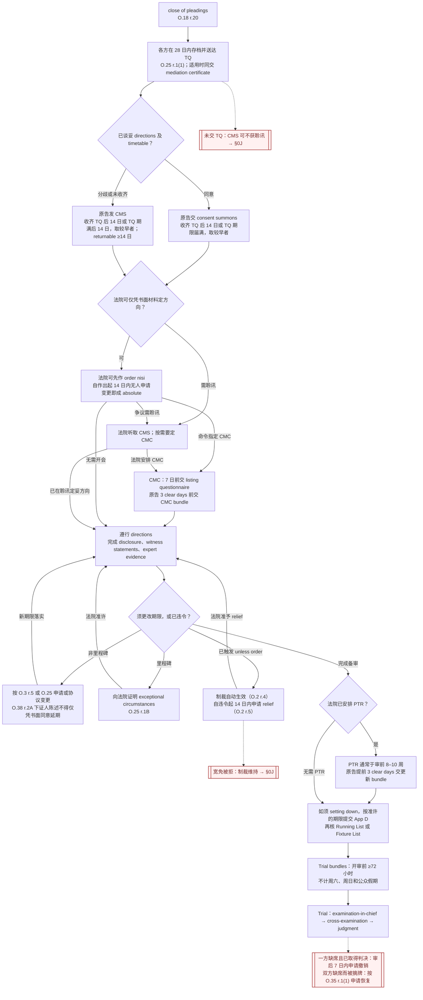
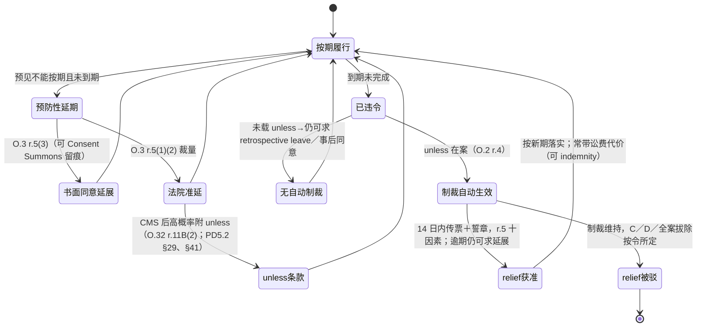
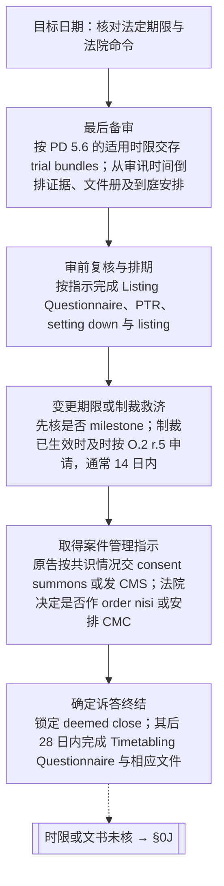

# 案件管理与审讯组织体系

## 速读定位层

> **`CO11（案件管理与审讯组织）`的核心功能，是解决诉状交换完毕（`Close of Pleadings`）至一审宣判之间的程序推进问题：此时原被告虽已通过诉状锁定争议焦点，但尚未交换文件证据、证人陈述书与专家报告，尚不具备开庭条件，因此法院须先通过案件管理程序制定备审时间表，待各项证据准备就绪后再将案件排入正审队列并完成庭审。** 全流程按时间先后分为四个连续阶段：**【第一阶段：制定备审时间表（`TQ` → `Consent Summons / CMS` → `Order Nisi / CMC`）】** 诉答程序视为终结后 **28 日内**，各方须各自填妥并存档送达《时间表问卷（`Timetabling Questionnaire, TQ`）》及调解证书，就后续文件披露、证人及专家证据交换直至审讯的期限提出建议，并尝试私下协商一致；在随后的 **14 日内**，若各方已就各项备审指示与时间表达成协议，由原告提交《同意传票（`Consent Summons`）》请法院书面批核，若未能达成一致或有当事方未交问卷，原告则必须发出《案件管理传票（`Case Management Summons, CMS`）》提请法院裁定（若原告既未交问卷亦未发传票，诉讼依 `O.25 r.1(4)` **自动搁置 `Stayed`**）；法院收到 `CMS` 后，若认为仅凭书面材料即可确定备审方向而**无需就时间表问题专门开庭聆讯**，会直接下达一份附条件的《暂准命令（`Order Nisi`）》——各方若在 **14 日内**均未提出变更申请，该暂准时间表即自动转为正式命令，从而**省去召开首次《案件管理会议（`CMC`）》的口头聆讯**（各方直接按该命令回家准备证据，不影响日后的最终正审）；反之，若一方在 14 日内申请变更，或法院认为案情复杂须当面核定，则会召开 `CMC` 口头聆讯（各方须于会前至少 7 日交存 `Listing Questionnaire` 补充申报审讯估计参数，并于会前 3 个 `clear days` 交存文件束），由聆案官或法官当庭确定备审时间表与后续审讯阶段节点。**【第二阶段：时间表执行期间的延期与违令处理（非里程碑 vs. 里程碑 & `Unless Order`）】** 法院确定的时间表包含两类性质不同的日期：第一类是**非里程碑日期（`Non-milestone dates`）**，即披露文件、交换证人陈述书或专家报告等具体备审步骤的截止日，只要不波及后续的核心审判节点，各方可通过互发函件达成书面协议自行顺延而无需向法院申请，若对方不同意延期，则由需要延期的一方依 `O.3 r.5` 向法院发出延期传票（`Time Summons`）；第二类是**三大里程碑日期（`Milestone dates`）**，专指 **`CMC`、审前覆核（`PTR`）及正审开庭日（`Trial`）**，各方即使私下达成协议亦无权自行更改，必须向法院证明存在“极端例外情况（`exceptional circumstances`）”方获准变更；若某一方在备审过程中无故逾期，法院可下达附带最后通牒性质的《限时命令（`Unless Order`）》，明确规定除非违令方在指定期限内补做该步骤，否则预设制裁（如剔除申索或抗辩、禁止援引某项证据）将依 `O.2 r.4` **在期限届满时自动生效**，守约方无需再另行申请确认，而违令方若想挽救诉讼，必须在自动生效命令送达后 **14 日内**依 `O.2 r.5` 以传票及支持誓章向法院申请《宽免制裁（`Relief from Sanctions`）》。**【第三阶段：审前准备核查与正式排期入表（`PTR` → `Setting down` → `Listing`）】** 由于早期的 `CMC` 仅负责下达准备证据的时间表，并未将案件正式排入待审队列，因此当各方按时间表完成文件披露、证人陈述书与专家报告交换后，程序即进入排期开庭阶段：对于预计审期超过 5 日的复杂案件，法院通常在开审前 **8 至 10 周**先召开一次《审前覆核（`Pre-Trial Review, PTR`）》，核查各方是否已悉数完成备审指示并最终确认出庭证人人数与审讯天数；当备审步骤完成（或期限届满）后，原告须在法院指定的期限内，依 `O.34` 向法院登记处递交排期申请及两套核心文件束，办理《排期入表（`Setting down for trial`）》——这一步的实质是向登记处正式挂号，确认案件已具备开庭条件并请求列入待审案件池，随后由排期主任（`Listing`）将案件分入锁定具体开庭日期的《固定审期表（`Fixture List`）》或按顺位排队候审、进入警告名单（`Warned List`）后随时待命开庭的《流动审期表（`Running List`）》。**【第四阶段：审讯文件束交付与正审程序（`Trial Bundles` → `Trial` → `O.35` 缺席处理）】** 在正审开庭前 **至少 72 小时**（不计周六、周日及公众假期），原告须向法院交存装订完备的《审讯文件束（`Trial Bundles`）》及开案陈词；进入正审（`Trial`）当日，若有一方缺席，到庭方可依 `O.35` 直接申请剔除缺席方申索或单方举证取得判决（缺席方可在判决后 **7 日内**申请撤销该缺席判决并恢复审讯）；双方均到庭时，依次由原告作开案陈词（`Opening speech`），随后传召原告证人上庭——在现代民事审讯中，证人宣誓确认其事先提交的书面证人陈述书后，该陈述书即直接作为其《主问证词（`Examination-in-chief`）》（一般不再口头重复主问，且主问严禁使用暗示答案的引导性问题 `leading questions`），紧接着由对方大律师进行《盘问（`Cross-examination`）》（盘问允许使用引导性问题以质疑证人可信度，但必须严格遵守 *Browne v Dunn* 案确立的 **`put case` 规则**：若己方证据版本与对方证人证词存在实质冲突，盘问大律师必须在盘问时将己方的矛盾版本当面明确指出让该证人回应，若盘问时未指出，在最后的结案陈词中便不得质疑该证人就该事项说谎），再经简短《覆问（`Re-examination`）》后完成原告案情，被告案情亦按相同顺序传召证人，最后由被告及原告依次作结案陈词（`Closing submissions`），由法官当庭或保留判决（`Reserve judgment`）择日宣告结果，并一并裁定判决前后的利息与诉讼费用归属。

### 适用范围

本卡从 O.18 r.20（close of pleadings）起，按实际办案时序把案件从「诉答刚打完」带到「开庭拿判令」：先交问卷报计划 → 法院定时表 → 按表备审，来不及就申请延期 → 违令被制裁就申请宽免 → 备审完成后检查、挂号、排期、编文件册，直至开庭。每一步的接续关系在各节开头的大白话导语中说明。
1. **先交问卷。** 诉答关闭后，各方在 28 日内把 timetabling questionnaire（TQ）存档并送达对方（file and serve），同时按 PD 31 交适用的 mediation certificate。此时证据还没开始准备，TQ 的作用是先向法院报出各方认可的备审时间表。§0C 逐栏说明 Appendix A 的 A–O 栏目。 <small style="opacity: 0.55">〔CL11M L179 "each and every party shall complete a Timetabling Questionnaire (as set out in Appendix A"〕</small>
2. **再请法院定 directions。** 各方谈妥后由原告交 consent summons；若谈不拢或未收齐问卷，则由原告发 case management summons（CMS）。法院可先发 order nisi，给各方 14 日申请变更。 <small style="opacity: 0.55">〔CL11M L311 "by an order nisi (i.e. a temporary order made in writing by way of a Court Note"〕</small>
3. **按法院时表备审。** CMC、PTR 和 trial 是 milestone dates。各方须按指定日期出席；若要变更，须向法院证明 exceptional circumstances。 <small style="opacity: 0.55">〔CL11M L169 "There are only 3 “milestone dates”: Case Management Conference, Pre-Trial Review and Trial"〕</small>
4. **发现会迟延，先核延期路径。** §0D 说明法院如何延长或缩短期限（包括 retrospective leave）、何时可凭 written consent 延期，以及 *The Decurion* 和 *Zida* 如何处理迟延与 prejudice。 <small style="opacity: 0.55">〔CL11M L565 "although the application for extension is not made until after the expiration of that period"〕</small>
5. **违令后先核实际制裁。** §0E 说明如何按 O.42 r.2(1) 和 PD 16.5 拟定 unless order。制裁依 O.2 r.4 自动生效后，违令方须从违令日起算 14 日内申请 relief from sanctions，并用证据回应 O.2 r.5 的十项因素。 <small style="opacity: 0.55">〔CL11M L679 "any sanction for failure to comply imposed by the rule or court order has effect unless the party in default applies"〕</small>
6. **排期、备册后开庭。** §0F 说明 PTR 的四项工作、Certificate of Counsel、setting down、Running List 与 Fixture List（含 Warned List）、A–E 文件册的 250 页及 72 小时要求、正审举证与缺席后果，以及 O.37 的 damages assessment。 <small style="opacity: 0.55">〔CL15 L120 "a pre-trial review (“PTR”) will be held, in particular for “Fixture List” cases"〕</small>
7. **按任务使用本卡。** §0G–§0J 处理答卷策略、排期、延期与制裁。§0K 把规则放回 SG04 的 TQ 练习，并衔接 SG06、SG09 和 SG10；材料目录与待核事项置于文末。

诉答起草、striking out 和 amendment 见 [CO04-05 诉答卡](./%5BCO04-05-10%5D%20Pleadings,%20Defence,%20Counterclaims%20and%20Third%20Party%20Proceedings.md)；interlocutory summons、security for costs 和 O.42 的起草、审批与盖印流程见 [CO07 传票卡](./%5BCO07%5D%20Drafting%20Summonses,%20Interlocutory%20Applications,%20Orders%20&%20Security%20for%20Costs.md) §3.3（本卡在 §0F.7 衔接）。Disclosure、witness statements 和 expert reports 的具体规则见 [CO08 证据准备卡](%5BCO08%5D%20Evidence%20Preparation%20System%20-%20Discovery%20Witnesses%20and%20Experts.md)；interim relief 见 [CO13 临时救济卡](%5BCO13%5D%20Interim%20Relief%20and%20Risk%20Protection%20System.md)。本届材料只在 O.37 损害评定部分列出 writ of subpoena；正审传召文件的材料缺口列在文末。

### 术语

| 术语 | 定义与章节 |
| --- | --- |
| 排期问卷（Timetabling Questionnaire） | 各方在 close of pleadings 后 28 日内填写 PD 5.2 Appendix A，存档并送达其他各方（file and serve）。法院据此确定 directions 和时表（O.25 r.1(1)）。它与 Listing Questionnaire 的区别：TQ 在证据尚未准备时交，性质是「备审动工前先报日程表」；LQ 在备审快完成时交，性质是「逐项检查作业做没做」。 [§0C](#0C.%20Timetabling%20Questionnaire%20%E9%80%90%E6%A0%8F%E5%A1%AB%E5%86%99%E9%80%BB%E8%BE%91) <small style="opacity: 0.55">〔CL11M L179 "each and every party shall complete a Timetabling Questionnaire (as set out in Appendix A"〕</small> |
| 调解证明（Mediation Certificate） | 各方随 TQ 一并存档（file）PD 31 Appendix B。律师签署确认已向当事人说明调解及其与诉讼的费用差异；当事人表明是否愿意调解，拒绝的须说明理由。 [§0B](#0B.%20%E6%A1%88%E4%BB%B6%E7%AE%A1%E7%90%86%E6%80%BB%E6%A1%86%E6%9E%B6%EF%BC%9A%E4%BB%8E%E8%AF%89%E7%AD%94%E5%AE%8C%E7%BB%93%E5%88%B0%E6%8E%92%E6%9C%9F%E5%BC%80%E5%AE%A1%E6%80%8E%E4%B9%88%E8%B5%B0) <small style="opacity: 0.55">〔CL11M L211 "shall file in Court a Mediation Certificate (as set out in Appendix B of PD 31)"；CL11M L215 "the party has to certify whether he is willing to attempt mediation"〕</small> |
| 同意传票（Consent Summons） | 各方谈妥 directions 和时表后，由原告提交协议供法院批准。期限取收齐被告 TQ 后 14 日与对方交 TQ 的期限届满两者中较早者（O.25 r.1(1A)；PD 5.2 ¶13）。 [§0B](#0B.%20%E6%A1%88%E4%BB%B6%E7%AE%A1%E7%90%86%E6%80%BB%E6%A1%86%E6%9E%B6%EF%BC%9A%E4%BB%8E%E8%AF%89%E7%AD%94%E5%AE%8C%E7%BB%93%E5%88%B0%E6%8E%92%E6%9C%9F%E5%BC%80%E5%AE%A1%E6%80%8E%E4%B9%88%E8%B5%B0) <small style="opacity: 0.55">〔CL11M L275 "procure and file a Consent Summons containing the agreed Directions or Timetable for the Court’s consideration"〕</small> |
| 案件管理传票（Case Management Summons，CMS） | 各方谈不拢、被告未交 TQ，或案件涉及 litigant in person 而适用 CMS 路径时，原告按 PD 5.2 Appendix B 发传票，请法院定 directions。发出期限见 ¶16；return date 不得早于发出后的 14 日。CMS 是申请文书，CMC 是法院举行的会议（O.25 r.1(1B)；PD 5.2 ¶¶16–18）。 [§0B](#0B.%20%E6%A1%88%E4%BB%B6%E7%AE%A1%E7%90%86%E6%80%BB%E6%A1%86%E6%9E%B6%EF%BC%9A%E4%BB%8E%E8%AF%89%E7%AD%94%E5%AE%8C%E7%BB%93%E5%88%B0%E6%8E%92%E6%9C%9F%E5%BC%80%E5%AE%A1%E6%80%8E%E4%B9%88%E8%B5%B0) <small style="opacity: 0.55">〔CL11M L295 "take out a summons (referred to as a Case Management Summons) (as set out in Appendix B"；CL15AX L80 "the plaintiff shall take out a case management summons"〕</small> |
| 暂准命令（order nisi） | 法院可先发 Court Note，在不开庭的情况下作出 directions。各方如要变更，须从命令作出日起算 14 日内申请；无人申请时，order nisi 成为 order absolute（O.25 r.1A(4)–(6)；PD 5.2 ¶¶19–22）。 [§0B](#0B.%20%E6%A1%88%E4%BB%B6%E7%AE%A1%E7%90%86%E6%80%BB%E6%A1%86%E6%9E%B6%EF%BC%9A%E4%BB%8E%E8%AF%89%E7%AD%94%E5%AE%8C%E7%BB%93%E5%88%B0%E6%8E%92%E6%9C%9F%E5%BC%80%E5%AE%A1%E6%80%8E%E4%B9%88%E8%B5%B0) <small style="opacity: 0.55">〔CL11M L311 "by an order nisi (i.e. a temporary order made in writing by way of a Court Note"；CL11M L319 "failing which the order nisi and the directions therein becomes absolute (i.e. final)"〕</small> |
| 里程碑日期（milestone date） | 法院指定的 CMC、PTR 与 trial 日期，以及已固定的 trial period，均属 milestone dates。各方如要改期，须向法院证明 exceptional circumstances；双方同意也不能自行改动（O.25 r.1B(2)、(3)、(8)）。 [§0B](#0B.%20%E6%A1%88%E4%BB%B6%E7%AE%A1%E7%90%86%E6%80%BB%E6%A1%86%E6%9E%B6%EF%BC%9A%E4%BB%8E%E8%AF%89%E7%AD%94%E5%AE%8C%E7%BB%93%E5%88%B0%E6%8E%92%E6%9C%9F%E5%BC%80%E5%AE%A1%E6%80%8E%E4%B9%88%E8%B5%B0) <small style="opacity: 0.55">〔CL11M L169 "There are only 3 “milestone dates”: Case Management Conference, Pre-Trial Review and Trial"；CL11M L171 "Milestone dates can only be varied in exceptional circumstances"〕</small> |
| 非里程碑日期（non-milestone date） | 当事人想改变法院时表内的普通步骤，应先协商，再依 O.25 r.1B(4)–(7) 请法院处理。若要调整 O.38 r.2A 下的 exchange of witness statements，当事人不能仅凭 written consent 延期；调整不得挪动已定 trial date 或 trial period。 [§0D](#0D.%20Extension%20of%20Time%EF%BC%9A%E7%94%B3%E8%AF%B7%E5%BB%B6%E9%95%BF%E6%88%96%E7%BC%A9%E7%9F%AD%E6%9C%9F%E9%99%90%E7%9A%84%E8%B7%AF%E5%BE%84%E3%80%81%E6%B3%95%E9%99%A2%E8%A3%81%E9%87%8F%E4%B8%8E%E9%80%BE%E6%9C%9F%E5%90%8E%E6%9E%9C) <small style="opacity: 0.55">〔CL11M L543 "All other dates or period fixed by the Court (i.e. not the milestone dates) are “non-milestone dates”"；CL11M L553 "the Court will not grant such an application if it changes a trial date or trial period (O.25 r.1B(7))"〕</small> |
| 案件管理会议（CMC） | 法院在需要开会时召开 CMC。聆案官通常主持首次会议，查核各方对 directions 的 compliance，再处理未决事项、后续时表及是否需要 PTR 或固定审期（O.25；PD 5.2 ¶¶23–32）。 [§0B](#0B.%20%E6%A1%88%E4%BB%B6%E7%AE%A1%E7%90%86%E6%80%BB%E6%A1%86%E6%9E%B6%EF%BC%9A%E4%BB%8E%E8%AF%89%E7%AD%94%E5%AE%8C%E7%BB%93%E5%88%B0%E6%8E%92%E6%9C%9F%E5%BC%80%E5%AE%A1%E6%80%8E%E4%B9%88%E8%B5%B0) <small style="opacity: 0.55">〔CL11M L461 "review the parties’ preparation of the case for trial (especially their compliance with Court directions)"；CL11M L415 "The date fixed for a Case Management Conference is a “milestone date” (O.25 r.1B (8))"〕</small> |
| 排期审讯问卷（Listing Questionnaire） | 各方至少在 CMC 前 7 日把 PD 5.2 Appendix C 存档并送达（file and serve），逐项确认 A1–A19 的备审进度。若在 PTR 前需要提交，则按法院指示办理；问卷应说明预计审期、语言和传译安排（PD 5.2 ¶¶24–25）。它与 TQ 的区别：TQ 是备审开始前报计划；LQ 是备审完成后逐项确认「能否现在排期开庭」。 [§0B](#0B.%20%E6%A1%88%E4%BB%B6%E7%AE%A1%E7%90%86%E6%80%BB%E6%A1%86%E6%9E%B6%EF%BC%9A%E4%BB%8E%E8%AF%89%E7%AD%94%E5%AE%8C%E7%BB%93%E5%88%B0%E6%8E%92%E6%9C%9F%E5%BC%80%E5%AE%A1%E6%80%8E%E4%B9%88%E8%B5%B0) <small style="opacity: 0.55">〔CL11M L423 "each party shall file and serve their Listing Questionnaire (as set out in Appendix C of PD 5.2)"〕</small> |
| 审前覆核（PTR） | 法院若安排 PTR，通常在审期前 8–10 周由 trial judge 主持。此时案件应已可开审；法官可定开审日、校正审期估算，并发出不影响审期的补充 directions（PD 5.2 ¶¶33–36）。 [§0F](#0F.%20%E5%AE%A1%E8%AE%AF%E7%BB%84%E7%BB%87%EF%BC%9APTR%20%E2%86%92%20Setting%20Down%20%E2%86%92%20Listing%20%E2%86%92%20Trial%20Bundles%20%E2%86%92%20%E5%BD%93%E6%97%A5%20%E2%86%92%20O.37) <small style="opacity: 0.55">〔CL11M L479 "normally about 8 to 10 weeks before the trial date (para 33 of PD 5.2)"；CL11M L491 "late interlocutory applications may be dismissed on the basis of delay alone"〕</small> |
| 大律师估算证书（Certificate of Counsel） | 如须请求审期或 trial period，拟出庭大律师或经办律师须分列 opening、己方证人的 examination-in-chief、对方证人的 cross-examination 及 closing 的时间（PD 5.2 ¶¶14、25）。 [§0F](#0F.%20%E5%AE%A1%E8%AE%AF%E7%BB%84%E7%BB%87%EF%BC%9APTR%20%E2%86%92%20Setting%20Down%20%E2%86%92%20Listing%20%E2%86%92%20Trial%20Bundles%20%E2%86%92%20%E5%BD%93%E6%97%A5%20%E2%86%92%20O.37) <small style="opacity: 0.55">〔CL15 L122 "a document usually referred to as “Certificate of Counsel”"〕</small> |
| 除外令／若不遵守即受罚命令（unless order） | 法院在 unless order 列明要做的事、履行期限和违令后果。若当事人未按期履行，命令列明的制裁自行生效，例如剔除 pleading 或禁止提交指定证据（O.1B r.1(3)；PD 16.5）。 [§0E](#0E.%20%E8%BF%9D%E5%8F%8D%20unless%20order%EF%BC%9A%E5%88%B6%E8%A3%81%E8%87%AA%E5%8A%A8%E7%94%9F%E6%95%88%EF%BC%88O.2%20r.4%EF%BC%89%E4%B8%8E%2014%20%E6%97%A5%E5%86%85%E7%94%B3%E8%AF%B7%E5%AE%BD%E5%85%8D%EF%BC%88O.2%20r.5%EF%BC%89) <small style="opacity: 0.55">〔CL11M L637 "the sanction imposed in the order will automatically take effect upon failure to comply within the time"〕</small> |
| 制裁宽免（relief from sanctions） | 制裁生效后，违令方须自违令起算 14 日内提出 summons，并以 affidavit 或 affirmation 支持。法院依 O.2 r.5 审查十项因素及全案情况；逾期须另求延时（O.2 rr.4–5）。 [§0E](#0E.%20%E8%BF%9D%E5%8F%8D%20unless%20order%EF%BC%9A%E5%88%B6%E8%A3%81%E8%87%AA%E5%8A%A8%E7%94%9F%E6%95%88%EF%BC%88O.2%20r.4%EF%BC%89%E4%B8%8E%2014%20%E6%97%A5%E5%86%85%E7%94%B3%E8%AF%B7%E5%AE%BD%E5%85%8D%EF%BC%88O.2%20r.5%EF%BC%89) <small style="opacity: 0.55">〔CL11M L681 "once a breach of the unless order occurs, the only recourse is to apply for relief from sanction"〕</small> |
| 时限传票（Time Summons） | 当事人以 time summons 请求延长或缩短期限，通常列入聆案官内庭三分钟清单，trainee solicitor 可出席。若原因或 prejudice 不能靠案卷说明，申请方应交支持誓章（O.3 r.5）。 [§0D](#0D.%20Extension%20of%20Time%EF%BC%9A%E7%94%B3%E8%AF%B7%E5%BB%B6%E9%95%BF%E6%88%96%E7%BC%A9%E7%9F%AD%E6%9C%9F%E9%99%90%E7%9A%84%E8%B7%AF%E5%BE%84%E3%80%81%E6%B3%95%E9%99%A2%E8%A3%81%E9%87%8F%E4%B8%8E%E9%80%BE%E6%9C%9F%E5%90%8E%E6%9E%9C) <small style="opacity: 0.55">〔CL11M L729 "A summons only seeking for extension of time are often referred to as “Time Summons”"；CL11M L733 "trainee solicitors has the right of audience"〕</small> |
| 排期审讯令（setting down） | 备审全部完成后的「挂号」动作：法院如定下 setting down 期限，原告用 PD 5.2 Appendix D 申请将案件排入审讯名单，并按 O.34 rr.2–3 向司法常务官提交排期请求和法官用文件册。不挂号，案件就不会进入任何审讯名单。 [§0F](#0F.%20%E5%AE%A1%E8%AE%AF%E7%BB%84%E7%BB%87%EF%BC%9APTR%20%E2%86%92%20Setting%20Down%20%E2%86%92%20Listing%20%E2%86%92%20Trial%20Bundles%20%E2%86%92%20%E5%BD%93%E6%97%A5%20%E2%86%92%20O.37) <small style="opacity: 0.55">〔CL15 L206 "The request for setting down is done by filing Appendix D as attached to PD 5.2."；CL15 L210 "must deliver to the Registrar, by post or otherwise, a request that the action may be set down for trial"〕</small> |
| 流动审讯单（Running List） | 原讼庭预计三日或以下的合资格短审通常进入 Running List，起初没有固定审日。法院确认已备妥的案件才会进入 Warned List（PD 7.1）。 [§0F](#0F.%20%E5%AE%A1%E8%AE%AF%E7%BB%84%E7%BB%87%EF%BC%9APTR%20%E2%86%92%20Setting%20Down%20%E2%86%92%20Listing%20%E2%86%92%20Trial%20Bundles%20%E2%86%92%20%E5%BD%93%E6%97%A5%20%E2%86%92%20O.37) <small style="opacity: 0.55">〔CL15 L262 "A Running List case is one with an estimated length of trial of 3 days or less"；CL15AX L298 "will be assigned to and set down in the Running List"〕</small> |
| 定期审讯单（Fixture List） | 案件预计超过三日，或有复杂程度、证人到庭等理由需要固定日期时，法院使用 Fixture List。区院有 litigant in person 的案件按 PD 27 处理（原讼庭见 PD 7.1）。 [§0F](#0F.%20%E5%AE%A1%E8%AE%AF%E7%BB%84%E7%BB%87%EF%BC%9APTR%20%E2%86%92%20Setting%20Down%20%E2%86%92%20Listing%20%E2%86%92%20Trial%20Bundles%20%E2%86%92%20%E5%BD%93%E6%97%A5%20%E2%86%92%20O.37) <small style="opacity: 0.55">〔CL15 L268 "A Fixture List case is one where the court has determined at the setting down stage"〕</small> |
| 被警示名单（Warned List） | 列单人员每周三从 Pending List 摘出可在下周起随时开审的案件。当事人进了 Warned List 后，须保持可以接通知即开庭的状态（PD 7.1 ¶4）。 [§0F](#0F.%20%E5%AE%A1%E8%AE%AF%E7%BB%84%E7%BB%87%EF%BC%9APTR%20%E2%86%92%20Setting%20Down%20%E2%86%92%20Listing%20%E2%86%92%20Trial%20Bundles%20%E2%86%92%20%E5%BD%93%E6%97%A5%20%E2%86%92%20O.37) <small style="opacity: 0.55">〔CL15AX L306 "will be extracted from the Pending List and put in another list – the Warned List"〕</small> |
| 审讯文件册（trial bundle） | 主理律师按类别编正审所需文件：A 法庭文书、B witness statements、C expert reports、D 披露文件、E 函件。每册不超过 250 页，并至少提前 72 小时交存，不计周六、周日和公众假期（PD 5.6）。 [§0F](#0F.%20%E5%AE%A1%E8%AE%AF%E7%BB%84%E7%BB%87%EF%BC%9APTR%20%E2%86%92%20Setting%20Down%20%E2%86%92%20Listing%20%E2%86%92%20Trial%20Bundles%20%E2%86%92%20%E5%BD%93%E6%97%A5%20%E2%86%92%20O.37) <small style="opacity: 0.55">〔CL15 L230 "The “trial bundles” will normally be divided by letter categories"；CL15AX L276 "at least 72 hours before the date fixed for the hearing (excluding Saturdays, Sundays and general holidays)"〕</small> |

### 环节定位

| 环节 | 实际操作 |
| --- | --- |
| 诉答终结 → 28 日内交换问卷 | 各方在 close of pleadings 后 28 日内存档并送达 TQ，同时按 PD 31 交适用的 mediation certificate。法院因此能在无人催办时取得备审方案（O.25 r.1(1)）。 <small style="opacity: 0.55">〔CL11M L185 "The purpose of a Timetabling Questionnaire is to enable the Court to give directions relating to management"〕</small> |
| 同意 → Consent Summons | 各方谈妥后由原告交 consent summons。法院可在不开庭的情况下批准，但会拒绝造成不必要迟延或成本的同意方向（PD 5.2 ¶¶13–15；见 §0B.3 *Li Shiu To*）。 <small style="opacity: 0.55">〔CL11M L317 "it will give great weight to the parties’ agreed directions"〕</small> |
| 分歧 → CMS | 各方谈不拢时，由原告按 PD 5.2 ¶16 发 CMS。原告不行动，被告可发 CMS 或申请驳回诉讼（O.25 r.1(1B)、(4)）。 <small style="opacity: 0.55">〔CL11M L303 "If the Plaintiff does not take out a Case Management Summons, the Defendant may (a) take out"〕</small> |
| order nisi | 法院若能根据书面材料定 directions，可先作 order nisi；当事人有 14 日申请变更，无人申请时命令成为 absolute（O.25 r.1A）。 <small style="opacity: 0.55">〔CL11M L321 "The Court shall, on an application to vary the order nisi, hear the Case Management Summons (O.25 r.1A(6))"〕</small> |
| CMC | 须举行 CMC 时，各方按时提交备审文件，并派有授权的代表出席。法院查核 pre-trial preparation，再处理余下步骤、PTR 或审期（PD 5.2 ¶32）。 <small style="opacity: 0.55">〔CL11M L467 "adjourn the Case Management Conference to another date, or fix a date for the Pre-Trial Review"〕</small> |
| 逾期 → unless order | 若当事人未按方向完成，法院可发 unless order，明确最后履行期限和违令后果（O.1B r.1(3)）。 <small style="opacity: 0.55">〔CL11M L643 "Such order can be made upon application by a party, by consent of the party, or of the court’s own motion under O.1B r.2."〕</small> |
| 违令 → relief | 若当事人违反 unless order，制裁自行生效。违令方须自违令起算 14 日内申请 relief，并用证据说明迟延与补救；法院可同时命其付讼费（O.2 rr.4–5）。 <small style="opacity: 0.55">〔CL11M L685 "Evidence in support (normally in the form of affidavit) of the application is expressed required by O.2 r.5(2)"〕</small> |
| PTR | 若法院定了 PTR，出庭大律师按 Certificate of Counsel 解释尚需多少庭时。法官可定开审日，并处理不会挪动审日的剩余方向（PD 5.2 ¶¶33–36）。 <small style="opacity: 0.55">〔CL11M L493 "fix the starting date for the trial (para 36(1) PD 5.2)"〕</small> |
| setting down → listing | 准予 setting down 后，原告按期限办妥排期。合资格短案候列 Running List；需要固定开审日的案件进入 Fixture List（PD 7.1）。 <small style="opacity: 0.55">〔CL15 L264 "will not be “warned” (i.e. placed on the Warned List) until the court is satisfied that all preparatory steps have been completed"〕</small> |
| trial bundles | 负责律师把庭上会用的文件按类别和日期编页、贴签，并在开审前按时交存 trial bundles（PD 5.6）。 <small style="opacity: 0.55">〔CL15AX L262 "arranged in chronological order from the front"〕</small> |

## 🗺️ 本卡地图



各方先用 TQ 向法院交代拟定时表。法院可书面给 directions，也可因有争议而先听取 CMS；只有案件需要时才举行 CMC。时表确定后，若某一步不能按时完成，当事人先核能否延期；若已触发 self-executing sanction，则先申请 relief。进入排期时，以法院实际指示决定是否需要 PTR 及何时 setting down，再按实际开审时间倒排文件册。

| 任务 | 直达 |
| --- | --- |
| 案件管理总框架：从诉答完结到排期开审怎么走 | [§0B](#0B.%20%E6%A1%88%E4%BB%B6%E7%AE%A1%E7%90%86%E6%80%BB%E6%A1%86%E6%9E%B6%EF%BC%9A%E4%BB%8E%E8%AF%89%E7%AD%94%E5%AE%8C%E7%BB%93%E5%88%B0%E6%8E%92%E6%9C%9F%E5%BC%80%E5%AE%A1%E6%80%8E%E4%B9%88%E8%B5%B0) |
| Timetabling Questionnaire 逐栏填写逻辑 | [§0C](#0C.%20Timetabling%20Questionnaire%20%E9%80%90%E6%A0%8F%E5%A1%AB%E5%86%99%E9%80%BB%E8%BE%91) |
| Extension of Time：申请延长或缩短期限的路径、法院裁量与逾期后果 | [§0D](#0D.%20Extension%20of%20Time%EF%BC%9A%E7%94%B3%E8%AF%B7%E5%BB%B6%E9%95%BF%E6%88%96%E7%BC%A9%E7%9F%AD%E6%9C%9F%E9%99%90%E7%9A%84%E8%B7%AF%E5%BE%84%E3%80%81%E6%B3%95%E9%99%A2%E8%A3%81%E9%87%8F%E4%B8%8E%E9%80%BE%E6%9C%9F%E5%90%8E%E6%9E%9C) |
| 违反 unless order：制裁自动生效（O.2 r.4）与 14 日内申请宽免（O.2 r.5） | [§0E](#0E.%20%E8%BF%9D%E5%8F%8D%20unless%20order%EF%BC%9A%E5%88%B6%E8%A3%81%E8%87%AA%E5%8A%A8%E7%94%9F%E6%95%88%EF%BC%88O.2%20r.4%EF%BC%89%E4%B8%8E%2014%20%E6%97%A5%E5%86%85%E7%94%B3%E8%AF%B7%E5%AE%BD%E5%85%8D%EF%BC%88O.2%20r.5%EF%BC%89) |
| 审讯组织：PTR → Setting Down → Listing → Trial Bundles → 当日 → O.37 | [§0F](#0F.%20%E5%AE%A1%E8%AE%AF%E7%BB%84%E7%BB%87%EF%BC%9APTR%20%E2%86%92%20Setting%20Down%20%E2%86%92%20Listing%20%E2%86%92%20Trial%20Bundles%20%E2%86%92%20%E5%BD%93%E6%97%A5%20%E2%86%92%20O.37) |
| 攻防与暗礁：问卷的策略含义与程序制裁机制 | [§0G](#0G.%20%E6%94%BB%E9%98%B2%E4%B8%8E%E6%9A%97%E7%A4%81%EF%BC%9A%E9%97%AE%E5%8D%B7%E7%9A%84%E7%AD%96%E7%95%A5%E5%90%AB%E4%B9%89%E4%B8%8E%E7%A8%8B%E5%BA%8F%E5%88%B6%E8%A3%81%E6%9C%BA%E5%88%B6) |
| 文书与期限倒排 | [§0H](#0H.%20%E5%AE%9E%E5%8A%A1%E6%93%8D%E4%BD%9C%E6%B8%85%E5%8D%95%EF%BC%9A%E6%96%87%E4%B9%A6%E3%80%81%E9%80%81%E8%BE%BE%E4%B8%8E%E6%97%B6%E9%99%90%E5%80%92%E6%8E%92) |
| 提交前核对 | [§0I](#0I.%20%E6%94%BB%E9%98%B2%E4%B8%8E%E6%89%A7%E8%A1%8C%E5%89%8D%E6%A0%B8%E5%AF%B9) |
| 失误、制裁与补救 | [§0J](#0J.%20%E7%A8%8B%E5%BA%8F%E5%A4%B1%E8%AF%AF%E5%8F%8A%E5%85%B6%E5%90%8E%E6%9E%9C) |
| SG 实务应用 | [§0K](#0K.%20SG%20%E5%AE%9E%E5%8A%A1%E5%BA%94%E7%94%A8%E4%B8%8E%E5%AF%BC%E5%B8%88%E5%8F%A3%E5%BE%84) |

#### 核心参数与计算口径
- **排期问卷法定提交死线（Timetabling Questionnaire - O.25 r.1(1)）**：诉答完结（close of pleadings）后 **28 天内**，各方须存档并向其他各方送达（file and serve）PD 5.2 Appendix A 的 Timetabling Questionnaire。
- **书面延期与 milestone dates（O.3 r.5(3)；RHC O.25 r.1B）**：适用 O.3 r.5(3) 的文件期限可经书面同意延期；法院指定的 O.38 r.2A witness statements 交换期限排除这一渠道。CMC、PTR、trial 或已固定的 trial period 只能由法院在 exceptional circumstances 下变更。
- **除非命令自动生效与制裁救济（Unless Order & Relief from Sanctions - O.2 r.4 / PD 5.2 ¶44）**：违反 Unless Order 之违约方，其诉状被剔除或判决生效自动发生；违约方必须在未遵令之日起 **14 天内**发出传票申请 Relief from Sanctions。
- **审前复核（PTR）与审讯文件册（Trial Bundles under PD 5.6）**：
  ① 审前复核（PTR）：通常在正审前 8–10 周召开；
  ② 申请排期开审（Setting Down under O.34 r.2）：按法院的许可与命令期限存档并缴费；
  ③ 审讯文件册（Trial Bundles）：负责一方须依 PD 5.6 §8 在聆讯前至少 72 小时向法庭交存 trial bundles；不计周六、周日及公众假期。

<!-- BEGIN:cite-legend -->
> [!info]- 引注图例
> 
> | 码 | 文件 | 层级 | 学年 |
> |---|---|---|---|
> | CL12 | [LG12 证人陈述与专家](../../99%20Moodle%20Mirror/Lecture%20Outlines,%20Powerpoints%20&%20Materials/LG12%20Witness%20Statements%20and%20Expert%20Reports/LG12%20-%20Witness%20Statements%20and%20Expert%20Reports.md) | 本届讲义 | 2026-27 |
> | CL15 | [LG15 审讯准备和程序](../../04%20Base%20Lectures/00%20This%20Year%20Moodle%202026-27/Lecture%20Outlines,%20Powerpoints%20&%20Materials/LG15%20-%20Trial%20Preparation%20Trial%20Procedure.md) | 本届讲义 | 2026-27 |
> | CL15S1 | [本届课堂幻灯·CL LG15 1-2（Trial Preparation）](../../04%20Base%20Lectures/00%20This%20Year%20Moodle%202026-27/Lecture%20Outlines,%20Powerpoints%20&%20Materials/CL%20LG15%202026-2027%201-2.md) | 本届讲义 | 2026-27 |
> | CL15S2 | [本届课堂幻灯·CL LG15 2-2（Trial Procedure）](../../04%20Base%20Lectures/00%20This%20Year%20Moodle%202026-27/Lecture%20Outlines,%20Powerpoints%20&%20Materials/CL%20LG15%202026-2027%202-2.md) | 本届讲义 | 2026-27 |
> | CL15AX | [本届 LG15 Annex（PD 5.2／5.6／7.1／16.1／21.1／27 全文附载）](../../04%20Base%20Lectures/00%20This%20Year%20Moodle%202026-27/Lecture%20Outlines,%20Powerpoints%20&%20Materials/CL%20LG15%20Trial%20Prep%20-%20Annex.md) | 本届讲义 | 2026-27 |
> | CAP-C15 | [8010_LG15_PT_51238ed8.md](../../99%20Moodle%20Mirror/Lecture%20Outlines,%20Powerpoints%20&%20Materials/LG15%20-%20Trial%20Prep%20&%20Procedure/Panopto%20Captions%20%28local%20export%29/8010_LG15_PT_51238ed8.md) | 本届讲义 | 2026-27 |
> | CL7 | [LG7 中间申请和讼费担保](../../04%20Base%20Lectures/00%20This%20Year%20Moodle%202026-27/Lecture%20Outlines,%20Powerpoints%20&%20Materials/LG7%20-%20Drafting%20Summonses.%20Interlocutory%20Applications,%20Security%20for%20Costs.md) | 本届讲义 | 2026-27 |
> | CL8 | [LG8 Discovery](../../04%20Base%20Lectures/00%20This%20Year%20Moodle%202026-27/Lecture%20Outlines,%20Powerpoints%20&%20Materials/LG8%EF%BC%9A%20Discovery/LG8%20Discovery%20Lecture%20Outline.md) | 本届讲义 | 2026-27 |
> | CAP-C7 | [PCLL8010 LG7 PT](../../99%20Moodle%20Mirror/Lecture%20Outlines,%20Powerpoints%20&%20Materials/LG7%20-%20Drafting%20Summonses.%20Interlocutory%20Applications,%20Security%20for%20Costs/Panopto%20Captions%20%28local%20export%29/8010_LG07_PT.md) | 本届讲义 | 2026-27 |
> | CAP-C9 | [PCLL8010 LG9 PT](../../99%20Moodle%20Mirror/Lecture%20Outlines,%20Powerpoints%20&%20Materials/LG9%20-%20Summary%20Judgment%20&%20Interim%20Payment/Panopto%20Captions%20%28local%20export%29/8010_LG09_PT.md) | 本届讲义 | 2026-27 |
> | CL11 | [1. LG11 LECTURE OUTLINE (2026-2027)](../../99%20Moodle%20Mirror/Lecture%20Outlines,%20Powerpoints%20&%20Materials/1.%20LG11%20LECTURE%20OUTLINE%20%282026-2027%29.docx) | 本届讲义 | 2026-27 |
> | CL11M | [1. LG11 LECTURE OUTLINE (2026-2027)（04 Base 伴生 md，756 行，本卡新引均用其行号）](../../04%20Base%20Lectures/00%20This%20Year%20Moodle%202026-27/Lecture%20Outlines,%20Powerpoints%20&%20Materials/1.%20LG11%20LECTURE%20OUTLINE%20%282026-2027%29.md) | 本届讲义 | 2026-27 |
> | CL11T | [LG11 本届课堂录音转录（Otter 合并稿：8010_LG11_PT_Otter_Transcript_Combined.md，209 行；William Jones 执教，2026-10-09 晚堂）](../../04%20Base%20Lectures/00%20This%20Year%20Moodle%202026-27/Lecture%20Outlines,%20Powerpoints%20&%20Materials/LG11%20-%20Case%20Management%20and%20Extension%20of%20Time/8010_LG11_PT_Otter_Transcript_Combined.md) | 本届讲义 | 2026-27 |
> | APPA | [本届 PD 5.2 Appendix A 排期问卷表伴生 md](../../04%20Base%20Lectures/00%20This%20Year%20Moodle%202026-27/Lecture%20Outlines,%20Powerpoints%20&%20Materials/PD5.2_App_A_V2%20Timetabling%20Questionnaire.md) | 本届讲义 | 2026-27 |
> | APPB | [本届 PD 5.2 Appendix B Case Management Summons 样本伴生 md](../../04%20Base%20Lectures/00%20This%20Year%20Moodle%202026-27/Lecture%20Outlines,%20Powerpoints%20&%20Materials/PD5.2_App_B%20Case%20Management%20Summons.md) | 本届讲义 | 2026-27 |
> | APPC | [本届 PD 5.2 Appendix C 排期审讯问卷表伴生 md](../../04%20Base%20Lectures/00%20This%20Year%20Moodle%202026-27/Lecture%20Outlines,%20Powerpoints%20&%20Materials/PD5.2_App_C_V2%20Listing%20Questionnaire.md) | 本届讲义 | 2026-27 |
> | APPD | [本届 PD 5.2 Appendix D Setting Down for Trial 表伴生 md](../../04%20Base%20Lectures/00%20This%20Year%20Moodle%202026-27/Lecture%20Outlines,%20Powerpoints%20&%20Materials/PD5.2_App_D%20Setting%20Down%20for%20Trial.md) | 本届讲义 | 2026-27 |
> | OLD-LG11O | [往届（2025-26）LG11 Case Management & EOT 讲义大纲（717 行·含 O.1B 权力例示与 CMC 缺席后果）](../../04%20Base%20Lectures/%5BLG11%5D%20Case%20Management%20and%20Extension%20of%20Time/LG11%20Case%20Management%20and%20EOT%20Lecture%20Outline.md) | 往届官方 | 2025-26 |
> | OLD-LG11S | [往届（2025-26）LG11 课堂幻灯伴生 md（564 行）](../../04%20Base%20Lectures/%5BLG11%5D%20Case%20Management%20and%20Extension%20of%20Time/LG11%20Case%20Management%20and%20EoT.md) | 往届官方 | 2025-26 |
> | OLD-LG11TQ | [往届（2025-26）LG11 夹排期问卷范本（与本届 App A 自 L11 起逐行全同）](../../04%20Base%20Lectures/%5BLG11%5D%20Case%20Management%20and%20Extension%20of%20Time/Timetabling%20Questionnaire.md) | 往届官方 | 2025-26 |
> | OLD-SET3L11 | [往届学生稿·Set 3「LG11 case management」（1213 行·非官方）](../../06%20Base%20Exam%20Notes/Set%203/LG11%20case%20management.md) | 往届学生稿 | 2025-26 |
> | OLD-SET3L15 | [往届学生稿·Set 3「LG15 Trial Preparation」（663 行·非官方）](../../06%20Base%20Exam%20Notes/Set%203/LG15%20Trial%20Preparation.md) | 往届学生稿 | 2025-26 |
> | SG4TQ | [本届 SG04 Exercise 1—Contract Case 排期问卷完整填报稿（含逐栏依据）](../../01%20SG/SG04%20Drafting%20SoC%20II%20-%20Negligence/01%20Exercise%201%20-%20Timetabling%20Questionnaire.md) | 凝结层 | 2026-27 |
> | SG4CD | [本届 SG04 主控「00 Classroom & Desk」（任务总览与大作业 DDL）](../../01%20SG/SG04%20Drafting%20SoC%20II%20-%20Negligence/00%20Classroom%20&%20Desk.md) | 凝结层 | 2026-27 |

> | SG4AP | [本届 SG4 Activity Plan（SG04 原任务书）](../../04%20Base%20Lectures/00%20This%20Year%20Moodle%202026-27/Small%20Group%20Activity%20Plans/SG4%20Activity%20Plan%20.md) | 本届官方 | 2026-27 |
> | LG11UP | [本届Updated Word修订阅读核对](obsidian://open?vault=3b1e77255f6c6e29&file=output%2Fresearch%2FCivil%20Litigation%20LG11%20Updated%20Tracked%20Changes%20Verification%20-%202026-10-23.md) | 本层自拟 | 2026-27 |
<!-- END:cite-legend -->

## 0B. 案件管理总框架：从诉答完结到排期开审怎么走

**此时案件处在什么状态？** 诉答刚终结：双方的对错主张已经写成状纸，但证据一样都没准备——文件未披露、证人陈述未写、专家未请，法院也不知道要审几天，无法排期。**案件管理在干嘛？** 它让法院在此时拿到双方认可的备审计划（先交 TQ），再把计划变成有约束力、有时限的时表（consent summons 或 CMS + order nisi / CMC）。**和相邻程序怎么分？** 此阶段的 TQ 与 CMC 是在证据未备时「布置写备审作业的时间表」；Listing Questionnaire 与 PTR 是备审快完成时「检查作业齐没齐、估算开庭要几天」（§0F）；setting down 则是作业全部完成后「去登记处窗口正式挂号排队领开庭日子」（§0F.2）——名字相近，阶段与功能不同。CMC、PTR 和 trial 一经定为 milestone date，只能按较严格的程序改期（§0B.6）。 <small style="opacity: 0.55">〔CL11M L23 "Lecture title | Case Management & Extension of Time"；CL11M L27 "Ophelia Chan on Case Management &  Sam Liu on Extension of Time"〕</small>

### 0B.1 全流程一览：从诉答完结到开审的完整时序（含延期与制裁救济）

各方在 O.18 r.20（close of pleadings）所定日期后开始计算 28 日。经办律师签署 TQ；各方可同步协商，但 PD 5.2 ¶8 不准以谈判未完为由延误交问卷。原告应在获知被告立场后选用 consent summons 或 CMS。法院取得各方资料后，先判断能否在书面上处理；如须进一步查问备审进度或解决争议，才需聆讯或 CMC。排期一经确定，各方就按指定日期完成证据准备；预见不能履行时走 §0D，制裁已生效时走 §0E。随后按 §0F 完成 trial preparation。 <small style="opacity: 0.55">〔CL11M L159 "the Timetabling Questionnaire together with the Mediation Certificate shall be filed with the Court"；CL11M L211 "at the same time as the filing of the Timetabling Questionnaire (i.e. within 28 days after the deemed date of close of pleadings)"〕〔CL11M L181 "the process of consultation must not delay the filing of the Timetabling Questionnaire"；CL15AX L52 "the process of consultation must not delay the filing of the Timetabling Questionnaire"〕〔CL11M L263 "file a single set of Timetabling Questionnaire (still within 28 days after the deemed date of close of pleadings)"；CL15AX L64 "within 14 days after receiving the Timetabling Questionnaire from all defendants"〕〔CL11M L305 "the Court will decline to hear the Case Management Summons unless the Timetabling Questionnaire has been filed"；CL15AX L88 "the plaintiff (whether legally represented or not) must take out a case management summons for directions"〕〔CL11M L319 "failing which the order nisi and the directions therein becomes absolute (i.e. final)"；CL15AX L114 "the Court will make orders nisi giving case management directions and fix a timetable"〕〔CL11M L423 "At least 7 days before the Case Management Conference, each party shall file and serve their Listing Questionnaire"；CL11M L433 "At least 3 days before the Case Management Conference, the Plaintiff shall lodge the Case Management Conference bundle"〕〔CL11M L479 "normally about 8 to 10 weeks before the trial date (para 33 of PD 5.2)"；CL15 L142 "At the PTR, the Court will:"〕〔CL15 L206 "The request for setting down is done by filing Appendix D as attached to PD 5.2."；CL15 L210 "must deliver to the Registrar, by post or otherwise, a request that the action may be set down for trial"〕〔CL15 L262 "A Running List case is one with an estimated length of trial of 3 days or less"；CL15AX L298 "will be assigned to and set down in the Running List"〕〔CL11M L643 "Such order can be made upon application by a party, by consent of the party, or of the court’s own motion under O.1B r.2."；CL11M L679 "any sanction for failure to comply imposed by the rule or court order has effect unless the party in default applies"〕</small>

### 0B.2 每一步交什么文书、期限几天（28 日／14 日／7 日／3 clear days）

| 文书／行为 | 时限（起算点 → 死线） | 表式／依据 | 性质与备注 |
| --- | --- | --- | --- |
| Timetabling Questionnaire（各方） | 诉答终结视为完成后 28 日内。 <small style="opacity: 0.55">〔CL11M L179 "each and every party shall complete a Timetabling Questionnaire (as set out in Appendix A"〕</small> | PD 5.2 App A。 <small style="opacity: 0.55">〔APPA L24 "urged to proceed with discovery without waiting for case management directions"〕</small> | 经办律师签署并声明答案真确；不可写"subject to counsel's advice"；不得改表式文字。 <small style="opacity: 0.55">〔APPA L36 "this questionnaire MUST be completed by the handling solicitor of this case"〕〔APPA L32 "reserving rights to take certain steps are NOT acceptable."〕〔APPA L40 "Parties are NOT allowed to change any wordings of this questionnaire"〕</small> |
| Mediation Certificate（各方） | 与问卷同时（28 日内）。 <small style="opacity: 0.55">〔CL11M L211 "shall file in Court a Mediation Certificate (as set out in Appendix B of PD 31)"〕</small> | PD 31 App B | 律师确认已解释调解与原讼费用对比、当事人确认理解；不乐意须给理由。 <small style="opacity: 0.55">〔CL11M L217 "the solicitor acting for the party has to confirm by signing that he explained to his client"〕</small> |
| 磋商方向／时表 | 交卷死线之前完成，但**不得拖延交卷**。 <small style="opacity: 0.55">〔CL15AX L52 "the process of consultation must not delay the filing of the Timetabling Questionnaire"〕</small> | PD 5.2 §8 | 原告在收齐对方问卷后仍有义务继续沟通争取一致。 <small style="opacity: 0.55">〔CL15AX L58 "The duty remains on him to communicate with the other parties with a view to agreeing the directions"〕</small> |
| Consent Summons（同意时） | 原告收到全部被告问卷后 14 日内，或对方交卷期届满时，取较早者。 <small style="opacity: 0.55">〔CL11M L275 "procure and file a Consent Summons containing the agreed Directions or Timetable for the Court’s consideration"〕</small> | O.25 r.1(1A)；PD 5.2 §13 | 拟求审期／审段者须附 Certificate of Counsel；联合单一问卷亦可行。 <small style="opacity: 0.55">〔CL15AX L66 "shall be attached to the consent summons referred to in paragraph 13 a certificate prepared by trial counsel"〕〔CL15AX L76 "filing a single set of Timetabling Questionnaire containing the joint views of the parties"〕</small> |
| Case Management Summons（分歧时） | 收到对方问卷后 14 日内，或交卷期满 28 日＋14 日内，取较早者；回院期不少于 14 日。 <small style="opacity: 0.55">〔CL11M L291 "within 14 days upon expiry of the period for the Defendant to file and serve a Timetabling Questionnaire"；CL11M L295 "take out a summons (referred to as a Case Management Summons) (as set out in Appendix B"〕</small> | O.25 r.1(1B)；PD 5.2 §16–18；PD 5.2 App B。 <small style="opacity: 0.55">〔APPB L16 "Parties to exchange all statements of factual witnesses within 28 days"〕</small> | 原告不取：被告可取 CMS，或申请驳回本案；法院亦可视之为 CMS 处置；有亲身诉讼人必须取。 <small style="opacity: 0.55">〔CL11M L303 "If the Plaintiff does not take out a Case Management Summons, the Defendant may (a) take out"〕〔CL15AX L88 "the plaintiff (whether legally represented or not) must take out a case management summons for directions"〕</small> |
| order nisi | 法院读卷后随时作出；14 日内无变更申请即成 absolute。 <small style="opacity: 0.55">〔CL11M L319 "failing which the order nisi and the directions therein becomes absolute (i.e. final)"〕</small> | O.25 r.1A(4)-(6)；PD 5.2 §19–22 | 申请变更 → 法院聆讯 CMS；就上诉人可用 relative 条款；课堂补充：master 纸面裁定以 court note **传真（fax）**送达律师行，且 14 日 vary 窗自命令作出日起算、**不以收到传真起算**。 <small style="opacity: 0.55">〔CL11M L321 "The Court shall, on an application to vary the order nisi, hear the Case Management Summons (O.25 r.1A(6))"〕〔CL11T L44 "The court might have faxed you the court note a day later."〕</small> |
| Listing Questionnaire（各方） | 各方至少在 CMC 前 7 日存档并送达（file and serve）。 <small style="opacity: 0.55">〔CL11M L423 " At least 7 days before the Case Management Conference"〕〔APPC L20 "to be filed before Case Management Conference or Pre-Trial Review"〕〔APPC L38 "You MUST provide an explanation in Section B if you answer “No” to any of the questions"〕〔CL11T L68 "it should be filled in by the handling solicitor, and you're not allowed to change the wording"〕</small> | PD 5.2 App C | 经办律师按表式原文签署。Section A 的 No 须在 Section B 逐项解释。 |
| CMC bundle（原告） | 原告至少在 CMC 前 **3 clear days** 交存。 <small style="opacity: 0.55">〔CL11M L165 "at least 3 days before the Case Management Conference hearing, the Plaintiff shall lodge and serve the Case Management Conference bundle"；CL11M L433 "At least 3 days before the Case Management Conference, the Plaintiff shall lodge the Case Management Conference bundle"；CL11T L72 "at least three days before the case management conference"〕〔CL11M L443 "should be updated and re-used at subsequent Case Management Conferences"；CL15AX L134 "should highlight the updated parts to assist the master or judge"〕</small> | [PD 5.2 ¶26](https://legalref.judiciary.hk/lrs/common/pd/pdcontent.jsp?lang=EN&pdn=PD5.2.htm) | 文件册收录 pleadings、witness statements、expert reports 和 trial bundle 的草拟索引。其后 CMC 或 PTR 可在原册上更新；索引须标明更新位置。 |
| PTR bundle（原告） | PTR 前不少于 3 clear days（同上更新版）。 <small style="opacity: 0.55">〔CL11M L483 "At least 3 clear days before the Pre-Trial Review, the Plaintiff shall lodge an updated bundle"〕</small> | PD 5.2 §35 | 内容与 CMC bundle 同（§26） |
| Certificate of Counsel | 求审期时同 Listing Questionnaire／Consent Summons 附交。 <small style="opacity: 0.55">〔CL15AX L124 "the parties should file and serve together with his Listing Questionnaire a certificate"〕</small> | PD 5.2 §14、§25 | 四段独立估算：己方开案／己方证人主问／盘问对方证人／己方结案。 <small style="opacity: 0.55">〔CL15 L124 "(1) his own opening submission"〕</small> |
| Setting down（App D） | 按授令期限（或授令时未定）；O.34 r.3 bundle 同交。 <small style="opacity: 0.55">〔CL15 L190 "the defendant may set the action down for trial or may apply to the Court to dismiss the action for want of prosecution"〕</small> | PD 5.2 App D；O.34 r.8(2) 持续信息义务。 <small style="opacity: 0.55">〔APPD L26 "The time estimated for trial in the Order granting leave to set down"〕〔APPD L58 "shall be the duty of all parties to an action entered in any list to furnish without delay"〕</small> | 24 小时内告诉对方；排期 leave 通常在 CMC 上申请。 <small style="opacity: 0.55">〔CL15 L272 "must, within 24 hours after doing so, notify the other parties to the action"〕〔CL15AX L342 "shall generally be made at the Case Management Conference"〕</small> |

**逾期的代价**：本条时限不履/逾期的后果链集中列于 [§0J.1 后果链总表](#0J.1%20不做或逾期的后果链总表（索引）) 行 1–2（问卷缺席与 CMC 缺席）。

### 0B.3 法院收到问卷后的两种处置与"同意≠批准"

order nisi（暂准命令）解决的是「没有争议也要开庭，太浪费」的问题：开庭聆讯有成本，若双方意见接近，法院不值得为确认一份无人反对的时表专门开庭，于是先在纸面上作命令，另给 14 日异议期作保障。法院先读 TQ 和随附文件。若现有材料足以定下 directions，法院按 PD 5.2 ¶21 在纸面上作 order nisi，省去双方为无须争辩的事项出庭。任何一方不同意具体指示，须在命令作出后 14 日内申请变更；收到传真不重新起算。无人申请时，命令成为 absolute。若争议需要口头陈词，法院可直接排 CMS 聆讯；书面命令本身也可以安排后续 CMC。 <small style="opacity: 0.55">〔OLD-LG11O L187 "Gives directions on its own motion upon reading the Questionnaire"·往届仅参考；OLD-LG11O L196 "The Court can fix a CMS. At the CMS, the Court can give directions leading up to trial"·往届仅参考；CL11M L321 "The Court shall, on an application to vary the order nisi, hear the Case Management Summons (O.25 r.1A(6))"〕</small>

- **双方同意后仍须法院批准。** 若各方提交 consent summons，法院会重视双方同意的 directions，但会拒绝不相称的安排。往届 *Li Shiu To v Li Shiu Tsang* HCA 416/2003 中，案件已可排两天审期，法院拒绝双方同意押后第二次 striking-out application，因为继续处理该申请会造成不相称的迟延。 <small style="opacity: 0.55">〔CL11M L317 "it will give great weight to the parties’ agreed directions"；CL15AX L100 "retain discretion to override the agreement where it considers the agreed directions and time limits to be unreasonable"〕〔OLD-LG11O L171 "Allowing the strike out application to continue forward despite severe delay is wholly disproportionate."·往届仅参考〕</small>
- **当事人须先交自己的 TQ。** *Faith Bright* 中，法院拒绝听取没有提交 TQ 的当事人提出的 CMS；缺报者应补交并解释迟延。 <small style="opacity: 0.55">〔CL11M L305 "the Court will decline to hear the Case Management Summons unless the Timetabling Questionnaire has been filed"；OLD-LG11O L157 "The Court has said that it would refuse to hear CMS if parties failed to file Timetabling Questionnaires"·往届仅参考〕</small>
- **原告不推动，被告可申请。** 若原告不交 TQ 或不发 CMS，被告可按 O.25 r.1(4) 自行发 CMS 或申请驳回。按往届例示，法院可依 r.1(5) 把驳回申请当作 CMS 处理，以便定下 directions。 <small style="opacity: 0.55">〔CL11M L201 "If the Plaintiff does not file a Timetabling Questionnaire, the Defendant may (a) take out a Case Management Summons"；CL11M L303 "or (b) apply for an order to dismiss the action"〕〔OLD-LG11O L178 "Plaintiff has the primary duty, but D also has duty to proceed with the case in reasonable timely manner"·往届仅参考〕</small>
- **原告在 CMS 摆明双方立场。** 原告可以写明双方均同意 28 日内交换 witness statements，但对中间申请时限分别主张 14 日和 28 日，并列明是否需要 CMC 的分歧。CMS 将争议交给法院；CMC 则是法院指定的管理会议。 <small style="opacity: 0.55">〔APPB L18 "Parties to seek counsel’s opinion within 28 days thereafter. [Agreed]"；APPB L20 "Parties to take out all interlocutory applications within 14 days thereafter. [Plaintiff]"〕</small>
- **课堂更正（2026-10-09 讲师当场自纠）**：课件所载样本命令标题为 "Order for case management conference"，讲师当场说明——实务命令抬头**仅写 "Order"**，不写命令内容描述，该样本 "not a very good sample"；命令起草板块仍以 [CO07 卡](./%5BCO07%5D%20Drafting%20Summonses,%20Interlocutory%20Applications,%20Orders%20&%20Security%20for%20Costs.md)§3.3 为准。 <small style="opacity: 0.55">〔CL11T L97 "only order without describing what the order is about. … this is not a very good sample"〕</small>

### 0B.4 CMC 聆讯实务：谁出席、没出席的代价

CMC（案件管理会议）是法院把各方叫来当面核数的会议：核对时表执行到哪一步、还欠什么、接下来定什么。它和 CMS 不是一回事——CMS 是当事人交上去的申请文书，CMC 是法院主持的会议；有分歧或法院要查进度才开，并非每宗案件必经。

| 议题          | 规则与细节                                                                                                                                                                                                                                                                                                                                                                                                                                 | 引注                              |
| ----------- | ------------------------------------------------------------------------------------------------------------------------------------------------------------------------------------------------------------------------------------------------------------------------------------------------------------------------------------------------------------------------------------------------------------------------------------- | ------------------------------- |
| 谁主持 | 案件初期通常由聆案官主持，聆案官可移交法官（其决定为终局）。 <small style="opacity: 0.55">〔CL11M L451 "usually heard by a master (initial stage) (para 27 of PD 5.2)"；CL15AX L136 "a CMC is generally heard by a master"〕</small> | PD 5.2 §27 |
| 谁出席 | 各方或其法律代表须出席；在法官席前聆讯（before judge）的由出庭大律师出席；出席律师须是经办人、熟案、有足够授权答复；往届笔记建议由受聘大律师出席以利即时磋商。 <small style="opacity: 0.55">〔CL11M L449 "attend by handling solicitor (paras 44 & 46 of PD 5.2), and if before judge, attend by counsel (para 45 of PD 5.2)"；CL15AX L206 "must in any event be familiar with it, be able to provide the Court with the information"〕〔OLD-SET3L11 L357 "It has been suggested that CMC should be attended by the counsel instructed"·往届仅参考〕</small> | PD 5.2 §44–46 |
| 法院在 CMC 做什么 | 审查备审进展及遵从、定后续时表、落实可以作出的承认与同意、押后 CMC 或定 PTR 或定审期／审段、查明 ADR 意向。 <small style="opacity: 0.55">〔CL11M L461 "review the parties’ preparation of the case for trial (especially their compliance with Court directions)"；CL11M L467 "adjourn the Case Management Conference to another date, or fix a date for the Pre-Trial Review"〕</small> | PD 5.2 §32 |
| CMC 时申请延期 | 法院在 CMC 核对各方是否已遵守时表。申请人须证明 sufficient grounds；法院准许时通常会发 unless order。 | PD 5.2 ¶29 <small style="opacity: 0.55">〔CL11M L455 "it will most likely be an unless order basis with costs"；CL15AX L140 "the grant of extension will most likely be on an unless order basis with self-executing sanctions"〕</small> |
| 新中间程序的可见性 | 应尽早在问卷／CMS 阶段集中提出；越近审期越不受理；CMC 不是补做问卷阶段该要方向的"第二次机会"。 <small style="opacity: 0.55">〔CL11M L457 "the closer to a trial date, the less likely the Court would entertain it"；CL15AX L144 "The later in time and the closer to a trial date an application is made"〕〔CL15AX L138 "It is not a second opportunity for the parties to ask for directions"〕</small> | PD 5.2 §28、§30–31 |
| 出席不足的代价 | 因一方过错或不合作导致开会，可即席评定并即时支付费用；出席者不足／指示不足致押后 → wasted costs。 <small style="opacity: 0.55">〔CL11M L473 "may be ordered to pay forthwith the costs (summarily assessed) of any other party who has attended"；CL11M L475 "adjournment of hearing due to inadequacy of legal representative = an order for costs wasted"〕</small> | PD 5.2 §47–48 |
| CMC 或 PTR 的讼费 | 法院安排常规会议时，课堂常见 costs in the cause。若一方不遵 PD 5.2 或不合作导致开会，法院可即席评定费用并命 forthwith 支付。若出席代表不熟悉案情或未获授权而须押后，法院可判 wasted costs。 <small style="opacity: 0.55">〔CL11T L72 "not complying with the procedure in practice direction 5.2, then you might be asked to pay costs immediately and summarily assessed"；CL11T L117 "the parties would have to go through this PTR stage"〕</small> | PD 5.2 ¶¶47–48（课堂算例） |
| 原告缺席 CMC | 其诉请暂时剔除（provisionally struck out）；无反诉时全案暂时剔除。 <small style="opacity: 0.55">〔OLD-LG11O L220 "If P fails to attend the CMC, his claim will be provisionally struck out"·往届仅参考〕</small> | RHC O.25 r.1C(1)·往届仅参考 |
| 被告缺席 CMC | 其反诉（如有）暂时剔除。 <small style="opacity: 0.55">〔OLD-SET3L11 L306 "his counterclaim (if any) will be provisionally struck out"·往届仅参考〕</small> | RHC O.25 r.1C(2)·往届仅参考 |
| 恢复路径 | 3 个月内可申请恢复：Stage 1 先证明违约的"充分理由"（疏忽、无知或纯惰性不足）；Stage 2 裁量看案情与对对方损害；Stage 3 可附条件。 <small style="opacity: 0.55">〔OLD-LG11O L224 "Once struck out, the relevant party may apply to restore the claim/counterclaim within 3 months."·往届仅参考；OLD-LG11O L228 "The defaulting party should first meet the threshold of showing “good reasons” for default."·往届仅参考；OLD-LG11O L230 "negligence, ignorance or sheer indolence are insufficient to constitute good reasons"·往届仅参考〕</small> | World Chinese／Top One（往届判例；仅参考） |
| 三个月届满 | 若未在期限内申请恢复，或申请已被拒，相关申索或反申索随三个月届满而驳回，对方获该项请求的讼费。普通恢复期限届满后且符合条件的，依 O.2 r.5 另求 relief（往届 *Chau Ming Shuen*）。 | RHC O.25 r.1C(6)；RDC O.25 r.4(6) <small style="opacity: 0.55">〔OLD-LG11O L238 "The action is automatically dismissed, without the need for the Court to give a further order"·往届仅参考〕〔OLD-LG11O L242 "The Court has no power under O.25 to entertain the application"·往届仅参考；OLD-LG11O L244 "But the Court can use O.2 r.5 to entertain the application"·往届仅参考〕</small> |

**后果索引**：本格"缺席 CMC"的完整后果链（暂时剔除 → 3 个月恢复 → 自动驳回 → O.2 r.5），见 [§0J.1 后果链总表](#0J.1%20不做或逾期的后果链总表（索引）) 行 2；出席不足致押后的 wasted costs 属同表行 2 与 PD 5.2 §47–48 口径。

在简单案件中，CMC 可以是 trial 前最后一次出庭。聆案官先核对已完成哪些步骤，再记录双方可以作出的 admissions 和 agreements、确定余下时表，并查明 ADR 计划。法院循此落实 active case management 和 controlling costs：可先定 trial date 或 trial period，需要时才押后或另定 PTR。 <small style="opacity: 0.55">〔CAP-C15 L136-L151 "All right. So when we talk about CMC under PD 5.2 paragraph 32, what happens there?"〕〔CAP-C15 L220-L226 "This is what I'm explaining here. Okay, so you can also adjourn the CMC to another"〕〔CAP-C15 L238-L240 "if it is a very simple case, the last time the parties may meet before they get to trial is potentially a CMC"〕</small>

**先缩小要审的证据争议。** 各方可同意让 witness statements stand as evidence-in-chief，并明确证人仍须到庭接受 cross-examination。若一方拟借已披露文件中的传闻陈述证明一方曾作出承认，适用民事 hearsay 规则（Evidence Ordinance (Cap. 8) ss.46–49）；课堂提及的 Criminal Procedure Ordinance (Cap. 221) s.65B 书面陈述机制属刑事程序。对方仍可争议 admissibility、所需通知或证据分量。 <small style="opacity: 0.55">〔CAP-C15 L262-L283 "Section 65. What does that mean? Admitted facts."〕〔CAP-C15 L349-L356 "Now we talked about hearsay admissions. Right. The other parallel to it, also a"〕</small>

> **Exam / Drafting Formulation:** "The parties have agreed the directions set out in the consent summons and seek the Court’s approval of the proposed timetable."

### 0B.5 法院的主动管理权：O.1A 目标与 O.1B 例示权力

CJR 要求法院按 O.1A r.1 的 underlying objectives 管理案件。法院须控制成本并加快处理，使程序与金额及争议的重要程度相称；同时保障双方能平等参与，促进和解，并在案件之间合理分配司法资源。O.1A r.2(1)、(2) 要求法院在行使权力和解释规则时贯彻这些目标；r.4(2)(e)、(f) 规定法院协助当事人和解的方式（部分条目见往届整理）。 <small style="opacity: 0.55">〔CL11M L205 "is to facilitate the settlement of disputes (O.1A r.1(e))"；CL11M L207 "encouraging the parties to use an alternative dispute resolution procedure"〕〔OLD-SET3L11 L17 "cost-effectiveness of any practice and procedure"·往届仅参考；OLD-SET3L11 L29 "Court must give effect to these objectives when exercising any of its powers"·往届仅参考〕</small>

法院依 O.1B 所列例示权力，可以延长或缩短期限、提前或押后聆讯、要求当事人或律师到庭、中止全部或部分程序、合并诉讼或安排同审。法院也可剔除争点、决定审理先后、安排 split trial，或在裁定 preliminary issue 后直接作判决。往届讲义列出的权力并非穷尽。 <small style="opacity: 0.55">〔OLD-LG11O L133 "has power to tailor make orders for a particular case depending on the circumstances"·往届仅参考；OLD-LG11S L22 "O.1B provides examples, not an exhaustive list"·往届仅参考〕〔OLD-LG11O L320 "Extend or shorten the time for compliance for any rule, direction or court order"·往届仅参考；OLD-LG11O L326 "Direct a split trial of different issues in a case"·往届仅参考；OLD-LG11O L334 "Decide the order in which issues are to be tried in an action"·往届仅参考〕</small>

| 运作方式 | 细节 | 引注 |
| --- | --- | --- |
| 启动权 | 可应申请，也可由法院自行启动（own motion）。 <small style="opacity: 0.55">〔OLD-LG11O L353 "can be exercised upon the parties’ application or on the Court’s own motion"·往届仅参考〕</small> | O.1B r.2·往届仅参考 |
| 给当事人发表的机会 | 聆讯中：法院应最少 3 日通知；不经聆讯：法院订明提交意见的期限与方式。 <small style="opacity: 0.55">〔OLD-LG11O L361 "the Court can request the parties to make comment at a forthcoming hearing"·往届仅参考〕</small> | O.1B r.2(2)(3)·往届仅参考 |
| 先作命令后救济 | 法院未征求同意即作的管理命令，受影响方可申请撤销、变更或解除。 <small style="opacity: 0.55">〔OLD-LG11O L363 "the affected party can apply to set aside, vary or discharge the order"·往届仅参考〕</small> | O.1B r.2(4)-(6)·往届仅参考 |
| order nisi 泛化机制 | 程序事宜可先作 order nisi，14 日内无人申请即成 absolute。 <small style="opacity: 0.55">〔OLD-LG11O L367 "which will turn into an order absolute in 14 days if there is no application from either party"·往届仅参考〕</small> | O.1B r.3·往届仅参考 |
| 命令可附条件／后果 | 可附付款入法院等条件；可订明不遵守后果（即 unless 的权源，见 0E）。 <small style="opacity: 0.55">〔CL11M L641 "specify the consequence of failure to comply with the order (r.1(3)(b))"〕</small> | O.1B r.1(3) |
| 管理决定的上诉属性 | 案件管理决定属主持聆案官／法官的裁量，一般不可上诉。 <small style="opacity: 0.55">〔CL15AX L182 "case management decisions are matters within the discretion of the master or the judge making that decision and are generally not susceptible to appeals"〕</small> | PD 5.2 §38 |
| 情况变化的自调 | 方向作后情况有变，法院可应申请或自行撤销、变更该方向或加给新方向。 <small style="opacity: 0.55">〔CL15AX L184 "the Court may set aside or vary a direction it has given or give further directions"〕</small> | PD 5.2 §39 |

### 0B.6 里程碑日期 vs 非里程碑日期：更改规则对照

时表里的日期分两等：CMC、PTR、trial 三类里程碑日期，改期须向法院证明 exceptional circumstances，双方同意也不行；其余普通日期，先协商、书面同意即可改。这样设计是因为里程碑牵动排庭、证人和其他案件的安排——不是双方私下说好就能挪的。

| 维度 | milestone dates（CMC／PTR／Trial） | non-milestone dates（其余一切日期） | 引注 |
| --- | --- | --- | --- |
| 定义 | 只有三类：CMC、PTR、Trial，且属法院时表中被标明者。 <small style="opacity: 0.55">〔CL11M L169 "There are only 3 “milestone dates”: Case Management Conference, Pre-Trial Review and Trial"〕</small> | 法院时表中除里程碑日期外的一切日期（如 CMS 聆讯日、证人陈述交换日）。 <small style="opacity: 0.55">〔CL11M L543 "All other dates or period fixed by the Court (i.e. not the milestone dates) are “non-milestone dates”"〕</small> | O.25 r.1B(8) |
| 可否书面同意变动 | **不可**——不得以 consent 变动；非向法院申请并提供例外情况，法院不得准。 <small style="opacity: 0.55">〔CL11M L505 "unless there are exceptional circumstances justifying the variation (O.25 r.1B(3))"；OLD-LG11O L310 "Milestone dates will only be varied in exceptional circumstances: RHC O.25 r.1B(3); RDC O.25 r.3(7)"·往届仅参考〕</small> | **可以**——先磋商，同意者以 Consent Summons 记录。 <small style="opacity: 0.55">〔CL11M L549 "if the other party agrees, file a Consent Summons to that effect (O.25 r.1B(4))"；CL15AX L186 "provided that the agreed variations do not involve or necessitate changes to any milestone date"〕</small> | O.25 r.1B(2)(3)/(4) |
| 双方不能同意时 | 申请人向法院证明 exceptional circumstances。 | 申请人尽快向法院提出申请，说明 sufficient grounds，并证明拟议新期限不会牵动 trial date 或 trial period。 <small style="opacity: 0.55">〔CL11M L551 "make an application to the Court (O.25 r.1B(5)) as soon as possible (para 41 of PD 5.2) showing sufficient grounds (O.25 r.1B(6))"；CL11M L553 "the Court will not grant such an application if it changes a trial date or trial period (O.25 r.1B(7))"〕</small> | O.25 r.1B(5)–(7) |
| 延期追加条件 | — | 经申请获准：通常以即时 unless order 形式并载明再违约制裁。 <small style="opacity: 0.55">〔CL11M L555 "extension will only be granted on the basis of an immediate “unless order”"；CL15AX L194 "on the basis of an immediate unless order prescribing a suitable sanction"〕</small> | PD 5.2 §41 |
| 不算例外情况 | 当事人迟给指示、更换律师团队、以及"对方无损而可用讼费补偿"三项明文除外。 <small style="opacity: 0.55">〔CL11M L417 "NOT late instructions from client (para 42 of PD 5.2)"；CL15AX L196 "late instructions from client, change in the team of lawyers, the absence of prejudice to the other party which cannot be compensated for by costs"〕</small> | — | PD 5.2 §42 |
| 正面判定例子 | 证人无法到庭：按 *Arko Ship Leasing* 九项因素逐项评估；拟定大律师不空不属理由；法援迟批亦不属；譬予改答辩纵废审日的 *Lok Wai Yee*；关键专家证据临审始得的 *Interprocom*。 <small style="opacity: 0.55">〔CL11M L511 "matters to be considered are set out in Arko Ship Leasing Ltd v Winsmart Int’l Shipping Ltd"〕〔CL11M L507 "the unavailability of preferred leading and junior counsel was considered NOT sufficient justification"〕〔CL11M L509 "NOT late legal aid application (which grants a statutory stay of the proceedings)"〕〔CL11M L621 "Just and fair to allow ex-husband to amend Defence very late, even if it would result in the vacation of the trial dates"〕〔CL11M L623 "exceptional circumstances were demonstrated to vacate the dates of trial pending the completion"〕</small> | 祈愿性变动可商榷但无理拒绝可能招来讼费惩处（往届笔记整理）。 <small style="opacity: 0.55">〔OLD-SET3L11 L429 "Unreasonable refusal to agree to a variation may attract penalty on costs"·往届仅参考〕</small> | 判例（本届大纲转述；判词不在库内） |

法院把 CMC、PTR 和 trial 列为 milestone dates，前面的准备步骤才能按同一张时表推进。普通文件期限先按 O.3 r.5 核对；法院时表中的 non-milestone step 则按 O.25 r.1B 及 PD 5.2 处理。若延期会更改 trial date 或 trial period，即使理由充分，法院也不能以普通延期绕过 milestone 的门槛（往届材料另有示例）。 <small style="opacity: 0.55">〔CL11M L617 "the Court is likely to refuse the extension or shorten the extension granted so that the milestone dates would not be affected"〕〔OLD-SET3L11 L435 "the requesting party may apply for variation, but the court shall not vary unless sufficient grounds"·往届仅参考；OLD-SET3L11 L437 "the court shall not vary the non-milestone date"·往届仅参考〕</small>

**后果索引**：私改 non-milestone、到期不求延的后果链见 [§0J.1 后果链总表](#0J.1%20不做或逾期的后果链总表（索引）) 行 3、行 4；exceptional circumstances 的举证口径另见 0D.2。
> **Exam / Drafting Formulation:** "The parties must propose a realistic timetable that advances the action toward trial consistently with the underlying objectives." <small style="opacity: 0.55">〔📄CL11 第“PART K: Variation of Case Management Timetable”节〕〔CL15 L76 "Trial preparation matters are also to be read together with"〕〔📄CL11 第“PART K: Variation of Case Management Timetable”节〕〔📄CL11 第“PART K”及“Part L: Extension of Time”节〕〔CL15 L362 "Order 3, rule 5(3) shall not apply"〕</small>

### 0B.7 高院（RHC）与区域法院（RDC）条文号对照

| 事项 | RHC（Cap.4A） | RDC（Cap.336H） | 引注 |
| --- | --- | --- | --- |
| 问卷义务与被告救济 | O.25 r.1(1)、r.1(1A)(1B)、r.1(4)(5) | O.25 r.1(3)(5)。 <small style="opacity: 0.55">〔OLD-LG11O L176 "RHC O.25 r.1(1B),(4); RDC O.25 r.1(3),(5)"·往届仅参考〕</small> | 往届讲义对照表（仅参考） |
| 法院书面方向→absolute | O.25 r.1A(4)-(6) | O.25 r.2(4)-(6)。 <small style="opacity: 0.55">〔OLD-LG11O L192 "RHC O.25 r.1A(4)-(6); RDC O.25 r.2(4)-(6)"·往届仅参考〕</small> | 往届讲义对照（往届仅参考） |
| 缺席→暂时剔除／恢复／自动驳回 | O.25 r.1C(1)-(6) | O.25 r.4(1)-(6)。 <small style="opacity: 0.55">〔OLD-LG11O L238 "RHC O.25, r.1C(6)(a); RDC O.25 r.4(6)(a)"·往届仅参考〕</small> | 往届讲义对照（往届仅参考） |
| milestone 定义与变动 | O.25 r.1B(8)、r.1B(2)-(7)。 <small style="opacity: 0.55">〔CL11M L169 "There are only 3 “milestone dates”"〕</small> | O.25 r.3(7)(8)。 <small style="opacity: 0.55">〔OLD-LG11O L290 "(RHC O.25 r.1B(8); RDC O.25 r.3(8))"·往届仅参考〕</small> | 往届讲义对照（往届仅参考） |
| PD 5.2 的适用 | 原讼庭全部民事（受 PD 5.7 规限）与区院均适用，专门名单除外。 <small style="opacity: 0.55">〔CL15AX L22 "applies to all civil actions in the Court of First Instance (subject to Practice Direction 5.7) and the District Court"〕</small> | 经 PD 27 §13 经必要变通适用。 <small style="opacity: 0.55">〔CL15AX L512 "Practice Direction 5.2 on Case Management applies with suitable adaptations to the District Court"〕</small> | PD 5.2 §A1；PD 27 §13 |
| 有事身诉讼人 | 取 CMS 必须（PD 5.2 §17） | 排方向聆讯为原则。 <small style="opacity: 0.55">〔CL15AX L514 "In cases involving litigants in person, a hearing will be fixed for giving case management directions"〕</small> | PD 27 §14 |
| 排期名单 | Running／Fixture 两分（PD 7.1） | **PD 5.7 与 PD 7.1 不适用区院**；区院 Running List 只及 PI／雇员补偿／交通车祸索赔三类，逾 3 日或有无律师当事人剔出。 <small style="opacity: 0.55">〔CL15AX L598 "do not apply to proceedings in the District Court."；CL15AX L528 "claims under the Employees’ Compensation Ordinance (Cap. 282)"〕</small> | PD 27 §J、§S35 |
| 和解会议（CSC／MASC） | 不适用 | **仅区院**（PD 31.1；本届大纲 key takeaway 明文）。 <small style="opacity: 0.55">〔CL11M L163 "Case Settlement Conference & Mediator-Assisted Case Settlement Conference only applies in District Court."〕</small> | PD 31.1（本届大纲转述） |

### 0B.8 调解与和解：PD 31 程序与无理拒绝调解的讼费后果

调解义务和 TQ 挂在一起交（Mediation Certificate 随问卷同交），因为 CJR 要求法院主动促成和解：愿不愿意调、什么时候材料够调，都要在问卷 A 栏向法院交代。无理拒绝调解要付出讼费代价——举证负担在拒绝方，不在胜方。

1. **Mediation Certificate／Notice／Response／Minute 的 PD 31 链条**：谁愿调解，交证明后发 Mediation Notice（App C）；对方 14 日内回 Mediation Response（App D）；拟定条款后 3 日内交 Mediation Minute。谈不拢的细分差异：联合申请法院作方向（限 venue／费用／参与充足度／开始时间四项单方申请面），以及为调解中止诉讼，但**中止不应扰乱里程碑、除例外情况不推迟审日**。课堂补充：调解达成后，原告须 promptly inform court 调解结果，并以 consent order 或 notice of discontinuance 正式了结程序。 <small style="opacity: 0.55">〔CL11M L225 "a Mediation Notice (as set out in Appendix C of PD 31)"；CL11M L245 "a Mediation Response (as set out in Appendix D of PD 31) within 14 days"；CL11M L247 "The Mediation Minute should be filed in Court within 3 days after being signed"〕〔CL11M L255 "bearing in mind to avoid disruption to milestone dates and, save in exceptional circumstances, postponement of the trial dates"〕〔CL11T L68 "the plaintiff would have to promptly inform the court the results of mediation"〕</small>
2. **Case Settlement Conference（CSC）与 Mediator-Assisted CSC（MASC）为区院专属**：在 CMS／CMC 或 Consent Summons 阶段排；当事人可证案不适合或已完成足够调解来"退出"；聆讯前 7 日交 CSC bundle（一页案情摘要、争点表、关键文件、最新要约与反要约、调解报告）；聆讯不公开、无损害基础、法官／聆案官只作三类命令（押后／同意命令了结全部或部分／推进下一阶段方向）；若不和解，主持法官不再介入本案；讼费原则上 in the cause，不合规或无理行为可致制裁。往届讲义据旧 Guidance Notes 另有细节（"pilot scheme"、退出二门、文件清单）。 <small style="opacity: 0.55">〔CL11M L325 "PART F: Case Settlement Conference"；CL11M L339 "parties may contend that their case is not suitable for Case Settlement Conference"；CL11M L407 "generally, costs in the cause"〕〔OLD-LG11O L377 "a pilot scheme at the DC for CSC (without prejudice hearing) to be held"·往届仅参考〕</small>
3. **和解意向在问卷上的申报义务**：问卷 Part A 就是要法院锁定各方调解立场与"何时材料足够调解"；无理拒绝于问卷中作应有的承认／同意，可受讼费制裁。 <small style="opacity: 0.55">〔CL11M L187 "whether the parties attempted mediation, and if not, whether the party intends to settle the case by mediation"〕〔CL15AX L56 "Any unreasonable refusal to make any admission or agreement may be visited with costs sanctions."〕</small>
4. **无理拒绝调解的 adverse costs 风险（课堂口径）**：burden 在**拒绝方**给出合理解释，不在胜方证明调解有合理胜算；法院考量四因素——nature of dispute／merits／调解会否拖延审讯／调解费用是否不成比例地高。最低尝试为一次 substantive mediation session，时长由 mediator 决定，实务常约 2–3 小时。合理豁免例：双方正进行 active without prejudice settlement negotiation（若谈判破裂须回到 mediation）。客户经解释讼费后果后仍坚持拒绝：告知其 adverse costs 后果，但终须听从客户指示。 <small style="opacity: 0.55">〔CL11T L52 "the burden is on the refusing party to give a reasonable explanation"〕〔CL11T L52 "What is the nature of the dispute? … Whether the cost of mediation would be disproportionately high"〕〔CL11T L52 "usually one substantive mediation session, and this will be decided by the mediator"〕〔CL11T L52 "there's an active without prejudice settlement negotiation between the parties"〕〔CL11T L56 "if your client insists that he does not want to do mediation, then you would have to listen"〕</small>
5. **Mediation Notice 栏目清单（课堂按 PD 31 样本逐项讲解）**：拟采用的组织 mediation rules；mediator 姓名＋CV；费用与分担（通常各方平分）；venue；sufficient attempt 的定义（通例为时长由 mediator 定的一次 substantive session）；何时启动（如出 witness statement／expert report 后）；是否求 stay。 <small style="opacity: 0.55">〔CL11T L64 "propose what should qualify as a sufficient attempt of mediation"；CL11T L64 "whether the applicant wants a stay of the legal proceedings"〕</small>
6. **调解谈不拢的两路径（课堂口径）**：①双方 joint application（consent summons）——法院可全项裁决；②单方 summons——法院**只能**定 venue／费用分担／sufficient level of participation／commencement time 四项，**不能裁定 mediator 人选**。 <small style="opacity: 0.55">〔CL11T L64 "The court cannot decide which mediator if only one party applies."〕</small>
7. **CSC 扩展分点（课堂口径）**：**cost statement**——各方律师须准备并交换"已发生费用＋预计至 trial（含 trial）"的费用报表，供主持者当场框算依据；**出席**——当事人本人必须到场＋法律代表（MASC 另有 mediator）；**律师角色**——support and advise 当事人，**不是** advocate（不作 litigation 论证）；**主持**——CSC 通常 master（多有调解背景）、MASC 通常 judge；**会上不处理任何 interlocutory applications**（settlement only）；主持者此后不再参与本案（上项已有，不重复）。**漏水案课堂实例（本届课堂例子）**：拖约四年的区院小额漏水案，CMC 已定 PTR 日，临 PTR 前数周法院以 court note 强制双方出席 CSC，master 以费用框算（继续上庭需聘 counsel、多花多少）促成当庭和解。 <small style="opacity: 0.55">〔CL11T L101 "cost incurred to date and estimate cost up to and including trial"〕〔CL11T L101 "It will be the parties themselves, right? They have to be there."〕〔CL11T L105 "support and advise the parties, but not to advocate in litigation"〕〔CL11T L101 "Usually, this master has a background of mediation"；CL11T L105 "if it's a mediator-assisted case settlement conference, it is usually before a judge"〕〔CL11T L105 "The court will not deal with any interlocutory applications."〕〔CL11T L97 "may fix a case settlement conference at the CMS"；CL11T L101 "I received a court note, asking the parties, well, actually compelling the parties to attend this case settlement conference"〕</small>
8. **MASC 子条（课堂口径）**：求 MASC 的 consent summons 须载——①appointed mediator 的联系资料；②已进行调解的 date and duration；③同意法院可在当事人缺席下与 mediator 联络。MASC bundle 为 CSC bundle 全部＋mediator's note（common grounds／remaining issues／parties' concerns／latest proposal）。 <small style="opacity: 0.55">〔CL11T L101 "contact information of the appointed mediator"；CL11T L101 "the date and duration of the mediation undergone"；CL11T L101 "agreement that the court may liaise with the mediator in the party's absence"〕〔CL11T L105 "the mediator's note prepared by the mediator would include some common grounds, remaining issues"〕</small>

#### 民事司法改革（CJR）六大底层目标与法院主动案件管理
- **O.1A r.1 六大底层目标（Underlying Objectives）**：
  ① 提高诉讼成本效益（Cost-effectiveness）；
  ② 确保案件以相称速度审理（Expeditious handling）；
  ③ 促进相称性与诉讼经济（Proportionality to amount involved & importance）；
  ④ 促进当事人平等（Equality between parties）；
  ⑤ 促进争议和解协商（Facilitate settlement）；
  ⑥ 公平分配法庭有限资源（Allot appropriate share of court resources）。
- **Milestone dates（RHC O.25 r.1B；RDC O.25 r.3）**：当事人不能协议更改法院固定的 CMC、PTR、trial 或 trial period。申请人须说明足以达到 exceptional circumstances 门槛的事实，以及改期对既定审期和其他当事人的影响。见 [司法机构 Civil Justice Reform FAQ](https://rcul.judiciary.hk/rc/eng/faqCJR.jsp)。

### 制度原理与个案核验

法院用问卷取得双方的建议，再把意见转化成可以执行的时表。以下解释自愿协商、固定节点和失责后恢复程序之间为何需要不同规则。

**第一问：为什么不能让当事人自己定节奏？**
法院须同时处理多个案件，不能让任一方反复改动审讯安排。双方在 28 日内交 TQ 后，法院会重视共同方案，并通过 order nisi 或 CMS 处理分歧；若方向不相称，法院可拒绝批准，见往届 *Li Shiu To*。若一方确实不能按期完成，*The Decurion* 要求法院同时衡量规则的约束力和裁判实体争议的公平。 <small style="opacity: 0.55">〔CL15AX L100 "It will give great weight to agreed directions and time limits"〕〔OLD-LG11O L171 "Allowing the strike out application to continue forward despite severe delay is wholly disproportionate."·往届仅参考〕〔CL11M L589 "to look at all relevant matters and consider the overall justice of the case"；CL11M L597 "But, the Court has treated the existence of such prejudice to be crucial and often decisive."〕</small>

**第二问：为什么把"逾期"设计成"自动制裁"而非"逐项追讨"？**
若每次违令都要由守约方先申请，案件会不断停下来另开聆讯。法院发出 unless order 时先订明后果；违令后 O.2 r.4 使该制裁自行生效，违令方须在 14 日内按 O.2 r.5 说明为何应宽免。法院因此把额外聆讯集中在实际提出理由的案件。 <small style="opacity: 0.55">〔CL11M L679 "any sanction for failure to comply imposed by the rule or court order has effect unless the party in default applies"〕</small>

**第三问：为什么只有三个里程碑？**
法院需要能依固定日期安排法官，各方也要按该日安排证人。O.25 r.1B(8) 因此把 CMC、PTR 和 trial 列为 milestone，而让普通准备步骤按 §0B.6 调整。即使 witness statements 的交换日不是 milestone，O.38 r.2A 仍排除当事人仅靠书面同意延期。 <small style="opacity: 0.55">〔CL15 L362 "Order 3, rule 5(3) shall not apply to any period specified by the Court under this paragraph."〕〔CL15AX L196 "late instructions from client, change in the team of lawyers, the absence of prejudice to the other party which cannot be compensated for by costs"〕</small>

**第四问：为什么把和解做成"证明链"而非"口号"？**
O.1A r.1(e) 规定法院应促进和解。PD 31 要求各方先交 Mediation Certificate，再由愿意的一方发 Notice；对方 14 日内回应，达协议后按规定于 3 日内办妥 Minute。区院另可按 PD 31.1 安排不公开、以 without prejudice 为基础的 CSC 或 MASC。 <small style="opacity: 0.55">〔CL11M L205 "is to facilitate the settlement of disputes (O.1A r.1(e))"；CL11M L207 "encouraging the parties to use an alternative dispute resolution procedure"〕</small>

**第五问：这些机制对谁最贵？**
各方及时提交问卷并合作时，法院可通过 consent summons 或 order nisi 省去多次开庭。若有人拖延，法院可拒绝聆讯未交 TQ 一方的 CMS、在 CMC 缺席时处理申索或反申索、执行 unless order，或在 PTR 拒绝迟来的申请。由律师或当事人造成的额外聆讯也会带来 wasted costs 或 relief 的举证与费用负担。

## 0C. Timetabling Questionnaire 逐栏填写逻辑

**此时案件处在什么状态？** 诉答刚终结，证据一样没准备——但法院已经需要知道整件案子打算怎么走。**TQ 在干嘛？** 它是备审动工前各方交出的「作业日程表」：怎么调解、要不要加当事人、拟不拟改诉答、传多少证人和专家、估计审几天，按 Appendix A 的 A–O 栏逐项向法院申报，法院据此定 directions 和时表。**和谁区分？** 与 Listing Questionnaire（LQ）分工不同：TQ 是「作业没动工、先报日程表」；LQ（§0F 阶段）是「作业快做完、逐项查进度」。不交 TQ 的直接后果：法院可拒绝聆讯你的 CMS（*Faith Bright*），对方还可自行发 CMS 或申请驳回诉讼。

下表按 PD 5.2 Appendix A 的原顺序列出所问事项。往届 LG11 所附表格的 Markdown 转录自第 11 行起与本届 PD5.2_App_A_V2 相同。SG04 Exercise 1 另对照司法机构官网与库内的 .doc；本届与往届表式引注均留在相应行。 <small style="opacity: 0.55">〔OLD-LG11TQ L18 "Timetabling Questionnaire to be filed after close of pleadings"·往届仅参考〕〔SG4TQ L30 "与本库`.doc`原件逐字节相同"〕</small>

经办律师先看 PD 5.2 Instructions 1–5，按 Appendix A 原文填答，并出席所需的管理聆讯。各方应依 ¶5 先推进 disclosure，不能等法院给方向。问卷不能用 "subject to counsel's advice" 或笼统的保留权利代替答案；区院按 PD 27 ¶13 适配表式。 <small style="opacity: 0.55">〔APPA L24 "urged to proceed with discovery without waiting for case management directions"〕〔APPA L32 "reserving rights to take certain steps are NOT acceptable."〕〔APPA L36 "this questionnaire MUST be completed by the handling solicitor of this case"〕〔APPA L40 "Parties are NOT allowed to change any wordings of this questionnaire"〕</small>

| 栏 | 原表问什么（节选） | 法律依据 | 往届范本标题原话 | 填表逻辑与策略含义 |
| --- | --- | --- | --- | --- |
| **0 表头** | 谁代为填写、案号 | O.25 r.1(1) | "Timetabling Questionnaire to be filed after close of pleadings"（往届范本原话，往届仅参考）。 <small style="opacity: 0.55">〔OLD-LG11TQ L18 "Timetabling Questionnaire to be filed after close of pleadings"·往届仅参考〕</small> | 除非各方已同意交一套联合问卷，否则各自填写（§0B.2）。 |
| **A Mediation** | A1 已交调解证明？A2 已试过？A3 是否愿以调解了结？A4 何时材料足够？A5 是否求暂停。 <small style="opacity: 0.55">〔APPA L48 "Have you filed and served any Mediation Certificate?"；APPA L54 "Have the parties attempted mediation so far?"；APPA L82 "Do you seek for a stay of proceedings to attempt mediation?"〕</small> | PD 31；O.1A r.4(2)(e)(f)。 <small style="opacity: 0.55">〔CL11M L207 "encouraging the parties to use an alternative dispute resolution procedure"〕</small> | "Mediation"（往届范本原话，往届仅参考）。 <small style="opacity: 0.55">〔OLD-LG11TQ L44–L48 "Mediation … Have you filed and served any Mediation Certificate?"·往届仅参考〕</small> | 各方在 A3 说明是否愿调解，在 A4 提出材料足备的时点，例如 expert reports 存档后。若 A5 申请 stay，应注明周数及对 milestone 的影响。 |
| **B Parties** | B1 是否拟加当事人（至何日、加何人、加为何身份）。 <small style="opacity: 0.55">〔APPA L94 "Do you intend to add another party to this case?"〕</small> | O.12／O.15 体系（本卡不展开） | "Parties"（往届范本原话，往届仅参考）。 <small style="opacity: 0.55">〔OLD-LG11TQ L90–L94 "Parties … Do you intend to add another party to this case?"·往届仅参考〕</small> | 拟加人的一方须填拟加入的人、身份及 on or before 日期，使法院先处理 joinder。拟另行发第三方通知时，将其所需时间一起纳入。 |
| **C Pleadings** | C1 是否修改诉答？C2 是否取 F&BP 传票？C3 对方 F&BP 请求是否未答？C4 拟何时答。 <small style="opacity: 0.55">〔APPA L110 "Do you intend to amend your pleadings?"；APPA L122 "Do you intend to take out a summons for Further and Better Particulars?"〕</small> | O.18 r.12；O.20（本卡不展开） | "Pleadings"（往届范本原话，往届仅参考）。 <small style="opacity: 0.55">〔OLD-LG11TQ L106–L110 "Pleadings … Do you intend to amend your pleadings?"·往届仅参考〕</small> | 律师按 on or before 标明 amendment 和 F&BP 的预计日期，并申报未答的 F&BP 请求，供法院排列先后。 |
| **D Related Proceedings** | D1 同当事人／相关当事人是否有另案悬于原讼庭、区院或审裁处？D2 应否合并或同庭审理。 <small style="opacity: 0.55">〔APPA L156 "Are there any proceedings pending in the Court of First Instance, District Court and/or any Tribunal"〕</small> | O.4 r.9（合并） | "Related Proceedings"（往届范本原话，往届仅参考）。 <small style="opacity: 0.55">〔OLD-LG11TQ L152–L158 "Related Proceedings … Are there any proceedings pending in the Court of First Instance"·往届仅参考〕</small> | 若发现另案，应尽早说明当事人和争点的重合，以及是否拟按 O.4 r.9 申请合并、同审或转移。未查实的事项不能填成已知没有另案。 |
| **E Split trial** | E1 是否拟申请分拆审讯。 <small style="opacity: 0.55">〔APPA L188 "Do you intend to apply for split trial in this case?"〕</small> | O.33 r.3；O.1B r.1(2)（本格要点沿往届大纲整理，往届仅参考）。 <small style="opacity: 0.55">〔OLD-LG11O L326 "Direct a split trial of different issues in a case"·往届仅参考〕</small> | "Split trial"（往届范本原话，往届仅参考）。 <small style="opacity: 0.55">〔OLD-LG11TQ L184–L188 "Split trial … Do you intend to apply for split trial in this case?"·往届仅参考〕</small> | 申请人须界定独立可审的问题，并说明该问题怎样了结案件或节省后续取证。若拟分拆 liability 与 quantum，按 §0F.6 解释为何该案应偏离一般做法。 |
| **F Evidence** | F1 已 serve 文件清单？F2 是否补清单？F3 拟传多少事实证人、多少个净日。 <small style="opacity: 0.55">〔APPA L200 "Have you served any list of documents?"；APPA L228 "Do you intend to call any witnesses of fact including yourself at the trial?"〕</small> | O.24；O.38 r.2A | "Evidence"（往届范本原话，往届仅参考）。 <small style="opacity: 0.55">〔OLD-LG11TQ L196–L200 "Evidence … Have you served any list of documents?"·往届仅参考〕</small> | 各方如实列出拟传召的事实证人和估计所需庭时，供对方安排盘问及法院估期。先区分能证明亲历事实的证人与只能推测的人员。 |
| **G 责任方专家** | G1 是否拟援引？G2 几人、姓名、领域？G3 精确争点？G4 单一联合专家？G5 报告完日？G6 检验？G7 联合检验？G8 O.38 r.38 联合报告。 <small style="opacity: 0.55">〔APPA L248 "Do you intend to adduce expert evidence on liability at the trial?"；APPA L274 "Do you agree to appoint a single joint expert?"；APPA L312 "Do you agree to have a joint report by experts of each of the parties pursuant to Order 38 rule 38"〕</small> | PD 5.2 §20；O.38 r.38。 <small style="opacity: 0.55">〔CL15AX L106 "identified the expert by name and field"；CL15AX L108 "identified the issue to which the expert evidence will relate"；CL15AX L110 "considered the appropriateness of appointing a single joint expert"〕</small> | "Expert evidence on liability (Reminder: Application for expert directions should be made as early as possible after the close of pleadings)"（往届范本原话，往届仅参考）。 <small style="opacity: 0.55">〔OLD-LG11TQ L244 "Expert evidence on liability (Reminder: Application for expert directions should be made as early as possible after the close of pleadings)"·往届仅参考〕</small> | 申请人应列明专家姓名、领域、精确争点及是否合适委任 single joint expert。未先获许可便取报告，通常自行承担费用风险；尽早在 G8 提议交换报告后多久开会、会后多久交联合报告。 <small style="opacity: 0.55">〔CL15AX L112 "does so at his own risk as to costs"〕</small> |
| **H 赔偿额专家** | 与 G 同构（人数／争点／SJE／完日／检验／联合报告） | 同 G | "Expert evidence on quantum"（往届范本原话，往届仅参考）。 <small style="opacity: 0.55">〔OLD-LG11TQ L328–L332 "Expert evidence on quantum … Do you intend to adduce expert evidence on quantum at the trial?"·往届仅参考〕</small> | 同一专家如能处理 liability 与 quantum，可在两栏各写其对应争点；损害减轻和修复费用应有明确的证据对应（§0K.1）。 |
| **I 中间程序** | I1 是否拟申请讼费担保？I2 其他未提的中间申请（O.14、特别披露等）？I3 已有未获处置申请？I4 自己未遵方向？I5 对方未遵方向。 <small style="opacity: 0.55">〔APPA L416 "Do you intend to apply for security for costs?"；APPA L424 "Are there any other interlocutory applications that you intend to make"；APPA L450 "Are there any outstanding directions which are yet to be complied with by you?"〕</small> | O.23；O.32（本卡不展开） | "Interlocutory Applications"（往届范本原话，往届仅参考）。 <small style="opacity: 0.55">〔OLD-LG11TQ L412–L416 "Interlocutory Applications … Do you intend to apply for security for costs?"·往届仅参考〕</small> | I1 申报 security for costs 并列拟申请日，让对方准备；往届 Negligence 案两造均答 No，见 CO07 §7 Batch C。答 I4、I5 时须核有无已批命令和实际逾期，不能把 draft 或未办理事项填成已经违令。 |
| **J CMC／PTR／Trial** | J1 求定 CMC？J2 在即将举行的 CMS 求定审日／审段？J3 求 PTR。 <small style="opacity: 0.55">〔APPA L478 "Do you request to have a Case Management Conference date fixed?"；APPA L484 "Do you request to have a trial date / trial period fixed at the forthcoming Case Management Summons hearing?"；APPA L490 "Do you request to have a Pre-Trial Review before the trial?"〕</small> | O.25；PD 5.2 §23、§33 | "Case Management Conference / Pre-Trial Review / Trial Date"（往届范本原话，往届仅参考）。 <small style="opacity: 0.55">〔OLD-LG11TQ L472–L474 "J … Case Management Conference / Pre-Trial Review / Trial Date"·往届仅参考〕</small> | 各方先核证据及中间程序能否及时完成，再在 J2 求定 trial date。日期一经固定，只有 exceptional circumstances 才可更改；确有临审事项需覆核时，在 J3 说明为何须 PTR。 |
| **K 长案件** | K1 审期估会≥15 日？K2 已按 PD 5.7 申请指派主审法官。 <small style="opacity: 0.55">〔APPA L500 "Do you estimate that the trial of the present case will last for 15 days or more?"〕</small> | PD 5.7。 <small style="opacity: 0.55">〔CL15AX L60 "shall also comply with Practice Direction 5.7 on Long Cases"〕</small> | "Long Cases"（往届范本原话，往届仅参考）。 <small style="opacity: 0.55">〔OLD-LG11TQ L496–L500 "Long Cases … Do you estimate that the trial of the present case will last for 15 days or more?"·往届仅参考〕</small> | 预计审期 15 日或以上的原讼庭案件按 PD 5.7 尽早联系 Listing Judge，请求指派 trial judge；该制度不适用于区院。 <small style="opacity: 0.55">〔CL15 L248 "assigned to a trial judge by way of letter to the Listing Judge"〕</small> |
| **L Proposed Directions** | L1 附拟议方向／已交 consent summons？ <small style="opacity: 0.55">〔APPA L526 "filed a consent summons pursuant to Order 25 rule 1 of the Rules of the High Court"〕</small> | O.25 r.1 | "Proposed Directions"（往届范本原话，往届仅参考）。 <small style="opacity: 0.55">〔OLD-LG11TQ L522–L526 "Proposed Directions … Have you attached any proposed directions to this questionnaire"·往届仅参考〕</small> | 在拟议方向列明法院可直接批准的命令文字、执行人及日期。无律师代表者可不附拟议方向。 |
| **M Other** | M1 其他有助案件管理的信息 | — | "Other matters"（往届范本原话，往届仅参考）。 <small style="opacity: 0.55">〔OLD-LG11TQ L546–L550 "Other matters … Set out any other information you consider will help the court"·往届仅参考〕</small> | 律师应说明跨境证人、客户假期、传译及文件量等会影响时表或庭时的事项。 |
| **N 概要附件** | N1 是否附一页案情与争点摘要。 <small style="opacity: 0.55">〔APPA L558 "attach with this questionnaire a one-page summary of the brief factual background of this case"〕</small> | PD 5.2 §9 | "Brief Factual Background and Issues"（往届范本原话，往届仅参考）。 <small style="opacity: 0.55">〔OLD-LG11TQ L552–L556 "N … Brief Factual Background and Issues … You are required to attach with this questionnaire"·往届仅参考〕</small> | 将基本事实和争点归在一页，让法院无需翻遍其余文件便能理解排期争议。 |
| **O 声明** | 当事人本人或经办律师签署声明答案真确。 <small style="opacity: 0.55">〔APPA L566 "declare that the above answers are true and accurate to the best of my information and belief"〕</small> | O.25 r.1(1)；讲义 citing Blue Book。 <small style="opacity: 0.55">〔CL11M L183 "The Timetabling Questionnaire must be completed by the handling solicitor of the case"〕</small> | "Declaration"（往届范本原话，往届仅参考）。 <small style="opacity: 0.55">〔OLD-LG11TQ L564–L566 "Declaration … declare that the above answers are true and accurate to the best"·往届仅参考〕</small> | 经办律师确认答案后签署。若无理拒作合理 admission，法院可依 PD 5.2 ¶10 作讼费命令。 |

**配套 Listing Questionnaire（PD 5.2 App C）栏目结构**：预备审讯 A1–A19（诉答定稿与 SoT、遵令、无未决申请、不再取申请、披露完成、无拟交传闻证据通知、证人陈述已尽交且经 SoT、可同意免出席证人名单、专家报告合方向、已送 RHC App D 专家行为守则、O.38 r.37C(1) 声明、是否盘问对方专家、备审层面已尽、适宜排期、附 counsel's certificate、附拟议方向）；B1 逐项解释 Section A 的 "No"；C1–C5 审期估算、Running List 适合性、语言、双语法官、传译；D 另案；E 调解；F 其他；G 一页摘要与一页损失计算；H 声明。 <small style="opacity: 0.55">〔APPC L56 "Do you confirm that your pleadings are in order and require no amendment?"；APPC L76 "Do you confirm that there is no outstanding interlocutory application(s) / appeal(s)?"；APPC L82 "Do you confirm that no further interlocutory application(s) will be taken out?"；APPC L114 "Can any of the witness statements exchanged be agreed so as to dispense with attendance of the maker(s) of such witness statement(s) at the trial?"；APPC L132 "have been served with a copy of the Code of Conduct for expert witness"；APPC L138 "contain a declaration in compliance with Order 38 rule 37C(1) of the Rules of the High Court"；APPC L152 "Do you confirm that all steps that ought to be taken to prepare your case for trial have been duly taken?"；APPC L158 "Do you confirm that it is appropriate in all the circumstances to set the case down now for trial?"；APPC L164 "Have you attached hereto a counsel’s certificate giving time estimates for the trial?"；APPC L194 "What is your estimation of the total length of the trial?"；APPC L200 "Is this case suitable for trial in the Running List?"；APPC L212 "Do you request that the case be tried by a bilingual judge?"；APPC L304 "you are required to attach a one-page computation of the damages claimed"〕</small>

**后果索引**：问卷环节"不交／不实／无理拒绝承认或同意"的后果链集中见 [§0J.1 后果链总表](#0J.1%20不做或逾期的后果链总表（索引）) 行 1（Faith Bright 门槛、对方替代出 CMS、PD 5.2 §10 讼费制裁三线）。

> **Exam / Drafting Formulation:** "The completed Timetabling Questionnaire identifies the remaining steps, proposed directions and estimated trial requirements."

## 0D. Extension of Time：申请延长或缩短期限的路径、法院裁量与逾期后果

**此时案件处在什么状态？** 时表已经定下，备审按日期推进，实务上几乎必然出现某一步来不及做：证人改期、专家报告慢、文件比预期多。**这一节在干嘛？** 讲三条合法的延路——双方书面同意（不必惊动法院，但只限文件类期限）、期限届满前向法院申请（Time Summons，通常 3 分钟单）、甚至期限已过再申请（retrospective leave）——以及法院用什么标准决定准不准（*The Decurion*、*Zida*）。**分界线在哪？** 期限未过、或只是普通期限没赶上，走本节；一旦法院已发 unless order 而你违令、制裁已自动生效，就只能走 §0E 的 relief from sanctions。负责律师应先核期限能否由书面同意更改，再查是否会影响 milestone。

### 0D.1 延长或缩短普通时限的三种路径与法定限制

为什么有三条路径？因为期限来源不同：当事人自己能协商解决的（文件类期限），书面同意即可，省时省钱；涉及法院裁量或已有争议的，走法院命令；已经错过期限的，O.3 r.5(2) 留了补救门（retrospective leave）。但记住两条法定限制：向上诉法院申请上诉许可的期限不适用（另有专条），展期传讯令书（writ）有效期只在例外情况且公正所需时才受理。硬扛不申请的代价：对方可申请强制履行或制裁（§0J.1 行 3），讼费也落在拖延方头上。

| 渠道 | 条件与后果 | 引注 |
| --- | --- | --- |
| 法院命令（O.3 r.5(1)） | 按其认为公正的条款，延长或缩短任何由规则／判决／命令／方向所订的行为期限；起草覆盖几乎所有情形。 <small style="opacity: 0.55">〔CL11M L563 "by order extend or abridge the period within which a person is required or authorized"；CL11M L571 "gives very wide discretionary power to the court to grant the same"〕</small> | O.3 r.5(1) |
| 届满后仍准（O.3 r.5(2) 即 retrospective leave） | 申请未在期内提出，法院仍可在逾期后准延——常称 retrospective leave。 <small style="opacity: 0.55">〔CL11M L565 "although the application for extension is not made until after the expiration of that period"；CL11M L581 "which is commonly referred to as “retrospective leave” from the Court"〕</small> | O.3 r.5(2) |
| 书面同意（O.3 r.5(3)） | 送达／存档／修改任何诉答或其他文件的期限，可以当事人书面同意延展，无需法院命令；追溯性同意延展亦可（Lawson v Midland Travellers）。 <small style="opacity: 0.55">〔CL11M L567 "may be extended by consent (given in writing) without an order of the Court being made for that purpose"；CL11M L583 "it is possible to give a retrospective extension of time by consent"〕</small> | O.3 r.5(3) |
| 缩短（abridgement） | 同权可缩短法定期限；例：可缩短 O.32 r.3 的传票 2 clear days 送达期。 <small style="opacity: 0.55">〔CL11M L573 "the Court has the power under O.3 r.5 to shorten the period required under O.32 r.3"〕</small> | O.3 r.5(1) |
| 例外一：上诉许可延长期 | 最常见不覆盖面：向 CA 求上诉许可的延长期。2017-12-01 起 O.59 r.2B(6) 赋原讼庭在期内或期后延展之权；之前仅区院有（O.58 r.2(10) DCO）。 <small style="opacity: 0.55">〔CL11M L575 "The most common situation that o.3 r.5 does not cover is to seek an extension of time for leave to appeal"〕</small> | O.59 r.2B(6) |
| 例外二：writ 有效期延展 | 纵可延令状有效期，仅例外情况且公正所需方受理（Singh (Joginder) v Duport Harper Foundries）。 <small style="opacity: 0.55">〔CL11M L577 "only in exceptional circumstances and where the interest of justice so require will the court entertain an application"〕</small> | 判例（大纲转述；判词不在库内） |

**同意延展的程序卫生**：书面同意无需命令，但 ADVISED 签交 Consent Summons 留痕——尤其预见对方会再求延而你这一次不想再给。课堂补充（角色不对称，2026-10-11 字幕）：推荐 Consent Summons 留痕是一般口径，但**代表求延一方**（如 plaintiff 客户住院求延）可选择 written consent without order 了事；**被求延一方**（defendant）则倾向 Consent Summons——在 court file 留下"已同意过一次"的记录，以便对抗其后第二、第三次求延。 <small style="opacity: 0.55">〔CL11M L727 "it is advisable that a Consent Summons be signed and filed for the extension so that the Court would have a record"〕〔CL11T L133 "They would want this in court's file in case the plaintiff later again asks us for a second time extension"〕</small>

### 0D.2 法院如何决定准不准延期：The Decurion 与 Zida 的判例标准

法院不是有申请就准。*The Decurion* 定下两条总原则：拒绝延期不能在没有充分理由（prejudice）的情况下让有实质内容的申索或抗辩无法审理，但规则的约束力同样要维护。*Zida* 给出操作次序：先问拒绝会造成什么实质不公，再核迟延长短、原因和对方承受的 prejudice。

1. **The Decurion [2012] 1 HKLRD 1063（CA）。** 申请人须指出拒绝延期将使哪项有实质内容的申索或抗辩无法审理，并说明可否用费用或限期弥补迟延。守约方可证明对方屡次不遵规则，或指出费用无法弥补的损害。法院既要让规则有约束力，也要防止程序失误使实体争议在无充分理由下不能审理。CJR 自 2009-04-02 生效后，迅速处理与公平仍须一并衡量；终院在 *Astro Nusantara* 的抗拒执行仲裁裁决语境认同这一进路。 <small style="opacity: 0.55">〔CL11M L589 "to look at all relevant matters and consider the overall justice of the case"；CL11M L595 "a party should not be deprived of an adjudication on the merits due to a procedural default unless there is prejudice"；CL11M L601 "An expeditious disposal of a case has to be considered together with the equally salutary objective of ensuring fairness"〕〔CL11M L603 "Astro Nusantara International BV v. PT Ayunda Prima Mitra (2018) 21 HKCFAR 118"〕</small>
2. **Zida Technologies。** 先问拒绝会否造成实质不公，再核迟延长短、原因和对方的 prejudice。原稿引判例列出这四项的分析次序；法院仍须权衡全案。守约方可证明额外等待已令争议持续未决（“an additional period of uncertainty is prejudice in itself”），并指出哪部分损害不能靠讼费填补。没有其他损害也不自动决定准驳。 <small style="opacity: 0.55">〔CL11M L605 "the court considers all matters including the adequacy of any reason for the delay and these are weighted in the balance"；CL11M L607 "Prospect of injustice, meaning the merit or the prospect of success"〕〔CL11M L615 "“an additional period of uncertainty is prejudice in itself”"〕〔CL11M L615 "the court will also need to consider whether the prejudice suffered by the respondent can be compensated"〕</small>
3. **结合法院前的全部材料。** *Kwok Lai Kwan v Kwok Biu [2023] HKCFI 17* 中，法院须审查全部相关情况，包括申请人对迟延的解释是否足够。 <small style="opacity: 0.55">〔CL11M L605 "the court considers all matters including the adequacy of any reason for the delay and these are weighted in the balance"〕</small>
4. **CJR 下的时间表。** 对不影响 milestone 的合理书面延期，双方应先按 O.3 r.5(3) 合作；*Joytex* 要求采取合理务实的做法，无理拒绝的一方可承担讼费。若请求会触及 milestone，申请人须另证 exceptional circumstances；法院可以只准较短期限，避免改动里程碑。 <small style="opacity: 0.55">〔CL11M L617 "the Court is likely to refuse the extension or shorten the extension granted so that the milestone dates would not be affected"〕〔CL11M L627 "adopt a reasonable and practical approach to applications for extensions of time with respect to “non-milestone” dates"〕〔CL11M L625 "The court is also more robust in making case management directions including imposing sanctions"〕</small>

**改动 milestone 时，申请方须解释为何其他安排不能保住审期。** 例如，当事人可提供关键证人的医疗或行程证据，说明为何不能换证人、以其他方式作证或调整举证次序；反对方可检验困难何时出现、是否由申请方造成、改期会损失多少准备或庭时。法院以 *Arko Ship Leasing* 的九项因素处理证人不到庭。PD 5.2 ¶42 排除迟给指示、换律师团队，以及对方没有不可由费用弥补的损害；拟聘大律师档期冲突与法援迟批也不足。*Lok Wai Yee v Man Koon Hung* 因迟来的修改揭示可能成立的抗辩而准改期；*Interprocom Ltd v Silver Wings Trading* 因关键专家证据到临审才取得而废除原审日，以完成报告。 <small style="opacity: 0.55">〔CL11M L621 "Just and fair to allow ex-husband to amend Defence very late, even if it would result in the vacation of the trial dates"；CL11M L623 "exceptional circumstances were demonstrated to vacate the dates of trial pending the completion"〕〔CL11M L511 "matters to be considered are set out in Arko Ship Leasing Ltd v Winsmart Int’l Shipping Ltd"；CL11M L513–L529 "what is the nature of the proceedings? … wider implications for the administration of justice"〕</small>

### 0D.3 延期申请的讼费：申请人通常自负，无理反对会被反转

| 场景 | 通常结果 | 引注 |
| --- | --- | --- |
| Time Summons（3 分钟单） | 请求宽限的通常费用处理仍受法院裁量及当事人行为影响。本届Updated Word修订阅读视图：**solicitor出席，高院$1,200／区院$800**；原1,045／700不再作为未更新的活动标准；trainee高院700／区院500为课堂对另一出席身份的口头例示，不能与solicitor费率混用。 <small style="opacity: 0.55">〔LG11UP L15 "The usual costs is HK$1,200 (High Court rate) and HK$800 (District Court rate)"〕〔CL11T L153 "if it's attended by trainee, high court trainee gets 700 and district court 500"〕</small> | 3分钟、出席身份与法院裁量均须分清；不是通用法定固定费率 |
| 反对不合理 | 被求同意却无理拒绝、或无理反对延期 → 可反转：不获讼费、甚至判付申请人讼费（Asgain）。 <small style="opacity: 0.55">〔CL11M L633 "has been asked to consent to the extension and has unreasonably refused"〕</small> | 判例（大纲转述） |
| 延期获批 | 往往带 unless 条件（尤其 CMS 后），且申请人承担费用同上 | O.32 r.11B；PD 5.2 §29、§41 |
| relief 获批 | 常带讼费代价，可至 indemnity。 <small style="opacity: 0.55">〔CL11M L711 "the court may order the default party to pay the innocent party’s costs on indemnity basis"〕</small> | HKCP 2024 2/5/3（大纲转述） |
法院可预先写明不履行的后果。制裁自行生效后，违令方须证明为何应获 relief from sanctions，并提出能落实的新时间表。 <small style="opacity: 0.55">〔CL11M L473 "may be ordered to pay forthwith the costs (summarily assessed) of any other party who has attended"；CL11M L475 "an order for costs wasted"〕</small>

### 0D.4 Time Summons 实务 playbook（从预见逾期到庭后落令）

1. **先征求同意。** 负责律师发现无法按期完成，应尽早写信说明原因、建议能够履行的新时间，并要求对方在原期限前回复。若对方首次提出合理延期且不影响 milestone，答辩方通常应同意；拒绝时应交代具体理由。 <small style="opacity: 0.55">〔CL11M L717 "you should briefly explain the reason for seeking the extension, give a reasonable proposal as to the new timetable"〕〔CL11M L719 "usually the time extension should be agreed, unless there are special reason justifies a refusal"〕</small>
2. **同意不等于同意长度**：认为期限过长者可另建议较短者；亦可以 unless 为条件防再拖。 <small style="opacity: 0.55">〔CL11M L723 "you may propose a shorter period"；CL11M L725 "You can also consider propose an unless order be made for the extension of time"〕</small>
3. **谈不拢 → 取 Time Summons**：列入聆案官 3 分钟单，trainee solicitor 有出庭权（PD 14.1）。惯例不要求支持誓章，但事实复杂宜备；课堂补充例外二：**或已是第 4／5 次求延**时亦宜备，以向法院解释为何仍需宽限。 <small style="opacity: 0.55">〔CL11M L733 "Time Summons will be listed under the 3-minutes list before a Master, which trainee solicitors has the right of audience"〕〔CL11M L731 "a supporting affidavit is not necessary for Time Summons, however, if the ground of seeking extension involves complex factual issues"〕〔CL11T L133 "unless in very complex cases, or unless say this is the fourth or fifth time of the time extension"〕</small>
4. **出庭前带什么**：旧档里到底准过几次延期、有否先磋、理据是什么——无律师答辩人须先备送达誓章，否则可能押后。 <small style="opacity: 0.55">〔CL11M L735 "how many extensions of time have been granted before this application"；CL11M L739 "Unable to prove service may result in an adjournment of the summons pending service"〕</small>
5. **庭外最后一轮**：通常可收窄为两点——给多少天、要不要 unless。呈词序：申请人→答辩人→申请人复言；口头裁，讼费后议。 <small style="opacity: 0.55">〔CL11M L747–L751 "how many days of extension should be granted … whether the extension should be granted on an unless basis"〕〔CL11M L751 "the applicant will make submissions first, then the respondent will make submissions in opposition"〕</small>
6. **答辩方的实务姿态**：Time Summons 很少被整单驳回；与其求驳回，不如**缩期＋unless**。 <small style="opacity: 0.55">〔CL11M L743 "a Time Summons is rarely dismissed but Masters are more minded to give strict timelines"〕</small>
7. **庭后命令之起草**：仅涉延期与讼费的命令**无须起草**（O.42 r.4(2)(a)(i)）；含 unless 等特别方向者由申请人尽快起草（O.42 r.5）——起草与盖印实体细节交叉 [CO07 卡](./%5BCO07%5D%20Drafting%20Summonses,%20Interlocutory%20Applications,%20Orders%20&%20Security%20for%20Costs.md)§3.3（本卡 0F.7 再交叉）。 <small style="opacity: 0.55">〔CL11M L753 "If the order only involves an extension of time and costs, it is not required to draw up"；CL11M L753 "e.g. unless order being made, it must be drawn up by the applicant as soon as reasonably practicable"〕</small>
若期限已过但尚无 self-executing sanction，法院仍可按 O.3 r.5(2) 批出 retrospective leave。若已有自动制裁，则转用 §0E。双方发生争议时，法院按 §0D.2 查证迟延、胜算和 prejudice，再决定能否按较短期限完成。 <small style="opacity: 0.55">〔📄CL11 第“Part L: Extension of Time”节，The Decurion、Astro Nusantara及Zida讨论〕</small>

申请人应交代原期限、以往获准延期的次数、这次不能完成的具体原因、已完成的工作及拟定的新时间表。发传票前，把理由、替代日程和答复期限交给对方；如关键事实有争议，可用支持誓章和文件证明。 <small style="opacity: 0.55">〔📄CL11 第“How to Apply for Time Extension – Time Summons”节〕</small>

答辩人若认为所求期限过长，可指出会撞上哪项准备或审期，并提出较短期限；若对方反复违令，则可求相称的 unless 条件。法院可命获宽限的一方付费用；反对本身不合理时，费用命令也可对反对方不利。 <small style="opacity: 0.55">〔📄CL11 第“Costs for Time Extension Applications”及“How to Apply for Time Extension – Time Summons”节〕</small>

> **Exam / Drafting Formulation:** "The Applicant seeks an extension before expiry and explains the reason, length, prejudice and effect on milestone dates."

### 0D.5 逾期的后果阶梯：从尚可补救到剔除、驳回

| 梯度 | 状态 | 法律逻辑 | 引注 |
| --- | --- | --- | --- |
| 0 | 尚未逾期 | 预防：磋或先申请；对方向里程碑看 | O.3 r.5 |
| 1 | 逾期但无 unless／无自动制裁 | 仍可回法院求 retrospective leave／事后同意；按 Zida 因素裁量；法院亦可能只给较短者。 <small style="opacity: 0.55">〔CL11M L581 "which is commonly referred to as “retrospective leave” from the Court"〕</small> | O.3 r.5(2)(3) |
| 2 | 当事人到 CMC 时未完成时表所列工作。 | 申请人须证明 sufficient grounds，法院准许时通常附 unless 条件。 | PD 5.2 ¶29 <small style="opacity: 0.55">〔CL15AX L140 "the grant of extension will most likely be on an unless order basis with self-executing sanctions"〕</small> |
| 3 | unless order 在案后违令 | 制裁**自动生效**，对方无需动作。 <small style="opacity: 0.55">〔CL11M L681 "the sanction imposed in any unless order takes effect automatically and immediately upon default"〕</small> | O.2 r.4 |
| 4 | 制裁生效后 | 唯一回头路：relief from sanction（0E） | O.2 rr.4–5 |
| 5 | CMC 缺席 | 暂时剔除 → 3 个月内可申请恢复 → 否则自动驳回 → 超期仅余 O.2 r.5（往届讲义口径，往届仅参考）。 <small style="opacity: 0.55">〔OLD-LG11O L238 "The action is automatically dismissed, without the need for the Court to give a further order"·往届仅参考〕</small> | O.25 r.1C·往届仅参考 |
| 6 | 长年怠于推进 | 被告于原告限期不排审讯时可申请 want of prosecution 驳回——通常以年计（若非十年）；Formative Way 两径测试。 <small style="opacity: 0.55">〔CL15 L194 "but this would normally need to be a lapse of several years"；CL15 L200 "inordinate and inexcusable delay on the part of the plaintiff or his lawyers"〕</small> | O.34 r.2(2)；固有管辖 |

**后果索引**：本梯度按 [§0J.1 后果链总表](#0J.1%20不做或逾期的后果链总表（索引）) 各行展开——梯度 1↔行 4、梯度 2↔行 3、梯度 3–4↔行 5、梯度 5↔行 2、梯度 6↔行 7。

#### O.3 r.5 三种延期路径与"充分理由"的审查
1. **书面同意延期（O.3 r.5(3)）**：当事人可书面延长送达、存档或修改 pleading 或其他文件的期限；特别规则排除书面延期或申请涉及 milestone date 时，须按相应规定向法院申请。见 [RHC O.3 与 O.25](https://www.elegislation.gov.hk/hk/cap4A)。
2. 传票前置函议：若协议不成，必须在现有期限届满前尽早发出传票（In-time application）。
3. 法院可接受不可归咎于当事人的突发事件或关键证人的重大变故。若律师只说事务繁忙，却交代不出具体事实和补救安排，法院不会把它当作充分理由。

## 0E. 违反 unless order：制裁自动生效（O.2 r.4）与 14 日内申请宽免（O.2 r.5）

> **先用大白话分清两样东西。** unless order（若不遵守即受罚命令）是法院的「最后通牒令」：命令里写明要做什么、多久做完、做不完有什么后果（例如剔除答辩书、禁止提交某份证据）。O.2 r.4 让这个后果在违令那一刻**自动兑现**——守约方什么都不用做，法院也不用再开庭裁定；违令方唯一的回头路，是从违令日起 14 日内依 O.2 r.5 申请 relief from sanctions（宽免）。**和 §0D 怎么分？** §0D 处理「来不及做、期限未过或制裁未触发」；本节处理「已经违令、制裁已生效」。本节末提供程序流转与补救次序；另设 [§0J.1 后果链总表](#0J.1%20不做或逾期的后果链总表（索引）)——全卡各程序环节"不做／逾期"一站查清，§6 目标策略亦以该表为违约清单。 <small style="opacity: 0.55">〔CL11M L679 "any sanction for failure to comply imposed by the rule or court order has effect unless the party in default applies"；CL11M L681 "once a breach of the unless order occurs, the only recourse is to apply for relief from sanction"〕</small>

### 0E.1 Unless Order 的作出（Making of Order）、形式要求与相称性

法院为什么爱用 unless order？因为后果预先写在命令里，违令即自动兑现，法院无须再为「要不要制裁」开一次庭，拖延方也立刻感受到压力——这就是 O.32 r.11B 要求 CMS 之后原则上写明不遵后果的原因。 <small style="opacity: 0.55">〔CL11M L667 "after a case management summons is taken out, it shall, unless there are special circumstances, specify the consequence"〕</small>

1. **法院何时发令。** 法院按 O.1B r.1(3) 可附条件（例如付款入法院），并写明不履行的后果；可应一方申请、依当事人同意或自行作出。若当事人反复拖延，守约方应列明原有命令、每次延期及失责，以支持明确的最后履行期限。 <small style="opacity: 0.55">〔CL11M L641 "specify the consequence of failure to comply with the order (r.1(3)(b))"〕〔CL11M L643 "Such order can be made upon application by a party, by consent of the party, or of the court’s own motion under O.1B r.2."〕〔CL11M L643 "the parties, or one of the parties, has repeatedly failed to follow the deadlines"〕</small>
2. **按当事人的出席及代表状态写期限。** O.42 r.2(1) 要求命人作为的命令明定时间；按 PD 16.5 ¶2，须从送达起算时可写 “unless within 14 days of the service of this order ...”；对于在场、有代表或同意的情形，可订绝对日期和时间，例如 “unless by [4 p.m. on Thursday, 1st December 1988] ...”。若命令不合 O.42 r.2 的形式要求，据其取得的 default judgment 可被撤销（*Van Houten v Foodsafe Ltd*, CA）。 <small style="opacity: 0.55">〔CL11M L645 "an order which requires a person to do an act must itself specify time after service of the order"；CL11M L651 "within 14 days of the service of this order the defendant"；CL11M L655 "unless by [4 p.m. on Thursday, 1st December 1988] etc. as above"〕〔CL11M L657 "may result in judgment entered pursuant to the unless order be set aside by the Court"〕</small>
3. **制裁须与违令相称。** 依 O.32 r.11B(3)，法院可因未交 Defence 而禁止再交，并按适用规则让原告入判；若仅未交某次中间申请的反对 affidavit，则可只限制该证据，保留答辩人按法律论点反对的机会。 <small style="opacity: 0.55">〔CL11M L659 "it should be appropriate and proportionate in relation to the non-compliance (O.32 r.11B(3))"〕</small>
4. **以 CMS 发出为界。** O.32 r.11B 让法院在 CMS 前决定是否预设制裁；CMS 后，法院除非有特殊情况，否则须订明不遵命令的后果。若曾依 O.3 r.5(3) 同意延期，对方仍未履行，守约方可将该次失责列入不合规记录（*Financial Holdings (BVI) Ltd v Chad C Holm*）。 <small style="opacity: 0.55">〔CL11M L665 "before a case management summons is taken out, it may specify the consequence of failing to comply (r.11B(1))"；CL11M L667 "after a case management summons is taken out, it shall, unless there are special circumstances, specify the consequence"；CL11M L669 "there is a high possibility that the court would make an unless order even if the extension is granted"〕〔CL11M L671 "failure to comply with the extended deadline may also demonstrate a history of failure to comply"〕</small>
5. **若不能遵守 unless order，先申请延期。** 申请人应在原期限届满前说明无法履行的具体原因和拟定的最短新期限；法院对放宽已定的最后期限要求更强理由。 <small style="opacity: 0.55">〔CL11M L661 "can be extended by the Court but the court would be very reluctant to do so"〕</small>

### 0E.2 制裁的自动生效（O.2 r.4）

若规则或命令明确规定不遵守即受某项制裁，违令一发生，制裁便依 O.2 r.4 automatically takes effect。守约方无须再申请令制裁生效；如须录入判决或执行，仍按命令和适用程序办理。违令方以违反命令所定期限为起点计算 14 日，并依 O.2 r.5 申请 relief。 <small style="opacity: 0.55">〔CL11M L679 "any sanction for failure to comply imposed by the rule or court order has effect unless the party in default applies"〕〔CL11M L681 "the sanction imposed in any unless order takes effect automatically and immediately upon default unless relief from sanction is obtained"；CL11M L681 "once a breach of the unless order occurs, the only recourse is to apply for relief from sanction"〕</small>

### 0E.3 relief from sanctions：14 日窗口、传票＋誓章、十因素裁量

relief from sanctions（制裁宽免）不是自动恢复——补交文件不能让已生效的制裁失效，必须由法院批准。申请人要过三道门：14 日内提出、以誓章交证据、回应 O.2 r.5(1) 的十项因素。 <small style="opacity: 0.55">〔CL11M L685 "Evidence in support (normally in the form of affidavit) of the application is expressed required by O.2 r.5(2)"；CL11M L687 "imposes a duty on the court to consider “all the circumstances” including the following factors"〕</small>

| 要素 | 规则 | 引注 |
| --- | --- | --- |
| 提出方式 | 传票＋支持誓章（O.2 r.5(2) 明文要求证据）。 <small style="opacity: 0.55">〔CL11M L685 "Evidence in support (normally in the form of affidavit) of the application is expressed required by O.2 r.5(2)"〕</small> | O.2 r.5(2) |
| 提出期限 | 违令方须自违令起算 14 日内申请。若已逾期，须另求延时，并解释迟延长短及原因、拟议救济的胜算，以及对方承受的 prejudice。 | O.2 r.4；HKCP 2024 2/4/1（大纲转述） <small style="opacity: 0.55">〔CL11M L683 "the court still has the discretion to extend time to grant relief"〕</small> |
| 十因素（r.5(1)） | ①司法公正利益；②申请是否迅速；③是否故意；④解释是否充分；⑤对其他规则与命令的遵从度；⑥违约由当事人还是律师造成；⑦无律师者是否知悉命令、且能不借法律协助做到；⑧审日或可能审日能否保住；⑨违约对各方的影响；⑩准予宽免对各方的影响。 <small style="opacity: 0.55">〔CL11M L687 "imposes a duty on the court to consider “all the circumstances” including the following factors"；CL11M L703 "whether the trial date or the likely trial date can still be met if relief is granted"〕</small> | O.2 r.5(1) |
| 清单非穷尽 | 裁量是多面平衡，无任何单一因素起决定作用。 <small style="opacity: 0.55">〔CL11M L709 "serve to highlight that the grant of relief is discretionary and a multi-facet balancing exercise"〕</small> | HKCP 2024 2/5/1（大纲转述） |
| 获准的代价 | 可判违约方按 indemnity basis 偿付无辜方讼费。 <small style="opacity: 0.55">〔CL11M L711 "the court may order the default party to pay the innocent party’s costs on indemnity basis"〕</small> | HKCP 2024 2/5/3（大纲转述） |

违令方可尽早补交欠缺文件，以证明迟延已受控制。补交本身不能解除已生效的制裁；须由法院批出 relief。

### 0E.4 逾期违令→制裁生效→救济申请：程序流转与补救次序



先读原命令：若尚未触发自动制裁，申请人应立即补做，并核对能否以 O.3 r.5(3) 的 written consent 或 retrospective leave 处理。若制裁已生效，申请人应从违令日起 14 日内发 summons、提交证据，并同步补做；若连 14 日也已届满，还须求延长申请期限。获准后应按新命令核对新期限、讼费和再次违令的后果，再确认实际完成。 <small style="opacity: 0.55">〔CL11M L683 "the court still has the discretion to extend time to grant relief"；CL11M L685 "Evidence in support (normally in the form of affidavit)"〕</small>

#### *Denton v TH White Ltd* [2014]：英国对照与香港 O.2 r.5
香港法院依 O.2 r.5(1) 审查全部情况及列明因素。下列 *Denton* 三问用于整理英国判例的分析顺序。

1. 违约的严重性与重要性（Seriousness and significance of the breach）：审查违约是否属于轻微（Trivial）或是否实质危及后续审讯或里程碑。
2. 为何发生违约的理由（Why the default occurred）：审查是否有正当合理解释（Good reason）。
3. 案情整体正义衡量（All the circumstances of the case）：重点考量司法效率与维护法庭命令之威严，以及对方是否受到实质偏见。

### 0E.5 违令后的处理次序：先核对命令与制裁，再申请宽免

**第一段：核对命令和违令时点。** 当事人先读命令所列的行为、期限及后果，核对命令如何送达、期限是否从送达开始及是否准过延期。若命令规定未交 Defence 即剔除抗辩，就按该后果处理；若命令只禁止提交迟来的反对 affirmation，答辩人仍可据现有记录反对申请，不能把该制裁写成案件已经败诉。 <small style="opacity: 0.55">〔📄CL11 第“Unless Order”节〕</small>

**第二段：违令方申请、守约方答辩。** 违令方须以 affidavit 或 affirmation 说明何时违令、谁造成、是否故意、此前合规情况、已怎样补正、多久可完成，以及原 trial date 能否保住。守约方应指出哪些解释与记录不符，并证明重做程序、证人安排或审期将受何种 prejudice。超过 14 日时，违令方还须申请延时，并解释申请本身为何迟延。 <small style="opacity: 0.55">〔📄CL11 第“Relief from Sanction”节〕</small>

**法院的决定。** 法官先确认制裁已按原命令生效，再按 O.2 r.5(1) 审查十项因素与全案情况。若补正和费用足以恢复公平，又能保住审期，法院可附期限与费用条件准予 relief；若失责和迟延未获解释，或补正仍不能消除实质损害，制裁继续有效。法院可命违令方按 indemnity basis 付费。 <small style="opacity: 0.55">〔📄CL11 第“Relief from Sanction”节，O.2 r.5因素〕</small>

若法院准予 relief，双方应即时确认新的履行日期和再违令后果；法院拒绝 relief 时，则按已经生效的制裁继续办理。 <small style="opacity: 0.55">〔📄CL11 第“Part L: Extension of Time”“Unless Order”“Relief from Sanction”节〕</small>

> **Exam / Drafting Formulation:** "The defaulting party seeks relief from sanctions within 14 days and addresses every factor under O.2 r.5."

## 0F. 审讯组织：PTR → Setting Down → Listing → Trial Bundles → 当日 → O.37

**此时案件处在什么状态？** 证据备齐、中间申请处理完，离实际开庭还差几步。**这一节按实际次序讲清每步在干嘛：** ①Listing Questionnaire——各方逐项确认备审已完成（§0C 已对比：它是「查作业」，不是「报日程表」）；②PTR——法院认为有需要时开的「验收会」：确认案件真的可以开审、敲定开审日、校正审期，不是再定一次计划；③Setting down——向登记处交 Appendix D、文件册和费用，把案件正式挂进审讯名单，相当于「作业做完去窗口挂号排队领开庭日子」；④Listing——法院按估计审期把案件放进 Running List（三日以下短案，候叫开庭）或 Fixture List（较长或复杂案件，固定开审日）；⑤编 trial bundles 并在开审前至少 72 小时交存；⑥开审与 O.37 损害评定。列单人员定下名单及通知安排后，律师便可倒排 trial bundles 与证人到庭，最后按正审方向举证。 <small style="opacity: 0.55">〔CL11M L423 "each party shall file and serve their Listing Questionnaire (as set out in Appendix C of PD 5.2)"；CL15 L120 "a pre-trial review (“PTR”) will be held, in particular for “Fixture List” cases"；CL15 L206 "The request for setting down is done by filing Appendix D as attached to PD 5.2."；CL15AX L276 "at least 72 hours before the date fixed for the hearing (excluding Saturdays, Sundays and general holidays)"〕</small>

### 0F.1 PTR（审前覆核）：法院验收案件是否已可开审

- **法院决定是否举行 PTR。** 若安排 PTR，通常在审期或 trial period 开始前 8–10 周（讲义也用「约两个月」说明），一般由 trial judge 主持；除非法院另有指示，向法官出席的代表应为 trial counsel。 <small style="opacity: 0.55">〔CL11M L479 "normally about 8 to 10 weeks before the trial date"；CL11M L487 "attend by trial counsel (paras 44 & 45 of PD 5.2)"；CL11M L489 "before trial judge (para 33 of PD 5.2)"〕〔CAP-C15 L880-L897 "Okay. Now. PD 5.2, paragraph 33, where the court decides to hold a PTR."〕〔CAP-C15 L910-L915 "All right. Paragraph 35, not less than three clear days before the date fixed for"〕〔CAP-C15 L916-L1027 "So at the Peter the court will one fix the starting date for the trial."〕</small>
- **出席时案件应已可开审。** 当事人应在 CMC 后完成中间程序。若到 PTR 才提出本可较早提出的 interlocutory application，法院可单以 delay 为由拒绝。若报告未齐或主要证人无法到庭，负责律师应事先报告欠缺项目、拟补救办法和对已定审期的影响。 <small style="opacity: 0.55">〔CL11M L491 "late interlocutory applications may be dismissed on the basis of delay alone"；CL15 L138 "A PTR is not an extension of the CMC. The Court expects a case to be ready for trial."〕〔CL15 L92 "prior to the PTR, all interlocutory applications should have already been made and determined."〕〔CL15 L134 "At the PTR, PD 5.2 (Section H) provides that:"〕</small>
- **原告更新文件册。** 按 PD 5.2 ¶35 至少在 PTR 前 3 clear days 交存更新的 CMC bundle，并在索引中标记更新。PTR 实务上多见于 Fixture List。 <small style="opacity: 0.55">〔CL11M L483 "the Plaintiff shall lodge an updated bundle"〕〔CL15 L120 "a pre-trial review (“PTR”) will be held, in particular for “Fixture List” cases, held 2 months before the trial"〕</small>
- **法院确认开审条件。** 若先前只定 trial period，法院可定实际开审日；其次依据已完成的中间步骤确认或更改审期估算；再给不影响审日的补充 directions，例如给未完成步骤延期或作 unless order 并附费用条件；最后可依 O.35 r.3A 设定庭审时限。 <small style="opacity: 0.55">〔CL11M L493 "fix the starting date for the trial (para 36(1) PD 5.2)"；CL11M L495 "confirm or vary the estimated length of the trial (in light of completed interlocutory steps)"；CL15 L148 "provided that such directions will not impinge upon the trial date"〕</small>
- **各方分别估算庭时。** Certificate of Counsel 逐项列出己方 opening、每名己方证人的 examination-in-chief、每名对方证人的 cross-examination 和己方 closing。法官据此判断证人数及合理庭时，列单人员据此分配 Running List 或 Fixture List；双方也知道哪些证人及盘问会影响审期和和解成本。 <small style="opacity: 0.55">〔CL15 L124 "(1) his own opening submission"〕〔CL15 L120 "For trials in the District Court and High Court, under"〕</small>

课堂估算：程序期间通常按 7 日为单位；中间聆讯常用 3、15、30 分钟，1、2、3 小时，或半天、全天；正审的估时从 15 分钟到数日。书面 opening 通常在审前 7–14 日交换，口头 opening 约 15 分钟至 1 小时。每名事实证人的 examination-in-chief 可约 15 分钟，用于在 Bundle B 确认证人陈述；cross-examination 通常至少 30 分钟，关键事实证人的盘问可达 2–3 日。书面 closing 的篇幅可约为 opening 的两倍，口头 closing 可至少需 1–2 小时。原告估两日、被告估两日，合计四日庭期。 <small style="opacity: 0.55">〔CAP-C15 L430-L466 "Now let me explain something to you. Um, in terms of time, as I've explained in HL7"〕〔CAP-C15 L496-L514 "the parties will file the written opening submissions anywhere between 7 to 14 days"〕〔CAP-C15 L520-L720 "Okay. The next question is evidence in chief of each of his own witnesses now in the"〕〔CAP-C15 L721-L754 "Now, remember the most single important reason why you need a trial is for"〕〔CAP-C15 L838-L859 "If the opening submission written submission, let's say, was 15 pages, whatever you're closing will easily be double of that"〕〔CAP-C15 L865-L877 "So let's assume after you add up all the time on the behalf of the plaintiff, let's"〕</small>
- **证人陈述作为 EIC 的常态**：绝大多数民案 PTR Order 通例会命证人陈述 stand as evidence-in-chief——但"作为 EIC 采纳"与"证人不出庭"不是一回事：证人仍须到庭接受盘问，除非 by consent 免到庭（0C Listing Questionnaire A10–A11）。 <small style="opacity: 0.55">〔CL15 L132 "the PTR Order will typically order that the witness statements will stand as evidence-in-chief"〕</small>

律师可按争点编一张内部准备表：谁证明该争点、用哪份已披露文件、证人或专家是否获许可及已送达、何时到庭、预留多少庭时。这张表把 O.24 disclosure、O.38 witness statements 和 expert directions 接到审期安排。 <small style="opacity: 0.55">〔CL12 L100 "A party may not call a witness if a witness"〕〔CL12 L148 "In practice, parties need to obtain leave to adduce expert"〕〔CL15 L120 "For trials in the District Court and High Court, under"〕</small>
- **例外：实地视察（site visit）**：涉案对象是实体场所的，可在 PTR 即安排庭、律、证人一起视察。 <small style="opacity: 0.55">〔CL15 L614 "usually at the PTR, an order will be made for the court, legal representatives and relevant witnesses"〕</small>
- **PTR 讼费。** 法院安排例行 PTR 或 CMC 时，课堂常见命令是 costs in the cause。若一方不合规导致须另外开庭，法院可 summarily assess 费用并命 forthwith 支付；若代表不熟悉案情或未获授权而须押后，则可命付 wasted costs。 <small style="opacity: 0.55">〔CL11T L117 "the parties would have to go through this PTR stage"；CL11T L72 "then you might be asked to pay costs immediately and summarily assessed"〕</small>

**后果索引**：缺席 PTR 与迟来中间申请的代价归并 [§0J.1 后果链总表](#0J.1%20不做或逾期的后果链总表（索引）) 行 6、行 10。

### 0F.2 Setting down for trial（排期审讯）

setting down（排期开审）是把案件从「准备中」正式登记为「等待开庭」的动作：向登记处交 Appendix D 申请表、O.34 r.3 法官用文件册和费用。它本身不是新的争点战场，而是排队领日子的必经手续；但若原告长期不办，被告可以代为排期，或以 want of prosecution 申请驳回——案件不发球，就会一直躺在名单之外。 <small style="opacity: 0.55">〔CL15 L206 "The request for setting down is done by filing Appendix D as attached to PD 5.2."；CL15 L190 "the defendant may set the action down for trial or may apply to the Court to dismiss the action for want of prosecution"〕</small>

- **获准后申请排期。** 须 setting down 的一方按法院许可及期限向登记处交 PD 5.2 Appendix D（Application to Set a Case Down for Trial），提交法官用文件册并办理排期。 <small style="opacity: 0.55">〔CL15 L206 "The request for setting down is done by filing Appendix D as attached to PD 5.2."〕〔CL15 L190 "the defendant may set the action down for trial or may apply to the Court to dismiss the action for want of prosecution"；CL15 L194 "but this would normally need to be a lapse of several years"〕</small>

法院可在 CMC 批准 setting down；若案件获安排 PTR，可在该次会议确认余下条件。法院已固定 trial date 或 trial period 时，先核 O.34 r.2(1) 的例外及个案方向。若法院给原告限期而原告不行动，被告可按 O.34 r.2(2) 代为排期，或申请因 want of prosecution 驳回。课堂例中，原告通过起诉令银行或债权人却步后把案件搁置；被告应以实际迟延及 prejudice 为证，不能把课堂上提到的 8–10 年或十年以上当作最低期限。 <small style="opacity: 0.55">〔CAP-C15 L1171-L1247 "Two. Where the plaintiff does not, within the period fixed under paragraph one, set"〕〔CAP-C15 L1252-L1255 "The general rule of thumb is 8 to 10 years"〕〔CAP-C15 L1297-L1318 "Paragraph 16 an action may be dismissed for want of prosecution."〕〔CAP-C15 L1321-L1330 "Continue with formative way. Paragraph 27, the effects of the lapse of time on the"〕</small>
- **O.34 r.3 bundle 清单**（法官用，一份均须编年序装订）：(a) 令状；(b) 诉答（含奉令作诉答的誓章、详情请求与所给详情）；(c) 全部相关命令——问卷所发／CMS／CMC／PTR；(d) 所需法援文件；(e) O.38 r.2A 交达的证人陈述。CMC bundle 可经指示直接**兼作** setting down bundle（免重复装订）。 <small style="opacity: 0.55">〔CL15 L212–L228 "the writ … the pleadings … all orders made … the requisite legal aid documents … all witness statements"〕〔CL15AX L344 "may direct that the bundle lodged for Case Management Conference"〕</small>

课堂将实务准备分为两套：setting down book 包含 writ、pleadings、命令、问卷、CMS／CMC／PTR 记录和全部 witness statements；正审使用的 trial bundles 按 A–E 备齐，一类可以编成 A1、A2 或 B1、B2、B3。专家部分须核对指示、报告、without prejudice 专家会议、联合报告，以及是否仍须传召专家盘问。课堂以音乐版权专家费用达 USD 1m 说明专家范围为何必须尽早订明。 <small style="opacity: 0.55">〔CAP-C15 L1336-L1360 "Now lodging documents when setting down order 34, rule three,"〕〔CAP-C15 L1363-L1381 "Now of course, the main thing we're talking about is usually a factual witnesses"〕〔CAP-C15 L1387-L1441 "Okay. Now sometimes you can overdo it."〕〔CAP-C15 L1483-L1510 "So paragraph 25, as far as the expert evidence is concerned, in the usual course of"〕</small>
- **命令要素**：排期令须载预计庭期及放入哪个名单（except Commercial 等特别名单）。 <small style="opacity: 0.55">〔CL15 L192 "shall contain an estimate of the length of the trial"〕</small>
- **App D 表格栏目（课堂口径）**：estimated length of trial、mode of trial、是否 bilingual judge（有中文文件时需要）、video conferencing facilities；VCF 是否另收费讲师答 "No… I don't think so"——存疑，登记文末 open 块待核，不作定本。 <small style="opacity: 0.55">〔CL11T L117 "estimate length of trial, mode of trial, whether it's before bilingual judge … video conferencing facilities"〕</small>
- **通知与持续信息义务**：排期后 24 小时内告知其他各方；凡入单案件各方须 [**无延滞**] 向列单人员提供和解或影响估期的信息；和解或撤回须即时通知并撤回档案；接受 O.22 付款或要约的原告亦须同案递交通知副本。 <small style="opacity: 0.55">〔CL15 L272 "must, within 24 hours after doing so, notify the other parties to the action"〕〔CL15 L274 "furnish without delay to the officer who keeps the list all available information"〕</small>

**Want of prosecution 的两条路径。** 被告可证明 (1) 原告故意公然违令（例如不遵守 peremptory order 或滥用程序）；或 (2) 原告有不可原谅的 inordinate delay，以致已不能公平审讯或被告受严重 prejudice。*Formative Way* 把零星而迟缓的推进（desultory／lethargic）也计入迟延；时效届满后的迟延尤其重要。原告若反对，应解释停顿，并说明即使有人记忆减退、身故或失联，仍有什么可用证据确立关键事实。同期文件的存在本身不能确保公平审讯。 <small style="opacity: 0.55">〔CL15 L196 "An action may be dismissed for want of prosecution where the court"〕〔CL15S1 L86 "covers not only periods of passive inactivity, but is equally apt to describe periods where things are happening in desultory fashion"〕〔CL15S1 L92 "The effects of the lapse of time on the memory of witnesses or, in the course of such time of their death or disappearance"〕</small>

**后果索引**：原告不排期的被告替代与 want of prosecution 归并 [§0J.1 后果链总表](#0J.1%20不做或逾期的后果链总表（索引）) 行 7。

> **Exam / Drafting Formulation:** "The action is ready to be set down, subject to completion of the identified pre-trial directions."

### 0F.3 Listing 体系：Running List／Fixture List／Warned List

| 事项 | Running List | Fixture List | 引注 |
| --- | --- | --- | --- |
| 准入 | 估庭期 ≤3 日（区院另限 PI／雇员补偿／交通索赔三类，且任一方有律师）。 <small style="opacity: 0.55">〔CL15 L262 "A Running List case is one with an estimated length of trial of 3 days or less"；CL15AX L528 "claims under the Employees’ Compensation Ordinance (Cap. 282)"〕</small> | 其余：估庭期较长、案情较复杂，或区院所定"good cause"。 <small style="opacity: 0.55">〔CL15 L268 "A Fixture List case is one where the court has determined at the setting down stage"〕</small> | PD 7.1 §2–3；PD 27 §J16–18 |
| 运作 | Pending List（每月末公示下月候选）→ 每周三抽出 Warned List → 按名单顺序开庭；各方有责自行留意位置并均候备审。 <small style="opacity: 0.55">〔CL15AX L306 "will be extracted from the Pending List and put in another list – the Warned List"；CL15AX L310 "to keep note of its position therein and to be ready for trial in due course"〕</small> | 授排期令时定审日／审段，或命各方到书记官面前定日；大律师档期的考虑不能凌驾法院日记。 <small style="opacity: 0.55">〔CL15AX L318 "the Master or Judge may fix the trial date or a trial period or direct the parties to attend before the Clerk of Court"〕〔CL15AX L322 "only to give effect to their wishes so far as may be convenient to the court diaries, which shall have priority"〕</small> | PD 7.1 §4–5 |
| 通知 | 开审前一日下午 2:30 前告示；上届口径：≤2 日案 1 日预告、3 日案 2 日预告。 <small style="opacity: 0.55">〔CL15AX L314 "not later than 2:30 p.m. on the day preceding the first day of the hearing"〕〔OLD-LG11O L433 "at least 1-day notice for trial of 2 days or less"·往届仅参考〕</small> | 审日固定，出席定于星期二到书记官前。 <small style="opacity: 0.55">〔CL15 L278 "the trial date to be fixed before the Clerk of Court on Tuesdays"〕</small> | PD 7.1；往届（仅参考） |
| 转单 | 一方随时可申请转单：传票向 Listing Master／Judge，≥1 clear day ＋誓章；已上 Warned List 则非例外情况不准。 <small style="opacity: 0.55">〔CL15AX L330 "No order will be made under this sub-paragraph in respect of an action already listed in the Warned List unless there are exceptional circumstances."〕</small> | 同左 | PD 7.1 §6(2) |
| 定日性质 | Listing Judge／Master 定日为**行政职能**（依 Cap. 4 s.28(2) 授权），非司法职能，RHC 上诉机制不适用。 <small style="opacity: 0.55">〔CL15AX L340 "The fixing of dates, either by a Judge or a Master, is an administrative function"；CL15AX L340 "the appeal procedures provided by those Rules are not applicable"〕</small> | 同左；被主审法官取消审日后，新日不可能私下与书记官安排，须回 Listing Judge／Master。 <small style="opacity: 0.55">〔CL15AX L350 "new trial date(s) should not be fixed without reference to the Listing Judge or the Listing Master"〕</small> | PD 7.1 §10、§15 |
| 督导警觉 | 排期内被警示前：法院须信纳备审步骤已全部完成；一个无需的 trial bundle 成本可在评税被拒（*Yip Sze Lung v Fairwood*，DCPI）。 <small style="opacity: 0.55">〔CL15 L264 "will not be “warned” (i.e. placed on the Warned List) until the court is satisfied that all preparatory steps have been completed"〕〔CL15S1 L116 "such costs relating to the unnecessary bundles may be refused at taxation"〕</small> | — | PD 7.1；判例（大纲转述） |

列单人员管理全院 diary。课堂举例：四日 fixture 在 DC 约一年内、在 CFI 约一年半；若连续空档难找，双方可商议排成 2+2 或 1+3 日，再请法院确认。需要安排外地证人来港也是申请固定日期的理由。先确认案件有资格进 Running List，再区分该名单与通知案件准备开庭的 Warned List；DC 另按 §0B.7 的 PD 27 资格处理。 <small style="opacity: 0.55">〔CAP-C15 L940-L970 "They will call the listing officer."〕〔CAP-C15 L982-L1024 "And that's how you fix the date. But let me tell you of a little trick."〕〔CAP-C15 L1393-L1411 "it mentioned in my notes there are two kinds of trials that will take place, generally"〕〔CAP-C15 L1600-L1642 "All right? All right. Directions relating to lists."〕</small>

### 0F.4 Trial bundles（PD 5.6）：法官庭上看到什么

| 要求 | 细节 | 引注 |
| --- | --- | --- |
| 制作责任 | 各方律师行共同负责、以 loose-leaf 形式争取一致；一方不合作不是拖延理由，**原告方先行建议并预备**；新增页编 "88-1, 88-2" 而非加字母（原 PD 5.6 §1）。 <small style="opacity: 0.55">〔CL15AX L240 "to seek to agree and prepare a bundle of documents in loose-leaf files"〕</small> | PD 5.6 §1 |
| 文件范围及 core bundle | 负责律师只收庭上会用的文件。若 agreed bundle 超过 100 页，按 PD 5.6 ¶2 另备 core bundle，收录各方将引用、与争议直接相关的文件。 <small style="opacity: 0.55">〔CL15AX L244 "Bundles must not include documents which are unlikely to be referred to at the trial."；CL15AX L246 "should be done in all cases in which the agreed bundle exceeds 100 pages"〕</small> | PD 5.6 ¶¶1–2 |
| 真伪状态三层 | 在册封面明文标出：视为真确（O.27 r.4 实务上多数已列文件视为真确）／仅同意放入／另同意亦为文件内容证据（保留反对无关性权利）。 <small style="opacity: 0.55">〔CL15AX L248 "most listed documents are deemed to be authentic"〕</small> | PD 5.6 §3 |
| 装订 | 牢装非钉装、由前至后编年、右上角连页、清晰可读；判词与证据誊本不与文件钉同册。 <small style="opacity: 0.55">〔CL15AX L262 "arranged in chronological order from the front"〕</small> | PD 5.6 §4 |
| 页数与标签 | lever-arch／圈装每册≤250 页；超一册的书脊标 A/B/C…；超过 5 册的内封面右上角加标。 <small style="opacity: 0.55">〔CL15AX L270 "should never include more than 250 pages"〕</small> | PD 5.6 §5、§7 |
| 分类（讲义典型） | A 法庭文书（诉答／传票／命令／通知）、B 证人陈述、C 专家报告、D 披露文件（通常最厚，按原/被告分套编号 D1、D2…）、E 函件。 <small style="opacity: 0.55">〔CL15 L232 "(A) Court Documents (i.e. Pleadings, Summonses, Orders, Notices)"〕</small> | 大纲自拟典型（非 PD 5.6 原文） |
| 交存时限 | 聆讯日前至少 **72 小时**（周六日公众假期除外）。 <small style="opacity: 0.55">〔CL15AX L276 "at least 72 hours before the date fixed for the hearing (excluding Saturdays, Sundays and general holidays)"〕</small> | PD 5.6 §8 |
| 违规代价 | 若律师交了庭上不用的文件，评税时法院可拒绝相关成本，见 *Yip Sze Lung v Fairwood*。*Ma Man Chun* 原定三日审，提交了 30 箱文件，含未经筛选的刑事案材料；当事人也未备 agreed facts、Scott Schedule 或联合专家报告。法院主动押后并给期修改 pleadings。 <small style="opacity: 0.55">〔CL15S1 L116 "such costs relating to the unnecessary bundles may be refused at taxation"；CL15S1 L136 "it is necessary for the parties to identify and select in advance of the trial the material and relevant parts"；CL15S1 L140 "Mr Lim’s opening submissions plainly go beyond the scope of the plaintiffs’ pleadings."〕</small> | 判例（大纲转述） |

**后果索引**：逾期交册与无必要册页的成本面归并 [§0J.1 后果链总表](#0J.1%20不做或逾期的后果链总表（索引）) 行 8。

**准备文件册就是控制后续成本。** 负责律师只收与争点有关且庭上会用的文件，按时序编目并贴标签；不应收与争点无关的往来函件、发票副本或重复草稿。*Ma Man Chun* 中，修改 SoC 后须重新处理 disclosure、witness statements 和 expert evidence。课堂以相对成本说明影响：pleadings 5、discovery 3–4、witness statements 2–3、experts 5、trial 80–100；讲师另用「正审为此前各阶段总和的 3–4 倍」概括成本差距。法院可令造成重做的一方承担由此浪费的费用。 <small style="opacity: 0.55">〔CAP-C15 L1561-L1594 "Now, if steps one, two, three, four."〕〔CAP-C15 L1516-L1558 "None of that was done. Paragraph 34."〕</small>

### 0F.5 审讯当日：证据进入、方向、缺席、时间表

**开审先确定举证方式。** Writ action 在 O.38 r.1（正审证人举证）下原则上由证人口头公开作证，以便接受 cross-examination。法院可准宣读 affidavit 并命宣誓人到庭。Originating summons 或 motion 可用 affidavit；若出现必须经正审解决的事实争议，O.28 容许法院指示按 writ action 继续。*Shum Wah Ming* 说明申请人不能用 originating summons 绕过实质事实争议。课堂以公开审讯为常态；涉及商业秘密、家事或 O.80 下受保护的未成年人及精神上无行为能力人士时，可申请 in camera。民事陪审团的课堂典型是诽谤案。 <small style="opacity: 0.55">〔CL15 L338 "shall be proved by the examination of the witnesses orally and in open court"；CL15 L340 "The true essence of having a trial is the cross-examination of such witnesses"〕〔CL15 L350 "affidavit evidence may also be tendered as evidence at a trial"；CL15S2 L37 "The originating summons procedure is not and is never intended to be a short-cut"〕〔CL15 L342 "Evidence by affidavit (O. 38, r. 2)"〕〔CL12 L120 "Nowadays, parties will invariably ask for a direction that witness"〕〔CAP-C15 L1657-L1672 "The core element of the trial, the core element of our common law system, is cross-examination"〕〔CAP-C15 L1699-L1741 "But if the plaintiff applies for a declaration by OS on affidavit, but there are"〕〔CAP-C15 L1744-L1774 "Now you must be wondering to yourself, well, why would anyone bother with an OS"〕〔CAP-C15 L1087-L1141 "So mentioned here, some potential and exceptional reasons for having a trial held in"〕〔CAP-C15 L1153-L1167 "Now you notice the wording here a judge shall whether the trial is to be with or"〕</small>
**证人按次序出庭、确认陈述，再接受盘问。** 法院依 O.38 r.2A 指明交换日期；各方须送达已签署并附 statement of truth 的陈述，不能靠 O.3 r.5(3) 的 written consent 延期，逾期须获准方可援引。非陪审案件的 directions 可令陈述全部或部分 stand as evidence-in-chief。庭上的五步是：证人宣誓、取 Bundle B、翻到例如第 100 页、确认签名、确认采纳内容。送达方不传唤该证人时，对方不得径用该陈述；证人已被传唤时，仍应到庭受盘问，除非双方同意或法院另有指示。民事 hearsay 在 Evidence Ordinance s.46 体系下原则上可采，受法院指示及专门程序规则约束。 <small style="opacity: 0.55">〔CL15 L362 "Order 3, rule 5(3) shall not apply to any period specified by the Court under this paragraph."〕〔CL15 L390 "he shall not be entitled to adduce evidence to which the direction related without the leave of the Court"〕〔CL15 L376 "no other party may put the statement in evidence at the trial"〕〔CL15 L380 "direct that the statement served, or part of it, shall stand as the evidence in chief"；CL15 L384 "only if it considers that there is good reason not to confine the evidence of the witness"〕〔CL15 L392 "no other person may make use of that statement for any purpose other than the purpose of the proceedings"〕〔CL15 L424 "Hearsay is permitted in a civil trial save where the court orders otherwise"〕〔CL15S2 L75 "do you see a signature; Is that your signature?"〕〔CL15 L430 "the other party(s) may not rely on that evidence save and unless the court allows its admission"〕</small>

证人如须修正日期、地点口误，或要就送达后出现的新事实作证，传唤方先按 O.38 r.2A(7) 请求 leave，说明为何有充分理由。对方可指出新增内容已超出 pleadings，或无法在庭上即时核实；若改变案情，应先处理 amendment 和补救准备。各方原则上只可在本案使用已交换的陈述；另案要用，须有同意、leave，或原陈述已在证人确认后实际成为证据。 <small style="opacity: 0.55">〔CAP-C15 L1840-L1906 "Right? That's kind of how you do it. You'll notice here at order 38, rule two a sub"〕〔CAP-C15 L1909-L1969 "no other person may make use of that statement for any purpose other than the purpose of the proceedings"〕〔CAP-C15 L1987-L2008 "All right. Or words to that effect. So if a party has filed a witness statement on"〕</small>

**盘问须把拟争议的关键事项交给证人。** *Browne v Dunn* (1893) 6 R 67 的 *put case* 规则让证人可以当庭回应。若被告拟在 closing 指称原告证人说谎、在关键日期记错，或法院应采信与该证人相反的版本，被告律师通常须在 cross-examination 中讲明争议及实质相反版本。对方可指出证人未获回应机会；若事前已清楚知悉争议，或法院能准许 recall 补救，则法官按公平决定是否听取后来的挑战及给予多少分量。见 [*TUI UK Ltd v Griffiths* [2023] UKSC 48 ¶¶42–70](https://supremecourt.uk/uploads/uksc_2021_0208_judgment_2a7059e7f8.pdf)。

讲师建议让盘问集中在已界定的争点和 prayer for relief，避免引入无需裁决的问题或削弱有用的 expert evidence。Examination-in-chief 原则上不用有争议的 leading questions；cross-examination 可用引导问题核实相反版本。Re-examination 只在有须澄清的盘问答案时进行。证人未作完证而休庭时，由法庭人员提示不得与他人、包括律师讨论案情；法官也会限制以跨夜或跨周末的拖延向证人施压。 <small style="opacity: 0.55">〔CAP-C15 L2056-L2167 "So I can only say this as my own opinion. Right. So what you're going to hear next,"〕〔CAP-C15 L2191-L2248 "Reexamination. The. … only the general rule on reexamination is don't do it unless you have to."〕〔CAP-C15 L2275-L2305 "You are not allowed to speak to anyone about this case, in particular your legal advisors, so that they will not be coached"〕〔CAP-C15 L2307-L2345 "The witness is stuck. Not allowed to contact anyone and subject to more attack"〕</small>

> **Exam / Drafting Formulation:** "If a party intends to invite the court to reject a witness’s evidence on a material point, it should ordinarily put the substance of its challenge to the witness in cross-examination."
**传召专家前先核许可。** 未获准不得援引 expert evidence；法院可在审前或审中限制医学或其他专家的人数。专家的首要义务是协助法院。任何一方可按适用规则使用 court documents 的 office copies，其可接纳性与原件相同。 <small style="opacity: 0.55">〔CL15 L454 "Expert evidence is not permitted without leave of the court"；CL15 L436 "order that the number of medical or other expert witnesses who may be called at the trial shall be limited"〕〔CL15 L442 "The duty under paragraph (1) overrides any obligation to the person from whom the expert witness has received instructions"〕〔CL15 L456 "Court documents are admissible and receivable in evidence at trial"〕</small>
**缺席先问谁没来，再问法院是否已经作判决。** 双方均不到庭时，法院可按 O.35 r.1(1) 把案件从名单摘除；当事人另行申请恢复。仅一方缺席时，法官可在确认审讯通知、相关送达和继续开审的公平性后开始聆讯。*Remedy Asia* 的被告已获通知及 trial bundles，但未提交答辩证据及未到庭，其 witness statements 和反申索被剔除。若原告缺席，法院可驳回申索，但被告仍须证明反申索（*Chan Yuet Ying*）。这条程序与未交 AOS 或 Defence 的 default judgment 不同。 <small style="opacity: 0.55">〔CL15 L464 "neither party appears, the action may be struck out of the list, without prejudice, however, to the restoration thereof"；CL15 L466 "the judge may proceed with the trial of the action or any counterclaim in the absence of that party"；CL15 L468 "the defendant was given proper notice of the trial and its dates, and the defendant being served with the trial bundles"；CL15S2 L108 "the witness statements hitherto filed and served by the Defendant were all struck out"〕〔CL15 L470 "the court shall dismiss the claim leaving only the defendant to proceed with proving any counterclaim"〕〔CL15 L476 "An application under this rule must be made within 7 days after the trial."〕〔CL15 L482 "it is the explanation for the absence of the absent party that is most important"；CL15 L496 "the most important matter for the court to decide whether to set aside a judgment"〕〔CL15 L460 "“Rules of the High Court, Cap.4A"〕〔CAP-C15 L2398-L2412 "not different causes or matters. Okay. Now, what happens if someone doesn't show up at"〕〔CAP-C15 L2724-L2752 "So absence of parties. As I mentioned, it's something that happens quite often as it"〕〔CAP-C15 L2758-L2770 "must be made within seven days after the trial"〕〔CAP-C15 L2773-L2803 "And the example given here is this case of forever property by Deputy High Court"〕</small>

若一方已在缺席审讯中取得判决、命令或 verdict，缺席方须依 O.35 r.2 自审讯后 7 日内申请 set aside。申请人首先须用证据说明缺席是意外或错误并非故意，并交代申请是否及时及有何真实胜算；若要求把全案事实重新审理，理由须特别有力。胜方可指出已依结果采取的行动、迟延带来的损失及申请人既往行状。法院依 *Lau Kam Chuen* 的八项考虑及 *Forever Property Finance*（Herbert Young DHCJ）衡量缺席解释、双方损害及终结争议与司法资源；O.35 r.2 不适用于不属 action 的清盘呈请（*First Ocean*）。见 [O.35 rr.1–2](https://www.civiljustice.hk/cppla/documents/Order_35.pdf)。

> **Exam / Drafting Formulation:** "The applicant seeks to set aside the judgment obtained in its absence, applies within seven days after the trial and explains both the absence and the merits of the proposed defence."
**押后或延长庭时先提出可执行方案。** 依 O.35 r.3，法院可按合适的时间和地点押后；临审修改、迟交披露、关键证人突发病情或缺席，都可能提出。申请人须证明障碍和所需时间（*Teinaz*），并提出避免整段押后的办法，例如先听第二名证人；反对方可证明其不能即时查证、无从盘问或无法按原审期完成。若材料确立继续审理会造成费用也不能弥补的不公，法官须押后（*Law Yin Pok Bosco* 引 *Dick v Piller*）。迟来修改所致的费用可按 indemnity basis 支付，见 *Gotland* 及课堂由 D1–D3 承担的例子。临审才申请 amendment 应以誓章解释 delay；Reply 提出的新案如与 SoC 不相容，法院可剔除。 <small style="opacity: 0.55">〔CL15 L502 "may, if he thinks it expedient in the interest of justice, adjourn a trial for such time"；CL15 L504 "any party seeking such an adjournment will most likely suffer the consequences in costs"〕〔CL15 L510 "the inability of the litigant’s absence is genuine and the onus is on them to prove"〕〔CL15 L518 "limit the time to be taken in examining, cross-examining or re-examining a witness"；CL15 L532 "the time limited for a trial must be reasonable"〕〔CL15 L556 "require the immediate fixing of date(s) on clear days where the court and the parties are available"〕〔CL15 L560–L564 "completion of factual evidence … time required to file written closing submissions"〕〔CAP-C15 L2896-L2916 "All right. So again talk about adjournment of a trial."〕〔CAP-C15 L2926-L2932 "A judge may strike out parts of a reply on the ground that they set up a new case,"〕〔CAP-C15 L2818-L2824 "The cost of an occasion by the adjournment was awarded against D1 to D3 on an indemnity basis"〕〔CAP-C15 L2935-L2986 "It was held by the CA where balance must be struck in the interests of justice in"〕</small>

法官依 O.35 r.3A 可限制证人数、examination-in-chief、cross-examination、传译、陈词、每方或全案庭时，也可改动原限时。庭时不足时，律师须用 list of issues 指出哪些盘问仍有必要，交代事实证人或专家为何超时，或说明书面 closing 还需多久。法院在证据量、争点重要性、各方提出证据的公平机会、原估时及名单压力之间分配剩余时间。若要加庭，双方先核法院与各方能否在紧接的日期连续完成；否则另订可行日期，仍由同一 trial judge 继续。 <small style="opacity: 0.55">〔CAP-C15 L2989-L3064 "is it related in relation to these issues which have been identified in the list of issues which was filed at the PTR?"〕</small>

**新材料应先交法院裁定。** 若新材料超出已披露证据，提出方须说明它与哪个已诉答争点相关、为何此时才交以及能否补救对另一方准备的影响。对方可就 unpleaded issue、lack of foundation 或事项已经处理完毕提出 objection。证人先退出等候，法院听取双方陈词后才决定是否让证人就该证据继续作答；获准后将新文件编为 exhibit D1、D2 等，供法庭查看的放大版也可另编 exhibit。法院可押后以便对方核实并令提出方承担费用。 <small style="opacity: 0.55">〔CAP-C15 L2590-L2660 "Your child is allowed to introduce evidence during trial."〕〔CAP-C15 L2662-L2722 "It happens. It happens during trial. Now, let me explain to you if I can just give"〕〔CAP-C15 L3244-L3307 "We shall now mark it as exhibit D1"〕</small>
**从 opening 到 closing 的次序。** 依 O.35 r.7，通常由原告先 opening，书面稿常在审前 1–2 周交。双方开案后，原告证人先出庭，各依 examination-in-chief、cross-examination、re-examination 的次序接受询问；被告证人随后采用同样次序。证据完毕后，被告通常先 closing、原告最后陈词。课堂例是被告一周交书面 closing，原告九日交，复庭半天各用一小时。若最后一方引入新法律问题或新权威，其他方可按 r.7(7) 就该点答复。 <small style="opacity: 0.55">〔CL15 L584 "written opening submissions, typically 1 – 2 weeks in advance"〕〔CL15 L586 "opening verbal submissions of the plaintiff as assisted by their written opening"；CL15 L596 "since the burden is on the plaintiff and they would have “the last word”"〕〔CL15 L580 "make a further speech in reply, but only in relation to that point of law"〕〔CL15 L600 "the relevant witness to step out of the witness box and wait outside the court room"〕〔CAP-C15 L3085-L3167 "Right. And cross-examination took longer. Now you'll notice here at number three, if"〕</small>
**视察与证物。** 在 adverse possession 或人身伤亡等案件中，法院可按 O.35 r.8 安排 site visit，法官与法庭人员同往；陪审案可授权陪审团视察。依 O.35 r.11，法庭人员按提出方或证明证人编号并管理证物；一份文件册可作为一件证物编号。 <small style="opacity: 0.55">〔CL15 L618 "and shall mark or label every exhibit with a letter or letters indicating the party"〕〔CL15 L625 "For the purpose of this rule a bundle of documents may be treated and counted as one exhibit"〕〔CAP-C15 L3196-L3241 "we typically call this a site visit"〕</small>

课堂的 DC 庭日通常 9:30 起（CFI 通常 10:00）。示例：9:30–11:00 开庭，11:00–11:15 小休，11:15–12:30 复庭（如盘问须衔接可至 13:00），13:00–14:30 午休，14:30–15:30 开庭，15:30–15:40 小休，15:40–16:30 复庭；讲师的庭上安排一般不超过约 16:45。 <small style="opacity: 0.55">〔CAP-C15 L757-L825 "Now, let me explain to you what is a day in the real world of a trial."〕</small>

**后果索引**：缺席 trial 的双方格局与 7 日撤销窗归并 [§0J.1 后果链总表](#0J.1%20不做或逾期的后果链总表（索引）) 行 9。

### 0F.6 责任／赔偿分拆与 O.37 损害评定

- **法院先问 preliminary issue 能否实质缩小正审。** 申请人依 O.33 r.3（分别审理争点）或 O.14A（先决法律问题）提出具体问题，说明每种答案会否终结全案或消除后续取证。对方可指出需要重听同一批证人、分拆会增加证人压力或会因上诉拖延余下审讯。法院一般避免拆开 liability 和 quantum；主张分拆者须证明节省的费用和时间大于重复准备及损害（*Rise Tall Developments v Yeuk Man*）。问题如未清楚界定、事实与法律交织或必须依赖假设事实，不宜分拆（*Lee Yiu Kwan*／*Netwell*；课堂 ASR 作 *Lee Yu Kwon*）。 <small style="opacity: 0.55">〔CL15 L653 "Notably, split trials on liability and quantum should be avoided."；OLD-SET3L15 L663 "The party which seeks such a departure from hearing both a trial on liability and quantum bears the burden of such proof"·往届仅参考〕〔CL15 L162 "there should be no hypothetical facts and where the issues of fact are interwoven with the legal issues raised"；CL15 L156 "should be flagged and applied for the parties as soon as possible"〕〔CL15 L100 "Subject to the provisions of these rules, the place of"〕〔CL15 L154 "Under special circumstances, there may eventually arise a summons for"〕〔CL15 L154 "Under special circumstances, there may eventually arise a summons for"〕〔CAP-C15 L1033-L1075 "So under special circumstances, there may be eventually a rise of summons for"〕</small>
- **已有 liability 判决而金额未定时，进入 O.37 r.1。** 若判令写明 damages to be assessed 而未指定方式，由聆案官评定；胜方须在开庭前 7 日通知对方，并证明金额。法院未另定时，适用 14 日 disclosure、其后 7 日查阅，以及 6 周内交换 witness statements 的 directions。需证人到庭或提交文件时，可用 writ of subpoena 强制传召。 <small style="opacity: 0.55">〔CL15 L631 "the damages shall, subject to the provisions of this Order, be assessed by a master"；CL15 L633 "the following directions shall, unless the Court directs otherwise, take effect automatically"〕〔CL15 L649 "may be compelled by writ of subpoena"〕</small>

### 0F.7 判令与命令基础：O.42／PD 16.1 在本卡位置（交叉 LG07 卡）

- 判令形式：O.42 r.2(1) 作为的命令明载期限（unless 的形式根源，见 0E.1）；O.42 r.4(2)(a)(i) 仅延期／仅含 r.4(3) 所列行为且无特别条款的命令无须起草；O.42 r.5 其余命令由发起申请一方起草并尽快呈批（unless 属起草之列）；PD 16.1：呈批应尽早参与并不迟于宣判后 7 日、律师亲签、登记处改动不服可约 Practice Master。 <small style="opacity: 0.55">〔CL11M L753 "If the order only involves an extension of time and costs, it is not required to draw up"〕〔CL11M L753 "e.g. unless order being made, it must be drawn up by the applicant as soon as reasonably practicable"〕〔CL15AX L370 "submitted for approval as soon as practicable but in any case not later than 7 days after the pronouncement"；CL15AX L372 "Draft orders will only be accepted by the Court if signed personally by a solicitor"〕</small>

**处理讼费。** 申请 summary assessment 的律师应带 statement of costs，让法官在庭上逐项核算；不遵 PD 14.3 ¶8 的后果见 *Cortland Enterprises*。课堂举的费用回收量级是 party-and-party 约 50–70%，common fund 约 70% 至 80% 多，indemnity basis 约 80% 多至 100%。法官可用 indemnity costs 反映须受非难的行为；法院不按这些百分比自动计费，实际基准及评定规则见 CO17 §3。 <small style="opacity: 0.55">〔CAP-C15 L2868-L2879 "So that is something we'll discuss more in civil advocacy."〕〔CAP-C15 L2881-L2893 "Okay. Still with Cortland Enterprises, paragraph 40."〕〔CAP-C15 L2827-L2863 "Are you always right? So just to remind you, in case I've not said it before."〕</small>
- **细节承担**：命令起草、审批、盖印、送达与备案的主体规则在 [CO07 卡](./%5BCO07%5D%20Drafting%20Summonses,%20Interlocutory%20Applications,%20Orders%20&%20Security%20for%20Costs.md)§3.3（含 O.42 r.3 命令日期即宣判日、r.5(5)(6) 起草权与盖印、r.5A 同意命令与 Consent Summons 的两路、PD 16.1 的叙文要件）；本卡不复制。
- **证人传唤文件**：本卡材料范围内，writ of subpoena 仅见于 O.37 评定程序（0F.6 上引）；传召证人到审讯的 subpoena ad testificandum／duces tecum 课程层面与流程未在已读材料出现 → **登记文末 open 块待补**（即不等于说其不存在）。

## 0G. 攻防与暗礁：问卷的策略含义与程序制裁机制

填 TQ 时，各方以可核实的事实提出时间表。法院会在 CMC、PTR 和列单时回看这些资料，决定是否接纳新方向以及由谁承担迟来的申请费用。

### 0G.1 问卷六个关键栏位的实务用法

1. **用 F3 安排证人和庭时。** 律师填拟传唤的人数和预计审讯日数，对方据此计划 cross-examination，法院据此估时。若送达陈述后不传唤该证人，他方不能径用其陈述（O.38 r.2A(6)）。各方应在 Listing Questionnaire A16–A17 按实确认备审已完成及是否适宜排期。 <small style="opacity: 0.55">〔APPA L228 "Do you intend to call any witnesses of fact including yourself at the trial?"〕</small>
2. **用 G、H 取得 expert directions。** 申请人按 PD 5.2 ¶20 列出姓名、领域及精确争点，并说明是否合适委任 single joint expert。拒绝联合专家的一方须在表内给理由。若在 CMS 后才提出原已可预见的需要，申请人须解释 delay；未获许可先取报告，原则上自行承担费用风险（¶20(2)）。 <small style="opacity: 0.55">〔CL15AX L112 "does so at his own risk as to costs"〕</small>
3. **用 I1 告知对方是否将求 security for costs。** 拟申请时填上 on or before 的日期；原填 No 后才申请，申请人须交代新情况。对方可按 *Waddington* 主张申请太迟，法院可单以 delay 驳回。见 CO07 §4.2。 <small style="opacity: 0.55">〔APPA L416 "Do you intend to apply for security for costs?"〕</small>
4. **用 J 栏决定何时固定日期。** 申请人应先落实可用的 counsel、证人和证据工作，再求定 CMC、PTR 或 trial。请求审期或 trial period 时，按 PD 5.2 ¶14 或 ¶25 附 Certificate of Counsel；trial 一经固定，更改须过 exceptional circumstances 的门槛。 <small style="opacity: 0.55">〔APPA L484 "Do you request to have a trial date / trial period fixed at the forthcoming Case Management Summons hearing?"〕</small>
5. **用 A3–A5 交代调解时点。** 若适宜等 expert reports 后再调解，律师可在 A4 写明依据；请求 stay 时须建议周数，并交代对里程碑的影响（PD 31 ¶16）。若一方拒绝合理的 admission 或 agreement，法院可按 PD 5.2 ¶10 作费用命令。 <small style="opacity: 0.55">〔CL15AX L56 "may be visited with costs sanctions"〕</small>
6. **按实际工作量估审期。** 原讼庭合资格的三日或以下短案可进 Running List；通常四日或以上用 Fixture List。高估会增加庭时和文件工作，低估会在 Listing Questionnaire C1 或 PTR 引来核查；法院可依 O.35 r.3A 限证人数和时长。各方应先独立估算自己的四部分，再供法院合计。 <small style="opacity: 0.55">〔CL15AX L124 "giving time estimates (without taking into account the time estimates of other parties)"〕</small>

### 0G.2 CJR 下的程序纪律：早申请、不得拖延、违者付讼费

民事司法改革（CJR）落地后，法院不再放任拖延：申请要趁早、延期要讲理由、违令有自动制裁（§0E）、浪费他人时间要赔讼费。落到操作上是四条纪律，每条都有明文依据：
- **中间申请应尽早提出。** 一般 summons 按 O.32 r.3 至少提前 2 clear days 送达；有特别规则则从其规定。案件进入 CMS 后，应同时核 O.25 r.7 的集中处理要求。PD 5.2 ¶¶28、30–31 允许法院拒绝本可早提的申请；到 PTR 时，法院可按 ¶34 仅以迟延驳回。 <small style="opacity: 0.55">〔CL15 L70 "so far as practicable apply at the time fixed for determination of the summons"；CL15 L74 "Any application subsequent to the case management summons and before judgment"〕</small>
- **不合作由造成额外程序的一方解释。** PD 5.2 ¶6(4) 容许法院就不相称的申请及无理反对即席评定不利费用；¶10 也适用于 TQ 上无理拒作 admission 或 agreement。若一方过错导致开会，法院可按 ¶¶47–48 命即时支付；代表准备不足而押后时可判 wasted costs。 <small style="opacity: 0.55">〔CL15AX L44 "They will be met with adverse costs orders summarily assessed"〕〔CL15AX L56 "may be visited with costs sanctions"〕〔CL11M L475 "an order for costs wasted"〕</small>
- **申请延期时同时提出相称后果。** 按 PD 5.2 ¶29，法院在 CMC 后批准延期时通常附 self-executing sanction。O.32 r.11B(2) 要求 CMS 发出后除特殊情况外列明不遵后果；PD 5.2 ¶41 对争议下的 non-milestone 延期要求即时 unless order。 <small style="opacity: 0.55">〔CL11M L555 "extension will only be granted on the basis of an immediate “unless order”"〕</small>
- **和解应配合备审。** O.1A r.1(e)、r.4(2)(e)、(f) 及 PD 31 把和解纳入时表；区院亦可安排 without prejudice 的 CSC 或 MASC。Running List 案件接到通知后可以很快开审，律师应同时准备和解和到庭。 <small style="opacity: 0.55">〔CL11M L255 "bearing in mind to avoid disruption to milestone dates and, save in exceptional circumstances, postponement of the trial dates"〕</small>

具体后果和救济见 [§0J.1](#0J.1%20不做或逾期的后果链总表（索引）)。

### 0G.3 实务暗礁十条（考场与实务都看的高频失误）

* [ ] **未在 28 日内交 TQ。** 被告可发 CMS 或申请驳回；依 *Faith Bright*，法院也可拒绝聆讯没有交自己问卷的一方提出的 CMS。 <small style="opacity: 0.55">〔CL11M L305 "unless the Timetabling Questionnaire has been filed"〕</small>
* [ ] **因仍在磋商而迟交。** PD 5.2 ¶8 不准以磋商为由延期。若各方改交联合问卷，也要在 28 日内完成。 <small style="opacity: 0.55">〔CL15AX L52 "the process of consultation must not delay the filing"；CL11M L263 "(still within 28 days after the deemed date of close of pleadings)"〕</small>
* [ ] **把同意当作已批命令。** 法院按 PD 5.2 ¶19 重视双方共识，但可拒绝不合理的 proposals，见往届 *Li Shiu To*。 <small style="opacity: 0.55">〔CL11M L317 "it will give great weight to the parties’ agreed directions"〕</small>
* [ ] **漏算 order nisi 的异议期。** 当事人须自命令作出起 14 日内申请变更。若命令已成 absolute，须核实后来是否有新情况足以依 O.25 r.1B(1) 申请新 directions，或是否有独立上诉依据。 <small style="opacity: 0.55">〔CL11M L319 "failing which the order nisi and the directions therein becomes absolute"〕</small>
* [ ] **仅以书面同意改 witness statements 交换期。** O.38 r.2A 明文排除 O.3 r.5(3)；当事人须向法院申请。 <small style="opacity: 0.55">〔CL15 L362 "Order 3, rule 5(3) shall not apply to any period specified by the Court under this paragraph."〕</small>
* [ ] **没有记录已获延期。** O.3 r.5(3) 适用时，书面同意本身可奏效。负责律师应保存原期限、同意文本和新期限；有再次延期风险时，可考虑存一份 consent summons，供法院核对既往宽限。 <small style="opacity: 0.55">〔CL11M L727 "the Court would have a record"〕</small>
* [ ] **违令后只补交文件。** O.2 r.4 所定制裁自行生效。违令方须从违令之日起计 14 日申请 relief；收到通知、发现违令或补交的日期不另起算。 <small style="opacity: 0.55">〔CL11M L679 "has effect unless the party in default applies"〕</small>
* [ ] **缺席 CMC 后没有在三个月内申请恢复。** 超期时，暂时剔除的申索或反申索按 O.25 自动驳回；通常恢复程序的期限届满后，另核 O.2 r.5 的 relief 路径（往届判例见 §0B.4）。 <small style="opacity: 0.55">〔OLD-LG11O L238 "The action is automatically dismissed"·往届仅参考〕</small>
* [ ] **把未必会用的材料都放入 trial bundle。** 每册最多 250 页，至少提前 72 小时交存。无必要的成本在评税时可被拒；若法官无法用册开审，也可像 *Ma Man Chun* 一样押后。 <small style="opacity: 0.55">〔CL15AX L276 "at least 72 hours before the date fixed for the hearing"；CL15S1 L127 "30 box files of trial bundles"〕</small>
* [ ] **把 stand as evidence-in-chief 当作免到庭。** 法院令陈述用作主问时，证人仍须接受盘问。若各方同意其无需出庭，应在 Listing Questionnaire A10–A11 记录；否则须依适用规则处理。 <small style="opacity: 0.55">〔CL15 L132 "the witness statements will stand as evidence-in-chief"〕</small>

> **Exam / Drafting Formulation:** "The trial bundle is paginated, indexed, limited to relevant material and lodged within the prescribed time."

## 0H. 实务操作清单：文书、送达与时限倒排

先以实际事件确定起算点，再核适用规则和个案命令。法院指定的期限、送达方式与普通规则不同时，按实际命令操作。下图从目标日期倒排；确定日期后，再按下表顺序办理。



| 步骤 | 应备文书及操作 |
| --- | --- |
| 确定诉答终结 | 锁定 deemed close；其后 28 日内完成 Timetabling Questionnaire 与相应文件 |
| 取得案件管理指示 | 原告按各方共识交 consent summons 或发 CMS。法院决定是否作 order nisi，或安排 CMC。 |
| 变更期限或制裁救济 | 先核是否 milestone；制裁已生效时及时按 O.2 r.5 申请，通常 14 日内 |
| 审前复核与排期 | 按指示完成 Listing Questionnaire、PTR、setting down 与 listing |
| 最后备审 | 按 PD 5.6 的适用时限交存 trial bundles；从审讯时间倒排证据、文件册及到庭安排 |

- **文书包**：各方按 PD 5.2 Appendix A 备 Timetabling Questionnaire 和适用的 Mediation Certificate；原告依共识情况备 consent summons 或 CMS。律师另备 Listing Questionnaire、适用的 Certificate of Counsel、CMC／PTR bundle，以及法院准许后用于 setting down 的 Appendix D。
- **倒排。** 从 close of pleadings 起计 TQ 的 28 日。CMC 前须分别登记 Listing Questionnaire 的 7 日与 CMC bundle 的 3 clear days；PTR 更新文件册也须至少提前 3 clear days。trial bundles 须按 PD 5.6 ¶8 至少提前 72 小时交存，不计周六、周日和公众假期。

> **Exam / Drafting Formulation:** "The Applicant seeks relief from sanctions and relies on the explanation, remedial steps and proposed timetable in the supporting affirmation."

### 程序交接与具体步骤

> 本节把案件从诉答终结到开审，按程序时序拆成十一步；每步的"触发 → 行动 → 产出"三问落到 0B／0F 对应小节，引注回主节不重复抄写。

1. 各方在 deemed close of pleadings 后 28 日内填写 A–O 栏，提交并送达 Timetabling Questionnaire 与 Mediation Certificate，另附适用的概要。各方先磋商 directions 和 timetable，但磋商不得延误提交。 <small style="opacity: 0.55">〔CL11M L159 "the Timetabling Questionnaire together with the Mediation Certificate shall be filed with the Court"；CL11M L179 "each and every party shall complete a Timetabling Questionnaire (as set out in Appendix A"；CL15AX L52 "the process of consultation must not delay the filing"〕</small>
2. 各方就 directions 达成一致时，原告依 §0B.2 所列窗口提交 consent summons；如同时请求排期，须附 Certificate of Counsel。法院审阅后可按同意条款给指示。 <small style="opacity: 0.55">〔CL11M L275 "procure and file a Consent Summons containing the agreed Directions or Timetable"；CL15AX L66 "shall be attached to the consent summons referred to in paragraph 13 a certificate prepared by trial counsel"〕</small>
3. 各方未达成一致、被告未交问卷或有当事人亲身应诉时，原告依 PD 5.2 Appendix B 在适用的 14 日期内发出 CMS，并预留至少 14 日至 return date。原告不申请时，被告可发 CMS 或依 O.25 申请驳回。 <small style="opacity: 0.55">〔CL11M L295 "take out a summons (referred to as a Case Management Summons)"；CL11M L303 "If the Plaintiff does not take out a Case Management Summons"〕</small>
4. 法院收到问卷与 CMS 后，如无需口头聆讯，可用 Court Note 发出 order nisi，定下 CMC 和会前时表。各方可在 14 日内申请变更；无人申请时，命令转为 absolute。 <small style="opacity: 0.55">〔CL11M L311 "by an order nisi (i.e. a temporary order made in writing by way of a Court Note"；CL11M L319 "failing which the order nisi and the directions therein becomes absolute"〕</small>
5. 各方须在 CMC 前至少 7 日提交并送达 Appendix C 的 Listing Questionnaire。经办律师签署，并在 Section B 解释 Section A 的 No，写明备审进度、预计审期及传译需求。 <small style="opacity: 0.55">〔CL11M L423 "each party shall file and serve their Listing Questionnaire"；APPC L38 "You MUST provide an explanation in Section B if you answer “No”"〕</small>
6. 原告按 PD 5.2 ¶26 至少在 CMC 前 3 clear days 向法院交存 CMC bundle，列入 pleadings、witness statements、expert reports 和 trial bundle 的草拟索引；后续 CMC 或 PTR 可更新并重用，并在索引标明更新部分。 <small style="opacity: 0.55">〔CL11M L433 "the Plaintiff shall lodge the Case Management Conference bundle"；CL11M L443 "should be updated and re-used at subsequent Case Management Conferences"；CL11T L72 "at least three days before the case management conference"〕</small>
7. 各方参加作为 milestone 的 CMC，由 Master 或 Judge 核查备审进度。法院可更新时表、附加 unless 条款，或定下 PTR、trial date 或 trial period。 <small style="opacity: 0.55">〔CL11M L461 "review the parties’ preparation of the case for trial"；CL11M L467 "adjourn the Case Management Conference to another date, or fix a date for the Pre-Trial Review"；CL15AX L138 "It is not a second opportunity for the parties to ask for directions"〕</small>
8. 若法院安排 PTR，通常在 trial 前约 8–10 周举行。原告至少提前 3 clear days 交更新 bundle；trial counsel 带同 Certificate of Counsel。法院可确认开审日和估期，并依 O.35 r.3A 给庭审指示；未完成事项可另订不影响原审期的 directions，必要时附 unless order。 <small style="opacity: 0.55">〔CL11M L479 "normally about 8 to 10 weeks before the trial date"；CL11M L491 "late interlocutory applications may be dismissed on the basis of delay alone"；CL15 L148 "provided that such directions will not impinge upon the trial date"〕</small>
9. 法院准许 setting down 后，原告按命令期限提交 PD 5.2 Appendix D 及 O.34 r.3 文件册，并在完成后 24 小时内通知其他各方；案件按适用条件进入 Running List 或 Fixture List。 <small style="opacity: 0.55">〔CL15 L206 "The request for setting down is done by filing Appendix D as attached to PD 5.2."；CL15 L272 "must, within 24 hours after doing so, notify the other parties to the action"〕</small>
10. Running List 的案件须关注何时进入 Warned List；Fixture List 的案件按通知办理定日。各方如需变更名单或既定审期，须向有权的 Listing Master 或 Judge 提出请求。 <small style="opacity: 0.55">〔CL15AX L306 "will be extracted from the Pending List and put in another list – the Warned List"；CL15AX L340 "The fixing of dates, either by a Judge or a Master, is an administrative function"〕</small>
11. 法院开审后听取开案陈词、主问、盘问、复问及结案陈词。法官依 O.35 r.3A 管理庭时，书记登记证物，法院随后作出 judgment 或 orders。 <small style="opacity: 0.55">〔CL15 L338 "shall be proved by the examination of the witnesses orally and in open court"；CL15 L596 "since the burden is on the plaintiff and they would have “the last word”"〕</small>

### 适用范围与程序选择

| 规则节点 | 凝结后的规则或边界 | 明确出处 |
| --- | --- | --- |
| 集中申请 | 尽可能在CMS时提出需要的中间事项。 | <small style="opacity: 0.55">〔CL15 L70 "practicable apply at the time fixed for determination of the"〕</small> |
| 后续请求 | CMS后trial前的中间事项须按相应规则安排，不靠随意口头追加。 | <small style="opacity: 0.55">〔CL15 L74 "Any application subsequent to the case management summons and before"〕</small> |
| 三类milestone | 区分case management conference、PTR和trial等milestone，而不是一个泛称截止。 | <small style="opacity: 0.55">〔CL15 L76 "that the 3 milestone dates are (i) case"〕</small> |
| 时间表问卷 | 讲义要求当事人填写Timetabling Questionnaire并争取CMS中的方向。 | <small style="opacity: 0.55">〔CL15 L78 "r.1(1) the Timetabling Questionnaire needs to be filled out by"〕</small> |
| Running List状态 | Running List案件在法庭满意准备步骤已完成前不被warned。 | <small style="opacity: 0.55">〔CL15 L264 "Warned List) until the court is satisfied that all"〕</small> |
| 专家数量 | 法庭可在trial前或trial时限制medical或other expert witness人数。 | <small style="opacity: 0.55">〔CL15 L436 "that the number of medical or other expert witnesses who may"〕</small> |
| exhibits | trial中的文件或物件作为exhibit由法庭人员按规则标记。 | <small style="opacity: 0.55">〔CL15 L618 "and shall mark or label every exhibit with a"〕</small> |
| 审期变化反馈 | 当事人须及时提供settlement和估期变化等listing信息。 | <small style="opacity: 0.55">〔CL15 L274 "list to furnish without delay to the officer"〕</small> |
| 传票缺席补救 | 申请人缺席致传票未经聆讯被驳回时，恢复申请须看公正及适用规则。 | <small style="opacity: 0.55">〔CL7 L94 "has been dismissed without a hearing by reason"〕</small> |
| consent程序 | 双方agreement与法庭order不同；按consent summons/order程序处理。 | <small style="opacity: 0.55">〔CL7 L176 "The structure of a consent order or consent summons is also straightforward. In short,"〕</small> |
| 专家时序 | expert需要和身份应在问卷或CMC等阶段提出。 | <small style="opacity: 0.55">〔CL12 L160 "will first state their need to call expert evidence (and the"〕</small> |
| 证据持续更新 | 新相关文件到来后须持续考虑discovery；trial准备不是一次封包后永不更新。 | <small style="opacity: 0.55">〔CL8 L40 "has a continuous duty to discover documents. This"〕</small> |

**本届规则补充与操作边界注**：
1. 当事人先核 close of pleadings 后 28 日交 TQ，再分别核 consent summons 与 CMS 的 14 日算法（§0B.2）。order nisi 的 14 日从作出日起算。CMC 前 7 日交 Listing Questionnaire；CMC 和 PTR 的文件册均须提前 3 clear days。trial bundles 按 PD 5.6 ¶8 至少提前 72 小时。 <small style="opacity: 0.55">〔CL11M L179 "each and every party shall complete a Timetabling Questionnaire"；CL11M L275 "procure and file a Consent Summons"；CL11M L319 "failing which the order nisi and the directions therein becomes absolute"；CL11M L423 "each party shall file and serve their Listing Questionnaire"；CL11M L433 "the Plaintiff shall lodge the Case Management Conference bundle"；CL15AX L276 "at least 72 hours before the date fixed for the hearing"〕</small>
2. 原告通过 CMS 把不一致的 directions 提交法院；法院若需要查核备审进度，可安排 CMC，并将其列为 milestone（§0B.3、§0B.6）。
3. 当事人在 O.38 r.2A 指定的证人陈述交换期内不能仅凭书面同意延期，因为该条排除 O.3 r.5(3)；仍可向法院申请。若改期将触及 milestone，适用 O.25 r.1B(2)、(3) 的 exceptional circumstances 门槛。 <small style="opacity: 0.55">〔CL15 L362 "Order 3, rule 5(3) shall not apply to any period specified by the Court under this paragraph."；CL11M L553 "the Court will not grant such an application if it changes a trial date or trial period (O.25 r.1B(7))"〕</small>
4. **RHC 与 RDC 的分布线**——条文号在区院并非同一套：O.25 的问卷／nisi／缺席链条按 RDC r.1(3)(5)／r.2(4)-(6)／r.4 布局（0B.7）；PD 5.7 与 PD 7.1 不适用区院（区院的 Running List 仅三类案件、有任一方无律师即剔出）。 <small style="opacity: 0.55">〔OLD-LG11O L176 "RHC O.25 r.1(1B),(4); RDC O.25 r.1(3),(5)"·往届仅参考；CL15AX L598 "do not apply to proceedings in the District Court."〕</small>
5. 缺席 PTR 时先核适用法院的 O.25 及三个月恢复路径；逾期交 trial bundle 时，法院可押后，评税时也可拒绝不必要的编册成本。见 §0J.1 行 6、8。

### 《法条 + 实务指示（PD）+ 条例》全流程顺向解码表

| 推进阶段 | 法条 / PD 编号 | 这一条具体在管什么（人话规则 + 核心数字） | 违令后果 / 关联反杀法条 |
| :--- | :--- | :--- | :--- |
| **0. 起点与总则** | **`O.18 r.20`** | **诉答关闭 (`Close of Pleadings`)**：最后一份诉状（Defence 或 Reply）送达满 **14 日**自动关闭，正式启动案件管理秒表。 | 同时触发 **14 日**自动披露 (`O.24 r.2`) 与 **28 **交问卷 (`O.25 r.1`)。 |
| ⬆️ | **`O.1A r.1–3`** | **CJR 基本目标 (`Underlying Objectives`)**：高效、合乎成本、公平分配法庭资源；当事人及律师负有协助法院推进的法定义务。 | 法院一切延期与宽免裁量的底层标尺。 |
| **1. 问卷与传票**<br/>(定备审时间表) | **`O.25 r.1(1)(a)`**<br/>+ **`PD 5.2 App A`** | **28 日交时间表问卷 (`TQ`)**：诉答关闭后 **28 日内**，各方须存档并送达填妥的 TQ，规划披露、证人、专家及审讯估算。 | 依 **`O.25 r.1(3)`**，此 28 日属刚性期限，**严禁各方协议延长**。 |
| ⬆️ | **`PD 31 ¶9`** | **调解证书 (`Mediation Certificate`)**：与 TQ **同步**存档送达，由律师及当事人签认已知悉调解途径及拒绝调解的讼费风险。 | 无合理理由拒绝调解（`unreasonable refusal`），正审后即使胜诉亦可遭剥夺讼费。 |
| ⬆️ | **`O.25 r.1(1)(b)`** | **随后 14 日拍板窗口（诉答关闭后第 42 日前）**<br/>① 各方谈妥时间表 → 原告交 **同意传票 (`Consent Summons`)**；<br/>② 谈不拢或有人未交 TQ → 原告须发 **案件管理传票 (`CMS`)**（须留至少 14 日通知期）。 | ① **原告既不交 TQ 亦不发传票**：依 **`O.25 r.1(4)`** 诉讼**自动搁置 (`Automatically stayed`)**；<br/>② **被告不交 TQ**：依 **`O.25 r.1(5)`** 原告仍须按期发 CMS 请法院下令制裁被告。 |
| **2. 暂准命令与 CMC** | **`O.25 r.1A`**<br/>+ **`PD 5.2 ¶11`** | **书面暂准命令 (`Order Nisi`)**：法院认为无需口头聆讯即可定时间表时，直接下达暂准指示；**14 日内**各方均未申请变更，即自动转为正式命令 (`Absolute`)，**免去召开首次 CMC 聆讯**。 | 若任一方在 **14 日内**发传票申请变更 (`apply to vary`)，则转入内庭口头聆讯。 |
| ⬆️ | **`O.25 r.1B(1)-(2)`**<br/>+ **`PD 5.2 ¶14–16`** | **案件管理会议 (`CMC`)**：案情复杂或有分歧时召开口头聆讯<br/>• 会前 **至少 7 日**：交存 **排期审讯问卷 (`Listing Questionnaire`, App B)**；<br/>• 会前 **3 clear days**：交存 **`CMC Bundle`**。 | 依 **`O.25 r.7`**，各方须在 CMS/CMC 阶段集中提出所有已知的中间申请（如改诉状、特定披露、专家许可）。 |
| **3. 期限更改与违令救济** | **`O.25 r.1B(3)`** | **非里程碑日期 (`Non-milestone dates`) 协议顺延**：披露、证人陈述书、专家报告等常规备审期限，只要**不牵动任何里程碑日期**，各方可凭交换函件（`exchange of letters`）书面协议顺延，免向法院申请。 | 若会波及里程碑日期，协议无效，必须向法院申请。 |
| ⬆️ | **`O.3 r.5`** | **普通期限的法院延期申请 (`Time Summons`)**：对方不同意顺延非里程碑期限时，需延期方须在期限届满前（或届满后）发传票向法院申请延期。 | 法院按 *The Decurion* 衡量迟延原因、对审期影响及不公风险；通常判申请方付此次传票讼费。 |
| ⬆️ | **`O.25 r.1B(8)`** | **三大里程碑日期 (`Milestone Dates`：专指 `CMC`、`PTR`、`Trial`)**：各方**绝对不得**协议变更；法院除非信纳存在 **`exceptional circumstances`（极端例外情况）**，否则不得批准更改（`r.1B(9)` 禁止以诉状未完或尚有中间申请为由改期）。 | 律师排期冲突、漏看日历或普通业务繁忙均**不构成**极端例外情况。 |
| ⬆️ | **`O.1B r.1(3)`**<br/>+ **`O.2 r.4`** | **限时命令 (`Unless Order`) 与制裁自动生效**：法院针对违令方下达“除非在 X 日前完成某步骤，否则剔除申索/抗辩或禁交某证据”的最后通牒；一旦逾期，**预设制裁依 `O.2 r.4` 自动生效**，守约方无需再发传票确认。 | 若原告申索被自动剔除，被告可直接申请登记判决并追讨全案讼费。 |
| ⬆️ | **`O.2 r.5`** | **14 日内申请宽免制裁 (`Relief from Sanctions`)**：违令方必须在自动生效命令送达后 **14 日**，以**传票 + 支持誓章**向法院申请宽免，法院按 `r.5(1)(a)-(j)` 十项因素（及 *Zida* 案原则）严格审查。 | 超过 14 日窗口才申请，救援难度呈指数级上升。 |
| ⬆️ | **`O.25 r.1C`** | **缺席 CMC 或 PTR 的自动暂时剔除**：一方在 CMC 或 PTR 聆讯缺席，法院可**暂时剔除 (`provisionally strike out`)** 其申索或抗辩。 | 缺席方须在剔除令起 **3 个月内**凭充分理由申请恢复；满 3 个月未申请则剔除变为终局。 |
| **4. 审前覆核与挂号入表** | **`PD 5.2 ¶21–24`** | **审前覆核 (`PTR`)**：预计审期超 5 日的案件，通常在开审前 **8–10 周**召开，核查备审指示是否全部落实。<br/>• 会前 **至少 7 日**：交 `Listing Questionnaire` + **出庭大律师证明书 (`Certificate of Counsel`, App C)**；<br/>• 会前 **3 clear days**：交 `PTR Bundle`。 | 若备审仍未完成，法官可在 PTR 下达严厉的 `Unless Order` 或即席判处不利讼费。 |
| ⬆️ | **`O.34 r.1–3`**<br/>+ **`PD 5.2 App D`** | **排期入表 (`Setting Down for Trial`)**：备审步骤完成后，原告在法院指定期限内向登记处递交排期要求书及 **两套** 规定文件束（`O.34 Bundle`），正式挂号将案件列入 **`Fixture List`（固定审期表）** 或 **`Running List`（流动审期表）**。 | 依 **`O.34 r.2(2)`**，若原告逾期未办入表，被告可自行代办，或申请以迟延推进为由**驳回原告诉讼 (`dismiss for want of prosecution`)**。<br/>依 **`O.34 r.8`**，入表后若和解须立即 (`forthwith`) 通知登记处。 |
| **5. 交卷、正审与判决** | **`PD 5.2 ¶31–35`** | **审讯文件束 (`Trial Bundles`) 与开案陈词**：原告须在开审前 **至少 72 小时**（依 `O.3 r.2` 不计周六、周日及公假）交存装订文件束（单册上限 **250 页**，多卷须备 `Core Bundle`）及原告开案陈词。 | 文件束未按期合规交存，法院可押后开庭并判违责方按弥偿基准赔付浪的讼费（Wasted costs）。 |
| ⬆️ | **`O.35 r.1 & r.2`** | **正审缺席处理与 7 日恢复窗 (`Non-attendance at Trial`)**：<br/>• `r.1`：双方缺席则案件从审讯表除名；原告缺席则驳回申索；被告缺席则原告单方举证拿判决。<br/>• **`r.2`**：缺席败诉方须在**审讯结束后 7 日内**发传票申请撤销判决并恢复审讯。 | 申请恢复须证明缺席有充分理由（如突发重病而非故意翘庭），且重审不会对守约方造成讼费无法弥补的损害。 |
| ⬆️ | **`O.35 r.7`**<br/>+ **`O.38 r.2A`** | **正审程序与证人作供**：<br/>• `O.35 r.7`：原告开案陈词 → 原告证人 → 被告证人 → 被告结案 → 原告结案。<br/>• `O.38 r.2A`：证人当庭认领书面陈述书即直接作为主问证词 (`Examination-in-chief`)；盘问须守 *Browne v Dunn* (`Put case`) 规则。 | 未按期交换书面陈述书的证人，依 `O.38 r.2A(7)` **未经法院许不得在正审传召出庭**。 |
| ⬆️ | **`O.42 r.3`**<br/>+ **`HCO s.48/49`** | **判决生效与利息**：<br/>• `O.42 r.3`：判决自法官**当庭宣告 (`pronounced`) 之日**起生效。<br/>• `HCO s.48`（区院 `DCO s.49`）：判前利息（由法院裁量）。<br/>• `HCO s.49`（区院 `DCO s.50`）：判后利息（按法定判定利率自动计至付清日）。 | 区域法院同套案件管理与审讯规则由 **`RDC O.25 / O.34 / O.35`** 及 **`PD 27`** 平行承接。 |

## 0I. 攻防与执行前核对

### 0I.1 申请人或原告的准备与核对

申请人提交现实可行的 timetable；如需变更，交代原因、进度和对 milestone 的影响。

### 0I.2 答辩人、被告与第三方的应对

对方可核迟延缘由、已浪费费用和审期影响，并提出较短延期或附条件方向。

### 0I.3 签署、送达或执行前的最终核对

区分延期、变更里程碑和 relief from sanctions；递交前对照实际命令及法院已批准的日期。

### 核对项目及缺口补救

每次接办案件时，负责律师先从案卷确认期限、已批命令、准备进度和制裁状态，再决定下一步。

| 状态变量 | 检查闸门 | 未通过时的反馈 |
| --- | --- | --- |
| 准备清单 | 是否完整列争议证据和请求 | 未完成的事项不得藏在“准备好”结论里 |
| 命令状态 | 请求、draft order和已批命令是否区分 | 按实际命令回填责任和期限 |
| 审期估计 | 证人和争议量是否支持时长 | 信息变化就更新估计，不等开庭才暴露 |
| 文件册状态 | 是否与交换证据和可采性一致 | 在bundle不等于已经admitted |

负责律师先核是否有新事实、该事实影响哪项义务，再确定能否自行补正或须向法院申请。若已发生制裁，按 [§0E.4](#0E.4%20逾期违令→制裁生效→救济申请：程序流转与补救次序) 处理；各项后果见 [§0J.1](#0J.1%20不做或逾期的后果链总表（索引）)。

| 状态变量 | 触发事实（输入信号） | 决策点 | 行动 | 反馈（制裁） | 补救（relief） |
| --- | --- | --- | --- | --- | --- |
| 原期限及已准延期 | 原期限临近，当事人尚未完成。 | 律师查是否可书面同意、须发 time summons，或须以 consent summons 记录。 | 向对方交代理由、新日程及答复日期。 | 当事人获宽限仍未履行时，法院可把该次失责计入记录。 | 协商不成，应在到期前发 time summons；答辩方可要求较短期限或相称的 unless 条件。 <small style="opacity: 0.55">〔CL11M L671 "failure to comply with the extended deadline may also demonstrate a history of failure to comply"〕〔CL11M L719 "usually the time extension should be agreed, unless there are special reason justifies a refusal"〕</small> |
| 草稿、存档与命令 | 当事人已递交 consent summons，但法院尚未批准。 | 律师查阅案卷，区分草稿、提议和已批命令。 | 按已批准的 order 或已转为 absolute 的 order nisi 记录责任人和日期。 | 法院在 CMC 会通过 Listing Questionnaire A3 核对 compliance。 | 如实申报尚未完成的工作，并向法院请求 directions。 <small style="opacity: 0.55">〔APPC L70 "Do you confirm that all case management directions have been complied with?"〕</small> |
| 披露、证人陈述与专家 | 交换期将届满，陈述未完成或专家许可未获批。 | O.38 r.2A 下的证人陈述期限不能仅由当事人书面延长。 | 按时交换；如确需延期并有争议事实，以誓章支持申请。 | 未遵方向时，当事人须获准才能援引该证据。 | 制裁已由 unless order 触发时，按 §0E.3 在 14 日内以传票和誓章申请 relief，并交代 Listing Questionnaire A6、A8、A12 的实际状态。 <small style="opacity: 0.55">〔CL15 L362 "Order 3, rule 5(3) shall not apply to any period specified by the Court under this paragraph."〕〔CL15 L390 "he shall not be entitled to adduce evidence to which the direction related without the leave of the Court"〕</small> |
| CMC、PTR 和 trial | 备审落后，已有项目未完成。 | 律师核对 Listing Questionnaire 所列未决申请和未完成的步骤。 | 补做可按时完成的工作，书面更新进度并解释其余差距。 | 延期如获准往往附 unless 条件；越近审日，迟提申请越难获处理。 | 若缺席 CMC 或 PTR，分别按 §0J.1 行 2、6 核对暂时剔除与申请恢复。 <small style="opacity: 0.55">〔CL11M L455 "it will most likely be an unless order basis with costs"；CL11M L457 "the closer to a trial date, the less likely the Court would entertain it"〕</small> |
| 制裁是否已发生 | 当事人未完成 unless order 指明的事项。 | 核对原命令、期限和实际履行情况。 | 立即补做，同时从违令日起算 relief 限期。 | 命令所列制裁会自行生效。 | 14 日内发传票并交誓章回应 O.2 r.5 的十因素；超期另求延时。见 §0E.3–0E.4。 <small style="opacity: 0.55">〔CL11M L681 "the sanction imposed in any unless order takes effect automatically and immediately upon default"〕</small> |
| 文件册与庭时 | 证人安排或实际庭时有变化。 | 律师按每名证人、实际文件和余下争点重算。 | 按 PD 5.6 重订文件册，删去不会在庭上使用的材料。 | 评税时，法院可不准不必要的文件册费用。 | 在 PTR 前更新估算，由法官按 PD 5.2 ¶36(2) 确认或改变审期。 <small style="opacity: 0.55">〔CL15S1 L116 "such costs relating to the unnecessary bundles may be refused at taxation"〕</small> |

接办时最常见的四处误判是把 draft 当成已 filed、把提议当成命令、把 non-milestone 当成可自行改期，以及未做完准备便在 Listing Questionnaire A16／A17 申报 ready。 <small style="opacity: 0.55">〔APPC L152 "Do you confirm that all steps that ought to be taken to prepare your case for trial have been duly taken?"；APPC L158 "Do you confirm that it is appropriate in all the circumstances to set the case down now for trial?"〕</small>

## 0J. 程序失误及其后果

### 0J.1 不做或逾期的后果链总表（索引）

> 先核后果是依法自动生效，还是须由法院另作命令。若须补救，再按相应规则核对申请的起算点及证据。

| # | 失误 | 后果及下一步 |
| --- | --- | --- |
| 1 | 各方在 close of pleadings 后 28 日内未交 TQ。 | 原告不交 TQ 或不发 CMS 时，被告可依 O.25 r.1(4) 自行发 CMS 或申请驳回；法院可依 r.1(5) 当作 CMS 处理。*Faith Bright* 表明法院可拒绝聆讯未交自己 TQ 一方的 CMS。缺报者应马上补交。无理拒作 admission 或 agreement 可依 PD 5.2 ¶10 受费用制裁；无理申请或反对也可按 ¶6(4) 被即席评费。 <small style="opacity: 0.55">〔CL11M L305 "the Court will decline to hear the Case Management Summons unless the Timetabling Questionnaire has been filed"；CL11M L201 "the Defendant may (a) take out a Case Management Summons or (b) apply for an order to dismiss the action"；CL15AX L56 "may be visited with costs sanctions"〕</small> |
| 2 | 一方缺席 CMC。 | 原告缺席，其申索暂时剔除；如无反申索，整个案件暂时剔除。被告缺席时，其反申索暂时剔除。申请人须于 3 个月内申请恢复，先证明 good reason，疏忽、无知或惰性不足；法院再核案情和 prejudice，并可附条件。未在 3 个月内申请即自动驳回；超过原期限仍须核 O.2 r.5 的 relief 路径（往届判例见 §0B.4）。 <small style="opacity: 0.55">〔OLD-LG11O L220 "If P fails to attend the CMC, his claim will be provisionally struck out"·往届仅参考；OLD-LG11O L224 "Once struck out, the relevant party may apply to restore the claim/counterclaim within 3 months."·往届仅参考；OLD-LG11O L238 "The action is automatically dismissed, without the need for the Court to give a further order"·往届仅参考；OLD-LG11O L242 "The Court has no power under O.25 to entertain the application"·往届仅参考〕</small> |
| 3 | 当事人擅自改变 non-milestone 日期。 | 对方可依 PD 5.2 ¶41(2) 申请强制履行或制裁。申请人若要事后获准延期，须依 O.25 r.1B(5)–(7) 证明 sufficient grounds，并保住 trial date 或 trial period；CMC 时获准者通常附 unless 条件（¶29）。O.38 r.2A 下的 witness statements 交换期不能依 O.3 r.5(3) 书面协议延期。 <small style="opacity: 0.55">〔CL15AX L192 "Alternatively, any other party may apply for an order to enforce compliance or for a sanction to be imposed or both of these."；CL15 L362 "Order 3, rule 5(3) shall not apply to any period specified by the Court under this paragraph."；CL11M L553 "the Court will not grant such an application if it changes a trial date or trial period (O.25 r.1B(7))"；CL15AX L140 "the grant of extension will most likely be on an unless order basis with self-executing sanctions"〕</small> |
| 4 | 期限届满后仍未求延期。 | 若无自动制裁，须马上核对普通书面延期或 retrospective extension，按 *Zida* 提供案情、时长、原因及 prejudice 的证据；延长不确定状态本身可构成损害。三分钟聆讯的课堂示例是 solicitor 在高院 $1,200、区院 $800，费用可因无理反对而反转。CMC 后获准通常附 unless 条件。制裁已生效时按第 5 行办理。 <small style="opacity: 0.55">〔CL11M L581 "which is commonly referred to as “retrospective leave” from the Court"；CL11M L607 "Prospect of injustice, meaning the merit or the prospect of success"；CL11M L615 "“an additional period of uncertainty is prejudice in itself”"；LG11UP L15 "The usual costs is HK$1,200 (High Court rate) and HK$800 (District Court rate)"〕</small> |
| 5 | 一方违反 unless order。 | O.2 r.4 使命令列明的制裁自行生效。违令方须自违令起 14 日内依 O.2 r.5(2) 发传票并附誓章；法院按 r.5(1) 十因素和全案情况决定。逾期则另求延时，交代迟延长短、原因、救济胜算及对方 prejudice。即使准予 relief，法院仍可命违令方按 indemnity basis 支付讼费。 <small style="opacity: 0.55">〔CL11M L681 "the sanction imposed in any unless order takes effect automatically and immediately upon default unless relief from sanction is obtained"；CL11M L679 "any sanction for failure to comply imposed by the rule or court order has effect unless the party in default applies"；CL11M L685 "Evidence in support (normally in the form of affidavit) of the application is expressed required by O.2 r.5(2)"；CL11M L683 "the court still has the discretion to extend time to grant relief"；CL11M L711 "the court may order the default party to pay the innocent party’s costs on indemnity basis"〕</small> |
| 6 | 一方缺席 PTR。 | 法院依 RHC O.25 r.1C 或 RDC O.25 r.4，暂时剔除缺席原告的 claim，或暂时剔除缺席被告的 counterclaim。欲恢复者须自 PTR 日起三个月届满前申请并证明 good reasons。若未申请或遭拒绝，相关请求在三个月届满时驳回，对方可获该请求的讼费。*Remedy Asia* 的被告缺席 PTR 后反申索先被暂时剔除；其正审再缺席，证人陈述及反申索被剔除。见 [RHC O.25 r.1C](https://wipolex-res.wipo.int/edocs/lexdocs/laws/en/hk/hk038en.html) 及 [RDC O.25 r.4](https://www.civiljustice.hk/gaz_sub_leg/documents/rdc/RDC_Order_25.pdf)。 <small style="opacity: 0.55">〔CL15S2 L106 "At the pre-trial review which took place on 20 August 2019, the Defendant failed to appear"；CL15S2 L108 "the witness statements hitherto filed and served by the Defendant were all struck out"〕</small> |
| 7 | 原告在法院指定期限内未 setting down。 | 被告可代为排期，或因 want of prosecution 求驳回。申请人须证明故意公然违令、滥用程序，或不可原谅的过度迟延，以致不可能公平审讯或给被告造成严重 prejudice。法院会核对多年间是否只有零星推进，以及证人记忆减退、身故或失联会否妨碍证明关键事实。 <small style="opacity: 0.55">〔CL15 L190 "the defendant may set the action down for trial or may apply to the Court to dismiss the action for want of prosecution"；CL15 L194 "but this would normally need to be a lapse of several years"；CL15 L196 "An action may be dismissed for want of prosecution where the court"；CL15S1 L86 "not only periods of passive inactivity, but is equally apt to describe periods where things are happening in desultory fashion"；CL15S1 L92 "The effects of the lapse of time on the memory of witnesses or, in the course of such time of their death or disappearance"〕</small> |
| 8 | 负责方未在 72 小时期限内交 trial bundle，或所交文件册大量重复。 | 法院可按实际情况押后，并让各方筛出相关文件。*Ma Man Chun* 临审交 30 箱文件，且无 agreed facts、Scott Schedule 或联合专家报告，法院主动押后并另给期限修改 pleadings；*Yip Sze Lung* 表明评税可拒绝不必要的费用。即使另一方不合作，原告也应按 PD 5.6 ¶1 先提议并编册。 <small style="opacity: 0.55">〔CL15S1 L140 "Mr Lim’s opening submissions plainly go beyond the scope of the plaintiffs’ pleadings."；CL15S1 L116 "such costs relating to the unnecessary bundles may be refused at taxation"；CL15AX L240 "Delay in its preparation should not be permitted because one party fails to co-operate."〕</small> |
| 9 | 缺席 trial。 | 双方缺席时，法院可按 O.35 r.1(1) 摘牌；当事人可另求恢复。一方缺席时，法官可在核清送达及公平性之后继续，见 *Remedy Asia*；原告缺席时，法院可驳回申索，被告仍须证明反申索，见 *Chan Yuet Ying*。如已取得 judgment、order 或 verdict，缺席方须在审后 **7 日内**依 r.2 申请撤销。按 *Lau Kam Chuen* 的八项考虑，先以证据解释缺席，再交代迟延、真实胜算和对胜方的影响。 <small style="opacity: 0.55">〔CL15 L464 "neither party appears, the action may be struck out of the list, without prejudice, however, to the restoration thereof"；CL15 L466 "the judge may proceed with the trial of the action or any counterclaim in the absence of that party"；CL15S2 L108 "the witness statements hitherto filed and served by the Defendant were all struck out"；CL15 L470 "the court shall dismiss the claim leaving only the defendant to proceed with proving any counterclaim"；CL15 L476 "An application under this rule must be made within 7 days after the trial."〕</small> |
| 10 | 当事人未在 CMS 阶段申报中间申请，临近 trial 才发传票（O.25 r.7）。 | 法院按 PD 5.2 ¶¶30–31 问申请为何此时才提；在 PTR 可按 ¶34 单以 delay 拒绝。*Waddington* 表明 security for costs 同样可因迟延被驳回（CO07 §4.2）。提出方须指出新情况何时发生，并解释为何无法在 TQ 或 CMS 阶段提出。 <small style="opacity: 0.55">〔CL15 L70 "must so far as practicable apply at the time fixed for determination of the summons"；CL11M L491 "late interlocutory applications may be dismissed on the basis of delay alone"；CL15AX L144 "The later in time and the closer to a trial date an application is made"〕</small> |

行 1–2 见 §0B.2、§0B.4；行 3–4 见 §0B.6、§0D；行 5 见 §0E；行 6–9 见 §0F；行 10 见 §0B.4、§0G.2。

## 0K. SG 实务应用与导师口径

**本届 SG09 完整应用：** [Hogwarts Q3](../../01%20SG/SG09%20Civil%20Procedure%202%20%28Knowledge%29/03%20Question%203%20-%20Six%20Month%20Timeline%20and%20Singapore%20Attendance.md)。

### 0K.1 SG04：Timetabling Questionnaire Drafting（排期问卷 A–O 栏目填写实操与诉答完结时效）

#### 1. 法律关系与核心争点拆解
- 诉答关闭后 28 日内，Runway 与原告各自提出证据准备和排期方案。被告须在不改变事实立场的前提下，说明专家、事实证人、庭时和调解安排。
- **核心争议**：双方对专家证人人数、事实证人数量、审讯时长预估（Trial estimate）及替代争议解决（ADR / Mediation）立场的冲突。

#### 2. 答题/起草要件映射与操作落点
- **按本届 Appendix A 的栏序填报。**
  - A（Mediation）：申报证明、意愿、何时适宜调解及是否求 stay。
  - B（Parties）及 C（Pleadings）：分别说明拟加入当事人和所需诉答方向。
  - D（Related Proceedings）：申报相关司法程序；discovery 的进度见 F，拟申请特定披露另见 I。
  - F（Evidence）：列明披露状态、拟传事实证人及预计庭时，并在拟议方向写清 witness statements 的交换期限。
  - G、H（Expert evidence）：分别说明 liability 与 quantum 的专家、学科、争点及可否使用 single joint expert。
  - J、K、L：在 J 写 CMC、PTR 或 trial 请求，K 申报长案；在 L 附拟议 directions。若求定审期，按 PD 5.2 交 Certificate of Counsel。
- **SG 应用映射与练习精析（自原第 0H 节归拢）**：
> 本小节归拢自 2026-10-09 深化版的第 0H 节。

#### 0K.1.1 本届 SG04 Exercise 1（Contract Case）：本主题最直接的实务应用

**场景**：SG04（2026-10-15 晚授课；Assignment 1（SoC，与本问卷不同项）DDL 2026-10-27 17:30）。Exercise 1 以 Contract Case（HCA 3388/2021）为背景、模拟日 2021-10-11，由被告方实习律师起草该方 Timetabling Questionnaire；完整答案与研究在 [SG04 Exercise 1 填报稿](../../01%20SG/SG04%20Drafting%20SoC%20II%20-%20Negligence/01%20Exercise%201%20-%20Timetabling%20Questionnaire.md)（本届官方表式一栏不漏）；原任务书见 [SG4 Activity Plan](../../04%20Base%20Lectures/00%20This%20Year%20Moodle%202026-27/Small%20Group%20Activity%20Plans/SG4%20Activity%20Plan%20.md)：AP 明示课前须上 LG11 并按 Exercise 1 备妥问卷、样本问卷于 2026-10-16 午后上 Moodle，Exercise 1 本体为课堂研讨与角色扮演、不需上传；模拟日与填表指示。 <small style="opacity: 0.55">〔SG4CD L8 "2026年10月15日（周四）19:00 – 21:00（Week 7）"；SG4CD L100 "2026年10月27日（周二）下午 5:30"〕〔SG4AP L39–L45 "Attend Civil Litigation LG11 … Prepare the Timetabling Questionnaire under Exercise 1"；SG4AP L72 "will be posted on Moodle after noon on Friday 16 October 2026"；SG4TQ L21 "Exercise 1 · Filling in Timetabling Questionnaire"；SG4TQ L25 "官方 10-16 午后发样本；无需上传 Moodle"〕〔SG4AP L92 "Assume today is 11 October 2021."；SG4AP L96 "download the current form of the Timetabling Questionnaire from the judiciary website"；SG4CD L20 "按假定 2021-10-11 程序状态，依据 PD 5.2"〕</small>

**逐栏映射（节选关键决策对应本卡模块）**：

| 栏 | SG04 Exercise 1 的填法（被告 Runway 方） | 对应本卡规则点 |
| --- | --- | --- |
| A1 | **No**——C25–26 是 draft 不能当已交；C21–24 是原告 certificate。 <small style="opacity: 0.55">〔SG4TQ L46 "C25–26是draft，不能当成已提交"〕</small> | 草稿不算已存档（draft≠filed），须核对实际存档状态（0C 栏 I 提示；SG4TQ 题解） |
| A3/A5 | 愿意试、但不会此刻停。 <small style="opacity: 0.55">〔SG4TQ L48 "客户同意将来尝试调解，不是永久拒绝"；SG4TQ L50 "不同意此时暂停程序"〕</small> | 调解立场要在问卷上申报清楚并说明理由（0G.1 第 5 条；0B.8） |
| B1 | 不发 Mood Third Party Notice——以客户 19 Aug 明确指示为本。 <small style="opacity: 0.55">〔SG4TQ L51 "19 Aug客户明确指示不发Mood Third Party Notice"〕</small> | 申报意味着"on or before"承诺（0C 栏 B） |
| F1/F3 | 清单拟 1 Dec 2021 交换；证人陈述其后 56 日（26 Jan 2022）——由 C9 草函推算，实务人名与可达性留方括号。 <small style="opacity: 0.55">〔SG4TQ L57 "本次资料并无己方已served list；草函同意延期"；SG4TQ L59 "Yes; 56 days after exchange of lists, i.e.26 January2022"〕</small> | 排期算术：先定触发事件，再算期限，落到日历日（SG4TQ L139 的校核方式）；阶段的先后次序（0B.1） |
| G1–G8 ／ H1–H8 | 1 位纺织／服装专家 Posen 教授；拟与早期方向同取；建议 SJE（对方不同则各一）＋联合检验＋联合报告。 <small style="opacity: 0.55">〔SG4TQ L60 "Yes; apply by8 November2021"；SG4TQ L63 "Yes; propose Professor Jack Posen as single joint expert"〕</small> | PD 5.2 §20 要求列专家姓名、领域、精确争点，并考虑单一联合专家（SJE）（0C 栏 G/H；0G.1 第 2 条） |
| I1 | **No**——被告无意 S4C；原告 C7 拟就反诉索担保是**对方**立场，不能照抄。 <small style="opacity: 0.55">〔SG4TQ L69 "此为己方是否申请；原告C7拟就反诉索security是对方立场，不能照抄"〕</small> | I1 让对方预先知道拟申请讼费担保及其日期（0G.1 第 3 条） |
| I4/I5 | 披露未完成但**不等于已违令**——"未完成步骤≠已违反 order"，须核验 deemed close 与正式限期。 <small style="opacity: 0.55">〔SG4TQ L72 "未完成步骤”不等于“已违反order”"〕</small> | 先核是否真的已违令、制裁是否已生效，再谈救济（0E.1–0E.2） |
| J1/J2/J3 | 求 CMC（首可排日 on/after 30 Mar 2022）；J2 此时**No**（披露／证人／专家未完）；求 PTR。 <small style="opacity: 0.55">〔SG4TQ L74 "first available date on／after30 March2022"；SG4TQ L75 "expert evidence未完成，不虚报readyfortrial"〕</small> | J2 求定审日即向法院作出承诺，其后改期须过 exceptional circumstances 门槛（0G.1 第 4 条） |
| L1 | 附拟议方向（清楚区分 proposed 与 agreed）。 <small style="opacity: 0.55">〔SG4TQ L78 "未file consent summons，亦不同意对方全部方向"〕</small> | 拟议方向要写成法院能直接照批的命令文字（0C 栏 L） |
| O | 由经办律师签署，日期仅拟，不伪签。 <small style="opacity: 0.55">〔SG4TQ L81 "供handling solicitor审核签署；日期12 Oct2021仅拟稿"〕</small> | Declaration 责任（0C 栏 O） |
| 跨栏方法论 | 先由事件先后倒推期间，不虚填最早可能日；未知指示写方括号，不写"subject to counsel's advice"。 <small style="opacity: 0.55">〔SG4TQ L127 "Dates must allow those steps to happen in order, rather than simply fill every box"〕</small> | 问卷纪律（0C Instructions） |

**课堂时点对照**：该 Exercise 模拟日在 LG11 之后（10-09）、SG04 正课（10-15）之前交付审阅；官方样本于 10-16 发放——**LG11 课堂字幕已于 2026-10-11 到库并完成定向校核（CL11T，open 块 O-T1 已核销）**；仅余官方样本 10-16 发放后再校一次填法口径。

#### 0K.1.2 SG06／SG09／SG10 挂接（按本届 SG 总索引状态）

- **SG06（2026-10-29，Civil Procedure 1）**：以本届四题为准。若答案涉及中间程序的处理顺序，先核 §0B 的 directions 和 milestone，再按 §0D、§0E 判断延期或已生效制裁。入口见 [SG 总索引](../../01%20SG/00%20Index.md)、[SG06 主控](../../01%20SG/SG06%20Civil%20Procedure%201/00%20Classroom%20&%20Desk.md)。
- **SG09（2026-11-19，Civil Procedure 2）**：Hogwarts 的 O.18 close of pleadings 触发 O.24 自动披露与 O.25 TQ。当天有效送达后，分别按实际 AOS、SoC 及 Reply 日期算；见 [本届 Q3 双时间轴](../../01%20SG/SG09%20Civil%20Procedure%202%20%28Knowledge%29/03%20Question%203%20-%20Six%20Month%20Timeline%20and%20Singapore%20Attendance.md)。
- **SG10（2026-11-20／26，Civil Procedure 3）**：涉及 injunctions、O.22 与 unless order。答题时先写命令义务及制裁（§0E.1），再按实际阶段选普通延期（§0D.5）或 relief（§0E.2–0E.5）。

> **Exam / Drafting Formulation:** "The parties propose that lists of documents be exchanged by [date]."

#### 3. 导师课堂口径与考场红线（Tutor's Takeaways）
- 代理人须照实申报调解立场。若当事人无合理理由拒绝调解，法院可按 PD 31 作不利的 costs order。

---

### 0K.2 跨场次接口：Extension of Time 与 Unless Order

#### 1. 法律关系与核心争点拆解
- 当事人发现不能如期交文件时，先核时限可否延期；若 unless order 的制裁已生效，则以原命令确定影响的是哪项 pleading 或哪份证据，再求 relief。

#### 2. 答题/起草要件映射与操作落点
- **处理 unless order 时，依原命令和实际履行判断：**
  1. 核准命令所列义务、期限和不履行的具体后果。
  2. 若主张 substantial compliance，指出已完成的步骤为何满足命令的实质要求。
  3. 若构成违约，立即在 14 天内提起 Relief 传票，提交誓章说明 O.2 r.5(1) 的相关因素，包括违约原因、补救进度、对各方的影响及申请速度。

> **Exam / Drafting Formulation:** "The Applicant seeks relief from sanctions and relies on the explanation and remedial steps set out in the supporting affirmation."

#### 3. 导师课堂口径与考场红线（Tutor's Takeaways）
- **期限届满前先处理不合规风险。** 若当事人预计不能遵守 unless order，应在原期限前求延期。若制裁已生效，须按 O.2 rr.4–5 申请 relief；仅补交文件或口头请求宽限不能解除制裁。

---

### 0K.3 跨制度接口：审前复核、trial bundles 与 SG10 程序准备

#### 1. 法律关系与核心争点拆解
- 法院若安排 PTR，双方先核 witness statements、expert reports、agreed list of issues 和 chronology 是否齐全，再指出哪些事项会影响开审。

#### 2. 答题/起草要件映射与操作落点
- **Trial Bundles 交付标准**：
  - 按 PD 5.6 §8 在聆讯前至少 72 小时向法庭交存；不计周六、周日及公众假期；
  - 联合文件册超过 100 页时，按 PD 5.6 ¶2 另备 core bundle。负责律师只收庭上会用的文件，并按类别编排。

> **Exam / Drafting Formulation:** "The parties estimate that the trial will take [number] days, including [number] days for witness evidence."

#### 3. 导师课堂口径与考场红线（Tutor's Takeaways）
- **开审前核对证人到庭。** 出庭大律师与事务律师应确认每名证人的日期和交通住宿。凡个案需要 subpoena ad testificandum，另核适用的传召和送达要求。

## 1. 第一性原理

| 问题 | 比较方法 |
| --- | --- |
| 本阶段先控制什么风险？ | 申请人提交现实可行的 timetable；如需变更，交代原因、进度和对 milestone 的影响。 |
| 对方怎样暴露错误？ | 对方可核迟延缘由、已浪费费用和审期影响，并提出较短延期或附条件方向。 |
| 两条相近程序如何区分？ | 延期解决何时履行；relief from sanctions 处理已生效的制裁。补交材料不能自动恢复诉权。 |
| 如何把结果变成下一步？ | 按 PD 5.6 的适用时限交存 trial bundles；从审讯时间倒排证据、文件册及到庭安排 |

## 2. 顺向推进

| 步骤 | 参与者完成的工作 | 交接物 |
| --- | --- | --- |
| 确认目标 | 律师确认客户要取得的结果及当前程序状态。 | 行动范围 |
| 核法律入口 | 锁定 deemed close；其后 28 日内完成 Timetabling Questionnaire 与相应文件 | 事实与权源清单 |
| 提交双方方案 | 原告有共识时交 consent summons，有分歧时发 CMS，法院再决定书面 directions 或聆讯。 | 已存档文书及已批 directions |
| 准备材料 | 先核是否 milestone；制裁已生效时及时按 O.2 r.5 申请，通常 14 日内 | 文书与支持证据 |
| 检查对方立场 | 对方可核迟延缘由、已浪费费用和审期影响，并提出较短延期或附条件方向。 | 异议和回应 |
| 完成下一步骤 | 按指示完成 Listing Questionnaire、PTR、setting down 与 listing | 送达记录、法院命令或已完成的步骤 |
| 管理余项 | 按 PD 5.6 的适用时限交存 trial bundles；从审讯时间倒排证据、文件册及到庭安排 | 更新后的时间表 |
| 确认执行与补救 | 区分延期、变更里程碑和 relief from sanctions；递交前对照实际命令及法院已批准的日期。 | 交接及待办记录 |

## 3. 本届规则与操作边界

| 客户所求 / 核心规则节点 | 与本卡主制度的区别及操作边界 |
| --- | --- |
| 期限与制裁 | 延期解决何时履行；relief from sanctions 处理已生效的制裁。补交材料不能自动恢复诉权。 |
| 排期与证据 | 把 discovery、证人及专家交换日期纳入 timetable；先按 CO08 准备，发现缺口及时通知。 |

## 4. 办案流程控制与关键节点核查（Procedural Control & Case Verification）

| 核对项 | 当事人如何核对 | 发现缺口后的行动 |
| --- | --- | --- |
| 确定诉答终结 | 锁定 deemed close；其后 28 日内完成 Timetabling Questionnaire 与相应文件 | 申请人提交现实可行的 timetable；如需变更，交代原因、进度和对 milestone 的影响。 |
| 变更期限或制裁救济 | 先核是否 milestone；制裁已生效时及时按 O.2 r.5 申请，通常 14 日内 | 对方可核迟延缘由、已浪费费用和审期影响，并提出较短延期或附条件方向。 |
| 最后备审 | 按 PD 5.6 的适用时限交存 trial bundles；从审讯时间倒排证据、文件册及到庭安排 | 区分延期、变更里程碑和 relief from sanctions；递交前对照实际命令及法院已批准的日期。 |

## 5. 横向程序联动与机制衔接（Inter-Procedural Coordination & Interface）

| 接口 | 两个程序如何衔接 |
| --- | --- |
| 期限与制裁 | 延期解决何时履行；relief from sanctions 处理已生效的制裁。补交材料不能自动恢复诉权。 |
| 排期与证据 | 把 discovery、证人及专家交换日期纳入 timetable；先按 CO08 准备，发现缺口及时通知。 |
| **修改 pleadings** | 在 TQ 的 C 栏申报拟修改及 F&BP，再由法院在 CMS 或 CMC 定方向。临近 trial，申请人须解释 delay，并提出能弥补对方 prejudice 的办法。*Lok Wai Yee* 因可能成立的抗辩而准迟改，原审日亦被废；*China Shanshui* 与 *China Forestry* 在开案后权衡迟延及损害，后案准改。*Ma Man Chun* 展示开审才发现 pleadings 不足的代价。详见 [CO04-05 卡](./%5BCO04-05-10%5D%20Pleadings,%20Defence,%20Counterclaims%20and%20Third%20Party%20Proceedings.md)。 <small style="opacity: 0.55">〔CL11M L621 "Just and fair to allow ex-husband to amend Defence very late, even if it would result in the vacation of the trial dates"〕〔CL15 L506 "Normally, leave to amend a pleading before trial is usually allowed unless the proposed amendment is bound to fail."〕〔CL15S1 L140 "Mr Lim’s opening submissions plainly go beyond the scope of the plaintiffs’ pleadings."〕</small> |
| **默认判决（default judgment）** | DJ 的撤销／附条件撤销把案件拉回时表——撤销后重新进入 CMS/CMC 节奏；LG07 卡 §7 Batch B：Master 附条件撤销默认判决（14 日内缴存 HK$100,000）、即席评定原告讼费 HK$50,000——"附条件"即案件管理语言；相关交叉在 LG07 卡 §2.2 与本卡 0E.1 的 unless。 |
| **O.14 简易判决** | O.14 传票须 10 clear days，与非正审传票 2 clear days 不同节拍；其入卷与 CMS 阶段中间程序可见性共用时间表；O.14 的 10 clear days 与一般传票 2 clear days 的时间差，LG07 卡 §5.1 已列；CMS 后申请"近审日"被阻的概率，0J.1 行 10＋Waddington。 <small style="opacity: 0.55">〔CL11M L491 "late interlocutory applications may be dismissed on the basis of delay alone"〕</small> |
| **S4C 讼费担保** | 问卷 I1 须申报拟申请与日期；不申报而迟来申请可被迟延驳回；问卷 I1；迟至 PTR 前申请被批反例（Waddington：单以迟延驳回）；担保本体规则在 [CO07 卡](./%5BCO07%5D%20Drafting%20Summonses,%20Interlocutory%20Applications,%20Orders%20&%20Security%20for%20Costs.md)§3.4–4.2。 <small style="opacity: 0.55">〔APPA L416 "Do you intend to apply for security for costs?"〕</small> |
| **Witness statements 与 experts** | 若法院按 O.38 r.2A 指定交换期，各方不能凭 O.3 r.5(3) 的书面同意延展；未获许可不能援引逾期陈述。PTR 可命 witness statements stand as evidence-in-chief，证人仍须到庭接受 cross-examination。申请人应及早按 PD 5.2 ¶20 交代专家姓名、领域、精确争点，并说明是否适合 single joint expert。 <small style="opacity: 0.55">〔CL15 L362 "Order 3, rule 5(3) shall not apply to any period specified by the Court under this paragraph."〕〔CL15 L132 "the witness statements will stand as evidence-in-chief"〕〔CL15AX L106 "identified the expert by name and field"〕</small> |
| **披露与 bundle** | discovery 不等方向就推进（PD 5.2 §5）；文件册草稿索引在 CMC bundle 已要交，trial bundle 按 PD 5.6 制作；先行披露；CMC bundle 内容；trial bundle 每册≤250 页、72 小时前交存。 <small style="opacity: 0.55">〔CL15AX L34 "The parties should proceed with discovery without the need to wait for an order of the Court"〕〔CL11M L433 "the Plaintiff shall lodge the Case Management Conference bundle"；CL11M L443 "should be updated and re-used at subsequent Case Management Conferences"〕〔CL15AX L270 "should never include more than 250 pages"；CL15AX L276 "at least 72 hours before the date fixed for the hearing"〕</small> |
| **临时救济（interim）** | 禁制令／Mareva／Anton Piller 属法官权限且按 LG13 轨道走；其存在会在 TQ 栏 I2 申报为待办中间程序；LG13 卡 §0A 已系统展开；I2 的申报面。 <small style="opacity: 0.55">〔APPA L424 "Are there any other interlocutory applications that you intend to make"〕</small> |
| **和解与 Settlement→list** | 和解意向在问卷 A3/A5 申报；和解达成要及时通知名单人员并撤回档案；问卷 A3/A5；O.34 r.8(2) 持续信息义务。 <small style="opacity: 0.55">〔APPA L60 "Do you have intention to settle this case by mediation?"；APPA L82 "Do you seek for a stay of proceedings to attempt mediation?"〕〔CL15 L274 "furnish without delay to the officer who keeps the list all available information"；CL15 L274 "the action is settled or withdrawn, to notify that officer of the fact without delay"〕</small> |
| **中间申请集中义务（O.25 r.7）** | 该在 CMS 出的申请要全列，迟出要被延误单驳回；此为本卡"暗礁"与 LG07 传票规则的接点；O.25 r.7 三期限：CMS 前 7 日通知差异项／CMS 后 2 clear days 传票。 <small style="opacity: 0.55">〔CL15 L70 "so far as practicable apply at the time fixed for determination of the summons"；CL15 L74 "Any application subsequent to the case management summons and before judgment"〕</small> |

## 6. 目标倒推与实务应对策略（Goal-Driven Strategy & Strategic Remedies）

| 客户目标 | 从目标倒推所需材料与行动 |
| --- | --- |
| 保住已定审期 | 从审讯日期倒排 bundle、证人及专家准备，先找不影响 milestone 的调整。 |
| 恢复被剔除的步骤 | 先核实际制裁及生效日，再及时申请 relief，提交解释、补救证据和新时间表。 |
| 让法庭批准中间请求 | 把请求、证据和draft order连成一套；选错程序或听取人员可能返工。 |
| 尽快排trial | 先证明准备步骤真已完成，再填写listing信息；不真实估期损害后续安排。 |
| 降低trial成本 | 识别可真正同意的证据和必要专家；不能假设对方同意或省略permission。 |
| 推迟审讯 | 按实际原因和适用adjournment规则提出；没有可用空档不代表能够随意追加审日。 |
| **A 保住审期** | 从 trial 倒排 PTR、CMC 及 CMS，把证人名单和专家身份提前写入 TQ F–H。经办律师如实完成 Listing Questionnaire A1–A19，答 No 时在 B 栏解释；counsel 按四段估时。O.38 r.2A 的交换期不能凭同意延期，应及时向法院申请。若估时失实，法院可在 PTR 调整。见 §0D.5、§0F.1、§0J.1 行 3、10。  <small style="opacity: 0.55">〔CL15 L362 "Order 3, rule 5(3) shall not apply to any period specified by the Court under this paragraph."〕</small> |
| **B 避免已经生效的制裁持续** | 在拟议 unless order 中明确履行窗口和相称后果。若制裁已生效，自违令日起 14 日内提交传票和誓章，证明非故意原因、责任人、合规史、能否保住审期及对各方的影响；逾期还须解释迟延和损害。法院可附 indemnity costs；拒绝 relief 时制裁维持。见 §0E.2–0E.4、§0J.1 行 5。  <small style="opacity: 0.55">〔CL11M L683 "the court still has the discretion to extend time to grant relief"；CL11M L711 "the court may order the default party to pay the innocent party’s costs on indemnity basis"〕</small> |
| **C 阻止对方移动 milestone** | 按 PD 5.2 ¶42 证实迟给指示、更换律师团队或费用足以补偿均不足。*DBS* 中拟聘大律师不空不构成例外，*Chan Chun Shing* 的法援迟批也不足。若对方称证人不能到庭，按 *Arko* 九项核对证人在何时可出庭、困难由谁造成及对司法安排的影响。见 §0B.6、§0D.2。  <small style="opacity: 0.55">〔CL11M L507 "the unavailability of preferred leading and junior counsel was considered NOT sufficient justification"；CL11M L509 "NOT late legal aid application"；CL11M L511 "matters to be considered are set out in Arko Ship Leasing Ltd v Winsmart Int’l Shipping Ltd"〕</small> |
| **D 应对对方延期** | 若对方首次、未逾期且请求合理，先看能否同意；若影响里程碑或有反复失责，可提出更短期限或除非条款。法院并非一定拒绝 time summons；无理反对时可作出不利费用命令（*Asgain*）。见 §0D.3–0D.4、§0E.1。  <small style="opacity: 0.55">〔CL11M L719 "usually the time extension should be agreed, unless there are special reason justifies a refusal"；CL11M L725 "You can also consider propose an unless order be made for the extension of time"；CL11M L743 "a Time Summons is rarely dismissed"〕</small> |

以客户目标确定要保存的证据、限期和替代方案。若当前程序已出错，查 [§0J.1](#0J.1%20不做或逾期的后果链总表（索引）)，再依 §0D 或 §0E 选补救。

###### 0A. 从管理命令到可开审案件：时限、补救和庭审准备

见 [现行章节](#0B.%20%E6%A1%88%E4%BB%B6%E7%AE%A1%E7%90%86%E6%80%BB%E6%A1%86%E6%9E%B6%EF%BC%9A%E4%BB%8E%E8%AF%89%E7%AD%94%E5%AE%8C%E7%BB%93%E5%88%B0%E6%8E%92%E6%9C%9F%E5%BC%80%E5%AE%A1%E6%80%8E%E4%B9%88%E8%B5%B0)。

###### 0A.2 CMC、PTR、trial与一般期限的分界

见 [现行章节](#0B.6%20%E9%87%8C%E7%A8%8B%E7%A2%91%E6%97%A5%E6%9C%9F%20vs%20%E9%9D%9E%E9%87%8C%E7%A8%8B%E7%A2%91%E6%97%A5%E6%9C%9F%EF%BC%9A%E6%9B%B4%E6%94%B9%E8%A7%84%E5%88%99%E5%AF%B9%E7%85%A7)。

###### 0A.6 先决定一个问题，还是全案一起审

见 [现行章节](#0F.6%20%E8%B4%A3%E4%BB%BB%EF%BC%8F%E8%B5%94%E5%81%BF%E5%88%86%E6%8B%86%E4%B8%8E%20O.37%20%E6%8D%9F%E5%AE%B3%E8%AF%84%E5%AE%9A)。

## 审计留痕：材料矩阵、待核事项与历史修订记录

<!-- === AUDIT_ZONE_START (DO NOT SEND BELOW THIS LINE TO GPT) === -->
> [!abstract]- 审计留痕：材料矩阵、待核事项与历史修订记录
>
> **2026-11-15 修订（可读性重构：接通逻辑断头路＋还原制度真实功能＋清除伪黑话）。** 用户指认四类阅读障碍后按五条铁律重构：①速读定位层与 §0B／§0C／§0D／§0E／§0F 及各子节新增"承上启下＋制度真身＋易混切割"大白话导语（TQ=备审动工前报日程表；LQ/PTR=备审快完成时查作业；setting down=作业完成后去登记处挂号排队；unless order=最后通牒令＋O.2 r.4 自动兑现＋14 日求宽免；三条延期路径按期限来源分工）。②清除自创黑话：`三文书、两会议、三里程碑`／`三渠道`／`两个例外`／`裁量架构`／`讼费谱系`／`后果谱系`／`两段式判断`／`策略暗线`／`策略货币`／`行动信号`／`自我承诺`／`三连`／`三件套`／`状态控制` 等标题与正文用语改为直述法律动作；`0D.1 三个渠道与两个例外`→`0D.1 延长或缩短普通时限的三种路径与法定限制`（用户钦定）等共 18 个标题改直白题。③错位用语：全部 14 处 `入禀`（仅指提起诉讼）按语境改为 `存档／交存并送达（file and serve）`；`法席（法官前）聆讯`→`在法官席前聆讯（before judge）`。④锚点全量同步：本卡 46 条内部锚点 0 断链（含修复 2 条指向 2026-11-14 前旧 0E 标题的断链）；canvas 26 条锚点同步并修复 24 条旧标题断链＋2 处节点显示文本旧用语；外部引用同步 [CO07 卡](./%5BCO07%5D%20Drafting%20Summonses,%20Interlocutory%20Applications,%20Orders%20&%20Security%20for%20Costs.md)、`00 Master/01 Master Deadlines & Case Matrix.md`（含 1 条此前已断的旧 0E 锚）、SG04 `00 Classroom & Desk.md`（0B.8 与 0H.1→0K.1.1）；0H.1／0H.2 编号错位改为 0K.1.1／0K.1.2。⑤引注零删减：全文 〔〕 引注 543 处与改前逐一守恒；法条号、天数、页数、判例名、英文采分词全部保留。备份：`_workspace/backup-2026-11-15-co11-readable/`（含 canvas）；门禁见本轮报告。
>
> **2026-11-14 修订。** 按实际程序重写开篇、§0B、§0D–§0F 和流程图。LG15A/B 补充分别归入 CMC、审期估算、排期、文件册、正审及讼费。现行 PD 5.2 ¶26 规定 CMC bundle 提前 3 clear days；旧日志所载「3 日无 clear」仅记录当时改动。O.2 r.4 从违令起算；O.35 r.1 摘牌与 r.2 审后 7 日撤销分列。
>
> **材料状态**：本届LG11原Word已纳入，LG12、LG15用于证人与审讯阶段；没有把某一录音缺席写成讲义不存在，也没有把LG15全套内容都说成LG11已教。实际SG任务与提交文件以各SG入口所列本届AP为准。
>
> **O-T6 核验进度。** RHC O.25 r.1C 和 RDC O.25 r.4 均明文涵盖缺席 PTR；§0J.1 行 6 已据规则改写。PD 5.6 逾期交册一项保留：应查实际命令与评税后果。

> **历史更新说明与各轮次修订留痕汇总（统一归档）**
> 
> - **2026-11-13 本轮更新说明（LG15 PT 字幕回流与拆卡评估备忘）**：
>   - 校核时间 2026-11-13。依据【CAP-C15】＝ 2026-11-02 PT 实录字幕（1104 条，session 51238ed8，讲师 Norman Hui；LG15A Trial Preparation＋LG15B Trial Procedure 两部分），整份阅读后定向回流，MD 行号＋相对时间定位。ASR 案名照录不采信。本节只增不删；与本卡既有 0F／0B–0H 冲突处以讲义＋PD5.2（CL15AX 附载全文）为准并登记。
>   - **拆卡评估（O-T2 (ii) 结论）**：实录内容 70% 以上落在「审前冲刺→审讯日操作」闭环（时间估计、钟点表、证人程序、盘问、缺席/押后/新证据/证物），与 CO11 母题「案件管理与 EOT」的重叠主要为 PTR／list of issues／阶段成本三点。建议：以本届 LG15 大纲＋两份幻灯＋本节字幕为底，另立 [CO15] 审讯准备与程序卡；0F 保留「审讯组织」摘要与跳转。执行待用户批准。用户指示：暂时不做任何拆卡行为——本建议挂起，不执行、不排期；字幕实质内容已以补充节挂本卡，拆卡与否不影响其可用性。
>   - **未处理范围备忘**：① LG15A（10-21 FT）无字幕：其讲师口径缺口保留；本节不冒称覆盖 LG15A；② ASR 案名（Lee Yu Kwon、chamois men、Mamman Chun、Remedy Asia、Forever Property、Cortland Enterprises 等）未与判词核对；③ 盘问技巧细节（含 trial advocacy 选修提示）不在本卡深化范围。
> 
> - **2026-10-23 本轮更新说明**：
>   - 新增／校准落点费用修订及来源视图；当前材料链见全科当前进度。下方带日期的旧快照保留为历史。
>   - 原 frontmatter 登记项：`本轮更新: "2026-10-23：已入库材料回流；Moodle新增按用户选择后续接入"`。
> 
> - **2026-10-09 深化重构与回改说明**：
>   - 开篇速读定位层为 2026-10-09 深化重构新增的开篇导引；具体各层的规则、条件、例外与引注见下方 §0A（既有）与 §0B–§0H（本轮深化），按本层术语定位后直达。
>   - §0B 为 2026-10-09 深化重构新增的主体之一（对应深度合同①）。
>   - 规则补充、主闭环、四个目标倒推链等操作边界注由 2026-10-09 回改充实；
>   - 0E.5 后果链总表对应终审追加：把"不做／逾期会怎样"集中在一张总表，正文各环节以其行号回点（0B.2→行 1–2、0B.6→行 3、0D→行 4、0E→行 5、0F.1→行 6/10、0F.2→行 7、0F.4→行 8、0F.5→行 9、0G.2→全表）。
> 
> - **2026-10-06 内容扩充说明**：
>   - 先读新增“0A. 从管理命令到可开审案件：时限、补救和庭审准备”，其中逐条展开条件、例外、证据、行动和后果；原有分析与引注保留。课堂字幕只作教师解释及核对，ASR内容与书面规则有别。
>   - SG-USE材料状态更正：本届LG11现已入99镜像，封面与课程日期已核。此前“未核齐／未到货”不再代表有无原件的现状；SG04 Questionnaire已接入其Timetabling Questionnaire及case-management directions章节。
> 
> - **2026-10-05 字幕补充与校核说明**：
>   - 校核时间：2026-10-05（Asia/Shanghai）。依据本届 2026–27 课堂字幕；每项标注讲次、相对录像时间及可核对的MD行号。原制作时间、历史材料快照及原稿保留。
> 
> - **2026-10-04 N1–N3 补作与来源挂接说明**：
>   - 状态控制：draft≠filed；拟议directions≠已作order；对方填“否”≠己方可照抄；“未完成”≠“已逾期”。本轮使用司法机构当前AppendixA表式并与库内原表核对相同。
> 
> - **2026-10-01 初始制作说明与快照**：
>   - 制作时间：2026-10-01（Asia/Shanghai）；材料快照为制作时本地已入库文件。以topic为单位，编号是本课现行目录锚点，不限制辐射讲次。
>   - 本文件是新增体系稿；相关旧卡的原文、引注和未决项仍保留。下述“学习建模／策略分析”是对已引规则的组织，不是新增法条或本届案情。
> 
> ---
> 
> **本轮修订**：按现行节号统一正文及跳转标签，归并高阶模型表，补全程序行动句，并将原引注移至段末、列表项末或相应单元格末。
> 
> 本轮统一操作、攻防、后果与实务应用的章节编号，并保留原有资料与历史核对记录。
> 
> **0H.3 材料矩阵（纳入／参考／未读一览）**
> 
> | 材料 | 届别／身份 | 本轮使用 |
> |---|---|---|
> | CL11M：本届 LG11 大纲（04 Base 伴生 md，756 行）〔CL11M L24 "9 October 2026, 1PM-3PM (FT), 7PM-9PM (PT)"〕 | 本届讲义 | **全读**；0B／0C／0D／0E 主体依据 |
> | CL11：同讲义的 99 镜像 docx 原件 | 本届官方 | 0A（既有，节名引注）保留 |
> | CL15：本届 LG15 大纲（1130 行；LG15A 2026-10-21 FT 1h／LG15B 2026-11-02 PT，授课未至）〔CL15 L26–L28 "21 October 2026 @ 9:00 … 2 November 2026 @ 7:00"〕 | 本届讲义 | **全读**；0F 主体依据；授课后补课堂口径 |
> | CL15S1／CL15S2：本届 LG15 幻灯两组 | 本届讲义 | **全读**；Formative Way 深段、Ma Man Chun、证人采纳五步 |
> | CL15AX：本届 LG15 Annex（PD 5.2／5.6／7.1／16.1／21.1／27 全文） | 本届讲义 | **全读**；程序性 PD 全文的库内主据 |
> | APPA／APPB／APPC／APPD：本届 PD 5.2 四表伴生 md | 本届讲义 | **全读**；0C 逐栏、CMS 样本、LQ、Setting Down 表 |
> | OLD-LG11O／OLD-LG11S／OLD-LG11TQ：上届 LG11 讲义＋幻灯＋问卷夹本 | 往届官方 | **全读（往届仅参考）**；O.1B 例示、CMC 缺席后果、设置名单个案、判例清单 |
> | OLD-SET3L11／OLD-SET3L15：Set 3 应试笔记 | 往届学生稿 | **全读（往届仅参考）**；O.1A 六目标整理、备考表式 |
> | SG4TQ／SG4CD：本届 SG04 Exercise 1 填报稿与主控 | 凝结层（本届） | **全读**；0H.1 映射锚点 |
> | SG4AP：本届 SG4 原任务书 | 本届官方 | 任务时点与 AP 行号沿 SG4TQ 援引（未逐行重读；不声称已融合全部） |
> | CL11T：LG11（2026-10-09 19:00–21:00）课堂字幕（Otter 合并稿 209 行） | 本届课堂实录 | **全读（2026-10-11）**；A 纠正 1 处＋B 补充 13 条已落卡，open 块 O-T1 已核销 |
> | LG15B（2026-11-02 PT）实录字幕（1104 条，session 51238ed8） | 本届 | 2026-11-12 入库、11-13 整份阅读；字幕实质内容经 2026-11-14 修订并入 §0B／§0F 各处（原所称「文末回流节」已不单独存在，指针落空，见 O-T9）；**LG15A（10-21 FT）平台无字幕**，其口径仍缺——拆卡评估已完成，见 O-T2 |
> | Blue Book（Hong Kong Civil Court Practice）O.25 段 | 库外 | 未查；本节一切 "Blue Book" 字样仅沿大纲转述〔CL11M L183 "Blue Book O.25 [8849]-\[8850\](online)"〕 |
> | O.1A／O.1B／O.2／O.3／O.25／O.32／O.42 条文与 PD 5.2 正式文本的原版 | 库外法源 | 库内无该等原文档；本卡仅引讲义与大纲对条文及 PD 的转述（含 LG15 Annex 附载的 PD 全文），不冒充条文原文——PDF 原文取用属库外核验，登记文末 open 块 |
> 
> 
> **0. 辐射范围与制作时的材料状态**
> 
> > **快照分层**：下表保留2026-10-01制作时状态；2026-10-06新增阅读范围见0A。本轮内容扩充不表示每个关联SG的全部补充指示已齐。
> 
> | 辐射 | 对应课程及用途 |
> |---|---|
> | LG | 主辐射LG7、LG15；接口LG8披露、LG12证人与专家；LG11本届原Word已于2026-10-06核读；其他后续材料另按到货状态 |
> | SG06 | [工作台](../../01%20SG/SG06%20Civil%20Procedure%201/00%20Classroom%20&%20Desk.md)；中间程序整体安排；材料状态：本届AP/追加资料未作为完整题面核齐；只作辐射定位 |
> | SG07 | [工作台](../../01%20SG/SG07%20Drafting%20Affidavit%20and%20Order%20%28Affirmation%20of%20Service%29/00%20Classroom%20&%20Desk.md)；宣誓材料与命令起草；材料状态：本届AP/追加资料未作为完整题面核齐；只作辐射定位 |
> | SG09 | [工作台](../../01%20SG/SG09%20Civil%20Procedure%202%20%28Knowledge%29/00%20Classroom%20&%20Desk.md)；中间申请时序；材料状态：本届AP/追加资料未作为完整题面核齐；只作辐射定位 |
> | SG10 | [工作台](../../01%20SG/SG10%20Civil%20Procedure%203%20%28Knowledge%29/00%20Classroom%20&%20Desk.md)；后续程序知识与审讯准备；材料状态：本届AP/追加资料未作为完整题面核齐；只作辐射定位 |
> 
> **底层材料快照**：本届LG7申请文书材料、LG15讲义/两份课件/Annex和PD5.2表格已见；LG8/12证据准备文件可作接口。没有完整核齐本届LG11独立案件管理材料、实际排期命令及后续SGAP，因此是已到材料范围的体系稿。
> 
> | 已到源文 | 版本和用途 |
> |---|---|
> | [LG7 中间申请和讼费担保](../../04%20Base%20Lectures/00%20This%20Year%20Moodle%202026-27/Lecture%20Outlines,%20Powerpoints%20&%20Materials/LG7%20-%20Drafting%20Summonses.%20Interlocutory%20Applications,%20Security%20for%20Costs.md) | 本届发布／2026-27；本卡按所选段落核引，不以文件存在宣称全部法源/课堂补充已核完。 |
> | [LG15 审讯准备和程序](../../04%20Base%20Lectures/00%20This%20Year%20Moodle%202026-27/Lecture%20Outlines,%20Powerpoints%20&%20Materials/LG15%20-%20Trial%20Preparation%20Trial%20Procedure.md) | 本届发布／2026-27；本卡按所选段落核引，不以文件存在宣称全部法源/课堂补充已核完。 |
> | [LG12 证人陈述与专家](../../99%20Moodle%20Mirror/Lecture%20Outlines,%20Powerpoints%20&%20Materials/LG12%20Witness%20Statements%20and%20Expert%20Reports/LG12%20-%20Witness%20Statements%20and%20Expert%20Reports.md) | 本届2026授课日期；内页仍写2025-2026；尚在99镜像；本卡按所选段落核引，不以文件存在宣称全部法源/课堂补充已核完。 |
> | [LG8 Discovery](../../04%20Base%20Lectures/00%20This%20Year%20Moodle%202026-27/Lecture%20Outlines,%20Powerpoints%20&%20Materials/LG8%EF%BC%9A%20Discovery/LG8%20Discovery%20Lecture%20Outline.md) | 本届发布／2026-27；本卡按所选段落核引，不以文件存在宣称全部法源/课堂补充已核完。 |
> 
> **总体判断**：书面讲义可支撑下列规则和体系，但本届材料链不视为全齐。具体缺口列在末尾open块；未发本届SG题面只登记辐射用途，不套用往届案情。
> 
> 
> **0A.1 2026-10-06材料更新：LG11已经到货**
> 
> 本轮读取本届正式Word **1. LG11 LECTURE OUTLINE (2026-2027)**，题为Case Management & Extension of Time，文件表格列本届授课安排。旧稿“LG11未到”只代表10月1日快照，现已失效；以下把案件管理与LG15审讯准备接通。Word引定位采用原件节名，不虚构PDF页码或MD行号。〔📄CL11 第“Case Management & Extension of Time”讲义及Part K、Part L〕
> 
> 
> **7. 既有卡片关系和使用方法**
> 
> **本轮新增接口**：[民事证据准备体系 披露 证人及专家](%5BCO08%5D%20Evidence%20Preparation%20System%20-%20Discovery%20Witnesses%20and%20Experts.md)；[临时救济与风险保障体系](%5BCO13%5D%20Interim%20Relief%20and%20Risk%20Protection%20System.md)。先看相邻体系的边界，再回本卡规则表核查。
> 
> **已有节点**：
> - [LG07\] Drafting Summonses, Interlocutory Applications, Orders & Security for Costs\](%5BLG07%5D%20Drafting%20Summonses%2C%20Interlocutory%20Applications%2C%20Orders%20%26%20Security%20for%20Costs.m](%5BCO07%5D%20Drafting%20Summonses,%20Interlocutory%20Applications,%20Orders%20&%20Security%20for%20Costs.md)：仅作已有脉络与原未决的入口；本卡法律规则仍由图例中的底层材料承重。
> 
> **SG练习使用**：先明确本届题面与客户角色，再在第3节定位所需规则；把未知事实列成取指示问题；沿顺向模型定步骤，按控制表找缺失输入；最后用逆向表比较至少两个可能工具。相关SG尚无本届题面时，这套方法只用于制度练习。
> 
> **证据与写法自检**：把每一句拆成“事实来自哪里／法律条件来自哪里／结论强度多大”。客户说法、模拟训练、自拟建议与法定规则各自标明；不要把本卡策略分析当成讲义原话。
> 
> **8. 更新记录**
> 
> - 2026-10-01：按本次用户要求新增topic体系稿，列明LG/SG辐射、材料快照及五原则；已有凝结正文未改写。
> - 2026-10-04：新增 N1–N3 补作与来源挂接（SG04 Exercise 1 应用入口与状态控制）；见下方日志节。
> - 2026-10-06：读取本届 LG11 原 Word，补全 milestone／一般期限、延期、unless 与 relief、PTR、时间估计、分题审理和缺席开审；新增补救流程图，明确旧缺料状态已过时（详见"2026-10-06 内容扩充记录"节）。
> - 2026-10-11：**LG11 字幕入库校核（CL11T＝`8010_LG11_PT_Otter_Transcript_Combined.md`，本届 2026-27，William Jones 晚堂 2026-10-09）**——**A 纠正 1 处**：CMC bundle 死线原误写 "3 clear days/3 净日"（0B.1 mermaid、0B.2 表行、§2 步骤 6、§3 补充注 1 共四处），按大纲〔CL11M L433 "At least 3 days before the Case Management Conference"〕与字幕〔CL11T L72 "at least three days before the case management conference"〕改为 "不少于 3 日（at least 3 days，无 clear）"；PTR 之 3 clear days（CL11M L483）不动。**B 补充 13 条**：①0B.8 无理拒绝调解的 adverse costs 风险（burden 在拒绝方、四因素、最低尝试、WP 谈判豁免、客户坚持须听从）；②0B.8 Mediation Notice 栏目清单；③0B.8 谈不拢两路径（joint application 全项裁决／单方 summons 仅四项、不能定 mediator 人选）；④0B.4 表加"CMC／PTR 讼费默认 costs in the cause"行＋0F.1 补句；⑤0B.8 CSC 扩展分点（cost statement、出席构成、support & advise 非 advocate、CSC→master／MASC→judge、不处理 interlocutory applications；漏水案课堂例单列标注"本届课堂例子"）；⑥0B.8 MASC consent summons 三项必备与 MASC bundle＝CSC bundle＋mediator's note；⑦0B.2 order nisi 行补 court note 传真送达、14 日 vary 窗自作出日起算；⑧0D.3 补 trainee 出席费率（高院 $700／区院 $500）；⑨0D.1 补原被告不对称偏好（求延方可 written consent without order、被求延方倾向 Consent Summons 留痕）；⑩0D.4 补第 4/5 次求延宜备支持誓章；⑪0B.3 加课堂更正注（实务命令抬头仅写 "Order"，不写内容描述）；⑫0F.2 补 App D 表格栏目（estimated length／mode of trial／bilingual judge／VCF）；⑬0B.2 LQ 行补与 TQ 同样由 handling solicitor 填写且不得改 wording、0B.8 调解达成后 plaintiff 须 promptly inform court 并以 consent order／notice of discontinuance 了结。**C**：open 块 O-T1 核销（字幕已到库；讲师登记差异 William Jones vs 课纲 Ophelia Chan／Sam Liu 两说并存不裁决）；新增 O-T7（法援 stay "42 days" 存疑）／O-T8（VCF 收费 "I don't think so" 存疑）两条 disputed，均不入正文。cite-legend 新增 CL11T 码；frontmatter 字幕校核日期更新为 2026-10-11。改动前备份：同目录 `[CO11] Case Management and Trial Organisation System.bak-preLG11T.md`。既有内容零删减。
>   - **同日收尾三项**（核查代理报遗留后由主代理执行）：①恢复 `[CO11] Case Management 程序脑图.canvas`（改名批次中失联，自 `_workspace/backup-2026-10-10-co-rename/` 取回并将节点内 [LG15] 全部改指 [CO11]，38 节点 0 invalid）；②正文中两处指向 O-T1 的"字幕未取得"陈旧表述更新为已到库口径（0H.1 课堂时点对照、0H.3 材料矩阵 CL11T 行）；③0H.1 表 SG4TQ 引注行号与现行 SG04 文件全量重映射（15 条 C5 摘录失配系 SG04 本日 R1/R2 重组后的行号漂移，引注文本逐字命中无改），cite_check 693 条 0 error、check_one 56 链 0 non-ok。
> - 2026-10-09：**深化重构**——本届 LG11 题为 Case Management & Extension of Time〔CL11M L23 "Lecture title | Case Management & Extension of Time"〕，按用户指示把 LG11 由"关联LG"移入"涵盖LG"；LG11（2026-10-09 19:00–21:00 授课中）的课堂口径与字幕未到，夜间到货后按既有字幕校核流程补。SG4 增入"覆盖SG"（SG04 Exercise 1＝本主题最直接 SG 应用）。新增 0B–0H 深化主体、速读定位层、两张 Mermaid、TQ 逐栏对照；frontmatter 快照日、enriched 更新为 2026-10-09；**LG15A/B（2026-11-02）授课与材料富化后，再评估就 Trial 部分是否拆卡**。既有 0A、§1–§8 与日期日志全部保留（零删减）；只修复 6 条既有失效链接（SG06/07/09/10 主控文件正名、SG04 Exercise 1 与 Research 文件正名）。
> 
> **2026-10-04 N1–N3 补作与来源挂接**
> 
> **本届SG04 Exercise1是本卡新增的直接应用入口**：[Contract Case完整问卷](../../01%20SG/SG04%20Drafting%20SoC%20II%20-%20Negligence/01%20Exercise%201%20-%20Timetabling%20Questionnaire.md)／[研究](../../01%20SG/SG04%20Drafting%20SoC%20II%20-%20Negligence/02%20Exercise%202%20-%20Statement%20of%20Claim%20&%20Case%20Analysis.md)。依据 [SG4 AP](../../04%20Base%20Lectures/00%20This%20Year%20Moodle%202026-27/Small%20Group%20Activity%20Plans/SG4%20Activity%20Plan%20.md) L39–45、90–96：LG11、Contract A／B／C1–24和特别提供的C25–26草稿。
> 
> 状态控制：draft≠filed；拟议directions≠已作order；对方填“否”≠己方可照抄；“未完成”≠“已逾期”。本轮使用司法机构当前AppendixA表式并与库内原表核对相同，所有未知指示在草稿方括号落地。【2026-10-05历史说明】当时未把“LG11整包未齐”改为齐全；2026-10-06现已取得并核读本届原Word，故“原讲义缺料”已补足，见0A；这仍不等于课堂后续材料全齐。
> 
> 留痕：仅新增SG4应用与回链，日期／具体填表理由在上述工作稿单点主述。【2026-10-09链接留痕】本节两链所指的SG04文件其后按SG-NAV约定正名（原`02 Exercise 1 - Timetabling Questionnaire - Contract Case`→`01 Exercise 1 - Timetabling Questionnaire`；原`06 Shared Research and Instructions - Current SG4`→`03 Research - Questions, Facts & Evidence`），本卡相应链已改为现行文件名；日志文字保留原状。
> 
> **2026-10-05 字幕补充与校核 (Caption Supplement & Check)**
> 
> > 校核时间：2026-10-05（Asia/Shanghai）。依据本届2026–27课堂字幕；每项标注讲次、相对录像时间及可核对的MD行号。原制作时间、历史材料快照及原稿保留。本轮为定向校核，未逐句回听所有录音；新字幕入库不等于未来SG补充指示、评分范本或整条材料链已齐。
> 
> **阶段图与材料边界。** LG7的roadmap帮助从题目辨案件阶段，回相应规则；LG9接着提及trial procedure/preparation讲次。（根据字幕：PCLL8010 LG7 PT，00:16:28–00:16:45；〔CAP-C7 L484 "find the approximate answer"〕）；（根据字幕：PCLL8010 LG9 PT，01:29:11–01:29:17；〔CAP-C9 L2500 "trial procedure and um, preparation"〕） 此处仅补接口来源，不把LG7/9当成LG15完整讲课，也不推断后续SG材料已齐。SG4问卷的具体dates/directions仍按其本届题面和假设时点。
> 
> 
> <!-- BEGIN:open -->
> **❓ 制作时未齐的材料与待核事项**
> - **2026-10-06已补足原讲义缺口**：LG11独立本届原Word已核读，相关内容在0A；课后澄清及尚未取得的字幕不作已齐声明。旧“LG11主包未核齐”状态作废留痕，不删除历史制作记录。
> - 本届实际trial orders、最新listing arrangements和后续SGAP未齐；每宗案件要按真实命令重新填写状态。
> - 未来新讲义、修订稿、课堂答疑及本届SG题面到货时，按本卡已登记来源定位补丁；不可用“本届”目录名消解原件内的学年或版本差异。
> - **【O-T1｜2026-10-09｜✅ 2026-10-11 已核销】今晚 LG11（2026-10-09 19:00–21:00，PT）课堂口径与字幕**（原纠文：字幕未取得）：字幕已到库——`8010_LG11_PT_Otter_Transcript_Combined.md`（209 行，Otter 合并稿，cite-legend 新码 CL11T）。**授课者登记差异**：字幕 frontmatter 载讲师为 **William Jones**，而课纲 CL11M L27 载 Ophelia Chan／Sam Liu——两说并存如实登记，不裁决。2026-10-11 本轮按字幕完成校核：**A 纠正 1 处**（CMC bundle 死线四处 "3 clear days/3 净日" → "不少于 3 日（at least 3 days，无 clear）"，PTR 之 3 clear days 不动）；**B 补充 13 条**（见 §8 2026-10-11 条）；**C**（本 open 块新增 O-T7／O-T8 两条 disputed）。历史记录保留不删。
> - **【O-T2｜2026-10-09；2026-11-13 评估完成】LG15A/B 授课后评估**：(i) 0F 讲师口径——LG15B（11-02 PT）实录已整份阅读并回流文末新节；**LG15A（10-21 FT）平台无字幕**（11-12 清单确认），其讲师口径仍缺，不开「已核」声明；(ii) **拆卡评估结论：建议拆卡**——本届实录中 Trial Prep＋Trial Procedure 合计约两小时自成闭环（时间估计机械学、审讯日钟点表、证人陈述确认程序、盘问哲学、缺席/押后/新证据/证物编号、结案陈词次序），与 0F 现有「审讯组织」段的重合度不足一半，继续塞入 CO11 会使母题从「案件管理」漂移；但拆卡属结构重组（涉及 README 主表／Structure Map §3.1／§4／Canvas 与本卡 0F 迁移），按 §18.1 范围纪律**待用户批准后另批执行**，本批只完成评估并把字幕实质内容以补充节挂在本卡。
> - **【O-T3｜2026-10-09】证人传唤文件（writ of subpoena）**：本库范围内，涉审讯的证人／文件传唤仅见 O.37 r.1(3) 损害评定程序一处〔CL15 L649 "may be compelled by writ of subpoena"〕；subpoena ad testificandum／duces tecum 于审讯（O.25／O.35 脉络）的形态、时限与实务格式，已读的本届 LG11 大纲、LG15 大纲与两组幻灯均未涉——只在库外条文与 Blue Book 可核，按本项目"不到库外核实"口径登记待补，不编造。
> - **【O-T4｜2026-10-09】RHC 与配套条文原文版面**：本卡对 O.1A／O.1B／O.2／O.3／O.25／O.32／O.42／PD 5.2／PD 16.5 的一切条文内容，均沿本届大纲引文（CL11M 内含 O.3 r.5 与 O.2 r.4 条文）与 LG15 Annex 附载的 PD 全文；条文官方版本（e-legislation）不在库内，引用时如需到判案面使用，**应先对官方版本核字句定本**。
> - **【O-T5｜2026-10-09】往届笔记残注**：往届学生稿（OLD-SET3L11）提到的"O.62 r.3(2A)（无理拒绝同意变动或招讼费惩处）"是过往学生笔记的转述，库内未另获核实；本卡只在引用时保持其笔记原样并带·往届仅参考，未作为规则主述。
> - **【O-T6｜2026-10-09】0E.5 后果链总表内"库内无明文"两处**：①缺席 PTR 的一般性后果规则——已读材料仅见 *Remedy Asia* 个案按 O.25 r.1C 暂时剔除（0E.5 行 6），缺席 PTR 的通用后果在 LG11/LG15 大纲与 PD 5.2 正文中未见明文（PD 5.2 §34 只及"迟来的中间申请可单以延误被驳回"）；②逾期交 bundle（72 小时死线后）的直接制裁——PD 5.6 仅述"at least 72 hours before"之义务，逾期后果未见明文，已读个案只见自行押后（Ma Man Chun）与评税拒付（Yip Sze Lung）两条间接成本面。两项如实登记，不臆造；如需规则级依据须到库外 PD／O.35 核字句。
> - **【O-T7｜2026-10-11｜disputed（不作定本入正文）】法援申请的 stay 期限**：讲师口述 "I think it's 42 days"〔CL11T L201 "If you apply for legal aid, usually there would be a stay. I think it's 42 days"〕——"I think" 属不确定表述，具体 stay 长度待核 Legal Aid Ordinance 条文；本卡 0B.6 已沿大纲记 "NOT late legal aid application（grants a statutory stay of the proceedings）"，"42 days" 数字不入正文。
> - **【O-T8｜2026-10-11｜disputed（不作定本入正文）】Setting down 申请 VCF 是否另收费**：讲师答 "No… I don't think so"〔CL11T L117 "Will that be extra cost for requiring these? No. No. No. I don't think so."〕——属存疑表述，待核；0F.2 正文只登记 App D 栏目含 video conferencing facilities，不登记收费结论。
> - **【O-T9｜2026-11-15｜指针落空，待核】文末「本届LG15 PT字幕回流」节缺失**：2026-11-13 日志第 12 项与材料矩阵原 LG15B 行均称字幕已回流至"文末新节"，但活动文件与 `_workspace/backup-2026-11-13-condensation-align/` 备份内均无该节；2026-11-14 修订说明称 LG15A/B 补充已分别归入 CMC、审期估算、排期、文件册、正审及讼费（0F 各处现确有 CAP-C15 引注），故判断为"内容并入 0F、单独节与指针未清理"。本轮已把材料矩阵指针改为指向 §0B／§0F 并登记本条；如需独立回流节，按字幕（CAP-C15）另批补写，不得视为已核缺失内容。
> 
> 
> > **2026-10-06 SG-USE材料状态更正**：本届LG11现已入99镜像，[📄本届原件](../../99%20Moodle%20Mirror/Lecture%20Outlines,%20Powerpoints%20&%20Materials/1.%20LG11%20LECTURE%20OUTLINE%20%282026-2027%29.docx)封面与课程日期已核。此前“未核齐／未到货”不再代表有无原件的现状；SG04 Questionnaire已接入其Timetabling Questionnaire及case-management directions章节。正文未因本次到货而冒称已逐句融合整份LG11。
> 
> 
> <!-- END:open -->
> **2026-10-06 内容扩充记录**
> 
> 读取新到LG11原Word，补全milestone/一般期限、延期、unless与relief、PTR、时间估计、分题审理和缺席开审；新增补救流程图，明确旧缺料状态已过时。
> 
> 旧文和此前未决事项保留；本次增加的规则分别回到本届底层来源，例子标注为自拟，不代入未取得的本届案情。
> 
> > **2026-10-06 链接修复留痕**：按本机Obsidian内部链接解析修正编码、跨库或定位问题；本次仅调整链接与技术标注，原有正文行序保留。逐处记录见课程总库 `output/reviews/Obsidian Link Repair - 2026-10-06.md`。 [完整修复记录](obsidian://open?vault=3b1e77255f6c6e29&file=output%2Freviews%2FObsidian%20Link%20Repair%20-%202026-10-06.md)
> 
> **2026-10-09 深化重构与 LG11 行同步记录（本轮）**
> 
> **依据**：①用户 2026-10-09 指示——本主题为本届 LG11 Case Management & Extension of Time（2026-10-09 19:00–21:00 授课中）的主内容，主卡深化；②本届 LG11 大纲题名〔CL11M L23 "Lecture title | Case Management & Extension of Time"〕＋封面行〔CL11M L22 "Lecture (LG) | LG11"〕。
> 
> **做了什么**：
> 1. **frontmatter**：`涵盖LG` 增 LG11 为首位（LG7、LG15 保持元列）；`关联LG` 移除 LG11；`覆盖SG` 增 SG4（首位）；新增 SG4 课表行（以 SG04 主控为出处，非 xlsx 坐标）；`enrichment_snapshot` 与 `enriched` 更新为 "2026-10-09"。
> 2. **速读定位层**：新增开篇三层（a. 程序辐射范围与边界；b. 关键术语逐一定义＋引注；c. 各环节解决什么问题）。
> 3. **引注图例**：新增 CL15S1／CL15S2／CL15AX／CL11M／APPA／APPB／APPC／APPD（本届讲义）与 OLD-LG11O／OLD-LG11S／OLD-LG11TQ（往届官方，2025-26）／OLD-SET3L11／OLD-SET3L15（往届学生稿，2025-26）／SG4TQ／SG4CD（凝结层，本届）／SG4AP（本届官方）。既有 6 码保留。
> 4. **主体新增七节**（0B–0H）：案件管理总框架（含主 Mermaid 状态图）、TQ 逐栏对照（表式经本轮实机 diff 核验：上届夹本与本届 App A 自第 11 行起逐行全同）、Extension of Time、制裁与 relief（含 stateDiagram 状态机）、审讯组织（PTR／setting down／listing／bundles／当日／O.37）、攻防与暗礁、SG 应用与材料矩阵。
> 5. **保留全部既有内容**：0A（含既有 📄CL11 节名引注与既有 mermaid）、§0–§8、2026-10-04／2026-10-05／2026-10-06 三节日志，一字未减。
> 6. **链接修理（本卡内 6 条既有失效）**：SG06／07／09／10 "工作台" 由 `00 Classroom.md` 改为正名 `00 Classroom & Desk.md`；SG04 应用链由 `02 Exercise 1 ... Contract Case.md`、`06 Shared Research ... SG4.md` 改为其正名。check_one 复验见用户报告。
> 7. **open 块**：新增 O-T1（今晚 LG11 课堂口径／字幕）、O-T2（LG15A/B 后再评估拆卡）、O-T3（证人传唤文件）、O-T4（条文原文版面）、O-T5（往届笔记残注）。
> 8. **2026-10-09 回改（用户对终审两条追加要求，本回合收尾）**：§1–§3 于前一回合已充实；本回合完成 §4 工程控制论（主闭环状态→触发→决策→行动→反馈→补救，锚链 0E.4／0E.5）、§5 横向耦合（九条耦合各附例子与引注）、§6 逆向选择（四条目标倒推链，交叉 0D／0E／0E.5）三节实质化；0E.5 总表与 12 处"总表索引"点题已就（0B.2、0B.4、0B.6、0C、0D.5、0E、0F.1、0F.2、0F.4、0F.5、0G.2、§6），open 块新增 O-T6；无删减既有内容。
> 9. **2026-10-09 本卡地图**：应用户对"长文易迷失"的要求，新增"🗺️ 本卡地图"节（章节顺序 Mermaid＋按任务直达表），位置在速读定位层与 §0 之间；正文零改动，仅插入导航。
> 10. **2026-10-09 程序脑图 Canvas**：应用户"脑图形式、大节点按时间序、小节点归属且可点击"的要求，新建同目录 `[CO11] Case Management 程序脑图.canvas`（阶段组 ①→⑨、程序件/时限/后果小节点、27 条节点内锚链全部核验通过），本卡地图节加入口。
> 11. **2026-10-10 母题结构图（内嵌）**：应用户"插入在笔记中、点线分支图、展示母题全部节点与流程"的要求，在本卡地图节新增 **母题结构图**（Case Management 分支 roadmap：①→⑨ 阶段节点各散程序件/时限子节点，虚线为"不做的后果"，⑤↔⑥ 为 EOT—制裁—relief 回环）；章节导航图与任务直达表保留。此前 README 曾误植全库层路线图，已撤回。
> 
> **未做什么**：未改 README.md／Structure Map.md／其他卡／SG 文件／讲义原件（只读使用）；未删任何行；未把今晚课堂口径写成已取得；未把 LG15 内容说成"LG11 已教"。
> 
> **2026-10-23 Updated讲义修订回流**
> 
> 按官方Updated Word的修订阅读视图更新3分钟solicitor出席例示费用；原MD转换未保留插入修订，不能用于否认版本更新。CMC／PTR费用段加上会议被安排及出席的前提，不再说每宗案件在任何情况下都必经该阶段。
> 
> <details><summary>旧行保留（已被本轮更新替代）</summary>
> 
> ````text
> | 会议讼费默认（CMC／PTR 同口径） | CMC 与 PTR 是各方在任何情况下都必经的阶段，故其讼费**默认 costs in the cause**（谁败诉谁付胜方讼费）；只有行为越轨（不遵 PD 5.2 程序、出席代表不足致客观无产出）才例外——summarily assessed 即付或 wasted costs〔CL11T L72 "not complying with the procedure in practice direction 5.2, then you might be asked to pay costs immediately and summarily assessed"；CL11T L117 "the parties would have to go through this PTR stage"〕（字幕 ASR 将 "costs in the cause" 误录，按术语还原引述） | PD 5.2 §47–48（课堂口径） |
> | Time Summons（3 分钟单） | 请求宽限＝求情，答辩人**纵反对无效**通常得讼费；高院 $1,045／区院 $700（律师出席 3 分钟）〔CL11M L631 "the respondent shall have the costs of such application even if his/her opposition is unsuccessful"；CL11M L631 "the usual costs is HK$1,045 (High Court rate) and HK$700 (District Court rate) if it is attended by a solicitor"〕；**trainee 出席**：高院 $700／区院 $500（本届课堂口径，usual practice，与既有 solicitor 费率并列，不改其标准）〔CL11T L153 "if it's attended by trainee, high court trainee gets 700 and district court 500"〕 | O.3 脉络（大纲） |
> | 4 | 到期不申请 Extension of Time | 逾期在手、不闻不问 | 【举证负担】只剩 retrospective leave／事后同意两条路：要背 Zida 四因素链（胜算＞时长＞理由＞损害），且"额外不确定期本身即损害"，不能赌"对方没损害"； CMC 后求延纵准多为 unless。【制裁暴露】拖到 3 分钟单：答辩者照例取回费用（$1,045／$700 级），无理反对才有反转风险。【救济门槛】若无 unless 在案未触发下一行；有 unless 转第 5 行 | 〔CL11M L581 "which is commonly referred to as “retrospective leave” from the Court"；CL11M L607 "Prospect of injustice, meaning the merit or the prospect of success"；CL11M L615 "“an additional period of uncertainty is prejudice in itself”"；CL11M L631 "the usual costs is HK$1,045 (High Court rate) and HK$700 (District Court rate) if it is attended by a solicitor"〕 |
> ````
> 
> </details>
> 
> 12. **2026-11-13 LG15 PT 字幕回流**：新增文末「本届LG15 PT字幕回流」节；§材料矩阵 LG15 行与 O-T2 更新；frontmatter `updated` 刷新。备份 `_workspace/backup-2026-11-13-condensation-align/`。
