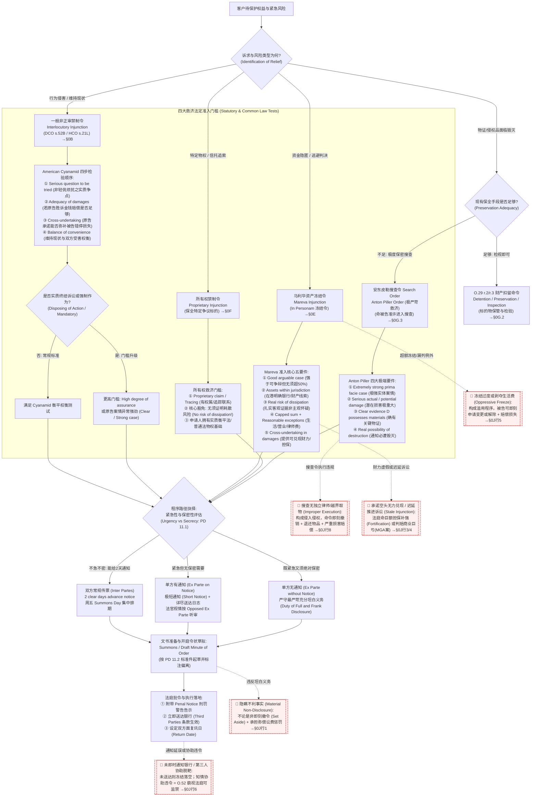
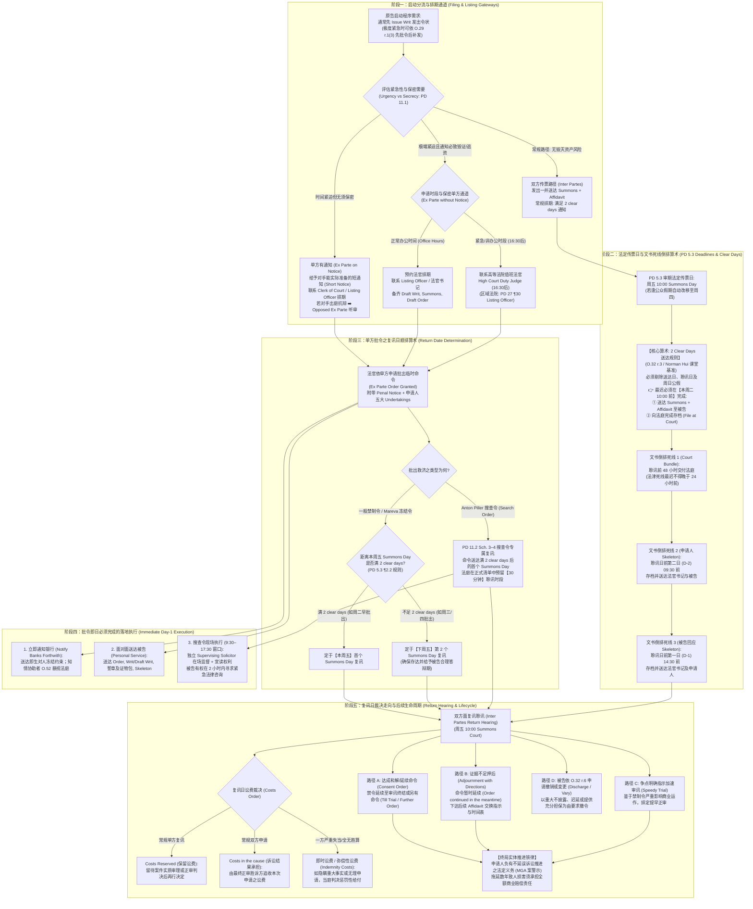

# 临时救济与风险保障体系

## 速读定位层

### 适用范围

本卡处理原告在正审前如何保护权利、资产与证据。§0B 先说明一般 interlocutory injunction；§0C–§0D 处理 undertaking as to damages、fortification、ex parte 路径及 full and frank disclosure；§0E–§0F 区分用于保障判决执行的 Mareva injunction 与用于保存争议财产的 proprietary injunction；§0G 处理 search order。Norwich Pharmacal order 只在电邮欺诈的资金追查中作为银行披露工具出现。中间申请和 security for costs 见 CO07；summary judgment 与 interim payment 见 CO06–09；discovery、证人与专家证据见 CO08；案件管理、PTR 及排期见 CO11；affidavit 起草见 CO16。 <small style="opacity: 0.55">〔CL13 L24 "Lecture Title : 13A Interlocutory Injunctions"〕〔CL13 L770 "a Norwich Pharmacal order requiring the bank to disclose the identity"〕</small>

### 术语

| 术语 | 定义与章节 |
|---|---|
| 禁制令（injunction） | 法院命令：禁止一方实施特定行为，或命其采取特定行动。当申请人寻求此项救济时，须具备独立的实体法权利基础。见 §0B.1。 <small style="opacity: 0.55">〔CL13 L66 "an injunction is an order of the Court that requires a party"；CL13 L68 "remedy, and not to be confused as a cause of action in itself."〕</small> |
| 中间禁制令（interlocutory injunction） | 诉讼终结前的临时救济：当案件处于诉讼初期或审讯之前，为维持现状（status quo）直至进一步命令或全案判决，法院可命令受令方暂停特定行为。见 §0B.2。 <small style="opacity: 0.55">〔CL13 L90 "a provisional measure taken at the earliest or near the commencement of proceedings"；CL13 L154 "to maintain the “status quo” between the parties"〕</small> |
| 短期临时命令（interim order for injunction） | 存续期极短的临时命令：当情况紧急或需迅速安排双方聆讯时，法院可批出仅有效至特定时点（例如至两日后上午 09:30 或最早可听取双方陈词之日）的禁制令。见 §0B.2。 <small style="opacity: 0.55">〔CL13 L88 "a very specific and usually short period of time"〕</small> |
| 防止将来侵害的禁制令（quia timet injunction） | 预防性禁制令：当侵权或违法行为尚未实际发生时，若申请人能证明自身权利面临实质侵害前景或将遭受严重损害的现实危险，则法院可提前批令禁止。见 §0B.2。 <small style="opacity: 0.55">〔CL13 L94 "fears that a wrong will be done to it if no order is made"〕</small> |
| undertaking as to damages（亦称 cross-undertaking as to damages） | 申请人向法院作出的法定承诺：若日后查明该禁制令本不应批出，则申请人须赔偿被告（及受令影响的第三方）因此遭受的一切损失。见 §0C.1。 <small style="opacity: 0.55">〔CL13 L254 "given to the Court, not to the party enjoined"〕</small> |
| fortification（强化担保） | 对损害赔偿承诺的履约担保：若申请人自身财力不足或存在兑现风险，则法院可命其提供银行担保、独立保证书或缴存保证金；在禁制令批出后，法院亦可应被告申请随时命其强化担保。见 §0C.3。 <small style="opacity: 0.55">〔CL13 L264 "the fortification of the undertaking by giving security, such as by a bond"；CL13 L264 "power to order fortification of an undertaking in damages after an injunction has been granted"〕</small> |
| full and frank disclosure（充分而坦白的披露） | 单方申请中的法定披露义务：当申请人以 ex parte（单方）方式申请救济时，必须主动向法官全盘披露所有重要事实（包括对自身不利的抗辩与证据）；若日后发现存在重大隐瞒（material non-disclosure），则法院通常不问案情是非直接撤销原令并判处惩罚性讼费。见 §0D.2、§0D.4。 <small style="opacity: 0.55">〔CL13 L468 "make “full and frank disclosure” of all material facts"；CL13 L468 "may be set aside without regard to the merits"〕</small> |
| 资产冻结令（Mareva injunction） | 对被告资产处置权的衡平法限制：当存在资产耗散风险时，法院禁止被告在判决前处置或转移其资产，以保障日后胜诉判决能够实际执行；但原告不会因此取得优先受偿地位或担保物权。见 §0E。 <small style="opacity: 0.55">〔CL13 L638 "seizure of assets so as to preserve them for the benefit"〕</small> |
| good arguable case | 资产冻结令的实体法准入测试：当申请人请求冻结令时，须就其实体申索提出强于勉强可争辩的案情（不以胜算超过五成为必要，但须有稳固的论据基础）。见 §0E.2。 <small style="opacity: 0.55">往届 · 〔CL13 L684 "the preferable threshold test has been held to be “a good arguable case”"；OLD-SET3L13 L502 "More than barely capable of serious argument"·往届仅参考〕</small> |
| real risk of dissipation | 冻结令的事实评估标准：申请人须举证证明，若法院拒绝批出冻结令，则存在因被告不当转移或隐匿资产导致日后判决落空或无法执行的真实风险；法院可综合考察被告过往规避行为、资产流动性质及其商业信用。见 §0E.2。 <small style="opacity: 0.55">〔CL13 L696 "refusal of an injunction would involve a real risk that a judgment or award"〕</small> |
| 搜索令（Anton Piller order） | 民事搜查性质的极端救济：当存在毁灭关键证据的重大危险时，法院命令被告准许点名人员进入其处所检视、复制或扣押所列物品；执行人员不得强行破门，若被告拒绝配合则构成藐视法庭。见 §0G。 <small style="opacity: 0.55">〔CL13 L782 "requiring the defendant to permit the plaintiff (subject to limitations) to enter"；CL13S4 L123 "It does not authorise the breaking down of any doors"〕</small> |
| supervising solicitor（监督律师） | 负责中立把关的专业人员：当法院批出搜索令时，必须委任与申请人及其律师无利益关联且具备执行经验的独立事务律师；由其向被告宣读并解释命令后果，监督搜索全过程并向法庭提交独立执行报告。见 §0G.5。 <small style="opacity: 0.55">〔CL13 L894 "The order should be executed under a supervising solicitor with experience"；📄CL13AX p.25 §4.057–4.059〕</small> |
| Ex parte 与 inter partes | (1) **Inter partes（双方聆讯）：** 诉讼常规路径：申请人按法定送达提前量送达传票与证据，使对方享有实际抗辩与陈词机会。(2) **Ex parte（单方聆讯）：** 异常程序：若情势极为紧急但通知不会挫败救济，则应提供短通知并按 ex parte on notice 聆讯；若一旦通知被告即会转移资产或销毁证据，则申请人须以誓章举证说明为何必须进行 without notice 聆讯。见 §0D.1。 <small style="opacity: 0.55">〔CL13 L454 "only in cases of urgency will the application be made ex parte"；CL13 L460 "or by reason of a need for secrecy"；CL13 L462 "known as “ex parte on notice”"〕</small> |
| 全球冻结令（worldwide Mareva） | 域外资产冻结救济：当申请人能够证明被告在香港本地的资产不足以清偿预期判决，且被告在境外持有可供执行的确定资产时，法院可将其受令范围扩展至全球资产。见 §0E.4。 <small style="opacity: 0.55">〔CL13 L690 "the insufficiency of assets within the jurisdiction to satisfy the plaintiff’s claim"〕</small> |
| Proprietary injunction（所有权禁制令） | 基于财产权益的物权保全令：当原告主张对被告持有的特定资产或可追踪收益享有所有权或衡平法权益时，法院命令保全该项争议财产；此时原告无需举证证明 Mareva 所要求的资产耗散真实风险。见 §0F。 <small style="opacity: 0.55">〔CL13 L748 "on an entirely different premise to a Mareva injunction"；CL13 L752 "there is no need to demonstrate a risk of dissipation"〕</small> |
| Norwich Pharmacal 披露令 | 针对第三方的纯披露衡平命令：当无辜第三方被动卷入或协助了他人的不法行为时，法院可命其向受害人披露侵权人身份或资金流向，以便原告提起诉讼。见 §0E.5、§0E.8。 <small style="opacity: 0.55">〔CL13 L770 "a Norwich Pharmacal order requiring the bank to disclose the identity"〕</small> |

### 环节定位

| 环节 | 实际操作 |
|---|---|
| 识别保护对象 | 申请人先分清要限制行为、保全执行资产、保护争议财产，还是防止毁证，再按 §0B.2 选择措施。 <small style="opacity: 0.55">〔CL13 L68 "an injunction is a form of relief that can be sought either"；CL13 L638 "seizure of assets so as to preserve them"〕</small> |
| 确定门槛 | 申请人须按所求救济证明门槛。Mareva injunction 须证明 good arguable case 及 real risk of dissipation；search order 须证明 strong prima facie case、严重损害及证据在通知后有被毁或移走的真实危险。 <small style="opacity: 0.55">〔CL13 L684 "“a good arguable case”"；CL13 L810 "“serious question to be tried” is simply not enough"〕</small> |
| 准备材料 | 申请人以誓章陈述损害、风险、不利事实及承诺所需财力，并在陈词说明证据如何满足条件。见 §0D.5。 <small style="opacity: 0.55">〔CL13 L536 "limited to evidence necessary to give a clear, concise and fair statement"；CL13 L542 "- 32. The affidavit in support should contain a clear and concise statement of the"〕</small> |
| 决定是否通知 | 申请人说明不能等候普通排期的事实，以及通知是否会挫败保全。见 §0D.1、§0H.1。 <small style="opacity: 0.55">〔CL13 L454 "only in cases of urgency"；CL13 L460 "a need for secrecy"〕</small> |
| 披露与承担责任 | 全盘披露与财务承诺：当单方申请救济而对方未出席时，申请人须主动进行充分查询并向法庭披露不利材料；若申请人自身财力不足以兑现损害赔偿承诺，则须准备提供强化担保（fortification）。见 §0C、§0D.2。 <small style="opacity: 0.55">〔CL13 L474 "make sufficient enquiries before launch of the application"；📄CL13AX p.56〕</small> |
| 递交与聆讯 | 传票排期与紧急出庭：若提起双方申请，依 summons day 规则推进（最迟须于周二 10:00 前完成送达并存档）；若遇极端紧急情况需单方申请，则依值班安排直接联系法庭，由法官审阅誓章及拟定命令草案。见 §0H.5。 <small style="opacity: 0.55">〔CL13 L422 "all papers must be served and filed by Tuesday 10:00 am"；CL13S1 L277 "never be “rubber stamped” by the Court"〕</small> |
| 拟定和送达命令 | 清晰起草与格式规范：命令起草必须客观具体，使受令人在审讯前即可确定受限行为边界；若拟定条款实质偏离 PD 11.2 标准格式，则申请人须在陈词中逐一说明偏离理由。见 §0B.2、§0H.4。 <small style="opacity: 0.55">〔CL13 L104 "identify the prohibited acts in a manner which is not dependent"；CL13 L634 "deviates in a material respect from the standard form"〕</small> |
| 通知第三方 | 向资产持有人送达通知：原告取得冻结令后须立即通知持有被告资产的银行；当第三方接获命令正式通知后，若明知而协助被告违反禁令处置资产，则第三方亦构成藐视法庭。见 §0E.6。 <small style="opacity: 0.55">〔CL13 L718 "served immediately against not just the defendant but also third parties"；CL13S3 L73 "contempt of court for any person notified of this Order knowingly to assist"〕</small> |
| 执行和更新披露 | 受限执行与持续披露义务：执行搜索令时，执行人员须严格依规定时段、限定人数、列明清单及法律特权保障流程办理；当案件处于单方命令存续期内，若案件事实发生重大变化，则申请人须持续向法院主动披露。见 §0G.5、§0D.2。 <small style="opacity: 0.55">〔CL13 L894 "executed under a supervising solicitor with experience"；CL13 L474 "disclose any material change of circumstance"〕</small> |
| Return date 与改令 | 复讯抗辩与救济调整：被申请人可依 O.32 r.6（经有效通知后）申请撤销或变更单方命令：(1) **撤销：** 若主张申请人存在重大隐瞒（material non-disclosure），则被告须举出确凿证据（cogent evidence）；若申请人存在不合理迟延或严重执行越权，亦构成撤令理由。(2) **变更：** 若原令范围过宽或生活/商业费用例外不足，则被告须指出具体受限条款并提出合理的收窄方案。见 §0E.7、§0G.6。 <small style="opacity: 0.55">〔CL13 L604 "varied or discharged after an application is made where there is liberty to apply"；CL13 L722 "there must be cogent evidence of the same"〕</small> |
| 违令 | 执行方须依明确条款及 O.52 程序向法院证明违令；法院可判监禁、罚款或扣押资产。见 §0J 行 9。 <small style="opacity: 0.55">〔CL13 L620 "subject to a contempt of Court as per O 52"；CL13 L734 "fined or your assets may be seized"〕</small> |

## 🗺️ 本卡地图



法院不会因为原告笼统声称“情况紧急”便批出任何一种命令。原告须先选择与风险相符的救济，再证明该救济的独立门槛：(1) 一般 interlocutory injunction 按 American Cyanamid 的顺序审查；(2) Mareva injunction 另须证明 good arguable case 与 real risk of dissipation；(3) proprietary injunction 以争议财产的权属联系为基础，无须证明耗散风险；(4) search order 要求 strong prima facie case，并须证明通知后毁失关键证据的真实危险。原告若请求 ex parte 处理，还须解释为何不能等候及为何不能通知；请求搜索时，须进一步证明 delivery up 或 preservation order 不能解决危险。排期见 §0H，程序错误的后果见 §0J。 <small style="opacity: 0.55">〔CL13 L166 "the relevant questions to be answered, in the following order, are"〕〔CL13 L238 "far more reluctant to grant an interlocutory mandatory injunction"〕〔CL13 L682 "establish the right to a Mareva injunction, the following must be proven"；CL13 L696 "(g) There must be the risk of dissipation of those assets so that refusal of"〕〔CL13 L752 "there is no need to demonstrate a risk of dissipation"〕〔CL13 L810 "(a) The existence of a strong prima facie case in a civil cause of action"〕〔CL13 L454 "only in cases of urgency will the application be made ex parte on affidavit"；CL13 L460 "a need for secrecy, particularly where a Mareva or Anton Piller order is"〕〔CL13 L422 "all papers must be served and filed by Tuesday 10:00 am of that same week"〕</small>

| 任务 | 直达 |
|---|---|
| 选择一般禁制令并说明损害 | [§0B：一般禁制令](#0B.%20%E4%B8%80%E8%88%AC%E4%B8%B4%E6%97%B6%E7%A6%81%E5%88%B6%E4%BB%A4%E4%B8%8E%20American%20Cyanamid%20%E6%B5%8B%E8%AF%95) |
| 估算赔偿承诺和强化担保 | [§0C：损害赔偿承诺与强化担保](#0C.%20%E6%8D%9F%E5%AE%B3%E8%B5%94%E5%81%BF%E6%89%BF%E8%AF%BA%E4%B8%8E%E5%BC%BA%E5%8C%96%E6%8B%85%E4%BF%9D) |
| 准备紧急申请及不利证据 | [§0D：单方申请与披露](#0D.%20%E5%8D%95%E6%96%B9%E7%94%B3%E8%AF%B7%E4%B8%8E%E5%85%85%E5%88%86%E8%80%8C%E5%9D%A6%E7%99%BD%E7%9A%84%E6%8A%AB%E9%9C%B2) |
| 冻结资产或处理银行通知 | [§0E：资产冻结](#0E.%20%E8%B5%84%E4%BA%A7%E5%86%BB%E7%BB%93%E4%BB%A4%EF%BC%9A%E5%87%86%E5%85%A5%E3%80%81%E8%8C%83%E5%9B%B4%E5%8F%8A%E6%89%A7%E8%A1%8C) |
| 保护申请人主张所有的具体财产 | [§0F：所有权禁制令](#0F.%20%E6%89%80%E6%9C%89%E6%9D%83%E7%A6%81%E5%88%B6%E4%BB%A4%EF%BC%9A%E4%BF%9D%E5%85%A8%E5%8F%AF%E8%AF%86%E5%88%AB%E8%B4%A2%E4%BA%A7%E5%8F%8A%E5%85%B6%E6%94%B6%E7%9B%8A) |
| 搜索令与执行保障 | [§0G：搜索令](#0G.%20%E6%90%9C%E7%B4%A2%E4%BB%A4%EF%BC%9A%E5%87%86%E5%85%A5%E3%80%81%E6%A0%87%E5%87%86%E6%9D%A1%E6%AC%BE%E5%8F%8A%E6%89%A7%E8%A1%8C) |
| 排期、命令、复讯、后果与 SG 应用 | [§0H–§0K](#0H.%20%E7%94%B3%E8%AF%B7%E3%80%81%E5%91%BD%E4%BB%A4%E8%B5%B7%E8%8D%89%E5%8F%8A%E8%81%86%E8%AE%AF%E5%AE%89%E6%8E%92) |

<!-- BEGIN:cite-legend -->
> [!info]- 引注图例
> 
> | 码 | 文件 | 层级 | 学年 |
> |---|---|---|---|
> | CL13 | [LG13 禁制令及保全](../../04%20Base%20Lectures/00%20This%20Year%20Moodle%202026-27/Lecture%20Outlines,%20Powerpoints%20&%20Materials/LG13%20-%20Interlocutory%20Injunctions,%20Marevas,%20APs.md) | 本届讲义 | 2026-27 |
> | CL7 | [LG7 中间申请和讼费担保](../../04%20Base%20Lectures/00%20This%20Year%20Moodle%202026-27/Lecture%20Outlines,%20Powerpoints%20&%20Materials/LG7%20-%20Drafting%20Summonses.%20Interlocutory%20Applications,%20Security%20for%20Costs.md) | 本届讲义 | 2026-27 |
> | CL9 | [LG9 简易判决与临时付款](../../04%20Base%20Lectures/00%20This%20Year%20Moodle%202026-27/Lecture%20Outlines,%20Powerpoints%20&%20Materials/LG9%20-%20Summary%20Judgment%20Interim%20Payment.md) | 本届讲义 | 2026-27 |
> | CAP-C7 | [PCLL8010 LG7 PT](../../99%20Moodle%20Mirror/Lecture%20Outlines,%20Powerpoints%20&%20Materials/LG7%20-%20Drafting%20Summonses.%20Interlocutory%20Applications,%20Security%20for%20Costs/Panopto%20Captions%20%28local%20export%29/8010_LG07_PT.md) | 本届讲义 | 2026-27 |
> | CAP-C9 | [PCLL8010 LG9 PT](../../99%20Moodle%20Mirror/Lecture%20Outlines,%20Powerpoints%20&%20Materials/LG9%20-%20Summary%20Judgment%20&%20Interim%20Payment/Panopto%20Captions%20%28local%20export%29/8010_LG09_PT.md) | 本届讲义 | 2026-27 |
> | CAP-C13A | [8010_LG13_PT_15166f19.md](../../99%20Moodle%20Mirror/Lecture%20Outlines,%20Powerpoints%20&%20Materials/LG13%20-%20Interlocutory%20Injunctions,%20Marevas,%20APs/Panopto%20Captions%20%28local%20export%29/8010_LG13_PT_15166f19.md) | 本届讲义 | 2026-27 |
> | CAP-C13B | [8010_LG13_PT_52dc6e2a.md](../../99%20Moodle%20Mirror/Lecture%20Outlines,%20Powerpoints%20&%20Materials/LG13%20-%20Interlocutory%20Injunctions,%20Marevas,%20APs/Panopto%20Captions%20%28local%20export%29/8010_LG13_PT_52dc6e2a.md) | 本届讲义 | 2026-27 |
> | CAP-C13C | [8010_LG13_PT_f10c1a36.md](../../99%20Moodle%20Mirror/Lecture%20Outlines,%20Powerpoints%20&%20Materials/LG13%20-%20Interlocutory%20Injunctions,%20Marevas,%20APs/Panopto%20Captions%20%28local%20export%29/8010_LG13_PT_f10c1a36.md) | 本届讲义 | 2026-27 |
> | CAP-C13D | [8010_LG13_PT_296f2068.md](../../99%20Moodle%20Mirror/Lecture%20Outlines,%20Powerpoints%20&%20Materials/LG13%20-%20Interlocutory%20Injunctions,%20Marevas,%20APs/Panopto%20Captions%20%28local%20export%29/8010_LG13_PT_296f2068.md) | 本届讲义 | 2026-27 |
> | CL13S1 | [本届课堂幻灯·CL LG13 1-4（O.29 interlocutory injunction 程序）](../../04%20Base%20Lectures/00%20This%20Year%20Moodle%202026-27/Lecture%20Outlines,%20Powerpoints%20&%20Materials/CL%20LG13%202026-2027%201-4.md) | 本届讲义 | 2026-27 |
> | CL13S2 | [本届课堂幻灯·CL LG13 2-4（Ex parte 与 PD 11.1）](../../04%20Base%20Lectures/00%20This%20Year%20Moodle%202026-27/Lecture%20Outlines,%20Powerpoints%20&%20Materials/CL%20LG13%202026-2027%202-4.md) | 本届讲义 | 2026-27 |
> | CL13S3 | [本届课堂幻灯·CL LG13 3-4（PD 11.2 与 Mareva）](../../04%20Base%20Lectures/00%20This%20Year%20Moodle%202026-27/Lecture%20Outlines,%20Powerpoints%20&%20Materials/CL%20LG13%202026-2027%203-4.md) | 本届讲义 | 2026-27 |
> | CL13S4 | [本届课堂幻灯·CL LG13 4-4（PD 11.2 与 Anton Piller）](../../04%20Base%20Lectures/00%20This%20Year%20Moodle%202026-27/Lecture%20Outlines,%20Powerpoints%20&%20Materials/CL%20LG13%202026-2027%204-4.md) | 本届讲义 | 2026-27 |
> | CL13AX | [本届 LG13 AP Annex 1.pdf（《Commercial Litigation in Hong Kong: A Practical Guide》第 4 章 Anton Piller Orders, Delivery Up of Goods & Search Orders，Norman Hui & Philips Wong 撰，59 页；引注按 PDF 页序 p.N＋章节号 §4.0xx）](../../04%20Base%20Lectures/00%20This%20Year%20Moodle%202026-27/Lecture%20Outlines,%20Powerpoints%20&%20Materials/LG13%20-%20AP%20Annex%201.pdf) | 本届讲义 | 2026-27 |
> | OLD-LG13O | [往届（2025-26）LG13 大纲（与本届大纲经本轮实机 diff：仅日期、目标句、四个“+”新判例与 PD 11.1 段号更新差异）](../../04%20Base%20Lectures/%5BLG13%5D%20Injunctions,%20Marevas%20and%20APOs/LG13%20-%20Interlocutory%20Injunctions,%20Marevas,%20APs.md) | 往届官方 | 2025-26 |
> | OLD-SET3L13 | [往届学生稿·Set 3「LG13 Interlocutory Injunctions: Ex parte Injunctions, Marevas and Anton Pillar Orders」（877 行·非官方）](../../06%20Base%20Exam%20Notes/Set%203/LG13%20Interlocutory%20Injunctions_%20Ex%20parte%20Injunctions,%20Marevas%20and%20Anton%20Pillar%20Orders.md) | 往届学生稿 | 2025-26 |
> | SG8CD | [本届 SG08 主控「00 Classroom & Desk」（Assignment 3 要求与材料状态）](../../01%20SG/SG08%20Drafting%20Affidavit%20and%20Order%20%28Mareva%29/00%20Classroom%20&%20Desk.md) | 凝结层 | 2026-27 |
> | CL13AX2 | [AP Annex 2 update（8页更新表）](../../04%20Base%20Lectures/00%20This%20Year%20Moodle%202026-27/Lecture%20Outlines,%20Powerpoints%20&%20Materials/LG13%20-%20Interlocutory%20Injunctions,%20Marevas,%20APs/LG13%20-%20AP%20Annex%202%20%28update%29.pdf) | 本届讲义 | 2026-27 |
> | S6-AP | [1. SG6 (Civil Procedure 1)](../../04%20Base%20Lectures/00%20This%20Year%20Moodle%202026-27/Small%20Group%20Activity%20Plans/1.%20SG6%20%28Civil%20Procedure%201%29.md) | 本届官方 | 2026-27 |
> | S6-L13 | [LG13 - Interlocutory Injunctions, Marevas, APs](../../04%20Base%20Lectures/00%20This%20Year%20Moodle%202026-27/Lecture%20Outlines,%20Powerpoints%20&%20Materials/LG13%20-%20Interlocutory%20Injunctions,%20Marevas,%20APs.md) | 本届讲义 | 2026-27 |
> | P111 | [PD11.1 - Judiciary Text.md](obsidian://open?vault=3b1e77255f6c6e29&file=output%2Fresearch%2FCivil%20Litigation%20SG08%20-%202026-11-09%2FPD11.1%20-%20Judiciary%20Text.md) | 库外法源 | 2026-27 |
> | P27 | [PD27 - Judiciary Text.md](obsidian://open?vault=3b1e77255f6c6e29&file=output%2Fresearch%2FCivil%20Litigation%20SG08%20-%202026-11-09%2FPD27%20-%20Judiciary%20Text.md) | 库外法源 | 2026-27 |
> | P53 | [PD5.3 - Judiciary Text.md](obsidian://open?vault=3b1e77255f6c6e29&file=output%2Fresearch%2FCivil%20Litigation%20SG08%20-%202026-11-09%2FPD5.3%20-%20Judiciary%20Text.md) | 库外法源 | 2026-27 |
> | SG8AP | [本届 SG08 AP 可读伴生](obsidian://open?vault=3b1e77255f6c6e29&file=output%2Fresearch%2FCivil%20Litigation%20SG08%20-%202026-11-09%2FSG08%20Activity%20Plan%20-%20Readable%20Companion.md) | 本届官方 | 2026-27 |
<!-- END:cite-legend -->

## 0B. 一般临时禁制令与 American Cyanamid 测试

### 0B.1 禁制令的性质、权源与管辖

Injunction 是衡平救济，申请人须有支持救济的权利基础。法院可禁止当事人实施指定行为（prohibitory injunction），或命其采取指定行动（mandatory injunction）。(1) **Interlocutory injunction：** 法院在最终裁定权利前暂时保护有关利益。(2) **Permanent injunction：** 法院在确定实体权利后作最终命令。高等法院及区域法院分别依 HCO（Cap. 4）s.21L 与 DCO（Cap. 336）s.52B（禁制令及委任 receiver 的权力），在认为 just or convenient 时批令，并可施加公正条款。HCO s.21L(3)（保全香港境内资产）授权法院限制当事人移走或以其他方式处置在港资产，无论当事人是否身在香港、在港居住或在港有居籍。 <small style="opacity: 0.55">〔CL13 L66 "an injunction is an order of the Court that requires a party"；CL13 L68 "remedy, and not to be confused as a cause of action in itself."〕〔CL13 L72 "may by order (whether interlocutory or final) grant an injunction or appoint a receiver"；CL13 L76 "shall be exercisable in cases where that party is, as well as in cases"〕〔CL13 L68 "remedy, and not to be confused as a cause of action in itself."〕</small>

普通 interlocutory applications 通常可由 Master 处理；RHC O.32 r.11(1)(d) 与 RDC O.32 r.16(1)(d)（Registrar 与 Master 的管辖限制）原则上把 O.29 Part I（临时禁制令及财产临时保全）的申请排除在 Registrar 和 Master 的权限之外，申请人须向 Judge 提出。法院若须在实体权利尚未裁定前，以可藐视执行的命令限制一方行动或财产处置，须先判断有无批令依据，以及限制范围和条件是否相称。(1) **各方已同意条款：** 依 RHC O.32 r.11(2) 或 RDC O.32 r.16(2)，Registrar 或 Master 可按约定条款批出 injunction，或作财产 detention、custody 或 preservation order。(2) **执行阶段的附随禁制令：** Master 可依 O.50 r.9（charging order 的附随禁制令）或 O.51 r.2（委任 receiver 作 equitable execution 的附随禁制令）批令，范围仅及于相关执行措施所需。[RHC O.32、O.50、O.51](https://www.wipo.int/wipolex/en/legislation/details/6248)；[RDC 对应规则](https://www.wipo.int/wipolex/en/legislation/details/6276)。 <small style="opacity: 0.55">往届 · 〔CL13 L78 "excludes the Registrar and masters under O 29 Pt I."〕〔OLD-SET3L13 L378 "not the Registrar and master (unless by consent of the parties)"·往届仅参考〕〔CL13 L910 "Why are injunctions expressly sought before judges and not masters?"〕〔CL13 L78 "excludes the Registrar and masters under O 29 Pt I."〕</small>

(1) **依附香港实体诉讼的禁制令：** 申请人原则上须指出针对被告、可在实体诉讼中主张的法律或衡平权利（Mercedes-Benz v Leiduck；Xinyuan）。(2) **为域外程序申请 free-standing interim relief：** 自 2009 年 4 月 2 日起，原告可依 HCO s.21M（支援域外程序的临时救济）和 RHC O.29 r.8A（提出该申请的程序），为已经或拟在香港以外开始、且可产生能在港执行的判决的诉讼求令。法院可依 HCO ss.21L、21M 批出临时保护，即使香港没有相应实体诉讼或无权审理实体争议；但若欠缺实体管辖使批令 unjust or inconvenient，法院可依 s.21M(4) 拒绝。[HCO ss.21L–21N](https://www.wipo.int/wipolex/en/legislation/details/6311)。 <small style="opacity: 0.55">〔CL13 L80 "to grant interim injunctions in aid of substantive proceedings commenced outside"〕〔CL13 L528 "interim relief is sought in aid of proceedings outside of Hong Kong"；OLD-SET3L13 L31 "a “free-standing” interlocutory injunction"·往届仅参考〕〔CL13 L80 "to grant interim injunctions in aid of substantive proceedings commenced outside"；CL13 L528 "- 26. Usually the issue of a writ or originating summons and the swearing of"〕</small>

(1) **普通第三方：** 申请人通常通知持有被告资产的银行，无须仅为通知而将银行列为被告；银行知悉现有命令后若故意协助被告处置受令资产，可构成 contempt。通知不能将银行或独立公司的自有资产纳入命令。(2) **Chabra jurisdiction 下的 nominal defendant：** 原告即使没有针对资产持有人的实体诉因，也可将其列为被告，请求直接限制其名下或持有的特定资产，但须有 good reason to suppose 该资产可经法院执行程序清偿针对主要被告的判决。若已有 good arguable case 证明主要被告实益拥有资产，法院无须在临时阶段先作最终产权裁决；仅证明主要被告管理或控制该公司，不能证明公司资产可用于执行针对该人的判决。[Grand Network Technology Ltd v XY, LLC [2017] HKCFA 45 [5]–[8]](https://babelcite.com/case/110791)。 <small style="opacity: 0.55">往届 · 〔OLD-SET3L13 L558 "Mareva injunction may cover assets which, though appear on their face to belong to TP"·往届仅参考〕</small>

(1) **Interlocutory injunction：** RHC O.29 r.1(1)（禁制令申请）容许当事人在审讯前或后申请，即使其 writ、originating summons、counterclaim 或 third party notice 未列该项救济。衡平权益持有人可先起诉并请求临时保护。(2) **Permanent injunction：** 申请人须在 pleadings 中列明该项救济；衡平权益持有人须将法律业权人加入程序，才能取得最终命令（Takmay）。 <small style="opacity: 0.55">〔CL13 L158 "whether or not a claim for the injunction was included"〕〔CL13 L430 "must claim it in their pleadings as a form of relief"〕〔CL13 L428 "owner of an equitable interest to start an action and apply for interlocutory relief"〕</small>


### 0B.2 救济选择、命令分类与条款精度

原告须从要防止的具体失败倒推救济。(1) 被告继续实施涉案行为，可能在正审前造成 damages 无法充分补偿的损失时，原告申请一般 interlocutory injunction。(2) 原告只求金钱判决，但有证据显示被告会不当转移自己的资产，使将来判决无法执行时，原告申请 Mareva injunction；该命令不使原告成为 secured creditor。(3) 原告主张某项资产或 traceable proceeds 本来属于自己时，原告申请 proprietary injunction；争点是财产联系，不是被告一般资产的耗散。(4) 关键证据会在通知后被毁或移走，而普通 preservation order 不足时，原告才申请 search order。Search order 要求被告准许进入，不赋予原告警察式的强行搜查权，也不能充当一般 discovery。若风险只是日后收不回讼费，应转用 CO07 的 security for costs。 <small style="opacity: 0.55">〔CL13 L166 "The law is well established where an interlocutory injunction is"〕〔CL13 L670 "The purpose of the Mareva injunction has been simply stated"〕〔CL13 L752 "For a proprietary injunction the American Cyanamid test is used"〕〔CL13 L810 "(a) The existence of a strong prima facie case in"〕</small>

| 分类 | 适用条件及期限 |
|---|---|
| Interim order for injunction | 法院可在需要短期保护时指定极短期限，例如由批令日至约两日后的 9:30，或至最早可以举行双方聆讯的时间。 <small style="opacity: 0.55">〔CL13 L86 "An injunction is further classified by the duration of time"〕〔CL13 L88 "a very specific and usually short period of time"〕</small> |
| Interlocutory injunction | 此为诉讼开始或接近开始时可以寻求的过渡救济，通常持续至进一步命令或判决。 <small style="opacity: 0.55">〔CL13 L90 "a provisional measure taken at the earliest or near the commencement"〕</small> |
| Permanent injunction | 法院全面评估证据后方可给予最终禁制令，通常在审讯后作出。 <small style="opacity: 0.55">〔CL13 L92 "obtained after the full assessment of the evidence"〕</small> |
| Quia timet injunction | 即使侵害尚未发生，申请人仍可求令，但须举证说明有实际发生侵害的前景，以及若法院不现在介入会有什么损害。没有同类侵害的往绩时，法院可降低对预测证据的评价（Morris v Redland Bricks）。 <small style="opacity: 0.55">〔CL13 L94 "fears that a wrong will be done to it if no order is made"〕</small> |

拟令应注明申请是 ex parte 还是 inter partes，写明命令期限，并以可识别的行为和标的写出禁止事项或履行义务。例如，申请人可请求禁止被告把物件放在指定车位，并在条款中写明该限制包括车牌 AA 1234 的车辆。命令若要求积极行动，须让被告在事实上知道该做什么（Morris v Redland Bricks）；申请人明言不拟执行某条款，法院不应批出该条款（IO of Jade Plaza）。保护机密的命令须写明哪些资料受限制，不能让被告等审讯才知道能否使用（Potters-Ballotini，Lord Denning）；同理，任何临时命令均不能把辨认受禁行为的工作留待正审裁断（The Staver）。命令不明确或范围过宽时，法院可拒批、改写或撤销；见 §0J 行 5。 <small style="opacity: 0.55">〔CL13 L110 "An (ex parte / inter partes) interlocutory prohibitory injunction requiring the defendant"〕〔CL13 L96 "If an injunction is to be granted it must be precise"〕〔CL13 L98 "ought to be such that the party affected can know with certainty"〕〔CL13 L104 "identify the prohibited acts in a manner which is not dependent"〕</small>

### 0B.3 衡平裁量下的拒批因素

无论申请最终或中间禁制令，即使申请人在时效内提出诉讼并能证明侵权，法院仍可拒绝衡平救济。申请人可能仍可请求损害赔偿或其他适当救济。 <small style="opacity: 0.55">〔CL13 L114 "the Court may still refuse the plaintiff an injunction"〕</small>

| 因素 | 法院考虑的事实及后果 |
|---|---|
| Adequacy of damages | 如金钱可以充分补偿申请人，尤其有关行为已停止且无再犯迹象，法院通常不授禁制令。见 Proctor v Bayley。 <small style="opacity: 0.55">〔CL13 L118 "prima facie you do not obtain an injunction to restrain wrongs"〕</small> |
| 危险的程度与发生机会 | 若申请人尚未蒙受实际损害，应证明危险迫近且一旦发生会造成重大损害；法院综合考量两者。见 Earl of Ripon v Hobart、Fletcher v Benley。 <small style="opacity: 0.55">〔CL13 L120 "to balance the magnitude of the evil against the chances of its occurrence"〕</small> |
| Clean hands | 以不正当手段取得或维持秘密的人，其求法院保护有关秘密的请求可因衡平裁量被拒。见 Hubbard v Vosper。 <small style="opacity: 0.55">〔CL13 L122 "do not come with “clean hands” to the court"〕</small> |
| Acquiescence | 若申请人知悉被投诉行为仍在发生，也知道自己享有相应权利，却未及时提出异议，法院可将其袖手旁观纳入裁量。见 Armstrong v Sheppard & Short。 <small style="opacity: 0.55">〔CL13 L124 "stands by while the act complained of is still taking place"〕</small> |
| Laches | 申请人知悉侵害后无理拖延，会削弱其证明现在仍有 irreparable harm 的能力（Legg v ILEA）。Giant Crystal 认定该案三个月已属过久；若时间过去后禁制令已无法阻止损害，法院不会作徒劳的命令（Re Chau Cham Wong）。 <small style="opacity: 0.55">〔CL13 L126 "unreasonable inaction by the plaintiff after the infringement"；CL13 L128 "considered a delay of 3 months to be inordinate delay"；CL13 L130 "Equity does not act in vain"〕</small> |
| 侵害琐细或措施失称 | 若仅有名义赔偿的基础，或强制履行的负担显著超出申请人所得利益，法院可拒绝禁制令。见 Behrens v Richards、Sharp v Harrison。 <small style="opacity: 0.55">〔CL13 L132 "Infringement of the plaintiff’s right(s) are trivial."〕</small> |
| 大厦公契下的侵占 | 公契权利人可请求最终强制令排除侵占；曾同意占用不当然产生永久权利，该许可至多可能是可任意终止的 bare licence。无理抵抗可导致判 indemnity costs。见 Fan Tony v IO of Kung Lok Building。 <small style="opacity: 0.55">〔CL13 L136 "an award of indemnity costs against the defendant"〕</small> |

(1) **Acquiescence：** 申请人知道对方仍在作出被投诉的行为，也知道自己有权反对，却一直未提出异议，法院可据此拒绝衡平保护。(2) **Laches：** 申请人无理拖延申请，法院可据此认为没有迫切的 irreparable harm（Nerium）。King Fung 以约六周无解释的迟延或约三个月有解释的迟延作为判断是否及时申请的实务尺度；Norman Hui 的课堂参考为约六至十周（ASR 案名为 Harbor Fit Seafood）。申请人须说明迟延原因及损害为何仍在发生或迫近。见 §0J 行 3。 <small style="opacity: 0.55">〔CL13 L138 "most usually affect interlocutory injunctions"〕〔CL13 L196 "a period of six weeks or so of unexplained delay and three months with an"〕〔CAP-C13A L1743-L1745 "And under the case of Harbor Fit Seafood, the general Marker of time is six to about"〕</small>

### 0B.4 American Cyanamid：按顺序审查争点、赔偿与不公风险

依 *American Cyanamid Co v Ethicon* [1975] AC 396，法院依次审查：(1) 是否有 serious issue to be tried；(2) 拒令后 damages 能否充分补偿申请人；(3) 批令后 undertaking as to damages 能否充分补偿被申请人；(4) 如赔偿能否补足仍有疑问，balance of convenience 倾向何方。课堂以专利缝合线案把两个赔偿方向分开，因而列为四步。中间阶段可能尚无完整诉答、文件披露或正审盘问，法院不宜最终裁断事实，而应比较哪种临时安排能维持 status quo 并带来 lower risk of injustice。 <small style="opacity: 0.55">〔CL13 L164 "was and still is defined by the House of Lords in the case of American Cyanimid"〕〔CL13 L150 "is without “proving” the case"〕〔CL13 L154 "to maintain the “status quo” between the parties"〕〔CL13 L166 "the relevant questions to be answered, in the following order, are"〕〔CAP-C13A L837-L838 "you must, as the applicant, satisfy these steps in the order in which they are presented"〕</small>

1. **Serious issue to be tried。** 申请人须提出非轻率、非骚扰性的真实争议。法院不以申请人有超过五成胜算为前提，也不在此阶段解决誓章冲突或疑难法律争议。Re Billion Shipping 强调门槛不高；Alfred Dunhill 以 90% 与 20% 对照说明法院并非评定概率；Fortune Realty 容许形成暂定看法，由法官控制评估深度。Hengshi 所说明的根本考虑，是选择在判断出错时仍具有 lower risk of injustice 的做法。门槛虽低，申请人仍须以证据交代争议。 <small style="opacity: 0.55">〔CL13 L180 "if the discretion were clogged by a technical rule forbidding its exercise"；CL13 L182 "it is no part of the court’s function at this stage of the litigation"〕〔CL13 L184 "must be satisfied that the claim is not frivolous or vexatious"〕〔CL13 L184 "not a very steep hurdle"；CL13 L186 "not to embark upon a mini-trial on the affidavits"〕〔CL13 L188 "take whichever course appears to carry the lower risk of injustice"〕〔CL13 L166 "The law is well established where an interlocutory injunction is"〕〔CAP-C13A L891-L892 "There is a serious question to be tried"〕〔CL13 L168 "Is there a serious issue to be tried"；CL13 L178 "does not need to show a prima facie case"〕</small>
2. **审查拒批禁令后，damages 能否充分补偿原告。** 假设法院拒令，被告在候审期间继续实施涉案行为，而原告最终胜诉：若原告在此期间的损失既能以金钱准确计算，被告又有足够财力实际支付，则 damages would be an adequate remedy。无论原告的实体案看起来多强，法院原则上均不批出临时禁制令。原告要突破该门槛，须证明损失客观上难以量化，例如商誉减损或客源流失，或证明被告将来无力偿付。被告则可用账目、保险或其他偿付资料证明金钱救济可行，并以原告的无解释迟延反驳其所谓损害“紧迫且不可弥补”。法官借此避免在损失可以事后补偿时，未经正审便限制被告的行动。 <small style="opacity: 0.55">〔CL13 L194 "would be an adequate remedy and the defendant would be in a financial position"〕〔CL13 L200 "although the loss is financial it is not capable of precise calculation"〕〔CL13 L196 "The plaintiff must be aware and accept that delay in issuing proceedings is a relevant"〕〔CL13 L194 "“The court should go on to consider whether…if the plaintiff"〕</small>
3. **审查批令后，undertaking as to damages 能否充分补偿被告。** 只有原告已证明 damages 对自己不足，法院才转而假设另一种错误：法院先批令，但原告最终败诉。此时，被告须指出禁令会造成什么损失，以及为何该损失难以量化或无法通过原告的 undertaking as to damages 实际获偿。原告则须说明由谁作出承诺、其财力如何，以及能否在法官要求时提供 fortification。若承诺足以覆盖被告的可赔损失，法院不会仅因批令可能使被告受损而拒令；若原告没有偿付能力，法院可拒批或以提供担保为条件。见 §0C。 <small style="opacity: 0.55">〔CL13 L202 "the defendant would be adequately compensated under the plaintiff’s undertaking"；CL13 L202 "there would be no reason to refuse"〕〔CL13 L200 "(a) The court should consider whether, if the plaintiff succeeds"〕</small>
4. **双方的 monetary remedies 均不能排除误判风险时，比较 balance of convenience。** 法官须比较两种错误各会造成什么后果：拒令但原告后来胜诉，或者批令但被告后来胜诉。N.W.L. v Woods 把维持 status quo 作为减少误判损害的审慎做法；Films Rover 与 Music Advance 则要求法院选择 lower risk of injustice。原告应以具体事实说明拒令会造成不可逆损害；被告可证明禁令会中断营业、改变既有状态或实际提前执行原告的最终救济。若批令本身会给被告造成不可弥补损害，法院可要求原告对最终胜诉达到 high degree of assurance（Shih-Hua）。若原告权利明确且被告没有 arguable defence，法院无须再作通常的 balance of convenience（Yeko Trading）。涉及机密资料与表达自由时，法官还须审查限制发表是否必要且相称，并把保护保密关系与公众发表、接收资料的利益一并纳入衡量（[HKU v Hong Kong Commercial Broadcasting [2015] HKCFI 2178](https://babelcite.com/case/101619)）。 <small style="opacity: 0.55">〔CL13 L210 "where there is doubt as to the adequacy of the respective remedies"〕〔CL13 L216 "It is a “counsel of prudence” to take such measures to preserve the “status quo”"〕〔CL13 L218 "the Court may require a high degree of assurance"〕〔CL13 L220 "it is not necessary for the court to consider the issue of “balance of convenience”"〕〔CL13 L222 "conflicting public interests such as freedom of speech and the duty of confidence"〕〔CL13 L206 "“balance of convenience” –"〕〔CAP-C13A L1224-L1231 "such unassailable rights"〕〔CL13 L220 "a case there is no arguable defence and that"〕</small>

> **Exam / Drafting Formulation:** "The applicant must show a serious issue to be tried. If damages are inadequate, the court considers the undertaking as to damages and then, where necessary, the balance of convenience and the course carrying the lower risk of injustice."

**攻防落点。** 原告不能只写“损害不可弥补”，而要把损害拆成能够由证据验证的项目：独特标的会否毁损、客户是否会永久流失、商誉损失为何无法准确计价，以及被告是否有财力支付。被告应反过来指出损失可计算、已有保险或其他金钱补救，并提出较窄措施。法官据此判断是否必须立即限制行为，还是让实体争议留待正审并以 damages 处理。 <small style="opacity: 0.55">〔CL13 L194 "“The court should go on to consider whether…if the plaintiff"〕</small>

### 0B.5 相对实力与强制性临时禁制令

原则上，法院只确认有 serious issue to be tried，不在临时阶段裁断最终胜负；否则 interlocutory hearing 会变成没有完整 discovery 和 cross-examination 的 mini-trial。下列情况会提高法院审查 merits 的深度。 <small style="opacity: 0.55">〔CL13 L226 "the normal rule that the parties can properly have their disputes await trial"〕</small>

| 适用情形 | 评估方式 |
|---|---|
| 一般测试仍无明确结论 | 法院仅在最后阶段考虑相对强弱，并须具备可信争议甚少而能明显区分实力的基础。见 Entec (Pollution Control)、Series 5 Software。 <small style="opacity: 0.55">〔CL13 L228 "except as a last resort, does the Court look at the merits"〕</small> |
| 临时命令实际会 dispose of the action | 法院评估申请人胜诉的实际可能性，无须达到全面审讯的深度。若临时限制条款在审讯前届满等原因使裁定实际上终局，则法院可要求申请人达到 at least likely to succeed at trial 的门槛。见 Zheng Lie Lie (No.1)、Brave Venture（CA）。 <small style="opacity: 0.55">〔CL13 L232 "dispose of the action due to the circumstances of the case"；CL13 L248 "the required standard being “at least likely to succeed at trial”"〕</small> |
| 事实无真实争议且各方同意即时处理 | 法院可按审讯处理申请并作最终命令。见 IO of Viking Garden v Golden Brains。 <small style="opacity: 0.55">〔CL13 L236 "no real dispute regarding the facts (2) there is agreement by the parties"〕</small> |

Mandatory injunction 命被告积极改变现状；一旦执行，后来胜诉的被告未必能恢复原状。因此原告除须满足 American Cyanamid 外，还须以更强的 merits 及损害证据说明为什么现在就要强制行动。De Falco、TKI 与 Shepherd Homes 以 high degree of assurance 或 strong prima facie case 表达这项较高要求；Pfizer 强调此类救济属例外。被告的主要反击是指出拟令会改变 status quo、所需行为难以逆转，或实际提前给予原告最终救济。若临时命令会 dispose of the action，例如限制期将在正审前届满，法院可要求原告证明 at least likely to succeed at trial（Brave Venture；TGI Friday’s）。Films Rover 与 Music Advance 的控制原则仍是 lower risk of injustice：法院对实体案越有把握，因误判产生的不公风险越低；即使未达到惯常表述的 high degree of assurance，若拒令造成的不可逆损害明显更大，法院仍可按整体公正批令。 <small style="opacity: 0.55">〔CL13 L238 "far more reluctant to grant an interlocutory mandatory injunction"〕〔CL13 L240 "considered to be exceptional"〕〔CL13 L242 "the plaintiff should show they have good prospects of success on the merits"〕〔CL13S1 L193 "The ultimate question is: what is the course to adopt which involves the least injustice"〕〔CL13 L246 "the principal concern of the court is that it might make a wrong decision"〕〔CAP-C13A L1548-L1563 "the plaintiff's case had to be made out to a higher standard of proof than is"〕〔CL13 L218 "The authorities emphasize, in particular, the need to take account of such special factors as"；CL13 L248 "- If a decision regarding the grant of an injunction has the nature and effect"〕</small>

> **Exam / Drafting Formulation:** "Where the interim order would effectively dispose of the action, the court may require the applicant to show that it is at least likely to succeed at trial."

### 0B.6 特殊诉因的适用边界

| 诉因 | 规则与操作边界 |
|---|---|
| 违反保密义务 | 原告须逐项证明：(1) 资料本身具有保密性质；(2) 被告在承担保密义务的情况下取得资料；(3) 被告未经授权使用资料（Lam Tai Hong）。原告不能只靠 “confidential” 标签；但若公开资料经投入劳动编排成具有商业价值的组合，整体仍可受保护（Robb v Green；Centaline）。被告可反击该资料已属行业公知，或只是自己的一般技能与记忆。没有 non-solicitation 或 restraint of trade clause 时，前雇员原则上可接触旧客户（Diamond Stylus）。供应商或制造商名单与客户名单没有法律上的当然差别，是否保密仍取决于形成名单的投入、非公开程度及商业用途（Yeko Trading；Gilman Engineering）。 <small style="opacity: 0.55">〔CL13 L272 "three elements had to be proved for a claim to succeed"；CL13 L278 "A list of customers has always been jealously guarded"；CL13 L284 "(ii) There is no valid distinction between a customers’ list and a suppliers’ or manufacturers’"〕</small> |
| 明示消极契约及限制契约 | (1) **普通 express negative covenant：** 如果承诺表面有效且有 serious issue to be tried，Fellowes & Son 中 Lord Denning 的进路倾向执行明示承诺。若承诺表面无效，则可拒批；Fellowes & Son 的法院多数也审查 balance of convenience，最终拒令。土地契约较常适用执行承诺的进路；若禁令限制公众使用场所或行使权利，法院须把该公共利益纳入 balance of convenience（Times Square）。 (2) **雇佣或营业的 restraint of trade：** 法院须核对 legitimate interest 及限制范围；若条款将在审讯前届满，临时命令可实际 dispose of the action，法院须评估原告在正审胜诉的实际可能性，并衡量禁令会否阻断被告就业或经营（Lansing Linde）。 <small style="opacity: 0.55">〔CL13 L292 "the balance of convenience test is not applied since the defendant’s “promise”"；CL13 L294 "there is “less controversy” to the principle that the balance of convenience"〕</small> |
| 雇佣限制 | 雇主不得用 covenant 单纯防止竞争，或阻止前雇员运用一般技能、知识及工作经验。若雇主证明条款保护 trade secrets 或 trade connections，仍须证明限制对双方及公众均合理，且没有超出保护该利益所需的范围；限制越重，雇主的举证负担越重（Midland Business Management；Herbert Morris；Degreeasia 采 Office Angels）。法院按订约时的情况审查期限、地域及所禁活动（Rock Refrigeration；Susan Buchanan）。Ho Wing Cheong 中三年客户联系限制超出所需，法院拒绝执行该期限。 <small style="opacity: 0.55">〔CL13 L314 "the onus of proving the reasonableness of the restriction rests on the party"；CL13 L330 "judged as at the time of the making of the contract"；CL13 L336 "reasonable in the duration, as to the geographical area"；CL13 L352 "the period of 3 years was in my judgment longer than was reasonably required"；CL13 L356 "“33. The law on enforceability of restrictive covenants in an employment contract is later conveniently"〕</small> |
| Legitimate interest | 原告要指出可视为业务财产的具体资产或优势，例如 trade secrets 或 trade connections，并解释若准许被告据为己用，为何会损害原告的正当业务利益（Stenhouse）。在 Store Friendly，法院确认所求限制保护该类利益后，再审查 balance of convenience；证明利益存在只解决保护对象的问题，原告还须证明临时限制的范围及后果支持批令。 <small style="opacity: 0.55">〔CL13 L310 "advantage or assets inherent in the business"〕</small> |
| 竞业限制的临时效力 | 若审讯很可能晚于限制期结束，法院须在申请阶段评估临时命令是否会实际执行余下全部限制期（Lansing Linde）。若法院最终认定期限过长而拒绝执行条款，被告可请求按 cross-undertaking as to damages 赔偿禁令造成的损失（Ho Wing Cheong）。 <small style="opacity: 0.55">〔CL13 L306 "the length of delay to trial might be a factor"；CL13 L306 "might be held liable on its cross undertaking as to damages"〕</small> |
| Fiduciary duty 与 springboard injunction | (1) **Fiduciary duty claim：** 原告须指出雇员承担的具体受信义务及违反义务的行为。 (2) **Springboard injunction：** 原告须指出不当行为带来的 head start 仍如何使被告获益，并把禁令范围和期间限于消除该优势所需；仅证明既往违责，不能证明此时仍有优势需要消除（McLarens v Poon Chi Fai Corey）。 <small style="opacity: 0.55">〔CL13 L372 "different from a “Springboard” injunction which prevents a “head start”"〕</small> |
| 商业秘密 | 雇主须识别具体资料，并证明该资料用于业务、未公开、可与雇员自由使用的一般知识区分，向竞争者披露会造成真实重大损害，而且雇主实际限制了传播（AXA China）。被告可证明资料已经行业公知（Saltman），或只是其记忆中的非秘密经验（Printers & Finishers）。CSAV 判定一般电邮通讯名单和酒会出席名单不具足够保密性质，说明原告不能把普通业务联系人一概包装成 trade secrets。 <small style="opacity: 0.55">〔CL13 L374 "used in a trade or business"；CL13 L386 "not all information is confidential and indeed some information can be removed"；CL13 L390 "See also: CSAV Group (Hong Kong Limited) v Norasia Container Limes Ltd. & ors [2006]"〕</small> |
| 忠诚及诚信 | 雇主可依据雇员的 implied duty of fidelity 或具体 fiduciary duty 起诉，但必须指出该义务由什么关系产生、雇员实施了什么违责行为，以及禁制令要阻止什么仍在持续的后果。仅列出 “good faith” 或 “fidelity” 标签，不能证明现在需要禁制令（Kao, Lee & Yip v Koo；Deacons v White & Case）。 <small style="opacity: 0.55">〔CL13 L392 "Claims for breach of good faith, implied duty as an employee and fidelity (see: Kao,"〕</small> |
| 诽谤与机密披露 | (1) **诽谤：** 被告提出有实际基础的 truth 或 justification 抗辩时，法院通常不在中间阶段限制发表，免得在正审前先行裁断真伪，并须顾及表达自由与陪审审讯（Holley v Smyth）。 (2) **政府机密：** 政府须指出披露会对国家安全等受保护利益造成的具体损害；法院比较维持保密与限制发表各自造成的不公（A-G v SCMP）。 <small style="opacity: 0.55">〔CL13 L394 "not normally granted where the defence is that of justification"〕</small> |
| Passing off、商标与版权 | 被告持续以争议名称或 get-up 营业并累积商誉时，原告迟延会使 balance of convenience 倾向被告（Harbour Fit）。若侵权会削弱标记的独特性或造成客源流失，而原告难以量化损失，damages 通常不足（Interactive Media）。判断 trade mark infringement 时，法院看相关消费者在实际购买场景下会察觉什么：BP Amoco 的驾车者从远处先看到加油站的绿色檐篷和标牌，在识别细小的「TOP」字样前已可能误认是 BP 油站，因此「TOP」未成为造成混淆的 sign 的一部分。 <small style="opacity: 0.55">〔CL13 L396 "the Court in particular will expect the plaintiff to act with speed"；CL13 L398 "difficult to quantify, and can rarely be adequately compensated"〕</small> |
| 本地商誉归属 | 本地经营者获准使用外国名称或商标后，法院先看双方是否约定在港商誉归谁；有约定即按约定处理。没有约定时，法院依使用方式及本地经营证据认定 goodwill 归属，不因商标或名称属于外国一方即推定商誉也属于该方（Guangzhou Green-Enhan）。 <small style="opacity: 0.55">〔CL13 L400 "a question of fact to be decided on the evidence"〕</small> |

## 0C. 损害赔偿承诺与强化担保

### 0C.1 承诺的性质与执行

法院批出 interlocutory injunction 时，通常要求申请人向法院作 undertaking as to damages。该承诺由法院执行，受令者不能将其当作双方之间的独立合同起诉。若法院后来认定禁制令不应批出，受令者可请求执行承诺。依 Chinacast：(1) 法院先决定是否批准执行；(2) 批准后，受令者须证明损失由禁制令造成，且并非过于遥远，法院再评定金额。 <small style="opacity: 0.55">〔CL13 L252 "give an undertaking to pay damages to the defendant for any loss suffered"〕〔CL13 L254 "given to the Court, not to the party enjoined"〕〔CL13 L254 "The nature of the undertaking in damages is that it"〕〔CAP-C13A L1275-L1282 "It's a promise given to the court."〕〔CL13 L572 "- (1) to give an undertaking in damages;"〕</small>

> **Exam / Drafting Formulation:** "The Applicant undertakes to comply with any order the Court may make as to damages if the Court later finds that this order has caused loss for which the Applicant should compensate the Respondent."

法院可在实体争议尚未裁断时，凭申请人向法院作出的 undertaking as to damages 先给予临时保护。尤其在 ex parte 批令后才听取对方的案件，申请人若不能证明有财力兑现承诺，该承诺便不足以保护被申请人，法院可要求补充财力证据、fortification，或拒绝批令（Wah Nam）。申请人取得指示时须确认承诺责任和实际可动用的财力；签署模板不能证明偿付能力。 <small style="opacity: 0.55">〔CL13 L256 "a safeguard for the defendant"；CL13 L258 "doubts as to the plaintiff being good for the cross-undertaking"〕</small>

### 0C.2 财力与披露

| 情形 | 事实要求与裁量 |
|---|---|
| 申请人不能证明财力 | 履约能力举证不足：当申请人未能提出确凿证据证明自身具有履行损害赔偿承诺的实际财力时，法院可直接拒绝批出禁制令；例如在 Lau Tak Wah Andy v Hang Seng Bank 案中，原告即因未举证财务能力而败诉。课堂以 Andy Lau 与 TVB 案情特别提示：申请人本人的社会知名度绝不能替代具体的资产与财力证明。 <small style="opacity: 0.55">〔CL13 L260 "turned on the failure or absence of a plaintiff showing its means"〕〔CAP-C13A L1374-L1382 "but more importantly, he lost the case on the cross undertaking NC damages."〕</small> |
| 实体案特别有力 | 实体申索极强时的例外衡量：法院通常须严格审查损害赔偿承诺能否实际兑现；但若案件证据显示申请人的实体胜诉希望极高，且若拒发禁令将给申请人造成难以挽回的损害，则法院仍可权衡利弊后批出禁制令，并承担日后承诺可能无法完全兑现的风险（Fleming Fabrications／RBG Resources）。 <small style="opacity: 0.55">〔CL13 L262 "accepting the risk that the undertaking may not be honoured if called"〕</small> |
| 单方申请中出现财力问题 | 单方申请中的财务状况披露：当申请人的财力疑点足以实质影响法院是否批令或是否命令强化担保时，申请人须在单方（ex parte）聆讯中主动向法庭全盘披露；若申请人隐瞒自身财务困境等重要事实（material facts），则法院事后查明可直接撤销禁令（New Asia 所适用的 Manor Electronics 和 Wah Nam）。 <small style="opacity: 0.55">往届 · 〔📄CL13AX p.56〕〔OLD-SET3L13 L284 "the duty of full and frank disclosure will require P to also provide"·往届仅参考〕</small> |
| 申请 Mareva injunction | 资产冻结令中的强制承诺要求：申请人向法院申请 Mareva 冻结令时，必须提供 undertaking as to damages；若日后法院认定该冻结令本不应批出，则被告有权依此承诺请求赔偿因资产遭冻结而遭受的一切损失；若申请人拒绝作出该项承诺，则法院绝对不予批令。 <small style="opacity: 0.55">〔CAP-C13C L441-L445 "an undertaking as to damages that must be there or it's going to get chucked out"〕</small> |

### 0C.3 强化担保的条件与计算

若 undertaking as to damages 可能难以兑现，被申请人可请求法院要求申请人以保证金、保函或缴存款项等方式提供保障。法院也可在批令后作此要求，即使批令当时无人提出（Elegant Jump）。如证明禁令不当取得，通常可请求执行承诺，法院仍保留是否执行的裁量。 <small style="opacity: 0.55">〔CL13 L264 "the fortification of the undertaking by giving security, such as by a bond"；CL13 L264 "after an injunction has been granted despite there being no application"〕〔CL13 L264 "will normally be enforced if the injunction was wrongfully obtained"〕〔CL13 L264 "As a further condition, the Court may require the fortification"〕</small>

(1) **Fortification：** 被告若以证据显示禁令可能造成重大损失，且执行 undertaking as to damages 时确有无法获偿的风险，可要求原告提供保函或缴存款项（Banco de Chile）。被告须以净利润、固定开支或其他可验证资料估计损失，不能只报营业额；原告可质疑损失是否由禁令造成、估算期间是否过长，或其财力是否已足以履行承诺。法院可按现有证据作宽幅估算（AMD Pack Rack）；Fabrique Ebel 在搜索令执行后的中间阶段要求 HK$1.5 million。(2) **Security for costs：** 被告担心胜诉后收不回讼费时，须另证相应的法定 ground；该担保不覆盖禁令损失。拒批、撤销或附加条件见 §0J 行 4。 <small style="opacity: 0.55">〔CL13 L264 "Granting of fortification was different from security for costs"；CL13 L264 "whether the estimated loss of the defendant was a significant one"〕〔📄CL13AX p.25 §4.062〕〔📄CL13AX p.56〕</small>

**Norman Hui 的课堂算例。** 被申请人以可证明的净利润损失，而非营业额，估计禁令对营业的影响。若每月净利润损失 HK$100,000，且距正审尚有 12 个月，法院可用 HK$1,200,000 估计 fortification，并可在命令中规定申请人须于 28 天内缴存该金额，逾期则禁令解除。 <small style="opacity: 0.55">〔CAP-C13A L1410-L1444 "You must fortify your undertaking"〕</small>

> **Exam / Drafting Formulation:** "The Respondent seeks fortification of the undertaking in the sum of HK$1,200,000, representing twelve months of evidenced net profit at HK$100,000 per month."

### 0C.4 申请前须取得的承诺指示

| 事项 | 申请人须说明的内容 |
|---|---|
| undertaking as to damages | 损害赔偿承诺的主体与形式：必须明确由谁向法院作出承诺（通常为申请人本人；若为离岸公司或资力存疑主体，则须由母公司或实际控制人共同作出），并严格按标准格式写入拟定命令中；PD 11.1 ¶38(1) 及 §0H.3 另列具体安排。 <small style="opacity: 0.55">〔CL13 L572 "to give an undertaking in damages"〕</small> |
| 其他承诺 | 程序推进与第三方保障承诺：申请人须确认能否依 PD 11.1 ¶38(2)–(5) 作出单方批令的通常法定承诺：当命令批出后，须立即（forthwith）以妥当方式通知被告；若涉及第三方银行或保管人，须承诺支付其遵令及查找的合理合规费用；若尚未正式起诉，则须承诺立即（forthwith）发出令状（writ）或原诉传票。若聆讯时法院依赖未签署的草拟誓章或口头陈词，则申请人须承诺在指定时限内正式誓立并送达誓章核证。 <small style="opacity: 0.55">〔CL13 L574 "- (2) to notify the defendant of the terms of the Order forthwith by appropriate"〕〔CAP-C13B L642-L655 "an applicant will usually be required to and allow give an undertaking in damages to"〕</small> |
| 现实履行能力 | 财力审查与担保方式准备：律师须在申请前先行核查申请人的净资产与流动资金；若法院在聆讯中要求提供强化担保（fortification），则申请人须提前确认实际能采取何种保障方式（如提供具有本地清偿力的银行保函、独立保证书或直接向法院缴存现金保证金）。 <small style="opacity: 0.55">〔CL13 L264 "As a further condition, the Court may require the fortification of the undertaking by giving"〕</small> |
| 风险指示 | 赔偿责任与风险提示：律师须向申请人明确释明法律风险：若日后查明该禁令本不应批出，则申请人须就受令方因该禁令蒙受的一切可预见损失承担赔偿责任；并协助申请人预估潜在损失量级及损失过于遥远（too remote）的免责边界。 <small style="opacity: 0.55">〔CL13 L254 "The nature of the undertaking in damages is that it is given to the Court,"〕</small> |

## 0D. 单方申请与充分而坦白的披露

### 0D.1 紧急程度、保密需要与通知

RHC O.29 rr.1(2)–(3)（紧急 ex parte 申请及发出程序前的禁制令）以 inter partes summons 为通常入口。若须紧急处理，原告可凭 affidavit 申请 ex parte。若紧急情况使原告来不及先发出 writ 或 originating summons，原告须说明为何不能等，并可呈交 draft writ 与 draft statement of claim 供法官阅览；法院可把 forthwith 发出程序列为批令条件。 <small style="opacity: 0.55">往届 · 〔CL13 L160 "such application may be made ex parte on affidavit but, except as aforesaid"；CL13 L162 "except where the case is one of urgency"〕〔OLD-SET3L13 L386 "customary to attach draft writ + S/C for court’s reference"·往届仅参考〕〔CL13 L158 "whether or not a claim for the injunction was included"；CL13 L162 "(3) The plaintiff may not make such an application before the issue of the writ"〕〔CL13 L162 "(3) The plaintiff may not make such an application before the issue of the writ"；CL13 L528 "- 26. Usually the issue of a writ or originating summons and the swearing of"〕</small>

PD 11.1 ¶7 下，申请人以两个事实问题决定排期及通知。 (1) **是否须立即批令：** 申请人须指出会在常规聆讯前发生的损害；若短通知仍能保全标的，应给对方实际可用的通知并交代对方能否阅卷及回应。法院可按 ex parte on notice 听取；对方到场反对时可按 opposed ex parte 处理。 (2) **是否须保密：** 若通知会让被告在法院介入前转走资产或毁灭证据，申请人可请求 without notice；若须保密但无需立即批令，仍可联系法官预约 ex parte 聆讯，无须走立即作令的紧急安排。 <small style="opacity: 0.55">往届 · 〔CL13 L460 "or by reason of a need for secrecy, particularly where a Mareva or Anton Piller order is"〕〔CL13 L516 "because of confidentiality, requires an ex parte hearing but does not necessarily require an immediate order"〕〔CL13 L462 "known as “ex parte on notice”"〕〔OLD-SET3L13 L384 "justified in cases of extreme urgency"·往届仅参考〕〔CL13 L454 "(ii) O 29 rr 1(2) and (3) state that only"〕〔CL13 L514 "an urgent application which requires an immediate order"〕〔CAP-C13B L495-L547 "Now, by the wording of this PD, you can see, in fact there are two kinds of ex parte"〕</small>

> **Exam / Drafting Formulation:** "The Applicant seeks an urgent hearing on short notice because [event] will occur before an ordinary inter partes hearing can be listed."

### 0D.2 重要事实、合理查询与持续披露

1. **核心义务。** 申请人以 ex parte 方式请求临时救济时，须履行 full and frank disclosure，向法院披露一切重要事实，尤其是不利事实和可预见的答辩。法院可在不决定实体是非的情况下撤销命令。见 R v Kensington、Brink’s MAT、Bank Mellat。法院决定是否维持或重发命令时，须按 §0D.4 审查披露失守与补救。 <small style="opacity: 0.55">〔CL13 L468 "the order may be set aside without regard to the merits"〕〔CL13 L472 "no injunction obtained ex parte should stand if it had been obtained"〕〔CAP-C13B L69-L79 "the applicant must make full and frank disclosure of all material facts."〕〔CL13 L472 "make the fullest and frankest disclosure that it"〕</small>
2. **申请前查询。** 义务包括实际知悉及适当查询后本应知悉的事实。申请人须记录实际发现、迟延、查询及未取得的关键材料；不能因未作合理查询而以不知情作为答辩。重要性由法院决定。 <small style="opacity: 0.55">〔CL13 L474 "make sufficient enquiries before launch of the application"；📄CL13AX p.21 §4.049；📄CL13AX p.22〕〔CAP-C13B L81-L85 "Okay. Note that the duty to make full and frank disclosure requires the plaintiff to"〕</small>
3. **持续披露。** 只要程序仍处于 ex parte 阶段，申请人发现会改变法院裁量的重要事实，就须主动更新法院（Hanjin Shipping）。若申请人在庭上口头披露新增事实，须依 PD 11.1 ¶27 以补充誓章核证、存档并送达。课堂算例：法官要求申请人在 24 小时内补交 affirmation。 <small style="opacity: 0.55">〔CL13 L474 "disclose any material change of circumstance while the proceedings remain on an ex parte basis"〕〔CL13 L530 "file and serve a supplemental affidavit setting out these further disclosures"〕〔CAP-C13B L417-L463 "the plaintiff undertakes to file an affirmation confirming these matters"〕</small>
4. **客观相关性。** 如某事实会影响法官权衡，即使申请人主观认为它不重要，也应披露（Tsai Lee Ting）。一项描述若会因概括或省略而使法院误解，即须补回重要限定。 <small style="opacity: 0.55">〔CL13 L484 "The test of materiality is simply objective and not for the plaintiff to decide"〕〔CAP-C13B L186-L187 "the drafting of an affidavit in support must have all relevant information and must not"〕</small>
5. **申请人须向法院指出重要证据。** 申请人及其律师必须在书面或口头陈词中指明重要事实所在的段落或页码（Rever (AMA) Salon、Standard Chartered）。即使已把文件放进附件，若法院仍须自行寻找足以影响批令的事实，申请人也未履行 full and frank disclosure。Hatton 中，148 段誓证和两册活页附件无法代替律师明确指出重要内容。 <small style="opacity: 0.55">〔CL13 L488 "Simply producing large amounts of documents without leading the Court to the relevant passages"〕〔📄CL13AX p.23 §4.053–4.055〕〔CL13 L468 "Where the Court is asked to grant relief without the"〕</small>

> **Exam / Drafting Formulation:** "In compliance with the duty of full and frank disclosure, the Applicant draws the Court’s attention to the following matters which the Respondent may rely upon in opposing the application."

### 0D.3 正式双方聆讯与单方阶段的分界

RHC O.32 r.3（summons 的送达时限）通常要求在聆讯前留足 2 clear days。(1) **Inter partes：** 被申请人获适当通知、材料和实际陈词机会时，法院可按 inter partes 审理；被申请人选择缺席，也不会使聆讯变成 ex parte，申请人不承担该阶段专属的 full and frank disclosure 义务（Alpha Leader）。(2) **先以 ex parte 批令：** 即使被申请人在 return date 出庭，法院仍会审查原申请时有无 material non-disclosure；之后的 inter partes 聆讯不会补回首次批令时的遗漏。 <small style="opacity: 0.55">〔CL13 L476 "does not extend to inter partes applications"〕〔CL13 L474 "Note that the duty to make full and frank disclosure requires the plaintiff to make"〕〔CL13 L478 "+ Chow Wing Man v Au Tse Pui & Anor, HCA 1830/2022, [2025] HKCFI 357,"；CL13 L480 "+ Wang Li Shuang & Anor v Wang Hanning & Ors, HCA 1586/2024, [2026] HKCFI"；CL13 L724 "+ A & Anor v C & Ors, CACV 1200/2025, [2025] HKCA 1148, [2026] 1"〕</small>

- **Chow Wing Man（2025-01-16，DHCJ Kent Yee）。** 被告获正式通知后选择不到庭，不能其后以单方披露义务攻击双方聆讯后取得的禁令。即使假设该义务适用，所称遗漏的伪造抗辩、口头协议情状及早前程序诉答并非 material non-disclosure。禁令维持，讼费判予申请人，法院提醒各方推进实体诉讼。 <small style="opacity: 0.55">〔CL13 L478 "granted following an inter partes hearing for which the defendants had received proper notice but elected"〕</small>
- **Wang Li Shuang（2026-06-22，DHCJ Anthony Chan SC）。** 已获适当通知而缺席者，亦不能其后援引单方披露义务挑战该令；判决同时强调推进实体程序。 <small style="opacity: 0.55">〔CL13 L480 "could not subsequently invoke the duty of full and frank disclosure to challenge the order"〕</small>

### 0D.4 披露不足、错误陈述及撤令裁量

| 审查事项 | 规则与后果 |
|---|---|
| Material non-disclosure | (1) **撤销原单方命令（Discharge）：** 当法院查明申请人单方申请时遗漏重要事实（material fact）时，通常直接撤销原令；使违规方彻底丧失因隐瞒而获取的一切诉讼优势，以捍卫 full and frank disclosure 原则的严肃性（Candy Fong Fong、Citibank、Tiong King Sing）；(2) **延续或重新批令的严格例外：** 若申请人请求法院行使自由裁量权延续或重新批令，则法院仅在具备极其充分的特殊理由时方可准许；此时法院须审慎权衡遗漏的可归责程度、对原批令决定的实质影响及撤令对当事人的相称性；仅凭实体申索极强或即使披露当初亦可能批令，均不足以抵销披露失守的过错。 <small style="opacity: 0.55">〔CL13 L482 "deprived of any advantage the breach of disclosure had caused"〕〔CL13 L468 "Where the Court is asked to grant relief without the"〕〔CL13 L628 "There are now standards which must be followed, as per"〕〔CAP-C13B L114-L115 "And the court says there's material non-disclosure. There can, as you see here, be"〕</small> |
| 执行结果 | 申请人不能仅以命令已执行或找到有利材料，为取得命令时的瑕疵辩解。见 Manor Electronics。 <small style="opacity: 0.55">〔CL13 L486 "no answer to say that the order has been justified by the result"〕〔CAP-C13B L174-L175 "It is usually no answer to say that the order has been justified by the result of its"〕</small> |
| 挑战的举证 | 被告主张撤令的确凿举证责任：若被告以存在重大隐瞒（material non-disclosure）为由请求撤销 Mareva 冻结令，则被告须提出确凿证据（cogent evidence）；明确指明申请人当初究竟隐瞒了何项足以影响法官批令决定的重要事实，并具体指出支持该事实的在案证据出处（Carmon，2024）。 <small style="opacity: 0.55">〔CL13 L722 "there must be cogent evidence of the same"〕</small> |
| Material non-disclosure 与 misrepresentation | 重大隐瞒与虚假陈述的同等制裁：Re Mount Everest（CA）原则普遍适用于所有单方（ex parte）救济程序：若申请人存在故意隐瞒，法院绝不予宽免；即使申请人属无意疏忽，法院原则上亦不容许其保有通过程序瑕疵获取的诉讼利益；依 Chain Lane 原则，除微不足道的琐细笔误外，任何实质性错误陈述（misrepresentation，纵非故意）均可直接导致禁令被撤销。 <small style="opacity: 0.55">〔📄CL13AX p.32 §4.085〕〔📄CL13AX p.22〕</small> |
| 执行后揭露重大不公 | Guess, Inc v Lee Seek Mon 容许法院衡量已经揭露的重大不公与程序瑕疵；这不是以执行结果当然确认原令。 <small style="opacity: 0.55">〔📄CL13AX p.33 §4.086〕</small> |
| 损害与举证 | 受害证明的免除与不公辩解举证：在 IMG v Lun Sheung Mei Serina 案中，法院确立：当被告申请撤令时，无需证明自身已因申请人的重大隐瞒实际遭受实质损害；反之，若原告主张该项遗漏并未给被告造成任何偏见（prejudice）而请求法庭维持命令，则法定举证责任完全由原告承担。 <small style="opacity: 0.55">〔📄CL13AX p.34 §4.087〕</small> |

**通行权禁制令。** 在 [Fantastic State Ltd v Tien’s Organic Farm [2019] HKCA 687 [41]–[44]、[54]–[66]](https://babelcite.com/case/122703) 中，被告在申请 ex parte 命令时，漏报地契条款的后半段，也未说明通往 Lot 813 的车路在未经授权的工程前并未接通。上诉庭认定这两项遗漏相互加重，且证据未能支持其通行权主张，遂撤销禁制令。申请人应同时向法官交代地契准许的路线、现场原有路线及后来改动，并用地图或文件标明差别。

未查询、未披露及未持续披露的程序后果见 §0J 行 1、2、10。 <small style="opacity: 0.55"></small>

### 0D.5 PD 11.1：排期、文书与披露方式

(1) **法院办公时间内：** 申请人应尽早联系 Clerk of Court 安排法官，通常以 affidavit 支持申请。登记处办公时间为周一至五 9:00–13:00 及 14:00–17:00；若当日无法安排法官即时处理，或有理由未能更早提出，Duty Judge 通常于 16:30 候命。 (2) **办公时间外：** 当事人须依值班安排联系 Duty Judge；区院案件由 Listing Officer 接续相关职能，见 §0H.5。只有属于 Master 权限的紧急申请，律师才应依 PD 11.1 ¶24 联系 Practice Master 的书记，见 §0B.1。 <small style="opacity: 0.55">〔CL13 L506 "This applies during opening hours of the Registry"；CL13 L508 "the Duty Judge will be available at 4:30 p.m."〕〔CL13 L514 "(1) an urgent application which requires an immediate order; and"〕〔CAP-C13B L291-L292 "The duty judge will be made. Will be available at 4:30 p.m. six outside the above"〕</small>

申请人须尽早递交誓章和 draft order，让法官在聆讯前阅卷。即使申请依 HCO s.21M 及 RHC O.29 r.8A 支持域外程序，申请人通常也须先发出 writ 或 originating summons，并誓立支持证据。若极例外情形使申请人无法依指引办妥，申请人须向法官说明原因。 <small style="opacity: 0.55">〔CL13 L526 "delivered to the Court sufficiently long before the hearing"〕〔CL13 L528 "section 21M (see Order 29, rule 8A"〕〔CL13 L532 "- 28. If in very exceptional circumstances precise compliance with this Practice Direction is not"〕</small>

**公司衍生诉讼的排期。** 股东以 common law derivative action 或 Companies Ordinance（Cap. 622）Part 14 Division 4（statutory derivative action）代表公司紧急申请临时救济时，若其代表公司的资格（standing）已有争议或可能成为争点，律师应尽早联系 Clerk of Court，由其安排交 Companies Judge 聆讯（PD 11.1 ¶13、PD 3.7 ¶2.2，公司内部管理的紧急申请）。 <small style="opacity: 0.55">〔📄CL13AX2 p.1〕</small>

支持誓章依 PD 11.1 第 32 段以证据清楚、简洁及公平地陈述以下事项。法律论证应置于陈词而非证据中。 <small style="opacity: 0.55">〔CL13 L536 "limited to evidence necessary to give a clear, concise and fair statement"；CL13 L538 "Affidavits should not contain submissions and argument."〕</small>

1. 产生针对被告的实体申索的事实。 <small style="opacity: 0.55">〔CL13 L544 "(1) the facts giving rise to the claim against the defendant"〕</small>
2. 支持临时救济的事实，包括拒批可能造成的实际损害。 <small style="opacity: 0.55">〔CL13 L546 "- (2) the facts giving rise to the claim for interim relief;"〕</small>
3. 每项所求命令为何适合单方处理；说明曾否通知、为何未通知、紧急时间线，以及已经尝试的较温和选择。 <small style="opacity: 0.55">〔CL13 L548 "- (3) the facts relied upon as justifying the application ex parte for each part"〕</small>
4. 被告已提出或合理可预见的答辩，并指明相关证据。 <small style="opacity: 0.55">〔CL13 L550 "- (4) any answer either asserted or likely to be asserted by the defendant in"〕</small>
5. 申请人所知可能导致法院拒批或拒绝单方批令的事实；说明关键材料缺口及已作查询。 <small style="opacity: 0.55">〔CL13 L552 "- (5) any facts known to the applicant which might lead the Court not to"〕</small>
6. 申请人须写明所求救济的范围、期限、适用例外和 return date，并在拟令列明 liberty to apply。若拟令偏离适用标准格式，申请人须向法官指出每项 material departure。 <small style="opacity: 0.55">〔CL13 L554 "(6) the precise relief sought."〕</small>

申请人的 skeleton 应说明每个门槛如何由证据满足，点明例外情形并定位具体誓章或文件段落。即使初次聆讯是有通知的单方申请，也应依指引把 skeleton、命令和证据送达对方。随材料提交的 draft minute 应准确载明请求，不以抽象的「不可弥补损失」代替证明。拟令既供法院准确授予救济，也可在批令后尽快盖印、复制并按实际需要连同 penal notice 交付送达及执行团队。 <small style="opacity: 0.55">〔CL13 L564 "must be served on the opposite party (including where the hearing is ex parte on notice)"〕〔CL13 L568 "- 37. Applicants for ex parte relief should prepare and lodge with the papers relating"〕〔CL13 L194 "“The court should go on to consider whether…if the plaintiff"〕〔CL13 L488 "Given that an ex parte injunction is subject to the"〕〔CL13 L628 "There are now standards which must be followed, as per"〕〔CAP-C13B L705-L742 "That should be pretty simple. So in summary, what do you need for next part in"〕</small>


申请团队可分别安排经办律师、整理材料人员及送达人员，并备三份 skeleton argument，分别供团队、法官和被告使用；另备送达附函。联系 Clerk of Court 时简述所求命令和紧急性，让法官可以在同日聆讯前先阅卷数小时。若申请人已说明通知会挫败冻结，团队应在法官批准前按 without notice 的安排保密。 <small style="opacity: 0.55">往届 · 〔OLD-SET3L13 L804 "There is a team of instructing solicitor"·往届仅参考〕</small>

## 0E. 资产冻结令：准入、范围及执行

### 0E.1 权源、历史与保全目的

在 *Mareva Cia Naviera SA v International Bulk Carriers* 中，船东就未付期租租金向外国承租人申索。Denning MR 认为存于伦敦银行的款项有实际转移危险，若容许转走，船东日后胜诉也可能无法执行；法院遂以中间禁令保全款项。Mareva injunction 保留可供执行的资产，原告不因批令而取得 charge 或成为 secured creditor。 <small style="opacity: 0.55">〔CL13 L638 "The origins of the Mareva injunction derive from Mareva Cia Naviera SA v International Bulk"〕〔CL13S3 L93 "there is a grave danger that these moneys in the bank in London will disappear"〕〔CL13 L638 "seizure of assets so as to preserve them for the benefit of the creditor"〕〔CAP-C13C L361-L370 "frozen, it's frozen for everyone"〕〔CL13 L672 "to place the plaintiff in the position of a secured creditor"〕</small>

Derby & Co. v Weldon 容许法院限制足以令判决落空的资产处置；原告须把 Mareva injunction 的资产范围、金额及期限限于确保执行所需，并保留被告合理的生活、正常营业及应诉开支。若拖延会让资产转走，申请人须尽快申请；若预先通知会挫败冻结，可请求 without notice，但须履行 full and frank disclosure，法院可因 material non-disclosure 撤销命令（Bank Mellat）。拟令应采用 PD 11.2（Mareva injunction 与 Anton Piller order 的标准格式）。 <small style="opacity: 0.55">〔CL13 L672 "no court should permit a defendant to take action designed to ensure that subsequent orders"〕〔CL13 L626 "If access to such a weapon is obtained without the fullest and frankest disclosure"〕〔CL13 L674 "The two main factors in order for a Mareva injunction to be effective"〕〔CL13 L628 "There are now standards which must be followed, as per Practice Direction 11.2/1"〕〔CL13 L670 "The purpose of the Mareva injunction has been simply stated"〕〔CAP-C13C L73-L83 "They seem extreme, but they are. And that was mentioned this case of Bank Milan,"〕</small>

### 0E.2 准入条件与证据

| 要件 | 申请人须证明的事项及边界 |
|---|---|
| (a) Good arguable case | 申请人须就实体法律或衡平权利提出 good arguable case（Nicekind）。其要求高于一般禁制令的 serious issue to be tried，低于 search order 的 strong prima facie case；申请人无须证明胜算超过 50%。 <small style="opacity: 0.55">〔CL13 L684 "the preferable threshold test has been held to be “a good arguable case”"；OLD-SET3L13 L502 "More than barely capable of serious argument"·往届仅参考〕〔CAP-C13C L405-L410 "Now, as I mentioned, you have to have a good arguable case."〕〔CL13 L684 "(a) The existence of a “good arguable case” on a substantive legal or equitable"〕</small> |
| (b) 管辖权 | (1) **香港实体诉讼：** 原告须说明香港法院为何有权审理支持 Mareva 的实体法律或衡平权利。 (2) **域外程序：** 即使香港法院无实体管辖，原告仍可按 HCO s.21M 及 RHC O.29 r.8A 申请，但须说明域外程序可产生能在港执行的判决，以及香港救济的实际用途。 <small style="opacity: 0.55">〔CL13 L686 "The Court must have jurisdiction in relation to that right"〕</small> |
| (c) 可合理估算的请求 | 以证据说明请求金额确定或可合理估算，并以此约束拟冻结金额。 <small style="opacity: 0.55">〔CL13 L688 "A good claim for a certain or approximate sum"〕</small> |
| (d) 资产 | 本地申请须交代被告在辖区内的资产；全球冻结还须说明本地不足及境外有足够资产，见 §0E.4。 <small style="opacity: 0.55">〔CL13 L690 "the insufficiency of assets within the jurisdiction to satisfy the plaintiff’s claim"〕</small> |
| (e) Balance of convenience | 申请人须交代冻结对各方的影响及适当例外，使法院能比较批令和拒令的后果。 <small style="opacity: 0.55">〔CL13 L692 "That the balance of convenience is in favour of grant"〕</small> |
| (f) Full and frank disclosure | 单方申请中的全盘披露：若申请人采取单方（ex parte）程序申请，则必须向法官全盘主动披露所有重要事实（包括所有对自身不利的抗辩与疑点）；若日后发现存在重大不披露，原令可被直接撤销。见 §0D。 <small style="opacity: 0.55">〔CL13 L694 "(f) There is full and frank disclosure"〕</small> |
| (g) Real risk of dissipation | 证明资产耗散的现实风险：法院须综合全案客观证据审查：若法院拒绝批出禁令，是否会带来因被告不当处置或隐匿资产而导致胜诉判决无法执行的真实风险（Great Wall）。评估风险推论时：(1) 若被告过往存在逃避履行债务或规避执行的前科，或涉案资产极易经电子渠道快速离境，均可有力支持风险推论；(2) 反之，若被告与香港本地存在深厚根基、商誉良好且具有稳固商业实体，则通常弱化风险推论；(3) 若被告表现出严重商业不道德（unacceptably low standard of commercial morality），显示其愿意采取不正当手段逃避法律义务，亦可支持该风险推论（Honsaico）；(4) 若申请人确立了关于欺诈的 good arguable case of fraud，则法院可直接依欺诈的内在性质及案件具体事实推断耗散风险存在（CAC Brake）。但必须注意：仅存在未清偿债务、资产位于境外、当事人态度不合作或主观怀疑，均不足以单独确立耗散风险。 <small style="opacity: 0.55">〔CL13 L696 "refusal of an injunction would involve a real risk that a judgment or award"；OLD-SET3L13 L512 "on the whole of the evidence then before the Court"·往届仅参考；OLD-SET3L13 L514 "Unacceptably low standard of commercial morality"·往届仅参考；OLD-SET3L13 L516 "upon the fact alone that there is a good arguable case of fraud"·往届仅参考〕〔CL13 L682 "In order for a plaintiff to establish the right to"〕〔CL13 L696 "(g) There must be the risk of dissipation of those assets so that refusal"〕</small> |
| (h) Undertaking as to damages | 损害赔偿承诺与强化担保：申请人必须愿意向法院作出 undertaking as to damages，并以证据证明自身具备实际履约财力；若在案证据显示其履约能力存在实质疑问或履行有现实困难，则法院可命令其提供强化担保（fortification）。 <small style="opacity: 0.55">〔CL13 L698 "the plaintiff be willing to consent to an undertaking as to damages"〕</small> |

原告若不能证明 good arguable case 或 real risk of dissipation，法院即应拒绝 Mareva injunction。即使两项门槛成立，法院仍可因 material non-disclosure、冻结金额超过 prima facie 可支持的申索额，或命令造成的压迫超过保全需要而拒令或收窄范围。被告应逐项拆分实体案、资产、耗散行为及金额证据；原告不能用 “fraud” 或 “担心不获偿” 等结论替代具体事实。 <small style="opacity: 0.55">〔CL13 L702 "(a) There is no good arguable case"〕</small>

> **Exam / Drafting Formulation:** "The Applicant must show both a good arguable case on the merits and a real risk that, unless restrained, the Respondent will dissipate assets so as to frustrate enforcement."

### 0E.3 可冻结资产、限额与命令的时间效力

法院通常把 Mareva cap 限于原告以 prima facie evidence 支持的申索额（Z Ltd v A-Z and AA-LL）。原告须以申索本金、可支持的利息及合理附加项目说明计算基础；被告可逐项攻击重复计算或尚无证据的金额。法官可在聆讯时直接调低 cap。课堂算例：原告拟冻结 HK$10 million，法官只准 HK$5 million，起草人必须把当庭批准的数字写入 sealed order。超额部分会不必要地限制被告生活和营业，可依 liberty to apply 请求 variation；见 §0J 行 5。 <small style="opacity: 0.55">〔CL13 L710 "normally, the amount which the plaintiff’s claim is prima facie justifiable"〕〔CAP-C13C L195-L204 "Remember, if you're appearing before the judge, the judge might say, I don't think it"〕</small>

若原告以证据指出第三方名下资产实益属于主要被告，法院可把该资产纳入 Mareva injunction。若第三方提出有事实支持的产权异议，法院须判断能否在中间阶段公平地解决归属；若不宜在该阶段裁断，可先保全并指示提前单独审理归属，或保留至正审；法院须衡量原告、被告与第三方各自会承受的后果（SCF Finance v Masri）。冻结额度仍以有证据支持的申索额为限。 <small style="opacity: 0.55">〔CL13 L710 "the amount which the plaintiff’s claim is prima facie justifiable"〕</small>

(1) **命令何时生效：** Domestic 或 worldwide Mareva injunction 一经法官宣告即生效，约束命令所列资产的此后处置。(2) **生效前已完成的处置：** 命令没有 retrospective effect；原告不能把批令前已完成的转移当作违令。若原告既无 proprietary claim 也无权 tracing，法院可拒绝以 Mareva 为由要求披露批令前的资产状况（Zhejiang Provincial Railway）。(3) **何时可追究 contempt：** 申请人须 forthwith 向被告送达，并通知持有受令资产的银行。第三方知悉条款后应尽合理努力保全资产；第三方若明知条款而故意协助被告违令，才可据此追究其 contempt。法官宣告决定命令何时生效；送达或其他知悉证据用于证明该第三方在协助处置时已知道命令。 <small style="opacity: 0.55">〔CL13 L618 "no retrospective effect and is effective from the time of the making or service"〕〔CL13 L736 "takes effect from the moment it is pronounced"〕〔CL13 L736 "takes effect from the moment it is pronounced"〕</small>

### 0E.4 全球冻结及判后延续

若申请全球冻结令，原告应证明本地资产不足及域外有可供执行的资产，并以证据说明被告处置或隐匿资产会危及执行（International Connex）。迟延尤其需要解释，参见 §0B.3。Hou Hsiao Bing 中，被告判后向家人大额转产支持认定耗散风险；法院维持冻结，但考虑境外平行救济调整限额。 <small style="opacity: 0.55">〔CL13 L690 "(d) The defendant must have assets within the jurisdiction (or in the case of a"；CL13 L712 "that a respondent has insufficient assets in the jurisdiction to satisfy"〕〔CL13 L712 "particularly sensitive towards the issue of delay"〕〔CL13 L744 "a real risk of asset dissipation based on substantial transfers of assets to family members"〕〔CL13 L744 "+ Hou Hsiao Bing v Ren Baogen, HCA 1657/2019, [2025] HKCFI 5024, [2026] 1 HKLRD"〕〔CL13 L726 "sought before trial, be continued after judgment"；CL13 L744 "+ Hou Hsiao Bing v Ren Baogen, HCA 1657/2019, [2025] HKCFI 5024, [2026] 1 HKLRD"〕</small>

(1) **针对受令被告：** 香港法院可约束被告处置境外资产，申请人应证明境外资产所在及其被转移的风险。 (2) **针对境外银行：** 通知香港命令不会使该命令自动在当地执行。申请人若要让境外银行在当地停止转账，应以当地的承认、执行或保全程序落实，并核对拟令对境外执行的限制（[Agritrade Resources Ltd v Ashok Kumar Sahoo [2021] HKCFI 685](https://commonlaws.ai/cases/eaef8473-c6c5-4d0b-80ad-b1e3d164c03e)）。

### 0E.5 披露、盘问与辅助救济

(1) **Asset disclosure：** 若原告须识别命令涵盖的资产，法院可命被告以 affidavit 列出超过指定价值的资产（China Metal Recycling）。被告如主张 privilege against self-incrimination，应按法院指示在誓章中提出该项主张。(2) **Cross-examination of deponents：** 若资产誓章的遗漏或矛盾妨碍执行，原告可申请盘问宣誓人，以核实资产并使 Mareva injunction 有效（Yau Chiu Wah）；原告仍须 forthwith 通知持有受令资产的人。(3) **Delivery up：** 若仅禁止处分不能保全相关资产，法院可作附随命令，要求交付汽车、珠宝或据法权产等资产（CBS UK v Lambert）。 <small style="opacity: 0.55">〔CL13 L716 "discovery, cross-examination of deponents"；CL13S3 L141 "The object of an order for cross-examination is to enable a Mareva injunction to be made more effective"〕〔CAP-C13C L219-L230 "one of the main forms of ancillary relief, if not the key one, is disclosure of information"〕〔CAP-C13C L465-L486 "Note here from the Yellow Couloir case 13."〕〔CL13 L716 "discovery, cross-examination of deponents"；CL13 L434 "- As Rogers VP observed in CSAV Group (Hong Kong) Ltd v Jamshed Safdar [2006]"〕</small>

(1) **Norwich Pharmacal order：** 若银行因处理涉案汇款而牵涉他人的不法行为，受害人可请求法院命银行披露识别收款人或追查款项所需的资料；若提前告知会妨碍保全，可另求保密条款。 (2) **对物品的 preservation 或 inspection：** 保管物品的命令只保存现状，不能授权检查或复制（CSAV v Jamshed Safdar）；请求 early discovery 或 inspection 的人须说明每项资料对指定目的为何必要，例如识别其他侵权人，范围过宽会被拒绝（Roberts v Jump Knitwear）。 <small style="opacity: 0.55">往届 · 〔OLD-SET3L13 L590 "discovery against TP mixed up with wrongful activities of others + Gagging order"·往届仅参考〕〔CL13 L434 "the need for a preservation order, also form of ancillary relief, is one thing"〕〔CL13 L436 "- Moreover, any discovery ordered would have to be necessary for the intended purpose. It"〕</small>

若原告需要监察被冻结业务是否在正常经营，可请求被告定期提交经审计账目。被告可用编制成本、业务负担及申请时点反对过早或过密的报告要求，并提出较窄替代方案，例如承诺完整保留账目，待法院认为有需要时再披露。法院在 China Light & Power、Kung Cheong Kai 及 Brugger v Medicaid 所体现的取向，是让监督措施足以保存证据和资产，同时避免把临时保全变成持续审计。 <small style="opacity: 0.55">〔CL13 L440 "an undertaking to “keep records” is provided"〕</small>

### 0E.6 标准命令、银行通知及费用例外

PD 11.2 标准冻结令的开首告知被告命令及违令可能导致藐视；正文记明法官所阅的 draft writ、Schedule 1 的誓章及所接受 Schedule 2 的承诺。若所拟条款有 material departure，应在聆讯时主动说明。 <small style="opacity: 0.55">〔CAP-C13C L126-L146 "Okay, so what does it say? The standard order it says injunction prohibiting disposal"〕〔CAP-C13C L165-L172 "going on with the standard order, the plaintiff to the judge who read the draft writ"〕〔CAP-C13C L100-L103 "And if you don't look at paragraph three, where the order sort deviates in the material"〕</small>

法院批令后，原告须 forthwith 向被告送达，并通知持有受令资产的银行。通知必须给出足以识别账户、冻结 cap、费用例外及有效期间的命令内容，并告知银行可在先通知原告律师后申请 variation 或 discharge（Guinness Peat Aviation）。银行在获通知前不会因为原告已取得命令便自动停止提款；原告若迟延通知，资产可能在银行知情前转走。反过来，银行只是持有资产并不足以成立 contempt；原告仍须证明银行在协助处置时已知命令及相关条款。 <small style="opacity: 0.55">〔CL13 L718 "served immediately against not just the defendant but also third parties"〕〔CL13 L720 "notify them of their right to vary the order and the details of the order"〕〔CAP-C13C L348-L349 "Typically, a bank may apply to the court at any time to vary or discharge this order or"〕〔CL13 L720 "notify them of their right to vary the order"；CL13S3 L74 "- (2) Set off by banks. This injunction does not prevent any bank from exercising"〕</small>

> **Exam / Drafting Formulation:** "Any third party notified of this order may apply to vary or discharge it so far as it affects that party, after giving notice to the Applicant’s solicitors."

依 PD 11.2 标准条款，第三方获通知后故意协助或容许违令可构成藐视，可能被监禁、罚款或扣押资产。若银行在收到通知前已向被告提供融资，银行仍可行使标准命令保留的 set-off 权。表面合规的提款，银行无需追问用途。 <small style="opacity: 0.55">〔CL13S3 L73 "contempt of court for any person notified of this Order knowingly to assist"；CL13S3 L74 "does not prevent any bank from exercising any right of set-off"；CL13S3 L75 "No bank need inquire as to the application or proposed application"〕〔CAP-C13C L336-L343 "This injunction does not prevent any bank bank from exercising any right of set off so"〕</small>

Draft order 须为被告保留具体数额的合理生活费用、正常且正当的营业费用及法律费用。原告应以现有资料提出可执行的 weekly cap；被告若认为金额不足，应以预算、到期账单或工资资料申请 variation，而不能笼统要求“正常开支”。标准条款容许双方律师书面同意提高限额或调整许可范围；被告缴存与冻结 cap 等额的款项，或提供双方同意的担保后，命令可按条款停止生效。通知失误的后果见 §0J 行 6。 <small style="opacity: 0.55">〔CL13S3 L62 "This Order does not prohibit the defendant from spending HK$"〕〔CAP-C13C L273-L283 "This order does not prohibit the defendant from spending X amount per week towards his"〕</small>

### 0E.7 存续、变更与解除

冻结令可以在审讯前请求，在判后延续，也可能在判决后、执行前请求。应核实际命令的存续条款，标准命令通常至 return date，并可因缴存等额款项或提供担保而解除。申请人 material non-disclosure 时，被申请人可据充分证据请求撤令（Carmon；见 §0D.4）。 <small style="opacity: 0.55">〔CL13 L726 "sought before trial, be continued after judgment, or even between judgment and execution"〕〔CL13S3 L57 "remain in force up to and including"〕〔CL13 L722 "As with ex parte injunctions generally, a Mareva may be discharged for material non-disclosure but"〕</small>

若事实发生重大变化、原令有误，或被告提出足以保全资产的承诺，各方可申请变更或解除。主张藐视的一方须指出明确的命令条款，并按适用程序证明违令；仅指称违令不足。 <small style="opacity: 0.55">〔CL13 L604 "The duration of an interlocutory inter partes injunction is normally"〕</small>

法院按 SFC v Qunxing Paper 客观判断放行费用是否公正。 (1) **普通 Mareva injunction：** 若被冻结的是被告自有资产，被告可用账目证明付款属于到期或持续的正常营业开支，并请求 variation。 (2) **Proprietary injunction：** 若原告就该项资产提出可争辩的所有权主张，法院须计入付款会消耗原告可能享有的财产；被告不能以一般冻结令允许正常开支为由，当然动用争议财产。 <small style="opacity: 0.55">〔CL13 L714 "to consider objectively the overall justice of allowing the payment"〕</small>

法院批出或拒绝冻结令均须给出理由。*A & Anor v C & Ors*（CA，2025-12-18）中，一审无理由拒令构成重要错误；上诉庭重新行使裁量后，批准全球冻结及交付电子设备并制作镜像的命令，但拒绝所有权禁制令及禁止离境令，维持匿名令，并作 costs reserved。 <small style="opacity: 0.55">〔CL13 L724 "the grant of a Mareva is a serious matter requiring reasoning from a court"〕</small>

### 0E.8 电邮欺诈后的保全与追偿

电邮欺诈发生后，受害方通常先凭汇款记录识别收款账户，再用下列申请防止款项转走、查清后手并追收余额。 <small style="opacity: 0.55">〔CL13 L762 "email fraud is now a prevalent form of modus operandi"〕</small>

1. 发现欺诈后，受害方可用自己银行提供的信息识别收款账户。 <small style="opacity: 0.55">〔CL13 L768 "(a) Upon discovery of the fraud, based on information provided by its own bank, the"〕</small>
2. (1) **冻结：** 受害方须针对拟受令者证明 good arguable case、可供执行的资产和 real risk of dissipation，才可请求 Mareva injunction。 (2) **查账：** 如银行记录是识别收款人或资金流向所需，而银行因处理汇款牵涉不法行为，受害方可另请求 Norwich Pharmacal order，限定银行披露必要的账户和转账资料。 <small style="opacity: 0.55">〔CL13 L770 "immediately apply for a Mareva injunction to freeze such bank account"〕</small>
3. 如果银行记录显示款项已转入另一账户，受害方应以新记录识别后手与款项；对后手求冻结，须补上针对该受令者及资产的证据；向处理该笔转账的银行求披露，则须说明还缺哪些识别或追踪资料。 <small style="opacity: 0.55">〔CL13 L772 "- (c) If the bank records disclosed show that the victim’s money has been transferred"〕</small>
4. 冻结能否实际保全款项取决于执行时该户是否仍有可及结余。 <small style="opacity: 0.55">〔CL13 L774 "- (d) In some, but not all, cases, and if the victim is lucky, by"〕</small>
5. 欺诈者或后手收款人可能不应讯；仅在有效送达及其他缺席条件满足后，受害方才可循适当程序求取缺席判决。 <small style="opacity: 0.55">〔CL13 L776 "- (e) The fraudsters and the subsequent recipient of the victim’s money (if any) would,"〕</small>
6. 若受害方证明自己享有 equitable title，并能追踪到银行账户的结余，可在申请 default judgment 时另求 Trustee Ordinance（Cap. 29）s.52(1)(e)（就据法权产作 vesting order 的权力）下的命令。申请人须说明收款人为何以受托人身份持有向银行申领余额的权利，以及为何适宜把该权利归于受益人；若还要求银行付款，应将银行列为该申请的答辩人，让银行有机会陈词并受命令约束。[Wismettac Asian Foods v United Top Properties](https://babelcite.com/case/129349)。 <small style="opacity: 0.55">〔CL13 L778 "an application for a vesting order regarding the balance in the bank account"；CL13 L764 "- A proprietary injunction might also be made together with a vesting order of the"〕</small>

若汇款能追踪至特定款项，受害方可求 proprietary injunction 保存争议财产；若也能证明另有可执行资产面临 real risk of dissipation，可同时请求 Mareva injunction 保全将来执行（Tiger Resort）。 <small style="opacity: 0.55">〔CL13 L756 "made also be made together with a Mareva injunction"〕</small>

## 0F. 所有权禁制令：保全可识别财产及其收益

(1) **Proprietary injunction：** 原告主张特定资产或可追踪收益属于自己，法院保全这项争议财产至审讯确定所有权（Societe Generale）。 (2) **Mareva injunction：** 原告寻求金钱判决时，法院可限制被告隐匿或转移可供执行的资产，避免被告使判决落空；法院不会借冻结裁断财产归原告所有（Polly Peck）。 <small style="opacity: 0.55">〔CL13 L748 "focused on specific assets, or the traceable proceeds thereof"；CL13 L748 "The putative ownership of the assets dictates that different approaches are required"〕〔CL13 L758 "restraining the defendant from dissipating or secreting away his ‍assets in order to make himself judgment proof"〕</small>

申请 proprietary injunction 的原告须提出合理证据识别资产或收益的位置，并说明其与原告财产的联系。法院依 American Cyanamid 审查是否有 serious issue to be tried、damages 是否足够，以及 balance of convenience 是否支持批令。原告不必另证 Mareva 所需的 real risk of dissipation。若资产可争辩地属于原告，法院较倾向保全；处理生活费或法律费的提款请求时，法院须计入支出可能耗减他人财产的后果。 <small style="opacity: 0.55">〔CL13 L750 "the need to adduce reasonable evidence of the existence and location"〕〔CL13 L752 "For a proprietary injunction the American Cyanamid test is used"；CL13 L752 "there is no need to demonstrate a risk of dissipation"〕〔CL13 L754 "rather more weighted in favour of granting"〕〔CL13 L752 "For a proprietary injunction the American Cyanamid test is used"〕〔CL13 L748 "on an entirely different premise to a Mareva injunction. A"〕</small>

若受托人混合信托款与自己的钱，原告仍须以证据追踪；受托人不能以可按自己意愿认定先提走何人款项为由击破该主张。原告的迟延即使足以导致一般冻结令被拒，法院仍可因具体财产须予保全而批出所有权禁制令。 <small style="opacity: 0.55">〔CL13 L760 "a “clear link” between the claimant’s funds ‍and the asset or money"；CL13 L760 "he cannot be heard to say that he took away the trust money"〕〔CL13 L760 "a proprietary injunction may nonetheless be granted"〕</small>

同一宗电邮诈骗若既有可追踪的争议财产，又有可能被被告转走的执行资产，法院可同时作 proprietary injunction 与 Mareva injunction（Tiger Resort）。(1) **Proprietary injunction：** 原告须就所指财产提出可争辩的所有权主张，无须证明 real risk of dissipation（Falcon Private Bank）。(2) **Mareva injunction：** 原告须证明被告资产有 real risk of dissipation，才可限制处置以保障执行。若原告证明受益权及可追踪的账户结余，可依 Trustee Ordinance（Cap. 29）s.52(1)(e)（就据法权产作 vesting order 的权力）请求取得向银行申领余额的权利。法院在 [Wismettac](https://babelcite.com/case/129349) 接受依法成立的 constructive trust 可支持该命令；[Tokić](https://babelcite.com/case/129932) 则拒绝仅凭命被告按受托人方式交账的声明推定 s.52(1)(e) 已适用。若法院不作 vesting order，原告取得金钱判决后，可就银行欠判决债务人的债项考虑 O.49（garnishee proceedings）。 <small style="opacity: 0.55">往届 · 〔CL13 L756 "- As per Tiger Resort Asia Ltd v. Kazuo Okada & Ors, [2019] HKCFI 1415,"〕〔CL13 L762 "- Typically, a proprietary injunction arises due to some form of fraudulent conduct, email fraud"〕〔CL13 L764 "an order vesting the trust properly directly in the beneficiary"〕〔OLD-SET3L13 L698 "he does not need to show real risk of dissipation"·往届仅参考〕</small>

> **Exam / Drafting Formulation:** "The Applicant seeks a proprietary injunction to preserve the identified asset or its traceable proceeds pending determination of title."

## 0G. 搜索令：准入、标准条款及执行

### 0G.1 权源、目的与强制边界

在盗版证据有重大危险会于通知后被移走或销毁时，法院可运用 inherent jurisdiction，在 ex parte 聆讯后命被告准许点名人员进入指定处所，检视、复制、移走或保管 listed items（Anton Piller K.G. v Manufacturing Process Ltd；课堂以 Laddie QC 经办的盗版案件解释这项救济的由来）。法院下令的是被告必须准入；被告拒绝可构成 contempt，但原告律师和助手不能破门或强行进入。 <small style="opacity: 0.55">〔CL13 L782 "requiring the defendant to permit the plaintiff (subject to limitations) to enter"〕〔CL13 L782 "- The origins of the Anton Piller order derive from Anton Piller K.G. v Manufacturing"〕〔CL13S4 L123 "It does not authorise the breaking down of any doors"；CL13S4 L129 "but only in an extreme case where there is grave danger"〕〔CL13 L830 "The procedure for applying for an Anton Piller order is"〕〔CAP-C13D L469-L499 "So just a bit of legal history. The creation of the Anton Piller was by this very"〕</small>

Tamco Electrical（CA）按法院要防止的后果区分两项救济。(1) **Search order：** 申请人须证明对方在收到通知后会有真实危险移走或毁掉关键证据。Ex p. Island Records 中，盗版经营者获悉被诉后清走存货，再否认曾持有存货，说明为何通知可使保全失效。申请人不得用 search order 搜集用来证明 contempt 的材料。(2) **Mareva injunction：** 申请人须证明被告可能不当处置资产，造成将来判决无法执行的 real risk of dissipation。两种风险都成立时，申请人仍须说明为什么各项命令及其范围都有必要。 <small style="opacity: 0.55">〔📄CL13AX p.6 §4.010〕〔CL13 L798 "As soon as one small shopkeeper was sued, he got rid of all the infringing material"〕〔📄CL13AX p.7 §4.012〕</small>

(1) **紧急保存可能消失的证据：** 在 Gaming Partners International Corp v Paulo Da Silva [11]–[12]、[43]–[46]，外国法院已发出 search and seizure order；香港法院可依普通法及 HCO s.21L（批出禁制令的权力）作 search order，并依 HCO s.21M（支援域外程序的临时救济）协助外地程序。申请人须证明香港境内的材料面临真实而迫切的移走、隐匿或毁灭风险。若香港申请的目的正是协助外地程序，申请人可按香港法院许可在该程序使用材料；implied undertaking 仍限制其他用途。(2) **为外地审讯取得证据：** 外地法院或审裁处可发出 letter of request，香港法院在符合 Evidence Ordinance（Cap. 8）s.75（接受域外取证请求的条件）后，可依 s.76（在港取证的命令）安排讯问、检视、拍照或保管财产。这项程序不能代替须保密并迅速执行的 search order。 <small style="opacity: 0.55">〔📄CL13AX2 p.3〕〔📄CL13AX2 p.4〕</small>

### 0G.2 O.29 r.2 的保管、保存与检视

RHC O.29 r.2（诉讼标的的 detention、custody、preservation 或 inspection）适用于本身是争议标的或案中会就其发生争议的财产。法院可授权进入诉讼一方占有的土地或建筑物来执行命令；原告须以 summons 或 O.25 r.7（案件管理阶段的申请通知）提出，通常由法院按 inter partes 审理。(1) **Preservation order：** 原告无需证明 real risk of dissipation；若 damages 足以补偿，法院通常不作命令。(2) **Inspection：** 原告须指出拟查验的财产及查验为何有助公平审讯。录像超出 r.2 的范围；若须录像，原告可依 inherent jurisdiction 另求授权（Ash v Buxted Poultry），并须在拟令写明标的、地点和获准操作。 <small style="opacity: 0.55">〔CL13 L790 "An application for an order under this rule must be made by summons"〕〔CL13 L802 "The order is basically mandatory"〕〔📄CL13AX2 p.6〕〔📄CL13AX2 p.7〕</small>

(1) **O.29 r.2 preservation order：** 若可通过通知对方并限制处分、保存或检查标的而保护公正审讯，申请人应走通常的 inter partes 路线。 (2) **Search order：** 若通知会使证据在法院能够听取双方前消失，申请人才可凭 §0G.3 的较高门槛请求法院命被告准入。搜查一经执行不能复原，因此法院须先确认较窄的保存措施不能解决危险。Island Records 中，被告获知诉讼便清走存货并否认曾持有存货，说明通知为何会挫败保全。 <small style="opacity: 0.55">〔CAP-C13D L537-L547 "Rule two is a preservation order. All right, so we know that the origin of it was"〕</small>

若婚礼相册并无被毁或被转移的真实危险，法院可依 O.29 r.2 命令保存相册，无须准许搜查（Overholt）；原告不能以誓章中夸大的措辞把普通保全变成 search order。Knit Studio 中，原告只需取回自己的羊毛衫以防货物出口；法院准许进入指定地点取回已识别的货物，无须授权搜寻其他材料。O.29 r.3 容许取样、观察或实验；r.6 适用于受留置权限制的财产追还；r.7A 可用于诉前检视、拍摄或保管。 <small style="opacity: 0.55">〔📄CL13AX p.7–8 §4.014〕〔📄CL13AX p.8 §4.015〕〔CL13 L898 "As per Rules of the High Court O 29:"〕〔CL13 L898 "As per Rules of the High Court O 29:"〕</small>

### 0G.3 搜索令的证据门槛

Search order 在被告尚未陈词时便容许他人进入处所、接触商业资料，并可能移走原件；执行后无法恢复被告原有的隐私和保密状态。原告因此不能只证明一般的 serious issue to be tried。依 Ng Chun Fai Stephen v Tamco，原告须以誓章逐项证明实体案足够强、潜在损害严重、关键证据在通知后面临真实灭失危险，并把搜索范围限于防止 denial of justice 所需。被告在 return date 可逐项攻击证据强度、毁证推论及命令范围。 <small style="opacity: 0.55">〔CL13 L808 "for a review of the principles and criticism of Anton Piller applications"〕</small>

1. **Strong prima facie case。** 原告须针对每一项 cause of action，列出其法律要素及支持事实，使法院能够在不进行完整正审的情况下确认实体案明显有力；怀疑或一般 serious issue to be tried 不足。NHS Luton 要求 skeleton argument 覆盖每项诉因的全部要素并提供足够 particulars。被告可抓住任何未获证据支持的要素，证明原告只是以搜索希望找到尚不存在的案件。Centaline 使用 “very strong” 或 “extremely strong” 描述证据，不另设第三种门槛。 <small style="opacity: 0.55">〔CL13 L810 "suspicion or a “serious question to be tried” is simply not enough"〕〔📄CL13AX2 p.5〕〔📄CL13AX p.11〕〔CAP-C13D L549-L559 "Note that the main thing about the Anton Piller is the high threshold is a strong"〕〔CL13 L810 "(a) The existence of a strong prima facie case in a civil cause of"〕</small>
2. **原告面临的实际或潜在损害必须严重。** 原告须以 strong prima facie evidence 说明，如果法院不保全证据，自己会遭受何种重大损害；损害须与拟搜索的 listed items 和实体诉因相连。被告仅否认责任，不能消除已有证据显示的严重危险（Hung Ka Ho）；但可证明损害可由 damages 补足，或拟搜物品与所称损害没有联系。 <small style="opacity: 0.55">〔CL13 L812 "(b) The existence of a strong prima facie case that there is the danger to"〕</small>
3. **证据必须重要，并在 inter partes 聆讯前面临真实的毁失危险。** 原告须识别具体文件、设备或资料，说明其对实体争议具有重大甚至关键价值，并以 strong prima facie evidence 证明被告在收到通知后可能毁损、隐藏或移走。被告不诚实可以支持推论，但原告仍须把失信行为与目标证据连接起来；Yousif v Salama 正是把被告的不诚实和已识别文件结合后才准令。被告可反击原告早已知情却长期不申请，或已有 preservation order 足以保护资料。Lau Wui Kwai King 中，原告在新证据出现后才发现欺诈，故不存在先知情而无理迟延。 <small style="opacity: 0.55">〔CL13 L814 "(c) The existence of a strong prima facie case of destruction or removal of evidence"〕〔📄CL13AX p.12 §4.020〕〔📄CL13AX p.12–13 §4.021–4.022〕</small>
4. **执行造成的损害须与保全目的相称。** 法院比较拒令对原告的损害与批令对被告的损害，尤其须考虑取走营业存货或关键文件会否妨碍正常经营。依 Lock Int’l 的 graduated response，即使被告曾窃取名单，法院也须先判断 delivery up 或 preservation order 能否消除危险；只有较窄措施不足，才应授权搜索。Tamco 所批评的 Ryan order 同时要求被告 forthwith 披露账户及应收款，又容许七日内以誓章披露，受令者无法从条款确定期限。命令还要求立即披露全球全部应收款，并以 contempt 强制执行，范围超出原告最终可求救济的需要。 <small style="opacity: 0.55">〔CL13 L816 "(d) The potential harm caused by the execution of the order must not be excessive"〕〔📄CL13AX p.9–10 §4.016–4.017〕〔📄CL13AX p.15 §4.026–4.027〕〔📄CL13AX p.16 §4.029〕</small>
5. **Full and frank disclosure。** 原告须把支持和不利于 search order 的 material facts 一并交给法官，尤其要交代被告可能提出的实体抗辩、较窄措施为何不足，以及目标物若不搜索为何会消失。原告若只证明一般保存需要，却隐藏没有真实毁证危险的材料，法院可在 return date 撤令，并限制已取得资料的使用。 <small style="opacity: 0.55">〔CL13 L818 "(e) There must be full and frank disclosure – in fact, a plaintiff applying for"〕〔CL13 L810 "(a) The existence of a strong prima facie case in"〕</small>
6. **Undertaking as to damages 及申请前调查。** 原告须愿向法院作 undertaking as to damages，并在申请前调查实体诉因、目标处所、listed items、执行人员及毁证危险。调查不足会使拟令过宽，并增加误取商业资料的风险。若纸本与电子材料分处多地，或一次进入不足，原告可像 Centaline 一样请求授权多次执行；但每次仍受命令点名的人员、地点、时段及 listed items 限制。被告可在 return date 以越权取物或执行损害请求 discharge、返还材料或执行承诺。 <small style="opacity: 0.55">〔CL13 L820 "(f) The plaintiff be willing to consent to an undertaking as to damages."〕〔CL13 L826 "Anton Piller orders usually require thorough investigation into the merits prior to the launch of"〕</small>

> **Exam / Drafting Formulation:** "The Applicant relies on a strong prima facie case, serious potential harm and a real possibility that material evidence will be destroyed or removed if notice is given."

### 0G.4 PD 11.2：标准通知与命令条款

原告须从 PD 11.2 标准格式起草 Notice 和 Order，并向法官指出 draft order 中每项 material departure。Notice 须让被告读懂义务及保障；Order 须让执行人员识别获准的措施及范围。向使用中文的人送达时，须附中文说明和指定附注。 <small style="opacity: 0.55">〔CL13 L634 "deviates in a material respect from the standard form this should be drawn to the attention"〕〔📄CL13AX p.5 §4.007〕〔📄CL13AX p.46〕〔CL13 L632 "in the absence of good reason to the contrary, now follow these forms"；CL13 L634 "3. Where the order sought deviates in a material respect from the standard form this"〕</small>

**拟用 contempt 强制执行时。** 原告须按 O.45 r.7(4)（强制执行行为或禁令命令时的 penal notice）在命令加上符合规定措辞的 penal notice。Willwin 中，随令附上的一般说明不能代替 endorsement；若原告拟追究公司董事或高级人员，须逐人写明姓名，即使公司只有一名董事也不能写成「任何董事」。原告如请求免除 personal service，须请法院准许；送达豁免不会把一般告知变为合格的 penal notice。 <small style="opacity: 0.55">〔📄CL13AX2 p.2〕〔📄CL13AX2 p.3〕</small>

| 标准通知 | 被告的义务及保障 |
|---|---|
| §§1–2 | 被告须准许指定人员按令进入、搜索、检视、移除或复制。没有同意时执行人员不能进入，但被告拒绝准入可构成违令并面临藐视。被告应阅读命令并尽快取得法律意见。 <small style="opacity: 0.55">〔CL13S4 L22 "- 1. This Order orders you to allow the persons mentioned below to enter the"〕〔CAP-C13D L75-L82 "If, however, you withhold your consent, you will be in breach of this order and may be"〕</small> |
| §3 | 被告可在允许入场前，要求送达律师以日常语言解释命令。 <small style="opacity: 0.55">〔CL13S4 L24 "explain to you what it means in everyday language"〕</small> |
| §4 | 被告可要求排除会从所见资料获得商业利益的人；方括号内可保留获指定的例外。 <small style="opacity: 0.55">〔CL13S4 L25 "- 4. You are entitled to insist that there is nobody [or nobody except Mr."〕</small> |
| §5 | 被告可拒绝在周一至五 9:30–17:30、周六 9:30–13:00 以外，或在周日及公众假期准入。已进入者可留至当日搜索完成，但周一至五不得超过 20:00，周六不得超过 15:00。 <small style="opacity: 0.55">〔CL13S4 L26 "- 5. You are entitled to refuse to permit entry before 9:30 a.m. or after"〕</small> |
| §6 | 当日不能按时完成时，按命令封存现场，并于下一工作日 9:30 续行。 <small style="opacity: 0.55">〔CL13S4 L30 "- 6. If the search is not completed by 8:00 p.m. (or by 3:00 p.m."〕</small> |
| §7 | (1) **Privilege against self-incrimination 适用时：** 被告若因披露文件或答复而面临真实检控风险，可主张特权拒绝披露或回答；法院其后可处理拒绝的后果。(2) **HCO s.44A（指定知识产权及 passing off 程序中撤除部分自证其罪特权）适用时：** 当事人不能仅以回答或遵令会使自己或配偶面临相关罪行或罚款追究为由拒绝，标准 Notice §7 的括号文字通常删除。见 §0G.6。 <small style="opacity: 0.55">〔CL13S4 L31 "- [7. You may be entitled to refuse to permit disclosure of any documents which"；📄CL13AX p.48〕</small> |
| §8 | 被告可拒披露与律师或专利、商标代理人为求意见而往来的特权文件。 <small style="opacity: 0.55">〔CL13S4 L32 "passing between you and your solicitors or patent or trade marks agents"〕</small> |
| §9 | 被告可立即取得法律意见并申请 variation 或 discharge；其间须按命令让原告律师先入，但律师不得开始搜索。周六被告无法取得法律意见时，可要求原告律师拨打 24 小时值班电话，接通 duty judge 处理申请。 <small style="opacity: 0.55">〔CL13S4 L33 "- 9. You are entitled to seek legal advice, and to ask the court to"〕〔📄CL13AX2 p.2〕〔CAP-C13D L177-L178 "So the plaintiff's solicitors has to call, as I mentioned earlier, on the duty judge's"〕</small> |
| §§10–11 | 被告违令可能构成藐视；公司董事可面临监禁、罚款或扣押资产。知悉命令而促成、鼓励或协助违令的人也可负藐视责任。 <small style="opacity: 0.55">〔CL13S4 L34 "- 10. If you the defendant disobey this Order you may be found guilty of"〕〔CAP-C13D L189-L193 "paragraph ten of the standard directions tells you that if any person with knowledge of"〕</small> |

| 标准命令 | 执行范围、时限及后果 |
|---|---|
| §1 | 点名律师及指定人数以内的助手可在许可时段进入 Schedule 1 处所，亦可依实际条款进入所披露的其他处所和车辆。他们可搜索、检视、拍摄和复制，并交由原告律师保管 Schedule 2 listed items；可在规定时段内返回续搜。 <small style="opacity: 0.55">〔CL13S4 L43 "- 1. Entry and search of premises and vehicles on the premises"〕</small> |
| §2(1)–(8) | 由原告律师按 Notice §5 的时段送达并在场监督。不得同时执行搜查证；处所似有独身女性时，随行至少一名女性。排除商业利益冲突，成果不得用于商业目的。移除前先列清单并给被送达方合理核对机会；受异议材料封存并由原告律师保管至复讯。被告或处所负责人须在场；不能遵行时，律师须以书面记录原因，供法院审查。 <small style="opacity: 0.55">〔CL13S4 L55 "- (1) This Order may only be served between 9:30 a.m. and 5:30 p.m. Monday"〕</small> |
| §3 | 被告应先知会执行方并保持沟通；可在两小时内整理其认为会致罪或属特权的文件交律师评估。其间可暂拒其余人员进入；原告律师同意则可延长。 <small style="opacity: 0.55">〔CL13S4 L67 "## Slide 8 — Pd 11.2 [7] anton piller"〕</small> |
| §4 | 被告须 forthwith 交付 listed items，但电脑内置硬盘除外。对仅机器可读资料，被告须提供有效访问和密码，并按令打印或复制。执行方须尽合理步骤避免损害设备及数据；没有专业技术的原告人员不得自行上机搜索。标准文本沿用软盘措辞；若须复制云端或服务器资料，原告应事先请求法院写入相应范围。 <small style="opacity: 0.55">〔CL13S4 L75 "## Slide 9 — Pd 11.2 [8] anton piller"〕〔CAP-C13D L390-L400 "And that was somewhat envisioned in paragraph 42, where copies of computer files can be"〕</small> |
| §§5–6 | 被告须 forthwith 披露 listed items 的下落、供应与销售方姓名地址及各宗供求日期和数量，并在命令所定日数内以誓章确认。在期限届满前，除求法律意见外，被告或其他知悉命令者不得按封口条款披露程序；被告不得毁损、窜改、取消或脱离对 listed items 的管有。其他禁止事项须在命令明确列出。 <small style="opacity: 0.55">〔CL13S4 L83 "- 5. Disclosure of information by the defendant"〕〔CL13S4 L95 "Except for the purpose of obtaining legal advice, the defendant or anyone else with knowledge"〕〔CAP-C13D L405-L427 "The defendant must immediately inform the plaintiff solicitors where the items are."〕</small> |
| 存续及复讯 | §6(2) 的禁止持续至复讯。法院以作令并送达后 2 clear days 届满后的第一个 summons day 为 return date；首聆通常预留三十分钟作程序指示（Tamco）。 <small style="opacity: 0.55">〔CL13S4 L101 "- DURATION OF THIS ORDER"；📄CL13AX p.53〕</small> |
| 受令者 | 个人不得亲为或经他人实施受禁行为；公司不得经其董事、职员、雇员或代理人实施。 <small style="opacity: 0.55">〔CL13S4 L103 "- EFFECT OF THIS ORDER"〕</small> |
| 承诺及支持证据 | 原告在 Schedule 3 作 undertaking，原告律师在 Schedule 4 作 undertaking；法官所阅的支持誓章列于 Schedule 5。拟令须让法官、被告与执行人员能从各表识别承诺人及支持证据。 <small style="opacity: 0.55">〔CL13S4 L107 "gave to the court the undertakings contained in Schedules 3, 4 and 5"〕</small> |
| 变更或撤销 | 被告或获通知的人可就涉及自己的条款随时申请变更或撤销，须先知会原告律师。范围、条款和执行瑕疵的后果见 §0J 行 5、8。 <small style="opacity: 0.55">〔CL13S4 L108 "- VARIATION OR DISCHARGE OF THIS ORDER"〕</small> |

### 0G.5 执行、监督、封存及报告

原告申请 search order 时，须预先识别拟进入的处所、点名负责执行的律师，并限制随行人员的数量与身份；法院据此控制进入私人处所的侵扰（Columbia Picture）。执行团队只可处理命令列明的 listed items，不得借机查看或取走其他材料；复制完成后，须按命令归还不应继续扣留的原件。物品权属有争议时，执行人员应封存并交原告律师保管，留待 return date 或正审处理，不得由原告自行使用。具经验且与双方独立的 supervising solicitor 应监督执行、保障被告权利并向法院报告。 <small style="opacity: 0.55">〔CL13 L878 "As can be seen via the standard order for an Anton Piller order, there are"〕〔CL13 L878 "As can be seen via the standard order for an"〕</small>

香港 PD 11.2 的标准格式没有一律要求独立 supervising solicitor。若搜索需要进入私人处所、接触敏感材料或预期发生执行争议，原告宜申请由有经验且与双方独立的律师监督；监督人向被告解释命令，记录进入、取物及异议，并向法院报告（Universal Thermosensors、IMG、Giant、Hatton）。课堂团队通常为三至五人，由另一律所的 supervising solicitor、经办律师及书记组成，再按命令和实际需要安排电脑专家或负责录像的私家侦探。Riley Leisure 中，执行律师未即时告知被告不再依赖某段誓证，违反其职责；法院因没有实际损害而未作进一步处置。 <small style="opacity: 0.55">〔📄CL13AX p.25 §4.057–4.059〕〔📄CL13AX p.25–26〕〔CAP-C13D L120-L135 "So the legal team, legal team that goes in to execute the Anton Piller typically is"〕〔CAP-C13D L300-L307 "So the supervising solicitor. So it's not mentioned in the Anton Piller standard order."〕</small>

执行人员遇到被告对物品或文件提出异议时，应依命令分开封存，由法院在 return date 决定谁可保管及使用。课堂以厚塑胶箱、胶带和签名封存。依命令应退的原件，原告律师须尽快且在两个工作日内归还；权属有争议者可依书面承诺交被告律师保管。Lau Wui Kwai King 中，团队对 42 箱文件及 10,041 个电子档案完成复制，并在两日内归还原件，说明即使材料量大也须预先安排复制和退还。 <small style="opacity: 0.55">〔CAP-C13D L345-L361 "But what it is, it is the yield which you see in Anton Piller cases,"〕〔📄CL13AX p.58–59〕〔📄CL13AX p.52〕</small>

按 PD 11.2 Sch.3(5)，原告律师或 supervising solicitor 应尽快作执行报告并送达被告。报告写明执行日期、时间及人员，送达时谁在场，如何解释命令并告知取得意见和主张特权的权利，记录被告有关言行，附完整搜索与取物清单及核对机会，并说明有无依令执行。申请人只可将材料用于命令授权的程序。若申请人要将材料用于新加入的被告或相关的另一程序，须先核对命令是否已授权；若未授权，应在 return date 或另行申请法院许可。 <small style="opacity: 0.55">〔📄CL13AX p.28 §4.071–4.072〕〔📄CL13AX p.58〕</small>

> **Exam / Drafting Formulation:** "The supervising solicitor should record the time of entry, the persons present, the listed items taken and any objections raised during execution."

被告拒绝准入时，申请人可按命令向法院处理藐视，不得强行执行。Giant Electronics [54]–[55] 中，未妥列清单并耗尽时间属明确违令，但该项本身不足以撤令；[53] 所述越权抄录价格敏感信息则是不诚实及滥用程序，可即时导致撤令。若搜索令被滥用，法院还可命返还取走的材料，并处理承诺下的损害。 <small style="opacity: 0.55">〔📄CL13AX p.27 §4.068〕〔📄CL13AX p.48；📄CL13AX p.51〕〔CAP-C13D L564-L571 "It's going to be subject to an undertaking as to damages. If there has been abuse of an"〕</small>

### 0G.6 特权、变更及已执行后的处理

被告通常依 O.32 r.6（撤销或变更 ex parte order），以 summons 和支持证据通知原告后申请 variation 或 discharge；情况真正紧急时才可请求 ex parte 处理（Hallmark）。被告若主张 material non-disclosure，须指出遗漏的诉因事实、当事人关系或其他会改变法院判断的材料。Refco 容许法院补载遗漏的 undertaking as to damages，使因命令受损的一方仍可申请执行承诺。若搜索已完成，被告仍可请求法院即时规管材料后续用途；若原令有效性仅影响赔偿，则可留待正审处理。 <small style="opacity: 0.55">〔CL13 L822 "the right to discharge or vary the order by way of an urgent application"〕〔📄CL13AX p.31 §4.083〕〔📄CL13AX p.32–33〕〔📄CL13AX p.26–27 §4.064；📄CL13AX p.57〕</small>

(1) **受令者未履行 disclosure：** 被告违反 search order 中的披露条款时，原告可申请 committal；正审已定期或已开始，法院仍可审理违令，包括被告是否销毁了本须披露的文件（Willwin）。 (2) **已搜索，变更或撤销申请未决：** 执行团队仍须按原令保管及限制使用材料，直至法院另作指示。法院若已有措施保障隐私，而暂停又会让证据继续被滥用，可维持保全（Gaming Partners）。 (3) **原 ex parte order 的披露争议：** 已完成的搜索不能倒转；法院可在 inter partes 聆讯立即规管未来用途。若剩余争议只决定原告须否按 undertaking as to damages 赔偿，法院通常留待正审，由审讯法官在盘问后处理 material non-disclosure（Dormeuil；Steeltex）。 <small style="opacity: 0.55">〔📄CL13AX2 p.5〕〔📄CL13AX2 p.5〕〔📄CL13AX2 p.6〕〔📄CL13AX p.27 §4.065〕</small>

(1) **普通特权：** 搜索涉及可能使个人被检控的文件或答复时，当事人须亲自主张 privilege against self-incrimination，并说明真实的检控风险（Downie v Coe）。若检控机关已作有约束力的承诺不使用被索取的材料，且承诺消除了相关风险，当事人不能仅凭假设的风险拒绝遵令（Istel v Tully）。 <small style="opacity: 0.55">〔📄CL13AX p.30 §4.078〕</small>

(2) **Theft Ordinance（Cap. 210）s.33(1)（追回、管理或交代财产的民事程序中撤除部分自证其罪特权）：** 若民事程序要求追回或管理财产、执行信托，或就财产及其交易交账，当事人即使可能使自己或配偶面临该条例下的罪行追究，仍须回答及遵令。在该条例下的刑事程序中，检方不得用被强制取得的陈述或承认指证答复人或陈述当时的配偶。若披露会另外增加当事人因该条例以外的独立罪行而被检控的真实风险，当事人仍可就该风险主张 privilege against self-incrimination。[Kot See For v Lam Man Cheung，CACV 536/2019 [31]–[35]](https://babelcite.com/case/134365)。

(3) **HCO s.44A（指定知识产权及 passing off 程序中撤除部分自证其罪特权）：** Court of First Instance 审理知识产权侵权、passing off，或为查明或预防该等侵害而提起的民事程序时，当事人仍须回答及遵令，即使这会使其本人或配偶面临相关罪行或罚款追究。原告草拟该类 search order 时，通常删除标准 Notice §7 保留此项特权的括号文字。District Court 没有同类规定（Windix）；法院若在 ex parte search order 中漏列本应适用的特权保障，以致被告实际上不能行使 privilege against self-incrimination，可撤令（IMG）。 <small style="opacity: 0.55">〔📄CL13AX p.30–31 §4.079–4.081〕〔📄CL13AX p.30–31 §4.079–4.080〕</small>

## 0H. 申请、命令起草及聆讯安排

### 0H.1 ex parte 与 inter partes 的选择



申请人通常先发出 writ，再以 summons 请求 inter partes 聆讯。依 O.29 rr.1(2)–(3)（紧急 ex parte 申请及发出程序前的禁制令）：(1) **时间紧迫，但可以通知：** 申请人须说明普通排期前会发生什么损害，并给对方能实际使用的短通知，交代通知时间及已送材料。法院可按 ex parte on notice 聆讯；若对方到庭反对，可按 opposed ex parte 听取其陈词。(2) **通知会挫败救济：** 申请人须以证据说明通知为何会促成资产转移或毁证。法院可 without notice 聆讯；若只须保密而无须即日批令，申请人可预约 ex parte 聆讯。若法院先批出短期命令，应定 return date，让被告有机会要求继续、变更或撤销。 <small style="opacity: 0.55">〔CL13 L454 "only in cases of urgency will the application be made ex parte on affidavit"；CL13 L460 "a need for secrecy"〕〔CL13 L462 "(iii) If urgency is the only reason for moving ex parte and the nature of"〕〔CL13 L514 "(1) an urgent application which requires an immediate order; and"〕〔CL13 L406 "“1.1 In future each Friday during term will be a summons day. The return dates"〕〔CL13 L410 "2.2 The judge granting an ex parte injunction will determine on which summons day the"〕〔CL13S2 L113 "usually being the next earliest Summons Day"〕〔CL13 L424 "** The first hearing at an inter partes hearing may result in an adjournment with"〕〔CL13 L604 "The duration of an interlocutory inter partes injunction is normally from the time of issue"〕</small>

### 0H.2 两套文书包

| 路径 | 申请人准备的文书 |
|---|---|
| inter partes | 申请人通常先发出 writ，再发出和送达 summons 及支持誓章，并按 PD 5.3 的 court bundle 与 skeleton argument 时限备卷。若聆讯另受 PD 5.4 或 PD 4.2 规管，申请人应按该聆讯所适用的递交要求安排。 <small style="opacity: 0.55">〔CL13 L414 "(a) Issue of a writ;"〕〔CL13 L412 "In summary, for an inter partes application for an interlocutory injunction"〕〔CL13 L418 "(c) Affidavit in support;"〕〔CL13 L420 "as a matter of practice and PD 5.4, a skeleton argument."〕</small> |
| ex parte | 申请人通常先发出 writ，准备支持誓章、skeleton argument、draft order，以及供 return date 使用的 draft summons。若紧急到来不及发出 writ，申请人须说明原因并承诺按命令发出，见 §0D.5。 <small style="opacity: 0.55">〔CL13 L592 "(a) Issue of a writ;"〕〔CL13 L594 "(b) Affidavit in support;"〕〔CL13 L590 "In summary, for an ex parte application for an interlocutory injunction"〕〔CL13 L590 "In summary, for an ex parte application for an interlocutory injunction"〕〔CL13 L600 "a draft summons for a return date hearing."〕</small> |

### 0H.3 Undertaking 清单（申请人在单方程序通常要给法院什么）

PD 11.1 ¶38 下，申请人通常向法院作出以下五项承诺。 <small style="opacity: 0.55">〔CL13 L570 "- 38. While the undertakings required of an applicant will vary from case to case,"〕</small>

1. 申请人给出 undertaking as to damages，财力与执行见 §0C。 <small style="opacity: 0.55">〔CL13 L572 "- (1) to give an undertaking in damages;"〕</small>
2. 申请人以适当方式 forthwith 通知被告命令条款。 <small style="opacity: 0.55">〔CL13 L574 "- (2) to notify the defendant of the terms of the Order forthwith by appropriate"〕</small>
3. 申请人偿付获通知第三方遵令而合理招致的费用及开支。 <small style="opacity: 0.55">〔CL13 L576 "- (3) to pay the reasonable costs and expenses of compliance with the Order incurred"〕</small>
4. 如果申请时尚未发出程序，申请人承诺 forthwith 发出程序。 <small style="opacity: 0.55">〔CL13 L578 "- (4) if proceedings have not been issued, to issue them forthwith; and"〕</small>
5. 如果法院依赖尚未签署的 draft affidavit 或申请人的口头披露，申请人须促成誓章签署，或以誓章核证已向法院口头陈述的事项，并按命令存档和送达。 <small style="opacity: 0.55">〔CL13 L580 "- (5) if a draft affidavit has not been sworn, or where other facts have"〕</small>

依 ¶39，法院通常在命令中写明被告可在通知后申请 discharge 或 variation，指定 inter partes return date，并将 costs reserved。 <small style="opacity: 0.55">〔CL13 L582 "- 39. The Order should, as a general rule, contain provision:"〕</small>

Search order 还须核对 PD 11.2 Schedules 3–4。原告在 Schedule 3 承诺依令履行 undertaking as to damages，包括标准格式所列律师以法院人员身份失责造成的损害；原告须尽快发出 writ，并核证未宣誓或口头提出的事项。原告随命令送达 writ 或 draft writ、summons 或 draft summons、誓章与可复制证物；不能复制时提供照片，并附口头提出的新事项的书面记录和 skeleton argument。原告须尽快送达执行报告，并遵守所得材料的使用限制；法院可按标准格式加入将款项存入原告律师的客户账户或为移除物品投保的条款。原告律师在 Schedule 4 承诺随时确认何物属 listed items，尽早且不超过两个工作日归还原件；如物品权属有争议，依书面承诺交被告律师保管，并安全保管其余物品直至法院另有指示。 <small style="opacity: 0.55">〔📄CL13AX p.56–58〕〔📄CL13AX p.58–59〕</small>

> **Exam / Drafting Formulation:** "The Applicant undertakes to notify the Respondent forthwith of the terms of this order and to pay the reasonable costs incurred by any notified third party in complying with it."

### 0H.4 命令起草

1. **界定受规管的行为。** 申请人须使被告能够凭命令文字识别哪些行为被禁止或必须完成，不能靠正审才会裁定的事实界定违令（The Staver）。法院不会批出申请人或法院不拟执行的条款（Jade Plaza）。 <small style="opacity: 0.55">〔CL13 L96 "As DHCJ Saunders stated in Incorporated Owners of Jade Plaza v Lam Chau Shing and"；CL13 L100 "Where existing terms are ill-considered and unjustifiably vague, and offends against the basic principle that"〕〔CL13 L620 "subject to a contempt of Court as per O 52"〕</small>
2. **以事实解释范围。** 申请人须指出维持 status quo 所需的行为限制，并解释条款对被告的影响。法院可在争辩聆讯中收窄范围、调整时限或改写执行方式。 <small style="opacity: 0.55">〔CL13S1 L277 "never be “rubber stamped” by the Court"〕</small>
3. **交代每一项 material departure。** Mareva injunction 与 search order 均从 PD 11.2 所附标准命令起草。申请人须在 draft order 标明每一项实质偏离，并向法官解释修改的证据、目的与限度。 <small style="opacity: 0.55">〔CL13 L628 "There are now standards which must be followed, as per Practice Direction 11.2/1"〕</small>
4. **写明复讯、通知和执行保障。** 申请人应写明 return date、liberty to apply、申请 discharge 或 variation 的通知要求及 costs reserved。申请人如拟以藐视执行，应按适用条款加上 penal notice 并安排送达。 <small style="opacity: 0.55">〔CL13 L582 "- 39. The Order should, as a general rule, contain provision:"〕〔CAP-C13A L363-L406 "in particular with the Morava and the Anton Piller on the injunction order will be what we call a penal notice."〕</small>
5. **限额和例外必须能执行。** 申请人须把 Mareva cap 限于 prima facie 可成立的申索额（Z Ltd），同时写清正常生活、营业及法律费用例外。被告能够按命令文字计算何种付款获准，银行才能按令操作。 <small style="opacity: 0.55">〔CL13 L710 "The amount of the defendant’s assets which the Court should “freeze” for a Mareva injunction"〕</small>
6. **备齐修改所需证据。** 被告若反对命令范围、期限、undertaking as to damages 或 fortification，申请人须能指出支持原条款的证据，或提出能够保存目标的较窄替代条款。相关后果见 §0J 行 5。 <small style="opacity: 0.55">〔CL13S1 L293 "the “fight” in an interlocutory injunction will be fluid"〕</small>

> **Exam / Drafting Formulation:** "Paragraph [X] departs from the PD 11.2 standard form by [identifying the change]; the evidence at paragraph [Y] shows why that change is needed."

### 0H.5 Summons Day 节奏（PD 5.3）

- PD 5.3 下，审期内 summons day 通常为周五 10:00；若周五是公众假期，该周改为周四。 (1) **通知及 return date：** 能给对方 2 clear days 通知时，Clerk of Court 在 summons 标示下一个 summons day；若 ex parte order 在距该日不足 2 clear days 时批出，法院通常把复讯定在批令后的第二个 summons day。Norman Hui 的课堂算例以周二 10:00 作为准备周五聆讯的时点。 (2) **聆讯材料：** 依 PD 5.3 ¶7.1.3、¶7.3，court bundles 至少在聆讯前 24 小时交付，能提早则提前 48 小时；申请人的 skeleton argument 须于聆讯前第二天 9:30 前存档并送交法官书记与被告；被告的回应须在聆讯前一天 14:30 前存档并送交法官书记及申请人。[PD 5.3 ¶¶1–2、7](https://www.wipo.int/wipolex/en/text/350756)。 <small style="opacity: 0.55">〔CL13 L422 "* Since “Summons Day” is a weekly event taking place normally on Friday 10:00 am"〕〔CL13 L406 "“1.1 In future each Friday during term will be a summons day. The return dates"〕〔CL13 L408 "2.1 The Clerk of Court will mark on the summonses for all injunction applications the"〕〔CAP-C13A L1827-L1828 "You must apply, if at all, for an interlocutory injunction no later than Tuesday"〕〔CL13 L406 "each Friday during term will be a summons day"；CL13 L410 "2.2 The judge granting an ex parte injunction will determine on which summons day the"〕</small>
- 法官在第一次聆讯可就誓章证据给 directions 后押后、批出 consent order，或指示 speedy trial。若该日是 ex parte order 的 return date，被告也可请求 discharge 或 variation。Equitable owner 的加入当事人问题见 §0B.1，skeleton argument 见 §0H.2。 <small style="opacity: 0.55">〔CL13 L424 "** The first hearing at an inter partes hearing may result in an adjournment with"〕〔CL13 L428 "It should be noted that it is possible for the owner of an equitable interest"〕〔CL13 L430 "A party seeking a permanent injunction must claim it in their pleadings as a form"〕〔CL13S1 L259 "As a matter of practice and PD 5.4/4.2, a skeleton argument"〕</small>
- Search order 的标准安排另以命令作出及送达后 2 clear days 届满来定首个 summons day。法院通常预留 30 分钟作 directions；若法官已在实际命令定日，应依该日办理。 <small style="opacity: 0.55">〔📄CL13AX p.53〕〔📄CL13AX p.53〕</small>
- 区域法院依 PD 27 ¶30、¶30A 对 PD 11.1、PD 11.2 和 PD 5.3 作适当调整，由 Listing Officer 履行相应职能。§0K.2 示范如何按 SG08 的假定日期计算。 <small style="opacity: 0.55">〔P27 L137 "apply with suitable adaptations to the District Court"〕</small>

> **Exam / Drafting Formulation:** "The application shall be listed for an inter partes hearing on [date], with liberty to apply to vary or discharge this order on notice."

### 0H.6 命令存续、讼费及诉讼推进

- **存续与改令。** 法院通常把 inter partes injunction 定至 further order 或 judgment；ex parte injunction 一般先定至较早的 return date。若情况有重大变化、原令基于法律错误（Regent Oil），或被告提供足以替代禁制的承诺，当事人可依 liberty to apply 请求 variation 或 discharge。London City Agency 允许在紧急时单方申请解除；Harbottle 说明，对共同被告之一解除命令通常也影响其余被告。 <small style="opacity: 0.55">〔CL13 L604 "The duration of an interlocutory inter partes injunction is normally from the time of issue"〕〔CL13 L606 "The duration of an ex parte injunction is normally from the time of issue to"〕〔CL13 L604 "varied or discharged after an application is made where there is liberty to apply"〕</small>
- **Costs。** (1) **Inter partes：** 法院可作 costs in the cause，把中间申请的讼费纳入最终获判讼费一方可追收的讼费；也可依 Steepleglade 只给中间申请胜方有条件的费用权利。例如作 plaintiff's costs in the cause 时，原告最终获判讼费才可追收此次申请的讼费；若被告最终获判讼费，被告不能凭这项命令追收此次申请的讼费。若一方行为不当或申请全无根据，法院可即时判给讼费（King Fung）；若法院在批令时已能判断争点的是非，也可据此定讼费（Mendlowitz）。(2) **Ex parte：** 法院通常作 costs reserved，留待日后决定谁承担申请讼费；在 opposed ex parte 中，被告胜出可获判该次聆讯的讼费（Pickwick）。即使侵权成立，若侵害琐细且被告曾提出合理和解，法院仍可命原告支付讼费（Wealthy Plus）。 <small style="opacity: 0.55">〔CL13 L608 "The general rule for costs of an interlocutory inter partes injunction application is the successful"；CL13S1 L292 "- Depending on the outcome, an applicant where successful (or more successful than not) at"〕〔CL13 L610 "For an interlocutory injunction, where a party has acted improperly or is in some way"〕〔CL13 L612 "The general rule for costs of an ex parte injunction application is costs reserved but"〕〔CL13 L614 "Where the infringement of the plaintiff’s right(s) are trivial and in particular where the defendant"〕〔CAP-C13B L777-L778 "Right. So, um, normally when it comes to interlocutory injunctions, the standard court"〕〔CAP-C13B L703 "It's always, always cost reserved. You don't get any cost because it's been untested."〕〔CL13 L608 "successful party’s costs in the cause"；CL13 L610 "For an interlocutory injunction, where a party has acted improperly or is in some way"；CL13 L612 "The general rule for costs of an ex parte injunction application is costs reserved but"；CL13 L614 "Where the infringement of the plaintiff’s right(s) are trivial and in particular where the defendant"〕</small>
- **推进实体程序。** 申请人取得命令后须及时推进诉讼。MGA Entertainment 中，原告迟延近六年后撤诉，被告因禁令多年停止销售产品；法院判原告赔偿禁令所致损失。赔偿旨在弥补损失，法院可从严审定金额。Chow Wing Man 与 Wang Li Shuang 同样要求当事人尽快推进实质程序。 <small style="opacity: 0.55">〔CL13 L616 "the effect of such delay was to put an end to the defendants’ products"〕</small>
- **执行与 contempt。** 申请人依 O.52（藐视法庭的 committal 程序）提出指控时，须指出明确的命令条款，证明受令者已获适当送达或符合免送达等适用条件，并证明其后的违令行为。若命令规管 trespass 或人身冲突，申请人须以可识别的地点、边界及行为写明禁止范围，使受令者无需等正审裁断也能确定如何遵令（Cheung Churk Hung）。 <small style="opacity: 0.55">〔CL13 L620 "subject to a contempt of Court as per O 52"〕</small>

## 0I. 复讯、抗辩与执行检查

### 0I.1 申请人的复讯准备

| 复讯前的检查 | 申请人应采取的行动 |
|---|---|
| 重要事实是否已在誓章中说明 | 申请人先完成 sufficient enquiries，再按 PD 11.1 ¶32 的六项内容更新誓章。若存在 special circumstances，申请人应在 skeleton argument 明示，并用段号和页码让法院找到直接证据。见 §0D.2、§0D.5。 <small style="opacity: 0.55">〔CL13 L474 "Note that the duty to make full and frank disclosure requires the plaintiff to make"〕〔CL13 L542 "- 32. The affidavit in support should contain a clear and concise statement of the"〕〔CL13 L558 "- 33. The application should be accompanied by a skeleton argument setting out precisely and"〕</small> |
| 命令和财力是否仍由证据支持 | 申请人携带标明 material departures 的 PD 11.2 draft order。若被告会质疑偿付能力，申请人须出示财力材料，并就 bond 或缴存款项备妥指示。见 §0C、§0H.4。 <small style="opacity: 0.55">〔CL13 L628 "There are now standards which must be followed, as per Practice Direction 11.2/1"〕〔📄CL13AX p.56〕</small> |
| 迟延和通知是否能够交代 | 申请人以时间线区分知悉、核查、申请、批令及送达。若曾迟延，申请人须解释每段期间；批令后按令通知被告及银行，说明变更权、命令细节和 return date。见 §0B.3、§0E.6。 <small style="opacity: 0.55">〔CL13 L196 "The plaintiff must be aware and accept that delay in issuing proceedings is a relevant"〕〔CL13 L718 "A Mareva injunction should normally be served immediately against not just the defendant but also"〕</small> |

### 0I.2 被告与第三方的应对

| 争议 | 被告或第三方应采取的行动 |
|---|---|
| 需要紧急改令 | 申请变更或撤销单方救济：通常情况下，被告应依 O.32 r.6（并发出传票及支持誓章通知原告）申请变更（variation）或撤销（discharge）单方命令；若按普通排期给足通知会导致救济落空（例如搜索令即将进场执行），则被告可申请紧急单方聆讯（Hallmark）；即便搜索已经执行完毕，若发现执行存在严重瑕疵，被告仍可向法庭申请限制所得材料的后续使用或变更保管安排。 <small style="opacity: 0.55">〔CL13 L822 "The Court has expressed its displeasure with the abuse of obtaining Anton Piller orders (see:"；📄CL13AX p.31〕</small> |
| 申请时遗漏重要事实或已无紧急性 | 以重大隐瞒或不合理迟延抗辩：当被告主张原告单方申请时存在重大隐瞒（material non-disclosure）时，被告须将支持誓章与客观证据逐项对读，并提出符合 Carmon 标准的确凿证据（cogent evidence）；若主张原告存在迟误抗辩（laches），则须详细列明原告获悉风险的具体时点及其不可解释的拖延期间；若暂无确凿证据推翻整项命令，则被告应集中请求收窄冻结上限（cap）、放宽生活及营业费用例外，或要求申请人提供强化担保。 <small style="opacity: 0.55">〔CL13 L722 "As with ex parte injunctions generally, a Mareva may be discharged for material non-disclosure but"〕〔CL13 L128 "It is trite that a party seeking an interlocutory injunction must do so promptly and"；CL13 L196 "The plaintiff must be aware and accept that delay in issuing proceedings is a relevant"〕</small> |
| 冻结限制正常支出或占用争议财产 | 排除过度压迫与保护日常开支：(1) **普通资产冻结令（Mareva）：** 当冻结令实质妨碍日常运作时，被告可提出会计账目与合同证明具体金额与到期日，申请变更命令以支取合理生活费用、正常业务支出及辩护法律费用；(2) **所有权禁制令（Proprietary Injunction）：** 若被告拟从原告主张享有所有权的争议账户中提款，则被告必须证明为何有权耗用该笔争议财产（普通冻结令的费用例外在此不适用）；(3) **第三方权利保障：** 银行等受令影响的第三方亦可直接依 liberty to apply 条款申请变更对自己造成不当负担的条款。 <small style="opacity: 0.55">〔CL13 L710 "The amount of the defendant’s assets which the Court should “freeze” for a Mareva injunction"；CL13 L714 "Where a party obtains an interlocutory injunction to restrain the claimants’ removal or disposition of"；CL13S3 L62 "- (1) This Order does not prohibit the defendant from spending HK$ per week towards"〕</small> |
| 搜索超出实际授权 | 被告可用清单、时间记录和执行报告证明越权，包括越过 listed items、超时、擅自抄录敏感资料或将成果用于商业目的；法院可撤令或控制材料用途。 <small style="opacity: 0.55">〔📄CL13AX p.48；📄CL13AX p.51〕</small> |
| 申请人无力履行承诺 | 申请人履约能力存疑时的救济：若被告预计因禁制令遭受重大经济损失，且在案证据显示申请人日后实际无力履行损害赔偿承诺，则被告可依 Banco De Chile 举证请求法院命令申请人提供强化担保（fortification）；当单方命令经复讯被维持或撤销后，各方仍负有继续积极推进正审程序的法定职责。 <small style="opacity: 0.55">〔CL13 L264 "As a further condition, the Court may require the fortification of the undertaking by giving"〕〔CL13 L478 "+ Chow Wing Man v Au Tse Pui & Anor, HCA 1830/2022, [2025] HKCFI 357,"〕</small> |

### 0I.3 签署与执行前的核对

| 核对事项 | 应回看的规则 |
|---|---|
| 证据是否达到正确门槛 | 一般 injunction 的 serious issue to be tried 仍须证据支持；Mareva injunction 和 search order 分别适用 good arguable case 与 strong prima facie case。若誓章只给结论，应先补事实。见 §0B.4、§0E.2、§0G.3。 <small style="opacity: 0.55">〔CL13 L684 "(a) The existence of a “good arguable case” on a substantive legal or equitable right"；CL13 L810 "(a) The existence of a strong prima facie case in a civil cause of action"〕〔CL13 L184 "The Court has found that it must be satisfied that the claim is not frivolous"〕</small> |
| 向法院交代事实与财力是否完整 | 申请人须指出附件中不利材料的位置；执行取得结果不能补救先前的 material non-disclosure。申请人不能以签署模板代替财力证据。见 §0C.2、§0D.2、§0D.4。 <small style="opacity: 0.55">〔CL13 L488 "Given that an ex parte injunction is subject to the highest good faith and a"〕〔CL13 L486 "Due to the exceptional relief given in ex parte applications, it is usually no answer"〕〔CL13 L260 "There have been instances where the decision of the Court has in the past turned"〕</small> |
| 申请时间与命令文字是否自洽 | 申请人应核对知悉日、迟延解释、cap、送达银行的安排及条款能否独立执行。见 §0B.3、§0E.3、§0E.6、§0H.4。 <small style="opacity: 0.55">〔CL13 L196 "The plaintiff must be aware and accept that delay in issuing proceedings is a relevant"；CL13 L128 "It is trite that a party seeking an interlocutory injunction must do so promptly and"〕〔CL13 L100 "Where existing terms are ill-considered and unjustifiably vague, and offends against the basic principle that"〕〔CL13 L710 "The amount of the defendant’s assets which the Court should “freeze” for a Mareva injunction"〕〔CL13 L718 "A Mareva injunction should normally be served immediately against not just the defendant but also"〕</small> |
| 执行者能否记录并证明合规 | 若只须取回已识别的物品，法院可授权在指定处所 delivery up，无须授权搜寻其他材料（Knit Studio）；若材料无真实毁失风险，可先申请 preservation order（Overholt）。若法院批出 search order，申请人须在许可时段安排获授权人员和所需的 supervising solicitor，并备好 listed items 清单；监督或记录不全会使申请人难以证明合规。批令后还须安排 return date 并推进实体诉讼。见 §0G.2、§0G.4–§0G.5、§0H.6。 <small style="opacity: 0.55">〔📄CL13AX p.8；📄CL13AX p.28〕〔CL13S4 L26 "- 5. You are entitled to refuse to permit entry before 9:30 a.m. or after"；📄CL13AX p.25〕〔CL13 L616 "It is trite law to assert that a plaintiff must proceed with its action expeditiously"〕</small> |

## 0J. 程序失误及其后果

| # | 失误 | 后果及下一步 |
|---|---|---|
| 1 | 申请人在 ex parte 聆讯有 material non-disclosure 或重大错误陈述。 | 撤销原令与制裁：当申请人在单方聆讯中存在重大不披露或实质性错误陈述时，法院原则上直接撤销原令并剥夺其通过违规获取的一切诉讼优势，同时判令惩罚性讼费；申请人绝不能以其实体申索强劲或搜查/冻结结果良好为由抵销隐瞒过错。依 Chain Lane 原则，非故意但非微不足道的错误陈述亦适用撤令制裁；Re Mount Everest 保留极狭窄的裁量权；挑战方申请撤令时须提出确凿证据（cogent evidence，Carmon）。 <small style="opacity: 0.55">〔CL13 L468 "may be set aside without regard to the merits"；CL13 L482 "deprived of any advantage the breach of disclosure had caused"；CL13 L722 "there must be cogent evidence of the same"；📄CL13AX p.32 §4.085；CL13 L486 "Due to the exceptional relief given in ex parte applications, it is usually no answer"〕</small> |
| 2 | 申请人没有查询本应查明的事实，或只把不利材料放在附件中。 | 法院按事实的客观重要性判断（Tsai Lee Ting），可撤令并批评律师未明确提示法院（Standard Chartered）。Hatton 中，148 段誓证和两册附件不能代替指出重要证据；申请人发现遗漏应立即补誓章并解释。 <small style="opacity: 0.55">〔CL13 L474 "make sufficient enquiries before launch of the application"；CL13 L484 "simply objective and not for the plaintiff to decide"；CL13 L488 "Simply producing large amounts of documents without leading"；📄CL13AX p.23 §4.053–4.055〕</small> |
| 3 | 申请人不能解释迟延。 | 法院可因 laches 拒令。King Fung 的六周及三个月是实务参照，Giant Crystal 认定该案三个月过久；passing off 对时间尤其敏感。申请人须证明持续或迫近损害，迟延也影响 irreparable harm 的判断（Nerium）。 <small style="opacity: 0.55">〔CL13 L196 "a period of six weeks or so of unexplained delay"；CL13 L128 "considered a delay of 3 months to be inordinate delay"；CL13 L126 "unreasonable inaction by the plaintiff after the infringement"；CL13 L396 "Where the cause of action is based upon passing off the Court in particular will"〕</small> |
| 4 | 申请人未给 undertaking as to damages，未证明财力，或隐瞒财力问题。 | 若申请人未提供承诺或未举证履约能力，法院可拒绝批令（Lau Tak Wah Andy）；若申请人在单方申请中隐瞒自身财力困难，法院事后查明可因重大隐瞒直接撤销原令（Manor Electronics；New Asia）；法院亦可命令申请人提供强化担保（fortification，Elegant Jump），并依 §0C.3 审查担保金额与履约风险。若被告日后请求执行损害赔偿承诺，须先取得法院执行许可；经许可后，被告须证明其因禁制令实际遭受的损失，且该损失并非过于遥远（not too remote）。 <small style="opacity: 0.55">〔CL13 L260 "absence of a plaintiff showing its means to meet an undertaking"；📄CL13AX p.56；CL13 L264 "power to order fortification of an undertaking in damages after an injunction has been granted"；CL13 L264 "Granting of fortification was different from security for costs"；CL13 L262 "In cases where the merits are strongly in favour of the plaintiff, in its discretion,"〕</small> |
| 5 | 命令不明确、超额、超出 status quo 所需，或申请人未说明实质偏离 PD 11.2。 | 法院可拒批、要求改写或依 liberty to apply 收窄命令（The Staver、Jade Plaza、Z Ltd）。申请人应指出具体偏离，解释保全所需的范围及金额。 <small style="opacity: 0.55">〔CL13 L96 "If an injunction is to be granted it must be precise"；CL13 L104 "identify the prohibited acts in a manner which is not dependent"；CL13 L710 "the amount which the plaintiff’s claim is prima facie justifiable"；CL13 L634 "deviates in a material respect from the standard form"；CL13 L604 "The duration of an interlocutory inter partes injunction is normally from the time of issue"〕</small> |
| 6 | 申请人没有通知银行，或通知未说明命令细节和变更权。 | 若申请人未通知银行，则银行不受对人冻结约束，不会依令限制提款；当银行接获正式通知后，若明知而协助违令处置资产，可构成藐视法庭（contempt）。申请人发现漏送须立即补送完整通知，并说明银行享有申请变更命令之权利；若被告依命令条款向法院缴存等额款项或提供合规担保，则冻结令自动解除终止。 <small style="opacity: 0.55">〔CL13 L718 "served immediately against not just the defendant but also third parties"；CL13 L720 "notify them of their right to vary the order"；CL13 L736 "takes effect from the moment it is pronounced"；CL13S3 L73 "- (1) Effect of this Order. It is a contempt of court for any person"〕</small> |
| 7 | 申请人取得命令后迟延推进或撤诉。 | 原告取得单方命令后负有加速推进正审的法定义务；若原告无故严重拖延诉讼进程或擅自撤诉，则被告有权请求法院执行损害赔偿承诺并对所受损失展开评定。在 MGA Entertainment 案中，因原告拖延近六年致使被告产品长期停售，法院最终判令原告赔偿被告巨额商业停业损失。 <small style="opacity: 0.55">〔CL13 L616 "put an end to the defendants’ products subject to the injunction"；CL13 L478 "prosecute the substantive action expeditiously"〕</small> |
| 8 | 搜索执行方越权取物、抄录敏感信息、遗漏清单或未按命令报告。 | Giant Electronics [53] 的越权抄录支持即时撤令；[54]–[55] 的清单缺失虽属违令，单凭该点未必撤令。法院可限制材料用途；原告律师须按 Sch.3(5)–(6) 送达报告并遵守使用限制，按 Sch.4 在两个工作日内归还应退原件。 <small style="opacity: 0.55">〔CL13 L894 "The order should be executed under a supervising solicitor with experience"；📄CL13AX p.48；📄CL13AX p.51；📄CL13AX p.58–59〕</small> |
| 9 | 受令者违令，或第三方知情而协助。 | 法院按 O.52 处理 contempt，可判监禁、罚款或扣押资产。Cedar Base 涉及一个月监禁及 indemnity costs。申请人须指出清晰的条款（Cheung Churk Hung）及当事人的行为；第三方不知道命令时不能仅凭其协助行为定责。 <small style="opacity: 0.55">〔CL13 L620 "subject to a contempt of Court as per O 52"；CL13 L734 "found guilty of contempt of court and you may be fined or your assets may be seized"；CL13S3 L67 "must not do it himself or in any other way"；📄CL13AX p.47〕</small> |
| 10 | ex parte order 存续时，申请人发现重要变化却未更新法院。 | 法院可因违反持续披露义务撤令（Hanjin Shipping）。申请人须即时披露，并按 PD 11.1 ¶27 以补充誓章更新案卷；不应等到 return date 才提。 <small style="opacity: 0.55">〔CL13 L474 "disclose any material change of circumstance while the proceedings remain on an ex parte basis"；CL13 L530 "- 27. Where disclosures not contained in the evidence or skeleton argument are made orally"〕</small> |

## 0K. SG 实务应用与导师口径

### 0K.1 SG06（Q4）：楼宇漏水与短期装修工程禁制令

[Question 4 完整答案](../../01%20SG/SG06%20Civil%20Procedure%201/04%20Question%204%20-%20Vivian,%20Injunction%20and%20Without%20Prejudice.md) · [课堂任务与双时间轴](../../01%20SG/SG06%20Civil%20Procedure%201/00%20Classroom%20&%20Desk.md) · [Q4 材料与法源](../../01%20SG/SG06%20Civil%20Procedure%201/04%20Question%204%20-%20Vivian,%20Injunction%20and%20Without%20Prejudice.md#%E6%9D%90%E6%96%99%E7%9F%A9%E9%98%B5%E4%B8%8E%E5%AE%9E%E9%99%85%E4%BD%BF%E7%94%A8)

#### 1. 法律关系与核心争点拆解

Vivian 的实体主张是 Joey 的装修工程导致其单位持续渗漏；她请求的不是笼统停工，而是限制 survey 所识别、仍在造成渗漏的特定工序。25 October 的 survey 与渗漏经过可支持 serious issue to be tried，但 Vivian 须解释为何渗漏自 9 月底加重，到 25 October 才安排检查。被告会用该迟延攻击紧急性，并指出天花板和墙身可以修复。Vivian 若主张古董受损不能由 damages 补足，须识别具体物品、独特性及预期损失。Joey 的保险不授权继续侵害，也不能代替 Vivian 向法院作出的 undertaking as to damages。 <small style="opacity: 0.55">〔S6-AP L111 "appointed a surveyor to inspect the flat on 25 October 2026"〕〔S6-AP L109 "before 8 November 2026"〕〔S6-AP L109 "moving into the flat on 12 November 2026"〕〔S6-L13 L252 "undertaking to pay damages to the defendant"〕</small>

#### 2. 答题要件映射与操作落点

法院须比较两种临时决定的实际后果。若拒令，渗漏可能继续并扩大损害；若批令，Joey 可能无法在 8 November 前完工，并影响 12 November 的租客入住。由于装修期很短，临时命令可能实际 dispose of the action；Vivian 因此须加强对 merits 和 lower risk of injustice 的说明。她若只求 prohibitory injunction，应把条款限于致漏工序并保留必要的安全止水工作；若要求 Joey 积极修复或准许进入单位，命令具有 mandatory effect，法院会要求 high degree of assurance。 <small style="opacity: 0.55">〔S6-L13 L232 "the grant or refusal of an injunction at the interlocutory stage will, in effect, dispose of the action"〕〔S6-L13 L548 "the reasons for giving no such notice"〕</small>

> **Exam / Drafting Formulation:** "Vivian should seek a narrow prohibitory injunction restraining the works identified in the survey as causing the leakage, while allowing essential work needed to make the premises safe."

#### 3. 导师课堂口径与考场红线（Tutor's Takeaways）

Vivian 应先给 Joey 能实际使用的短通知。若她请求 without notice，须证明通知为何会挫败救济，并履行 full and frank disclosure：交代 Joey 的完整立场、迟延、survey 的局限、保险、完工及入住安排、damages 是否足够，以及自己履行 undertaking as to damages 的财力。在 ex parte 阶段出现新的 material facts，她须立即补充。Joey 的信只有在上下文显示它是就现有争议作出的 genuine settlement negotiations 时才受 without prejudice 保护；信头标签本身不足。若受保护，Vivian 改用 survey、照片及公开投诉证明紧急性；若不受保护，只能依据信件的实际措辞证明 Joey 已知渗漏及作出有限因果表态，不能把 “might have caused some damage” 升格为承认全部责任。题面没有 search order 所需的毁证事实；他人曾取得 ex parte order 不能证明 Vivian 的案件同样紧急。 <small style="opacity: 0.55">〔S6-L13 L474 "any material change of circumstance"〕〔S6-L13 L568 "the precise relief which the Court is asked to grant"〕</small>

### 0K.2 SG08（Assignment 3）：内部汇款欺诈与本地 Mareva 支持誓章起草

[Exercise 1 四问](../../01%20SG/SG08%20Drafting%20Affidavit%20and%20Order%20%28Mareva%29/01%20Exercise%201%20-%20Mareva%20Knowledge%20Questions.md) · [Exercise 2 逐笔时间轴](../../01%20SG/SG08%20Drafting%20Affidavit%20and%20Order%20%28Mareva%29/02%20Exercise%202%20-%20Chronology%20and%20Basic%20Structure.md) · [四节誓章](../../01%20SG/SG08%20Drafting%20Affidavit%20and%20Order%20%28Mareva%29/03%20Exercise%202%20-%20Affidavit%20of%20Rachel%20Lee.md) · [法源核验](../../01%20SG/SG08%20Drafting%20Affidavit%20and%20Order%20%28Mareva%29/04%20Authorities%20and%20Material%20Matrix.md)

#### 1. 法律关系与核心争点拆解

Glorious Fine Wines 的付款经理 Pang 批准三笔款项转往他任董事兼股东的 Chanton HK 账户：HK$56,000、HK$560,500 与 HK$1,510,500，合计 HK$2,127,000。誓章须以供应商正确付款资料、Pang 的付款指示、发票及银行记录连接每笔转账。对 Pang，原告以其职务、审批及资金导向证明挪用和违反义务的 good arguable case；对 Chanton HK，原告须另用公司收款、所知事实及继续保留资金的证据支持 knowing receipt。若现有证据不足以建立针对 Chanton HK 的独立诉因，原告可备位依 Chabra jurisdiction 将公司列为 nominal defendant，但须证明有 good reason to suppose 公司名下的特定资产可用于清偿针对 Pang 的判决。Pang 是董事或股东、对公司有管理权限，均不能单独满足该门槛；给银行通知也不能弥补对公司的冻结令尚未成立。若款项仍可追踪至特定余额，原告可另行论证 proprietary injunction。 <small style="opacity: 0.55">〔CL13 L542 "The affidavit in support should contain a clear and concise statement"〕</small>

> **Exam / Drafting Formulation:** "The bank records show that three payments totalling HK$2,127,000 were credited to Chanton HK; the records exhibited below identify the instructions and destination account for each payment."

原告须把三类账户分开：(1) 供应商真实账户用来证明付款应往何处；(2) Chanton HK 的 Bank of East Asia 收款账户用来证明涉案款项实际进入何处；(3) Pang 的工资账户属于另一资产线。历史入账或工资记录只能识别账户，不能证明申请时的余额。Real risk of dissipation 可由多次改变付款流向、Pang 对付款的控制、较大的末笔转账与辞职时序合并推断；未接电话、公司注册资本较低或家属在旧年失联，均不能单独证明不当耗散。

> **Exam / Drafting Formulation:** "The risk of dissipation is inferred from the repeated diversions and their timing; the historical payment records do not establish the present balance in either account."

#### 2. 起草要件映射与操作落点

Supporting affidavit 或 affirmation 应按四节展开：good arguable case、assets within the jurisdiction、real risk of dissipation，以及 other requirements and relief sought。Exercise 1 指定 ex parte on notice，因此申请人须说明实际给了什么通知、何时送交什么材料、被告如何回应，以及为什么仍须紧急聆讯。只有另有证据证明通知会让被告在法院介入前转移资金，才能转为 without notice。申请人还须主动披露审计日期矛盾、被告可能提出的解释、Glorious Fine Wines 初步约 HK$20 million 亏损及债务，因为这些资料会影响法院判断 company 能否履行 undertaking as to damages。

> **Exam / Drafting Formulation:** "The Applicant gave the Respondents notice on [date and time] and seeks an urgent hearing because [event] will occur before an ordinary inter partes hearing can be listed."

> **Exam / Drafting Formulation:** "If relief is sought without notice, the Applicant relies on the evidence at paragraph [X] showing that advance warning would create an immediate opportunity to transfer the funds."

Glorious Fine Wines 是 undertaking as to damages 的承诺人；Rachel Lee 须说明自己代表公司的授权，并以公司可动用资金或有效担保证明履约能力。客户预付 HK$300,000 法律费用只用于讼费，不是被告可执行的 fortification。若拟同时冻结 Chanton HK 账户与 Pang 的工资账户，draft order 应设单一 aggregate cap，避免就同一 HK$2,127,000 损失重复冻结，并写明生活、正常营业和法律费用例外、资产披露限期、return date、liberty to apply 及第三方通知条款。每项 material departure 均须向法官说明。 <small style="opacity: 0.55">〔P111 L161 "for the costs to be reserved"〕</small>

> **Exam / Drafting Formulation:** "The Applicant offers the usual undertaking as to damages and seeks a single aggregate limit of HK$2,127,000, subject to the exceptions set out in the draft order."

#### 3. 导师课堂口径与考场红线（Tutor's Takeaways）

每人独立起草一份 supporting affidavit 或 affirmation，包括首页及四节正文；首页左上写真实姓名和组号，文件以本人姓名命名，不另做 exhibit cover sheets 或 backsheet。学生连同签妥的 Pro Forma Declaration 经 Moodle 提交；AP 指定期限为 2026 年 12 月 1 日中午 12:00。Draft order 是准备申请时必须核对的文书，但 AP 没有把它列为另行提交的成品。 <small style="opacity: 0.55">〔SG8AP L80 "Please prepare ONE affidavit only."〕〔SG8AP L82 "There is no need to prepare exhibit cover sheets or the backsheet."〕〔SG8AP L62 "12:00 noon on Tuesday 1 December 2026"〕〔SG8AP L62 "your name as the file name of the document"〕</small>

AP 采用 HK$2,127,000 的拟诉金额，但没有提供法院或案号；草稿不得编造已分配案号。若练习选择 District Court，PD 27 ¶30／30A 使 PD 11.1、PD 11.2 与 PD 5.3 经 suitable adaptations 适用，由 Listing Officer 承担相应排期职能。假设法院在 2026 年 1 月 15 日星期四批出 ex parte order，次日不足 2 clear days，通常 return date 为第二个 summons day，即 1 月 23 日星期五；实际安排以法官写入命令的日期为准。 <small style="opacity: 0.55">〔P53 L19 "the second summons day following the grant"〕</small>

### 0K.3 SG09 / SG10 及跨科接口（预留槽位）

#### 1. 法律关系与核心争点拆解

SG09 的 security for costs 与本卡的 fortification 保护不同债项：security for costs 保障被告日后获判的诉讼讼费；fortification 保障禁制令错误造成、由 undertaking as to damages 覆盖的损失。两项申请不能互相替代。SG10 处理禁制令知识时，应先按 §0B–§0G 识别救济，再按 §0H–§0J 处理路径、拟令及程序后果。

#### 2. 答题映射与操作落点

申请人应在案件管理阶段提出已经可预见的中间申请。O.25 r.7 下，接近审日才提出、且没有充分解释的申请，可因 delay 被拒；禁制令另须遵守 §0H.5 的 summons day、通知及材料时限。Civil Advocacy SG3 则要求参与者把命令文字与被告的实际负担连接起来，说明较窄条款能否保护原告，并在申请人权利明确、被告没有 arguable defence 时识别何时不必进入通常的 balance of convenience。

#### 3. 导师课堂口径与考场红线（Tutor's Takeaways）

LG7、LG9 与 LG13 均把本课禁制令制度指向 Civil Advocacy SG3；Civil Litigation 的 Mareva affirmation 起草则由 §0K.2 承担。课堂红线是不能把三种门槛混用：一般 interlocutory injunction 用 serious issue to be tried，Mareva injunction 用 good arguable case，search order 用 strong prima facie case。 <small style="opacity: 0.55">〔CAP-C7 L670 "the backbone for SG three in civil advocacy"〕〔CAP-C9 L2497 "LG 13 in relation to injunction"〕〔CAP-C13A L231-L235 "Now, just for your information, your civil advocacy SG3,"〕〔CAP-C13A L1224-L1231 "So you have to look at the terms of how that order is made under the case of ICO"〕〔CAP-C13A L1596-L1600 "So that last part is critical. As you will see in SG three and the demonstration."〕〔CAP-C13B L192-L199 "I believe there will be one of the exercises where you will be asked to draft an"〕</small>

## 1. 第一性原理

| 问题 | 比较方法 |
|---|---|
| 法官为何能在事实未完全查明时批令？ | 法官先比较暂时不作为与作出命令的后果，再看承诺、期限和 return date 能否降低错误决定的代价。Films Rover 经 Music Advance 适用的 lower risk of injustice 提供比较方法；各制度的准入证据仍分别见 §0B、§0E、§0G。 <small style="opacity: 0.55">〔CL13 L188 "take whichever course appears to carry the lower risk of injustice"；CL13 L244 "Nonetheless, it has also been stated that the fundamental principle on interlocutory applications for prohibitory"〕</small> |
| 法院如何弥补 ex parte 的资料缺口？ | 法官听不到对方时，申请人须主动交代对方合理会提出的事实和论点。法院可因 material non-disclosure 撤销侵扰较强的命令，例如 Mareva injunction 或 search order（Bank Mellat）；及早安排 return date 则让被申请人有机会要求 variation 或 discharge。 <small style="opacity: 0.55">〔CL13 L624 "Both Mareva injunctions and Anton Piller orders have been referred to as the “nuclear” weapons"〕</small> |
| 限制资产与取得资产有何区别？ | 原告若只求确保将来能够执行判决，法院限制处置所需范围即可。Derby 与 Z Ltd 的对照说明，保全判决和赋予 secured creditor 地位是两种不同结果。 <small style="opacity: 0.55">〔CL13 L670 "The purpose of the Mareva injunction has been simply stated as being, in Derby &"；CL13 L710 "The amount of the defendant’s assets which the Court should “freeze” for a Mareva injunction"〕</small> |
| 为什么较小侵扰的手段有优先性？ | 法官先辨别命令的哪一部分一旦执行便不可逆，再判断赔偿能否补足。与一般 prohibitory injunction 相比，search order 已暴露的秘密和已实施的搜查无法恢复原状；Lock Int’l 的 graduated response 据此比较保存、交付与搜索。 <small style="opacity: 0.55">〔📄CL13AX p.15 §4.026–4.027〕</small> |
| 谁承担临时决定的风险？ | 申请人先承担查询、披露、及时推进及兑现承诺的责任；被告可在 return date 争议继续批令，并申请 variation、discharge 或 fortification。法官依 §0J 比较程序瑕疵及补救的后果。 <small style="opacity: 0.55"></small> |

## 2. 顺向推进

| 步骤 | 参与者完成的工作 | 交接物 |
|---|---|---|
| 1. 识别客户风险 | 律师区分要保护的行为、执行资产、争议财产、证据、资金或讼费。 | 救济选择及其目的。 <small style="opacity: 0.55"></small> |
| 2. 对照证据 | 律师按所选门槛核对每项证明，包括 serious issue to be tried、good arguable case 或 strong prima facie case 的对应证据。 | 证据索引及未能证明的事实。 <small style="opacity: 0.55"></small> |
| 3. 决定通知 | 申请人按 §0D.1 区分能够普通通知、只能短通知及不能通知的案件。 | 通知方式与申请时间线。 <small style="opacity: 0.55"></small> |
| 4. 准备申请 | 申请人按 §0C、§0D、§0H.2 核对披露、财力和文书。 | 誓章、skeleton argument 及对应的拟令。 <small style="opacity: 0.55"></small> |
| 5. 递交及聆讯 | 申请人按紧急值班安排或 summons day 递交，法院决定命令及复讯。 | 法官实际批出的命令与 return date。 <small style="opacity: 0.55"></small> |
| 6. 送达 | 申请人依命令向受令者及需通知的第三方送达。 | 送达记录及第三方通知。 <small style="opacity: 0.55"></small> |
| 7. 执行 | 执行方按实际授权实施 search order，并记录在场人员、时间、listed items 和异议。 | 清单、封存记录及报告。 <small style="opacity: 0.55"></small> |
| 8. 复讯 | 双方就继续、修改或撤销命令陈词。 | inter partes order 或其后程序指示。 <small style="opacity: 0.55"></small> |
| 9. 管理存续 | 申请人更新单方阶段的重要事实并推进实体程序；各方按变化请求改令。 | 补充证据、最新命令与实体时间表。 <small style="opacity: 0.55"></small> |
| 10. 处理违令 | 当事人先核命令、送达和事实，再决定是否依 O.52 请求法院处理。 | 足以对应各项指控的证据。 <small style="opacity: 0.55"></small> |

## 3. 本届规则与操作边界

| 客户所求 | 与临时禁制的区别 |
|---|---|
| **Interim payment。** 原告已经送达 writ 且 AOS 期限届满，才可按 O.29 r.10 以 summons 和 affidavit 申请；原告须于 return day 前不少于 10 clear days 送达 summons、支持誓章和证物。 | O.29 r.11(1) 要求被告已承认责任、已有判决而损害额待评定，或法院信纳原告在审讯中可取得 substantial damages，三者择一。资金困难不能代替门槛。法院考虑 contributory negligence、set-off、cross-claim 及 counterclaim，只可预付最终赔偿中合理的比例；人身伤害另须依 r.11(2) 核对保险、公共机构或足够财力。给予 unconditional leave to defend 与命令作 interim payment 不相容。见 CO06–09。 <small style="opacity: 0.55">〔CL9 L475 "the time limited for him to acknowledge service has expired"；CL9 L499 "would obtain judgment for substantial damages"〕〔CL9 L501 "exceeding a reasonable proportion of the damages which"〕〔CL9 L486 "not less than 10 clear days before the return day"；CL9 L512 "a person whose means and resources are such as to enable him to make the interim payment"；CL9 L148 "will not grant an order for interim payment where it gives unconditional leave to defend"〕</small> |
| **Security for costs。** 被告可按 O.23 r.2 等规则申请，原告 ordinarily resident out of the jurisdiction 是一项 ground；若原告是公司，且可信证据显示公司可能无力支付被告胜诉时的讼费，被告可依 Companies Ordinance s.905 申请。 | 有 ground 后，法院仍须判断命令是否公正。被告主张费用难以追回时，法院同时审查原告实际能否筹款、诉因的 merits，以及命令会否 stifle a genuine claim。该笔款项保障讼费；fortification 则保障禁令造成的损失。见 CO07。 <small style="opacity: 0.55">〔CL7 L1088 "then if, having regard to all the circumstances of the"〕〔CL7 L1115 "plaintiff is ordinarily resident out of the jurisdiction, per RHC"〕〔CL7 L1153 "An application for security for costs under s.905 would need to be supported by"〕〔CL7 L1169 "For O.23, r.2, if the plaintiff argues that an order for security for costs"〕</small> |

## 4. 工程控制论

申请人以可核查的材料确认每一项程序要求，并在发现缺口时调整申请或执行安排。 <small style="opacity: 0.55"></small>

| 核对项 | 当事人如何核对 | 发现缺口后的行动 |
|---|---|---|
| 保护对象 | 律师用实体请求和拟保全标的验证普通执行资产与争议财产的区分。 | 若只能证明债权，按 Mareva injunction 的条件评估；若能追踪财产，再另列 proprietary injunction。 <small style="opacity: 0.55"></small> |
| 证据强度 | 申请人把每项证据放在相应制度的门槛下检验。 | 若不能证明耗散或毁证，补取可取得的材料，或改求较窄的 preservation order；涉及银行资料时见 §0E.5、§0E.8。 <small style="opacity: 0.55">〔CL13 L810 "(a) The existence of a strong prima facie case in a civil cause of action"〕</small> |
| 披露 | 申请人把不利事实、可能答辩及获令后的变化与誓章逐项对读。 | 当申请人发现原有誓章遗漏重要事实，或案情发生足以影响法官批令的新变化时，须立即通过补充誓章向法庭如实披露，并合理解释此前遗漏之原因；若被动等待对手揭发，则法院将依重大不披露（material non-disclosure）原则直接撤销原令。见 §0D.4。 <small style="opacity: 0.55">〔CL13 L482 "“Material facts” are all matters which are material for a judge to know and which"〕</small> |
| 财力 | 申请人区分账面资产、能够及时调用的款项和第三方保障。 | 若申请人自身财力不足以兑现损害赔偿承诺，则应提前备妥银行担保书（bond）或向法院缴存保证金指示；若申请人确实无法提供任何实质履约保障，则仅当实体申索极为强劲时，方可依 Fleming 案请求法院行使衡平裁量权批令并由法院承担承诺日后可能无法兑现的风险。 <small style="opacity: 0.55">〔CL13 L260 "There have been instances where the decision of the Court has in the past turned"；CL13 L264 "As a further condition, the Court may require the fortification of the undertaking by giving"〕〔CL13 L262 "In cases where the merits are strongly in favour of the plaintiff, in its discretion,"〕</small> |
| 条款 | 受令者是否能在正审前确认禁止事项、cap、例外及期限。 | 申请人应改写不能独立执行的条款，并标明 material departures；批令后依 liberty to apply 请求修改。 <small style="opacity: 0.55">〔CL13 L100 "Where existing terms are ill-considered and unjustifiably vague, and offends against the basic principle that"；CL13 L710 "The amount of the defendant’s assets which the Court should “freeze” for a Mareva injunction"〕〔CL13 L604 "The duration of an interlocutory inter partes injunction is normally from the time of issue"〕</small> |
| 通知 | 申请人用送达记录核对银行身份、通知日期、条款及变更权。 | 漏送时立即补送并核查受影响账户；若有处置，另查知悉时间及实际行为。 <small style="opacity: 0.55">〔CL13 L718 "A Mareva injunction should normally be served immediately against not just the defendant but also"〕〔CL13S3 L73 "- (1) Effect of this Order. It is a contempt of court for any person"〕</small> |
| 执行和推进 | 执行方以记录证明时段、在场、清单、使用限制及报告；申请人另记复讯和实体进度。 | 执行过程若发生任何程序偏差，执行律师须立即书面记录并向法庭申请进一步指示；当临时命令处于存续期间，申请人必须同步履行持续披露义务，并积极加速推进正审诉讼程序。 <small style="opacity: 0.55">〔📄CL13AX p.48〕〔📄CL13AX p.28〕〔CL13 L616 "It is trite law to assert that a plaintiff must proceed with its action expeditiously"〕</small> |

## 5. 横向耦合

| 接口 | 两个程序如何衔接 |
|---|---|
| 诉前通信与冻结 | 律师拟发诉前信时，应先判断提前告知会否促成不当处置；通知顺序应与 §0D.1 所需证据一致。 |
| 禁制令与 O.14 | (1) **Interlocutory injunction：** 申请人须证明审讯前有保全需要，法院可暂时维持 status quo。 (2) **Summary judgment：** 原告须证明被告没有需要审讯的实体抗辩，才可请求法院在 O.14 下直接判决。申请人若同案请求两项救济，须各自证明保全需要与实体判决的门槛；serious issue to be tried 不能代替 O.14 的证明。 <small style="opacity: 0.55">〔CL13 L914 "Is it possible for a plaintiff to apply for both an injunction and summary judgment concurrently?"〕</small> |
| Mareva injunction 与 Norwich Pharmacal | (1) **资产冻结令（Mareva）：** 当申请人就拟受令主体及其名下资产证明具备 good arguable case 及 real risk of dissipation 时，法院方可命令禁止其处置资产；(2) **第三方披露令（Norwich Pharmacal）：** 当无辜银行处理了涉案欺诈汇款时，受害方可申请命令银行披露收款人身份及完整资金流向；若银行披露记录显示资金已被转至次级账户，则受害方须针对次级账户持有人另行举证确立冻结门槛，绝不能以披露令直接替代资产冻结令。 <small style="opacity: 0.55">〔CL13 L770 "immediately apply for a Mareva injunction to freeze such bank account"；CL13 L772 "- (c) If the bank records disclosed show that the victim’s money has been transferred"〕</small> |
| Search order 与 discovery | (1) **Search order：** 原告须证明在通知后有毁失重要证据的真实危险，法院才可在较窄措施不足时命被告准入。 (2) **Discovery 或 inspection：** 申请人若只需识别更多侵权人或取得文件，须指出所需资料及其必要性；CSAV 不容许凭 preservation order 检视材料，Roberts v Jump Knitwear 容许必要范围内的早期披露。 <small style="opacity: 0.55">〔CL13 L434 "the need for a preservation order, also form of ancillary relief, is one thing"〕</small> |
| Fortification 与 security for costs | (1) **强化担保（Fortification）：** 若被告预计因禁令遭受重大商业损失，且有确凿证据表明申请人存在无法兑现损害赔偿承诺的现实风险，则法院可命令申请人提供银行保函或向法庭缴存现金（Banco de Chile）；(2) **讼费担保（Security for Costs）：** 若被告担心胜诉后无法从原告处追回诉讼讼费，则须确立法定担保事由（如原告居于境外或属无资产空壳公司）；但法院在批令前必须审慎权衡，确保该项讼费担保命令不会扼杀原告的正当申索（stifle a genuine claim）。 <small style="opacity: 0.55">〔CL13 L264 "Granting of fortification was different from security for costs"〕</small> |
| 盘问披露誓章与正审证据 | 原告若已取得冻结令且资产披露不足，可申请盘问宣誓人，以确定受令资产及确保命令有效；正审盘问则检验与诉答争点有关的证词，供法院裁断实体权利。 <small style="opacity: 0.55">〔CL13 L716 "discovery, cross-examination of deponents"〕</small> |
| 中间申请与案件管理 | 各方宜在 CMS、CMC 前集中提出已知中间申请；若接近审日才申请，法院可按 O.25 r.7 处理迟延。禁制令仍有 §0H.5 的独立排期安排。 <small style="opacity: 0.55">〔CL13 L406 "each Friday during term will be a summons day"〕</small> |
| 权属与最终救济 | 衡平权益人可先求临时保护；若求 permanent injunction，申请人须在诉答中提出，并按 Takmay 加入法律业权人。 <small style="opacity: 0.55">〔CL13 L428 "cannot obtain a final order unless he joins those who are the legal owners"〕</small> |
| 中期付款、最终评定与推进义务 | 法院评定最终损害时须处理已付金额；保全令则要由原告及时推进实体诉讼。MGA 所示责任见 §0H.6。 <small style="opacity: 0.55">〔CL13 L616 "It is trite law to assert that a plaintiff must proceed with its action expeditiously"〕</small> |

## 6. 逆向选择

| 客户目标 | 从目标倒推所需材料与行动 |
|---|---|
| 判后仍有资产可供执行 | 原告须首先明确拟约束的责任主体并设计向资产持有人的通知路径；进而全面核验实体权利、资产具体位置及转移迹象；若目前仅存主观怀疑，则应先通过银行记录调取客观证据；若申请人自身财力不足，则须提前备妥强化担保方案。见 §0E、§0J 行 1、4、6。 <small style="opacity: 0.55">〔CL13 L722 "As with ex parte injunctions generally, a Mareva may be discharged for material non-disclosure but"〕</small> |
| 关键证据在审讯前仍可取得 | 原告先明确证据及位置，再核能否经 delivery up、preservation order 或加快 discovery 保存；如确需 search order，备妥人员、时段、listed items 及报告安排。见 §0G、§0J 行 8。 <small style="opacity: 0.55">〔CL13 L826 "Anton Piller orders usually require thorough investigation into the merits prior to the launch of"〕</small> |
| 命令继续有效 | 申请人按 return date 倒排补充披露、证据及陈词，并继续推进实体案；发现原有遗漏时即补充并解释。见 §0D、§0H、§0J 行 1、7、10。 <small style="opacity: 0.55">〔📄CL13AX p.22〕</small> |
| 被告恢复必要支出或免受过宽限制 | 被告应依在案证据选择应对策略（申请撤令、申请变更、放宽生活及营业费用例外，或要求强化担保）：若暂时无法提出确凿证据（cogent evidence）推翻全案命令，则应集中举证证明原令范围过宽，请求法庭将冻结限额与禁止行为收窄至合理保护所需。见 §0I.2、§0J 行 5、6。 <small style="opacity: 0.55">〔CL13 L722 "As with ex parte injunctions generally, a Mareva may be discharged for material non-disclosure but"〕〔CL13 L710 "The amount of the defendant’s assets which the Court should “freeze” for a Mareva injunction"〕</small> |
| 在最终赔偿前取得可用资金 | 原告先确认 O.29 的触发条件及可支持金额，再决定是否申请 interim payment。见 §3。 |
| 保留可追回的讼费 | 被告须识别 security for costs 的 ground 并证明所求金额；法院须同时审查命令是否会阻断真实申索。见 §3、CO07。 |

> [!abstract]- 审计留痕：材料矩阵、待核事项与历史修订记录
> 
> **2026-11-13：判例结论及适用边界校准。** 正文补写 Registrar／Master 的权限、Companies Judge 的排期、Chabra 与第三方通知的界线、Mareva 生效与执行节点、域外取证，以及自证其罪特权的适用范围。
> 
> **讲义延伸阅读。** 《Hong Kong Civil Procedure》Vol. 1 paras 29/1/8–29/1/20，以及指定教科书 [11-1]–[11-57]、[11-81]–[11-103]。 <small style="opacity: 0.55">〔CL13 L174 "para.s 29/1/8 – 29/1/20"〕〔CL13 L54 "Read paragraphs [11-1] to [11-57] and [11-81] to [11-103]"〕</small>
> 
> **Annex 2 索引。** 项 5 所列 Suh v Ryu [2012] FSR 31 仅补入脚注。第 8 页另列 Jade’s Realm、David Paul Steicke、Willwin Development 及 Gaming Partners 的固有管辖或交叉脚注；可核的处理规则分别在 §0G.1、§0G.2、§0G.4 和 §0G.6。原 §4 所列 Garson：原讼法庭认定，2014 年税务调查的说法只是背景，没有用作申请依据；更正对批令不够重要，无须为此再回法庭。[Garson Real Property Agencies (H.K.) Ltd (in Liquidation) v Ho Pui Fong [2018] HKCFI 911 [57]–[61]](https://babelcite.com/case/115073)。 <small style="opacity: 0.55">〔📄CL13AX2 p.8〕</small>
> 
> **限制契约索引。** 讲义于 §0B.6 所据段落同时列 IO of Mai On Building 与 Faccenda Chicken；原段没有给出两案各自的限制契约裁断。
> 
> **全球冻结的往届索引。** Set 3 将 Bank of India v Bhagwandas 与被告入港后的 contempt 制裁一并登记。原资料未说明该句对应的判词段落，正文不把入港写成所有藐视程序的先决条件。 <small style="opacity: 0.55">往届 · 〔OLD-SET3L13 L576 "The court can only punish D for contempt for breaches of order if D enters Hong Kong"·往届仅参考〕</small>
> 
> **课堂延伸阅读。** Annex X1 对应 worldwide Mareva injunction，Annex X2 对应 search order。课堂案名 UK／ICO Trading 为 ASR 转写；权利明确且无 arguable defence 的具体规则见 §0B.4。
> 
> **PD 11.1 旧版段号。** 大纲以 ¶¶25–39 组织：呈纸及拟令 ¶25、先发程序 ¶26、口头披露 ¶27、极例外解释 ¶28、誓章 ¶¶29–32、陈词 ¶¶33–36、拟令 ¶37、承诺 ¶38、命令条款 ¶39。旧幻灯仍引 ¶¶19–33；2017 年更新文本的 ¶13(5) 曾单列公司衍生诉讼的 standing 争议，现行 ¶13 转引 PD 3.7 ¶2.2。 <small style="opacity: 0.55">〔CL13 L570 "- 38. While the undertakings required of an applicant will vary from case to case,"〕〔CL13 L526 "- 25. In all applications ex parte for the grant, continuance or discharge of an"〕〔CL13S2 L57 "19. In all applications ex parte"〕〔CL13 L526 "- 25. In all applications ex parte for the grant, continuance or discharge of an"；CL13S2 L57 "19. In all applications ex parte"〕</small>
> 
> 
> **2026-11-13：CO13 全卡原位更新。** §0B–§0K 作为唯一实体主干；Annex 2 的独有规则、PT 课堂注解及 SG06、SG08 的应用已按主题归位。§1–§6 仅保留比较、办案顺序与核对方法；核心规则及拟令补充英文考场句式。引注代码、行号和引文保持原样。
> 
> **当前材料状态。** 已核本届 SG06 与 SG08 AP、SG08 Sample Basic Structure，以及课程提供的 Annex 2（8 页、21 项）。PD 11.1、PD 5.3 与 PD 27 的司法机构文本见本卡引注图例，其他法条和判例的查核范围见下。PT 四段共 1,246 条字幕已按主题纳入；FT 字幕未取得。下列带日期的材料矩阵和开放项保存当时记录。
> 
> **既有交付路径。** 2026-11-13 第一阶段已替换 §0B–§0G；同日完成全卡并回修该部分的考试术语。SG06、SG08 文件只同步受影响的章节定位。
> 
> **历史范围及附件沿革**
>  **2026-10-23本轮更新**：新增／校准落点 §0M；当前材料链见[全科当前进度](../_meta/Current%20Progress%20and%20Material%20Uptake.md)。下方带日期的旧快照保留为历史。
>  **2026-10-10 §18 全规格重构**：先读「速读定位层」与「🗺️ 本卡地图」直达；深节 0B–0L 逐条展开 American Cyanamid 测试、undertaking as to damages 与 fortification、ex parte 的 full and frank disclosure、Mareva／worldwide／辅助披露／第三方银行、proprietary、Anton Piller 要件与执行保障、申请工程学、攻防暗礁、后果链总表、SG08 作业逐条映射与材料矩阵。**原有全部正文（§0–§8、2026-10-05/06 三条日志与全部引注）零删减保留。** 本卡服务 2026-10-24 LG13A/B 课堂预习 + SG08 马利华誓章作业（DDL 2026-12-01）双用途。
> 
>  **2026-10-06内容扩充**：先读新增“0A. 临时救济：保护什么、凭什么、怎样申请”，其中逐条展开条件、例外、证据、行动和后果；原有分析与引注保留。课堂字幕只作教师解释及核对，ASR内容与书面规则有别。
> 
> 
>  制作时间：2026-10-01（Asia/Shanghai）；材料快照为制作时本地已入库文件。以topic为单位，编号是本课现行目录锚点，不限制辐射讲次。
>  本文件是新增体系稿；相关旧卡的原文、引注和未决项仍保留。下述“学习建模／策略分析”是对已引规则的组织，不是新增法条或本届案情。
> 
> 
> ## 0. 辐射范围与制作时的材料状态
> 
>  **快照分层**：下表保留2026-10-01制作时状态；2026-10-06新增阅读范围见0A。本轮内容扩充不表示每个关联SG的全部补充指示已齐。
> 
> | 辐射 | 对应课程及用途 |
> |---|---|
> | LG | 主辐射LG7、LG9、LG13；接口LG1诉前选择、LG8证据及LG15case management |
> | SG08 | [工作台](../../01%20SG/SG08%20Drafting%20Affidavit%20and%20Order%20%28Mareva%29/00%20Classroom%20&%20Desk.md)；Mareva 支持誓章及命令；此行为 2026-10-01 历史快照，AP 后于 2026-11-09 到货并已纳入 §0K.2。 |
> | SG09 | [工作台](../../01%20SG/SG09%20Civil%20Procedure%202%20%28Knowledge%29/00%20Classroom%20&%20Desk.md)；Security for Costs等程序工具；材料状态：本届AP/追加资料未作为完整题面核齐；只作辐射定位 |
> | SG10 | [工作台](../../01%20SG/SG10%20Civil%20Procedure%203%20%28Knowledge%29/00%20Classroom%20&%20Desk.md)；禁制令及保全知识应用；材料状态：本届AP/追加资料未作为完整题面核齐；只作辐射定位 |
> 
> **底层材料快照（2026-10-01）**：当时本届 LG7 security for costs、LG9 interim payment、LG13 主讲义、四份课件及 Annex 已见，课堂补充和 SG08／09／10 AP 尚未核齐。SG08 AP 与 LG13 PT 字幕后续已经到货，现行处理见 §0K.2 及本审计区“当前材料状态”。
> 
> | 已到源文 | 版本和用途 |
> |---|---|
> | [LG7 中间申请和讼费担保](../../04%20Base%20Lectures/00%20This%20Year%20Moodle%202026-27/Lecture%20Outlines,%20Powerpoints%20&%20Materials/LG7%20-%20Drafting%20Summonses.%20Interlocutory%20Applications,%20Security%20for%20Costs.md) | 本届发布／2026-27；本卡按所选段落核引，不以文件存在宣称全部法源/课堂补充已核完。 |
> | [LG9 简易判决与临时付款](../../04%20Base%20Lectures/00%20This%20Year%20Moodle%202026-27/Lecture%20Outlines,%20Powerpoints%20&%20Materials/LG9%20-%20Summary%20Judgment%20Interim%20Payment.md) | 本届发布／2026-27；本卡按所选段落核引，不以文件存在宣称全部法源/课堂补充已核完。 |
> | [LG13 禁制令及保全](../../04%20Base%20Lectures/00%20This%20Year%20Moodle%202026-27/Lecture%20Outlines,%20Powerpoints%20&%20Materials/LG13%20-%20Interlocutory%20Injunctions,%20Marevas,%20APs.md) | 本届发布／2026-27；本卡按所选段落核引，不以文件存在宣称全部法源/课堂补充已核完。 |
> 
> **总体判断**：书面讲义可支撑下列规则和体系，但本届材料链不视为全齐。具体缺口列在末尾open块；未发本届SG题面只登记辐射用途，不套用往届案情。
> 
> 
> **8页／21项已全部读**。这是本届课程提供的旧章节更新表，不是2026年新修法通知；与Annex1原章节配读，不能只引Annex1而漏掉明确替换与追加。更新点按功能归并，原页码仍可逐件回查。
> 
> 
> 
> **进度**：PT LG13原课表24Oct；outline曾写23Oct，地点／时长也有差别，保留原通知冲突，未自行裁决。现有Notes／四PPT／Annex1与本次Annex2均可读；尚未取得本届已授FT录像字幕及PT后续实录的实时平台状态，须恢复Moodle后查。先前“Annex未齐”笼统状态不再代表纸面材料实态。【2026-11-13 留痕：Moodle 已恢复；PT 四段实录已入库回流（O-L1 PT 侧解除），FT 仍无字幕；“Annex 未齐”历史结论维持作废。】
> 
>  校核时间 2026-11-13。依据【CAP-C13A】–【CAP-C13D】＝ 2026-10-24 PT 补课 Zoom 录像四段（Panopto 分段：禁令一般制度 74 分钟→ex parte/PD11.1 30 分钟→Mareva 17 分钟→Anton Piller 21 分钟；共 1246 条），整份阅读后定向回流；MD 行号＋相对时间定位。ASR 拼写照录不采信（Colder/Morava＝Mareva、ICO/UK trading 等）。本节只增不删；与正文冲突处以讲义＋Annex 附载 PD 全文为准并登记。
> 
> 讲师说明其编写了课程所附 AP 执行章节。 <small style="opacity: 0.55">〔CAP-C13D L321-L324 "The annex is a commercial law book which that chapter I wrote."〕</small>
> 
> ### C. 未处理范围
> 
> - FT（10-13）无字幕；LG13A FT 口径仍缺（O-L1 半侧开放）。
> - ASR 案名（Harbor Fit Seafood、UK/ICO Trading、TGI Fridays、Steeple Glade、Yellow Couloir、Bank Mellat／Milan 等）未与判词核对。
> - 讲师自撰 annex 章节与本卡已核的 Annex 1/2 的关系（是否同一文本）未比对，待下轮。
> 
> ### 2026-10-10 对 SG08 的登记
> 
> - **历史状态（2026-10-10，已解决）：** 当时 SG08 AP 尚未发布；2026-11-09 到货后确认，本届 AP 与官方范文均采用 Glorious Fine Wines、Rachel Lee、Pang 与 Chanton HK 的事实，现行应用见 §0K.2。
> 
> ### 排期未决
> 
> 6. **库内无明文处的诚实登记**——缺席 return date 的一般后果规则、PD 11.2 末段"first summons day"对非周五批令的推演细则，已读材料未见明文，登记 open 块 O-L4 备注，不按"有规则"引用。 <small style="opacity: 0.55"></small>
> 
> ### 2026-10-28 SG06 应用记录
> 
> 本节为已入库本届AP的应用回流；规则主述仍在本卡既有深节。旧材料日期及历史快照保留，不把本节学习分析当导师反馈。
> 
> ### §0J 旧总表索引
> 
> **使用口径**：行 1–2 是"披露面"，行 3 是"时间面"，行 4 是"担保面"，行 5 是"文书面"，行 6 是"第三方面"，行 7 是"推进面"，行 8 是"执行面"，行 9 是"受令方面"，行 10 是"持续面"。各行在正文的落点：行 1/2/10 → §0D；行 3 → §0B.3、§0E.4、§0H.5；行 4 → §0C；行 5 → §0B.2、§0E.3、§0H.4；行 6 → §0E.6；行 7 → §0H.6；行 8 → §0G.4–0G.5；行 9 → §0G.4、§0E.6、§0H.6。 <small style="opacity: 0.55"></small>
> 
> ### 历史材料盘点、接口及修订记录
> 
> ## 0L. 材料矩阵（2026-10-10 盘点）
> 
> > 对应 §3.1 来源盘点＋§8.3 覆盖说明：本轮（2026-10-10）全部列名材料的实际使用情况；每项注明纳入／仅参考／未读的位置与理由。参考阅读影响的结论全部对应到深节，往届材料仅以"往届仅参考"身份出现。
> 
> | 材料 | 届别／身份 | 本轮（2026-10-10）使用与读取范围 |
> |---|---|---|
> | CL13：本届 LG13 大纲（含 Annex 1–2，1302 行） | 本届讲义 | **全读**；0B–0G 主体依据（要件、判例转述、PD 11.1／11.2 经大纲引用文本） <small style="opacity: 0.55"></small> |
> | CL13S1–S4：本届 LG13 四份课堂幻灯伴生 md（297＋126＋152＋187 行） | 本届讲义 | **全读**；PD 5.3 节奏、标准命令段落、Music Advance 六点、Denning 原案段 <small style="opacity: 0.55"></small> |
> | CL13AX：`LG13 - AP Annex 1.pdf`（59 页；《Commercial Litigation in Hong Kong》第 4 章，Norman Hui & Philips Wong） | 本届大纲附件 | **全读**（按 PDF 页抽取文本）；0G 执行细节、0D.4 判例池、0C 承诺与 fortify 实例（引注按 PDF 页） |
> | `LG13 - AP Annex 2 (update).pdf`（8 页、21 项） | 本届大纲附件 | **已全文核对并归位**：PD 11.1、penal notice、Gaming Partners、NHS Luton、Willwin、O.29 r.2 与 search order 的更新均已并入 §0B–§0G。 |
> | OLD-LG13O：往届 LG13 大纲（2025-26） | 往届官方 | **实机 diff 核验**：除年份抬头、授课日期与目标句、四个"+"新判例（Chow Wing Man／Wang Li Shuang／A & Anor v C & Ors／Hou Hsiao Bing）、PD 11.1 段号版本外，正文与本届大纲一致——用作版本关系说明，不作独立依据 <small style="opacity: 0.55">往届 · 〔OLD-LG13O L28 "Week 6, Day 5; 10 October 2025"·往届仅参考〕</small> |
> | 往届 LG13 四份幻灯伴生 md（同名 2025-2026 版） | 往届官方 | **实机 diff 核验**：除届别抬头外逐行全同——登记为版本同源，不作引用码（避免与本届幻灯重复登记） <small style="opacity: 0.55"></small> |
> | OLD-SET3L13：Set 3 应试笔记（877 行） | 往届学生稿 | **全读（往届仅参考）**；门槛注解（good arguable case＞serious issue）、春节：Great Wall／Honsaico／CAC Brake／SCS Finance／Bank of India 等本科未转述二批：一律以"往届仅参考"身份引用 |
> | SG8CD：本届 SG08 主控「00 Classroom & Desk」 | 本届 SG 层 | **只读全读**（按任务分派，SG 目录只读）；0K.1 作业要求与材料状态全部按其登记引用 |
> | 本届 LG13 `docx`／`pdf`／`pptx` 原件本体 | 本届官方 | 未逐字重新抽取（md 伴生已为逐行转换）；md 与原件的版式差异未核——以 md 行号引用（§7.3 语法常态） <small style="opacity: 0.55"></small> |
> | 一手法源文本（HCO s.21L/s.21M/s.44A、DCO s.52B、RHC O.29/O.32/O.52、PD 5.3/5.4/11.1/11.2 全文） | 库外法源 | **不在库内**；本卡只按大纲与 Annex 的**转述／附载文本**引用对应条号——判案面使用应先对官方版核字句（→open O-L4） <small style="opacity: 0.55"></small> |
> | 教科书院 [11-1]–[11-57]、[11-81]–[11-103]；White Book 29/1/8–29/1/20 | 库外 | 同上；只登记大纲指定位置（→open O-L5） |
> | 判词原文（American Cyanamid、Tamco、Ng Chun Fai、Derby、Qunxing、Recent "+"案等） | 库外 | **不在库内**；大纲／Annex 的判例要旨为转述——用到个案命题时按需外部核判词（→open O-L7） |
> | SG08 本届 Activity Plan | 本届官方，已到 | 2026-11-09 已核；现行事实、四节誓章要求与截止时间见 §0K.2。“未发布”为 2026-10-10 历史状态。 |
> | LG13A/B PT（2026-10-24 12:00 起，Zoom 补课四段）实录字幕 | 本届 | **已到并回流（2026-11-13）**：1246 条整份阅读，见文末「本届LG13 PT字幕回流」；O-L1 PT 侧解除 | 
> | LG13A（2026-10-13 FT 9:00–11:30）课堂口径／字幕 | 本届（缺口） | 平台无字幕（11-12 清单确认），FT 侧口径仍缺，随 O-L1 开放部分保留；讲师 Norman Hui <small style="opacity: 0.55">〔CL13 L34 "Lecturer : Norman Hui"〕</small> |
> 
> **矩阵外的既有接口**（2026-10-01／10-06 两轮的既有快照与 2026-10-05 字幕校核）保留于 §0 与日志节——本轮未改动其陈述范围，只在其上补全 LG13 主材料全读状态。 <small style="opacity: 0.55"></small>
> 
> 
> 
> ## 7. 既有卡片关系和使用方法
> 
> **本轮新增接口**：[接案、诉前行为与 LBA 体系（含接案面谈 0A 节；原 [LG01-02] Supplement 已于 2026-10-10 并入该主卡）](%5BCO01%5D%20Taking%20Instructions,%20Pre-Action%20Conduct%20&%20Drafting%20LBA.md#0A.%20从客户叙述到可采取行动的案情)；[案件管理与审讯组织体系](%5BCO11%5D%20Case%20Management%20and%20Trial%20Organisation%20System.md)。先看相邻体系的边界，再回本卡规则表核查。
> 
> **已有节点**：
> - [LG07\] Drafting Summonses, Interlocutory Applications, Orders & Security for Costs\](%5BLG07%5D%20Drafting%20Summonses%2C%20Interlocutory%20Applications%2C%20Orders%20%26%20Security%20for%20Costs.m](%5BCO07%5D%20Drafting%20Summonses,%20Interlocutory%20Applications,%20Orders%20&%20Security%20for%20Costs.md)：仅作已有脉络与原未决的入口；本卡法律规则仍由图例中的底层材料承重。
> 
> **SG练习使用**：先明确本届题面与客户角色，再在第3节定位所需规则；把未知事实列成取指示问题；沿顺向模型定步骤，按控制表找缺失输入；最后用逆向表比较至少两个可能工具。相关SG尚无本届题面时，这套方法只用于制度练习。
> 
> **证据与写法自检**：把每一句拆成“事实来自哪里／法律条件来自哪里／结论强度多大”。客户说法、模拟训练、自拟建议与法定规则各自标明；不要把本卡策略分析当成讲义原话。
> 
> ## 8. 更新记录
> 
> - 2026-10-01：按本次用户要求新增topic体系稿，列明LG/SG辐射、材料快照及五原则；已有凝结正文未改写。
> - 2026-10-10：**§18 全规格重构**——新增速读定位层（范围·术语·环节）、🗺️本卡地图（母题结构图＋章节导航图＋任务直达表）、深节 0B–0L（American Cyanamid 逐要件、undertaking 与 fortification、ex parte 披露义务、Mareva 八项与第三方、proprietary、Anton Piller 要件与执行、申请工程学、攻防暗礁、0J 十行后果总表、SG08 逐条映射、材料矩阵）；frontmatter `涵盖LG` 重排为 LG13 首位、`enrichment_snapshot`／`enriched` 更新为 2026-10-10；既有 §0–§8、0A 与三条日志**零删减保留**；3 条既有失效 SG 链接按正名修正（`00 Classroom.md`→`00 Classroom & Desk.md`，同 LG15 批次口径）；重写过程中宿主曾中断，原稿由 `_workspace/backup-2026-10-10-8010-institutions/` 备份逐行恢复，未丢任何内容。详见文末「2026-10-10 深化重构记录」。
> 
> ## 2026-10-05 字幕补充与校核 (Caption Supplement & Check)
> 
> > 校核时间：2026-10-05（Asia/Shanghai）。依据本届2026–27课堂字幕；每项标注讲次、相对录像时间及可核对的MD行号。原制作时间、历史材料快照及原稿保留。本轮为定向校核，未逐句回听所有录音；新字幕入库不等于未来SG补充指示、评分范本或整条材料链已齐。
> 
> **跨科接口核对。** LG7说LG13是Civil Advocacy SG3的backbone，LG9亦说明LG13禁令与该科SG3相连。（根据字幕：PCLL8010 LG7 PT，00:23:08–00:23:12；）；（根据字幕：PCLL8010 LG9 PT，01:29:04–01:29:10；） 不把它挂到Civil Litigation SG3；本轮没有LG13完整课堂字幕，不扩写禁令门槛或未来SG案情。
> 
> 
> <!-- BEGIN:open -->
> ### ❓ 制作时未齐的材料与待核事项
> - **SG08 题面缺口已关闭：** 本届 AP、账户证据、官方 Sample Basic Structure 与交件要求已经核对；现行应用见 §0K.2。
> - LG13尚待课堂补充；精确case distinction、undertaking、执行监督和样本orders须逐份读原件后继续添细。
> - 未来新讲义、修订稿、课堂答疑及本届SG题面到货时，按本卡已登记来源定位补丁；不可用“本届”目录名消解原件内的学年或版本差异。
> - **【O-L1｜2026-10-10】LG13A/B 课堂口径未出与授课日三口径**：大纲记 13A：2026-10-13 9:00–11:30（FT）、13B：2026-10-24 noon–2:30pm（Week 8 Day 6＝周六）；本卡 frontmatter 沿原 xlsx 工作表8!G13:G21 记 2026-10-24 12:00–14:00（PT 合并场）；而课程 Structure Map §3.1 表另记"LG13A/B · 23/10"，分派任务书亦写"2026-10-23 授课"——xlsx 引用的 10-24 与 Structure Map／分派口径的 10-23 并存，本卡不裁断并登记冲突：按规范§9 以原 xlsx 为准暂定 10-24，Structure Map 侧建议下一轮对账时核原表更正。授课日冲突登记保留（字幕平台日期 2026-10-24 证实 PT 场为 10-24，与 Structure Map“23/10”的出入仍不裁断）。**【2026-11-13】PT 侧解除**：10-24 PT 补课实录四段（1246 条）已整份阅读，Norman Hui 对 case distinction（故事化案例链）、undertaking／fortification（含 120 万/28 天算例）、Mareva 披露与银行 set-off、Mareva/AP 标准 order 逐段、AP 三要件与执行团队的课堂口径已回流文末新节；**FT 侧（10-13）平台无字幕，该半侧 O-L1 保留开放**。 <small style="opacity: 0.55"></small>
> - **【O-L2｜2026-10-10】PD 11.1 段号版本**：本届大纲按更新后编号引用（§25–§39、skeleton=§33–36、undertakings=§38、命令条款=§39）；本届幻灯与 Annex 附载文本仍引修订前编号（§19–§33）；`LG13 - AP Annex 2 (update).pdf` 记 2017-02-13 生效修订。条文同一套、段号两个版本——在判案面引用前须按司法机构现行 PD 11.1 核段号。 <small style="opacity: 0.55"></small>
> - **【O-L3｜已解决】SG08 本届题面**：2026-10-10 时 Activity Plan 尚未发布；2026-11-09 已取得并核对 AP，现行事实、账户、金额、交件要求和誓章四节结构已写入 §0K.2。原先“往届案情不得当本届事实使用”的限制，已由本届 AP 和官方 Sample Basic Structure 的到货解除。
> - **【SG8 范文到货｜2026-11-13】**：官方 [3. SG8 Sample Basic Structure.pdf](../../04%20Base%20Lectures/00%20This%20Year%20Moodle%202026-27/Lecture%20Outlines,%20Powerpoints%20&%20Materials/Sample%20Drafts/3.%20SG8%20Sample%20Basic%20Structure.pdf) 六步骨架与 §0K.2 映射一致（六项门槛同序，当事人与 AP 一致）；两处誊正提示（BoC 显式化／结尾点名第三方送达）见 [CO16 同日节](%5BCO16%5D%20Affidavits,%20Affirmations%20and%20Exhibits.md)。
> - **【O-L4｜2026-10-10】法源原文版面**：本卡一切 RHC／条例／PD 条文内容均沿本届大纲与 Annex 的转述／附载文本引用；电子条例（e-legislation）与 PD 官方现行版不在库内。**缺席 return date 的一般后果、非周五批令的 summons day 推排**两点库内无明文，不重写成规则。 <small style="opacity: 0.55"></small>
> - **【O-L5｜2026-10-10】大纲指定读物未入库**：教科书段落 [11-1]–[11-57] 与 [11-81]–[11-103]、White Book para. 29/1/8–29/1/20——本卡未将其结论写成已读。 <small style="opacity: 0.55"></small>
> - **【O-L6｜已解决】AP Annex 2（update）**：8 页、21 项更新已经全文核对；实质规则已归入 §0B–§0G，纯判例索引保留在本审计区。
> - **【O-L7｜2026-10-10】判词原文不在库内**：本卡判例全部按大纲与 Annex 转述；涉及就个案命题作决定（如 SG08 作业的自我评估）时，应出库按判词原文核——2026 年新增四案（Chow Wing Man／Wang Li Shuang／A & Anor v C & Ors／Hou Hsiao Bing）尤其如此。 <small style="opacity: 0.55"></small>
> 
> 
> 
> <!-- END:open -->
> ## 2026-10-05 复审修订留痕
> 
> **F5／C2-01–02**：补一般禁制令第一道门槛；补interim payment时点及准入，不把目的当规则。
> 
> <details><summary>修订1：修改前原文（保留）</summary>
> 
> ````text
> | 一般平衡 | 通常检查damages是否足够及便利衡量，不把它等同于判定最终胜诉。 | <small style="opacity: 0.55">〔CL13 L170 "Would damages be an adequate remedy for a"〕</small> |
> ````
> 
> </details>
> 
> <details><summary>修订2：修改前原文（保留）</summary>
> 
> ````text
> | interim payment用途 | interim payment回应等待赔偿期间的资金需要，但仍须满足具体申请规则。 | <small style="opacity: 0.55">〔CL9 L471 "itself. The nature of an interim payment is for"〕</small> |
> ````
> 
> </details>
> 
> ## 2026-10-05 复审后续补充
> 
> 
> > 留痕：新增引用和成果接口；原正文及此前字幕补充保留。
> 
> ## 2026-10-06 内容扩充记录
> 
> 展开一般禁制、Mareva、proprietary与搜索令差异、赔偿担保、单方披露、命令执行及变更；加入申请到执行流程图。
> 
> 旧文和此前未决事项保留；本次增加的规则分别回到本届底层来源，例子标注为自拟，不代入未取得的本届案情。
> 
> > **2026-10-06 链接修复留痕**：按本机Obsidian内部链接解析修正编码、跨库或定位问题；本次仅调整链接与技术标注，原有正文行序保留。逐处记录见课程总库 `output/reviews/Obsidian Link Repair - 2026-10-06.md`。 [完整修复记录](obsidian://open?vault=3b1e77255f6c6e29&file=output%2Freviews%2FObsidian%20Link%20Repair%20-%202026-10-06.md)
> 
> ## 2026-10-10 深化重构记录（本轮）
> 
> **依据**：用户 2026-10-10 任务分派——把本卡从 26.6KB 骨架重构为 §18 全规格主卡；服务 2026-10-24 LG13A/B 预习与 SG08 作业（DDL 2026-12-01）。
> 
> **做了什么**：
> 1. **前置核对**：全读本届 LG13 大纲（CL13，1302 行）、四份幻灯伴生（CL13S1–S4）、`AP Annex 1.pdf`（CL13AX，59 页）；往届大纲与四份幻灯实机 diff（仅届别抬头、日期、四个"+"新案与 PD 11.1 段号差异）；全读 Set 3 应试笔记（OLD-SET3L13）与 SG08 主控（SG8CD，只读）。 <small style="opacity: 0.55"></small>
> 2. **新结构**：速读定位层（范围边界／术语十五行／环节任务十一行）→ cite-legend 新增 8 码（CL13S1–S4、CL13AX、OLD-LG13O、OLD-SET3L13、SG8CD）→ 🗺️ 本卡地图（母题结构图＋章节导航图＋任务直达表）→ §0／0A（原样保留）→ 深节 0B–0L → §1–§6 五原则实质化 → §7–§8 → 日志 → open 块 → 本记录。
> 3. **零删减执行**：原 296 行全部保留——§0、0A、§1–§8 正文、三条日志、修订 details 与链接留痕逐行搬入；仅 3 条既有失效链接按正名修正（SG08/09/10「工作台」：`00 Classroom.md`→`00 Classroom & Desk.md`；同 LG15 批次口径，登记在 §8）。
> 4. **中断续写说明**：本轮写入过程中宿主会话曾中断——中断点完成至速读定位层与本卡地图（26,956 字节）；续接时从 `_workspace/backup-2026-10-10-8010-institutions/` 的 26,370 字节编辑前备份逐行核对补回原稿各节，再续写深节。零删减自证：备份稿 208 条非空行中 202 条在新稿逐行匹配；6 条既定变更＝3 行 frontmatter 快照更新（enrichment_snapshot／enriched／status 2026-10-10，§8 登记）＋3 行 SG 链接正名；另有 1 行（§7「本轮新增接口」）系本轮写入期间 LG01 批次的跨卡同步——[LG01-02] Topic Supplement 按 §18.3 并入 [LG01] 主卡后，该批将本卡旧接口链接改指新主卡 0A 锚点（经 check_one 核验解析通过），保留不回退。
> 5. **open 块**：保留三条既有事项并加注现状；新增 O-L1（LG13A/B 课堂口径与授课日登记）、O-L2（PD 11.1 段号两版本）、O-L3（SG08 题面）、O-L4（法源原文版面＋两处无明文）、O-L5（大纲指定读物）、O-L6（Annex 2 未采用）、O-L7（判词原文库外）。 <small style="opacity: 0.55"></small>
> 6. **门禁**：受改文件的 `cite_check.py` 与 `check_one.py` 结论见交付报告；只读 `native-scan --check` 与 `baseline.py check` 不在本任务范围（§13.2 只读审核口径：本任务为写作任务但未授权跑全库级写门禁）。
> 
> **未做什么**：未动 README.md／Structure Map.md／其他凝结卡／SG 文件／04 与 99 原件（全部只读使用）；未删任何原行行；未把 LG13A/B 课堂口径写成已取得；未把往届案情升格为本届题面；未出库核判词原文（在 open 块 O-L7 登记）。
> 
> ## 2026-10-23更新
> 
> 新增§0M：Annex2的21项全读并归位，补SG06Q4接口；Annex1与原引注保留。原文未擅改。
