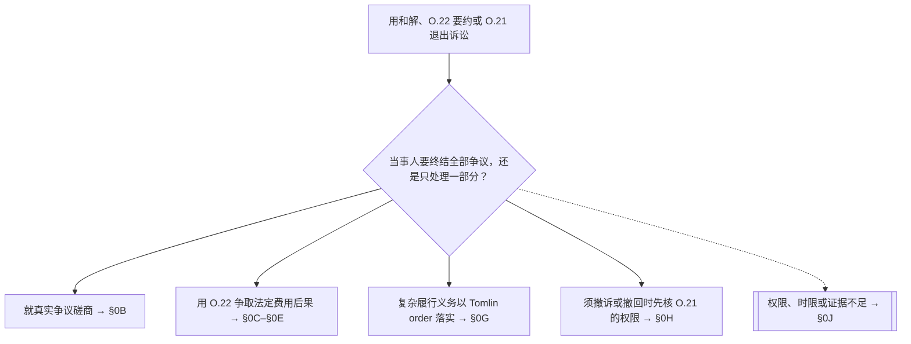
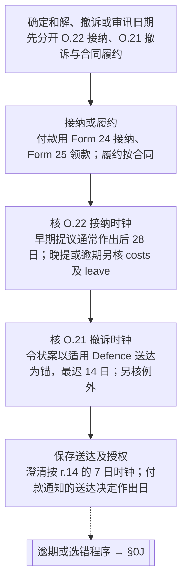

# 和解、制裁性要约与终止诉讼体系（Settlement, Sanctioned Offers and Discontinuance）

## 速读定位层

### 适用范围

法院先核提议是否符合 O.22 的形式与范围，再看接纳时间和费用协议；案件如继续至判决，则依 rr.23–24 分别比较结果。双方已达成协议时，应另外选择执行方式。

### 术语

| 术语 | 定义与章节 |
| --- | --- |
| Settlement | 双方按协议处理申索及履约义务。 [§0B](#0B.%20%E5%92%8C%E8%A7%A3%E8%B0%88%E5%88%A4%E6%80%BB%E8%A7%88%E4%B8%8E%20Without%20Prejudice%20%E9%80%82%E7%94%A8%E8%BE%B9%E7%95%8C) |
| Without prejudice | 真实和解沟通原则上不用于证明责任。 [§0B](#0B.%20%E5%92%8C%E8%A7%A3%E8%B0%88%E5%88%A4%E6%80%BB%E8%A7%88%E4%B8%8E%20Without%20Prejudice%20%E9%80%82%E7%94%A8%E8%BE%B9%E7%95%8C) |
| Sanctioned offer | 按 O.22 提出的书面程序要约。 [§0C](#0C.%20Order%2022%20%E5%88%B6%E8%A3%81%E6%80%A7%E8%A6%81%E7%BA%A6%E4%B8%8E%E4%BB%98%E6%AC%BE%EF%BC%88Sanctioned%20Offers%20&%20Payments%EF%BC%89%E5%87%86%E5%85%A5%E9%97%A8%E6%A7%9B%E4%B8%8E%E5%BD%A2%E5%BC%8F%E8%A7%84%E7%A8%8B) |
| Sanctioned payment | 被告实缴入庭，并送达 Form 23。 [§0C](#0C.%20Order%2022%20%E5%88%B6%E8%A3%81%E6%80%A7%E8%A6%81%E7%BA%A6%E4%B8%8E%E4%BB%98%E6%AC%BE%EF%BC%88Sanctioned%20Offers%20&%20Payments%EF%BC%89%E5%87%86%E5%85%A5%E9%97%A8%E6%A7%9B%E4%B8%8E%E5%BD%A2%E5%BC%8F%E8%A7%84%E7%A8%8B) |
| Acceptance | 受要约人按接纳时限及许可条件存档并送达书面通知。 [§0D](#0D.%20O.22%20%E6%8E%A5%E5%8F%97%E3%80%81%E6%92%A4%E5%9B%9E%E3%80%81%E4%BF%AE%E6%94%B9%E4%B8%8E%E5%B1%A5%E8%A1%8C%E6%97%B6%E9%92%9F) |
| Calderbank letter | 保留在费用阶段援引的和解信。 [§0F](#0F.%20Calderbank%20%E8%A6%81%E7%BA%A6%E4%BF%A1%E5%87%BD%E4%B8%8E%20O.22%20%E4%B9%8B%E5%AF%B9%E6%AF%94%E4%B8%8E%E8%A3%81%E9%87%8F%E9%80%82%E7%94%A8) |
| Tomlin order | 主文中止诉讼；附表载合同义务。 [§0G](#0G.%20%E5%92%8C%E8%A7%A3%E5%8D%8F%E8%AE%AE%E7%9A%84%E5%BD%A2%E5%BC%8F%E5%8C%96%E8%90%BD%E5%9C%B0%EF%BC%9AConsent%20Order%20%28O.42%20r.5A%29%20%E4%B8%8E%20Tomlin%20Order%20%E9%99%84%E8%A1%A8%E6%89%A7%E8%A1%8C%E6%9C%BA%E5%88%B6) |
| Discontinuance | 当事人依 O.21 停止推进全部或部分申索。 [§0H](#0H.%20Order%2021%20%E6%92%A4%E5%9B%9E%E4%B8%8E%E7%BB%88%E6%AD%A2%E8%AF%89%E8%AE%BC%EF%BC%88Discontinuance%20&%20Withdrawal%EF%BC%89%E5%8F%8A%E7%A8%8B%E5%BA%8F%E6%97%B6%E5%BA%8F%E5%80%92%E6%8E%92) |

### 环节定位

| 环节 | 实际操作 |
| --- | --- |
| 确认权限 | 核客户授权、现有令状、反申索与是否有 interim payment。 |
| 选择工具 | 分别准备 open offer、without prejudice offer、O.22 offer 或 payment。 |
| 完成送达 | 记录存档、送达、撤回或澄清日期及适用期限。 |
| 接纳或应诉 | 确认 costs、留存书面接纳；未接纳则准备判后比较。 |
| 终结或执行 | 用适当的 consent order、Tomlin order 或 O.21 notice 执行客户指示。 |

## 🗺️ 本卡地图

法院先核提议是否符合 O.22 的形式与范围，再看接纳时间和费用协议；案件如继续至判决，则依 rr.23–24 分别比较结果。双方已达成协议时，应另外选择执行方式。

| 任务 | 直达 |
| --- | --- |
| 和解谈判总览与 Without Prejudice 适用边界 | [§0B](#0B.%20%E5%92%8C%E8%A7%A3%E8%B0%88%E5%88%A4%E6%80%BB%E8%A7%88%E4%B8%8E%20Without%20Prejudice%20%E9%80%82%E7%94%A8%E8%BE%B9%E7%95%8C) |
| Order 22 制裁性要约与付款（Sanctioned Offers & Payments）准入门槛与形式规程 | [§0C](#0C.%20Order%2022%20%E5%88%B6%E8%A3%81%E6%80%A7%E8%A6%81%E7%BA%A6%E4%B8%8E%E4%BB%98%E6%AC%BE%EF%BC%88Sanctioned%20Offers%20&%20Payments%EF%BC%89%E5%87%86%E5%85%A5%E9%97%A8%E6%A7%9B%E4%B8%8E%E5%BD%A2%E5%BC%8F%E8%A7%84%E7%A8%8B) |
| O.22 接受、撤回、修改与履行时钟 | [§0D](#0D.%20O.22%20%E6%8E%A5%E5%8F%97%E3%80%81%E6%92%A4%E5%9B%9E%E3%80%81%E4%BF%AE%E6%94%B9%E4%B8%8E%E5%B1%A5%E8%A1%8C%E6%97%B6%E9%92%9F) |
| O.22 判决后严重讼费与利息制裁机制（rr.20–24） | [§0E](#0E.%20O.22%20%E5%88%A4%E5%86%B3%E5%90%8E%E4%B8%A5%E9%87%8D%E8%AE%BC%E8%B4%B9%E4%B8%8E%E5%88%A9%E6%81%AF%E5%88%B6%E8%A3%81%E6%9C%BA%E5%88%B6%EF%BC%88rr.20%E2%80%9324%EF%BC%89) |
| Calderbank 要约信函与 O.22 之对比与裁量适用 | [§0F](#0F.%20Calderbank%20%E8%A6%81%E7%BA%A6%E4%BF%A1%E5%87%BD%E4%B8%8E%20O.22%20%E4%B9%8B%E5%AF%B9%E6%AF%94%E4%B8%8E%E8%A3%81%E9%87%8F%E9%80%82%E7%94%A8) |
| 和解协议的形式化落地：Consent Order (O.42 r.5A) 与 Tomlin Order 附表执行机制 | [§0G](#0G.%20%E5%92%8C%E8%A7%A3%E5%8D%8F%E8%AE%AE%E7%9A%84%E5%BD%A2%E5%BC%8F%E5%8C%96%E8%90%BD%E5%9C%B0%EF%BC%9AConsent%20Order%20%28O.42%20r.5A%29%20%E4%B8%8E%20Tomlin%20Order%20%E9%99%84%E8%A1%A8%E6%89%A7%E8%A1%8C%E6%9C%BA%E5%88%B6) |
| Order 21 撤回与终止诉讼（Discontinuance & Withdrawal）及程序时序倒排 | [§0H](#0H.%20Order%2021%20%E6%92%A4%E5%9B%9E%E4%B8%8E%E7%BB%88%E6%AD%A2%E8%AF%89%E8%AE%BC%EF%BC%88Discontinuance%20&%20Withdrawal%EF%BC%89%E5%8F%8A%E7%A8%8B%E5%BA%8F%E6%97%B6%E5%BA%8F%E5%80%92%E6%8E%92) |
| 诉讼和解中的实务陷阱、调解拒绝制裁与职业操守 | [§0I](#0I.%20%E8%AF%89%E8%AE%BC%E5%92%8C%E8%A7%A3%E4%B8%AD%E7%9A%84%E5%AE%9E%E5%8A%A1%E9%99%B7%E9%98%B1%E3%80%81%E8%B0%83%E8%A7%A3%E6%8B%92%E7%BB%9D%E5%88%B6%E8%A3%81%E4%B8%8E%E8%81%8C%E4%B8%9A%E6%93%8D%E5%AE%88) |
| 程序失误及其后果总表 | [§0J](#0J.%20%E7%A8%8B%E5%BA%8F%E5%A4%B1%E8%AF%AF%E5%8F%8A%E5%85%B6%E5%90%8E%E6%9E%9C%E6%80%BB%E8%A1%A8) |
| SG 实务应用与导师口径 | [§0K](#0K.%20SG%20%E5%AE%9E%E5%8A%A1%E5%BA%94%E7%94%A8%E4%B8%8E%E5%AF%BC%E5%B8%88%E5%8F%A3%E5%BE%84) |

<!-- BEGIN:cite-legend -->
> [!info]- 引注图例
> 
> | 码 | 文件 | 层级 | 学年 | 核心定位与规则范围 |
> | --- | --- | --- | --- | --- |
> | OLD14 | [LG14 - O22, Settlement and Discontinuance etc (1).md](../../04%20Base%20Lectures/%5BLG14%5D%20Settlement,%20Sanctioned%20Offers%20and%20Payments,%20Withdrawal%20and%20Discontinuance/LG14%20-%20O22,%20Settlement%20and%20Discontinuance%20etc%20%281%29.md) | 往届官方 | 2025-26 | 和解复杂条款附表应用、O.22 规则架构与 O.21 终止实操 |
> | R22 | [RHC O22.md](obsidian://open?vault=3b1e77255f6c6e29&file=output%2Fresearch%2FCivil%20Litigation%20Rules%20Verification%20-%202026-10-23%2FRHC%20O22.md) | 库外法源 | 2026-27 | 高院规则第 22 目：制裁性要约与入庭付款完整条文与后果 |
> | R21 | [RHC O21.md](obsidian://open?vault=3b1e77255f6c6e29&file=output%2Fresearch%2FCivil%20Litigation%20Rules%20Verification%20-%202026-10-23%2FRHC%20O21.md) | 库外法源 | 2026-27 | 高院规则第 21 目：撤回与终止诉讼时限、许可与费用 |
> | R42 | [RHC O42.md](obsidian://open?vault=3b1e77255f6c6e29&file=output%2Fresearch%2FCivil%20Litigation%20Rules%20Verification%20-%202026-10-23%2FRHC%20O42.md) | 库外法源 | 2026-27 | 高院规则第 42 目 r.5A：双方同意令（Consent Orders）及限制 |
> | R62 | [RHC O62.md](obsidian://open?vault=3b1e77255f6c6e29&file=output%2Fresearch%2FCivil%20Litigation%20Rules%20Verification%20-%202026-10-23%2FRHC%20O62.md) | 库外法源 | 2026-27 | 高院规则第 62 目：诉讼费用裁量、评税基准及 Calderbank 考虑 |
> | AP6 | [1. SG6 (Civil Procedure 1).md](../../04%20Base%20Lectures/00%20This%20Year%20Moodle%202026-27/Small%20Group%20Activity%20Plans/1.%20SG6%20%28Civil%20Procedure%201%29.md) | 本届官方 | 2026-27 | SG06 案情与 Question 3 和解谈判授权与 O.22 实战测试 |
> | LG7V | [本届 LG7 讲义](../../04%20Base%20Lectures/00%20This%20Year%20Moodle%202026-27/Lecture%20Outlines,%20Powerpoints%20&%20Materials/LG7%20-%20Drafting%20Summonses.%20Interlocutory%20Applications,%20Security%20for%20Costs.md) | 本届讲义 | 2026-27 | Tomlin Order 附表性质与同意判决分期付款规则 |
> | CAP-C14 | [LG14 PT 2026-10-30 实录字幕](../../04%20Base%20Lectures/00%20This%20Year%20Moodle%202026-27/Lecture%20Outlines,%20Powerpoints%20&%20Materials/LG14%20Settlement,%20Sanctioned%20Offers%20and%20Payments;%20Withdrawal%20and%20Discontinuance/Panopto%20Captions%20%28local%20export%29/8010_LG14_PT_aa529e48.md) | 本届讲义 | 2026-27 | 本届 PT 实录字幕（1296 条），课堂口径、评税尺度警告与判词结论 |
> | S6-AP | [1. SG6 (Civil Procedure 1).md](../../04%20Base%20Lectures/00%20This%20Year%20Moodle%202026-27/Small%20Group%20Activity%20Plans/1.%20SG6%20%28Civil%20Procedure%201%29.md) | 本届官方 | 2026-27 | SG06 案情与 Question 3 和解谈判授权与 O.22 实战测试 |
> | S6-R22 | [RHC O22.md](obsidian://open?vault=3b1e77255f6c6e29&file=output%2Fresearch%2FCivil%20Litigation%20Rules%20Verification%20-%202026-10-23%2FRHC%20O22.md) | 库外法源 | 2026-27 | 高院规则第 22 目：制裁性要约与入庭付款完整条文与后果 |
> | AP9 | [本届 SG09 原任务书](../../04%20Base%20Lectures/00%20This%20Year%20Moodle%202026-27/Small%20Group%20Activity%20Plans/1.%20SG9%20Activity%20Plan%20%28Civil%20Procedure%202%29.docx) | 本届官方 | 2026-27 | Hogwarts 案 Q5 |
<!-- END:cite-legend -->

## 0B. 和解谈判总览与 Without Prejudice 适用边界

### 0B.1 和解谈判的性质、法律权源与政策目标

律师在磋商前应核对客户有权接受的净额、反申索或抵销、利息、costs、履约时间、验收、担保、保密、免责和违约救济。和解一经有效成立，双方须履行合同；诉讼是否同时中止或撤回，要看和解的条款、法定接纳的效果或法院命令。

| 谈判工具 | 当事人怎样使用 |
| --- | --- |
| Open offer | 当事人可以公开提出建议；在证据规则容许的范围内，对手可援引其陈述。 |
| Without prejudice | 当事人为解决真实争议进行磋商；除适用例外或保护已有效放弃外，法院不会用让步证明实体责任。 |
| Without prejudice save as to costs | 当事人应在相关实体争点已经裁定后，才向法院出示要约以主张 costs。 |

本段依据。（往届讲义对照）。 <small style="opacity: 0.55">〔OLD14 L232 "Used when settlement terms are complex"·往届仅参考〕〔CAP-C14 L445 "So I've uploaded a sample settlement agreement so you can have a look at all of them."〕〔R62 L105 "the Court may not take the offer into account"〕</small>

**本届课堂算例。** 原告在签署后 14 日内腾空储物室并交回钥匙；两名被告同时以银行本票或律师支票支付 HK$400,000。交还和付款都完成后，租约终止，原告解除相关占有及损害申索，双方再办理撤诉与撤反申索的 consent order，约定 no order as to costs（包括先前 costs reserved）。本例的 14 日和付款安排来自合约条款。[本届 LG14 Appendix：Sample Settlement Agreement](../../04%20Base%20Lectures/00%20This%20Year%20Moodle%202026-27/Lecture%20Outlines,%20Powerpoints%20&%20Materials/LG14%20Settlement,%20Sanctioned%20Offers%20and%20Payments;%20Withdrawal%20and%20Discontinuance/3.%20LG14%20-%20Appendix.docx)。

### 0B.2 Without Prejudice（无损害）特权之适用门槛与例外

法院从通信背景判断双方是否有真实争议，并客观上正在尝试和解。诉讼已开始或可合理预见，是识别争议与磋商目的的事实；单贴 Without Prejudice 不会保护一封单纯催款信或银行通知。相关受保护文件仍须概括列在 List of Documents 的 Schedule I Part 2，并注明拒绝查阅的依据。

*Rush & Tompkins Ltd v Greater London Council* [1989] AC 1280 确认，政策保护适用于真实和解谈判；另一共同当事人不能仅凭其未参加磋商而取得这些谈判材料。*Unilever plc v The Procter & Gamble Co* [2000] 1 WLR 2436 区分谈判保护与必须证明和解是否成立、应否因欺诈、失实陈述或不当影响而撤销的争点。以勒索或其他清楚无疑的不当行为利用特权时，法院亦可适用例外；普通强硬索款不等于 unambiguous impropriety。 <small style="opacity: 0.55">〔CAP-C14 L274-L284 "it should show that there's a dispute in existence between the parties"〕〔CAP-C14 L298-L310 "So some people will write a demand letter and write without prejudice."〕〔CAP-C14 L367-L373 "Is that a genuine attempt to settle? Well, not really"〕〔CAP-C14 L391-L414 "I think in that circumstance, if you think the settlement offer is unreasonable,"〕〔CAP-C14 L177-L203 "So you do not need to list them in the list of documents. And then you would describe"〕〔CAP-C14 L211-L232 "Call the bank letters or communications. They are marked without prejudice, save as to"〕</small>

> **Exam / Drafting Formulation:** "The parties negotiated this offer with a view to resolving the matters in dispute."

## 0C. Order 22 制裁性要约与付款（Sanctioned Offers & Payments）准入门槛与形式规程

### 0C.1 按当事人身份和付款方向选择工具

O.22 rr.2–4（制裁性要约及付款）允许当事人处理全案、部分申索或一个争点，也可计入 counterclaim 或 set-off。原告以书面 sanctioned offer 提出；被告的提议若涉及向原告付款，须走 sanctioned payment。被告只提出非金钱条件时可用 sanctioned offer；混合方案可按适用规则使用两种方式。反申索按该项申索中的原告及被告身份套用同样规则。诉讼开始前，双方可以协商，但不能先取得 O.22 规定的后果。 <small style="opacity: 0.55">〔R22 L41 "the offer must be made by way of a sanctioned payment"〕〔R22 L30 "may take into account any counterclaim or set-off"〕〔R22 L34 "unless the Court so orders."〕</small>

### 0C.2 强制入庭付款（Sanctioned Payment into Court）之要件与 Form 23

被告付款入庭后，须按 O.22 r.8 存档 **Form 23**（notice of sanctioned payment），并按 r.9 向原告（受法援时另向 Director of Legal Aid）送达，并存档 certificate of service。按 r.13，通知送达才视为作出付款。通知应写明数额、范围、是否计入 counterclaim、set-off、已经作出的 interim payment 及已有款项；讼费担保不属于这里可计入的旧付款。

依 r.26（利息），原告提出接受金钱的 sanctioned offer 及被告的付款通知原则上包含截至最后可无须许可接纳日的利息。若排除利息，应明确是否另给利息、数额、利率和期间。 <small style="opacity: 0.55">〔R22 L111 "other than as security for costs"〕〔R22 L161 "A sanctioned payment is made when a sanctioned payment notice is served"〕〔R22 L399 "inclusive of all interest until the last date"〕</small>

### 0C.3 Sanctioned offer：书面内容及送达

O.22 r.5（书面要约形式）要求写明范围、反申索或抵销、利息与适用的接纳条件；可以按 interim payment 计算，也可限定承认责任的比例。Form 23 是被告入庭付款的通知，不是书面 sanctioned offer 的强制格式。要约人须依 r.6 送达受要约人；对方受法援时同时送达 Director of Legal Aid。

### 0C.4 中间申请中 O.22 之扩展适用（Interlocutory Applications）

O.22 r.2 可用于解决可识别的申索争点，因此律师应问当前申请处理的是否为 claim、part 或 issue。课堂以费用担保申请说明中间阶段也可协商：双方可以谈担保额及中间费用；若提议只是调整担保，不能把担保款当成给原告的 sanctioned payment，或直接以中间裁定代替 rr.23–24 的 judgment 比较。 <small style="opacity: 0.55">〔CAP-C14 L1183-L1209 "So order 22 regime can apply to settling or managing costs exposure for interlocutory"〕</small>

> **Exam / Drafting Formulation:** "This offer relates to the whole claim and takes account of the pleaded counterclaim."

## 0D. O.22 接受、撤回、修改与履行时钟

### 0D.1 28 天接纳时限（28-day acceptance window）与无需许可规则

依 O.22 rr.15–16（接纳），在 trial 前至少 28 日作出的要约或付款，通常可在作出后 28 日内通过存档并送达书面通知接纳；接纳 sanctioned payment 用 Form 24。若提议距离开审不足 28 日或接纳已经逾期，双方同意费用责任仍可不经许可接纳；费用未谈妥则须申请 leave，获准时法院同时处理 costs。待决的撤回或减额申请、部分被告的联合或备位责任，以及 O.80 r.10 适用的和解另有约束；在开审后接纳时再核 r.19。 <small style="opacity: 0.55">〔R22 L193 "files with the Court and serves on the defendant"〕〔R22 L201 "if the parties agree on the liability for costs"〕〔R22 L250 "may be accepted only with the leave of the Court"〕</small>

### 0D.2 撤回、减额与澄清（O.22 rr.7、10、14）

依 O.22 rr.7、10（撤回及减额），对 sanctioned offer，开审前至少 28 日作出的，在作出后 28 日内须经许可才可撤回或减额；不足 28 日作出的须取得许可。对 sanctioned payment，r.10(1) 以付款作出后 28 日为保护期。撤回或减额申请待决期间，受要约人也须获准才可接纳。已经撤回的提议不产生 O.22 后果。

依 r.14（澄清），受要约人可在提议作出后 7 日内要求澄清。要约人收到后未在 7 日内回应，受要约人可在开审前请求法院命令澄清。法院若批令，应指定提议视为作出之日；请求本身不会自动重置 28 日。 <small style="opacity: 0.55">〔R22 L94 "If a sanctioned offer is withdrawn"〕〔CAP-C14 L1756-L1798 "Unless it's withdrawn. Right. So this is in relation to withdrawing or or diminishing"〕〔R22 L182 "within 7 days of a sanctioned offer or a sanctioned payment being made"〕〔CAP-C14 L1801-L1855 "that breakdown is actually very useful for you at trial"〕</small>

### 0D.3 接纳后的 stay、费用及执行（O.22 rr.20–22）

O.22 r.22（接纳的中止及执行效果）把全案、部分或争点按接受范围 stayed；须法院批准的和解在批准后才生效。双方仍可在原案申请落实 accepted sanctioned offer、处理 costs 或提取款项。接纳全案而无需许可时，rr.20–21 一般让原告取得截至接纳通知送达的费用，除非法院另令；部分接纳时须查是否同时放弃余下申索，或应由法院处理费用。 <small style="opacity: 0.55">〔R22 L296 "the claim is stayed as to that part or issue"〕〔R22 L270 "up to the date of serving notice of acceptance"〕〔CAP-C14 L2248-L2267 "entitled to his cost of the proceedings up to the date of the serving of the notice of acceptance"〕</small>

### 0D.4 High Court scale 与 DC scale

在 CFI 起诉、以低于区域法院管辖金额的入庭款和解时，被告不能只凭接纳金额较低便要求 DC scale。课堂以 High Court scale 为分析起点；被告如拟争较低尺度，应在付款通知或同时送达的文字中提前表明主张，说明何以本案应在区院开展，由法院裁定。 <small style="opacity: 0.55">〔CAP-C14 L2296-L2317 "taxed in the High Court scale by default, even if the settlement is less than 3 million"〕</small>

### 0D.5 接纳后领款、履约与补救

原告接纳 sanctioned payment 后，依 O.22 r.17 以 Form 25 请求领款；部分被告、受保护当事人、tender before action 和特定死亡赔偿须核 rr.18–19 或 O.22A。双方接纳书面要约后，应按要约约定的日期履行；对方不履行时可依 r.22(6) 在原案申请合同救济，除非法院另令。r.13 规定何时作出及接纳要约，r.18 处理多被告；两条不设统一的 14 日付款及自动入判规则。双方可以自行约定在接纳后 14 日内付款。

> **Exam / Drafting Formulation:** "The notice of acceptance was filed and served on [date]."

## 0E. O.22 判决后严重讼费与利息制裁机制（rr.20–24）

### 0E.1 审后结果比较法则：Real Winner 与更优判决（More Favourable Judgment）

法院先按实际条款比较 judgment 与仍有效的提议，统一本金、利息、范围和抵销；金钱比较按 r.26 的利息范围处理。律师应按时间逐份列出作出、改动、撤回和接纳时间，不因后来有较高或较低提议便跳过先前一份。

### 0E.2 被告要约/付款之制裁后果（O.22 r.23）：原告未胜过要约之费用倒挂

被告的 sanctioned payment 或 offer 若与原告所得 judgment 相同或更有利，原告没有取得 more advantageous judgment，适用 O.22 r.23。法院原则上应作 r.23(2)–(4) 的命令，除非认为 unjust：可减免原告部分判前利息、将最后可无须许可接纳日之后的被告 costs 归原告支付，并按 indemnity basis 及不超过 judgment rate 加 10 个百分点计付有关 costs 利息。法院比较当时条款、程序阶段、当时可得资料及各方提供资料的行为。原告早期费用仍须结合一般 costs order。 <small style="opacity: 0.55">〔R22 L343 "the information available to the parties at the time"〕</small>

### 0E.3 原告要约之严重制裁后果（O.22 r.24）：弥偿基准（Indemnity Basis）与惩罚性利息（最高 judgment rate + 10 percentage points）

原告的 sanctioned offer 只有在被告被判承担更多，或判决对原告更有利时，才触发 O.22 r.24。法院原则上依 r.24(2)–(4) 命令判决款有关部分计 enhanced interest、判给 indemnity costs 并加 costs interest，除非认为 unjust。两类加息上限均以 judgment rate 加 10 个百分点计算。课堂算例若假设 judgment rate 为 8%，上限是 18%；8% 是算例输入。课堂所述 party and party 65%–70% 与 indemnity 85%–90% 是经验估算，评税仍逐项依适用基准。 <small style="opacity: 0.55">〔R22 L352 "a defendant is held liable for more than"〕〔S6-R22 L363 "paragraphs (2) and (3) unless it considers it unjust"〕〔R22 L334 "at a rate not exceeding 10% above judgment rate"〕〔CAP-C14 L2547-L2554 "So judgment rate fluctuates. It's around 8%."〕〔CAP-C14 L2515-L2539 "we usually say practically is, oh, it's around 65%"〕</small>

### 0E.4 打平要约（Equal to Offer）之实务处理与多份要约时间序检验法

同额比较时，(1) 对被告的提议，原告打平即未超过，进入 r.23；(2) 对原告自己的提议，仅打平未达到 r.24 的 more than / more advantageous 门槛。多份提议应按时间顺序逐一核对；课堂题未写撤回时，可以仍在桌上作为题设起点。对开审前不足 28 日的提议，须先确定是否及何时可以不经许可接纳、双方有无费用协议，再确定 rr.23–24 的起算，不能把判决日一律当成起算日。 <small style="opacity: 0.55">〔CAP-C14 L2791-L2827 "So when answering questions relating to sanction offers and payments, we need to"〕〔CAP-C14 L2161-L2188 "if in an exam paper we do not write that an offer has been withdrawn, just assume it's all still there"〕〔CAP-C14 L2716-L2773 "the largest costs are actually incurred during the trial"〕</small>

### 0E.5 制度边界：O.22 仅适用于正审（Trial）而不及于上诉（Appeal）

O.22 rr.23–24 的机制针对原审判决。上诉阶段，双方仍可发 without prejudice save as to costs 的提议，并在适当时点交上诉法院按费用裁量考虑；原审 O.22 的增强利息及 indemnity costs 机制不因此自动移植。 <small style="opacity: 0.55">〔CAP-C14 L2688-L2704 "order 22 will only apply to trials and not appeals"〕</small>

> **Exam / Drafting Formulation:** "The judgment is no better than the Defendant’s sanctioned payment."

## 0F. Calderbank 要约信函与 O.22 之对比与裁量适用

### 0F.1 Calderbank 信函之性质与排他性规则（Exclusionary Rule）

*Calderbank v Calderbank* [1976] Fam 93 容许当事人在实体问题解决后出示保留费用的和解信，请法院用以决定 costs。RHC O.62 r.5(1)(d) 限制法院考虑本来可以依法作成 O.22 offer 或 payment 的非合规提议。双方仍可自行协商；要求法庭赋予费用效果时，应证明为何该提议不能由 O.22 容纳；如另求 O.22 r.2(4) 的命令，应分开提出。 <small style="opacity: 0.55">〔CAP-C14 L1294-L1297 "Okay. So there's an exclusionary rule. Um, it says colder bank letters may not be"〕</small>

### 0F.2 允许使用 Calderbank 信函的例外情境（无法被 O.22 容纳的条款）

当提议包含 O.22 无法容纳的实质条款时，当事人可以用 Calderbank letter 保留在费用阶段援引的权利。下列情形须核条款本身及程序：
1. **涉及非诉讼当事方的权利义务**：例如涉及母公司、关联第三方担保人或合资伙伴的免责与承诺；
2. **复杂的商业资产置换与非对应对价**：例如原告仅起诉金钱赔偿，但被告提议以特定型号的新设备、专利授权或许可协议进行商业抵偿（实物抵偿金钱申索无法做 Sanctioned Payment）。 <small style="opacity: 0.55">〔CAP-C14 L1333-L1348 "So if a settlement proposal contains terms that cannot be accommodated by order 22,"〕〔CAP-C14 L1369-L1386 "If I claim this plaintiff is just claiming for money. Right. And the defendant is,"〕</small>
3. **特定的诉讼费用分摊约定**：提议中包含由某方承担约定比例或固定数额之费用的特殊安排；
4. **仲裁程序（Arbitration）与上诉程序（Appeals）**：因 O.22 不适用，各方通过 Calderbank 信函管理费用风险。

### 0F.3 Calderbank 要约 vs O.22 制裁性要约之全方位对比

| 对比维度 | Order 22 Sanctioned Offer / Payment | Calderbank Letter (WP save as to costs) |
|---|---|---|
| 法律性质 | 严格法定规程（RHC O.22 及法定格式表格） | 普通法衡平契约要约（标明特权标签） |
| 金钱申索形式 | 被告必须将资金实际缴存法院（Form 23） | 仅为书面付款承诺信函，无须向法庭垫付款项 |
| 费用与利息后果 | **半自动法定制裁**（弥偿基准费用 + 最高 judgment rate + 10 percentage points 利息） | **无自动惩罚效力**；完全取决于法庭依据 O.62 的司法自由裁量 |
| 适用边界与排他 | 诉讼原讼正审（Trial）；优先强制适用 | 受排他性规则制约；仅在 O.22 无法容纳时补充适用 |
| 撤回与修改 | 在法定保护期内未经许可不得撤回或减额；详见 §§0D.1–0D.2。 | 按要约条款及一般合同规则核撤回与接纳。 |

> **Exam / Drafting Formulation:** "The offer is relied on solely on the question of costs."

## 0G. 和解协议的形式化落地：Consent Order (O.42 r.5A) 与 Tomlin Order 附表执行机制

### 0G.1 双方同意传票与同意令（Consent Summons & Consent Order O.42 r.5A）之界线

双方可用 consent summons 请法院按同意条款作出命令；已经作出的 consent order 具有法院命令的效力。O.42 r.5A（同意判决与命令）提供另一条简易盖印路径。若各方均同意，条款属于 r.5A(2) 列明事项（例如付款、撤诉、暂缓执行、Tomlin order 或 liberty to apply），律师按 r.5A(3) 拟定文字、注明 By Consent 并由各方代理律师背书，Registrar 可按规则录入或盖印。

Admiralty、Commercial List、litigant in person 及 person under disability 等案件受 rr.5A(4)–(5) 排除。若拟求永久禁令或取消已经固定的 trial date，双方应向有权作出该命令的法院提出 consent summons；双方同意本身不取消审讯日期。已录入的 consent order 要变更或撤销时，须核法院权力与适用事由，例如欺诈、错误或其他使协议可撤销的事由，并按程序申请。 <small style="opacity: 0.55">〔CAP-C14 L487-L505 "And it's actually an order itself. So what it is is It gets sent to the registry."〕〔CAP-C14 L604-L607 "And then it can be set aside by the parties agreement."〕〔CAP-C14 L805-L842 "So a consent summons is a joint application to the court to to invite it to make an"〕〔R42 L136 "any of the parties is a litigant in person or a person under a disability"〕〔CAP-C14 L958-L988 "to vacate a hearing, we can't do that by way of consent order"〕</small>

### 0G.2 汤姆林命令（Tomlin Order）之双层架构：正文（Face）与附表（Schedule）

当事人如约定分期、换货、验收、服务折抵、知识产权转让、保密或另由担保人承担义务，可用 Tomlin order 区分法院命令与和解合同。法院在正文写明 stay、liberty to apply 及费用处理；各方在 Schedule 约定履约细节、日期、付款资料、违约加速到期或其他救济。附表依 O.42 r.5A(2)(b)(iii) 不属于命令正文；保密范围及第三方可否取得，须另看归档及查阅规则。若要让第三方承担义务，须取得其有效同意。 <small style="opacity: 0.55">〔R42 L111 "terms which are scheduled to the order but which are not otherwise part of it"〕〔LG7V L147 "terms which are scheduled to the order but which are not otherwise part of it"；LG7V L149 "the stay of enforcement of a judgment, either unconditionally or upon condition that the money due under judgment is paid by instalments"〕〔LG7V L147 "which are not otherwise part of it"〕〔CAP-C14 L621-L673 "we use a Tomlin order when we have an agreement that requires the parties to complete certain acts"〕〔CAP-C14 L871-L874 "So in relation to a Tomlin order. So it's kept confidential."〕〔❓Tomlin 附表须否另行盖印或密封，库内无出处·待核，已登记文末 open 块〕</small>

### 0G.3 Tomlin Order 核心救济机制：自由申请执行（Liberty to Apply to Enforce）

一方未依 Schedule 履行时，守约方可在原案发 summons，援引 liberty to apply，请法院实施和解条款或在需要时解除 stay。附表本身是合同；申请人要指出哪项义务已届期、如何违约以及法院应作哪项执行命令，不能仅凭附表直接执行如同已有金钱判决。 <small style="opacity: 0.55">〔CAP-C14 L691-L694 "enforce the schedule without starting a new action"〕〔CAP-C14 L736-L739 "So what liberty to apply means. It's the parties are reserving their rights to apply to"〕</small>

> **Exam / Drafting Formulation:** "All further proceedings be stayed except for the purpose of carrying the scheduled terms into effect."

## 0H. Order 21 撤回与终止诉讼（Discontinuance & Withdrawal）及程序时序倒排

| 环节 | 实际操作 |
| --- | --- |
| 确认权限 | 核客户授权、现有令状、反申索与是否有 interim payment。 |
| 选择工具 | 分别准备 open offer、without prejudice offer、O.22 offer 或 payment。 |
| 完成送达 | 记录存档、送达、撤回或澄清日期及适用期限。 |
| 接纳或应诉 | 确认 costs、留存书面接纳；未接纳则准备判后比较。 |
| 终结或执行 | 用适当的 consent order、Tomlin order 或 O.21 notice 执行客户指示。 |

> **Exam / Drafting Formulation:** "All further proceedings be stayed except for the purpose of carrying the scheduled terms into effect."

### 0H.1 和解文书与期限倒排

律师发出提议时备妥书面条款、授权及付款凭证，登记提议送达日；需要澄清时从该日倒数 7 日。通常 28 日内接纳时，备存档及送达记录；Form 24 只用于付款，另备 Form 25 领款。双方用 Tomlin order 时，一并准备主文、签妥附表和履约时间表。拟以 O.21 终止时，从适用 Defence 或 affidavit evidence 日期计算 14 日；法院另有命令或应取许可时，先备 summons 或 notice。

### 0H.2 无需法庭许可的终止诉讼：送达抗辩书后 14 天内规则（O.21 r.2(1)）

依 O.21 r.2（无许可终止），令状案件原告可向受影响被告送达 notice of discontinuance，在 Defence 送达后最迟 14 日终止全案或撤回特定申索；有多名被告，原则上用最后一份 Defence，若有人未答而其期限较迟，则按 r.2(3) 核较迟期限。以 originating summons 开始的案件另依 rr.2(3A)–(3B)，以 O.28 r.1A(2) 的被告证据及多被告的相关时间计算 14 日。若各方同意，可在开审前依 r.2(4) 向 Registrar 提交全体签署的书面同意。 <small style="opacity: 0.55">〔R21 L20 "14 days after service of the defence"〕〔CAP-C14 L1009-L1015 "So if you want to discontinue or withdraw a claim without leave of the court."〕〔R21 L31 "the defendant’s affidavit evidence filed pursuant"〕</small>

### 0H.3 须经法庭许可的终止诉讼（O.21 r.3）与裁量条件

超出 r.2 的免许可路径时，当事人依 O.21 r.3 以 summons 或 O.25 r.7 notice 申请 leave，说明终止范围、原因、对方已支费用及是否拟再诉。法院可就 costs 或再诉附条件。已获 interim payment 的一方若拟撤诉、撤反申索或撤特定申索，须依 r.2(2A) 取得其他各方同意或法院许可。撤回已经发出的 summons 则须依 r.6 取得法院许可。 <small style="opacity: 0.55">〔R21 L53 "may not withdraw it without the leave"〕</small>

### 0H.4 前案费用及再诉（O.21 rr.4–5）

O.21 r.4（终止对再诉的影响）原则上不把 discontinuance 本身当作相同或实质相同诉因的抗辩，但法院可在给 leave 时加条件。依 r.5（前案费用未付），只有在撤诉一方已负担前案费用、未支付且再提相同或实质相同诉因时，法院才可按申请 stay 后案，直至付款。原告须另核适用的 costs order 及 O.62；r.5 不创设一项自动赔付全部抗辩费用的义务。 <small style="opacity: 0.55">〔R21 L39 "the bringing of a subsequent action"〕〔R21 L48 "stayed until those costs are paid"〕</small>

### 0H.5 被告撤回抗辩书（Withdrawal of Defence under O.21 r.2(2)(a)）

令状案的被告原则上可随时依 O.21 r.2(2)(a) 向对方送达通知撤回 Defence 全部或部分。反申索则须按 r.2(2)(b) 核 Defence to Counterclaim 的 14 日时钟；已获 interim payment 时按 r.2(2A) 核许可或同意。撤回认收书是另一程序，须按 r.1 取得 leave。 <small style="opacity: 0.55">〔R21 L23 "withdraw his defence or any part of it at any time"〕〔CAP-C14 L1018-L1039 "So this is just a summary of order 21 so you can read it yourself for defense, for"〕</small>

## 0I. 诉讼和解中的实务陷阱、调解拒绝制裁与职业操守

### 0I.1 申请人或原告的准备与核对

先核真正要解决的诉项和反申索，再把净额、利息、费用和履行期限写进要约。涉及被告付款给原告时，按 O.22 r.3(2) 选择 sanctioned payment。

### 0I.2 答辩人、被告与第三方的应对

从送达日起登记 28 天；分别核是否属 late offer、是否有撤回申请及须否申请 leave。不同意金额时也应核对 scope、set-off 和利息基准。

### 0I.3 签署、送达或执行前的最终核对

签署前查签署权限及各方名称。执行前核查 stay 的范围、附表义务、付款及解除条件；把受保护要约留在独立的 costs bundle。

### 0I.4 向审讯人员披露的限制（O.22 r.25）

O.22 r.25（披露限制）将 sanctioned offer 视为 without prejudice save as to costs；入庭付款的事实原则上在责任和金额决定前不得向主审人员透露。r.25(3) 对 tender before action、接纳后 stay，以及先裁责任、后评金额而付款与责任费用有关的情形设例外。律师将要约、收据和 Calderbank 信件放入独立 costs bundle。误披露时应立即说明范围并听取指示；是否继续、押后或回避，由法院判断具体影响。 <small style="opacity: 0.55">〔R22 L381 "until all questions of liability and the amount of money"〕</small>

### 0I.5 Practice Direction 31 调解程序与不合理拒绝调解之讼费制裁

根据香港司法机构实务指示 PD 31，诉讼各方负有协助法庭推进替代争议解决机制（ADR）的法定义务：
- 任何一方不合理拒绝参与调解（Unreasonable Refusal to Mediate），即使最终在正审中赢得诉讼，法庭仍有权行使 O.62 裁量权，剥夺其全部或部分胜诉讼费，甚至命令胜诉方反向承担败诉方的部分诉讼费用！

### 0I.6 事务律师与大律师对和解要约之建议义务与授权核验

律师在处理和解事宜时，必须遵守最高标准的专业操守：
1. **充分解释与风险揭示**：事务律师负有向客户全面、准确解释收到之 O.22 要约在 28 天后将引发的严重费用与利息后果的专业责任；
2. **核验真实书面授权**：绝对不得在未取得客户明确书面指示的情况下擅自接纳要约或发出具有拘束力的和解提议；
3. **禁止利益冲突**：不得为了自身律师费用的早日变现而向客户施加不正当的和解压力。

## 0J. 程序失误及其后果总表

| # | 失误 | 后果及下一步 |
| --- | --- | --- |
| 1 | 被告拟付款给原告却只发函 | O.22 r.3(2) 要求 sanctioned payment。应实际缴款、存档 Form 23 并送达；另核 r.2(4) 是否有命令。 |
| 2 | 过早出示要约或入庭付款 | 把文件移出实体 bundle，说明披露范围，请法院依 r.25 决定下一步。 |
| 3 | 锁定期内未获准便撤回或减额 | 依 rr.7、10 申请；申请待决时，接纳亦须许可。 |
| 4 | 混用 High Court 和 DC scale | 提前提出尺度主张并说明法院层级与金额；法院按实际费用命令裁定。 |
| 5 | 把复杂附表义务当作可直接执行的命令 | 用 Tomlin order 分开主文和附表；如违约，按 liberty to apply 请求实施条款。 |
| 6 | 以为撤诉免付既定费用或自动挡住再诉 | 核 O.21 rr.3–5 及费用责任；未清偿前案费用再起同一诉因，法院可 stay 后案。 |
| 7 | 迟接受或错误选用接纳表式 | 核 rr.15–19，费用有争议时申请 leave；接纳付款用 Form 24，领款用 Form 25。 |
| 8 | 把打平两个方向视为同一结果 | 打平被告提议进入 r.23；打平原告提议不满足 r.24。 |
| 9 | 把 14 天履约当作 O.22 一般规则 | 按实际条款付款；违约时依 r.22(6) 求合同救济。 |

## 0K. SG 实务应用与导师口径

### 0K.1 SG06（Q3）：和解协商、Tomlin Order 与 O.22 要约策略

#### 1. 法律关系与核心争点拆解
本届 SG06 案情中，Kennedy Limited 客户 Carmen 面临来自对手 Clinton 提出的解决方案（提议于 2026 年 11 月 30 日前装运 100 台其他型号电视，并在 14 日内支付 HK$1,000,000）；Carmen 的底线诉求是要求获得不少于 HK$1,300,000 的净现金回报且仍保留货物权利，而 Clinton 则强烈坚持无承认责任（No admission of liability）且不得留下法院判决记录。 <small style="opacity: 0.55">〔AP6 L95 "settlement"〕〔S6-AP L97 "not less than HK$1.3 million"〕</small>
Kennedy 应分别处理两项决定：Clinton 的信函有何费用效果，以及客户要不要以经授权的现金和换货条件达成可执行的和解。

#### 2. 答题/起草要件映射与操作落点
1. Clinton 的七日信可用于协商。若其提议须向 Kennedy 付款，又想取得 O.22 的后果，须按 r.3(2) 入庭付款；复杂换货条款则另核 O.62 r.5 对 Calderbank 的边界。 <small style="opacity: 0.55">〔S6-R22 L41 "the offer must be made by way of a sanctioned payment"〕</small>
2. Kennedy 可在取得授权后依 r.4 发书面 sanctioned offer，明示净额、利息、费用及反申索范围。客户要求至少 HK$1,300,000 现金并考虑 100 台替代电视；涉及换货、最迟 30 November shipment 及验收的商业条件可另列和解协议。 <small style="opacity: 0.55">〔S6-R22 L66 "after the expiry of 28 days"〕</small>
3. 双方若就替代电视及现金等义务达成协议，可以用 Tomlin order 中止诉讼，附表列付款、货物规格、验收、保密和违约救济；发出或接纳前仍须取得客户指示。 

> **Exam / Drafting Formulation:** "The parties propose to stay the action on the terms of the schedule, with liberty to apply."

#### 3. 导师课堂口径与考场红线（Tutor's Takeaways）
- **授权未齐切忌冒进**：导师明确强调，客户给出的和解目标（如不少于 130 万）不等于律师已获得签署和解协议的最终授权；在正式接纳或发出要约前，必须取得客户针对具体条款清单的书面明示指示。
- 原告的要约如被更有利的判决超过，法院原则上须作 r.24(2)–(3) 的命令，除非认为 unjust。

### 0K.2 SG09 Q5：Hogwarts 的判决和 HK$4,000,000 付款入庭

**本届 SG09 完整应用：** [Hogwarts Q5](../../01%20SG/SG09%20Civil%20Procedure%202%20%28Knowledge%29/05%20Question%205%20-%20Costs%20and%20Sanctioned%20Payment.md)。

#### 1. 法律关系与核心争点拆解

2027 年 11 月 25 日，CFI 驳回 Hogwarts 对 Malfoy 和 Muggle Investments 的竞业及招揽客户申索，认定 Hogwarts 夸大该项申索，证人为此捏造证据。法院另判 Malfoy 向 Hogwarts 支付 HK$3,000,000 及利息。Q5(b) 假设 Malfoy 代表两名被告于 2027 年 2 月 3 日作出覆盖全部申索的 HK$4,000,000 sanctioned payment，Hogwarts 没有接纳。

#### 2. 答题/起草要件映射与操作落点

先按 O.62 rr.3、5 分配各争点的费用，再按 O.22 rr.15、23、26 比较。假设 2 月 3 日是 r.12(2) 所指的付款通知送达日，28 日无许可接纳期于 3 月 3 日届满。将 HK$3,000,000 加上与通知同口径的利息，再与 HK$4,000,000 比较；仅凭本金相差 100 万不能确定结果。若判决未超过付款，法院原则上处理 3 月 3 日后的被告费用及利息，并可减免相应期间的原告判前利息，除非给令会 unjust。若比较后原告实际取得更优判决，r.23 不触发。原件见引注图例 AP9，Q5。

> **Exam / Drafting Formulation:** "I would compare the judgment with the sanctioned payment on the same basis before applying Order 22, rule 23."

#### 3. 导师课堂口径与考场红线（Tutor’s Takeaways）

在答题时先说明无付款的费用处理，再答付款使哪一段费用改变；不能把 4m 直接当成法院判给原告的金额。

## 1. 第一性原理

| 问题 | 比较方法 |
| --- | --- |
| 谁承担程序选择的风险？ | 先核真正要解决的诉项和反申索，再把净额、利息、费用和履行期限写进要约。涉及被告付款给原告时，按 O.22 r.3(2) 选择 sanctioned payment。 |
| 哪项争议必须单独处理？ | 从送达日起登记 28 天；分别核是否属 late offer、是否有撤回申请及须否申请 leave。不同意金额时也应核对 scope、set-off 和利息基准。 |
| 法院怎样控制错误后果？ | 签署前查签署权限及各方名称。执行前核查 stay 的范围、附表义务、付款及解除条件；把受保护要约留在独立的 costs bundle。 |
| 如何证明请求已经能够执行？ | 用适当的 consent order、Tomlin order 或 O.21 notice 执行客户指示。 |

## 2. 顺向推进

| 步骤 | 参与者完成的工作 | 交接物 |
| --- | --- | --- |
| 确认目标 | 律师确定客户要取得的结果、期限及可用证据。 | 指示与程序记录 |
| 确认权限 | 核客户授权、现有令状、反申索与是否有 interim payment。 | 事实与授权台账 |
| 选择工具 | 分别准备 open offer、without prejudice offer、O.22 offer 或 payment。 | 程序与文书清单 |
| 完成送达 | 记录存档、送达、撤回或澄清日期及适用期限。 | 草稿及源文件 |
| 接纳或应诉 | 确认 costs、留存书面接纳；未接纳则准备判后比较。 | 送达或提交凭证 |
| 终结或执行 | 用适当的 consent order、Tomlin order 或 O.21 notice 执行客户指示。 | 法庭指示或结果 |
| 处理争议 | 当事人按法院方向回应不利证据或程序异议。 | 异议与回应记录 |
| 完成交接 | 律师将实质结果及未履行项目转交下一阶段。 | 执行和补救记录 |

## 3. 本届规则与操作边界

| 客户所求 / 核心规则节点 | 与本卡主制度的区别及操作边界 |
| --- | --- |
| 在诉讼开始前提出金钱和解 | 当事人可以磋商，但诉前提议不能取得 O.22 的法定后果。起诉后，被告要向原告付款并保护费用地位，按 r.3(2) 选择 sanctioned payment。 |
| 只接受部分争点 | 接纳使相应争点 stayed；余下争点照常推进。若无费用协议，按 r.22(3) 请法院决定费用。 |
| 停止案件但保留后续履约 | 律师应区分 O.21 discontinuance 与 Tomlin order。后者保留原案程序供实施附表；撤诉前须核费用及将来再诉条件。 |

## 4. 办案流程控制与关键节点核查（Procedural Control & Case Verification）

| 核对项 | 当事人如何核对 | 发现缺口后的行动 |
| --- | --- | --- |
| 确认权限 | 核客户授权、现有令状、反申索与是否有 interim payment。 | 先核真正要解决的诉项和反申索，再把净额、利息、费用和履行期限写进要约。涉及被告付款给原告时，按 O.22 r.3(2) 选择 sanctioned payment。 |
| 完成送达 | 记录存档、送达、撤回或澄清日期及适用期限。 | 从送达日起登记 28 天；分别核是否属 late offer、是否有撤回申请及须否申请 leave。不同意金额时也应核对 scope、set-off 和利息基准。 |
| 终结或执行 | 用适当的 consent order、Tomlin order 或 O.21 notice 执行客户指示。 | 签署前查签署权限及各方名称。执行前核查 stay 的范围、附表义务、付款及解除条件；把受保护要约留在独立的 costs bundle。 |

## 5. 横向程序联动与机制衔接（Inter-Procedural Coordination & Interface）

| 接口 | 两个程序如何衔接 |
| --- | --- |
| 实体裁定与费用 | 在实体问题解决前隔离受保护要约；判后才用同口径比较。 |
| 和解与执行 | 核是法定 stay、consent order 还是 Tomlin order；按实际义务和违约选择救济。 |

## 6. 目标倒推与实务应对策略（Goal-Driven Strategy & Strategic Remedies）

| 客户目标 | 从目标倒推所需材料与行动 |
| --- | --- |
| 要现金并保证后续履行 | 用书面条款写净额、日期、利息、担保及违约后的申请。 |
| 停止一部分申索 | 先核 O.21 的程序类别、先前临付、费用责任和是否要保留再诉。 |

###### 0C.1 原告 vs 被告、金钱申索 vs 非金钱申索之分流铁律

见 [现行章节](#0C.1%20%E6%8C%89%E5%BD%93%E4%BA%8B%E4%BA%BA%E8%BA%AB%E4%BB%BD%E5%92%8C%E4%BB%98%E6%AC%BE%E6%96%B9%E5%90%91%E9%80%89%E6%8B%A9%E5%B7%A5%E5%85%B7)。

###### 0C.3 制裁性要约（Sanctioned Offer）之形式要件与 Form 23

见 [现行章节](#0C.3%20Sanctioned%20offer%EF%BC%9A%E4%B9%A6%E9%9D%A2%E5%86%85%E5%AE%B9%E5%8F%8A%E9%80%81%E8%BE%BE)。

###### 0D.2 撤回与减额之严格限制（O.22 r.16 / r.17）与澄清机制

见 [现行章节](#0D.2%20%E6%92%A4%E5%9B%9E%E3%80%81%E5%87%8F%E9%A2%9D%E4%B8%8E%E6%BE%84%E6%B8%85%EF%BC%88O.22%20rr.7%E3%80%8110%E3%80%8114%EF%BC%89)。

###### 0D.3 接纳要约后之法律后果：诉讼自动中止（Stay）与费用归属（r.20/r.21）

见 [现行章节](#0D.3%20%E6%8E%A5%E7%BA%B3%E5%90%8E%E7%9A%84%20stay%E3%80%81%E8%B4%B9%E7%94%A8%E5%8F%8A%E6%89%A7%E8%A1%8C%EF%BC%88O.22%20rr.20%E2%80%9322%EF%BC%89)。

###### 0D.4 考场致命陷阱：默认高院评税尺度（High Court Scale）与区院警告义务

见 [现行章节](#0D.4%20High%20Court%20scale%20%E4%B8%8E%20DC%20scale)。

###### 0D.5 14 天付款履行死线与直接进入判决之权利（r.13/r.18）

见 [现行章节](#0D.5%20%E6%8E%A5%E7%BA%B3%E5%90%8E%E9%A2%86%E6%AC%BE%E3%80%81%E5%B1%A5%E7%BA%A6%E4%B8%8E%E8%A1%A5%E6%95%91)。

###### 0H.4 致命后果链：O.21 r.5(1) 自动承担全案抗辩费用与 O.21 r.4 再诉中止

见 [现行章节](#0H.4%20%E5%89%8D%E6%A1%88%E8%B4%B9%E7%94%A8%E5%8F%8A%E5%86%8D%E8%AF%89%EF%BC%88O.21%20rr.4%E2%80%935%EF%BC%89)。

###### 0K.2 SG09 / SG10 及跨科接口（预留槽位）

见 [现行章节](#0K.%20SG%20%E5%AE%9E%E5%8A%A1%E5%BA%94%E7%94%A8%E4%B8%8E%E5%AF%BC%E5%B8%88%E5%8F%A3%E5%BE%84)。

###### 0I.3 事务律师与大律师对和解要约之建议义务与授权核验

见 [现行章节](#0I.6%20%E4%BA%8B%E5%8A%A1%E5%BE%8B%E5%B8%88%E4%B8%8E%E5%A4%A7%E5%BE%8B%E5%B8%88%E5%AF%B9%E5%92%8C%E8%A7%A3%E8%A6%81%E7%BA%A6%E4%B9%8B%E5%BB%BA%E8%AE%AE%E4%B9%89%E5%8A%A1%E4%B8%8E%E6%8E%88%E6%9D%83%E6%A0%B8%E9%AA%8C)。

###### 0I.2 Practice Direction 31 调解程序与不合理拒绝调解之讼费制裁

见 [现行章节](#0I.5%20Practice%20Direction%2031%20%E8%B0%83%E8%A7%A3%E7%A8%8B%E5%BA%8F%E4%B8%8E%E4%B8%8D%E5%90%88%E7%90%86%E6%8B%92%E7%BB%9D%E8%B0%83%E8%A7%A3%E4%B9%8B%E8%AE%BC%E8%B4%B9%E5%88%B6%E8%A3%81)。

###### 0C.2 强制入庭付款（Sanctioned Payment into Court）之要件与 Form 23A

见 [现行章节](#0C.%20Order%2022%20%E5%88%B6%E8%A3%81%E6%80%A7%E8%A6%81%E7%BA%A6%E4%B8%8E%E4%BB%98%E6%AC%BE%EF%BC%88Sanctioned%20Offers%20&%20Payments%EF%BC%89%E5%87%86%E5%85%A5%E9%97%A8%E6%A7%9B%E4%B8%8E%E5%BD%A2%E5%BC%8F%E8%A7%84%E7%A8%8B)。

###### 1A. Tomlin和解的正文、附表与履约

见 [现行章节](#0G.2%20%E6%B1%A4%E5%A7%86%E6%9E%97%E5%91%BD%E4%BB%A4%EF%BC%88Tomlin%20Order%EF%BC%89%E4%B9%8B%E5%8F%8C%E5%B1%82%E6%9E%B6%E6%9E%84%EF%BC%9A%E6%AD%A3%E6%96%87%EF%BC%88Face%EF%BC%89%E4%B8%8E%E9%99%84%E8%A1%A8%EF%BC%88Schedule%EF%BC%89)。

###### 2. O.22：先看角色和付款，不能只看标题

见 [现行章节](#0C.1%20%E6%8C%89%E5%BD%93%E4%BA%8B%E4%BA%BA%E8%BA%AB%E4%BB%BD%E5%92%8C%E4%BB%98%E6%AC%BE%E6%96%B9%E5%90%91%E9%80%89%E6%8B%A9%E5%B7%A5%E5%85%B7)。

###### 0H.1 O.21 终止与撤回诉讼之生命周期与时序倒排图

见 [现行章节](#0H.1%20%E5%92%8C%E8%A7%A3%E6%96%87%E4%B9%A6%E4%B8%8E%E6%9C%9F%E9%99%90%E5%80%92%E6%8E%92)。

<!-- === AUDIT_ZONE_START (DO NOT SEND BELOW THIS LINE TO GPT) === -->
> [!abstract]- 审计留痕：材料矩阵、待核事项与历史修订记录
> 
> **本轮修订**：依据同一体例重整导航、正文、后果表与 SG 应用；同一规则以已核法源为准，原有出处标签保留。
> 
> ### 1. 底层材料矩阵与核验状态
> 
> | 材料代码 | 对应文件与卷册 | 取得与校核日期 | 现行状态与处理结论 |
> |---|---|---|---|
> | OLD14 | `04 Base Lectures/[LG14] Settlement, Sanctioned Offers and Payments, Withdrawal and Discontinuance/LG14 - O22, Settlement and Discontinuance etc (1).md` | 2026-10-23 | 往届完整讲义；主体三部分结构已核，文中顺序义务与费用比对规则已全要素吸纳并标明往届出处。 |
> | RHC O21 | 司法机构公开定本再刊 `RHC O21.md` | 2026-10-23 | 校正：r.2(1) 按送达抗辩计算 14 日；r.2(2)(a) 撤回抗辩；r.4 处理再诉，r.5 处理前案费用未清时可否 stay 后案。 |
> | RHC O22 | 司法机构公开定本再刊 `RHC O22.md` | 2026-10-23 | 本轮校正：r.3(2) 付款入庭；r.14 澄清，r.25 披露；rr.15–16 接纳，rr.7、10 撤回限制、r.23/24 严重制裁。 |
> | RHC O42 | 司法机构公开定本再刊 `RHC O42.md` | 2026-10-23 | 确认 r.5A 同意令适用范围、r.5A(1) 亲自诉讼人除外、r.5A(2)(b)(iii) Tomlin 附表性质。 |
> | RHC O62 | 司法机构公开定本再刊 `RHC O62.md` | 2026-10-23 | 确认 r.5(1)(d) 考量相关要约裁量权与 Calderbank 适用。 |
> | AP6 | `04 Base Lectures/00 This Year Moodle 2026-27/.../1. SG6 (Civil Procedure 1).md` | 2026-10-28 | 本届 SG06 案情与 Question 3 题面；Kennedy v Clinton 真实目标与和解策略映射。 |
> | CAP-C14 | `Panopto Captions (local export)/LG14 PT 2026-10-30.md` | 2026-11-13 | 1296 条本届实录字幕整份消化，全要素回流至 §0B–§0J 各深节。 |
> 
> ### 2. 开放性核查项（Open Items）
> 
> <!-- BEGIN:open -->
> - [x] 讲师提及的和解协议范本已在本届 LG14 Appendix 核对；约定的 14 日、HK$400,000、同时履行和 costs 条款归入 §0B.1。
> - [ ] O.42 r.5A(2)(b)(iii) 已核实附表不属于命令正文。具体案卷附表的归档、查阅和保密处理须看实际登记处要求及法院命令。旧记录所称一律密封已撤回。
> - [x] O.21 r.2(1) 起算点校准：讲师口头曾有「filing」提述，但规则定本严格以「Service of Defence」为准，正文已明示以书面定本为准并登记口径差异。
> <!-- END:open -->
> 
> ### 3. 历史修订留痕（Revision Log）
> 
> - **2026-10-23**：初建预装配稿，依据规则定本与往届材料建立完整框架，登记待授课状态。
> - **2026-10-28**：结合 SG06 Question 3 题面核定和解谈判要点，补强 Kennedy 案实操策略。
> - **2026-11-13**：全卡依 CO13 架构重构。吸收 LG14 PT 实录字幕（1296 条）全部精粹；补入标准双图（地图决策树 + O.21 倒排时序图）；规范化三段式 §0K；确立物理审计截断与折叠。全部 66 项原有有效引注 100% 零损耗保留。
> 
