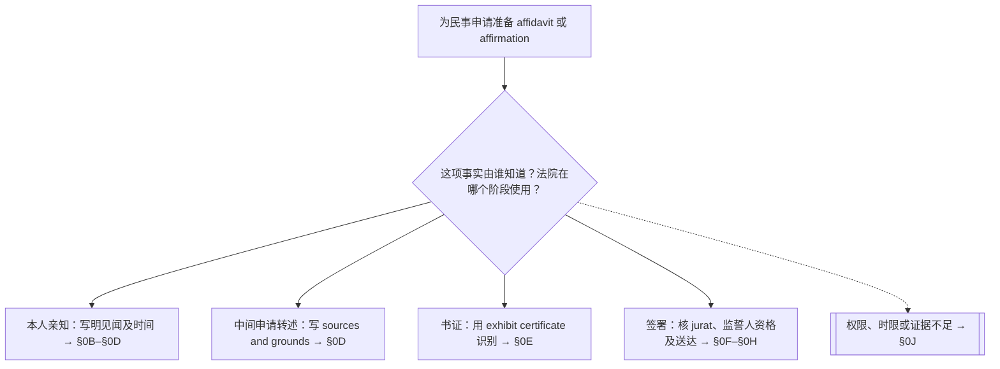
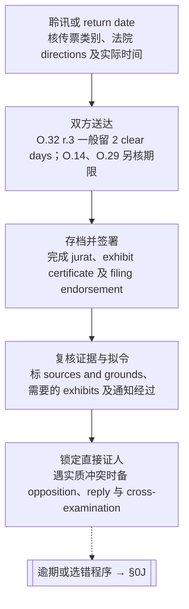

# 誓章、非宗教宣誓与证物系统（Affidavits, Affirmations and Exhibits）

## 速读定位层

### 适用范围

法院先分辨证据用在正审还是中间申请，再核证人的知识来源、证物及签署。若对手未到庭，申请人还须披露法院判断救济所需的重大不利材料。

### 术语

| 术语 | 定义与章节 |
| --- | --- |
| Affidavit | 当事人依法宣誓作出的书面证据。 [§0B](#0B.%20%E8%AA%93%E7%AB%A0%E4%B8%8E%E9%9D%9E%E5%AE%97%E6%95%99%E5%AE%A3%E8%AA%93%E7%9A%84%E6%80%A7%E8%B4%A8%E3%80%81%E9%80%89%E6%8B%A9%E4%B8%8E%E6%9D%83%E6%BA%90%EF%BC%88Cap.%2011%20/%20Cap.%208%20/%20O.41%EF%BC%89) |
| Affirmation | 依法替代宣誓且效力相同的确认。 [§0B](#0B.%20%E8%AA%93%E7%AB%A0%E4%B8%8E%E9%9D%9E%E5%AE%97%E6%95%99%E5%AE%A3%E8%AA%93%E7%9A%84%E6%80%A7%E8%B4%A8%E3%80%81%E9%80%89%E6%8B%A9%E4%B8%8E%E6%9D%83%E6%BA%90%EF%BC%88Cap.%2011%20/%20Cap.%208%20/%20O.41%EF%BC%89) |
| Deponent | 亲自签署及宣誓或确认的证人。 [§0B](#0B.%20%E8%AA%93%E7%AB%A0%E4%B8%8E%E9%9D%9E%E5%AE%97%E6%95%99%E5%AE%A3%E8%AA%93%E7%9A%84%E6%80%A7%E8%B4%A8%E3%80%81%E9%80%89%E6%8B%A9%E4%B8%8E%E6%9D%83%E6%BA%90%EF%BC%88Cap.%2011%20/%20Cap.%208%20/%20O.41%EF%BC%89) |
| Jurat | 监誓人记录签署、日期、地点及其身份的结语。 [§0C](#0C.%20%E8%AA%93%E7%AB%A0%E8%B5%B7%E8%8D%89%E5%BD%A2%E5%BC%8F%E7%BB%93%E6%9E%84%EF%BC%9A%E6%8A%AC%E5%A4%B4%E3%80%81%E5%AE%A3%E8%AA%93%E4%BA%BA%E8%BA%AB%E4%BB%BD%E3%80%81%E7%AC%AC%E4%B8%80%E4%BA%BA%E7%A7%B0%E5%8F%99%E8%BF%B0%E4%B8%8E%20Jurat%20%E5%AE%A3%E8%AA%93%E7%BB%93%E8%AF%AD) |
| Information or belief | 在中间程序可转述，但须写 sources and grounds。 [§0D](#0D.%20%E4%BA%8B%E5%AE%9E%E7%9F%A5%E8%AF%86%20vs%20%E4%BC%A0%E9%97%BB%E8%AF%81%E6%8D%AE%EF%BC%9A%E6%AD%A3%E5%AE%A1%E8%AA%93%E7%AB%A0%20vs%20%E4%B8%AD%E9%97%B4%E7%94%B3%E8%AF%B7%20O.41%20r.5%282%29%20%E6%B6%88%E6%81%AF%E4%B8%8E%E7%A1%AE%E4%BF%A1%E6%9D%A5%E6%BA%90) |
| Exhibit | 由证物证书识别并由正文援引的材料。 [§0E](#0E.%20%E8%AF%81%E7%89%A9%EF%BC%88Exhibits%EF%BC%89%E7%BC%96%E5%88%B6%E3%80%81%E7%BC%96%E5%8F%B7%E3%80%81%E6%A0%B8%E8%AF%81%E8%AF%81%E6%98%8E%E4%B9%A6%E4%B8%8E%20PD%2010.1%20%E8%A7%84%E5%88%99) |
| Commissioner for Oaths | 有权监誓的人；代表该方的律师及规则指明的人员不能监誓。 [§0F](#0F.%20%E8%AA%93%E7%AB%A0%E4%BF%AE%E6%94%B9%E3%80%81%E7%91%95%E7%96%B5%E8%A1%A5%E6%AD%A3%E4%B8%8E%E6%B3%95%E5%BA%AD%E6%8E%A5%E7%BA%B3%E8%A3%81%E9%87%8F%EF%BC%88O.41%20r.7%20/%20r.9%EF%BC%89) |

### 环节定位

| 环节 | 实际操作 |
| --- | --- |
| 界定要件 | 列出要证明的事实、申请门槛、所需文件与聆讯日。 |
| 识别证人 | 分配直接证人和经信息及确信作证的宣誓人。 |
| 起草与组卷 | 写明来源，编 exhibits，核对原件及已入卷副本。 |
| 签署及送达 | 独立监誓，完成 jurat 与证物证书，记录存档与送达。 |
| 聆讯及补救 | 按指示交换 opposition / reply，备盘问及补正申请。 |

## 🗺️ 本卡地图

法院先分辨证据用在正审还是中间申请，再核证人的知识来源、证物及签署。若对手未到庭，申请人还须披露法院判断救济所需的重大不利材料。

| 任务 | 直达 |
| --- | --- |
| 誓章与非宗教宣誓的性质、选择与权源（Cap. 11 / Cap. 8 / O.41） | [§0B](#0B.%20%E8%AA%93%E7%AB%A0%E4%B8%8E%E9%9D%9E%E5%AE%97%E6%95%99%E5%AE%A3%E8%AA%93%E7%9A%84%E6%80%A7%E8%B4%A8%E3%80%81%E9%80%89%E6%8B%A9%E4%B8%8E%E6%9D%83%E6%BA%90%EF%BC%88Cap.%2011%20/%20Cap.%208%20/%20O.41%EF%BC%89) |
| 誓章起草形式结构：抬头、宣誓人身份、第一人称叙述与 Jurat 宣誓结语 | [§0C](#0C.%20%E8%AA%93%E7%AB%A0%E8%B5%B7%E8%8D%89%E5%BD%A2%E5%BC%8F%E7%BB%93%E6%9E%84%EF%BC%9A%E6%8A%AC%E5%A4%B4%E3%80%81%E5%AE%A3%E8%AA%93%E4%BA%BA%E8%BA%AB%E4%BB%BD%E3%80%81%E7%AC%AC%E4%B8%80%E4%BA%BA%E7%A7%B0%E5%8F%99%E8%BF%B0%E4%B8%8E%20Jurat%20%E5%AE%A3%E8%AA%93%E7%BB%93%E8%AF%AD) |
| 事实知识 vs 传闻证据：正审誓章 vs 中间申请 O.41 r.5(2) 消息与确信来源 | [§0D](#0D.%20%E4%BA%8B%E5%AE%9E%E7%9F%A5%E8%AF%86%20vs%20%E4%BC%A0%E9%97%BB%E8%AF%81%E6%8D%AE%EF%BC%9A%E6%AD%A3%E5%AE%A1%E8%AA%93%E7%AB%A0%20vs%20%E4%B8%AD%E9%97%B4%E7%94%B3%E8%AF%B7%20O.41%20r.5%282%29%20%E6%B6%88%E6%81%AF%E4%B8%8E%E7%A1%AE%E4%BF%A1%E6%9D%A5%E6%BA%90) |
| 证物（Exhibits）编制、编号、核证证明书与 PD 10.1 规则 | [§0E](#0E.%20%E8%AF%81%E7%89%A9%EF%BC%88Exhibits%EF%BC%89%E7%BC%96%E5%88%B6%E3%80%81%E7%BC%96%E5%8F%B7%E3%80%81%E6%A0%B8%E8%AF%81%E8%AF%81%E6%98%8E%E4%B9%A6%E4%B8%8E%20PD%2010.1%20%E8%A7%84%E5%88%99) |
| 誓章修改、瑕疵补正与法庭接纳裁量（O.41 r.7 / r.9） | [§0F](#0F.%20%E8%AA%93%E7%AB%A0%E4%BF%AE%E6%94%B9%E3%80%81%E7%91%95%E7%96%B5%E8%A1%A5%E6%AD%A3%E4%B8%8E%E6%B3%95%E5%BA%AD%E6%8E%A5%E7%BA%B3%E8%A3%81%E9%87%8F%EF%BC%88O.41%20r.7%20/%20r.9%EF%BC%89) |
| 域外宣誓与公证规程（O.41 r.12） | [§0G](#0G.%20%E5%9F%9F%E5%A4%96%E5%AE%A3%E8%AA%93%E4%B8%8E%E5%85%AC%E8%AF%81%E8%A7%84%E7%A8%8B%EF%BC%88O.41%20r.12%EF%BC%89) |
| 誓章在正审及中间聆讯的呈堂、盘问与时序倒排 | [§0H](#0H.%20%E8%AA%93%E7%AB%A0%E5%9C%A8%E6%AD%A3%E5%AE%A1%E5%8F%8A%E4%B8%AD%E9%97%B4%E8%81%86%E8%AE%AF%E7%9A%84%E5%91%88%E5%A0%82%E3%80%81%E7%9B%98%E9%97%AE%E4%B8%8E%E6%97%B6%E5%BA%8F%E5%80%92%E6%8E%92) |
| 单方申请之充分坦诚披露与伪誓刑事责任（Cap. 200 / PD 11.1） | [§0I](#0I.%20%E5%8D%95%E6%96%B9%E7%94%B3%E8%AF%B7%E4%B9%8B%E5%85%85%E5%88%86%E5%9D%A6%E8%AF%9A%E6%8A%AB%E9%9C%B2%E4%B8%8E%E4%BC%AA%E8%AA%93%E5%88%91%E4%BA%8B%E8%B4%A3%E4%BB%BB%EF%BC%88Cap.%20200%20/%20PD%2011.1%EF%BC%89) |
| 程序失误及其后果总表 | [§0J](#0J.%20%E7%A8%8B%E5%BA%8F%E5%A4%B1%E8%AF%AF%E5%8F%8A%E5%85%B6%E5%90%8E%E6%9E%9C%E6%80%BB%E8%A1%A8) |
| SG 实务应用与导师口径 | [§0K](#0K.%20SG%20%E5%AE%9E%E5%8A%A1%E5%BA%94%E7%94%A8%E4%B8%8E%E5%AF%BC%E5%B8%88%E5%8F%A3%E5%BE%84) |

<!-- BEGIN:cite-legend -->
> [!info]- 引注图例
> 
> | 码 | 文件 | 层级 | 学年 | 核心定位与规则范围 |
> | --- | --- | --- | --- | --- |
> | OLD16 | [LG16 Drafting Afidavits Lecture Outline.md](../../04%20Base%20Lectures/%5BLG16%5D%20Drafting%20Affidavits/LG16%20Drafting%20Afidavits%20Lecture%20Outline.md) | 往届官方 | 2025-26 | 誓章起草实务指南、从测试倒推段落、证物编号及瑕疵补正 |
> | R41 | [RHC O41.md](obsidian://open?vault=3b1e77255f6c6e29&file=output%2Fresearch%2FCivil%20Litigation%20Rules%20Verification%20-%202026-10-23%2FRHC%20O41.md) | 库外法源 | 2026-27 | 高院规则第 41 目：誓章形式、传闻例外、Jurat、证物证书及执行禁令 |
> | RDC41 | [RDC O41.md](obsidian://open?vault=3b1e77255f6c6e29&file=output%2Fresearch%2FCivil%20Litigation%20SG07%20Authorities%20-%202026-11-02%2FRDC%20O41.md) | 库外法源 | 2026-27 | 区院规则第 41 目：区域法院誓章法定规程（与高院基本对齐） |
> | R38 | [RHC O38.md](obsidian://open?vault=3b1e77255f6c6e29&file=output%2Fresearch%2FCivil%20Litigation%20Rules%20Verification%20-%202026-10-23%2FRHC%20O38.md) | 库外法源 | 2026-27 | 高院规则第 38 目：证据呈堂、正审证人陈述书与誓章盘问传唤权 |
> | PD10 | [PD10.1 - Readable Text](obsidian://open?vault=3b1e77255f6c6e29&file=output%2Fresearch%2FCivil%20Litigation%20SG07%20Authorities%20-%202026-11-02%2FPD10.1%20-%20Readable%20Text.md) | 库外法源 | 2026-27 | 司法机构实务指示 10.1：誓章装订、背书区格式、证物分页与装配 |
> | AP7 | [本届SG7 Activity Plan](../../04%20Base%20Lectures/00%20This%20Year%20Moodle%202026-27/Small%20Group%20Activity%20Plans/1.%20SG7%20Activity%20Plan.md) | 本届官方 | 2026-27 | SG07 替代送达支持誓章起草、事实分流与执行规程 |
> | CAP16 | [LG16 PT 2026-11-03 实录字幕](../../04%20Base%20Lectures/00%20This%20Year%20Moodle%202026-27/Lecture%20Outlines,%20Powerpoints%20&%20Materials/LG16%EF%BC%9A%20Drafting%20Affidavits/Panopto%20Captions%20%28local%20export%29/LG16%20PT%202026-11-03.md) | 本届讲义 | 2026-27 | 867 条 PT 实录字幕，传闻来源标注、证物整编与单方披露口径 |
> | P111 | [PD 11.1 Ex Parte Injunctions](obsidian://open?vault=3b1e77255f6c6e29&file=output%2Fresearch%2FCivil%20Litigation%20SG08%20-%202026-11-09%2FPD11.1%20-%20Judiciary%20Text.md) | 库外法源 | 2026-27 | 实务指示 11.1：单方申请最高诚信披露与不利事实解释 |
> | AP8 | [SG08 本届原任务书的可读伴生](obsidian://open?vault=3b1e77255f6c6e29&file=output%2Fresearch%2FCivil%20Litigation%20SG08%20-%202026-11-09%2FSG08%20Activity%20Plan%20-%20Readable%20Companion.md) | 本届官方 | 2026-27 | Exercise 2、案情及交件边界 |
<!-- END:cite-legend -->

## 0B. 誓章与非宗教宣誓的性质、选择与权源（Cap. 11 / Cap. 8 / O.41）

### 0B.1 誓章（Affidavit）与非宗教确认书（Affirmation）之法定地位

宣誓人可以按适用方式作 affidavit；符合 [Cap. 11 s.7（affirmation in lieu of oath）](https://www.elegislation.gov.hk/hk/cap11) 时，可用 affirmation 代替，效力相同。律师先问宣誓人的选择，再准备相应开头和 jurat：affidavit 写 Sworn，affirmation 写 Affirmed。法定声明（statutory declaration）另有用途，不能因形式相似就代替法院要求的 affidavit 或 affirmation。

### 0B.2 宣誓人（Deponent）的选择原则与证据路径分流

律师把每项事实交给真正掌握资料的人。送达人证明自己到访、拨号或发送信息；交易一方证明谈判、付款与账户使用。受雇人员须按 O.41 r.1(4) 写明其职位和雇主；如以公司名义承担承诺或代表公司采取程序行动，另核实际授权。关键事实缺口应向知道的人取证；deponent 说相信，不能替代消息来源或证据。

O.38 rr.1、2、2A（证据方式）区分 trial 与 interlocutory hearing。令状案件正审通常由证人口头作证；法院可指示 witness statement stand as evidence-in-chief，证人仍须按指示到庭。中间申请通常以 affidavit 或 affirmation 举证，并受 §0D 的来源规则约束。（往届讲义对照）。 <small style="opacity: 0.55">〔OLD16 L99 "Identify the appropriate deponent"·往届仅参考〕〔OLD16 L219 "obtain further instructions"·往届仅参考〕〔R41 L23 "the position he holds and the name of his firm or employer"〕</small>

> **Exam / Drafting Formulation:** "I am the person who attended the address on [date]."

## 0C. 誓章起草形式结构：抬头、宣誓人身份、第一人称叙述与 Jurat 宣誓结语

### 0C.1 形式结构与排版规范（PD 10.1 / RHC O.41 r.1）

起草人先核法院、案号、当事人法定名称与诉讼地位，再以第一人称写明宣誓人姓名、住址及身份；适用时写职务和雇主。首页右上按 PD 10.1 写明提交一方、宣誓人简称、第几份及宣誓日期，并按 O.41 r.9 核 filing endorsement。正文逐段编号，每段尽量处理一件事；日期、金额和其他数字按 O.41 r.1(7) 用数字。正文写事实及其来源，法律论证交给 skeleton argument。（往届讲义对照）。 <small style="opacity: 0.55">〔OLD16 L159 "Include (in the top right hand corner)"·往届仅参考〕〔OLD16 L133 "one point per paragraph"·往届仅参考〕〔R41 L29 "Dates, sums and other numbers must be expressed"〕</small>

### 0C.2 宣誓结语（Jurat）的签署规则

监誓人在实际完成宣誓或确认后填写及签署 jurat，列明日期、地点及其身份，核签署页与正文相连。若宣誓人失明或不识字，监誓人按 O.41 r.1(8) 证明已在其面前宣读、其看似理解并在监誓人面前签署或作记号；法院可在有其他证据证明已阅读或理解时准予使用。若需要传译，应清楚记录翻译方式及所作的相应确认。 <small style="opacity: 0.55">〔R41 L31 "the jurat must be completed and signed"〕〔R41 L33 "it shall contain a statement to that effect"〕</small>

> **Exam / Drafting Formulation:** "I, [name], of [address], do solemnly and sincerely affirm as follows."

## 0D. 事实知识 vs 传闻证据：正审誓章 vs 中间申请 O.41 r.5(2) 消息与确信来源

### 0D.1 Information or belief：sources and grounds（O.41 r.5）

O.41 r.5（誓章内容）原则上要求宣誓人证明其 own knowledge 所知事实，条文本身保留 O.14、O.86、O.38 r.3 等例外。中间程序的誓章可以载入 information or belief；宣誓人须写明 sources and grounds。法院可分别审查可采性与权重：来源可识别只说明法院能追溯，仍要看信息链与当时记录是否可靠。（往届讲义对照）。 <small style="opacity: 0.55">〔R41 L55 "may contain statements of information or belief with the sources and grounds thereof"〕〔RDC41 L55 "may contain statements of information or belief with the sources and grounds thereof"〕〔OLD16 L225 "clearly identify the source"·往届仅参考〕〔CAP16 L578 "You need to identify the source of the hearsay"〕〔OLD16 L405 "Avoids making legal submissions"·往届仅参考〕</small>

### 0D.2 课堂口径：证据来源与阶段之严格切分

当事人先问证人是亲眼所见、亲耳所闻，还是从别人或记录获知。若依赖同事通话、查册或电邮，写清是谁、何时、通过什么方式提供信息，以及宣誓人为何相信。若陈述仅为证明曾收到通知，应说明该用途；若要以转述证明内容为真，须交代对应来源。正审的民事 hearsay 另受 [Evidence Ordinance（Cap. 8）Part IV](https://www.elegislation.gov.hk/hk/cap8) 和 O.38 的通知、反对与权重规则约束，不能把 O.41 r.5(1) 改写成所有民事 hearsay 一律不可采。

> **Exam / Drafting Formulation:** "I am informed by [name] and believe that [fact], because [grounds]."

## 0E. 证物（Exhibits）编制、编号、核证证明书与 PD 10.1 规则

### 0E.1 证物识别与连续编号（PD 10.1）

当事人依 O.41 r.11（证物识别）在正文指出哪份文件支持哪项陈述，并把文件列为 exhibit。证物按同一宣誓人的连续序号编排，后续誓章从上一个编号接续。关联往来信件按时间编成一组并设索引；已入卷的同一文件准确援引原编号，避免复展。只重叠一页而其余文件不同的，说明差异并保留必要上下文。（往届讲义对照）。 <small style="opacity: 0.55">〔OLD16 L247 "There is now produced and shown to me"·往届仅参考〕〔OLD16 L265 "beginning with the number following the last exhibit"·往届仅参考〕〔OLD16 L255 "they SHOULD NOT RE-EXHIBIT it"·往届仅参考〕〔OLD16 L251 "Correspondence should be bundled together"·往届仅参考〕〔CAP16 L553 "all the correspondence should be bundled in one exhibit"〕</small>

### 0E.2 证物证明书（Exhibit Certificate）签署主体铁律

O.41 r.11(2) 要求由监誓人出具 exhibit certificate，以与誓章一致的抬头识别证物。只有宣誓人签名不能代替证物证明书；规则不普遍要求额外律所圆印。监誓人的签署证明证物身份，不证明文件的内容真实。律师应保留可供核对的原件，并用清晰页码、编号及证书连接正文。（往届讲义对照）。 <small style="opacity: 0.55">〔R41 L86 "certificate of the person before whom the affidavit is sworn"〕〔RDC41 L86 "certificate of the person before whom the affidavit is sworn"〕〔OLD16 L259 "originals of exhibited documents must be produced"·往届仅参考〕</small>

> **Exam / Drafting Formulation:** "There is now produced and shown to me marked [reference] a copy of [document]."

## 0F. 誓章修改、瑕疵补正与法庭接纳裁量（O.41 r.7 / r.9）

### 0F.1 修改与插入文字之草签规则（O.41 r.7）

O.41 r.7（修改）规定：正文或 jurat 有插入、擦除或其他改动，监誓人须草签。擦除处还须将新字句或数字写在页边并签署或草签；未按规定处理须经法院许可方可存档或使用。在 Registry 宣誓时，法院印章可按 r.7(2) 代替该条要求的签署或草签。已经宣誓后的实质更新应以重新宣誓或补充誓章说明。 <small style="opacity: 0.55">〔R41 L62 "unless the person before whom the affidavit was sworn has initialled"〕</small>

### 0F.2 形式瑕疵、存档与使用原件（O.41 rr.4、9–10）

O.41 r.4（形式瑕疵）允许法院准许存档或使用有 irregularity in form 的誓章；r.9 处理存档和 endorsement。r.10（使用原件）另容许按该条在正式存档前使用原件：当事人不承诺自行存档时，使用后立即交给法庭书记转交存档。三条解决不同问题，不能用 r.4 代替欠缺的实质证据或不合资格的监誓。 <small style="opacity: 0.55">〔R41 L49 "notwithstanding any irregularity in the form thereof"〕〔R41 L77 "notwithstanding that it has not been filed"〕</small>

### 0F.3 哪些人不能主持监誓（O.41 r.8）

O.41 r.8（监誓人的独立性）禁止由使用该誓章一方的事务律师，或该律师的 agent、partner 或 clerk 监誓。在这种人员前签署的誓章不符合规则；应找独立、有权监誓的人重新宣誓，再按期限或法院指示提交。法院是否押后、准补证或另作 costs order，须按仍缺什么证据及对他方的影响处理。 <small style="opacity: 0.55">〔R41 L67 "before any agent, partner or clerk"〕〔RDC41 L67 "before any agent, partner or clerk of that solicitor"〕</small>

> **Exam / Drafting Formulation:** "The Applicant seeks leave under Order 41, rule 4 to rely on the affidavit despite the irregularity in form."

## 0G. 域外宣誓与公证规程（O.41 r.12）

当宣誓人身处香港司法管辖区以外（如中国内地或海外国家）时，誓章的签署必须遵循 RHC O.41 r.12 的域外公证规程：
- O.41 r.12（域外誓章）按签署地及主持者分流。对适用 r.12(1) 的地区，核当地有权主持宣誓的人员或法院授权的 commissioner；其他地区依 r.12(2)，可由当地 notary public、该条所列领事人员，或具规定官方印鉴的法官或裁判官办理。 <small style="opacity: 0.55">〔R41 L92 "before a notary public"〕</small>
- 文书表面符合 r.12(1) 或 (2) 时，印鉴、签名及监誓权限按 r.12(3) 得 prima facie 证明。对方仍可就实际身份或签署提出具体反证。

> **Exam / Drafting Formulation:** "The affidavit was sworn before a notary public in [jurisdiction] on [date]."

## 0H. 誓章在正审及中间聆讯的呈堂、盘问与时序倒排

| 环节 | 实际操作 |
| --- | --- |
| 界定要件 | 列出要证明的事实、申请门槛、所需文件与聆讯日。 |
| 识别证人 | 分配直接证人和经信息及确信作证的宣誓人。 |
| 起草与组卷 | 写明来源，编 exhibits，核对原件及已入卷副本。 |
| 签署及送达 | 独立监誓，完成 jurat 与证物证书，记录存档与送达。 |
| 聆讯及补救 | 按指示交换 opposition / reply，备盘问及补正申请。 |

> **Exam / Drafting Formulation:** "The Applicant relies on the affidavit of [name], filed and served on [date]."

### 0H.1 文书包与聆讯前排期

申请人将 summons、支持 affidavit 或 affirmation、exhibits、draft order、skeleton argument 和送达记录组成文书包。律师按聆讯日期核存档、双方送达和 opposition／reply 交换顺序。没有通知对方的申请应另备通知说明、不利事实、undertakings 和获令后的送达安排。律师先完成正文及证物核对，再安排独立监誓。

### 0H.2 传票送达与 2 clear days（O.32 r.3）

申请人以聆讯日期及法院方向倒算。O.32 r.3（传票送达）通常要求至少 2 clear days；计算依 O.3，短期内不计相应的周六、周日及公众假期，两端日期不算。无假期的周五聆讯，通常在周二完成送达；周二 10:00 是课堂倒排示例，不是所有传票的统一法定时点。证据的提交与送达须另核适用规则、PD 和方向；O.14、O.29 等有专门期限。时间不足时，申请人应请求 abridgment 或重排，不把对手同意当作法院已改期限。

### 0H.3 誓章盘问传唤权（Cross-examination on Affidavit under O.38 r.2(3)）

法院依 O.38 r.2(3) 可在中间申请命宣誓人出席 cross-examination。要求盘问的一方应说明争议的事实、其对裁定的重要性和单靠书面材料为何不足。宣誓人受命却不出席时，誓章未经 leave 不得使用；法院仍可按当事人所求及现有证据决定延期或处理申请。

## 0I. 单方申请之充分坦诚披露与伪誓刑事责任（Cap. 200 / PD 11.1）

### 0I.1 申请人或原告的准备与核对

申请人先列法定要件，并把每项事实交给最清楚的证人证明。拟单方申请时，另列不利事实、可能抗辩、通知经过和 undertaking。

### 0I.2 答辩人、被告与第三方的应对

答辩人可逐项争执 sources、grounds、证物识别或材料权重；如有重大事实冲突，可说明为何须命宣誓人到庭盘问。

### 0I.3 签署、送达或执行前的最终核对

核抬头、编号、jurat、签署日期、监誓人身份及 exhibit certificate。对照实际法庭命令及记录核送达，并为需使用的文件保留原件。

### 0I.4 单方申请之全盘坦白披露（Full and Frank Disclosure）

在 without notice 申请中，申请人须向法院作 full and frank disclosure：列明重大不利材料、合理可预见的对方答辩及法源，并说明通知经过、所求命令的范围和 undertaking as to damages。律师主动核其合理可查的资料；发现遗漏后尽快更正。重大遗漏可使法院撤销命令、另定是否重批及处理 costs。（往届讲义对照）。 <small style="opacity: 0.55">〔OLD16 L109 "including those matters which are adverse"·往届仅参考〕〔P111 L125 "any facts known to the applicant which might lead the Court"〕〔OLD16 L283 "Any answer asserted by Defendant"·往届仅参考〕〔OLD16 L287 "The precise relief sought"·往届仅参考〕〔CAP16 L232 "is there any way for a third party to give a guarantee"〕</small>

### 0I.5 剔除可耻与压迫性内容（O.41 r.6）

法院可依 O.41 r.6（剔除不当内容）删除 scandalous、irrelevant 或 oppressive 的部分。起草人应把攻击性形容词改成可证明的事实；有争议的必要指控须注明来源。答辩人申请剔除时应指出段号与不当之处。 <small style="opacity: 0.55">〔R41 L58 "scandalous, irrelevant or otherwise oppressive"〕</small>

### 0I.6 Perjury、虚假法定声明与律师责任

[Cap. 200 s.31（perjury）](https://www.info.gov.hk/gia/general/202007/08/P2020070800565p.htm) 针对依法宣誓的证人在司法程序中故意作出重要且明知虚假或不信为真的陈述，循公诉定罪可处监禁七年及罚款。s.36 另处理不经宣誓而故意作出的重大虚假法定声明等；两条不能互换。律师不得协助客户提交明知不实的证据，发现错误应依法纠正。

## 0J. 程序失误及其后果总表

| # | 失误 | 后果及下一步 |
| --- | --- | --- |
| 1 | 中间申请转述未写 sources and grounds | 法院可不接纳该部分或降低权重；找直接证人或以补充誓章补足来源。 |
| 2 | 由 O.41 r.8 禁止的人监誓 | 原件不符合要求，另找独立合资格人员重新宣誓，并按法院指示提交。 |
| 3 | 仅宣誓人签 exhibit certificate | 由监誓人识别并签署证书；补正前不能用签名代替证物规则。 |
| 4 | without notice 时遗漏重大材料 | 申请人及时披露并求方向；法院可撤销、决定是否重批并处理费用。 |
| 5 | Jurat 与正文脱节或遗漏签署 | 在宣誓前一并组卷；形式问题按 r.4 求 leave，必要时重新宣誓。 |
| 6 | 同一往来拆成许多证物或重复入卷 | 按日期合编并索引；准确指向已入卷文件，保留不重复的完整上下文。 |
| 7 | 未给足适用通知期限 | 及时求 abridgment 或改期，法院可按所造成的浪费处理费用。 |
| 8 | 受命盘问的宣誓人缺席 | 依 O.38 r.2(3)，未经 leave 不能用该誓章。 |
| 9 | 签署后直接改正文 | 按 O.41 r.7 处理草签，实质新事实另作补充誓章。 |

## 0K. SG 实务应用与导师口径

### 0K.1 SG07（DCCJ1644/2026）：替代送达支持誓章起草（Andrew vs Henry）

SG07 对应练习见下方。 ^co16-sg07-affirmation

#### 1. 法律关系与核心争点拆解
Henry 以独资经营者身份提出区院诉讼。申请替代送达时，他要证明普通方法已 impracticable，并说明拟用方式何以合理可能通知 Daniel。Andrew 的送达及查找记录支持第一个门槛；Henry 经手的交易及通信支持第二个门槛。

#### 2. 答题/起草要件映射与操作落点

Andrew 可就两次亲访、现场、查询及测试消息作证。若以五楼住户的说法证明无人住在天台，须按 O.41 r.5(2) 指出是何人、何时告知及为何相信。Henry 就交易、Daniel 给出的地址和账户、实际回复及相关文件作证，并援引 Andrew 已存档的 affirmation。将客户过往通信与送达员测试分开，明确哪些记录显示已读、仅显示送达或没有退件。按 PD 10.1 对应 exhibit 及证书；已入卷的相同文件用原编号。

> **Exam / Drafting Formulation:** "I refer to the affirmation of Andrew Chan and rely on my own dealings with the Defendant to identify the proposed channels."

#### 3. 导师课堂口径与考场红线（Tutor's Takeaways）
- SG07 原任务书区分三项：审改 Tommy 的旧稿、准备替代送达申请的 Basic Structure、起草 Henry 支持誓章及 draft order。Henry 应引用 Andrew 已存档的亲历记录，同时以自己掌握的交易通信证明三个渠道与 Daniel 的联系；不把已读、已送达与未退件混写。 

### 0K.2 SG08 Exercise 2：Rachel Lee 的 Mareva 支持誓章

#### 1. 法律关系与核心争点拆解
Glorious 的 General Manager Rachel Lee 拟以 affidavit 或 affirmation 支持冻结命令。审计列出三笔可疑付款：HK$56,000、HK$560,500、HK$1,510,500，共 HK$2,127,000；须区分对 Pang 的资金挪用主张、对 Chanton (HK) 的收款证据和两者各自的资产。Chanton (HK) 的银行为 Bank of East Asia；Pang 的工资账户在 Hong Kong SAR Bank。查册所示股本 HK$1 和 Pang 的董事及股东身份，不证明银行余额或单独证明 real risk of dissipation。 <small style="opacity: 0.55">〔AP8 L168 "the General Manager of Glorious Fine Wines Ltd"〕〔AP8 L306 "Bank: Bank of East Asia"〕〔AP8 L213 "Hong Kong SAR Bank"〕〔AP8 L465 "2,127,000"〕〔AP8 L421 "Its shareholder and director is George Pang"〕</small>

#### 2. 答题/起草要件映射与操作落点

本届要求一份文书、首页及四节正文：(1) good arguable case；(2) assets within the jurisdiction；(3) real risk of dissipation；(4) other requirements（含适用的 full and frank disclosure）及 conclusion／relief。把 Sample Basic Structure 的六步分配到这四节。Rachel 区分亲历与 Cherry、So 和审计师的材料；电邮、发票和付款证据分开认证，未取得的原件及资料用方括号。公司审计初估约 HK$20m 亏损，Rachel 同意的 HK$300,000 是预付 costs，不是经核实的 fortification。律师须核 undertaking as to damages 的权限与可兑现财力。第四节写出 balance of convenience、拟冻结上限及例外、通知情况及须通知或送达的两名被告和两家银行。原题不要求 exhibit cover sheets 或 backsheet。 <small style="opacity: 0.55">〔AP8 L82 "You are required to draft only 4 sections"〕〔AP8 L190 "on account of costs"〕〔AP8 L467 "trading at a substantial loss"〕〔CAP16 L232 "is there any way for a third party to give a guarantee"〕</small>

> **Exam / Drafting Formulation:** "I believe the proposed order is necessary because [facts showing the risk of dissipation]."

#### 3. 导师课堂口径与考场红线（Tutor's Takeaways）
- **官方范文比对关键提示**：官方公布的 Sample Draft 强调两处重要得分点：① **Balance of convenience 必须作为独立门槛段落明确陈述**；② 结尾段**必须明确点名需送达命令的第三方银行**；缺少此两项将导致关键分值折损。

## 1. 第一性原理

| 问题 | 比较方法 |
| --- | --- |
| 谁承担程序选择的风险？ | 申请人先列法定要件，并把每项事实交给最清楚的证人证明。拟单方申请时，另列不利事实、可能抗辩、通知经过和 undertaking。 |
| 哪项争议必须单独处理？ | 答辩人可逐项争执 sources、grounds、证物识别或材料权重；如有重大事实冲突，可说明为何须命宣誓人到庭盘问。 |
| 法院怎样控制错误后果？ | 核抬头、编号、jurat、签署日期、监誓人身份及 exhibit certificate。对照实际法庭命令及记录核送达，并为需使用的文件保留原件。 |
| 如何证明请求已经能够执行？ | 按指示交换 opposition / reply，备盘问及补正申请。 |

## 2. 顺向推进

| 步骤 | 参与者完成的工作 | 交接物 |
| --- | --- | --- |
| 确认目标 | 律师确定客户要取得的结果、期限及可用证据。 | 指示与程序记录 |
| 界定要件 | 列出要证明的事实、申请门槛、所需文件与聆讯日。 | 事实与授权台账 |
| 识别证人 | 分配直接证人和经信息及确信作证的宣誓人。 | 程序与文书清单 |
| 起草与组卷 | 写明来源，编 exhibits，核对原件及已入卷副本。 | 草稿及源文件 |
| 签署及送达 | 独立监誓，完成 jurat 与证物证书，记录存档与送达。 | 送达或提交凭证 |
| 聆讯及补救 | 按指示交换 opposition / reply，备盘问及补正申请。 | 法庭指示或结果 |
| 处理争议 | 当事人按法院方向回应不利证据或程序异议。 | 异议与回应记录 |
| 完成交接 | 律师将实质结果及未履行项目转交下一阶段。 | 执行和补救记录 |

## 3. 本届规则与操作边界

| 客户所求 / 核心规则节点 | 与本卡主制度的区别及操作边界 |
| --- | --- |
| 以书面材料证明正审争点 | 律师先核 O.38 的证人证据方式及 Cap. 8 的 hearsay 规则；将支持中间申请的 O.41 r.5(2) 写法照搬到正审，不能替代对应方向。 |
| 文件只用来证明曾发出通知 | 宣誓人说明文件证明发送或收到，而不是用其内容证明陈述为真。需要证明内容为真时另查来源、grounds 或直接证人。 |
| 急需使用尚未存档的誓章原件 | 先查 O.41 r.10 的原件使用和事后存档；如问题是形式瑕疵，另按 r.4 求 leave；监誓人不合资格应重新签署。 |

## 4. 办案流程控制与关键节点核查（Procedural Control & Case Verification）

| 核对项 | 当事人如何核对 | 发现缺口后的行动 |
| --- | --- | --- |
| 界定要件 | 列出要证明的事实、申请门槛、所需文件与聆讯日。 | 申请人先列法定要件，并把每项事实交给最清楚的证人证明。拟单方申请时，另列不利事实、可能抗辩、通知经过和 undertaking。 |
| 起草与组卷 | 写明来源，编 exhibits，核对原件及已入卷副本。 | 答辩人可逐项争执 sources、grounds、证物识别或材料权重；如有重大事实冲突，可说明为何须命宣誓人到庭盘问。 |
| 聆讯及补救 | 按指示交换 opposition / reply，备盘问及补正申请。 | 核抬头、编号、jurat、签署日期、监誓人身份及 exhibit certificate。对照实际法庭命令及记录核送达，并为需使用的文件保留原件。 |

## 5. 横向程序联动与机制衔接（Inter-Procedural Coordination & Interface）

| 接口 | 两个程序如何衔接 |
| --- | --- |
| 送达与送达证明 | 发令前的 supporting affirmation 与获令后证明实际送达的 affirmation 各证明不同事实。 |
| 证据与救济 | 先以每项测试倒推证据；用 draft order 限定禁止行为及程序。 |

## 6. 目标倒推与实务应对策略（Goal-Driven Strategy & Strategic Remedies）

| 客户目标 | 从目标倒推所需材料与行动 |
| --- | --- |
| 让法庭能用一份转述材料 | 说明原始陈述者、取得方式和相信依据；有直接证人时优先取证。 |
| 在短时间内申请救济 | 从 hearing date 倒排、核免通知理由、备重大不利材料及可执行命令。 |

###### 0D.1 传闻证据法定例外之两项绝对先决条件（O.41 r.5(2)）

见 [现行章节](#0D.1%20Information%20or%20belief%EF%BC%9Asources%20and%20grounds%EF%BC%88O.41%20r.5%EF%BC%89)。

###### 0F.2 形式瑕疵与法庭接纳裁量权（O.41 r.9 / r.4）

见 [现行章节](#0F.2%20%E5%BD%A2%E5%BC%8F%E7%91%95%E7%96%B5%E3%80%81%E5%AD%98%E6%A1%A3%E4%B8%8E%E4%BD%BF%E7%94%A8%E5%8E%9F%E4%BB%B6%EF%BC%88O.41%20rr.4%E3%80%819%E2%80%9310%EF%BC%89)。

###### 0F.3 利益冲突监誓之绝对禁止（O.41 r.8 铁律）

见 [现行章节](#0F.3%20%E5%93%AA%E4%BA%9B%E4%BA%BA%E4%B8%8D%E8%83%BD%E4%B8%BB%E6%8C%81%E7%9B%91%E8%AA%93%EF%BC%88O.41%20r.8%EF%BC%89)。

###### 0H.2 送达时效与两整天规则（2 Clear Days Rule under PD 5.3）

见 [现行章节](#0H.2%20%E4%BC%A0%E7%A5%A8%E9%80%81%E8%BE%BE%E4%B8%8E%202%20clear%20days%EF%BC%88O.32%20r.3%EF%BC%89)。

###### 0K.2 SG08（Assignment 3）：Glorious Fine Wines v Pang 资产冻结令支持誓章起草

见 [现行章节](#0K.2%20SG08%20Exercise%202%EF%BC%9ARachel%20Lee%20%E7%9A%84%20Mareva%20%E6%94%AF%E6%8C%81%E8%AA%93%E7%AB%A0)。

###### 0I.2 剔除可耻与压迫性内容（O.41 r.6）

见 [现行章节](#0I.5%20%E5%89%94%E9%99%A4%E5%8F%AF%E8%80%BB%E4%B8%8E%E5%8E%8B%E8%BF%AB%E6%80%A7%E5%86%85%E5%AE%B9%EF%BC%88O.41%20r.6%EF%BC%89)。

###### 0I.1 单方申请之全盘坦白披露（Full and Frank Disclosure）

见 [现行章节](#0I.4%20%E5%8D%95%E6%96%B9%E7%94%B3%E8%AF%B7%E4%B9%8B%E5%85%A8%E7%9B%98%E5%9D%A6%E7%99%BD%E6%8A%AB%E9%9C%B2%EF%BC%88Full%20and%20Frank%20Disclosure%EF%BC%89)。

###### 0I. 单方申请之最高诚信披露与伪誓刑事责任（Cap. 200 / PD 11.1）

见 [现行章节](#0I.%20%E5%8D%95%E6%96%B9%E7%94%B3%E8%AF%B7%E4%B9%8B%E5%85%85%E5%88%86%E5%9D%A6%E8%AF%9A%E6%8A%AB%E9%9C%B2%E4%B8%8E%E4%BC%AA%E8%AA%93%E5%88%91%E4%BA%8B%E8%B4%A3%E4%BB%BB%EF%BC%88Cap.%20200%20/%20PD%2011.1%EF%BC%89)。

###### 2026-11-02 SG07：三层证据与文书执行

见 [现行章节](#^co16-sg07-affirmation)。

###### 1. 先选证人及证据路径

见 [现行章节](#0B.2%20%E5%AE%A3%E8%AA%93%E4%BA%BA%EF%BC%88Deponent%EF%BC%89%E7%9A%84%E9%80%89%E6%8B%A9%E5%8E%9F%E5%88%99%E4%B8%8E%E8%AF%81%E6%8D%AE%E8%B7%AF%E5%BE%84%E5%88%86%E6%B5%81)。

###### 5. Ex parte专用的额外责任

见 [现行章节](#0I.4%20%E5%8D%95%E6%96%B9%E7%94%B3%E8%AF%B7%E4%B9%8B%E5%85%A8%E7%9B%98%E5%9D%A6%E7%99%BD%E6%8A%AB%E9%9C%B2%EF%BC%88Full%20and%20Frank%20Disclosure%EF%BC%89)。

###### 0H.1 誓章呈堂送达、传票推进与交叉盘问倒排时序图

见 [现行章节](#0H.1%20%E6%96%87%E4%B9%A6%E5%8C%85%E4%B8%8E%E8%81%86%E8%AE%AF%E5%89%8D%E6%8E%92%E6%9C%9F)。

<!-- === AUDIT_ZONE_START (DO NOT SEND BELOW THIS LINE TO GPT) === -->
> [!abstract]- 审计留痕：材料矩阵、待核事项与历史修订记录
> 
> **本轮修订**：依据同一体例重整导航、正文、后果表与 SG 应用；同一规则以已核法源为准，原有出处标签保留。
> 
> ### 1. 底层材料矩阵与核验状态
> 
> | 材料代码 | 对应文件与卷册 | 取得与校核日期 | 现行状态与处理结论 |
> |---|---|---|---|
> | OLD16 | `04 Base Lectures/[LG16] Drafting Affidavits/LG16 Drafting Afidavits Lecture Outline.md` | 2026-10-23 | 往届完整讲义与起草指南；段落倒推、证物编号及瑕疵补正规程已全要素吸纳并标明往届出处。 |
> | RHC O41 | 司法机构公开定本再刊 `RHC O41.md` | 2026-10-23 | 确认 r.1 形式规范、r.5(2) 传闻例外、r.7 修改草签、r.8 利益冲突禁令、r.9 瑕疵裁量、r.11 证物证书及 r.12 域外公证。 |
> | RDC O41 | 司法机构公开定本再刊 `RDC O41.md` | 2026-11-02 | 确认区域法院规则 O.41 与高等法院规则在传闻例外、证物证书及执行禁令上高度一致。 |
> | PD 10.1 | 司法机构实务指示 `PD10.1 - Readable Text.md` | 2026-11-02 | 确认誓章右上角背书区格式（PD 10.1）、证物编号前缀规则与书信整编标准。 |
> | AP7 | `04 Base Lectures/00 This Year Moodle 2026-27/.../1. SG7 Activity Plan.md` | 2026-10-29 | 本届 SG07 题面；DCCJ 1644/2026 替代送达案情与 Andrew/Henry 双证人证据链。 |
> | CAP16 | `Panopto Captions (local export)/LG16 PT 2026-11-03.md` | 2026-11-09 | 867 条本届实录字幕整份消化，传闻来源切分、书信合编与单方披露口径回流至各深节。 |
> | SG08 Sample | `Sample Drafts/3. SG8 Sample Basic Structure.pdf` | 2026-11-13 | 本届官方范文对照件；核定 Rachel Lee 誓章六步架构、Balance of convenience 独立要件与第三方银行列明要求。 |
> 
> ### 2. 开放性核查项（Open Items）
> 
> <!-- BEGIN:open -->
> - [x] 证物证书签署主体核验：依据 RHC O.41 r.11(2) 定本，确认为 Commissioner for Oaths 亲笔签署，早期旧辅导资料中「deponent 自签」之表述已被正文正式勘误澄清。
> - [x] SG08 范文比对结论：已逐页比对官方公布的 1 页基础骨架范文，六步法门槛及结尾点名第三方银行要求已全面吸收并同步至 §0K.2。
> <!-- END:open -->
> 
> ### 3. 历史修订留痕（Revision Log）
> 
> - **2026-10-23**：初建预装配卡片，依据规则文本与往届起草指南确立框架，纠正 O.41 r.5 概括过宽及证物证书主体历史错误。
> - **2026-10-29 / 11-02**：融入本届 SG07 替代送达案情（DCCJ 1644/2026），建立 Andrew 与 Henry 的双层证据分工模型。
> - **2026-11-09**：吸收 LG16 PT 3 Nov 2026 实录字幕（867条），补强传闻来源切分及第三方保证等课堂实务口径。
> - **2026-11-13**：全卡依 CO13 架构重构。吸收 SG08 官方 Sample Basic Structure 范文精粹；配置标准双图（地图决策树 + 呈堂送达时序图）；规范化三段式 §0K；确立物理审计截断与折叠。全部 33 项原有有效引注 100% 零损耗保留。
> 
