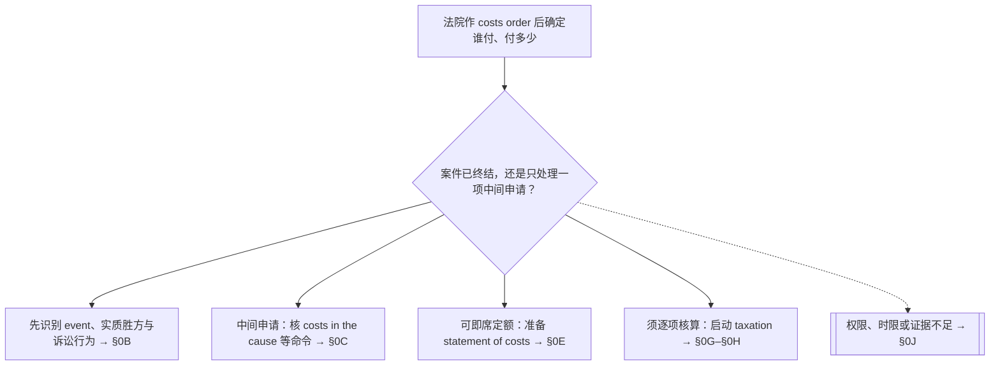
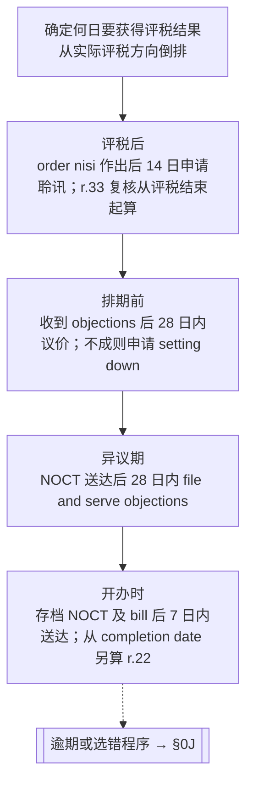

# 诉讼费用裁量、评定与评税体系（Costs, Assessment and Taxation）

## 速读定位层

### 适用范围

法院先决定费用责任和范围，再决定评税基准及定额方式。若当事人另求律师或非当事人承担费用，法院须审查独立的权源和听证程序。

### 术语

| 术语 | 定义与章节 |
| --- | --- |
| Costs order | 法院决定由谁承担什么费用及适用基准。 [§0B](#0B.%20%E8%AF%89%E8%AE%BC%E8%B4%B9%E7%94%A8%E8%A3%81%E5%88%A4%E6%9D%83%E5%8E%9F%E7%90%86%E4%B8%8E%E8%83%9C%E8%AF%89%E6%96%B9%E4%BB%98%E8%B4%B9%E5%8E%9F%E5%88%99%EF%BC%88HCO%20s.52A%20/%20O.62%20r.3%EF%BC%89) |
| Costs follow the event | 非中间程序通常以实质胜方取得费用为起点。 [§0B](#0B.%20%E8%AF%89%E8%AE%BC%E8%B4%B9%E7%94%A8%E8%A3%81%E5%88%A4%E6%9D%83%E5%8E%9F%E7%90%86%E4%B8%8E%E8%83%9C%E8%AF%89%E6%96%B9%E4%BB%98%E8%B4%B9%E5%8E%9F%E5%88%99%EF%BC%88HCO%20s.52A%20/%20O.62%20r.3%EF%BC%89) |
| Costs in the cause | 该项费用归最终取得全案费用的一方。 [§0C](#0C.%20%E4%B8%AD%E9%97%B4%E7%94%B3%E8%AF%B7%E4%B9%8B%E8%AF%89%E8%AE%BC%E8%B4%B9%E7%94%A8%E5%91%BD%E4%BB%A4%E8%B0%B1%E7%B3%BB%EF%BC%88Five%20Parameters%20&%20Spectrum%20of%20Orders%EF%BC%89) |
| Certificate for Counsel | 需要时由法院认证 counsel 出庭费用的程序。 [§0C](#0C.%20%E4%B8%AD%E9%97%B4%E7%94%B3%E8%AF%B7%E4%B9%8B%E8%AF%89%E8%AE%BC%E8%B4%B9%E7%94%A8%E5%91%BD%E4%BB%A4%E8%B0%B1%E7%B3%BB%EF%BC%88Five%20Parameters%20&%20Spectrum%20of%20Orders%EF%BC%89) |
| Party and party basis | 评税聆案官准许必要或妥当的合理费用。 [§0D](#0D.%20%E8%AE%BC%E8%B4%B9%E8%AF%84%E7%A8%8E%E7%9A%84%E4%B8%89%E5%A4%A7%E5%9F%BA%E5%87%86%E4%B8%8E%E5%AE%9E%E5%8A%A1%E8%BF%BD%E5%9B%9E%E7%8E%87%EF%BC%88O.62%20r.28%EF%BC%89) |
| Indemnity basis | 评税聆案官排除不合理发生或金额不合理的费用；疑点归收取方。 [§0D](#0D.%20%E8%AE%BC%E8%B4%B9%E8%AF%84%E7%A8%8E%E7%9A%84%E4%B8%89%E5%A4%A7%E5%9F%BA%E5%87%86%E4%B8%8E%E5%AE%9E%E5%8A%A1%E8%BF%BD%E5%9B%9E%E7%8E%87%EF%BC%88O.62%20r.28%EF%BC%89) |
| Summary assessment | 法院以概括方式确定费用金额。 [§0E](#0E.%20%E7%AE%80%E6%98%93%E8%AF%89%E8%AE%BC%E8%B4%B9%E7%94%A8%E8%AF%84%E4%BC%B0%EF%BC%88Summary%20Assessment%20under%20PD%2014.3%20/%20PD%205.2%EF%BC%89) |
| Wasted costs | 法律代表承担其不当、不合理或疏忽行为导致的浪费费用。 [§0F](#0F.%20%E9%92%88%E5%AF%B9%E5%BE%8B%E5%B8%88%E4%B8%AA%E4%BA%BA%E7%9A%84%E4%B8%A5%E9%87%8D%E5%A4%B1%E5%BD%93%E6%B5%AA%E8%B4%B9%E8%AE%BC%E8%B4%B9%E4%BB%A4%EF%BC%88Wasted%20Costs%20Orders%20under%20O.62%20r.8%EF%BC%89) |
| Taxation | 按费用命令及账单逐项确定可追偿额。 [§0G](#0G.%20%E6%AD%A3%E5%BC%8F%E8%AF%84%E7%A8%8E%E7%A8%8B%E5%BA%8F%E4%B8%8E%E6%97%B6%E9%99%90%E6%97%B6%E9%92%9F%EF%BC%88Detailed%20Taxation%20under%20O.62%20&%20O.62A%EF%BC%89) |

### 环节定位

| 环节 | 实际操作 |
| --- | --- |
| 明确费用范围 | 核 costs order、评税基准、谁付款及适用 completion date。 |
| 择定金额路径 | 能合意先议定；否则选 summary assessment 或 taxation。 |
| 交换费用文件 | 按指示提交 statement of costs，或存档并送达 NOCT 与 bill。 |
| 回应或和解 | 逐项提出 objections，并另核 O.62A offer 或 payment。 |
| 核证及执行 | 核 order nisi、复核时限、final certificate 及后续执行。 |

## 🗺️ 本卡地图

法院先决定费用责任和范围，再决定评税基准及定额方式。若当事人另求律师或非当事人承担费用，法院须审查独立的权源和听证程序。

| 任务 | 直达 |
| --- | --- |
| 诉讼费用裁判权原理与胜诉方付费原则（HCO s.52A / O.62 r.3） | [§0B](#0B.%20%E8%AF%89%E8%AE%BC%E8%B4%B9%E7%94%A8%E8%A3%81%E5%88%A4%E6%9D%83%E5%8E%9F%E7%90%86%E4%B8%8E%E8%83%9C%E8%AF%89%E6%96%B9%E4%BB%98%E8%B4%B9%E5%8E%9F%E5%88%99%EF%BC%88HCO%20s.52A%20/%20O.62%20r.3%EF%BC%89) |
| 中间申请之诉讼费用命令谱系（Five Parameters & Spectrum of Orders） | [§0C](#0C.%20%E4%B8%AD%E9%97%B4%E7%94%B3%E8%AF%B7%E4%B9%8B%E8%AF%89%E8%AE%BC%E8%B4%B9%E7%94%A8%E5%91%BD%E4%BB%A4%E8%B0%B1%E7%B3%BB%EF%BC%88Five%20Parameters%20&%20Spectrum%20of%20Orders%EF%BC%89) |
| 讼费评税的三大基准与实务追回率（O.62 r.28） | [§0D](#0D.%20%E8%AE%BC%E8%B4%B9%E8%AF%84%E7%A8%8E%E7%9A%84%E4%B8%89%E5%A4%A7%E5%9F%BA%E5%87%86%E4%B8%8E%E5%AE%9E%E5%8A%A1%E8%BF%BD%E5%9B%9E%E7%8E%87%EF%BC%88O.62%20r.28%EF%BC%89) |
| 简易诉讼费用评估（Summary Assessment under PD 14.3 / PD 5.2） | [§0E](#0E.%20%E7%AE%80%E6%98%93%E8%AF%89%E8%AE%BC%E8%B4%B9%E7%94%A8%E8%AF%84%E4%BC%B0%EF%BC%88Summary%20Assessment%20under%20PD%2014.3%20/%20PD%205.2%EF%BC%89) |
| 针对律师个人的严重失当浪费讼费令（Wasted Costs Orders under O.62 r.8） | [§0F](#0F.%20%E9%92%88%E5%AF%B9%E5%BE%8B%E5%B8%88%E4%B8%AA%E4%BA%BA%E7%9A%84%E4%B8%A5%E9%87%8D%E5%A4%B1%E5%BD%93%E6%B5%AA%E8%B4%B9%E8%AE%BC%E8%B4%B9%E4%BB%A4%EF%BC%88Wasted%20Costs%20Orders%20under%20O.62%20r.8%EF%BC%89) |
| 正式评税程序与时限时钟（Detailed Taxation under O.62 & O.62A） | [§0G](#0G.%20%E6%AD%A3%E5%BC%8F%E8%AF%84%E7%A8%8E%E7%A8%8B%E5%BA%8F%E4%B8%8E%E6%97%B6%E9%99%90%E6%97%B6%E9%92%9F%EF%BC%88Detailed%20Taxation%20under%20O.62%20&%20O.62A%EF%BC%89) |
| 影响讼费的诉前与诉中行为（PD 18.1, PD 31, WP Save as to Costs） | [§0H](#0H.%20%E5%BD%B1%E5%93%8D%E8%AE%BC%E8%B4%B9%E7%9A%84%E8%AF%89%E5%89%8D%E4%B8%8E%E8%AF%89%E4%B8%AD%E8%A1%8C%E4%B8%BA%EF%BC%88PD%2018.1,%20PD%2031,%20WP%20Save%20as%20to%20Costs%EF%BC%89) |
| 事务律师对客户之费用告知义务与追讨限制 | [§0I](#0I.%20%E4%BA%8B%E5%8A%A1%E5%BE%8B%E5%B8%88%E5%AF%B9%E5%AE%A2%E6%88%B7%E4%B9%8B%E8%B4%B9%E7%94%A8%E5%91%8A%E7%9F%A5%E4%B9%89%E5%8A%A1%E4%B8%8E%E8%BF%BD%E8%AE%A8%E9%99%90%E5%88%B6) |
| 程序失误及其后果总表 | [§0J](#0J.%20%E7%A8%8B%E5%BA%8F%E5%A4%B1%E8%AF%AF%E5%8F%8A%E5%85%B6%E5%90%8E%E6%9E%9C%E6%80%BB%E8%A1%A8) |
| SG 实务应用与导师口径 | [§0K](#0K.%20SG%20%E5%AE%9E%E5%8A%A1%E5%BA%94%E7%94%A8%E4%B8%8E%E5%AF%BC%E5%B8%88%E5%8F%A3%E5%BE%84) |

<!-- BEGIN:cite-legend -->
> [!info]- 引注图例
> 
> | 码 | 文件 | 层级 | 学年 | 核心定位与规则范围 |
> | --- | --- | --- | --- | --- |
> | OLD17 | [LG17 - Costs (Substantive).md](../../04%20Base%20Lectures/%5BLG17%5D%20Costs%20%28Substantive%29/LG17%20-%20Costs%20%28Substantive%29.md) | 往届官方 | 2025-26 | 往届完整讲义；费用命令参数、评税三大基准、浪费讼费及正式评税时限 |
> | R62 | [RHC O62.md](obsidian://open?vault=3b1e77255f6c6e29&file=output%2Fresearch%2FCivil%20Litigation%20Rules%20Verification%20-%202026-10-23%2FRHC%20O62.md) | 库外法源 | 2026-27 | 高院规则第 62 目：费用裁量权、基准、简易评定、浪费费用令及评税时钟 |
> | R62A | [RHC O62A.md](obsidian://open?vault=3b1e77255f6c6e29&file=output%2Fresearch%2FCivil%20Litigation%20Rules%20Verification%20-%202026-10-23%2FRHC%20O62A.md) | 库外法源 | 2026-27 | 高院规则第 62A 目：评税要约与入庭付款（14 天接纳窗口与费用后果） |
> | H52 | [Cap4 s52A.md](obsidian://open?vault=3b1e77255f6c6e29&file=output%2Fresearch%2FCivil%20Litigation%20Rules%20Verification%20-%202026-10-23%2FCap4%20s52A.md) | 库外法源 | 2026-27 | 香港法例第 4 章《高等法院条例》第 52A 条：法庭对诉讼费用之完全自由裁量权 |
> | CAP-C17 | [LG17 PT 2026-11-09 实录字幕](../../04%20Base%20Lectures/00%20This%20Year%20Moodle%202026-27/Lecture%20Outlines,%20Powerpoints%20&%20Materials/LG17%20-%20Costs%20%28Substantive%29/Panopto%20Captions%20%28local%20export%29/8010_LG17_PT_f4bb3bcc.md) | 本届讲义 | 2026-27 | 1049 条本届实录字幕，五参数分解、非随胜负例外、Certificate for counsel 口径及 Wasted Costs 案例 |
> | AP9 | [本届 SG09 原任务书](../../04%20Base%20Lectures/00%20This%20Year%20Moodle%202026-27/Small%20Group%20Activity%20Plans/1.%20SG9%20Activity%20Plan%20%28Civil%20Procedure%202%29.docx) | 本届官方 | 2026-27 | Q5 |
<!-- END:cite-legend -->

## 0B. 诉讼费用裁判权原理与胜诉方付费原则（HCO s.52A / O.62 r.3）

### 0B.1 司法自由裁量权与胜诉方获偿原则（Costs Follow the Event）

HCO s.52A（讼费管辖）及 O.62 r.3（讼费裁量）授权法院决定谁应付、应付多少和基准。正审等非中间程序以 costs follow the event 为起点；法院先识别实质胜方，再看对其偏离默认结果是否有正当理由。*IBL v Luke* 的课堂落点是先辨实际结果，再判断费用裁量；有多项争点时，不能单用净判额决定。O.1A r.3 要求各方及其法律代表协助法院实现程序目标，课堂亦把 counsel 与 solicitor 纳入这一责任。 <small style="opacity: 0.55">〔R62 L47 "except under an order of the Court"〕〔R62 L49 "other than interlocutory proceedings"〕〔R62 L51 "or make such other order as it sees fit"〕〔CAP-C17 L466-L496 "Right. So as we see here mentioned at paragraph nine, the proper approach in"〕〔CAP-C17 L457-L532 "What happened was the respondent husband was spending a lot of money on his"〕〔CAP-C17 L319-L330 "Now, 183 the parties to any proceedings and their legal representatives shall assist"〕</small>

### 0B.2 当事人诉中行为对费用的影响与争点化分摊（O.62 r.5）

O.62 r.5 要求法院考虑当事人的诉前及诉中行为、某争点是否值得提出或抗辩、诉求有否夸大，以及可依法考虑的要约。若一方只在部分争点胜诉，法院可按 issue 或比例分摊。律师用 pleadings、议定争点清单及判决结果证明某项工作为何必要；对方可指出无理坚持造成的额外费用。*Pang Uk-chor* 的课堂例说明：一方在诉答、对方开案材料和审讯推进过程中获得重新评估机会，仍无理坚持的，法院可据此调整费用。 <small style="opacity: 0.55">〔R62 L114 "whether it was reasonable for a party to raise"〕〔R62 L118 "exaggerated his claim"〕〔CAP-C17 L1228-L1252 "Okay. Now sometimes things are based on issues as you see here."〕〔CAP-C17 L862-L940 "So what does Pang u chor talk about? The reason why I chose this case is not just"〕〔CAP-C17 L1414-L1453 "So what happened was this the decisions of Justice Sias declining to address the"〕</small>

> **Exam / Drafting Formulation:** "The Defendant seeks the costs of the issues on which it succeeded."

## 0C. 中间申请之诉讼费用命令谱系（Five Parameters & Spectrum of Orders）

### 0C.1 完整费用命令之「五参数结构」

讲师在课堂上明确强调，一份合规、清晰的诉讼费用命令绝不能仅仅写一个孤立的词语「Costs」，必须完整包含以下**五个核心参数（Five Parameters）**： <small style="opacity: 0.55">〔CAP-C17 L3106-L3141 "Now, having said that, once you know the standard basis,"〕</small>
1. **Who（承担主体与收取主体）**：谁向谁支付（必须明确指明 Paying Party 与 Receiving Party）；
2. **What（涵盖范围）**：是全案费用（Of the action）、该次申请的费用（Of the application）、该次申请所引致的额外费用（Of and incidental to）、还是针对特定孤立争点（Of the issue）；
3. **Contingency（附随条件/胜负挂钩）**：是无论主案胜败直接确定（In any event），还是随主案最终结果转移（In the cause），抑或暂时保留（Reserved）；
4. **Basis（评税基准）**：是党同基准（Party and Party）、还是惩罚性的弥偿基准（Indemnity Basis）；
5. **When（支付时点与数额确定路径）**：是即日由法庭进行简易评估（Summary Assessment）并在 14 天内支付，还是留待主诉终结后进行正式评税（Taxation forthwith vs Taxation at the end of trial）。

### 0C.2 中间申请常规费用命令谱系与法定含义

| 费用命令术语 | 法定含义与执行条件 | 适用典型场景与规则依据 |
|---|---|---|
| **Costs in any event**（在任何情况下均由某方收取） | 收取方无论主案最终正审胜败如何，**均享有不可剥夺的收取该项中间费用的权利**。但若无法院明示命令，通常留待正审后一并评税。 | 申请人提出完全不必要的传票、或被告提出毫无理据的程序阻挠。 |
| **Costs in the cause** | 该次申请费用归最终获判全案费用的一方。 | 若法院只给一方 its costs in the cause，该方败诉时，对手也不会仅凭这项中间命令取得该次费用。 <small style="opacity: 0.55">〔CAP-C17 L1925-L1928 "the court cannot give an order without determining cause"〕</small> |
| **Costs reserved**（保留费用） | 该次申请的费用**留待后续阶段（通常为正审法官全面审理全案后）再行决定**。未作最终决定前，任何一方不得开展评税。 | 申请的胜负与正审实体诚信紧密关联，当前阶段尚难见分晓。法庭决定「今天不作决定」本身属于正式司法决定。 <small style="opacity: 0.55">〔CAP-C17 L1963-L1966 "I have decided to not decide today which is still a decision"〕</small> |
| **No order as to costs**（各方费用自理） | 各方各自承担自身因该次申请所发生之全部律师费用，任何一方不得向对方索偿。 | 双方均有部分胜负，或因法制不明确而具有合理争议。 |
| **Costs thrown away**（落空费用） | 赔偿一方因对方撤回步骤、撤销缺席判决或重大程序失误而导致**已经发生且彻底被浪费的准备费用**。 | 缺席判决被申请人撤销时，原告先前为入判所花的费用由申请人补偿。 |

### 0C.3 胜负不挂钩的法定特别例外清单与 Certificate for Counsel 口径

费用归属有专门规则时，律师先核该条是否写明 unless otherwise ordered；修改诉答、延期或缩期、第三方披露的费用不能一律视为与胜负无关。修改引致的费用通常由修改方承担；如对方无理反对，*Le Soleil* 的课堂例说明法院可另分配反对所引致的费用。Norwich Pharmacal 或 Bankers’ Books 申请应区分第三方合理的遵令成本、法律费用和双方争议的申请费用。

出庭律师在 Master 席前争取计入 counsel 费用时，应在费用裁决时提出 Certificate for Counsel，并核 O.62 First Schedule 的适用范围、法院层级和实际命令。单名 counsel 在 Judge 席前并不按同一条 Master 规则办理；两名 counsel 的费用另有认证规则。法院可否补授、税务聆案官可否计入，不能只从漏问一句推断。 <small style="opacity: 0.55">〔R62 L53 "any amendment made without leave"〕〔CAP-C17 L1054-L1069 "shall be borne by the party making the amendment"〕〔R62 L55 "for serving or filing any document"〕〔CAP-C17 L1951-L1957 "Okay, so with the ones that you understand, such as extension of time or abridgment of"〕〔CAP-C17 L1075-L1147 "So amendment is one of them okay. It doesn't end there for the cost of an occasion by"〕〔R62 L65 "to the time of receipt of the notice of discontinuance"〕〔CAP-C17 L1477-L1504 "So be careful. All right. Now as we mentioned before, there's certain kinds of"〕〔CAP-C17 L1264-L1307 "I'll give you an example of what they're talking about. You've been taught the case"〕〔R62 L78 "giving the applicant 7 days’ notice"〕〔CAP-C17 L1795-L1885 "With a certificate for counsel, you must say that if you are before the High Court master below"〕〔CAP-C17 L1852-L1855 "So in SG three, eventually in civil advocacy, we're acting as counsel for a judge"〕</small>

> **Exam / Drafting Formulation:** "The Defendant asks for its costs of this application in any event."

## 0D. 讼费评税的三大基准与实务追回率（O.62 r.28）

### 0D.1 党同基准（Party and Party Basis under O.62 r.28(2)）

法院未另订基准时，评税聆案官依 O.62 r.28(2) 用 party and party basis，只准许为司法公正或维护当事人权利所必要或妥当的费用。收取方须用账单、工时及凭证说明必要性。课堂用实际支付额约 50% 至七成多作经验范围；原讲义的 65%–70% 只是其中一个估算，不能作为固定追回率。（往届讲义对照）。 <small style="opacity: 0.55">〔R62 L702 "necessary or proper for the attainment of justice"〕〔OLD17 L615 "Generally, a costs order awarded by the Court"·往届仅参考〕〔CAP-C17 L3046-L3103 "50 to roughly 70 odd percent of their costs"〕〔CAP-C17 L3064-L3070 "You recover back. Okay. Now having said that, when there is a cost order made, if it"〕</small>

### 0D.2 共同基金基准（Common Fund Basis under O.62 r.28(4)）

法院指示采用 common fund basis 时，聆案官依 r.28(4) 给合理发生的费用评定合理数额，并按有共同利益基金的 solicitor and client 评税规则处理；信托、遗产等场景须核实际费用命令。法院依 r.28(3) 有权指示此基准或 indemnity basis。 <small style="opacity: 0.55">〔R62 L706 "a reasonable amount in respect of all costs reasonably incurred"〕</small>

### 0D.3 弥偿基准（Indemnity Basis under O.62 r.28(4A)）

法院指示用 indemnity basis 时，聆案官依 r.28(4A) 排除不合理发生或金额不合理的部分，其余准许；在合理性上仍有疑点时，归收取方。法院可因 some special or unusual feature、严重程序失当或 O.22 的适用后果选用该基准；胜诉本身不够。课堂估算约 85%–90%，不是全额赔偿保证。（往届讲义对照）。 <small style="opacity: 0.55">〔R62 L707 "shall be resolved in favour of the receiving party"〕〔OLD17 L370 "some special or unusual feature"·往届仅参考〕〔CAP-C17 L1768-L1786 "So when you're considering indemnity costs, um, this case of the Commissioner of"〕</small>

> **Exam / Drafting Formulation:** "The costs are to be taxed on the party and party basis, if not agreed."

## 0E. 简易诉讼费用评估（Summary Assessment under PD 14.3 / PD 5.2）

### 0E.1 适用范围与制度目的

O.62 rr.9A–9D（即席及暂定评定）与 [PD 14.3 ¶¶6–15](https://legalref.judiciary.hk/lrs/common/pd/pdcontent.jsp?lang=EN&pdn=PD14.3.htm) 区分 summary assessment、provisional summary assessment 和 taxation。中间申请原则上优先前两种；支付方如指出无法简要处理的实质争议，法院可指示正式评税。法院还须核 r.9C 的排除及法援或受保护当事人的规则。决定实体申请的 Judge 或 Master 通常一并评定，可暂定金额、安排书面处理或续讯。依 r.9B，一般在命令后 14 日付款，法院可指定其他日期；法援例外另按条文。 <small style="opacity: 0.55">〔CAP-C17 L2998-L3013 "It just should went by way of summary assessment. Now the final thing before we leave"〕</small>

### 0E.2 费用清单送达规程与文书死线

寻求 summary assessment 的一方按 PD 14.3 Appendix A 备 statement of costs，列工时、费率、counsel fees 和必要支出，由本人或律师签署。除其他 PD 另有规定外，随实体 skeleton 一并交存和送达。律师确认请求未超过客户对本所实际责任。法院用 broad-brush 方式核相称性，不逐项作 mini-taxation；文书冗长或无理由迟交会影响费用命令，不产生自动失权。诉讼费支付方应尽早指出哪些项目无法简要处理。 <small style="opacity: 0.55">〔CAP-C17 L754-L796 "What will typically happen is behind the scenes, each side will provide or prepare"〕〔CAP-C17 L2884-L2931 "Okay. When there's a summary assessment of costs, a party, which is to seek a summary"〕〔CAP-C17 L2947-L2980 "14 although the court may allow the full amount claimed by the receiving party,"〕〔CAP-C17 L2932-L2944 "Okay. So that's disposal on papers. And also they say prolix."〕〔CAP-C17 L2853-L2860 "the taxing master may make the party and or the practitioner responsible for such failure personally liable for costs"〕</small>

> **Exam / Drafting Formulation:** "I ask the Court to assess the costs of this application summarily."

## 0F. 针对律师个人的严重失当浪费讼费令（Wasted Costs Orders under O.62 r.8）

### 0F.1 权源依据与 *Ridehalgh v Horsefield* 三步测试法则

HCO s.52A（wasted costs 的权源）及 O.62 r.8 允许法院命法律代表个人承担由 improper、unreasonable 或 negligent conduct 造成的浪费费用。*Ridehalgh v Horsefield* [1994] Ch 205 依次问三件事：律师是否有该行为；行为是否导致本可避免的特定费用；让律师承担这些费用是否公正。一般败诉或单纯判断失误不能直接证明这三项。（往届讲义对照）。 <small style="opacity: 0.55">〔CAP-C17 L2461-L2490 "Right. And when they meet in court, whoever wins or loses actually pays two sets of"〕〔CAP-C17 L2491-L2530 "All right. And then how is that manifested in the wording of order six to rule eight?"〕〔CAP-C17 L2611-L2660 "What happened in this case was the court had to decide, well, what's the best"〕〔OLD17 L548 "The causal link between the solicitor’s conduct"·往届仅参考〕</small>

### 0F.2 司法审理程序（*Josephine Ma* 案两阶段程序）与举证责任

*Ma Soso Josephine v Lee Chi Hang* [2004] 2 HKLRD 797 的两阶段程序先问材料是否足以要求律师 show cause，再由法院给其合理答辩机会，处理证据、因果、金额与公平。律师无法因 legal professional privilege 充分说明的，法院不能从其沉默作不利推论而替申请人补足证明。申请时依 [PD 14.5](https://legalref.judiciary.hk/lrs/common/pd/pdcontent.jsp?lang=EN&pdn=PD14.5.htm) 核书面说明、送达和各方陈述机会。 <small style="opacity: 0.55">〔CAP-C17 L2677-L2710 "Okay. So more specifically later said in Josephine Ma was a reference to this paragraph"〕〔CAP-C17 L1555-L1600 "The application involves a two stage process. The court first considers whether the party should be joined for the purposes of costs"〕〔CAP-C17 L2662-L2675 "Okay. The burden of proof first begins with it being on the applicant,"〕〔CAP-C17 L2790-L2827 "Initially, the court is invited by the applicant to call on the solicitor to show"〕〔R62 L134 "a reasonable opportunity to attend a hearing"〕</small>

### 0F.3 非当事人诉讼费用令（Non-Party Costs Orders under O.62 r.6A）

当事人向非当事人求 costs 时，法院按 HCO s.52A 与 O.62 r.6A 先处理仅为 costs 目的的加入和听证，再问该人是否实际控制、资助并从诉讼取得利益，以及给令是否公正。仅有股东或董事身份不足。向律师求 wasted costs 则按 r.8 的行为、因果和公正测试处理。 <small style="opacity: 0.55">〔CAP-C17 L1609-L1705 "Well that order 62 rule six A its DNA is linked to section 52 A of the High Court"〕〔CAP-C17 L1669-L1702 "For serious delay, could amount to an abuse of process whereby the court would dismiss"〕</small>

> **Exam / Drafting Formulation:** "The costs sought were incurred as a result of the conduct identified in the application."

### 0F.4 本届新增两案：何时加入非当事人、迟延何时妨碍追偿

- *Achieve Goal Holdings Ltd v Zhong Xin Ore-Material Holding Co Ltd* [2024] HKCA 500：O.62 r.6A 是 summary procedure。法院先决定是否仅为 costs 加入；只有申请明显属于 abuse of process，例如迟延或根本错误已达此程度，才在第一阶段拒绝。法院在第二阶段给被加入者合理到庭机会，再决定下令是否符合 interests of justice。本案上诉许可申请未显示 reasonable prospect of success。
- *Billion Well Construction Engineering Co Ltd v Long Faith Engineering Ltd* [2024] HKCFI 3712：HCO s.52A 没有为非当事人费用申请设统一期限。申请人本来可诉该非当事人却未加入时，法院会查有无尽早警告；判后迟延造成实质损害时，法院可拒绝给令。若迟延严重到构成 abuse of process，法院可在加入阶段驳回。[本届 LG17 讲义（新增两案）](../../04%20Base%20Lectures/00%20This%20Year%20Moodle%202026-27/Lecture%20Outlines,%20Powerpoints%20&%20Materials/LG17%20-%20Costs%20%28Substantive%29/LG17%20-%20Costs%20%28Substantive%29.docx)。

## 0G. 正式评税程序与时限时钟（Detailed Taxation under O.62 & O.62A）

### 0G.1 正式评税：分开启动、送达、反对及复核的时钟

当事人先查费用已否约定或已经评定；仍须评税的，以 §0H 时序区分四条时钟：completion date、存档后送达、反对和排期、评定结果的听证或复核。

### 0G.2 正式评税启动与反对时钟（NOCT & Notice of Objections）

O.62 r.21（启动评税）要求收取方存档 NOCT 和 bill of costs、缴规定费用，并在存档后 7 日内向有权参与的人送达，适用 r.21(3)–(7) 时另处理第三方或无需送达的情况。依 [PD 14.3 ¶¶17–26](https://legalref.judiciary.hk/lrs/common/pd/pdcontent.jsp?lang=EN&pdn=PD14.3.htm)，NOCT 使用 Appendix D；bill 用 Appendix B，逐阶段和项目编列，律师核对客户实际应付。除非有不同方向，支付方在 NOCT 送达后 28 日内以 Appendix C 存档及送达 list of objections；收到反对后再给 28 日议价，未能全部议定，收取方提交 Appendix E 请求排期。对方漏答时，收取方以送达誓章和 Appendix E Section A 申请 bill as drawn，由聆案官决定。

O.62 r.22（迟延）的三个月从 completion date 起算。届满而未议定或未送 NOCT，支付方可给至少 7 日通知申请命令；聆案官可定限期并处理迟延的费用及利息。另有 r.22(7) 的两年启动限制，法院准延期则按延长期限。完成日按 r.22(9) 核实际法院命令和程序状态。（往届讲义对照）。 <small style="opacity: 0.55">〔OLD17 L771 "Within 28 days after service of the NOCT"·往届仅参考〕〔OLD17 L757 "The reasons for objection should also be clearly stated"·往届仅参考〕〔OLD17 L779 "an affidavit to prove due service"·往届仅参考〕〔OLD17 L783 "cannot be postponed without the approval"·往届仅参考〕</small>

### 0G.3 Order 62A 评税制裁性要约与 14 天接纳窗口

O.62A（评税要约及付款）把 receiving party 的书面 sanctioned offer 与 paying party 的 sanctioned payment 分开。支付方用 Form 93 付款通知；收取方接纳付款用 Form 93A，领款用 Form 93B。r.1 的 relevant date 是书面评税日或排定的评税聆讯日；r.1(2) 排除在有关程序中现在或曾经受法援的一方。rr.13–14 原则上要求在 relevant date 前并在作出后 14 日内存档及送达接纳通知；逾期后，双方若同意之后评税费用的责任和金额，可无须许可，否则申请 leave。r.18 处理接纳后的 stay；r.19 处理收取方未胜过付款，r.20 处理收取方胜过自己提议。除非 unjust，适用条文的 indemnity basis、利息和费用安排；r.19 利息与费用可能有不同起点，r.20 须按送达日。两者都不能照抄 O.22 的 28 日钟。 <small style="opacity: 0.55">〔CAP-C17 L658-L676 "Such offer may be made at any time before the relevant date. Now pay attention to"〕〔CAP-C17 L637-L655 "All right. So what does order 62 A rule three say one a cost offered by a paying party"〕〔R62A L58 "14 days"〕〔CAP-C17 L807-L850 "you can have to deal with that now or to a rule 18 if a sanctioned offer or"〕</small>

### 0G.4 Order nisi、final certificate 与两级复核（O.62 rr.21B、33–35）

O.62 r.21B（书面暂定评税）的 order nisi 自作出后 14 日转为 absolute，除非在该期内申请聆讯；未取得实质改善的申请人可承担聆讯费用。O.62 r.33（向原评税聆案官复核）则由评税结束后起算 14 日，或聆案官定较短期限，且须在 final certificate 签发前提出并交书面逐项反对。依 r.34(4) 及时索取理由后，仍不服可按 r.35 在相关 certificate 签署后 14 日内以 summons 向 Judge 申请，或依获准延长办理。评税完成后按 r.17A 取得 final certificate；执行见 CO18。 <small style="opacity: 0.55">〔R62 L568 "The order nisi becomes absolute 14 days after it is made"〕〔R62 L841 "may not apply to a judge"〕〔R62 L843 "after the signing of the taxing master ’s final certificate"〕〔R62 L867 "within 14 days after the taxing master ’s certificate"〕</small>

### 0G.5 诉前和诉中行为：保留费用的要约及调解

#### 0G.5.1 Without Prejudice Save as to Costs 信函之使用纪律（第二纹身）

律师把 without prejudice save as to costs 函件与实体证据分开；相关实体问题裁定后，才在 costs 陈词中引用。课堂的 specific discovery 算例中，原告要求十项文件，被告先提议交五项；若法院只命交五项或更少，被告可援引合理提议要求该次申请费用。法院仍须查提议条件、可得资料和各方实际行为。 <small style="opacity: 0.55">〔CAP-C17 L2122-L2140 "That's right. So when do you use this letter? Anything without prejudice."〕〔CAP-C17 L2023-L2107 "I'll give it to you using a context. Again, let's assume the plaintiff is going to take"〕</small>

#### 0G.5.2 拒绝调解之讼费制裁（PD 31）

一方无合理理由拒绝调解时，对方可按 PD 31 在 costs 阶段提交适当记录。法院可调整费用，包括削减胜方可得数额；收到 Mediation Notice 后应按适用期限作实质回应，若提出延后调解，应说清尚缺哪些资料及何时可以调解。

> **Exam / Drafting Formulation:** "The receiving party has filed and served the notice of commencement and the bill of costs."

## 0H. 影响讼费的诉前与诉中行为（PD 18.1, PD 31, WP Save as to Costs）

| 环节 | 实际操作 |
| --- | --- |
| 明确费用范围 | 核 costs order、评税基准、谁付款及适用 completion date。 |
| 择定金额路径 | 能合意先议定；否则选 summary assessment 或 taxation。 |
| 交换费用文件 | 按指示提交 statement of costs，或存档并送达 NOCT 与 bill。 |
| 回应或和解 | 逐项提出 objections，并另核 O.62A offer 或 payment。 |
| 核证及执行 | 核 order nisi、复核时限、final certificate 及后续执行。 |

> **Exam / Drafting Formulation:** "If the amount cannot be assessed today, I ask for directions for assessment on the papers."

申请即席评定的一方先备签妥的 statement of costs、对应 skeleton、费用命令草案及所需 counsel certificate。正式评税的一方备 Appendix D NOCT、Appendix B 账单及送达凭证；支付方另备 Appendix C 逐项反对。核对 NOCT 存档后 7 日送达、NOCT 送达后 28 日反对、反对送达后 28 日议价，以及书面暂定评税后 14 日申请聆讯；见 §0G。

## 0I. 事务律师对客户之费用告知义务与追讨限制

### 0I.1 申请人或原告的准备与核对

申请费用的一方先确定谁付、付哪项、归属条件、基准和时点。寻求即席评定时提交 statement of costs；在 Master 席前有 counsel 时检查所需 certificate。

### 0I.2 答辩人、被告与第三方的应对

支付方按争点及账单项目提出具体 objections，说明哪些工时、费率或支出不符基准。对非当事人或律师个人的请求另核行为、因果与听证。

### 0I.3 签署、送达或执行前的最终核对

执行前核实际 costs order、适用 basis、付款期限、order nisi 或 final certificate 的状态；两条 14 日复核时钟分别登记。

### 0I.4 律师对客户之告知义务（Solicitors' Guide §4.01(8)）

事务律师在接受客户委托并推进诉讼时，承担着严格的专业告知责任：
- 依据《香港事务律师专业操守指引》第 4.01(8) 条，律师必须在委托之初以书面形式明确告知客户计算费用的基准、预计阶段费用估计（Cost Estimates），并随案件推进及时提供更新账单；
- 必须明确向客户解释：**即便案件大获全胜，由败诉方依据 Party and Party 基准赔付的费用，实务上通常仅占自身实际发生律师费用的 50% 至 70%**，差额必须由客户依委托协议自行清偿。

### 0I.5 起诉法院选择策略与费用尺度（Start Low and Go High）

> 区域法院的法律服务费用标准大致相当于高等法院费用的六成（约 60%）。对于标的额临界于 300 万港元争议上限的案件，实务上明智的策略是**「低开高走（Start low and go high）」**——先在区域法院起诉，若后续发现索赔金额超出管辖上限，可依法申请将诉讼移升至高等法院；反之，若盲目在高等法院起诉而最终判决金额不足 300 万，胜诉方不仅面临被法庭裁定仅按较低的区域法院尺度（District Court Scale）评定费用，还可能因滥用高院资源而遭受惩罚性核减。 <small style="opacity: 0.55">〔CAP-C17 L3021-L3045 "If a person spends $100 for particular legal services in the court of first instance."〕</small>

## 0J. 程序失误及其后果总表

| # | 失误 | 后果及下一步 |
| --- | --- | --- |
| 1 | Master 席前未求需要的 Certificate for Counsel | 可能不能计入相应 counsel 费用；核当时命令并尽早请求指示。 |
| 2 | 迟交 statement of costs 或提交冗长清单 | 法院可另排、书面处理或转评税，并处理浪费的费用；不产生自动失权。 |
| 3 | completion date 后三个月既未议定也未送 NOCT | 支付方可依 r.22 给至少七日通知求定限；聆案官可因迟延调整费用或利息。 |
| 4 | 漏交 list of objections | 收取方可以送达誓章及 Appendix E Section A 请求按账单评税。 |
| 5 | 把 O.22 的 28 日套给 O.62A | 改核 rr.13–14 的 14 日与 relevant date；迟接受时先谈之后评税费用。 |
| 6 | 要求律师承担浪费费用却未列因果 | 依 r.8、PD 14.5 写明行为及特定费用，让被指律师答辩。 |
| 7 | 不回应合理调解建议 | 对方可在 costs 阶段援引；尽早给具体理由和替代日期。 |
| 8 | 把三类评税异议的起点混为一谈 | order nisi 的听证、r.33 向 Master 复核和 r.35 向 Judge 复核分别登记。 |
| 9 | 超过两年仍未启动评税 | 检查法院有无依 r.22(7) 延长期限；三个月迟延条文不是两年门槛。 |

## 0K. SG 实务应用与导师口径

### 0K.1 SG06：担保、和解与中间申请费用

#### 1. 法律关系与核心争点拆解
在 SG06（Question 1 费用担保与 Question 3 和解谈判）中，诉讼费用的争夺贯穿全流程。核心争点在于：当一方在中间申请中获得有利结果时，应当如何精准表述所寻求的费用命令（Who / What / Contingency / Basis / When），以最大程度保障当事人的现金流与费用追偿权。

#### 2. 答题/起草要件映射与操作落点
1. **费用担保（Security for Costs）传票**：申请人获胜后，标准费用命令应主张「**Defendant's costs in the cause**」（若被告获判全案费用，可计入该项；若被告未获判全案费用，双方不能仅凭此项命令向对方追收该次费用）；若原告无理抗辩导致多次开庭，被告可主张「**Defendant's costs in any event**」；
2. **延期传票（Time Summons）**：根据本届更新讲义，常规简单的延期传票课堂更新举例（High Court 約 HK$1,200 / District Court 約 HK$800）；实际付款人和期限按法院命令；
3. **简易评定之当庭请求**：在传票辩论获胜后，律师必须当庭向聆案官提出：“*I ask for a summary assessment of the costs of this application, and I have filed and served our Statement of Costs...*”

> **Exam / Drafting Formulation:** "The Defendant asks for its costs of this application in the cause."

#### 3. 导师课堂口径与考场红线（Tutor's Takeaways）
- **民事倡辩（Civil Advocacy）费用评分的 Binary 特性**：导师特别指出，在民事倡辩考核中，诉讼费用命令的陈述按课堂提醒属直接可核的评分项！在边缘及格线（Borderline Pass/Fail）上，法官/考官往往将费用陈述是否严谨合规作为决定性的 Tie-breaker！漏提 Certificate for Counsel 或表述混淆将直接导致该项全扣。 <small style="opacity: 0.55">〔CAP-C17 L199-L235 "If a student in the civil advocacy assessment is borderline fail or borderline"〕</small>

### 0K.2 民事倡辩（Civil Advocacy）与考场费用 Binary 评分红线

#### 1. 法律关系与核心争点拆解
在模拟法庭（Mooting）与倡辩考核中，当法官就传票实体作出裁决后，会立即转向各方大律师发问：“*What do you say as to costs?*”
此时的核心争点是：胜诉方能否在 30 秒内完整、无误地向法庭报出包含五项参数的标准费用命令。

#### 2. 答题/起草要件映射与操作落点
标准口头陈述模式：
> *“My Lord / Master, I ask that the Plaintiff pay the Defendant’s costs of and incidental to this application, to be taxed if not agreed on a party and party basis. Further, as we are before the Master, I respectfully ask for a Certificate for Counsel.”*

> **Exam / Drafting Formulation:** "The Defendant asks for its costs of this application in any event, to be taxed if not agreed."

#### 3. 导师课堂口径与考场红线（Tutor's Takeaways）
- 按 O.62 First Schedule ¶2(3)，Master in chambers 有 counsel 出庭时核认证；在 Master in open court、Judge 或 Court of Appeal 席前，两名以上 counsel 的出庭费另核认证。 <small style="opacity: 0.55">〔CAP-C17 L1795-L1885 "With a certificate for counsel, you must say that if you are before the High Court master below"〕〔CAP-C17 L1852-L1855 "So in SG three, eventually in civil advocacy, we're acting as counsel for a judge"〕〔CAP-C17 L145-L169 "So if you look at that chart which was given to you at the beginning of the year,"〕</small>

### 0K.3 SG09 Q5：分项判决后的 costs 与 sanctioned payment

**本届 SG09 完整应用：** [Hogwarts Q5](../../01%20SG/SG09%20Civil%20Procedure%202%20%28Knowledge%29/05%20Question%205%20-%20Costs%20and%20Sanctioned%20Payment.md)。

#### 1. 法律关系与核心争点拆解

2027 年 11 月 25 日，CFI 驳回 Hogwarts 对 Malfoy 和 Muggle Investments 的竞业及招揽客户申索，认定 Hogwarts 夸大该项申索，证人为此捏造证据。法院另判 Malfoy 向 Hogwarts 支付 HK$3,000,000 及利息。Q5(b) 假设 Malfoy 代表两名被告于 2027 年 2 月 3 日作出覆盖全部申索的 HK$4,000,000 sanctioned payment，Hogwarts 没有接纳。

#### 2. 答题/起草要件映射与操作落点

(1) **无付款：** Hogwarts 可求 Malfoy 承担返还申索的合理费用；两名被告可求 Hogwarts 承担失败的竞业及招揽申索费用。法院可按争点或比例分摊；夸大及捏造证据为降低 Hogwarts 可得费用、或对失败争点判 indemnity costs 提供依据。不能让未被判负有返还义务的 Muggle 承担该项费用。(2) **有付款：** 按 CO14 统一范围与利息后，若原告未超过 4m，按 r.23 另处理最后免许可接纳日以后的被告费用及利息，再防止同一笔费用重复计算。原件见引注图例 AP9，Q5。

> **Exam / Drafting Formulation:** "I ask the Court to allocate costs by issue and then apply the consequences of the sanctioned payment to the relevant period."

#### 3. 导师课堂口径与考场红线（Tutor’s Takeaways）

把原判决的 costs 分析与 O.22 的增量后果分开；待主审完成实体及金额裁定后才出示适用的费用材料。

## 1. 第一性原理

| 问题 | 比较方法 |
| --- | --- |
| 谁承担程序选择的风险？ | 申请费用的一方先确定谁付、付哪项、归属条件、基准和时点。寻求即席评定时提交 statement of costs；在 Master 席前有 counsel 时检查所需 certificate。 |
| 哪项争议必须单独处理？ | 支付方按争点及账单项目提出具体 objections，说明哪些工时、费率或支出不符基准。对非当事人或律师个人的请求另核行为、因果与听证。 |
| 法院怎样控制错误后果？ | 执行前核实际 costs order、适用 basis、付款期限、order nisi 或 final certificate 的状态；两条 14 日复核时钟分别登记。 |
| 如何证明请求已经能够执行？ | 核 order nisi、复核时限、final certificate 及后续执行。 |

## 2. 顺向推进

| 步骤 | 参与者完成的工作 | 交接物 |
| --- | --- | --- |
| 确认目标 | 律师确定客户要取得的结果、期限及可用证据。 | 指示与程序记录 |
| 明确费用范围 | 核 costs order、评税基准、谁付款及适用 completion date。 | 事实与授权台账 |
| 择定金额路径 | 能合意先议定；否则选 summary assessment 或 taxation。 | 程序与文书清单 |
| 交换费用文件 | 按指示提交 statement of costs，或存档并送达 NOCT 与 bill。 | 草稿及源文件 |
| 回应或和解 | 逐项提出 objections，并另核 O.62A offer 或 payment。 | 送达或提交凭证 |
| 核证及执行 | 核 order nisi、复核时限、final certificate 及后续执行。 | 法庭指示或结果 |
| 处理争议 | 当事人按法院方向回应不利证据或程序异议。 | 异议与回应记录 |
| 完成交接 | 律师将实质结果及未履行项目转交下一阶段。 | 执行和补救记录 |

## 3. 本届规则与操作边界

| 客户所求 / 核心规则节点 | 与本卡主制度的区别及操作边界 |
| --- | --- |
| 要在中间申请当庭定出数额 | 法院可按 PD 14.3 以 broad-brush 方式评定；实质争议无法简要处理时，请求 provisional summary assessment 或 taxation directions。 |
| 要更改一项暂定评税结果 | r.21B 的听证请求从 order nisi 作出起算；r.33 向 Master 复核从评税结束起算；r.35 向 Judge 复核另受证书及索取理由条件约束。 |
| 要律师或资助人个人负担费用 | 律师责任按 r.8 证明行为、因果及公正；非当事人按 r.6A 先处理加入与听证，再核 interests of justice。 |

## 4. 办案流程控制与关键节点核查（Procedural Control & Case Verification）

| 核对项 | 当事人如何核对 | 发现缺口后的行动 |
| --- | --- | --- |
| 明确费用范围 | 核 costs order、评税基准、谁付款及适用 completion date。 | 申请费用的一方先确定谁付、付哪项、归属条件、基准和时点。寻求即席评定时提交 statement of costs；在 Master 席前有 counsel 时检查所需 certificate。 |
| 交换费用文件 | 按指示提交 statement of costs，或存档并送达 NOCT 与 bill。 | 支付方按争点及账单项目提出具体 objections，说明哪些工时、费率或支出不符基准。对非当事人或律师个人的请求另核行为、因果与听证。 |
| 核证及执行 | 核 order nisi、复核时限、final certificate 及后续执行。 | 执行前核实际 costs order、适用 basis、付款期限、order nisi 或 final certificate 的状态；两条 14 日复核时钟分别登记。 |

## 5. 横向程序联动与机制衔接（Inter-Procedural Coordination & Interface）

| 接口 | 两个程序如何衔接 |
| --- | --- |
| 判决与费用分摊 | 通过判决及争点清单界定 costs order，再计算各项目。 |
| 要约与评税 | 实体 O.22 及账单 O.62A 的接纳期、比较对象和利息时点分别登记。 |

## 6. 目标倒推与实务应对策略（Goal-Driven Strategy & Strategic Remedies）

| 客户目标 | 从目标倒推所需材料与行动 |
| --- | --- |
| 在一次聆讯确定讼费 | 准备已签署的 statement of costs，核需要的 Certificate for Counsel，口头提出具体命令。 |
| 从长账单中排除多报项目 | 逐项对照指示与原件，列反对、替代金额及账单的总核减额。 |

###### 0G.1 正式评税程序（Taxation）、3 个月死线与 O.62A 费用要约时钟图

见 [现行章节](#0G.1%20%E6%AD%A3%E5%BC%8F%E8%AF%84%E7%A8%8E%EF%BC%9A%E5%88%86%E5%BC%80%E5%90%AF%E5%8A%A8%E3%80%81%E9%80%81%E8%BE%BE%E3%80%81%E5%8F%8D%E5%AF%B9%E5%8F%8A%E5%A4%8D%E6%A0%B8%E7%9A%84%E6%97%B6%E9%92%9F)。

###### 0G.4 临时命令转终局命令（Order Nisi to Absolute）与复核规程（Review under O.62 r.33）

见 [现行章节](#0G.4%20Order%20nisi%E3%80%81final%20certificate%20%E4%B8%8E%E4%B8%A4%E7%BA%A7%E5%A4%8D%E6%A0%B8%EF%BC%88O.62%20rr.21B%E3%80%8133%E2%80%9335%EF%BC%89)。

###### 0K.1 SG06 / SG09 诉讼费用命令争夺与传票实务

见 [现行章节](#0K.1%20SG06%EF%BC%9A%E6%8B%85%E4%BF%9D%E3%80%81%E5%92%8C%E8%A7%A3%E4%B8%8E%E4%B8%AD%E9%97%B4%E7%94%B3%E8%AF%B7%E8%B4%B9%E7%94%A8)。

###### 0H.1 Without Prejudice Save as to Costs 信函之使用纪律（第二纹身）

见 [现行章节](#0G.5.1%20Without%20Prejudice%20Save%20as%20to%20Costs%20%E4%BF%A1%E5%87%BD%E4%B9%8B%E4%BD%BF%E7%94%A8%E7%BA%AA%E5%BE%8B%EF%BC%88%E7%AC%AC%E4%BA%8C%E7%BA%B9%E8%BA%AB%EF%BC%89)。

###### 0I.1 律师对客户之告知义务（Solicitors' Guide §4.01(8)）

见 [现行章节](#0I.4%20%E5%BE%8B%E5%B8%88%E5%AF%B9%E5%AE%A2%E6%88%B7%E4%B9%8B%E5%91%8A%E7%9F%A5%E4%B9%89%E5%8A%A1%EF%BC%88Solicitors%27%20Guide%20%C2%A74.01%288%29%EF%BC%89)。

###### 0H.2 拒绝调解之讼费制裁（PD 31）

见 [现行章节](#0G.5.2%20%E6%8B%92%E7%BB%9D%E8%B0%83%E8%A7%A3%E4%B9%8B%E8%AE%BC%E8%B4%B9%E5%88%B6%E8%A3%81%EF%BC%88PD%2031%EF%BC%89)。

###### 0I.2 起诉法院选择策略与费用尺度（Start Low and Go High）

见 [现行章节](#0I.5%20%E8%B5%B7%E8%AF%89%E6%B3%95%E9%99%A2%E9%80%89%E6%8B%A9%E7%AD%96%E7%95%A5%E4%B8%8E%E8%B4%B9%E7%94%A8%E5%B0%BA%E5%BA%A6%EF%BC%88Start%20Low%20and%20Go%20High%EF%BC%89)。

###### 2. 把完整费用命令拆成五个参数

见 [现行章节](#0C.1%20%E5%AE%8C%E6%95%B4%E8%B4%B9%E7%94%A8%E5%91%BD%E4%BB%A4%E4%B9%8B%E3%80%8C%E4%BA%94%E5%8F%82%E6%95%B0%E7%BB%93%E6%9E%84%E3%80%8D)。

###### 0D.3 弥偿基准（Indemnity Basis under O.62 r.28(3)）

见 [现行章节](#0D.3%20%E5%BC%A5%E5%81%BF%E5%9F%BA%E5%87%86%EF%BC%88Indemnity%20Basis%20under%20O.62%20r.28%284A%29%EF%BC%89)。

<!-- === AUDIT_ZONE_START (DO NOT SEND BELOW THIS LINE TO GPT) === -->
> [!abstract]- 审计留痕：材料矩阵、待核事项与历史修订记录
> 
> **本轮修订**：依据同一体例重整导航、正文、后果表与 SG 应用；同一规则以已核法源为准，原有出处标签保留。
> 
> ### 1. 底层材料矩阵与核验状态
> 
> | 材料代码 | 对应文件与卷册 | 取得与校核日期 | 现行状态与处理结论 |
> |---|---|---|---|
> | OLD17 | `04 Base Lectures/[LG17] Costs (Substantive)/LG17 - Costs (Substantive).md` | 2026-10-23 | 往届完整讲义；费用命令五参数、三大评税基准、Wasted costs 及评税流程全要素吸纳并标明往届出处。 |
> | RHC O62 | 司法机构公开定本再刊 `RHC O62.md` | 2026-10-23 | 确认 r.3 裁量权、r.5 诉中行为、r.8 浪费讼费令、r.21 启动及送达、r.22 三个月迟延与两年启动限制、r.28 评税三大基准及 r.33/34 复核规程。 |
> | RHC O62A | 司法机构公开定本再刊 `RHC O62A.md` | 2026-10-23 | 本轮校正：rr.13–14 为 14 日接纳窗口，r.18 是接纳后果，rr.19–20 是未接纳的评税后果。 |
> | Cap. 4 s.52A | 司法机构公开定本再刊 `Cap4 s52A.md` | 2026-10-23 | 确认高等法院对诉讼费用之完全自由裁量权及第三人费用管辖权。 |
> | CAP-C17 | `Panopto Captions (local export)/LG17 PT 2026-11-09.md` | 2026-11-13 | 1049 条本届实录字幕整份消化，Norman Hui 讲师口径回流至各深节；新增案例 #21/#22、cross-appeals 自学范围登记于此。〔CAP-C17 L52-L58 "items cases number 21 and 22 have been added"〕〔CAP-C17 L52-L58 "Now, in terms of tonight's lecture on course, as usual, if there are any new materials,"〕〔CAP-C17 L1888-L1891 "All right. Okay. Um, so there are some other matters here in relation to cross appeals"〕 |
> 
> ### 2. 开放性核查项（Open Items）
> 
> <!-- BEGIN:open -->
> - [x] LG17 PT 实录字幕已取得并回流，PD 14.3 与 PD 14.5 司法机构原文已核适用段落；本轮据此校正 §0E–§0H。
> - [x] 已核本届新版 LG17 讲义新增 #21、#22，具体规则归 §0F.4。旧稿「等待镜像」的状态已更新。
> <!-- END:open -->
> 
> ### 3. 历史修订留痕（Revision Log）
> 
> - **2026-10-23**：初建预装配卡片，依据规则文本与往届讲义确立框架，建立费用命令五参数与三大基准对比。
> - **2026-11-13**：全卡依 CO13 架构重构。吸收 LG17 PT 实录字幕（1049 条）全部精粹；补入标准双图（地图决策树 + 正式评税与 O.62A 时钟图）；规范化三段式 §0K；确立物理审计截断与折叠。全部 70 项原有有效引注 100% 零损耗保留。
> 
