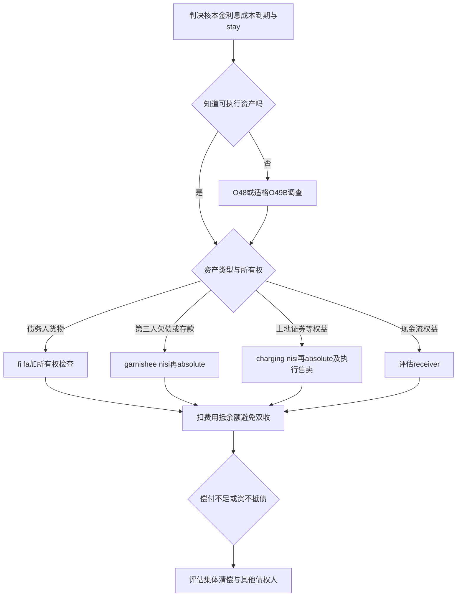

# CO18 — Judgment Enforcement and Asset Recovery

> **进度界限（2026-10-23）**：本届PT该课尚未授。当前可见资料范围未取得本届该课新讲义／实录；往届讲义用于建立完整topic的教学方法和研究线索，不挪入往届案情。规则伴生以HKLII公开再刊、所列整合日期2025-10-01为版本依据；截至2026-10-23全部修法尚未由eLegislation定本穷核，正式案件须再核。Moodle登录失效，新增材料未能实时确认，已登记补课触发。

## 速读定位层

本卡主述民事判决生效后的法定执行与资产回款流程。

### 核心概念与制度定位

| 术语（英文原词） | 法律定义与规则要件 |
|---|---|
| 判定债权人（Judgment Creditor） | 判决给付受领主体：在民事正审或简易程序中已取得法院生效判决，依法享有对败诉方直接申请强制执行并受领清偿给付的权利人。 |
| 判定债务人（Judgment Debtor） | 判决给付清偿主体：被法院生效判决裁定负有金钱清偿或特定作为/不作为法定给付义务，若不按期清偿将面临财产扣押及执行制裁的负债方。 |
| 第三债务人扣押令（Garnishee Order） | 对第三人欠付资金的法定执行命令：当无辜第三方（如银行）对判定债务人负有已到期的金钱债务时，法院可命令该第三方直接向判定债权人清偿，以抵偿债务人欠付之款项。 |
| 押记令（Charging Order） | 对债务人不动产或证券设定的法定担保：法院命令在债务人名下的土地、房产、股票或基金上设立抵押押记；当判决债务仍未获清偿时，债权人可进一步向法庭申请变卖该财产优先受偿。 |
| 查封扣押令状（Writ of Fieri Facias，Fi. Fa.） | 针对债务人动产的扣押变卖令状：由法庭执达吏依法进入债务人处所查封扣押其名下货物动产并公开拍卖；以拍卖所得扣除执行费用后清偿债务。 |
| 暂准命令与绝对命令（Order Nisi & Order Absolute） | 执行程序中的两阶段裁决机制：(1) **暂准命令（Order Nisi）：** 法院先命第三人或债务人在指定时限内说明为何不应最终执行的临时裁定；(2) **绝对命令（Order Absolute）：** 若期内无人提出有效抗辩，则命令转为最终生效并强制执行。 |

> [!NOTE]
> 保全未判债权之资产冻结令（Mareva Injunction）属于 CO13，其性质为防止资产耗散的临时衡平救济，绝对不等于执行程序，亦不赋予债权人任何破产优先受偿权。PT LG18 为 16Nov；下列旧讲义示例均非本届 SG 事实。

## 本卡地图

图显示选择与反馈，具体条件及例外以下文及其规则出处为准；不是每案必经全部分支。

| 任务 | 定位 | 产物 |
|---|---|---|
| 先决定程序／是否适用 | §1–§2 | 适用条件与替代路线 |
| 准备证据及文件 | §3–§4 | 操作步骤、时钟与对方回应 |
| 失败、费用与补救 | §5–§6 | 风险／后果及下一步 |
| 课堂应用及来源状态 | §7–§8 | SG映射、版本与未决 |

<!-- BEGIN:cite-legend -->
> [!info]- 来源图例：身份、届别与可点原件
>
> | 码 | 文件 | 层级 | 学年 |
> |---|---|---|---|
> | OLD18 | [LG18 Lecture Outline.md](../../04%20Base%20Lectures/%5BLG18%5D%20Enforcement/LG18%20Lecture%20Outline.md) | 往届官方 | 2025-26 |
> | R45 | [RHC O45.md](obsidian://open?vault=3b1e77255f6c6e29&file=output%2Fresearch%2FCivil%20Litigation%20Rules%20Verification%20-%202026-10-23%2FRHC%20O45.md) | 库外法源 | 2026-27 |
> | R46 | [RHC O46.md](obsidian://open?vault=3b1e77255f6c6e29&file=output%2Fresearch%2FCivil%20Litigation%20Rules%20Verification%20-%202026-10-23%2FRHC%20O46.md) | 库外法源 | 2026-27 |
> | R47 | [RHC O47.md](obsidian://open?vault=3b1e77255f6c6e29&file=output%2Fresearch%2FCivil%20Litigation%20Rules%20Verification%20-%202026-10-23%2FRHC%20O47.md) | 库外法源 | 2026-27 |
> | R48 | [RHC O48.md](obsidian://open?vault=3b1e77255f6c6e29&file=output%2Fresearch%2FCivil%20Litigation%20Rules%20Verification%20-%202026-10-23%2FRHC%20O48.md) | 库外法源 | 2026-27 |
> | R49 | [RHC O49.md](obsidian://open?vault=3b1e77255f6c6e29&file=output%2Fresearch%2FCivil%20Litigation%20Rules%20Verification%20-%202026-10-23%2FRHC%20O49.md) | 库外法源 | 2026-27 |
> | R49B | [RHC O49B.md](obsidian://open?vault=3b1e77255f6c6e29&file=output%2Fresearch%2FCivil%20Litigation%20Rules%20Verification%20-%202026-10-23%2FRHC%20O49B.md) | 库外法源 | 2026-27 |
> | R50 | [RHC O50.md](obsidian://open?vault=3b1e77255f6c6e29&file=output%2Fresearch%2FCivil%20Litigation%20Rules%20Verification%20-%202026-10-23%2FRHC%20O50.md) | 库外法源 | 2026-27 |
> | R51 | [RHC O51.md](obsidian://open?vault=3b1e77255f6c6e29&file=output%2Fresearch%2FCivil%20Litigation%20Rules%20Verification%20-%202026-10-23%2FRHC%20O51.md) | 库外法源 | 2026-27 |
> | R52 | [RHC O52.md](obsidian://open?vault=3b1e77255f6c6e29&file=output%2Fresearch%2FCivil%20Litigation%20Rules%20Verification%20-%202026-10-23%2FRHC%20O52.md) | 库外法源 | 2026-27 |
> | R88 | [RHC O88.md](obsidian://open?vault=3b1e77255f6c6e29&file=output%2Fresearch%2FCivil%20Litigation%20Rules%20Verification%20-%202026-10-23%2FRHC%20O88.md) | 库外法源 | 2026-27 |
<!-- END:cite-legend -->

## 1. 执行前的六个问题

核①命令类型；②已量化净余款、利息及costs；③履行期限是否到；④有无有效stay／分期方向；⑤资产实际属于谁及在何地；⑥净实现值扣抵押／执行成本是否值得。O45把金钱、入庭款、土地占有、交物、作为／不作为分开，不可把fi fa套给所有命令。〔R45 L150 "A writ of fieri facias"〕

可并用适用手段但不能双重受偿；每次回款更新账表并通知需通知的人。上诉本身一般不stay（CO19）；个别O47 stay亦不必然冻结全部其他执行路径，核实际命令范围。

## 2. 资产调查：O48与O49B不是“公司／个人”绝对二分

| 项目 | O48 | O49B |
|---|---|---|
| 对象 | 金钱债务人可为自然人；公司可叫适当officer，另有其他judgment的r2路径。〔R48 L16 "an officer thereof"〕 | 指定金钱判决未清偿的适格自然人debtor；不把公司董事当公司债个人承担者。〔R49B L17 "a judgment for the payment of a specified sum of money"〕 |
| 范围 | 欠debtor哪些债、财产／清偿手段及相关books／documents。〔R48 L20 "what other property or means of satisfying"〕 | full disclosure资产、负债、收支和资产／收入处分。〔R49B L35 "all his assets, liabilities, income and expenditure"〕 |
| 申请及到庭 | exparte誓章、draftorder、personal service，依法院方向带文件及examination。 | 可个人送达到庭令；有合理原因认为无效才直接arrest；可适用禁离港条件，非自动。〔R49B L21 "may be ineffective to secure the attendance"〕 |
| 调查后权力 | O49Br1B明文可接O48 examination；不应把刑罚全部写成O48本身无条件权力。 | 能付、规避处分或故意不披露等满足r1B时，裁量最多3个月；可分期／修改。〔R49B L49 "following an examination conducted under Order 48"〕 |

往届开头“O48corporates/O49Bindividuals”只适合速记，正文也承认O48自然人。本卡以文本修正。刑禁不是因为单纯无钱便可施加：须法定条件、程序与严格证明，保障到庭的拘捕与examination后监禁是不同权力；监禁不消灭债。〔R49B L56 "not exceeding 3 months"〕〔R49B L77 "shall not satisfy or extinguish"〕

## 3. Fi fa：货物所有权、leave、扣押及售卖

| 步骤 | 要求与产物 | 暗礁／后果 |
|---|---|---|
| 查资产 | 债务人真正拥有的goods／chattels与可扣范围，查third-party、租购、必要生活／行业工具及现行法例豁免。 | 公司的judgment不能扣董事妻子的货；旧金额豁免不未经现行核实便套用。 |
| 申请writ | praecipe及判决副本、到期额，核O46r2的6年以上、主体改变、遗产、条件满足、receiver等leave情形。 | “判决6年后不能执行”错误；是特定writ需leave，另核时效。〔R46 L21 "6 years or more have elapsed"〕 |
| 交bailiff | O46／47及执行指示、地址、成本按金，保管扣押清单并核HCOs21C优先效力。 | 不是债权人自行抢货；bailiff接writ与后来善意购买者权利须另核。 |
| 第三方claim | 进入O17bailiff interpleader；旧教学为收到notice后7日表明承认／争议。 | 若不属JD，不能为凑债额照卖；依据原权属及相关方向。〔OLD18 L427 "within 7 days after receiving the notice"·往届仅参考〕（往届方法参考） |
| 出售 | 通常public auction，其他方式求O47r6方向；有关summons至少4clear days。 | 售款先扣执行成本；求净回收而非账面估值。〔R47 L27 "not less than 4 clear days"〕 |
| Debtor求stay | O47r1 specialcircumstances／unabletopay，判决时口求或其后summons＋誓章，并按至少4日送。 | 批准是裁量、可附条件；不把此处困难条件套成CAstay的唯一测试。〔R47 L18 "special circumstances which render it inexpedient"〕 |

## 4. Garnishee：冻结的是第三人欠debtor的债

判给至少HK$1,000（非入庭款判决），garnishee在管辖内且有due／accruing due债，是O49r1起点。正数银行存款是银行欠客户债；overdraft是相反方向。借用别人的账号、joint／trust归属、工资／养老金豁免及外国双重给付风险须另核，不以知道银行名字便保证成功。〔R49 L17 "amounting in value to at least $1,000"〕〔R49 L17 "any debt due or accruing due"〕

| 阶段 | 文件与步骤 | 时钟／反馈 |
|---|---|---|
| nisi申请 | exparte誓章列判决、未付净额、JD姓名地址、garnishee在HK及欠债事实与来源，银行branch已知则给。 | 只说“听说有存款”不足；r2。〔R49 L33 "stating the sources of the deponent’s information"〕 |
| 送garnishee | personal service nisi，距returnday至少15日，送达才bind该债。 | 不是取得纸令即已经bank冻结。〔R49 L40 "at least 15 days before the day"〕 |
| 送JD | 至少在送garnishee后7日，又距returnday至少7日；法院可另命。 | 三日期须同时合规，不能把两次7日并成只给7日。〔R49 L42 "at least 7 days after the order has been served"〕 |
| absolute | 不出庭／不争债可求absolute；争债按r5summary或trial，第三方claim按r6。 | 不是无论银行说明什么都自动转款。〔R49 L53 "the Court may summarily determine"〕 |
| 清偿及费用 | garnishee遵absolute付款可有效解除对JD相应债；r10成本及其优先。 | 更新余额，留执行证明；破产／清盘须核完成attachment与收到钱时点。〔R49 L62 "a valid discharge of his liability"〕 |

## 5. Charging order：担保与出售是两步

先有可执行已量化债及JD的适合beneficialinterest（land、法定securities、court funds等），不能对损害额未assessed或他人beneficial property凭空造charge。核HCOss20–20B及DC对应条文；O50给程序而非独自产生全部实体权限。

| 阶段 | 要求 | 风险与下一步 |
|---|---|---|
| nisi | exparte誓章＋draft；列判决余款、已知其他creditors、资产完整资料、验证beneficialownership。 | fullfrank及抵押／其他权利要披露，O50r1。〔R50 L31 "owned beneficially by the judgment debtor"〕 |
| 送达 | 送JD、相应公司／registerkeeper／Registrar／trustee及法院指定interestedperson；nisi＋誓章至少7日前。 | 留足所有需收者回应机会，O50r2。〔R50 L55 "at least seven days before"〕 |
| absolute | 法院考虑个人境况、其他creditors不当损害、争产及全部情况，可改／撤。 | 家庭居住、离婚、优先抵押影响裁量与何时sale；不能保证永久挡债。 |
| 效力 | 形成相应equitablecharge；土地登记及优先／再登记按LRO核，不等于自动变成业主。 | 证券nisi及stopnotice有专门处分限制，O50rr5–6。〔R50 L77 "No disposition by the judgment debtor"〕 |
| 实现 | O50r9A／O88r5A另以OS＋誓章申请sale等，列charge、剩额、priorencumbrances、估值、sale计划、占有人。 | 先扣优先抵押及sale成本才有净额；nisi／absolute均不是即日强卖。〔R88 L85 "the manner of sale of the property charged"〕 |
| 撤销／变更 | JD或其他interest者按r7申请并送有关人。 | 披露不全／权属错误及时回应，不能只无视order。〔R50 L93 "any other person interested in the subject"〕 |

## 6. 其他路线、破产清盘及失败回路

O51可考虑equitableexecution receiver，法院权衡可取金额、方法成本及替代。O52committal／O49B涉及人身自由，不能当普通催款威胁。破产／清盘是集体清偿，先核真实未争债、statutorydemand、门槛、期间及适用法规；旧讲义$10,000／3周不等于本次已核全部现行破产规则。无资产时启动程序可能只增加费用。

旧例显示：公司存款可garnishee，公司仓库可核charge及货物fi fa；董事个人上海厂房、妻子商店不能为公司债任扣。自然人海外账户需评估foreignenforcement及garnishee法律；不能只因同品牌银行在HK有分行便忽略法人、外国债法及doublepayment保护。〔OLD18 L907 "Mr Sun is only one of the directors"·往届仅参考〕（往届方法参考）〔OLD18 L571 "it can extinguish the garnishee’s liability"·往届仅参考〕（往届方法参考）

| 漏核事项 | 后果链 | 补救 |
|---|---|---|
| 余额／stay | 超收或违令→返还／费用风险 | 单一recoveryledger；先核有效order。 |
| 所有权／优先权 | 扣他人货／无equity→争诉成本超回款 | 产权调查、mortgage余额、interpleader／合适资产。 |
| nisi送达顺序 | 未生bindingeffect／return日不合→需延期补送 | O49的15与7＋7分开；O50的7另算。 |
| 只获charge不sale | 有担保却没现金 | 另求sale及净值分析，保登记效力。 |
| 债务人破产／清盘 | 执行受限／已收可能受挑战 | 核BO／CWUMPO完成执行的专门日期及priority，不能只比判决先后。 |
| 无可执行资产 | 成本沉没 | 先O48／适格O49B调查，再按净回款选手段。 |

## 7. SG接口与实战产物

**本届 SG09 完整应用：** [Hogwarts Q6](../../01%20SG/SG09%20Civil%20Procedure%202%20%28Knowledge%29/06%20Question%206%20-%20Judgment%20Enforcement.md)。

SG09／10为未来程序整合题关联，当前未取得本届题面，不拿Twinkle／William旧例填入。实战应交付：判决与余额表、资产归属／地点／净值表、每条手段的文件／service／returncalendar、第三方claim和insolvency调查、实际回款记录。CO13旧Mareva不赋予优先受偿，CO19上诉／stay另核。

## 8. 材料状态、未决及修订

已读往届LG18主体及课堂例题，取得O45–52相关规则再刊，按本卡关键条件核对。旧讲义O49Br1B(2)段落编号与取得版不同、O48绝对公司二分、imprisonment“distinguish债”误词均不沿用；应为监禁不清偿债。本届LG18／新课件／字幕尚待发放及Moodle可见性确认。

<!-- BEGIN:open -->
- HCO执行权限、LRO登记、BO及CWUMPO具体门槛／完整版本尚未穷核；本卡不把旧数额当现行已核数字。
- 当前规则再刊是2025-10-01整合；未来课前须核新材料与实际版本。SG09／10事实待本届任务。
<!-- END:open -->

2026-10-23首次建主卡；图示与总表区分调查、担保、冻结、出售、回款与集体清偿。

## 本届课表定位

[原课表XLSX](obsidian://open?vault=3b1e77255f6c6e29&file=PCLL%20PT%20Yr1%20%28General%29%2F2026-27%201st%20Sem%20PT%20YR1%20PCLL%20Timetable%20%2824.08.2026%29.xlsx)，工作表12!B13:B18；本卡日期按此核，未来资料到货后再核教师通知。
