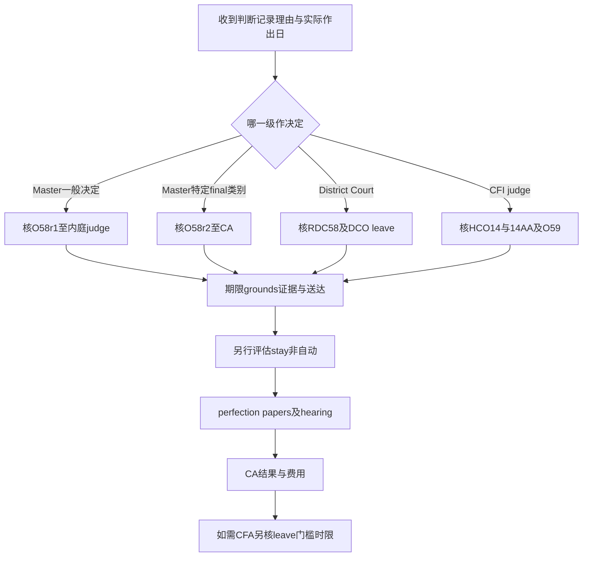

# CO19 — Civil Appeals, Leave and Stay

> **进度界限（2026-10-23）**：本届PT该课尚未授。当前可见资料范围未取得本届该课新讲义／实录；往届讲义用于建立完整topic的教学方法和研究线索，不挪入往届案情。规则伴生以HKLII公开再刊、所列整合日期2025-10-01为版本依据；截至2026-10-23全部修法尚未由eLegislation定本穷核，正式案件须再核。Moodle登录失效，新增材料未能实时确认，已登记补课触发。

## 速读定位层

本卡主述民事上诉的法院层级路线、上诉许可、法定期限、上诉理由、新证据准入及判决暂缓执行。

### 核心概念与制度定位

| 术语（英文原词） | 法律定义与规则要件 |
|---|---|
| 聆案官（Master） | 法院常设司法官员：在高等法院原讼法庭及区域法院处理程序性中间申请、缺席判决、简易评税及案件管理事务；对聆案官决定的上诉依法通常由内庭法官以 de novo 方式全面重审。 |
| 内庭法官（Judge in Chambers） | 在法官内庭审理特定程序与上诉的法官：负责处理针对聆案官决定的上诉案件以及特定重大中间救济申请（如单方禁制令及涉及正审前权能的传票）。 |
| 上诉许可（Leave to Appeal） | 提起上诉的司法准入门槛：当法律规定针对特定中间决定或特定级别裁决必须先取得许可时，上诉人须向原审法官或上诉法庭证明其上诉具有合理胜诉前景（reasonable prospect of success）或案涉重大公共利益法律问题。 |
| 中间决定与终局决定（Interlocutory vs Final Decision） | 判决性质的法定分类：(1) **终局决定（Final）：** 无论判决走向如何均能终局裁断当事人全案实体权利的裁判；(2) **中间决定（Interlocutory）：** 仅解决诉讼程序性争端或未能终结全案实体争议的裁决，其上诉时效通常更短且普遍受严格许可限制。 |
| 暂缓执行（Stay of Execution Pending Appeal） | 针对生效判决的暂停执行救济：提起上诉并不自动产生暂缓执行的效力（no automatic stay）；若上诉人拟阻止对方在诉讼期间强制执行判决，必须另行向法院提出传票申请，并证明存在若不暂缓将导致上诉落空（ruin appeal）的特殊正当理由。 |

> [!NOTE]
> 民事上诉绝非全案事实的重新审判（not a retrial）；当事人仅对裁判结果不服绝对不等于原审存在可予纠正的法律或重大事实错误。PT LG19 为 17Nov。

## 本卡地图

图显示选择与反馈，具体条件及例外以下文及其规则出处为准；不是每案必经全部分支。

| 任务 | 定位 | 产物 |
|---|---|---|
| 先决定程序／是否适用 | §1–§2 | 适用条件与替代路线 |
| 准备证据及文件 | §3–§4 | 操作步骤、时钟与对方回应 |
| 失败、费用与补救 | §5–§6 | 风险／后果及下一步 |
| 课堂应用及来源状态 | §7–§8 | SG映射、版本与未决 |

<!-- BEGIN:cite-legend -->
> [!info]- 来源图例：身份、届别与可点原件
>
> | 码 | 文件 | 层级 | 学年 |
> |---|---|---|---|
> | OLD19 | [LG19 - Appeals.md](../../04%20Base%20Lectures/%5BLG19%5D%20Appeals/LG19%20-%20Appeals.md) | 往届官方 | 2025-26 |
> | R58 | [RHC O58.md](obsidian://open?vault=3b1e77255f6c6e29&file=output%2Fresearch%2FCivil%20Litigation%20Rules%20Verification%20-%202026-10-23%2FRHC%20O58.md) | 库外法源 | 2026-27 |
> | R59 | [RHC O59.md](obsidian://open?vault=3b1e77255f6c6e29&file=output%2Fresearch%2FCivil%20Litigation%20Rules%20Verification%20-%202026-10-23%2FRHC%20O59.md) | 库外法源 | 2026-27 |
> | D58 | [RDC O58.md](obsidian://open?vault=3b1e77255f6c6e29&file=output%2Fresearch%2FCivil%20Litigation%20Rules%20Verification%20-%202026-10-23%2FRDC%20O58.md) | 库外法源 | 2026-27 |
> | H14 | [Cap4 s14.md](obsidian://open?vault=3b1e77255f6c6e29&file=output%2Fresearch%2FCivil%20Litigation%20Rules%20Verification%20-%202026-10-23%2FCap4%20s14.md) | 库外法源 | 2026-27 |
> | H14A | [Cap4 s14AA.md](obsidian://open?vault=3b1e77255f6c6e29&file=output%2Fresearch%2FCivil%20Litigation%20Rules%20Verification%20-%202026-10-23%2FCap4%20s14AA.md) | 库外法源 | 2026-27 |
> | C22 | [Cap484 s22.md](obsidian://open?vault=3b1e77255f6c6e29&file=output%2Fresearch%2FCivil%20Litigation%20Rules%20Verification%20-%202026-10-23%2FCap484%20s22.md) | 库外法源 | 2026-27 |
> | C23 | [Cap484 s23.md](obsidian://open?vault=3b1e77255f6c6e29&file=output%2Fresearch%2FCivil%20Litigation%20Rules%20Verification%20-%202026-10-23%2FCap484%20s23.md) | 库外法源 | 2026-27 |
> | C24 | [Cap484 s24.md](obsidian://open?vault=3b1e77255f6c6e29&file=output%2Fresearch%2FCivil%20Litigation%20Rules%20Verification%20-%202026-10-23%2FCap484%20s24.md) | 库外法源 | 2026-27 |
<!-- END:cite-legend -->

## 1. 先画法院路线，再谈胜算

收到决定即保存实际pronouncement日期、理由、order、transcript、听审材料和service记录；不要等seal或拿齐判词才注意appeal时钟。先核决定者、程序类型、实质final／interlocutory及特别禁止／leave条款；summaryjudgment、O49B及interpleader有专门分类。

| 决定 | 通常路线 | 不能简化成 |
|---|---|---|
| Master一般决定 | O58r1至judgein chambers，服从r2及O5r6／O12r1例外。 | 所有Master都直上CA或所有都先求leave。〔R58 L17 "Except as provided by rule 2"〕 |
| Master r2列明final决定 | 特定O14r6(2)／O36trial、assessment、O84A、O49B、bankruptcy／windingup、O17等至CA。 | 普通的 O.14 summary judgment 申请与同意由 Master 作 trial 是两件不同事。〔R58 L28 "other than an interlocutory judgment"〕 |
| DC Master／Judge | 依RDC58及DCO63／63A核leave及例外，不能把HC rights原样套入。 | DCfinaljudgment一律免leave。〔D58 L38 "An application for leave to appeal must be made"〕 |
| CFI Judge | HCO14一般权及法定排除；interlocutory依14AA通常须leave，O59程序。 | 只要叫order就interlocutory；rulings核规则列明非interlocutory项。〔H14A L14 "an interlocutory judgment or order"〕 |
| CA至CFA | 普通民事依Cap484s22(1)(b)discretionaryleave，greatgeneral／publicimportanceorotherwise；有特别路线须另核。 | 争额大就当然有权到CFA；s22(1)(a)已废。〔C22 L14 "(a) (Repealed"〕〔C22 L16 "great general or public importance"〕 |

## 2. 各自时钟：issue、service、leave不可混

| 程序 | 关键期间／动作 | 限定与依据 |
|---|---|---|
| HC Master→judge | r1notice一般决定后14日内issue；issue后5日内serve所有otherparty；service后至少2clear days才hear。 | 法院可另命。旧讲义“14日内通知全部party”不能取代完整三步。〔R58 L21 "must be issued within 14 days"〕〔R58 L21 "served within 5 days after issue"〕 |
| CFI须leave决定 | O59r2B一般向原court决定后14日内求leave；被拒后14日内renewCA。 | 按条款及法例特别情形；interpartes原案原则相应interpartes。〔R59 L68 "within 14 days from the date of the refusal"〕 |
| HC获leave后appeal | O59r4(1)(a)通常leave后7日内serve notice；其他一般决定后28日，bankruptcy／windingup专核。 | 不是先拿leave仍有全新28日。〔R59 L110 "7 days after the date on which leave to appeal is granted"〕 |
| DC leave申请 | RDC58r2(4)：Master特定／Judge非interlocutory28日；Judgeinterlocutory14日；拒leave后14日renewCA。 | 获leave后r2(8)serve notice7日；免leave特例r2(9)28日。〔D58 L40 "28 days from the date of the judgment"〕〔D58 L55 "not later than 7 days after"〕 |
| CA纸面／单JA拒leave | O59r2A(7)一般通知determination后7日requestoral，totallywithoutmerit限制；单JA拒leave另核r2C7日freshapplication二JA。 | 不是所有被拒都绝无复议，也不混为同一无条件路线。〔R59 L90 "consisting of 2 Justices of Appeal"〕 |
| CFA | 普通s23／24向CA决定后28日内motion，至少给opponent7日notice；被拒依s24通常拒后28日向CFA申请。 | CA→CFA不是自动接续；特定leapfrog、法定类别及可延期间须另核。〔C24 L16 "within 28 days"〕〔C24 L16 "within 28 days"〕 |

逾期需迅速求适用延长权限、解释整个迟延及拟grounds／merits和对方损害；不能自己选择seal日重算。期间表仅适用列明普通路线；任何特殊ordinance优先核。

## 3. Grounds、leave及上诉材料

leave门槛：reasonableprospectofsuccess或其他interestsofjustice理由；不是须证明“很可能赢”，也不是纯有争议就够。指出具体错误法原则、误解关键证据、漏考虑／错考虑因素、裁量超出合理范围；不要把原庭意见不喜欢等同appealableerror。〔H14A L24 "the appeal has a reasonable prospect of success"〕〔H14A L26 "some other reason in the interests of justice"〕

| 产物 | 内容 | 核对点 |
|---|---|---|
| Leave summons／statement | 为何准leave，逾期为何并求EOT；interpartesservice，resistingstatement通常14日。 | O59r2A；grounds只写“判错”不足。〔R59 L28 "the reasons why leave should be granted"〕 |
| Notice of appeal | 明确挑战whole／part、分项grounds及要求CA改作何种preciseorder。 | 不能想要新relief到庭才加，r3(3)一般须leave。〔R59 L99 "the precise form of the order"〕 |
| 材料 | 判决理由、sealedorder、pleadings、相关affidavits／exhibits、transcript、chronology、authorities及bundles依PD2.1／个案方向准备。 | 不把全部discovery倒入bundle；只需可决定grounds的材料，保页号与引用一致。 |
| Respondent | 维护结果但拟改order或改用特定理由须核O59r6notice；不能所有情况都另发crossappeal。 | interlocutory通常14日，其余21日；送达后2日内向Registrar交两份，依r6核，别错把reply当notice。〔R59 L147 "must give notice to that effect"〕 |
| Setdown／security | 依O59r5及时lodgenotice及documents／所需security，申请聆讯／notice有关party。 | 期间和个案directions要抄入calendar；不把servednotice等同appeal已perfection。 |

## 4. 事实、裁量、新证据与新论点

往届教学解释Master→judge通常rehearing，judge不受Master决定拘束；**不等于可任加证据**，O58r1(5)仍限制旧事项新证据，specialgrounds另核。CA亦非让败诉者不受限重trial；对原庭证人可信性与裁量尊重，需具体可干预错误。〔OLD19 L118 "a rehearing of the application as if afresh"·往届仅参考〕（往届方法参考）〔R58 L25 "except on special grounds"〕

| 拟新增内容 | 门槛与原因 | 资料准备 |
|---|---|---|
| 原庭前已存在的新证据 | O59r10／specialgrounds；LaddvMarshall教学三项：合理勤勉仍取不到、对结果重要影响、表面可信（非必须无可争辩）。 | 说明取得过程与时间，交拟证据及为何前庭不能合理取得；不能为弥补疏忽当然重开。〔OLD19 L158 "could not have been obtained with reasonable diligence"·往届仅参考〕（往届方法参考） |
| 决定后才发生事项 | 区别O58／O59规则所准新事项；法院仍考虑终局、重要性、时间及公平。 | 不是只要日期新就必采；解释影响原结果的哪项基础。〔R59 L236 "matters which have occurred after the date"〕 |
| 原庭未提出新论点 | Flywin程序公平：若原庭提出会让对方证据明显不同，则通常阻却。 | 证明不存在合理可能原庭举证会更有利对方；纯新法律点亦考虑公平和更高法院缺下级意见。〔OLD19 L196 "no reasonable possibility that the state of the evidence"·往届仅参考〕（往届方法参考） |
| 仅不满意事实判断 | 指出误读、遗漏客观不可争议材料等可干预错误。 | 不重写完整客户版本代替grounds，不能以另一judge也许选不同说法为由上诉。 |

## 5. Stay pending appeal：必须另做决定

O58r1(4)、RDC58r3及O59r13明确上诉不自动stay。评估arguableappeal、执行是否使上诉无实际意义、若上诉得直对方能否返还、双方损害及可行security；只说已fileappeal不免履令。〔R59 L291 "shall not operate as a stay"〕〔D58 L62 "shall not operate as a stay"〕

一般先向作令court申请；CFI／CA均有权时O59r14(4)原则先原court，除不可能／不切实际的specialcircumstances。拒Masterstay的正确后续与实体appeal分别处理，不跳过程序重申同一申请。给summons、事实誓章、draftconditionalstay及所需security，而非在stayhearing预审完整merits。〔R59 L312 "impossible or impracticable to apply to the court below"〕〔OLD19 L126 "should not be turned into a platform"·往届仅参考〕（往届方法参考）

## 6. 决定后果、费用及控制回路

CA可维持、改判、撤销、发还／newtrial或其他适当命令，依权限、错误及是否有足够事实处理；不保证某一程序错误必然全案重审。费用同时分原庭／上诉，O22原审costs与上诉一般裁量不能混用（CO14／17）。

| 失误 | 后果链 | 补救 |
|---|---|---|
| 错误法院／错final分类 | 无效步骤／逾期风险 | 先来源与O58类别表；及时seekleave／EOT，不假设自动转送。 |
| 只issue未serve | 未完成该clock动作→失上诉机会风险 | 分栏日期，证明service，核可延权限。 |
| 无精准grounds／relief | 对方无法回应／法院不准扩展 | 逐项error→影响→requestedorder，及时申请amendleave。 |
| 新证据无解释 | 被拒采→旧案仍无法推翻 | 按勤勉／重要／可信及afterevent分支准备。 |
| 认为appeal自动stay | 执行继续→资产／费用风险 | 立即独立评估stay及security。 |
| CFA只重复事实争辩 | 难过publicimportance／otherwisegate | 先核可上诉法律问题和终局性，再劝客户衡量净收益。 |

## 7. SG与实战接口

目前只登记未来SG09／10的程序主题关联，不创建未发题目的答案。对已学defaultjudgment／summaryjudgment、security、discovery、unlessorder，若要不服必须重新从“谁作何种决定”走本卡路线，不能把setaside与appeal二者随意互换。CO06承担defaultsetaside，CO11承担relief与程序管理，CO18承担执行。

## 8. 材料、未决及修订

本卡定向读往届LG19路线、fresh evidence／newpoint／stay方法，并以取得版RHC58／59、RDC58、HCO14／14AA、CFAO22–24核关键规则。CFAO平台最新整合日期实际为2026-05-21，与RHC2025-10-01、RDC2025-03-28不同，逐件记录；**长篇案例全文、最新PD及全部上诉registry操作未穷核**。

<!-- BEGIN:open -->
- 本届LG19／slides／实录字幕及SG09／10任务尚待当前平台核验；先保留真实缺口。
- 需按未来具体题补PD2.1／2.3／4.1原文、上诉登记文件、完整setdown／bundle期限及特别jurisdiction；不能把本卡普通路线当所有appeal全集。
<!-- END:open -->

2026-10-23新增；纠正往届“14日内通知所有人”、所有finalMaster等同普通summaryapplication、所有rehearing均可新证等可误读的简写。旧原件未改。

## 本届课表定位

[原课表XLSX](obsidian://open?vault=3b1e77255f6c6e29&file=PCLL%20PT%20Yr1%20%28General%29%2F2026-27%201st%20Sem%20PT%20YR1%20PCLL%20Timetable%20%2824.08.2026%29.xlsx)，工作表12!C13:C18；本卡日期按此核，未来资料到货后再核教师通知。
