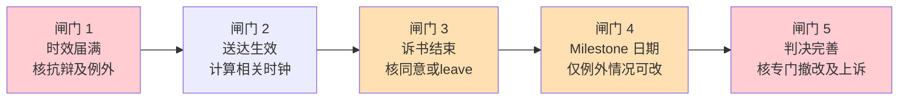
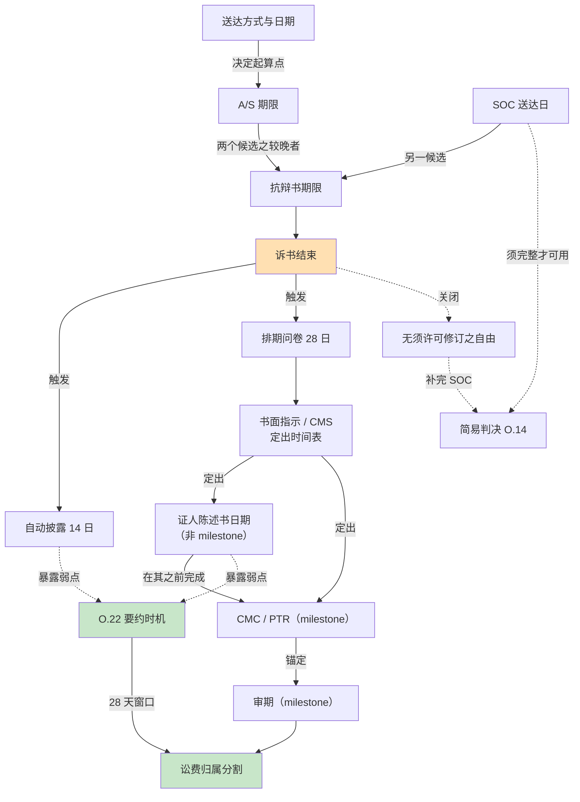

> [!note] 宏观总控与全景时钟定位（Master Layer）
> 本文档属于 **全景总括与全案工具层（Master Layer）**，从「第一性原理、工程控制论、全流程图谱与法定程序时钟」对民事诉讼进行跨专题顶层统摄，与下方的 **[制度凝结层（Institutions 单卡）](/pcll-litigation-cards/institutions/co01-taking-instructions/)** 构成【总括 ↔ 分论】与【全局时钟 ↔ 专题实操】的映射关系。
> 如需深入查阅某一具体阶段（如 O.10 送达、O.18 诉答、O.14 简易判决、O.24 披露、O.29 禁令等）的深度实体规则与实务攻防，请直接跳转至对应制度凝结卡。

## 民事诉讼总览 — 一份文件掌握整体结构

> **2026-10-29整卡合并**：现有13张主卡。CO04–05＋CO10合为[CO04–05–10](/pcll-litigation-cards/institutions/co04-05-10-pleadings/)；CO06＋CO09合为[CO06–09](/pcll-litigation-cards/institutions/co06-09-pre-trial-judgments/)；Tomlin条款与履约专章归[CO14](/pcll-litigation-cards/institutions/co01-taking-instructions/)。CO11保持独立；其他卡仅同步必要引用，SG实质内容冻结。

> **2026-10-28 SG06准备完成**：本届四题16问与双时间轴 · Question 1完整答案 · Question 2完整答案 · Question 3完整答案 · Question 4完整答案。29Oct19–21，Gp77／CCT623／TC；学习稿状态，导师反馈及具体调查未决见SG。 〔AP L41 "answers to the 4 questions below"〕


> **2026-10-23主述更新**：本页旧日期表／题库及比较保留原资料身份；完整制度以[当前15张主卡](../README.md#%E5%BD%93%E5%89%8D%E4%B8%BB%E5%8D%A1%E6%80%BB%E8%A1%A8%EF%BC%882026-10-29%EF%BC%89)为准，材料状态查[当前进度](../_meta/Current%20Progress%20and%20Material%20Uptake.md)。新增[CO10](/pcll-litigation-cards/institutions/co04-05-10-pleadings/)、[CO14](/pcll-litigation-cards/institutions/co01-taking-instructions/)、[CO16–19](../README.md#%E5%BD%93%E5%89%8D%E4%B8%BB%E5%8D%A1%E6%80%BB%E8%A1%A8%EF%BC%882026-10-29%EF%BC%89)，不再沿用“缺卡”状态；具体时限不要离开条件摘用。

> **SG05更新 · 2026-10-22**：本届SG05四题口答、Summary、Basic Response及DCC Word已补齐。22Oct19–21，SunYanlong Group77／CCT623／TC；真实事实缺口在答案内。旧周次说明保留为历史快照。


> 目的：先建立整体感，再谈细节。其余四份材料是查阅型的（时限表、流程图、真题矩阵、三人对比），这一份是**理解型**的。
> 组织方式：第一性原理（把制度拆到不可再拆的底层需求，其余全部由它推导）+ 工程控制论（把诉讼看成一个有状态、有闸门、有反馈的受控系统）。
> 三个维度：**竖向**（是什么、多长时间）→ **横向**（彼此如何耦合、时点如何错位）→ **逆向**（当事人要达成目的时，如何利用或规避程序）。

### 结构回链（凝结 ↔ 讲义 ↔ SG）

完整互指表：Structure Map（含 **LG 逆向表**）。上课清单：Weekly

| 本文件位置 | 讲义（04） | 本届 SG（01） |
|---|---|---|
| §1 第一性（告知/界定/证明/效率） | —（问法通用于所有 LG/SG） | 各 Desk「第一性」行 |
| §2 控制论（状态/闸门/反馈） | LG3 REV 送达时钟；LG6 默认阀 · 见 [CO06 专题卡片](/pcll-litigation-cards/institutions/co06-09-pre-trial-judgments/) | SG01 Desk 时效闸门 |
| §3.1 立案前 / LBA·管辖·当事人 | LG1 · LG2 · 本章凝结见 [CO01 接案、诉前行为与 LBA](/pcll-litigation-cards/institutions/co01-taking-instructions/) | SG01 · SG02 |
| §3.2 送达 | LG3 Service (REV) · Additional Information after Lecture · ppt (REV) · 本章凝结见 [CO03 Chapter Condensed](/pcll-litigation-cards/institutions/co03-service-and-aos/) | SG01 铺垫（后续知识 SG） |
| §3.3 诉书 | LG4 Pleadings · LG5 SoC · 本章凝结见 [CO04-05 诉答文书](/pcll-litigation-cards/institutions/co04-05-10-pleadings/) | SG03 （AP 已到，PT 场 10-08）· SG04（案卷已挂，等 AP） |
| §4 横向耦合 | [时限](/pcll-litigation-cards/master/co00-deadlines-and-time-limits/) · [流程](/pcll-litigation-cards/master/co00-procedural-flowcharts/) | SG01 Q4 当事人；诉书结束↔披露见后课 |
| 默认判决 / 效率阀 | LG6 Default Judgments · LG6 PPT · 本章凝结见 [CO06 默认判决与自认](/pcll-litigation-cards/institutions/co06-09-pre-trial-judgments/) | — |
| 非正审传票 / 讼费担保 | LG7 Summonses & S4C · 本章凝结见 [LG07 非正审传票起草与讼费担保](/pcll-litigation-cards/institutions/co07-summonses-and-orders/) | — |
| §3.4 审前（披露 / 简易判决 / 禁制令 / 审前与审讯） | 本届 LG8 Discovery · LG9 SJ & Interim Payment · LG13 Injunctions · LG15 Trial（制度卡待建） | — |

---

# 第一部分：第一性原理 — 整套制度只解决四个问题

把《高等法院规则》上千条拆到底，剩下的是四个不可再拆的需求。**任何一条规则都是这四者之一的实现手段**；这层只帮助理解目的；具体权限、条件与例外仍须回规则，不能由目的推定法律结论。

| # | 底层需求 | 一句话 | 由它推导出的制度 |
|---|---|---|---|
| **1** | **告知（Notice）** | 没人能在不知情的情况下被判败诉 | 送达 O.10、替代送达 O.65 r.4、AOS O.12、诉答违约入判前预警 O.19 r.8A、ex parte 的 return date |
| **2** | **界定（Definition）** | 争点必须先固定，否则无法审、无法举证、无法判 | 诉书 O.18、修订 O.20、诉书结束、承认事实 O.27、质问书 O.26 |
| **3** | **证明（Proof）** | 谁主张谁举证，证据须事先交换、不得突袭 | 披露 O.24、证人陈述 O.38、专家证据 O.38 r.36、传票 subpoena |
| **4** | **效率与代价（Cost & Speed）** | 诉讼消耗公共与私人资源，必须有加速阀与惩罚机制 | 简易判决 O.14、默认判决 O.13、案件管理 O.25 / O.1B、和解 O.22、讼费 O.62、执行 O.45–49 |

**为什么这个拆法有用**：考试题干从来不问"O.18 r.2 是什么"，而是给一段案情问"下一步该做什么"。你只要判断当下**卡在四个需求的哪一个**，就知道往哪个方向找工具——对方不理你（需求 1，走 O.13）、对方的诉答缺必要细节（需求2，先考虑O18r12 particulars；剔除、质问及披露各有不同用途）、你缺一份关键文件（需求 3，走 specific discovery）、对方明显没有实质抗辩（需求 4，走 O.14）。

**再往下压一层**，四个需求服务于一个终极目的：**让有权利的人以相称的代价拿到可执行的结果**。"相称"（proportionality）是 O.1A 的基础目标，也是法院所有裁量权的方向盘——凡题目问"法院会不会准"，答案的落点几乎总是这三个字。

---

# 第二部分：控制论视角 — 诉讼是一个受控系统

钱学森的工程控制论关心三件事：**系统有哪些状态**、**状态之间由什么闸门转换**、**反馈如何纠偏**。民事诉讼恰好可以这样建模，而且这个模型直接解释了考试为什么爱考某些点。

## 2.1 状态变量：任何时刻，一宗案件由五个变量确定

判断"现在能做什么、不能做什么"，先读这五个值，再核主体、法院、证据及命令。它是分析提纲，不是穷尽所有法律条件。

| 状态变量 | 取值 | 决定了什么 |
|---|---|---|
| **S1 时效** | 未过 / 已过 / 可重启 | 时效抗辩、例外、是否有权延期及是否已有效起诉；届满不一律消灭全部权利 |
| **S2 送达** | 未送达 / 已送达（实际或推定） | 送达相关时钟的起算点；其他时钟可能由作令、notice或程序步骤起算 |
| **S3 诉书** | 未开始 / 进行中 / **已结束** | 能否无须许可修订；披露义务是否触发 |
| **S4 案件管理** | 未排期 / 已有时间表（含 milestone） | 哪些日期可协商变更、哪些不能 |
| **S5 和解** | 无要约／有效O22要约或付款／接受、撤回或需leave状态 | 讼费风险的归属 |

## 2.2 闸门：五个不可逆或高代价的转换点

下图是五个会提高程序成本的转换点。均须核相应补救，不把学习模型的“闸门”理解为无例外不可逆：



- **闸门1 时效**：须逐诉因核条文及事实；障碍、承认、PI裁量等不是所有案件一律可重启的通行证（CO01）。
- **闸门 2 送达**：本身可逆（送达不当可撤销默认判决），但它启动相关回应时钟，算错则连环出错。
- **闸门 3 诉书结束**：此前pleading可依O20r3一次免leave修订，writ依r1有独立限制，此后须经许可或对方同意。这是**全科最重要的一条软闸门**，第三部分会详述。
- **闸门 4 Milestone**：CMC、PTR 与审期属 milestone（O.25 r.1B(8)），**除例外情况不得变更**（O.25 r.1B）；WS交换日虽非milestone，O38r2A(2)仍排除O3r5(3)的私延；先求同意后须法院认可（CO08／11）。
- **闸门 5 判决盖印**：盖印前法院仍可revisit（*in re L*，2023 JUL Q3(b) 就考这个）；盖印后须按专门权限核defaultsetaside、exparte撤令、slip等，或走上诉；不能泛称只剩上诉（CO06／07／19）。

## 2.3 反馈回路：系统靠三种信号纠偏

| 回路 | 机制 | 触发的后果 |
|---|---|---|
| **讼费回路**（最强） | 败诉方付费；行为不当则按 indemnity basis 计 | O.22 r.23(4)/r.24(3)：indemnity 讼费 + 判决利率上浮至多 10% |
| **命令回路** | 按具体制度的nisi→absolute机制；14日并非所有nisi的统一期限 | 看适用命令与指定反对机制，不一概视为承认实体请求 |
| **制裁回路** | 剔除诉书、unless order、监禁不超 3 个月（O.49B） | 制裁依具体规则／命令生效；依法求延、relief或其他补救；不是任一违令自动失全部实体权利 |

**这解释了 O.22 为什么是考试重心**：它是把"和解压力"翻译成"讼费风险"的转换器，是系统里反馈增益最大的一环。

---

# 第三部分：竖向 — 五条主干，每条只记三件事

竖向就是"是什么、要多久、依据何在"。细数字在 [01 时限表](/pcll-litigation-cards/master/co00-deadlines-and-time-limits/)，这里只保留**骨架**。

## 3.1 主干一：立案前（决定生死）

**三个必答问题**，见客户第一次就要过一遍：

1. **时效过了吗？** 合约 6 年、盖印合约 12 年、一般侵权通常6年（先核causeofaction何时accrue；知识／潜在损害条文只在其适用条件下）、人身伤害 3 年。
   - 三个例外：未成年人与精神上无行为能力者，时效**自障碍消除才起算**（s.22）；债务人**承认债务则时效重新起算**（s.23(3)）；人身伤害的 3 年可由法院衡量双方不利后**裁量豁免**（s.30）。
2. **哪个法院？** 区域法院管 **$75,000 至 $300 万**（s.32(1)(a) DCO），超过归原讼法庭。
   - 关键细节：**合约约定利息计入门槛**，法定利息不计。2025 AUG Q1 就是 300 万本金 + 40 万约定利息 = 340 万，因此必须去高等法院。
3. **当事人是谁？** 独资经营者要以东主本人名义起诉，写"东主本人姓名 trading as 商号"（Intro 3）；商号不能单独起诉；未成年人须由 next friend 代理并另交两份通知。

## 3.2 主干二：立案与送达（启动时钟）

发出令状 → 送达 → 被告 14 日内提交 AOS。送达方式：亲自送达为原则，挂号邮寄或投入信箱为替代（O.10 r.1(2)），**推定寄出后第 7 日送达，但可被相反证明推翻**；这个第 7 日**含周六日及公众假期**（O.10 r.1(3)(a) 明文不适用 O.3 r.2(5)）。若依 s.827 CO 邮寄至公司注册办事处，则按 PD 19.2：挂号第 4 个、平邮第 2 个工作日（LG3 REV）。电邮不是法定方式，须先取得替代送达命令（O.65 r.4）。

## 3.3 主干三：诉书（界定争点）

SOC → 抗辩（及反索赔）28 日 → Reply 28 日 → **诉书结束**。诉状只写重要事实：不写证据、不写法律论证、不写不重要的事实。

## 3.4 主干四：审前（举证与管理）

诉书结束触发**自动披露**（14 日内交换文件清单）→ 排期问卷 28 日 → 法院书面指示或 CMS 定出时间表 → 交换证人陈述与专家报告 → CMC（文件册已含证人陈述与专家报告）→ PTR（审前约 2 个月）→ 审判（LG11）。

## 3.5 主干五：判后（落袋与救济）

讼费（order nisi → 14 天 → absolute）→ 执行（fi fa、第三债务人、押记令、O.49B 盘问）或上诉（终局判决 28 日、中间判决 14 日）。

---

# 第四部分：横向 — 知识之间的真实耦合（本文重点）

竖向背完仍然不会答题，因为考题考的是**一个程序如何改变另一个程序**。以下是七组真实存在的耦合，每组都能在真题里找到对应。

## 4.1 耦合图：谁牵动谁



## 4.2 七组耦合详解

**耦合一：送达日 → A/S → 抗辩书，一错三错。**
抗辩书期限取两者之**较晚者**：AOS 期限届满后 28 日，或 SOC 实际送达后 28 日（O.18 r.2(1)）。所以送达日算错一天，抗辩书期限可能整体位移。SG6 里三位同学正是在此分歧（详见 04 三人对比）。
**横向要点**：SOC 送达日与 AOS 期限**互不相干地各自跑表**，最后取较晚者——这就是"时间错位"的典型。

**耦合二：诉书结束同时是三扇门的开关。**
它一次触发三件事：披露义务开始（14 日）、排期问卷开始（28 日）、O20r3“一次、close前”免leave通道结束；其后仍核writtenagreement／leave。
**横向要点**：许多人只记"诉书结束 = 进入披露"，漏掉修订自由的丧失，而后者才是逆向操作的核心（见 5.2）。

**耦合三：简易判决受制于 SOC 的完整性。**
SOC 不完整时不能申请简易判决——*Wong Chow Hoi Sze Elsie v Crown Wine Cellars Ltd*（CACV 262/2015）。2025 JAN Q4(a) 的标准答案就是：先核依O21r6获准撤summons／适当修改申请，再按O20可用通道修SoC及重申请；不能单方撤summons。
**横向要点**：这是"修订自由"与"加速工具"的直接耦合，也解释了为什么闸门 3 如此关键。

**耦合四：milestone 与非 milestone 的时间落差可以被利用。**
CMC、PTR 与审期是 milestone，非例外情况不得变更（O.25 r.1B）；WS交换日虽非milestone，仍须法院认可延期，不能只靠双方同意（O38r2A(2)，CO08）。
**横向要点**：即使CMC还有两个月，仍须验证WS→expert→CMC整条链、理由及对方回应期，不能保证28日延期不影响CMC或必获准；反过来，若延后会顶到 milestone，就很难获准。2025 JAN Q3(d) 考的正是这个落差。讲义还提醒两点：法院期望双方就非 milestone 日期的合理延期请求达成同意（O.3 r.5(3)），不合理处理延期者可能面临讼费制裁（*Joytex Development*）；另一条实务建议是，WS交换延期必须取得法院认可；其他可私延的日期再核O3r5(3)及限制。可用consentsummons明确法院方向，让法院留有记录（LG11）。

**耦合五：披露的成果会改变和解的定价。**
披露与证人陈述会暴露双方的弱点，而 O.22 的窗口是 28 天。
**横向要点**：**要约时机应当踩在信息优势刚形成、对方尚未看清的时点**。2024 JAN Q5(c) 的评分要点直白写着：原告"知道专家证据可能不利于己"仍拒绝要约，因此逾期接受要承担讼费后果——法院明确不接受"我是收到专家报告才知道"这种辩解。

**耦合六：讼费后果按时间点分割，而非一刀切。**
典型的 split costs order：被告付原告至 t+28 日的普通基准讼费；原告付被告自 t+28 日起至判决的 **indemnity 基准**讼费，另加不超过判决利率 +10% 的利息（O.22 r.23(4)、r.24(3)）。
**横向要点**：讼费不是判决时才结算的单一变量，而是**沿时间轴分段**的。所以任何一次要约都在时间轴上切下一刀，之后的每一天都在改变风险归属。

**耦合七：法院层级向下贯穿至讼费评定。**
在高等法院起诉但索赔额本属区域法院范围，讼费可能被按区院标准评定；但被告若想这么做，须**事先警告**对方将请法院适用 O.22 r.20(1) 的但书（*Etratech Asia-Pacific Ltd v Leader Printed Circuit Boards Ltd* [2013] 4 HKC 282），否则自动按高院标准评定。
**横向要点**：立案时的一个选择（去哪个法院），在结案时通过讼费机制反过来咬你一口。

## 4.3 一张"横向时点错位"总表

同一时刻，不同时钟各自在跑。这是横向思维的核心图景：

| 时钟 | 起算于 | 独立于 |
|---|---|---|
| A/S 期限 | 送达生效日 | SOC 何时送达 |
| 抗辩书期限 | AOS法定期限与SoC送达两锚分别加28日取较后 | 实际提早交AOS不提前法定锚；核命令／特别程序 |
| 披露期限 | 诉书结束 | 案件管理指示 |
| 排期问卷 | 诉书结束 | 披露是否完成 |
| 证人陈述 | 法院指定期／个案方向 | 不可仅凭私下同意延期，须核法院认可 |
| O22 | 合法offer／paymentnotice送达日 | 距trial是否足28日、撤回、costs协议与leave会改变后续 |
| 上诉期限 | 判决/命令作出日 | 讼费是否评定完毕 |

**读法**：任何一题给你多个日期，先问"这几个日期各属哪个时钟"，再判断它们是否互相牵动。多数错误来自把两个独立时钟当成一个。

---

# 第五部分：逆向 — 从客户目的反推程序用法

这一部分是把知识倒过来用：不问"这个程序是什么"，而问"客户要达成 X，我该动用或规避哪个程序"。这是执业与考试真正的分野。

## 5.1 逆向索引：目的 → 手段

| 客户目的 | 顺向工具 | 逆向思路与依据 |
|---|---|---|
| **时效快到了但事实未查清** | — | 先发令状占住时效（令状有 12 个月送达期），再利用这段时间调查；令状可先作一般背书，SOC 稍后送达 |
| **想留在区域法院省讼费** | — | **主动放弃部分请求**使总额降至 300 万以下（2025 AUG Q1 评分方案明确给分）；注意约定利息计入门槛 |
| **作为D担心P败诉后不付费用** | O23／s905 | 先满足法定事由再看公正、迟延与金额；这保护费用，不担保本案赔偿债权 |
| **想快速结案** | 简易判决 O.14 | 前提是SoC及请求完整；需补时核O21r6撤summons许可、O20修订、服务及费用后再申请 |
| **对方消极不理、迟延不应诉** | 默认判决 O.13 / O.19 | 未认收走 O.13；未抗辩走 O.19（须提前 2 clear days 书面通知）；先核验送达合法性防被撤销 |
| **客户承认欠债但流动资金短缺** | O.13A 自认与分期偿付 | 在抗辩期前提交 Form 16 提出分期方案；符合O13A的具体路线可用相应固定costs及付款安排；不能仅交表即保证全面stay或锁定所有后续费用 |
| **客户银行账户突遭判决扣押执行** | 撤销默认判决 O.13 r.9 / O.19 r.9 | 核验送达誓章，若送达有瑕疵（在境外/退件）直取 ex debito justitiae 撤销且由原告付讼费；若规则判决则须证明具胜诉前景抗辩（*Young Bing Ching*） |
| **对方诉答缺必要细节** | O18r12 F&BP；证据另核O24／26 | specific discovery **应先以信函要求**，对方拒绝才发传票；补充清单**无须法院许可**（持续性义务） |
| **有合理原因需更多时间** | O3r5／适用规则 | 只动**非 milestone** 日期，且确保不顶到 CMC、PTR 或审期；宜取同意传票留痕 |
| **想避免对方修订诉状** | — | **推动诉书尽早结束**，此后对方修订须经许可；反之若自己要修订，就在结束前动手 |
| **担心对方转移资产** | Mareva 禁令 | ex parte 申请须**全面坦诚披露**，包括自己的财务困难；但仅披露不够，要同时提出补救（如个人担保） |
| **管理和解与费用风险** | O.22 要约/付款 | 时点选在披露或专家报告刚暴露对方弱点时；注意被告不愿付原告讼费时**不能用 sanctioned offer**，核真实可接受条款及O22费用后果；Calderbank受O62r5限制，象征付款仍不免相应费用规则 |
| **对方以不诚实证据抗辩** | 讼费 | 判决后 **14 日内**申请变更 order nisi，要求按 indemnity 基准评定（滥用程序） |
| **判决未判利息** | — | **趁判决尚未盖印**申请重新听审补判（*in re L*） |
| **想知道JD可执行资产** | O48／适格O49B调查 | 区分自然人／公司officer、金钱与其他判决；监禁需满足专门条件，CO18 |

## 5.2 三个高阶逆向套路

**套路一：诉书结束这扇门，是攻守两用的。**
你若需要修订（补齐案由、纠正当事人名称、改写请求），在close前核O20r3一次免leave修pleading；writ及party／capacity／newcause另有r1等限制。反之，你若担心对方补强其诉状，就**推动诉书尽快结束**——其后须核同意或leave，并非每次均必须争议申请，而且若新说法与原有抗辩事实矛盾，会被 O.18 r.12A 挡住（2024 JAN Q5(b)）。

**套路二：利用两类日期的刚性差，为自己争取时间又不触发制裁。**
先看 CMC 还有多远。若尚有两个月，WS延期仍须法院认可，并逐步验是否影响专家及CMC；28日是否合理取决于具体进度和证据；若 CMC 就在眼前，同样的申请就会被视为扰乱审期而遭拒。**判断顺序永远是：先定位 milestone，再看还剩多少余量，最后才决定申请多长。**

**套路三：把披露成果换算成讼费杠杆。**
披露与证人陈述完成后，双方对胜算的判断会发生位移。此时作出 O.22 要约，就是在时间轴上切一刀：对方若拒绝而最终未能取得更好结果，从该有效提议最后可无leave接受日后核相应indemnity成本及unjust例外，还要付上浮至多 10% 的利息。**关键在于这一刀切得越早，落在你这侧的时间段越长**——但太早则信息不足、定价失准。这个权衡就是 O.22 的全部技艺。

## 5.3 逆向思维的通用提问法

任何一道情景题，按顺序问四句：

1. **五个状态变量现在各是什么值？**（时效、送达、诉书、案件管理、和解）
2. **客户真正想要的是什么？**（拿钱、拖延、施压、避免曝光、控制成本）
3. **卡在四个底层需求的哪一个？**（告知、界定、证明、效率）
4. **最近的闸门在哪里，是要抢在它之前还是推它尽快关上？**

这四问覆盖了绝大多数题型。答不出第 1 问就回 [时限表](/pcll-litigation-cards/master/co00-deadlines-and-time-limits/)，答不出第 4 问就回本文 2.2。

---

# 第六部分：一页速记

**四个底层需求**：告知 · 界定 · 证明 · 效率与代价。
**五个状态变量**：时效 · 送达 · 诉书 · 案件管理 · 和解。
**五个闸门**：时效届满 · 送达生效 · 诉书结束 · milestone 日期 · 判决盖印。
**三个反馈回路**：讼费（最强）· order nisi · 制裁。
**四个数字**：**14**（AOS、披露、order nisi、中间判决上诉）· **28**（抗辩书、Reply、排期问卷、O.22 窗口、终局判决上诉）· **7**（草拟命令、多数短期通知）· **2 clear days**（一般传票送达，time summons及特别程序有例外）。
**两条算日规则**：7 日或以下不计周末假日；超过 7 日照计（O.3 r.2(5)）。
**推定送达（单独记，别套上一行）**：O.10 r.1(3) 邮寄／投信箱 = 寄出后**第 7 日，周末假日照计**（明文不适用 O.3 r.2(5)）；s.827 CO 邮寄公司注册办事处 = PD 19.2 挂号第 4、平邮第 2 个**工作日**。
**一句话方向盘**：凡问"法院会不会准"，答案落在**相称性**（O.1A）。

---

## 与其他四份材料的关系

| 文件 | 用途 | 什么时候看 |
|---|---|---|
| **本文** | 建立整体结构与三维思维 | 最先看，考前再看一遍 |
| [01 时限表](/pcll-litigation-cards/master/co00-deadlines-and-time-limits/) | 查具体天数与条文 | 做题时随手查 |
| [02 程序流程图](/pcll-litigation-cards/master/co00-procedural-flowcharts/) | 看单一流程的完整步骤 | 复习某一专题时 |
| 03 真题矩阵 | 看考点分布与官方评分口径 | 排复习优先级、模考后 |
| 04 三人对比 | 看同学的分歧点与官方常见错误 | 练起草题、核对疑难点 |

**注**：本文条文号与判例初版取自往届（2025-2026）讲义正文与历年评分方案；本届（2026-27）LG1–LG9、LG13、LG15 讲义其后已入库 `04/00 This Year Moodle 2026-27/`，2026-09-27 复审已按本届讲义订正若干处（见下方修订记录）。⚠️ 时限表 I 节：LG14 所引 O.22 为 28 日；LG17 的 14 日见于 O.62A 讼费评定要约语境（LG17:138、162），可能属两套制度——待用户确认。

## 修订记录

- 2026-09-27 复审修订（依据 PCLL Audit 2026-09-27 附录 D、E、F）：§3.1 独资经营者称谓改为"东主本人姓名 trading as 商号"（原"某公司 trading as 某商号"）；§3.2 推定送达注明第 7 日含周末、补 s.827 + PD 19.2；§3.4、§4.1 图、耦合四、§4.3 表改正证人陈述与 CMC 顺序（原"CMC 锚定证人陈述""起算于 CMC 指示"）；milestone 补 PTR；Joytex 描述按 LG11 拆成两点；§6 速记把推定送达从"7"组拆出另列；文首回链表 LG3 改接 REV / Additional Information / ppt (REV)，补 LG6 PPT，LG7 改链 04 的 md，接入 [LG01] 卡，补 §3.4 行（本届 LG8/LG9/LG13/LG15），SG03 状态改为 AP 已到，链接文字去方括号；文末 O.22 注改为待用户确认表述，过期的"2025-2026 讲义"说明更新。

## 复审修订记录

- 2026-09-28 复审修订（依据 PCLL Audit 2026-09-27 附录 D 第 1、2、4、8、9、10、17、18 项；本轮为接管上一中断会话对 `00 Master/` 三张卡的收尾核对，逐条回本届讲义复核，未新增未经复核的结论）：
  - **复核上一会话（含 09-27 半成品）对本文的改动，全部回原件验证通过，未回退、未重做**：§3.2 与 §6 的推定送达表述回 `LG3 - Reference Material.md:180`（O.10 r.1(3)(a) "the seventh day (**ignoring Order 3, rule 2(5)**)"）与 `LG3 …(REV).md:401、405、407`（s.827 CO／PD 19.2 挂号第 4、平邮第 2 个**工作日**；推定日按所采方法定；宜在送达函中写明所采方法）核对无误；§2.2 闸门 4、耦合四、§5.1 的 milestone 名单回 LG11 大纲 :290（"any days fixed for a CMC, a PTR or the trial"，RHC O.25 r.1B(8)）、:310（仅例外情况可变更）、:524、:542、:677 核对无误；§3.4 与 §4.1 的"书面指示／CMS 定时间表 → 交换证人陈述与专家报告 → CMC → PTR"回 LG11 :192–194（法院阅问卷后自行指示或定 CMS）、:155（问卷拟议指示示例"exchange witness statement within 56 days from the order"）、:204（CMC 文件册须含 pleadings、witness statements、expert reports）核对无误；§3.1 独资经营者称谓回 [LG00] Intro Lecture 3 大纲 :220（"must sue in the sole proprietor's own name … 'XXX trading as XXX & Co'"；附录 D 记的 :174 系审查时行号，已漂移）核对无误；文末 O.22 未决注回 LG17 :138、:162（14 日属 **O.62A** 讼费评定要约）核对无误。
  - **链接卫生复核**：全文 38 条链接均为相对路径 md 链接，无裸 `[[wikilink]]`、无链到文件夹、链接文字无方括号、空格与 `()[]&,` 均已百分号编码；本文对外**不使用锚点**，故不存在锚点漂移。`check_one.py` 结果：38 links / 0 non-ok。
  - **标题未改**：本文现有 `#`／`##`／`###` 标题一字未动（`01 SG/` 笔记与 Structure Map §2 的 5 个 Overview 锚点按现标题逐字复核，全部可解析）。本轮仅**新增**本小节标题。
  - **与另两张卡的一致性**：推定送达（含周末）、证人陈述先于 CMC、O.22 未决三项，已与 [01 时限表](/pcll-litigation-cards/master/co00-deadlines-and-time-limits/) A／C／H／I 节及 [02 程序流程图](/pcll-litigation-cards/master/co00-procedural-flowcharts/) 图一、§六、§七 逐张比对，表述一致；第三方通知（O.16 r.1(2)）只在时限表 D 节出现，本文与流程图均无该制度表述，无冲突。
  - **未改的存疑处（留给用户裁决）**：§4.1 图中 `CMC -->|"锚定"| 审期` 沿用原稿措辞（CMC 确实锚定审期，与本文已改正的"CMC 锚定证人陈述"是两件事）；§3.5"上诉（终局判决 28 日、中间判决 14 日）"为高院口径，未展开区院分支，与流程图 §七 一致。

## 2026-10-04 N1–N3 补作与来源挂接

**成果入口更新**：SG4本届研究（现正名） · SG4诉状与案件分析（现正名） · SG4排期问卷（现正名）。本次只接通本届SG准备与凝结层的双向入口；旧总结和历史记录保留。具体事实、疑点和来源在各成果内，不在总览重复扩写。（2026-10-10 据 01 SG/SG04 现文件名正名，原 Aurora／Contract Case 旧名失效）

## 2026-10-06 实质内容入口

本轮在以下主题稿的0A节新增具体规则、条件、证据、程序选择、后果和演练示例。此页原有正文及引注保留；同一细节从下列入口阅读，避免另复制一份。

- [0A. 从客户叙述到可采取行动的案情](/pcll-litigation-cards/institutions/co01-taking-instructions/)（2026-10-10：该 0A 节已随 [LG01-02] Supplement 并入 [LG01] 主卡，链接改指主卡）
- [0A. 从事实到诉状：逐项选择、起草和补救（已并入主卡）](/pcll-litigation-cards/institutions/co04-05-10-pleadings/)
- [0A. 证据取得、保护及进入审讯的完整路径](/pcll-litigation-cards/institutions/co08-evidence-preparation/)
- [0A. 审前取得什么判决：准入、证明与补救](/pcll-litigation-cards/institutions/co06-09-pre-trial-judgments/)
- [🗺️ 本卡地图](/pcll-litigation-cards/institutions/co13-interim-relief/)
- [0A. 从管理命令到可开审案件：时限、补救和庭审准备](/pcll-litigation-cards/institutions/co11-case-management/)

材料更新：本届LG11原Word已核读，原讲义缺口已补足；案件管理、延期与解除制裁的本届详细内容见上列LG15主题0A。旧年份引用继续保留为历史来源，勿将旧缺料状态当今日状态。

**留痕**：2026-10-06新增本入口；未将导航页/清单改造成另一份重复主题稿。

> **2026-10-06 链接修复留痕**：按本机Obsidian内部链接解析修正编码、跨库或定位问题；本次仅调整链接与技术标注，原有正文行序保留。逐处记录见课程总库 `output/reviews/Obsidian Link Repair - 2026-10-06.md`。 完整修复记录

## 2026-10-23条件校准及当前承担卡

本页为学习建模与跨topic导航，不能独立创设权限。已校准WS延期、close前免leave条件、summons撤回、赔偿与费用担保、nisi及时效／sealedjudgment的绝对口径。

| 判断 | 当前主述 |
|---|---|
| 送达与管辖异议 | [CO03](/pcll-litigation-cards/institutions/co03-service-and-aos/) |
| 一般诉答及修改 | [CO04-05](/pcll-litigation-cards/institutions/co04-05-10-pleadings/) |
| WS延期及证据 | [CO08](/pcll-litigation-cards/institutions/co08-evidence-preparation/) |
| Summaryjudgment及临付 | [CO09](/pcll-litigation-cards/institutions/co06-09-pre-trial-judgments/) |
| Counterclaim及O16 | [CO10](/pcll-litigation-cards/institutions/co04-05-10-pleadings/) |
| EOT／relief及管理 | [CO11](/pcll-litigation-cards/institutions/co11-case-management/) |
| O22及退出 | [CO14](/pcll-litigation-cards/institutions/co01-taking-instructions/) |
| 费用及taxation | [CO17](/pcll-litigation-cards/institutions/co01-taking-instructions/) |
| 执行及资产调查 | [CO18](/pcll-litigation-cards/institutions/co01-taking-instructions/) |
| 上诉及stay | [CO19](/pcll-litigation-cards/institutions/co01-taking-instructions/) |

<details><summary>本轮撤换的旧句（历史，不再适用）</summary>

```text
把《高等法院规则》上千条拆到底，剩下的是四个不可再拆的需求。**任何一条规则都是这四者之一的实现手段**；记住这一层，遇到没背过的条文也能推出它想干什么。
**为什么这个拆法有用**：考试题干从来不问"O.18 r.2 是什么"，而是给一段案情问"下一步该做什么"。你只要判断当下**卡在四个需求的哪一个**，就知道往哪个方向找工具——对方不理你（需求 1，走 O.13）、对方的抗辩含糊（需求 2，走 O.18 r.19 剔除或 O.26 质问书）、你缺一份关键文件（需求 3，走 specific discovery）、对方明显没有实质抗辩（需求 4，走 O.14）。
判断"现在能做什么、不能做什么"，只需读这五个值。**这是全科最有用的一张表**——所有程序性问题都是它的函数。
| **S1 时效** | 未过 / 已过 / 可重启 | 能否起诉；已过则一切后续无意义 |
| **S2 送达** | 未送达 / 已送达（实际或推定） | 所有期限的起算点 |
| **S5 和解** | 无要约 / 要约在 28 天窗口内 / 窗口已过 | 讼费风险的归属 |
控制论里最要紧的是**不可逆环节**，因为一旦通过就无法回退。民诉有五个：
    G1["闸门 1<br/>时效届满<br/>不可逆"]
    G2["闸门 2<br/>送达生效<br/>启动全部时钟"]
    G3["闸门 3<br/>诉书结束<br/>修订自由丧失"]
    G5["闸门 5<br/>判决盖印<br/>只能上诉"]
- **闸门 1 时效**：唯一真正不可逆的。但有三个例外可"重启或延后"（见 3.1）。
- **闸门 2 送达**：本身可逆（送达不当可撤销默认判决），但它**启动所有下游时钟**，算错则连环出错。
- **闸门 3 诉书结束**：此前修订诉书**无须许可**（O.20 r.1(1)、r.3），此后须经许可或对方同意。这是**全科最重要的一条软闸门**，第三部分会详述。
- **闸门 4 Milestone**：CMC、PTR 与审期属 milestone（O.25 r.1B(8)），**除例外情况不得变更**（O.25 r.1B）；证人陈述书的提交日不是，可经同意变更（O.3 r.5(3)）。
- **闸门 5 判决盖印**：盖印前法院仍可revisit（*in re L*，2023 JUL Q3(b) 就考这个）；盖印后只剩上诉。
| **命令回路** | order nisi → 14 天无异议 → absolute | 不作为即默认接受 |
| **制裁回路** | 剔除诉书、unless order、监禁不超 3 个月（O.49B） | 不遵守则失去实体权利 |
1. **时效过了吗？** 合约 6 年、盖印合约 12 年、一般侵权 6 年（自损害发生或被发现）、人身伤害 3 年。
它一次触发三件事：披露义务开始（14 日）、排期问卷开始（28 日）、**无须许可修订的自由关闭**（O.20 r.1(1)、r.3）。
SOC 不完整时不能申请简易判决——*Wong Chow Hoi Sze Elsie v Crown Wine Cellars Ltd*（CACV 262/2015）。2025 JAN Q4(a) 的标准答案就是：**撤回简易判决传票 → 趁诉书未结束无须许可修订 SOC → 重新申请**。
CMC、PTR 与审期是 milestone，非例外情况不得变更（O.25 r.1B）；证人陈述书提交日不是，可经双方同意变更（O.3 r.5(3)）。
**横向要点**：若 CMC 还有两个月，延后证人陈述书 28 日**不会牵动 CMC**，因此法院倾向批准；反过来，若延后会顶到 milestone，就很难获准。2025 JAN Q3(d) 考的正是这个落差。讲义还提醒两点：法院期望双方就非 milestone 日期的合理延期请求达成同意（O.3 r.5(3)），不合理处理延期者可能面临讼费制裁（*Joytex Development*）；另一条实务建议是，即便已书面同意、无须法院命令，也宜签署并提交同意传票，让法院留有记录（LG11）。
| 抗辩书期限 | 上述两者之较晚者 | — |
| 证人陈述 | 书面指示或 CMS 所定时间表（在 CMC 之前） | 可经同意平移 |
| O.22 窗口 | 要约作出日 | 诉讼进度 |
| **对方财力不足，怕赢了拿不到钱** | 讼费保证金 O.23 | 非本地原告或无力偿债的公司是常见理由；但**须尽早申请**——迟延本身足以令申请被驳 |
| **想快速结案** | 简易判决 O.14 | 前提是 SOC 完整；不完整则先撤回、修订、再申请 |
| **客户承认欠债但流动资金短缺** | O.13A 自认与分期偿付 | 在抗辩期前提交 Form 16 提出分期方案；锁定原告仅能索取法定固定讼费（区院 $6,500）且享受暂缓执行 |
| **对方抗辩含糊，想逼其明确** | O.26 质问书 / O.24 specific discovery | specific discovery **应先以信函要求**，对方拒绝才发传票；补充清单**无须法院许可**（持续性义务） |
| **需要拖延时间** | O.3 r.5 延期 | 只动**非 milestone** 日期，且确保不顶到 CMC、PTR 或审期；宜取同意传票留痕 |
| **想施加和解压力又不承担风险** | O.22 要约/付款 | 时点选在披露或专家报告刚暴露对方弱点时；注意被告不愿付原告讼费时**不能用 sanctioned offer**，应改用 Calderbank offer 或象征性 sanctioned payment |
| **想知道对方有什么资产** | O.49B 盘问 | 判后工具，不遵守可致监禁不超 3 个月 |
你若需要修订（补齐案由、纠正当事人名称、改写请求），**抢在诉书结束前**，此时无须许可、也不因已送达而有别（O.20 r.1(1)，2025 JAN Q3(a)）。反之，你若担心对方补强其诉状，就**推动诉书尽快结束**——之后他每一次修订都要过法院这道关，而且若新说法与原有抗辩事实矛盾，会被 O.18 r.12A 挡住（2024 JAN Q5(b)）。
先看 CMC 还有多远。若尚有两个月，把非 milestone 的证人陈述书延后 28 日是安全的——不影响 milestone，法院乐于批准；若 CMC 就在眼前，同样的申请就会被视为扰乱审期而遭拒。**判断顺序永远是：先定位 milestone，再看还剩多少余量，最后才决定申请多长。**
披露与证人陈述完成后，双方对胜算的判断会发生位移。此时作出 O.22 要约，就是在时间轴上切一刀：对方若拒绝而最终未能取得更好结果，自 t+28 日起的讼费按 indemnity 基准计，还要付上浮至多 10% 的利息。**关键在于这一刀切得越早，落在你这侧的时间段越长**——但太早则信息不足、定价失准。这个权衡就是 O.22 的全部技艺。
**四个数字**：**14**（AOS、披露、order nisi、中间判决上诉）· **28**（抗辩书、Reply、排期问卷、O.22 窗口、终局判决上诉）· **7**（草拟命令、多数短期通知）· **2 clear days**（一般传票送达）。
```

</details>


<!-- BEGIN:cite-legend -->
> [!info]- 引注图例：码 → 具体来源 → 身份／届别
>
> | 码 | 文件 | 层级 | 学年 |
> |---|---|---|---|
> | AP | 1. SG6 (Civil Procedure 1) | 本届官方 | 2026-27 |
<!-- END:cite-legend -->

## 2026-10-29材料回流

本届SG7 AP已入库，3个Exercise与摄影合同案已明确；CO03／CO16同步，交件任务书12:00与上传槽23:59差异见工作页。

当前材料／任务入口。

## 2026-11-02 SG07完整备课

SG07完整学习入口：同一Photography案3项Exercise按阶段推进；两门槛主述CO03，证据表达CO16，具体命令CO07。Ex3完整MD与两Word条件草稿已制作；真实证物与课上sample待补。旧29Oct“尚无完整稿”是制作前状态。

> **SG08 · 2026-11-09**：本届课堂与个人交件；PT按原课表 12 Nov 19–21 Gp77 CCT623 TC，AP月份冲突；1 Dec AP12:00，旧 Moodle 槽23:59。
