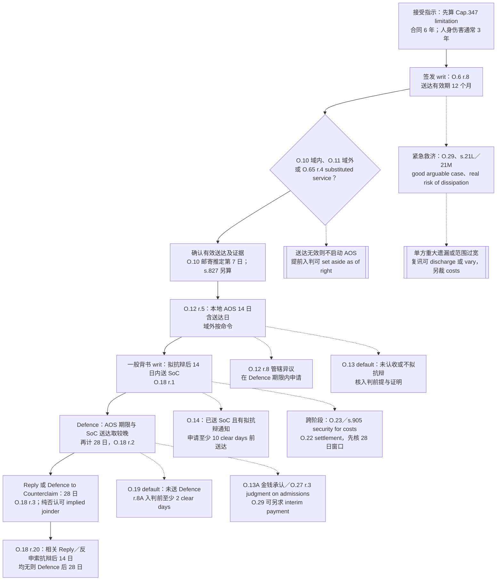
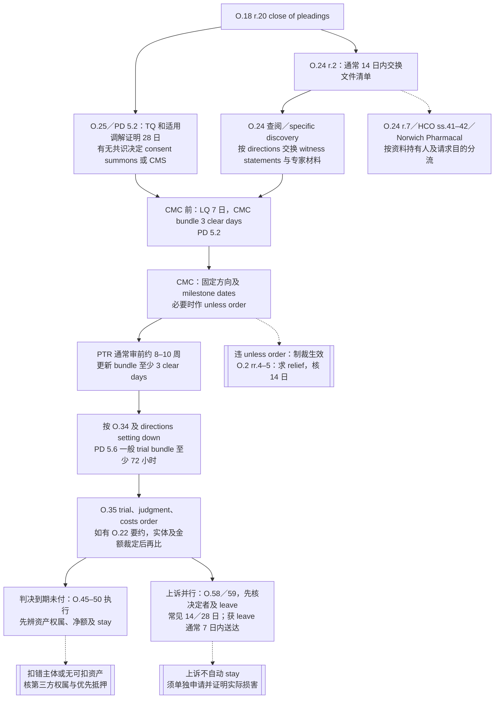

> [!note] 宏观总控与全景时钟定位（Master Layer）
> 本文档属于 **全景总括与全案工具层（Master Layer）**，从「第一性原理、工程控制论、全流程图谱与法定程序时钟」对民事诉讼进行跨专题顶层统摄，与下方的 **[制度凝结层（Institutions 单卡）](/pcll-litigation-cards/institutions/co01-taking-instructions/)** 构成【总括 ↔ 分论】与【全局时钟 ↔ 专题实操】的映射关系。
> 如需深入查阅某一具体阶段（如 O.10 送达、O.18 诉答、O.14 简易判决、O.24 披露、O.29 禁令等）的深度实体规则与实务攻防，请直接跳转至对应制度凝结卡。

## Civil Litigation｜全科总览与程序图

| 要解决的问题 | 直达 |
| --- | --- |
| 算日期、找判例 | [期限与判例矩阵](/pcll-litigation-cards/master/co00-deadlines-case-matrix/) |
| 按题眼选程序、查 SG 或真题 | [考试与 SG 路由](/pcll-litigation-cards/master/co00-exam-sg-router/) |

## 1. 十三张主卡的三个维度

| 维度与阶段 | 卡号 | 触发时点 | 核心功能 | 交付物 |
| --- | --- | --- | --- | --- |
| 主干 1 诉前 | [CO01](/pcll-litigation-cards/institutions/co01-taking-instructions/) | 收到委托、发现损失或临近时效 | 核当事人、诉因、管辖、limitation 和通知要求 | 取指示记录、时间表、LBA 或保护性 writ |
| 主干 2 启动与送达 | [CO03](/pcll-litigation-cards/institutions/co03-service-and-aos/) | 确定 writ／OS 后 | 选择域内、域外或 substituted service；固定送达日与 AOS 时钟 | 盖印起诉文件、送达命令或证据、Form 14 |
| 主干 3 认收与诉答 | [CO04-05-10](/pcll-litigation-cards/institutions/co04-05-10-pleadings/) | 被告认收或表示拟抗辩 | 界定 material facts、反申索、set-off、第三方与修改 | SoC、Defence／Counterclaim、Reply、TPN 或修订稿 |
| 主干 4 证据准备 | [CO08](/pcll-litigation-cards/institutions/co08-evidence-preparation/) | 诉答界定争点后；特定披露可独立发生 | 披露和查阅、privilege、事实证人、专家及第三方取证 | List of Documents、witness statements、expert directions |
| 主干 5 案管与正审 | [CO11](/pcll-litigation-cards/institutions/co11-case-management/) | close of pleadings 后；有方向须遵守 | TQ、CMS、CMC、PTR 及 trial bundle；管理延期与制裁 | 已同意时表或 directions、PTR 文件册、审讯档案 |
| 主干 6 执行 | CO18 | 判决可执行且未获履行 | 按债务人与资产类型选择调查、扣押、押记或出售 | 判决余额表、writ、garnishee 或 charging order |
| 主干 7 上诉 | CO19 | 有可指明的可上诉错误；判决后与执行并行 | 核决定者、leave、期限、grounds 和 stay | Leave summons、notice of appeal、bundle 和独立 stay 请求 |
| 插入 1 审前取判或预付 | [CO06-09](/pcll-litigation-cards/institutions/co06-09-pre-trial-judgments/) | 被告违约、无实质抗辩、已有承认或急需预付 | O.13／19 default judgment、O.14、O.13A、O.27 及 O.29 interim payment | 入判请求、核实誓章、临付命令或撤销申请 |
| 插入 2 紧急保全 | [CO13](/pcll-litigation-cards/institutions/co13-interim-relief/) | 资产耗散、正在发生侵害、证据可能被毁 | Injunction、Mareva、proprietary injunction、search order、fortification | 支持誓章、skeleton、draft order、undertakings、return date |
| 插入 2 费用保障 | [CO07](/pcll-litigation-cards/institutions/co07-summonses-and-orders/) | 胜诉后有实际讼费回收风险 | O.23／Cap.622 s.905 security for costs | Summons、财力证据、担保形式与分期建议 |
| 插入 3 和解及退出 | CO14 | 可比较的让步或需终止部分争议 | O.22、Calderbank、O.21、consent／Tomlin order | Offer／payment notice、接纳通知、附表或撤诉通知 |
| 底座 1 传票及命令 | [CO07](/pcll-litigation-cards/institutions/co07-summonses-and-orders/) | 当事人请求方向、救济或同意令 | 核权限、notice、起草、入禀、盖印与送达 | Summons、draft order、sealed order |
| 底座 2 誓章及证物 | CO16 | 须以书面宣誓材料举证 | 核 deponent、sources and grounds、jurat、exhibits | 可提交的 affidavit／affirmation 与证物册 |
| 底座 3 讼费 | CO17 | 中间裁定、终局费用或议定失败 | 成本归属、basis、summary assessment、taxation 和非当事人费用 | Costs order、statement of costs、bill、allocatur |

## 2. 全流程状态机

### 2.1 诉前、送达、诉答与审前拦截

### 2.2 证据、案管、正审、执行及上诉

## 3. 四组横向参数对比

### 3.1 审前取判与剔除

| 制度 | 适用前提 | 申请时点与通知要求 | 法定证明门槛 | 核心抗辩或失败后果 | 对应卡号 |
| --- | --- | --- | --- | --- | --- |
| O.13／19 Default Judgment | 被告未认收、不拟抗辩或未送 Defence；须按索赔类型选入判形式 | 核 AOS 或 Defence 期届满；O.19 r.8A 先送书面意向通知，至少 2 clear days | 核有效送达、案卷状态及规则允许的救济 | 若送达或入判步骤失效，则可按 irregular DJ 申请撤销；损害未算定须评定 | [CO03](/pcll-litigation-cards/institutions/co03-service-and-aos/) [CO06-09](/pcll-litigation-cards/institutions/co06-09-pre-trial-judgments/) |
| O.14 Summary Judgment | 已送达 SoC；被告已给拟抗辩通知；非排除类别 | Return day 前至少 10 clear days 送 summons、verifying affidavit 及支持材料 | 原告先建立 prima facie case；被告须指出 triable issue 或其他应审讯理由 <small style="opacity: 0.55">〔RHC14 L33 "not less than 10 clear days before the return day"〕</small> | 若需评断重大事实或可信性，则不能作 mini-trial；按证据强弱无条件或附条件给 leave to defend | [CO06-09](/pcll-litigation-cards/institutions/co06-09-pre-trial-judgments/) |
| O.27 r.3 Judgment on Admissions | 对方在 pleadings 或其他材料中承认决定性事实 | 可在案件任何阶段申请；按 summons 的一般或个案通知方向 | 承认须足以支持拟判救济；法院可无需等待余下问题决定而给适当命令 <small style="opacity: 0.55">〔RHC27 L25 "without waiting for the determination of any other question"〕</small> | 若承认有条件或不明确，则不据此取判；纯金钱申索的表格承认及分期另走 O.13A | [CO06-09](/pcll-litigation-cards/institutions/co06-09-pre-trial-judgments/) [CO04-05-10](/pcll-litigation-cards/institutions/co04-05-10-pleadings/) |
| O.18 r.19／固有管辖 Striking Out | 诉状或程序本身存在规则所列缺陷或 abuse of process | 可申请或由法院主动处理；先核 PD 19.1；用 r.19(1)(a) 时不得引外部证据 | 无合理诉因或抗辩、scandalous／frivolous／vexatious、妨碍公平审讯，或 abuse；须属 plain and obvious <small style="opacity: 0.55">〔RHC18 L238 "at any stage of the proceedings order to be struck out"〕</small> | 若缺陷可有效修订，则先评估 amendment；不能替代对事实争议的正常审讯 | [CO04-05-10](/pcll-litigation-cards/institutions/co04-05-10-pleadings/) |

### 3.2 金钱、资产及费用保障

| 制度 | 适用前提 | 申请时点与通知要求 | 法定证明门槛 | 核心抗辩或失败后果 | 对应卡号 |
| --- | --- | --- | --- | --- | --- |
| O.29 Interim Payment | 原告求终局损害赔偿或其他金额前的部分预付 | 在适用的 AOS 期届满后发 summons；return day 前至少 10 clear days 送达 | 依 rr.11–12 核承认、责任判决或会获实质金额判决等入口；人身伤害另有被告类别限制 <small style="opacity: 0.55">〔RHC29 L112 "not less than 10 clear days before the return day"〕</small> | 若付款超出合理比例或未扣 counterclaim／set-off，则调减或拒批；保持与正审隔离 | [CO06-09](/pcll-litigation-cards/institutions/co06-09-pre-trial-judgments/) |
| Mareva injunction | 保全日后判决可供执行的资产 | 视紧急性选择 inter partes／ex parte on notice／without notice；单方须备 return date | good arguable case、资产连接、real risk of dissipation、balance of convenience；核 undertaking | 若只有欠款或资金可移动，则不足；Chabra 另证第三方资产可用来清偿主被告判决 | [CO13](/pcll-litigation-cards/institutions/co13-interim-relief/) CO16 |
| Proprietary injunction | 原告主张对特定资产有所有权或可追踪权益 | 依 O.29 与实际紧急性申请；按拟令范围送达 | 证明有可审 proprietary claim 及资产连接；查 adequacy of damages 和 balance of convenience | 若只能证明普通债权，则不能把被告的一般资产当作诉争物 | [CO13](/pcll-litigation-cards/institutions/co13-interim-relief/) |
| Security for Costs | 被告有 O.23 gateway，或按 Cap.622 s.905 证明公司原告可能无力付费 | 尽早 inter partes；金额、方式及期间按命令 | 先证 gateway；再看 just、stifling、迟延、金额及可执行性 | 若令将扼杀真实申索，原告须用可用资金及实际融资证据；命令不当然等于替被告追偿债款 | [CO07](/pcll-litigation-cards/institutions/co07-summonses-and-orders/) |
| Fortification | 被告担心申请人不能兑现 undertaking as to damages | 可在 return date 或后续申请补强 | 须有禁令导致可估算实质损失的证据，并证明承诺有实际不能兑现的风险 | 若只有营业额或抽象风险，则不足；以净损失、期间及因果支持数额 | [CO13](/pcll-litigation-cards/institutions/co13-interim-relief/) |

### 3.3 获取资料与保存证据

| 制度 | 适用前提 | 申请时点与通知要求 | 法定证明门槛 | 核心抗辩或失败后果 | 对应卡号 |
| --- | --- | --- | --- | --- | --- |
| O.24 一般／特定披露 | 当事人持有、保管或有权取得与 pleaded issues 相关文件 | 通常 close 后 14 日交换；特定披露用 summons 及支持证据 | Peruvian Guano 的相关性受公平处理／节省成本与相称性限制；须说明类别和控制权 | 若请求宽泛或涉及 LPP，则缩窄、列明特权；查看文件不等于获准外用 | [CO08](/pcll-litigation-cards/institutions/co08-evidence-preparation/) |
| Norwich Pharmacal | 第三方参与或便利不当行为，掌握识别或起诉所需资料 | 按原诉或申请程序送第三方；急迫且有依据才不通知 | 有可争辩不当行为、第三方卷入、资料必要、无实际替代及比例 | 若对方只是普通证人或资料已有更简便取得方式，则法院可拒绝；核合规费用 | [CO08](/pcll-litigation-cards/institutions/co08-evidence-preparation/) |
| O.29 r.2 preservation／inspection | 特定财产为诉争标的或与争点有关 | 申请明确物件、地点、检视人员及期限；按命令通知 | 保存或检视须与争点及公平审理需要相称 | 若要求无边界取走资料或进入未指明第三方场所，则须缩窄或另用适当程序 | [CO13](/pcll-litigation-cards/institutions/co13-interim-relief/) [CO08](/pcll-litigation-cards/institutions/co08-evidence-preparation/) |
| Anton Piller search order | 有关键侵权或不当行为证据，且真有销毁危险 | 常 without notice；须完整披露、标准保障、supervising solicitor 与 return date | strong prima facie case（旧案 phrasing：extremely strong）、very serious damage、明确有资料及 real possibility of destruction | 不可强行进入；保留 LPP、自证其罪保护及 listed items 的边界 | [CO13](/pcll-litigation-cards/institutions/co13-interim-relief/) CO16 |

### 3.4 撤销、宽免、上诉和暂缓

| 制度 | 适用前提 | 申请时点与通知要求 | 法定证明门槛 | 核心抗辩或失败后果 | 对应卡号 |
| --- | --- | --- | --- | --- | --- |
| Irregular DJ／Regular DJ | 先核送达、期限、入判依据；再分是否合规 | 尽快发 summons 及誓章；执行在途另求 stay | Irregular：set aside as of right；Regular：real prospect of success，兼看迟延及解释 | 若当事人只称未看到令状，则仍须证明送达瑕疵；若合规则须交有实质的 Defence | [CO06-09](/pcll-litigation-cards/institutions/co06-09-pre-trial-judgments/) [CO03](/pcll-litigation-cards/institutions/co03-service-and-aos/) |
| Ex parte injunction discharge | 单方命令在行，或申请人有 material non-disclosure／条件变化 | O.32 r.6 或命令保留的 discharge／variation 路径；立即排 return date | 说明遗漏对当时决定的重要性或救济条件何以不再满足 | 若复讯维持或重批，则仍可能就原遗漏另裁 costs；不得先自行违令 | [CO13](/pcll-litigation-cards/institutions/co13-interim-relief/) |
| Unless order relief | 命令设条件制裁且已违令 | O.2 rr.4–5：从违约日起核 14 日；迅速发 summons 与证据 | 法院按规则列项审查原因、及时性、补救、审期及双方损害 | 若仅完成迟交动作，则不能恢复已失权利；若尚未违令，先求有效延期 | [CO11](/pcll-litigation-cards/institutions/co11-case-management/) |
| Civil appeal／stay | 先分 Master／Judge、CFI／DC、final／interlocutory | 先核 O.58／59 的 issue、service、leave 期限；另发 stay 请求 | Leave：reasonable prospect of success 或 interests of justice；stay 须说明执行对上诉的实际影响 | 若只不同意事实判断或仅已提交上诉，则不能替代 appealable error 或 stay order | CO19 CO18 |

| 法源与复查 | 直达 |
| --- | --- |
| 程序原文 | [《高等法院规则》](https://www.elegislation.gov.hk/hk/cap4A) · [《区域法院规则》](https://www.elegislation.gov.hk/hk/cap336H) · [O.27 原文](https://www.civiljustice.hk/gaz_sub_leg/documents/rhc/RHC_Order_27.pdf) |
| 实际日期算法 | [逐行时限表](/pcll-litigation-cards/master/co00-deadlines-case-matrix/) |

<!-- BEGIN:cite-legend -->
> [!info]- 来源图例：主卡及其出处映射
>
> | 码 | 文件 | 层级 | 学年 |
> | --- | --- | --- | --- |
> | CO19 | CO19 | 凝结层 | 2026-27 |
> | CO13 | [CO13](/pcll-litigation-cards/institutions/co13-interim-relief/) | 凝结层 | 2026-27 |
> | CO11 | [CO11](/pcll-litigation-cards/institutions/co11-case-management/) | 凝结层 | 2026-27 |
> | CO01 | [CO01](/pcll-litigation-cards/institutions/co01-taking-instructions/) | 凝结层 | 2026-27 |
> | CO04-05-10 | [CO04-05-10](/pcll-litigation-cards/institutions/co04-05-10-pleadings/) | 凝结层 | 2026-27 |
> | CO03 | [CO03](/pcll-litigation-cards/institutions/co03-service-and-aos/) | 凝结层 | 2026-27 |
> | CO14 | CO14 | 凝结层 | 2026-27 |
> | CO08 | [CO08](/pcll-litigation-cards/institutions/co08-evidence-preparation/) | 凝结层 | 2026-27 |
> | CO06-09 | [CO06-09](/pcll-litigation-cards/institutions/co06-09-pre-trial-judgments/) | 凝结层 | 2026-27 |
> | CO07 | [CO07](/pcll-litigation-cards/institutions/co07-summonses-and-orders/) | 凝结层 | 2026-27 |
> | CO16 | CO16 | 凝结层 | 2026-27 |
> | CO18 | CO18 | 凝结层 | 2026-27 |
> | CO17 | CO17 | 凝结层 | 2026-27 |
> | RHC27 | RHC O27 | 库外法源 | 2026-27 |
> | RHC29 | RHC O29 | 库外法源 | 2026-27 |
> | RHC14 | RHC O14 | 库外法源 | 2026-27 |
> | RHC18 | RHC O18 | 库外法源 | 2026-27 |
<!-- END:cite-legend -->
