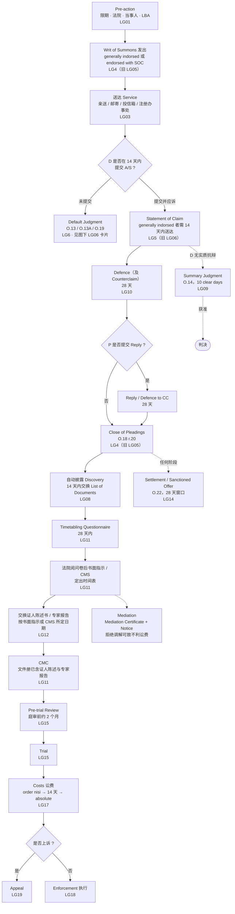
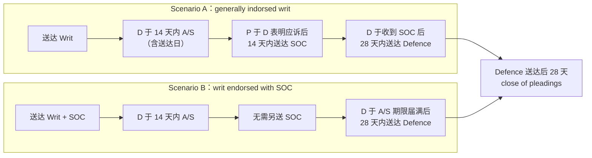
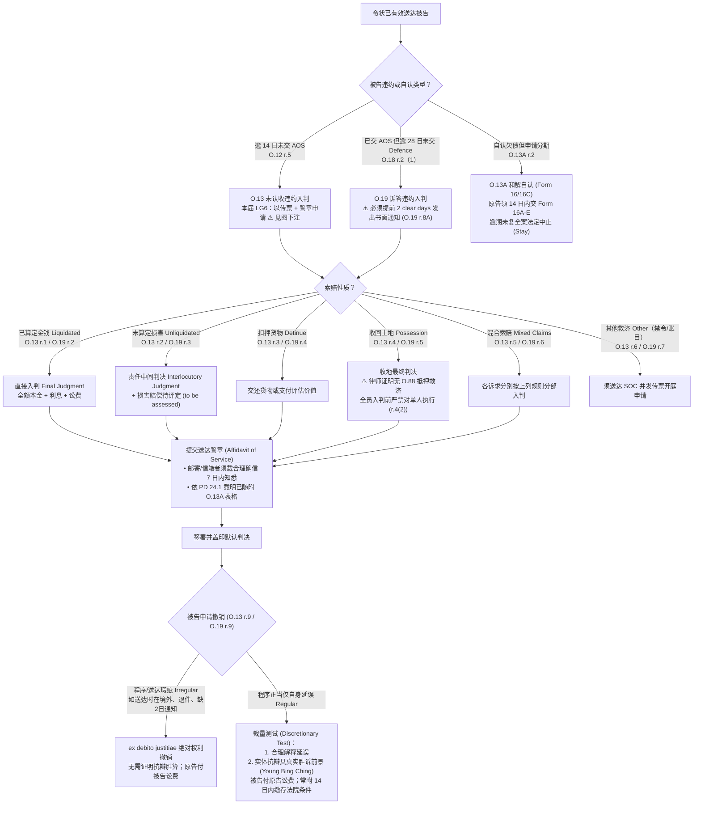
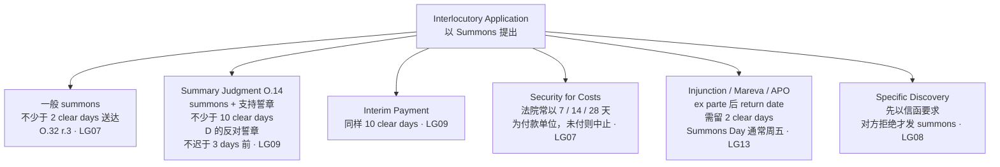
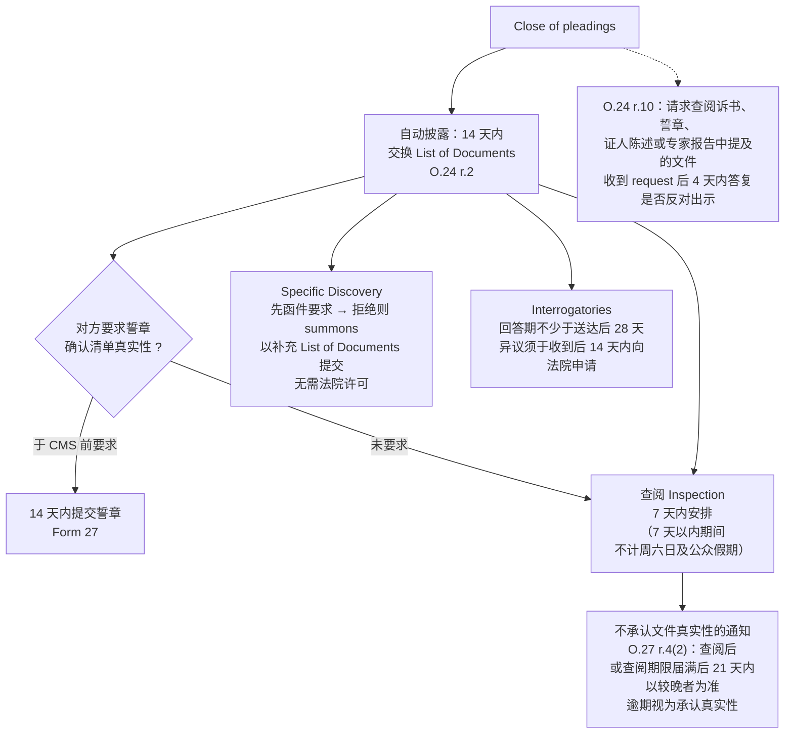
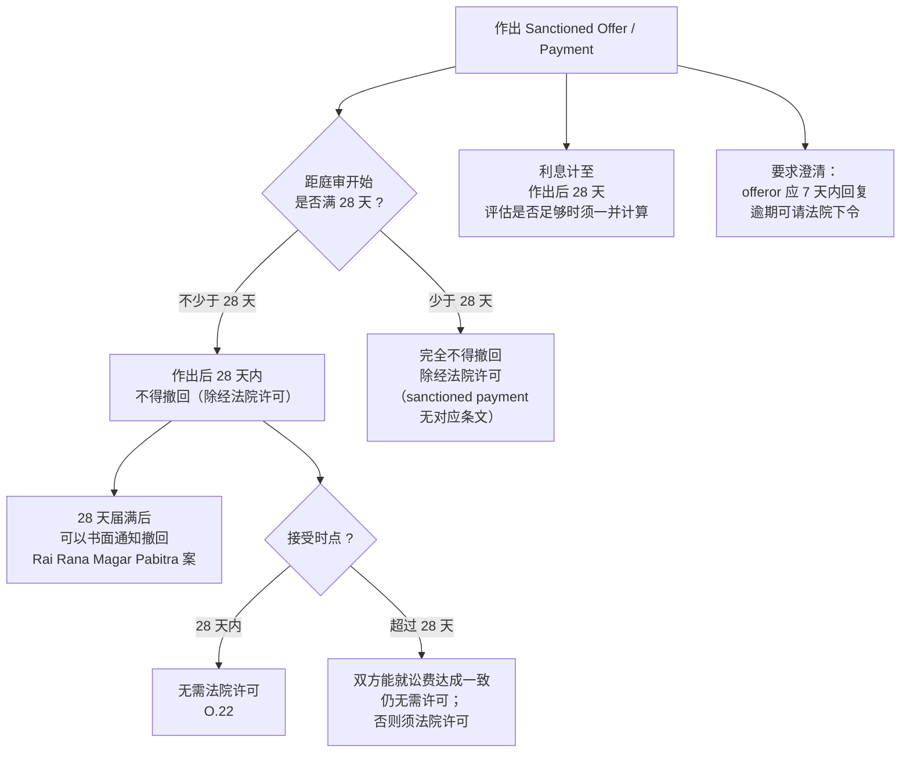
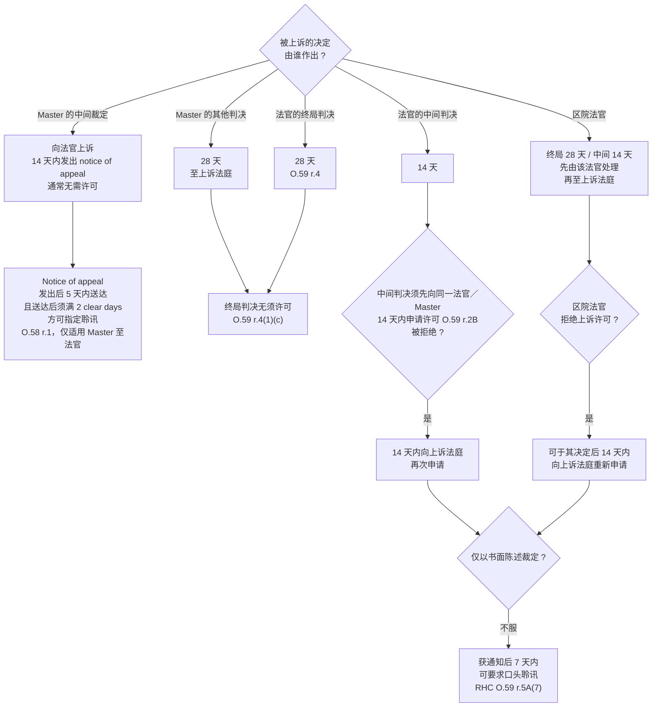
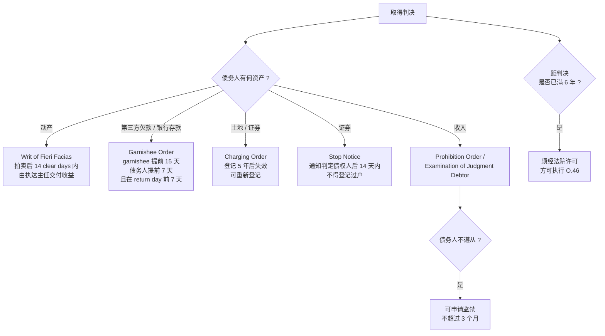

> [!note] 宏观总控与全景时钟定位（Master Layer）
> 本文档属于 **全景总括与全案工具层（Master Layer）**，从「第一性原理、工程控制论、全流程图谱与法定程序时钟」对民事诉讼进行跨专题顶层统摄，与下方的 **[制度凝结层（Institutions 单卡）](/pcll-litigation-cards/institutions/co01-taking-instructions/)** 构成【总括 ↔ 分论】与【全局时钟 ↔ 专题实操】的映射关系。
> 如需深入查阅某一具体阶段（如 O.10 送达、O.18 诉答、O.14 简易判决、O.24 披露、O.29 禁令等）的深度实体规则与实务攻防，请直接跳转至对应制度凝结卡。

## 民事诉讼程序流程图 · Procedural Flowcharts

> **2026-10-28 SG06准备完成**：本届四题16问与双时间轴 · Question 1完整答案 · Question 2完整答案 · Question 3完整答案 · Question 4完整答案。29Oct19–21，Gp77／CCT623／TC；学习稿状态，导师反馈及具体调查未决见SG。 〔AP L41 "answers to the 4 questions below"〕

> **2026-10-23主述更新**：本页旧日期表／题库及比较保留原资料身份；完整制度以[当前15张主卡](../README.md#%E5%BD%93%E5%89%8D%E4%B8%BB%E5%8D%A1%E6%80%BB%E8%A1%A8%EF%BC%882026-10-29%EF%BC%89)为准，材料状态查[当前进度](../_meta/Current%20Progress%20and%20Material%20Uptake.md)。新增[CO10](/pcll-litigation-cards/institutions/co04-05-10-pleadings/)、[CO14](/pcll-litigation-cards/institutions/co01-taking-instructions/)、[CO16–19](../README.md#%E5%BD%93%E5%89%8D%E4%B8%BB%E5%8D%A1%E6%80%BB%E8%A1%A8%EF%BC%882026-10-29%EF%BC%89)，不再沿用“缺卡”状态；具体时限不要离开条件摘用。

> 骨架取自课程官方材料 `[SG01]/00 Official/SG1 AP_Appendix A_Lifecycle of a Case.pdf`（12 步）与
> `[LG05]/Stages of Writ Action.pdf`，天数与条文出自各 LG 讲义正文。
> 天数逐一核对见 [01 Deadlines and Time Limits.md](/pcll-litigation-cards/master/co00-deadlines-and-time-limits/)。
> 在 VS Code / Obsidian / GitHub 里可直接渲染 Mermaid。

---

## 一、主干：Writ Action 全流程

默认判决制度卡：[CO06 默认判决与自认](/pcll-litigation-cards/institutions/co06-09-pre-trial-judgments/)。图中 `LGx` = 本届编号，`旧 LG0x` = 04 旧库文件夹编号，对照表见 Structure Map。

---

## 二、Pleadings 阶段的两种情形

课程反复考的分野：Writ 是 **generally indorsed**（仅概述请求）还是 **endorsed with SOC**（已附索赔陈述）。
下表出自 `LG05 Lecture Outline` 的对照表（旧库 [LG05]；本届对应 LG4 - Pleadings 讲义末的 Scenario A/B 对照表）。

**易错点**：Scenario B 的 28 天从「A/S 期限届满」起算，不是从收到 Defence 请求起算；
两种情形若无 Reply，均为 Defence 送达后 28 天 close of pleadings（O.18 r.20）。

---

## 三、默认判决、自认与撤销（O.13 / O.13A / O.19）— 详见 [LG06 制度卡片](/pcll-litigation-cards/institutions/co06-09-pre-trial-judgments/)

⚠️ 入判方式：原稿此处写"（无需开庭，登记处行政盖印）"；本届 LG6 讲义 Application Procedure 明写 "By summons + affidavit"（O.13 r.7 誓章证明送达）。已按讲义改；实务做法是否另有行政入判，待用户确认。

`O.13A` 自认制度的核心控制阀：原告在收到自认后 **14 日内** 必须以 Form 16A/B/D/E 回复，逾期未回复全案**自动法定中止（Stay of action）**。若被告获准分期偿付但拖欠一期，依 r.9(8) 暂缓执行立即失效，原告可全额执行。

---

## 四、Interlocutory 阶段：常见申请的时限

**Order 起草的连带时限**（LG07）：命令须由申请方拟稿，宣布后**7 天内**未拟出，
他方可代为拟稿；草稿应尽快、无论如何不迟于宣布后 7 天提交批准。

---

## 五、Discovery 阶段

---

## 六、Sanctioned Offer / Payment（O.22）

这是全科最容易在天数上失分的一块，28 天在此有三层不同含义。本图全按 LG14 所引 O.22 的 28 日绘制。⚠️ LG17 另有一处"14 日"，见于 **O.62A 讼费评定要约**语境（LG17:138、162），可能属两套制度而非同一制度内的冲突，**未决、待用户确认**，详见 [01 时限表](/pcll-litigation-cards/master/co00-deadlines-and-time-limits/) I 节。

---

## 七、Appeals（LG19）

出处与适用界线（依 LG19）：14 天内向同一法官／Master 申请许可、被拒后 14 天内向上诉法庭再申请＝O.59 r.2B（LG19:416–438）；终局判决（Master 或法官作出）上诉至上诉法庭**无须许可**、28 天＝O.59 r.4(1)(c)（LG19:468）；"发出后 5 天内送达、送达后满 2 clear days 方可聆讯"＝O.58 r.1，仅适用 Master → 法官一支（LG19:102–108）。⚠️ 上图中"仅以书面陈述裁定 → 7 天内要求口头聆讯"一节，库内 LG19 只在**高院** RHC O.59 r.5A(7) 项下明载（LG19:370）；区院一支（向上诉法庭重新申请后）接至此节点系按同一实务类推，库内**无区院对应条文明文**，作答时宜只写高院依据。另：C 支（Master 的其他判决 → 上诉法庭，28 天）的 28 天期限出自 O.58 r.2 所引条文（LG19:242），"无须许可"则依 O.59 r.4(1)(c) 就**终局判决**而发（:468）——若该 Master 判决属中间性质，仍须先按 O.59 r.2B 取许可。

---

## 八、Enforcement（LG18）

---

## 九、把流程图和课程进度对起来

前五周（8/31–10/3）在上的是主干的**前半段**（本届编号，依 Course Outline 第 5–6 页）：LG1A/1B 引论与接案/LBA（9/4）、LG2 会见客户（9/7）、
LG3 送达（9/8）、LG4 Pleadings（9/9）、LG5 SoC 起草（9/14）、LG6 default judgment（9/21）、LG7 summonses 与讼费担保（9/22）、
LG8 discovery（9/29）、LG9 summary judgment（9/30）。也就是上图一里从 `Pre-action` 到 `Discovery` 这一段。（旧库文件夹编号在 LG4–LG6 错位：本届 LG4 = 旧 [LG05]，LG5 = 旧 [LG06]，LG6 = 旧 [LG04]。）

对应的小组课是 SG01（LBA）、SG02（会见客户，9/17–18 全天实操）。
`LG10` 之后的抗辩书、案件管理、证人陈述、庭审、讼费、执行、上诉属后续周次。

---

## 修订记录

- 2026-09-27 复审修订（依据 PCLL Audit 2026-09-27 附录 D）：图一证人陈述与 CMC 顺序改正（书面指示 / CMS 定时间表 → 交换证人陈述与专家报告 → CMC → PTR），删去"按 CMC 指示"；节点 E 内嵌的 Markdown 链接移到图下；节点 B/F/J 旧库编号改写为本届编号并注旧号；§三 连线标签中的半角括号改为全角或删去，O.13 节点删去"（无需开庭，登记处行政盖印）"改依本届 LG6 讲义"传票 + 誓章"并加 ⚠️ 待用户确认；§五 "Notice to produce at trial"改为 O.27 r.4(2) 不承认真实性通知，"4 天内答复"从质问书下移出、改挂 O.24 r.10；§七 上诉图："5 天内送达、2 clear days"只挂 Master→法官一支，终局判决改挂"无须许可"，"拒绝许可"改挂法官中间判决（O.59 r.2B），区院续行申请接入书面裁定复核；§八 停止通知改为"通知判定债权人后 14 天内不得过户"；§九 改用本届 LG 编号与日期。

## 复审修订记录

- 2026-09-28 复审修订（依据 PCLL Audit 2026-09-27 附录 D 第 3、4、5、6、15、18、20 项；本轮接管中断会话，先逐条回本届／往届原件复核上一会话已改内容，确认无误者不重做、不回退，仅补其未尽处）：
  - **复核通过（未改动）**：图一 `法院阅问卷后书面指示 / CMS → 交换证人陈述书与专家报告 → CMC → PTR → Trial` 依 LG11 大纲 :192–194、:204（CMC 文件册须含 pleadings、witness statements、expert reports）与 :155（问卷拟议指示"exchange witness statement within 56 days from the order"）成立；§五 F 节点（O.27 r.4(2) 不承认真实性通知：查阅后或查阅期限届满后 21 天，以较晚者为准）与 I 节点（O.24 r.10 查阅诉书／誓章／证人陈述／专家报告中提及的文件，4 天内答复是否反对）逐字回本届 LG8 Discovery 大纲第 23、24 段核实；§八 F 节点依 LG18 Outline :817；§三 O.13 入判方式改依本届 LG6 讲义 :323–325"Application Procedure / By summons + affidavit"，原稿"登记处行政盖印"之说保留在图下 ⚠️ 注中待用户裁决；§九 与本届编号映射（本届 LG4=旧 [LG05]、LG5=旧 [LG06]、LG6=旧 [LG04]，LG7 起同号）依 Course Outline 与 `04 Base Lectures/` 讲义夹实名核实。
  - **本轮新增 1（§六）**：补一句 O.22 未决提示并列明 LG17 的"14 日"出自 **O.62A 讼费评定要约**（LG17:138、162），指向时限表 I 节，**不裁决冲突**——使三张卡对 O.22 的表述一致（本图仍按 LG14 的 28 日绘制）。
  - **本轮新增 2（§七）**：给"7 天内要求口头聆讯"节点补出处 **RHC O.59 r.5A(7)**，并在图下注明该条库内只在高院项下明载（LG19:370、:438），区院一支接此节点系实务类推、库内无区院对应明文；同时列明 O.59 r.2B（LG19:416–438）、O.59 r.4(1)(c)（:468）、O.58 r.1（:102–108）三项接线依据。上一会话新增的 `区院重新申请 → 书面裁定复核` 一条边属未经库内条文支撑的推论，故以注释标明而非删去。
  - **链接卫生**：全文 5 条链接均为相对路径 md 链接（含 §三 大标题内既有的一条），无裸 `[[wikilink]]`、不链文件夹、链接文字无方括号、`空格()`均已百分号编码；对外不使用锚点。`check_one.py`：5 links / 0 non-ok。
  - **Mermaid 复核**：8 张图节点文字均加双引号，`-->|…|` 连线标签内已无半角括号，全文无 LaTeX 箭头写法，辐射图（§二）用 `flowchart LR`。
  - **标题未改**：本文现有 `##` 标题（含 §三 带链接的标题）一字未动，仅**新增**本小节标题。

## 2026-10-06 实质内容入口

本轮在以下主题稿的0A节新增具体规则、条件、证据、程序选择、后果和演练示例。此页原有正文及引注保留；同一细节从下列入口阅读，避免另复制一份。

- [0A. 从客户叙述到可采取行动的案情](/pcll-litigation-cards/institutions/co01-taking-instructions/)（2026-10-10：该 0A 节已随 [LG01-02] Supplement 并入 [LG01] 主卡，链接改指主卡）
- [0A. 从事实到诉状：逐项选择、起草和补救（已并入主卡）](/pcll-litigation-cards/institutions/co04-05-10-pleadings/)
- [0A. 证据取得、保护及进入审讯的完整路径](/pcll-litigation-cards/institutions/co08-evidence-preparation/)
- [0A. 审前取得什么判决：准入、证明与补救](/pcll-litigation-cards/institutions/co06-09-pre-trial-judgments/)
- [🗺️ 本卡地图](/pcll-litigation-cards/institutions/co13-interim-relief/)
- [0A. 从管理命令到可开审案件：时限、补救和庭审准备](/pcll-litigation-cards/institutions/co11-case-management/)

**留痕**：2026-10-06新增本入口；未将导航页/清单改造成另一份重复主题稿。

<!-- BEGIN:cite-legend -->
> [!info]- 引注图例：码 → 具体来源 → 身份／届别
>
> | 码 | 文件 | 层级 | 学年 |
> |---|---|---|---|
> | AP | 1. SG6 (Civil Procedure 1) | 本届官方 | 2026-27 |
<!-- END:cite-legend -->
